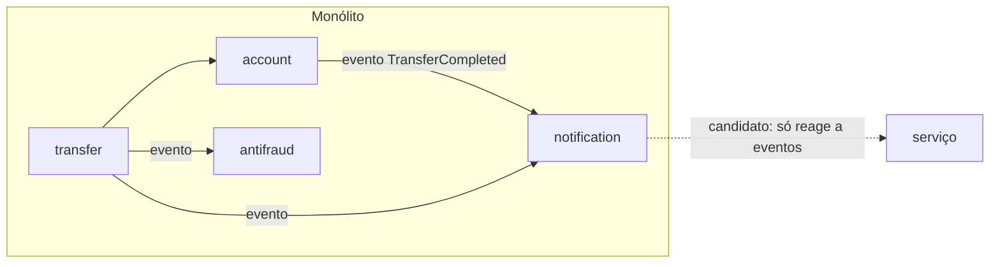

# P5.02 — Decomposição por domínio

> ⏱️ ~1h30 · 🔵 Pleno · Pré-requisitos: P5.01, P4.08 (mapa de contextos), P4.09–P4.11 (módulos, um dono por tabela), P3.07 (idempotência de consumidor), P3.09 (Outbox)

> ✅ **Validação final (2026-11-24):** módulo executado no PayFlow reconstruído; resultado e o que continua não executado no [README do módulo](README.md). Os avisos "não executado" / "por leitura" abaixo descrevem a escrita original.

> ⚠️ **Verificação:** aula **de desenho**: **nada executado**. A mecânica do **corte** (módulo que consome eventos, com portas e dono dos dados) já foi executada na P4 (`lab/architecture-lab`) e na P3 (`lab/messaging-lab`). A **extração real** do `notification` do PayFlow é **por leitura**. O procedimento em 7 passos é **proposta do treinamento**, não receita de fornecedor.

## 🎯 Objetivos
Ao final desta aula você consegue:
- **Derivar** candidatos a serviço a partir de **bounded contexts**, não de tabelas.
- **Aplicar** critérios de fronteira (coesão, acoplamento, dono dos dados, ritmo de mudança, falha).
- **Explicar** "**banco por serviço**" e o que se perde (`JOIN`, ACID) e o que se ganha.
- **Reconhecer** anti-padrões: serviço-entidade, **nano**serviço, banco compartilhado.
- **Executar no papel** a extração do `notification` pelo método do **estrangulamento** (*strangler fig*).

## 🤔 Por que isso importa
Onde **cortar** decide se você terá **autonomia** ou **dor**. Cortes por **camada técnica** ("serviço de banco", "serviço de e-mail genérico") ou por **tabela** produzem serviços que **precisam falar o tempo todo**. Cortes por **capacidade de negócio** tendem a ser **estáveis**: mudam por razões **diferentes**. Você já fez 80% do trabalho na P4.08: os contextos e o mapa de relações **são** o mapa de cortes possíveis.

## 💡 Intuição (explicação simples)
Dividir uma empresa em **departamentos**: ninguém separa "os que usam o grampeador" de "os que usam o telefone" (corte por **ferramenta**); separa-se **Vendas**, **Financeiro**, **Suporte** (corte por **função de negócio**), cada um com **seus arquivos** e **suas regras**. O **Financeiro** não abre a gaveta de Vendas: **pede** um relatório, ou recebe um **aviso** ("pedido fechado").

## 🔬 Como funciona por dentro

### 1. Do contexto ao serviço
Um **bounded context** é **candidato** a serviço; **não é obrigado**. Passe por este filtro:

| Critério | Pergunta | Bom sinal |
|---|---|---|
| **Coesão** | as partes mudam **juntas**? | mudam pela **mesma razão** |
| **Acoplamento** | quantas chamadas **síncronas** entram e saem? | poucas; o resto é **evento** |
| **Dono dos dados** | só este contexto lê/escreve a tabela? (P4.11) | **sim**, verificado |
| **Ritmo de mudança** | muda em ritmo **diferente** dos vizinhos? | sim |
| **Falha** | o resto vive sem ele por minutos? | sim, com degradação **combinada** |
| **Time** | existe um time (ou pessoa) **dono**? | sim |



### 2. Banco por serviço (e a conta que ele cobra)
Regra do módulo: **cada serviço é dono dos seus dados**; **ninguém** mais acessa as tabelas dele (extensão **física** da regra "um dono por tabela" da P4.11).

| Você perde | Como se compensa |
|---|---|
| `JOIN` entre contextos | **API em lote**, **evento com o dado** ou **cópia própria** (P4.11) |
| Transação ACID entre serviços | consistência **eventual**, **Outbox** (P3.09), **saga** (S1) |
| Relatório "que junta tudo" | **réplica/CDC** para um modelo de leitura (S3), não consultas cruzadas |
| Migração única de esquema | **uma migração por serviço** e compatibilidade de contrato (P5.04) |

O que se **ganha**: o serviço **evolui seu esquema** sem coordenar com os outros e **escala/isola** o armazenamento que lhe convém.

### 3. Anti-padrões de decomposição
| Anti-padrão | Sintoma | Correção |
|---|---|---|
| **Serviço-entidade** (`UserService`, `AccountService`) | tela exige 5 chamadas | corte por **capacidade** (contexto), não por substantivo |
| **Nanosserviço** | serviços de 200 linhas que só se chamam entre si | **funda** de volta (módulo) |
| **Banco compartilhado** | dois serviços escrevem a mesma tabela | **dono único** + evento/API |
| **Serviço "utilitário" central** (`CommonService`) | todos dependem de um | **biblioteca** versionada ou duplicação **consciente** |
| **Corte por camada** (front/negócio/dados) | toda mudança toca 3 serviços | corte **vertical** (fatia completa) |

### 4. Extração pelo **estrangulamento** (*strangler fig*) em 7 passos
Em vez de reescrever, **cresça ao lado** do módulo e **desligue** o antigo quando o novo estiver provado.

1. **Pré-condição:** o módulo tem **API pública**, **dono dos dados** e `verify()`/ArchUnit **verdes** (P4.09/P4.10). Sem isso, **não comece**.
2. **Contrato primeiro:** escreva os **contratos** (eventos que ele consome; API que ele expõe; [P5.04](P5.04-eventos-e-compatibilidade-de-apis-e-de-schemas.md) e [P5.09](P5.09-testes-de-contrato-spring-cloud-contract-ou-pact.md)).
3. **Esqueleto do serviço:** projeto Spring Boot, **banco/schema próprio**, migrações **próprias** (`V1…` num histórico **novo**), CI e imagem próprios (J9, J10).
4. **Cópia de dados:** carregue as tabelas do módulo para o banco novo (**ETL único** + **idempotente**), e passe a manter o novo **atualizado por eventos**.
5. **Modo sombra:** o serviço novo **consome os mesmos eventos** com **outro `group.id`** e **só registra** o que **faria** (não envia nada). Compare com o módulo antigo (mesmas decisões? mesmos destinatários?).
6. **Virada:** desligue o envio do módulo antigo e ligue o do serviço (**uma flag**), **monitorando** (P6). **Reverta** pela flag se algo divergir.
7. **Limpeza:** remova o módulo do monólito (e as tabelas, **depois** de uma janela de segurança, via migração **expand/contract**, S3). Atualize o `allowedDependencies` e o ADR.

> **Idempotência decide a virada:** o consumidor novo **não pode** reenviar o que o antigo já enviou. A tabela `processed_messages` (P3.07) **migra junto** (ou o serviço novo começa pelo **offset** da virada). Sem isso, a virada **duplica e-mails**.

## 🛠️ Exemplo prático: o desenho do `payflow-notifications`

### Fronteira
| Item | Decisão (127) |
|---|---|
| **Responsabilidade** | decidir **canal** (e-mail/push/SMS), **montar** e **entregar** a mensagem; guardar **preferências** e **histórico de entrega** |
| **Entrada** | eventos `payflow.transfers.v1` (Kafka, grupo **próprio**) e tarefas de e-mail/push (RabbitMQ, filas **próprias**) |
| **API** | `GET/PUT /api/v1/notification-preferences` (público, **via gateway**, autenticado) e `/internal/v1/**` (**só** rede interna) |
| **Dados** | banco **próprio** (`notifications`): `notification_preferences`, `delivery_log`, `processed_messages` |
| **Não faz** | **não** altera saldo, **não** lê tabelas do monólito, **não** é chamado de forma **síncrona** pela transferência |

### Estrutura (repositório novo, mesmos princípios da P4)
```
payflow-notifications/
├── pom.xml                       Spring Boot 4.1.2, Java 25
└── src/main/java/com/payflow/notifications/
    ├── domain/                   Preferences, DeliveryAttempt (regras de canal)
    ├── application/              casos de uso + portas port.in / port.out (P4.02)
    └── adapter/
        ├── in/                   TransferEventsListener (Kafka), PreferencesController (REST)
        └── out/                  EmailSender, PushSender, JdbcPreferencesStore
```
A estrutura **repete o hexágono pragmático** (decisão 116): o corte **não** exige redesenho, só **mudança de endereço**. As regras de ArchUnit (P4.10) **vão junto**.

### O que fica **no monólito**
- O módulo `notification` vira, **durante a transição**, um **adaptador fino**: publica o que sempre publicou (Outbox) e **não** envia mais nada (passo 6).
- Em `account`/`transfer`, **nenhuma chamada** ao serviço novo: o **evento** é a fronteira.

## 🧠 Pausa para lógica: pontue os candidatos
Dê nota **0 a 2** (2 = favorece extrair) a cada critério (coesão, baixo acoplamento síncrono, dono dos dados, ritmo diferente, falha tolerável, time dono) para `notification`, `antifraud` e `reporting`. Qual passa de 9 pontos?

<details><summary>Dica e solução</summary>

**Dica:** "falha tolerável" é 0 se o resto **não** vive sem ele.

**Solução (uma leitura possível):** `notification` = coesão 2, acoplamento 2 (só eventos), dono 2, ritmo 2, falha 2, time 1 → **11**. `antifraud` = 2, 1 (lê `transfer`), 1, 1, 1 (degrada para "revisar"), 1 → **7**. `reporting` = 2, 0 (lê tudo), 0, 1, 2, 1 → **6** (e a dor dele se resolve com réplica/CDC, S3). A nota **não é ciência**: serve para **forçar a conversa** e deixar o **critério por escrito**. **Variação:** reavalie `antifraud` se o **modelo de risco** passar a exigir GPU/outra linguagem (ganha ritmo diferente).
</details>

## ⚖️ Trade-offs e quando NÃO usar
- **Banco por serviço** custa **duplicação** de dados e consistência **eventual**; **banco compartilhado** é mais barato **hoje** e **mais caro sempre depois**.
- **Corte fino demais** multiplica a taxa da P5.01; **corte grosso demais** deixa **mini-monólitos**. Comece **grosso**, divida **quando doer**.
- **Estrangulamento** é lento: dias a semanas por módulo. **Reescrever** é mais rápido **no papel** e mais arriscado na prática.
- **Cópia de dados** por evento exige **tratar atraso** e **reordenação** (P3.05): o serviço precisa tolerar **dado levemente velho**.

## ⚠️ Erros comuns e boas práticas de produção
- **Cortar por tabela:** o `ledger_entries` não é um serviço; é um **detalhe** do contexto `account`.
- **Virada sem modo sombra:** descobre-se em produção que o serviço novo **escolhe outro canal**.
- **Esquecer a idempotência na virada** (acima): e-mail em dobro.
- **Duas fontes de verdade** depois da virada (módulo e serviço **ambos** enviando): use **uma flag** com **dono**.
- **Remover as tabelas antigas no mesmo dia**: mantenha **janela** de reversão.

## 🧩 Exercícios
1. **Fixação:** diga qual critério cada situação viola: (a) dois serviços fazem `UPDATE` em `accounts`; (b) toda tela chama `UserService`, `AccountService` e `LedgerService`; (c) um serviço de 150 linhas só repassa chamadas.
2. **Aplicação no PayFlow** (por leitura):
   - [ ] Escreva o **contrato de eventos** que `payflow-notifications` consome (campos, tipos, **dinheiro como string**, decisão 11) e o **teste de compatibilidade** (P5.04).
   - [ ] Planeje o **modo sombra**: como comparar a decisão do módulo antigo com a do serviço (métrica e *log* estruturados, P6).
   - [ ] Desenhe a **migração de dados**: quais tabelas vão, em que ordem, e como a `processed_messages` é tratada.
   - Pronto quando: há **plano de reversão** (uma flag) e **critério de desligar** o módulo antigo (ex.: "7 dias com 0 divergência").
3. **Desafio:** proponha a **API** (não a implementação) para `reporting` consumir "saldo atual" **sem** consultar `accounts`: evento, API em lote ou cópia? Justifique.

<details><summary>Solução de referência (1)</summary>

(a) **dono dos dados**; (b) **serviço-entidade** (corte por substantivo, não por capacidade); (c) **nanosserviço**.
</details>

## 🎤 Na entrevista
1. **"Como você decide onde cortar?"** "Pelos **bounded contexts**: capacidade de negócio, **dono dos dados**, ritmo de mudança, falha tolerável. **Não** por tabela nem por camada técnica. Antes, **modularizo** e **verifico** a fronteira."
2. **"O que é banco por serviço e o que custa?"** Cada serviço é **dono exclusivo** do seu armazenamento. Custa `JOIN`, ACID entre serviços e relatórios cruzados; compensa com **eventos**, **Outbox**, **sagas** e **modelos de leitura**.
3. **"Como migrar sem reescrever?"** **Estrangulamento**: contrato, serviço ao lado, dados copiados e sincronizados por eventos, **modo sombra**, virada por **flag**, limpeza depois.
4. **"O que dá errado na virada?"** Duplicidade (falta de idempotência), **divergência** de decisão sem modo sombra e **duas fontes de verdade**.

## 📚 Para ir além
- 📄 [microservices.io: Decompose by subdomain](https://microservices.io/patterns/decomposition/decompose-by-subdomain.html): decomposição por subdomínio de DDD.
- 📄 [Martin Fowler: Strangler Fig Application](https://martinfowler.com/bliki/StranglerFigApplication.html): a origem da metáfora.
- 📄 [Microsoft: Strangler Fig pattern](https://learn.microsoft.com/en-us/azure/architecture/patterns/strangler-fig): passo a passo e **considerações**.
- 📄 [Martin Fowler: Bounded Context](https://martinfowler.com/bliki/BoundedContext.html): o conceito base (já usado na P4.08).
- 📑 *Building Microservices* (Newman), cap. sobre decomposição; *Domain-Driven Design* (Evans) (**de memória, não conferidos**).

## ✅ Checklist da aula
- [ ] Sei derivar candidatos de **contextos** e filtrá-los pelos critérios.
- [ ] Sei o que "**banco por serviço**" tira e dá.
- [ ] Sei os **7 passos** do estrangulamento e por que o **modo sombra** importa.
- [ ] Sei desenhar a fronteira do `payflow-notifications`.
