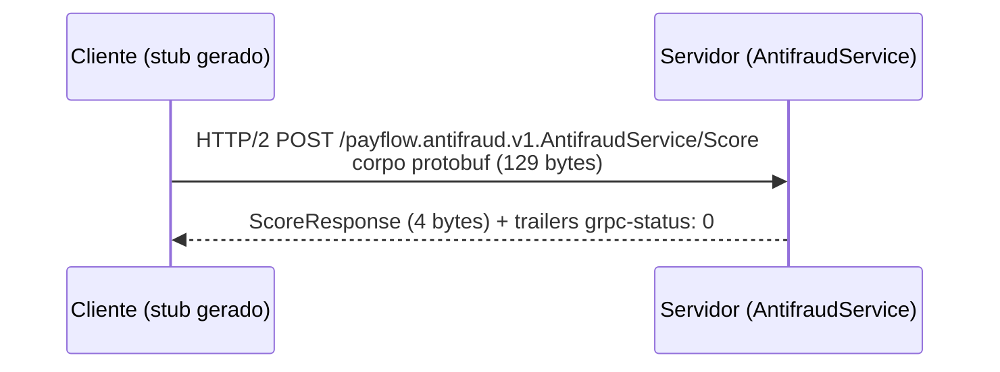

# P5.03 — REST vs gRPC

> ⏱️ ~1h30 · 🔵 Pleno · Pré-requisitos: P5.01, J2 (HTTP), J6 (REST, `RestClient`, timeouts), P3.01 (síncrono × assíncrono), P4.02 (portas e adaptadores)

> ✅ **Validação final (2026-11-24):** módulo executado no PayFlow reconstruído; resultado e o que continua não executado no [README do módulo](README.md). Os avisos "não executado" / "por leitura" abaixo descrevem a escrita original.

> ⚠️ **Verificação:** os exemplos foram **executados** em `lab/integration-lab/grpc-lab` (Linux, JDK 25.0.5, Maven 3.9.12, Spring Boot **4.1.2**, **Spring gRPC 1.1.2**, grpc-java **1.84.1**, protobuf-java **4.36.2**; **10 testes verdes**, sem Docker). **Saídas reais** em `out-T3G.txt` e `out-T4G.txt`. **Não executado:** TLS/mTLS, *streaming*, balanceamento **do lado do cliente**, `gRPC-Web`, *interceptors*, passar gRPC por um gateway/Kubernetes. Os números de latência são de **loopback**, **um cliente sequencial**, máquina **compartilhada**: valem como **ordem de grandeza**, **não** como *benchmark*.

## 🎯 Objetivos
Ao final desta aula você consegue:
- **Descrever** o que o gRPC acrescenta ao REST (contrato `.proto`, HTTP/2, binário, *deadlines*, *streaming*) e o que **custa**.
- **Escrever** um `.proto` seguro para evoluir (números de campo, `reserved`, enum com zero, dinheiro como *string*).
- **Implementar** servidor e cliente com os *starters* do **Boot 4.1** e **provar** `DEADLINE_EXCEEDED`, `INVALID_ARGUMENT` e `UNAVAILABLE`.
- **Escolher** entre REST e gRPC com **critério**, e **defender** a escolha padrão do PayFlow.

## 🤔 Por que isso importa
Quando dois serviços conversam **de forma síncrona**, o **protocolo** define **desempenho, contrato e depuração**. O REST/JSON domina por simplicidade e alcance; o gRPC aparece em **tráfego interno intenso** e em **ambientes poliglotas** com contratos estritos. Um pleno precisa **escolher sem fanatismo**: gRPC não é "REST mais rápido" nem "REST é antigo".

## 💡 Intuição (explicação simples)
- **REST/JSON** é **escrever cartas em português**: qualquer pessoa lê (humano, `curl`, navegador), mas cada carta repete cabeçalhos e nomes por extenso.
- **gRPC/Protobuf** é um **formulário padronizado com números nos campos** ("campo 4 = valor"): **compacto** e **rígido**, a máquina lê muito rápido; mas **você precisa do formulário** (o `.proto`) e **não** lê a olho nu.

## 🔬 Como funciona por dentro

### 1. O que é o gRPC
- **Contrato** em `.proto` → **código gerado** (cliente e servidor) em várias linguagens.
- **Transporte:** HTTP/2 (conexão **multiplexada**, cabeçalhos comprimidos).
- **Mensagens:** Protocol Buffers (binário), campos identificados por **número**.
- **Tipos de chamada:** *unary*, *server streaming*, *client streaming*, *bidirectional* ([conceitos](https://grpc.io/docs/what-is-grpc/core-concepts/)).
- **Prazo (*deadline*)** e **cancelamento** propagáveis pela cadeia ([guia](https://grpc.io/docs/guides/deadlines/)).
- **Status** próprios (`OK`, `INVALID_ARGUMENT`, `DEADLINE_EXCEEDED`, `UNAVAILABLE`…), **não** códigos HTTP ([lista](https://grpc.io/docs/guides/status-codes/)).



### 2. O contrato (`antifraud.proto`)
```proto
syntax = "proto3";
package payflow.antifraud.v1;
option java_multiple_files = true;
option java_package = "com.payflow.lab.grpc.antifraud.v1";

service AntifraudService {
  rpc Score(ScoreRequest) returns (ScoreResponse);
}

message ScoreRequest {
  string transfer_id = 1;            // UUID
  string source_account_id = 2;
  string destination_account_id = 3;
  string amount = 4;                 // decisão 11: dinheiro como STRING ("100.00"), nunca double
  string currency = 5;
}

message ScoreResponse {
  int32 score = 1;
  Decision decision = 2;
  reserved 3;                        // era "reason_text"; o número NUNCA volta a ser usado
  reserved "reason_text";
}

enum Decision {
  DECISION_UNSPECIFIED = 0;          // o zero é "não sei"
  ALLOW = 1; REVIEW = 2; DENY = 3;
}
```
Regras (do [guia de *dos and don'ts*](https://protobuf.dev/best-practices/dos-donts/) e do [guia proto3](https://protobuf.dev/programming-guides/proto3/); o que **provamos** está na seção 4):
1. **Nunca** reutilize um número de campo; ao remover, use `reserved`.
2. **Não** mude o **tipo** de um campo existente.
3. O valor **0** de todo `enum` é "**não especificado**".
4. **Dinheiro**: `string` (ou inteiro de menor unidade), **nunca** `float`/`double`.
5. **Versione o pacote** (`payflow.antifraud.v1`).

### 3. Servidor e cliente com os *starters* do Boot 4.1
O Boot 4.1 **traz** os *starters* `spring-boot-starter-grpc-server` e `spring-boot-starter-grpc-client`, e o BOM gerencia `grpc-java` **1.84.1**, `protobuf-java` **4.36.2** e `spring-grpc` **1.1.2** (lidos em `spring-boot-dependencies-4.1.2.pom`).

```xml
<dependency><groupId>org.springframework.boot</groupId><artifactId>spring-boot-starter-grpc-server</artifactId></dependency>
<dependency><groupId>org.springframework.boot</groupId><artifactId>spring-boot-starter-grpc-client</artifactId></dependency>
```
```java
// Um @Service que estende a classe base gerada vira serviço gRPC (o starter registra sozinho)
@Service
public class AntifraudGrpcService extends AntifraudServiceGrpc.AntifraudServiceImplBase {
    @Override
    public void score(ScoreRequest req, StreamObserver<ScoreResponse> out) {
        BigDecimal amount;
        try { amount = new BigDecimal(req.getAmount()); }
        catch (NumberFormatException e) {
            out.onError(Status.INVALID_ARGUMENT.withDescription("amount invalido: " + req.getAmount()).asRuntimeException());
            return;
        }
        int score = ScoringRules.score(amount);
        out.onNext(ScoreResponse.newBuilder().setScore(score).setDecision(ScoringRules.decision(score)).build());
        out.onCompleted();
    }
}
```
```properties
spring.grpc.server.port=9090     # no laboratório o teste escolhe uma porta livre
```
**Cliente** (no laboratório, `ManagedChannelBuilder` com texto puro; em produção **TLS**):
```java
var stub = AntifraudServiceGrpc.newBlockingStub(channel).withDeadlineAfter(200, TimeUnit.MILLISECONDS);
ScoreResponse r = stub.score(request("15000.00"));
```
A **regra de negócio** (`ScoringRules`) é **a mesma** para REST (`@PostMapping("/api/v1/antifraud/score")`) e gRPC: **o protocolo é transporte**.

### 4. O que o laboratório mediu e provou
**Uma chamada e o tamanho** (`out-T3G.txt`):
```
T3G Score(15000.00) -> score=90 decision=DENY
T3G tamanho do corpo: requisicao protobuf=129 bytes, JSON=209 bytes; resposta protobuf=4 bytes, JSON=30 bytes
```
Os três UUIDs (36 caracteres cada) dominam o corpo; o **ganho** do binário é **maior** em mensagens com **números e enums** do que em *strings* longas.

**Latência** (loopback, 1 cliente sequencial, 3.000 chamadas por rodada, após aquecimento de 2.000; **três rodadas**, porque a máquina é **compartilhada**):
```
T3G rodada 1: gRPC 127 us/chamada, REST/JSON HTTP/1.1 482 us/chamada
T3G rodada 2: gRPC 107 us/chamada, REST/JSON HTTP/1.1 266 us/chamada
T3G rodada 3: gRPC  76 us/chamada, REST/JSON HTTP/1.1 241 us/chamada
```
Leitura honesta: **gRPC foi 2 a 4 vezes mais rápido neste cenário**, mas (a) o cliente REST era o `HttpClient` do JDK em HTTP/1.1 **sem** *pool* configurado, (b) **sem TLS**, (c) a rede real (**centenas de µs a ms**) **domina** essa diferença de dezenas de µs, (d) os valores **variaram** entre rodadas. **Não** conclua "gRPC é 3× mais rápido"; conclua "**o custo de serialização/protocolo não é o gargalo** da maioria das chamadas de rede reais".

**Prazo e erros** (`out-T3G.txt`):
```
T3G deadline 200 ms contra servidor de 1000 ms: DEADLINE_EXCEEDED | DEADLINE_EXCEEDED: CallOptions deadline exceeded after 0.174815570s. ...
T3G ... o chamador foi liberado apos 215 ms
T3G SEM deadline: o chamador esperou 1504 ms (o padrao do gRPC e nao ter prazo)
T3G amount invalido -> INVALID_ARGUMENT | amount invalido: abc
T3G servidor fora do ar: UNAVAILABLE | UNAVAILABLE: io exception
T3G ... falhou rapido, em 3 ms (SEM deadline configurado)
```
**O mesmo defeito do REST:** **sem *deadline* o gRPC espera para sempre** (a lição de timeouts da J6 e da [P5.07](P5.07-resilience4j-i-timeouts-e-retry.md) **vale igual**). *Servidor fora do ar* falha rápido (`UNAVAILABLE`); *servidor lento* **não** falha sozinho.

### 5. Evolução do contrato (executado: `ProtoEvolutionTest`)
```
T4G campo novo: leitor novo lendo dado antigo -> modelVersion='' (padrao); leitor antigo lendo dado novo -> score=42, campo desconhecido preservado=[3]
T4G numero reutilizado (int32 -> string): parse OK, id='a', reason='', campo 2 virou 'desconhecido'=true (o score 42 sumiu sem erro)
T4G enum com valor novo (7) lido por cliente antigo: decision=UNRECOGNIZED, valor numerico preservado=7
```
| Mudança | Compatível? | Evidência |
|---|---|---|
| **Campo novo** com **número novo** | **sim**, nos dois sentidos | leitor antigo **ignora** (guarda como desconhecido); leitor novo vê o **padrão** |
| **Reutilizar número** com **outro tipo** | **NÃO, e sem erro** | o `parseFrom` **não lança**; o dado **some** (`reason=''`) |
| **Valor novo de enum** | **parcial** | cliente antigo vê `UNRECOGNIZED` (**trate esse caso**) |
| Renomear campo | **sim** no binário (usa o número); **não** no JSON do Protobuf | *(regra do guia, não executada)* |

O ponto perigoso é o segundo: o formato binário **perdoa** o erro **em silêncio**. É por isso que `reserved` e a **revisão do `.proto`** importam.

## 🛠️ Exemplo prático: a escolha para o PayFlow

| Critério | REST/JSON | gRPC |
|---|---|---|
| **Depurar** (`curl`, navegador, logs) | **fácil** | exige `grpcurl`/ferramentas |
| **Chegar ao navegador/parceiros** | **nativo** | precisa de *gRPC-Web*/tradução |
| **Gateway, cache HTTP, WAF** | **maduro** | menos suporte (**não verificado** aqui) |
| **Contrato** | OpenAPI (J6) + testes de contrato (P5.09) | `.proto` **é** o contrato, geração de código |
| **Desempenho em alto volume interno** | bom | **melhor** (menos bytes e CPU) |
| ***Streaming*** | SSE/WebSocket (P3.11) | **nativo** |
| **Prazo/cancelamento propagados** | manual | **embutido** |
| **Equipe e ferramentas** | todos conhecem | curva de aprendizado |

**Decisão (128, ADR 0017):** **REST/JSON é o padrão** para chamadas síncronas entre serviços do PayFlow (e é **o** contrato público). **gRPC** fica **reservado** para um caminho **interno, de alto volume e latência crítica** (candidato: `antifraud` quando extraído, S1) ou para *streaming*. O laboratório existe para você **saber fazer** quando surgir a razão.

## 🧠 Pausa para lógica: quantos bytes por segundo?
O `antifraud` recebe **2.000 consultas/s**. Cada requisição+resposta mede (protobuf) 129 + 4 = **133 bytes** e (JSON) 209 + 30 = **239 bytes** de **corpo** (sem cabeçalhos). Qual a diferença de **corpo** em MB/s e **por que ela importa pouco** aqui?

<details><summary>Dica e solução</summary>

**Dica:** multiplique por 2.000 e converta.

**Solução:** protobuf ≈ 266.000 B/s (**0,25 MiB/s**); JSON ≈ 478.000 B/s (**0,46 MiB/s**): diferença ≈ **0,2 MiB/s**, ínfima frente a um link de 1 Gbit/s (~119 MiB/s). A diferença **só pesa** com **mensagens grandes**, **milhões** de chamadas ou **CPU** limitada. **Variação:** inclua os cabeçalhos HTTP/1.1 (centenas de bytes **por requisição**) e veja a vantagem do HTTP/2 com compressão de cabeçalhos **crescer**.
</details>

## ⚖️ Trade-offs e quando NÃO usar
- **gRPC não substitui REST** em API **pública**/navegador. Use onde **você controla os dois lados**.
- **Contrato rígido** é virtude **e** custo: toda mudança passa pelo `.proto` e pela geração de código em **todos** os clientes.
- **Balanceamento:** conexões HTTP/2 **longas** fazem um balanceador de **conexão** (L4) **concentrar** chamadas em poucas instâncias; costuma exigir balanceamento **por chamada** (cliente ou proxy L7). *(Conhecimento geral; **não executado** aqui; volta na P7.)*
- **Observabilidade:** *tracing* e métricas existem, mas **as ferramentas HTTP** que você já tem (`curl`, *access logs*) **não** servem.
- **Se o problema é lentidão, meça primeiro**: quase sempre é **consulta ao banco** ou **chamada em série**, não o JSON.

## ⚠️ Erros comuns e boas práticas de produção
- **Sem *deadline*** (medido: esperou 1504 ms): defina **sempre** e **propague** o prazo restante.
- **`double` para dinheiro** no `.proto`: erro de arredondamento (decisão 11).
- **Reutilizar número de campo:** dado some **sem exceção** (medido).
- **Tratar todo erro como 500:** mapeie `INVALID_ARGUMENT` (sua culpa), `NOT_FOUND`, `UNAVAILABLE` (tente de novo, **se idempotente**), `DEADLINE_EXCEEDED`.
- **Plugin de geração:** no laboratório, o `protobuf-maven-plugin` da `io.github.ascopes` (**5.1.11**, a versão do BOM do Boot, e a **5.1.12**) **falhou** com o Maven 3.9.12 (`Guice/NullInjectedIntoNonNullable … ProtocResolver`); usamos o `org.xolstice.maven.plugins:protobuf-maven-plugin` **0.6.1** com `os-maven-plugin` e os executáveis `protoc` e `protoc-gen-grpc-java` do Maven Central. **Não** investigamos a causa; se o seu ambiente for diferente, teste o plugin **antes** de planejar.

## 🧩 Exercícios
1. **Fixação:** (a) por que `DECISION_UNSPECIFIED = 0`? (b) o que acontece se você trocar `int32 score = 2` por `string reason = 2`? (c) qual status gRPC você usaria para "conta de destino inexistente"?
2. **Aplicação no PayFlow** (por leitura):
   - [ ] Escreva o `.proto` de **um** serviço futuro (`ReportingService.BalancesOf` em lote) seguindo as 5 regras.
   - [ ] Escreva a **tabela de erros**: cada exceção do domínio → status gRPC **e** → HTTP (J6).
   - [ ] Defina o **prazo padrão** (*deadline*) e justifique pelo p99 medido.
   - Pronto quando: há `reserved` para campos removidos e **nenhuma** `double` com dinheiro.
3. **Desafio:** rode o laboratório (`./run-all.sh`), escreva um teste que dispare as chamadas **em paralelo** (vários clientes, virtuais) e compare de novo: a conclusão se mantém?

<details><summary>Solução de referência (1)</summary>

(a) Porque o **zero é o valor padrão** de um campo ausente: se for um valor **de negócio** (ex.: `ALLOW`), um dado **incompleto** parece "aprovado". (b) Muda o **tipo na rede** (varint → delimitado por tamanho): o leitor novo **não lança erro**, trata o campo 2 como **desconhecido** e o `score` **some** (executado: `reason=''`). (c) `NOT_FOUND` (ou `INVALID_ARGUMENT` se o **formato** do id é inválido).
</details>

## 🎤 Na entrevista
1. **"REST ou gRPC?"** "**REST por padrão** (alcance, depuração, ferramentas); **gRPC** para **tráfego interno intenso**, **contratos estritos poliglotas** ou **streaming**. Antes de trocar por desempenho, **meço**: quase sempre o gargalo não é o protocolo."
2. **"Como evoluir um `.proto`?"** Só **acrescentar** campos com **número novo**; **nunca** reutilizar número nem mudar o tipo; usar `reserved`; enum com zero "não especificado"; tratar valores desconhecidos.
3. **"O que é *deadline* e por que importa?"** Um **prazo absoluto** da chamada, propagável; **sem ele** o chamador espera indefinidamente (medimos 1,5 s contra um servidor lento, sem limite).
4. **"Por que gRPC é mais rápido?"** Binário **compacto**, HTTP/2 **multiplexado**, código gerado; **mas** em rede real a diferença **diminui** perante a latência e o trabalho do servidor.

## 📚 Para ir além
- 📄 [gRPC: conceitos principais](https://grpc.io/docs/what-is-grpc/core-concepts/): tipos de chamada, *deadlines*, *metadata*, status.
- 📄 [gRPC: *Deadlines*](https://grpc.io/docs/guides/deadlines/): como definir e propagar prazos.
- 📄 [gRPC: códigos de status](https://grpc.io/docs/guides/status-codes/): a lista e o significado de cada um.
- 📄 [gRPC: tratamento de erros](https://grpc.io/docs/guides/error/): erros ricos e *trailers*.
- 📄 [gRPC no HTTP/2](https://grpc.io/blog/grpc-on-http2/): por que o transporte importa.
- 📄 [Protobuf: guia proto3](https://protobuf.dev/programming-guides/proto3/) e [*dos and don'ts*](https://protobuf.dev/best-practices/dos-donts/): regras de evolução.
- 📄 [Protobuf: guia de estilo](https://protobuf.dev/programming-guides/style/): nomes e organização.
- 📄 [Spring gRPC](https://docs.spring.io/spring-grpc/reference/index.html): a integração oficial (o Boot 4.1 traz os *starters*).
- 💻 `lab/integration-lab/grpc-lab`: o código desta aula, com os testes.

## ✅ Checklist da aula
- [ ] Sei **escrever** um `.proto` evolutivo (números, `reserved`, enum com zero, dinheiro como *string*).
- [ ] Sei **por que** o *deadline* é obrigatório e **como** o gRPC falha sem ele.
- [ ] Sei **comparar** REST e gRPC com critérios e **não** com fé.
- [ ] Sei o que o laboratório **não** cobre (TLS, *streaming*, balanceamento).
