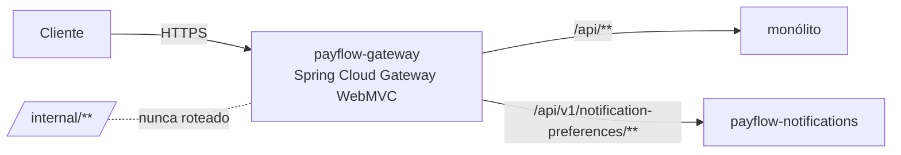

# P5.05 — API Gateway (Spring Cloud Gateway)

> ⏱️ ~1h30 · 🔵 Pleno · Pré-requisitos: P5.02, J2 (HTTP, proxies), J6 (CORS), J8 (cadeias de segurança, JWT), P3.12 (MVC com *threads* virtuais, decisão 113)

> ⚠️ **Verificação:** o roteamento, os filtros e os **comportamentos de erro** foram **executados** em `lab/integration-lab/gateway-lab` (JDK 25.0.5, Spring Boot **4.1.2**, **Spring Cloud 2025.1.4** → `spring-cloud-gateway-server-webmvc` **5.0.4**, `spring-cloud-circuitbreaker` **5.0.3**; **6 testes** verdes; destinos simulados com `com.sun.net.httpserver`). **Saída real** em `out-T5.txt`. ⚠️ **Compatibilidade:** o trem de lançamento **2025.1** declara o **Boot 4.0.x** (o BOM `spring-cloud-dependencies-2025.1.4` aponta `spring-boot 4.0.9`); o **2026.0** (`2026.0.0-RC2`, **ainda não final**) aponta o **Boot 4.2.0-RC2**. **Nenhum trem do Spring Cloud declara o Boot 4.1**: o laboratório rodou **sem erro** no 4.1.2, mas é uma **combinação não declarada**. **Não executado:** *rate limit* com Bucket4j, TLS no gateway, JWT no gateway, o gateway **WebFlux**, balanceamento por descoberta de serviços.

## 🎯 Objetivos
Ao final desta aula você consegue:
- **Explicar** o que um *API gateway* faz (e **o que não deve fazer**).
- **Configurar** rotas por caminho, `StripPrefix`, cabeçalhos, `Retry` e `CircuitBreaker` no **Spring Cloud Gateway Server WebMVC**.
- **Prever** o que o cliente vê quando o destino está **lento**, **fora do ar** ou **devolve 503**.
- **Decidir** o que fica no gateway e o que fica nos serviços (segurança, resiliência).
- **Avaliar** o risco de versão (trem do Spring Cloud × Boot) antes de adotar.

## 🤔 Por que isso importa
Com **dois** serviços (monólito e notificações) o cliente precisaria conhecer **dois endereços**, duas políticas de CORS, dois certificados. O *gateway* dá **uma porta de entrada**. Mas ele também vira **ponto único de falha e de gargalo**, e **tentação** de abrigar regra de negócio. Saber **o que colocar** nele é o que separa uma borda limpa de um **monólito escondido na frente** dos serviços.

## 💡 Intuição (explicação simples)
A **portaria** de um prédio comercial: confere **quem entra**, **encaminha** ao andar certo, **barra** o excesso de gente e **registra** tudo. Ela **não** faz o trabalho das empresas nos andares. Se a portaria passa a **assinar contratos** pelos inquilinos, o prédio inteiro **para** quando o porteiro adoece.

## 🔬 Como funciona por dentro

### 1. O que o gateway faz (e não faz)
| Faz bem (preocupações **transversais**) | **Não** deve fazer |
|---|---|
| **Roteamento** por caminho/cabeçalho | **regra de negócio** |
| **TLS** na borda, CORS, normalizar cabeçalhos | **orquestrar** várias chamadas para compor uma resposta (*BFF* é **outro** componente, com dono) |
| **Limite de taxa** grosseiro, cabeçalho de correlação | **substituir** a autenticação/autorização dos serviços |
| **Timeouts/CB** de **borda** | **mascarar** um serviço sem contrato |
| **Observabilidade** (log de acesso, métrica) | guardar **estado** |

Referências: [microservices.io: API Gateway](https://microservices.io/patterns/apigateway.html), [Microsoft: Gateway Offloading](https://learn.microsoft.com/en-us/azure/architecture/patterns/gateway-offloading) e [Sam Newman: BFF](https://samnewman.io/patterns/architectural/bff/).



### 2. WebMVC × WebFlux
O Spring Cloud Gateway tem **duas** versões: **`gateway-server-webmvc`** (Servlet, **bloqueante**, combina com **threads virtuais**) e **`gateway-server-webflux`** (reativa). O PayFlow usa **MVC com threads virtuais por padrão** (decisão 113): **adotamos a variante WebMVC** (decisão 130). O nome do *starter* é `spring-cloud-starter-gateway-server-webmvc`.

### 3. O risco de versão (leia antes de adotar)
| Item | Valor | Fonte |
|---|---|---|
| Spring Boot do PayFlow | **4.1.2** | `versoes.md` |
| Trem **2025.1.4** | Gateway **5.0.4**, Circuit Breaker **5.0.3**, Commons **5.0.4**, `spring-boot` **4.0.9** | `spring-cloud-dependencies-2025.1.4.pom` |
| Trem **2026.0.0-RC2** | Gateway **5.1.0-RC2**, `spring-boot` **4.2.0-RC2** (**pré-lançamento**) | Maven Central |
| Página de versões suportadas | lista `2025.1` ↔ Boot `4.0.x` ([wiki](https://github.com/spring-cloud/spring-cloud-release/wiki/Supported-Versions)) | lida em 2026-11-14 |

**Resultado do laboratório:** o **Gateway 5.0.4 funcionou no Boot 4.1.2** (6 testes verdes). **Decisão (130):** usar o trem **2025.1.x**, **tratar como "funciona, mas não declarado"**, ter **teste de roteamento no CI** (como o do laboratório) para **detectar** quebra a cada atualização do Boot e **migrar** para o 2026.0 **quando for final** e declarar o Boot que você usa. Se o time **não aceita** esse risco, **o gateway de borda do provedor de nuvem** (P9) ou um **proxy** (Caddy/NGINX, J10) resolvem o roteamento **simples** sem o Spring Cloud.

### 4. A configuração do laboratório (`application.yml`)
```yaml
spring:
  http:
    clients:
      connect-timeout: 500ms
      read-timeout: 600ms          # vale para o cliente HTTP que o gateway usa (executado)
  cloud:
    gateway:
      server:
        webmvc:
          trusted-proxies: .*      # SÓ no laboratório (ver abaixo)
          routes:
            - id: notifications
              uri: ${lab.notifications.url}
              predicates:
                - Path=/notifications/**
              filters:
                - StripPrefix=1
                - AddRequestHeader=X-Gateway, payflow
                - name: CircuitBreaker
                  args:
                    id: notif-cb
                    fallbackUri: forward:/fallback/notifications
                    statusCodes: 503   # sem isto, uma resposta 503 NÃO conta como falha
            - id: notifications-retry
              uri: ${lab.notifications.url}
              predicates:
                - Path=/retry/**
              filters:
                - StripPrefix=1
                - name: Retry
                  args:
                    retries: 3
                    statuses: BAD_GATEWAY,SERVICE_UNAVAILABLE
                    methods: GET,POST
            - id: monolith
              uri: ${lab.monolith.url}
              predicates:
                - Path=/api/**
              filters:
                - AddRequestHeader=X-Gateway, payflow
resilience4j:
  circuitbreaker:
    instances:
      notif-cb:
        sliding-window-size: 4
        minimum-number-of-calls: 4
        failure-rate-threshold: 50
        wait-duration-in-open-state: 5s
```
Dependências: `spring-cloud-starter-gateway-server-webmvc` e `spring-cloud-starter-circuitbreaker-resilience4j`, com o BOM `spring-cloud-dependencies` **2025.1.4** em `dependencyManagement`.

### 5. O que **realmente** aconteceu (`out-T5.txt`)
```
T5 /notifications/internal/... -> 200 {"service":"notifications","path":"/internal/v1/users/u1/preferences","xGateway":"payflow","xForwardedFor":"127.0.0.1","xForwardedPrefix":"/notifications","authorization":"Bearer abc",...}
T5 /api/v1/accounts -> 200 {"service":"monolith","path":"/api/v1/accounts","xGateway":"payflow",...}
T5 rota inexistente -> 404
T5 destino lento (3 s), spring.http.clients.read-timeout=600ms, rota SEM breaker: HTTP 500 em 609 ms; chamadas ao destino=1
T5 destino fora do ar (conexao recusada): HTTP 500 {"timestamp":"...","status":500,"error":"Internal Server Error","path":"/dead/x"}
T5 Retry(methods=GET,POST), destino 503: resposta 500; o destino recebeu 4 chamadas (1 original + 3 retentativas)
T5 CircuitBreaker no gateway (janela 4, destino 503): status das 6 chamadas = [200(destino=1), 200(destino=2), 200(destino=3), 200(destino=3), 200(destino=3), 200(destino=3)]; chamadas que chegaram ao destino=3
T5 com o breaker aberto: 200 {"source":"gateway-fallback"}
```
| # | Observação | Consequência prática |
|---|---|---|
| 1 | `StripPrefix=1` removeu `/notifications`; o cabeçalho `Authorization` **atravessou** | o serviço **precisa** validar o JWT por conta própria (decisão 130) |
| 2 | **Sem `trusted-proxies`, o gateway NÃO enviou `X-Forwarded-*`**; com `.*`, enviou `For`, `Host`, `Proto`, `Port`, `Prefix`, `Forwarded` | em produção use **a faixa do seu balanceador**, **nunca** `.*` (qualquer cliente poderia forjar a origem) |
| 3 | **Destino lento/fora do ar → HTTP 500**, **não** 502/504 | o cliente vê "erro do servidor" genérico; mapeie para **504/502** num `@ControllerAdvice`/filtro se o contrato pedir *(não executado)* |
| 4 | `spring.http.clients.read-timeout` **funcionou**: cortou em **609 ms** | **sem** essa propriedade o gateway **espera** o destino (como o `RestClient` da P5.07) |
| 5 | O filtro **`Retry`** repetiu **POST** quando mandei `methods: GET,POST` (**4 chamadas**) e, esgotado, devolveu **500** | **nunca** configure *retry* de `POST` sem **chave de idempotência** (P5.07) |
| 6 | `CircuitBreaker` **sem `statusCodes` não conta resposta 503 como falha** (primeira tentativa: 6 chamadas **chegaram** ao destino, nenhuma foi barrada); com `statusCodes: 503` ele **abriu depois de 3 chamadas** (a janela é de 4; provavelmente já havia **1 sucesso** de outro teste no mesmo contexto: **não confirmado**) e o `fallbackUri` respondeu **200** em todas | **liste** os status que são falha; um *fallback* **200** **esconde** o problema (alerte pelo breaker, P6) |
| 7 | A sintaxe curta `Retry=retries=3,statuses=…` **falhou ao subir** (`Failed to bind properties under 'retries' to int`) | use a forma **`name`/`args`** para filtros com vários parâmetros |

> Observação 6: o laboratório foi rodado **primeiro sem** `statusCodes` (resultado: 6 chamadas ao destino, status 503 devolvido ao cliente) e **depois com**; o `out-T5.txt` guarda **só a execução final** (com `statusCodes: 503`). Para reproduzir o primeiro caso, **apague** a linha `statusCodes` do `application.yml` de teste.

### 6. Onde fica a segurança
- **No gateway:** TLS, **CORS** (uma vez, J6), limite de taxa **grosseiro** e **bloqueio** de rotas `/internal/**` (**nunca** são roteadas; o laboratório não tem rota para elas).
- **Em cada serviço:** **validar o JWT** e **autorizar** (J8, P10). O gateway **não substitui** isso: se alguém alcançar o serviço **sem passar** pelo gateway (rede interna comprometida, erro de regra), o serviço **fica aberto**.
- **Nunca** confie num cabeçalho como `X-User-Id` **só porque veio do gateway** sem **mTLS**/rede isolada (S5).

## 🛠️ Exemplo prático: a borda do PayFlow
**Rotas (decisão 130):**
| Caminho público | Destino | Filtros |
|---|---|---|
| `/api/v1/notification-preferences/**` | `payflow-notifications` | `CircuitBreaker` + fallback de **503** claro (`{"type":…,"status":503}` Problem Details), **sem `Retry` de escrita** |
| `/api/**` (demais) | monólito | `Retry` **só de `GET`** |
| `/internal/**`, `/actuator/**` | **nenhum** | (sem rota → 404) |

**Timeouts:** `spring.http.clients.connect-timeout: 500ms` e `read-timeout` **maior que o p99 medido** do destino (P5.07), **menor** que o limite do navegador/balanceador.
**Disponibilidade:** **2+ réplicas** do gateway atrás do balanceador (P9); ele **não guarda estado**.

## 🧠 Pausa para lógica: o orçamento de tempo
O cliente do app desiste em **10 s**. O gateway tem `read-timeout` de **8 s** e **3 retentativas** de `GET`. O monólito demora **4 s** numa consulta lenta. O que o cliente vê?

<details><summary>Dica e solução</summary>

**Dica:** some as tentativas **sequenciais** (não há *backoff* no filtro padrão).

**Solução:** cada tentativa leva **4 s** (< 8 s, então não estoura o *timeout* do gateway) e todas **terminam com sucesso** na primeira: **não há retentativa** (a resposta veio). **Mas** se o monólito responder **503** em 4 s, **4 tentativas × 4 s = 16 s** > 10 s: o **cliente** desiste **antes**, o gateway continua trabalhando para **ninguém** e **multiplica a carga** num serviço doente. **Regra:** o **orçamento total** (tentativas × tempo) **cabe** dentro do prazo do cliente; senão **reduza** tentativas ou *timeouts*. **Variação:** se o monólito **também** tiver 3 tentativas internas contra o próprio destino lento, uma requisição do cliente pode virar **4 × 3 = 12** chamadas à jusante (a amplificação medida na P5.07 foi **27**).
</details>

## ⚖️ Trade-offs e quando NÃO usar
- **Gateway** dá uma entrada única, **ao custo** de **um componente a mais** na frente de **tudo** (latência, *deploy*, ponto de falha).
- **Com um só serviço** (monólito), um **proxy simples** (Caddy/NGINX, J10) basta.
- **Gateway com lógica** vira "monólito escondido": o **time do gateway** vira gargalo para toda mudança.
- **Spring Cloud Gateway × gateway de nuvem** (API Gateway/ALB, P9): o de nuvem é **gerenciado** (menos operação, mais **acoplamento** ao fornecedor); o Spring dá **controle em código** e **testes locais**.
- **Combinação não declarada** (Cloud 2025.1 + Boot 4.1): risco **aceito e registrado** (acima).

## ⚠️ Erros comuns e boas práticas de produção
- **`trusted-proxies: .*` em produção**: cabeçalhos `X-Forwarded-*` **forjáveis**.
- **Sem *timeouts*:** o gateway **espera** o destino e **segura** as *threads* (a história da [P5.10](P5.10-estudo-de-caso-o-servico-de-notificacoes-que-derrubou-o-checkout.md)).
- ***Retry* de `POST`** sem idempotência: **duplica** efeito (medido: **4 chamadas**).
- **CB sem `statusCodes`:** o breaker **nunca abre** com 503 (medido).
- ***Fallback* 200** que esconde a falha: **meça** e **alerte**.
- **Expor `/actuator` ou `/internal` pelo gateway** por regra genérica `/**`: **liste** rotas, não use curinga.
- **Autenticação só no gateway:** tudo **atrás** dele fica sem defesa.

## 🧩 Exercícios
1. **Fixação:** (a) o que `StripPrefix=1` faz com `/notifications/x/y`? (b) por que `trusted-proxies: .*` é perigoso? (c) o que o cliente vê quando o destino **demora mais** que o `read-timeout`?
2. **Aplicação no PayFlow** (por leitura):
   - [ ] Crie o projeto `payflow-gateway` com `spring-cloud-starter-gateway-server-webmvc`, BOM **2025.1.4** e as rotas da tabela.
   - [ ] Escreva **teste de roteamento** (destinos simulados como no laboratório): caminho → destino, `/internal/**` → 404, destino lento → erro dentro do prazo.
   - [ ] Defina `trusted-proxies` com a **faixa** do seu balanceador e **teste** que um `X-Forwarded-For` forjado do cliente **não** passa.
   - Pronto quando: **nenhuma** rota `/internal/**` e um teste de **versão** (sobe com o Boot do projeto) no CI.
3. **Desafio:** implemente o **mapeamento 500 → 504** para *timeout* e **502** para conexão recusada e **teste** os dois caminhos.

<details><summary>Solução de referência (1)</summary>

(a) Remove o **primeiro** segmento: o destino recebe `/x/y` (executado: `/notifications/internal/…` → `/internal/…`). (b) Faz o gateway **confiar** em `X-Forwarded-*` de **qualquer** origem: o cliente forja IP/host/protocolo. (c) **HTTP 500** (executado), em ~o tempo do *timeout* (609 ms com 600 ms configurados).
</details>

## 🎤 Na entrevista
1. **"O que é um API gateway e o que **não** colocar nele?"** Ponto de entrada que cuida de **preocupações transversais** (roteamento, TLS, CORS, limites, observabilidade). **Não** coloco **regra de negócio**, **orquestração** de domínio nem **substituo** a autenticação dos serviços.
2. **"Gateway é ponto único de falha?"** Pode ser; mitigo com **réplicas sem estado**, *timeouts* e *health checks*, e mantendo-o **burro**.
3. **"Como o gateway protege o resto?"** **Timeouts**, **circuit breaker**, **limite de taxa** e **retry só de requisições idempotentes** — e cada serviço **continua** validando o token.
4. **"Spring Cloud Gateway ou gateway de nuvem?"** Controle e teste em código × operação gerenciada; decido por **time, custo e acoplamento**.

## 📚 Para ir além
- 📄 [Spring Cloud Gateway (referência)](https://docs.spring.io/spring-cloud-gateway/reference/): a documentação oficial (escolha a versão **5.0.x**).
- 📄 [Gateway Server WebMVC](https://docs.spring.io/spring-cloud-gateway/reference/spring-cloud-gateway-server-webmvc.html): a variante usada aqui.
- 📄 [Filtro `Retry` (WebMVC)](https://docs.spring.io/spring-cloud-gateway/reference/spring-cloud-gateway-server-webmvc/filters/retry.html) e [filtro `CircuitBreaker`](https://docs.spring.io/spring-cloud-gateway/reference/spring-cloud-gateway-server-webmvc/filters/circuitbreaker-filter.html): argumentos e comportamento.
- 📄 [Spring Cloud: versões suportadas](https://github.com/spring-cloud/spring-cloud-release/wiki/Supported-Versions): trem × Boot.
- 📄 [Spring Cloud (visão geral)](https://spring.io/projects/spring-cloud): projetos e trens.
- 📄 [microservices.io: API Gateway](https://microservices.io/patterns/apigateway.html) e [Sam Newman: BFF](https://samnewman.io/patterns/architectural/bff/): quando e como.
- 💻 `lab/integration-lab/gateway-lab`.

## ✅ Checklist da aula
- [ ] Sei **o que** um gateway deve e **não** deve fazer.
- [ ] Sei configurar rotas, `Retry` e `CircuitBreaker` (e **por que** `statusCodes`).
- [ ] Sei o que o cliente vê com destino **lento/fora do ar** (**500**).
- [ ] Sei o **risco de versão** e como o **teste no CI** o mitiga.
