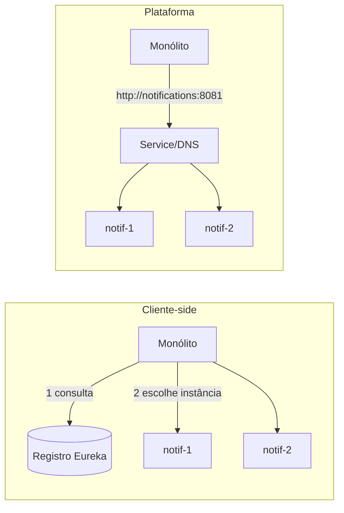

# P5.06 — Configuração e descoberta de serviços vs Kubernetes

> ⏱️ ~1h30 · 🔵 Pleno · Pré-requisitos: P5.05, J5.05 (`application.yml`, profiles, `@ConfigurationProperties`), J9 (Compose, `configtree`, segredos por arquivo), J2 (DNS)

> ⚠️ **Verificação:** aula **conceitual e de decisão**: **nada foi executado** (não há Eureka, Config Server nem cluster Kubernetes no laboratório; o Kubernetes entra na **P7**). **Verificado:** as **versões** dos projetos Spring Cloud no BOM `spring-cloud-dependencies-2025.1.4` (lidas no `.pom`) e as **URLs** citadas (HTTP 200). O comportamento do Kubernetes descrito vem **da documentação oficial citada** e de **conhecimento geral**, e é marcado onde **não** foi conferido.

## 🎯 Objetivos
Ao final desta aula você consegue:
- **Explicar** os dois problemas — **onde está o outro serviço?** (descoberta) e **com que configuração ele sobe?** — e as soluções **dentro** e **fora** do Spring.
- **Comparar** Eureka/Spring Cloud LoadBalancer, Spring Cloud Config e Spring Cloud Kubernetes com **DNS de Service** e **ConfigMap/Secret**.
- **Decidir** por que o PayFlow **não** usa Eureka nem Config Server.
- **Configurar** o endereço de um serviço **por ambiente**, sem acoplar o código ao mecanismo.

## 🤔 Por que isso importa
No monólito, "chamar o outro módulo" é uma chamada de método. Com serviços, você precisa de um **endereço** que **muda** (instâncias sobem e descem, IPs mudam) e de **configuração** que **varia** por ambiente e **não pode** estar no Git (segredos). Antes do Kubernetes, o ecossistema Spring resolveu isso com **componentes próprios** (Eureka, Config Server); hoje, **numa plataforma de contêineres**, essas funções vêm **de graça** da infraestrutura. Um pleno precisa **reconhecer os dois mundos** e **não instalar o que a plataforma já dá**.

## 💡 Intuição (explicação simples)
- **Descoberta** é a **lista telefônica**: você não decora o telefone de cada loja; **procura pelo nome**. **Eureka** é uma lista que **cada loja atualiza sozinha** e que **você consulta** (descoberta **no cliente**); **DNS do Kubernetes** é o **telefonista** que **liga por você** quando você diz "notifications" (descoberta **no servidor**/plataforma).
- **Configuração** é o **bilhete na geladeira**: um **lugar central** (Config Server, ConfigMap) com as instruções para **cada morador** (serviço) e cada **casa** (ambiente).

## 🔬 Como funciona por dentro

### 1. Descoberta de serviços
| Modelo | Como funciona | Exemplo | Quem balanceia |
|---|---|---|---|
| **No cliente** (*client-side*) | o serviço **se registra** num **registro**; o cliente **consulta** a lista e **escolhe** a instância | **Eureka** (`spring-cloud-netflix`) + **Spring Cloud LoadBalancer** | **o cliente** |
| **Na plataforma** (*server-side*) | o nome DNS aponta para um **IP virtual** que **distribui** | **Kubernetes `Service`** (`notifications.payflow.svc.cluster.local`), Compose (nome do serviço), balanceador de nuvem | **a plataforma** |


**Quando o registro ainda faz sentido:** **fora** do Kubernetes (VMs), em **vários** ambientes **sem** plataforma comum, ou quando você precisa de **metadados** e **roteamento** por cliente. **Dentro** do Kubernetes, o `Service` + DNS **já é** a descoberta, com **verificação de saúde** (*readiness*, P7) decidindo **quem recebe tráfego** ([documentação do `Service`](https://kubernetes.io/docs/concepts/services-networking/service/) e [DNS para Services e Pods](https://kubernetes.io/docs/concepts/services-networking/dns-pod-service/)).

**Cuidado conhecido (não executado aqui):** com **conexões longas** (HTTP/2, **gRPC**, P5.03) o balanceamento **por conexão** do `Service` pode **concentrar** chamadas em poucas instâncias; costuma-se usar balanceamento **por chamada** (proxy L7/malha ou cliente). Confirme na **sua** plataforma.

### 2. Configuração
| Mecanismo | O que é | Pontos fortes | Pontos fracos |
|---|---|---|---|
| **Variáveis de ambiente** e `application-<perfil>.yml` | padrão do Boot (J5) | simples, **12-factor** | **sem** auditoria/atualização central |
| **`configtree:`** (J9) | cada **arquivo** de um diretório vira uma propriedade ([Boot: external config](https://docs.spring.io/spring-boot/reference/features/external-config.html)) | ótimo para **Secret**/volume montado; **sem** biblioteca extra | recarregar exige **reiniciar** (ou *watch* próprio) |
| **ConfigMap / Secret** (Kubernetes) | objetos do cluster montados **como arquivos ou variáveis** ([ConfigMap](https://kubernetes.io/docs/concepts/configuration/configmap/)) | **nativo**, versionado com o manifesto (P7/P8), RBAC | **sem** histórico por si só; segredo **precisa** de cuidado (P10) |
| **Spring Cloud Config** | **servidor** que serve propriedades de um **repositório Git** ([doc](https://docs.spring.io/spring-cloud-config/reference/)) | **histórico no Git**, **atualização** por aplicação (`/actuator/refresh`/bus) | **mais um serviço** crítico (sobe antes de todos); cuidado com segredo no Git |
| **Spring Cloud Kubernetes** | lê **ConfigMap/Secret** e **descobre** serviços pela **API** do Kubernetes ([doc](https://docs.spring.io/spring-cloud-kubernetes/reference/index.html)) | recarrega config **sem reiniciar**; reaproveita o modelo Spring | exige **permissão RBAC** do app à API do cluster; **mais acoplamento** à plataforma |

### 3. Versões no BOM `2025.1.4` (lidas, não executadas)
| Projeto | Versão |
|---|---|
| `spring-cloud-config` | **5.0.6** |
| `spring-cloud-netflix` (Eureka) | **5.0.3** |
| `spring-cloud-kubernetes` | **5.0.4** |
| `spring-cloud-commons` (LoadBalancer) | **5.0.4** |
| `spring-cloud-gateway` / `circuitbreaker` | **5.0.4** / **5.0.3** |
⚠️ O mesmo aviso da [P5.05](P5.05-api-gateway-spring-cloud-gateway.md): o trem 2025.1 declara o **Boot 4.0.x**.

## 🛠️ Exemplo prático: o PayFlow **sem** Eureka nem Config Server

**Decisão (131, ADR 0017):**
- **Descoberta:** **nome DNS por ambiente**, vindo de **propriedade** (`payflow.notifications.base-url`): hoje o **nome do serviço no Compose** (J9); na **P7**, o **`Service` do Kubernetes**. **O código não sabe** como o nome é resolvido.
- **Configuração:** **variáveis de ambiente** + **`configtree`** para segredos (J9); no Kubernetes, **`ConfigMap`/`Secret`** montados. **Sem** Config Server.
- **Balanceamento:** o da **plataforma**. **Sem** Spring Cloud LoadBalancer.
- **Por quê:** o PayFlow tem **um** serviço extra, roda em contêineres e vai para o Kubernetes na P7: **registro** e **servidor de configuração** seriam **dois serviços críticos a mais** para operar, sem problema que justifique.

```yaml
# application.yml do monólito (o código só lê esta propriedade)
payflow:
  notifications:
    base-url: ${PAYFLOW_NOTIFICATIONS_BASE_URL:http://notifications:8081}
    connect-timeout: 500ms
    read-timeout: 800ms
```
```yaml
# compose.yaml (acréscimo; J9): o NOME do serviço é o endereço
services:
  notifications:
    image: payflow-notifications:dev
    ports: []            # não publicado: só a rede interna alcança
  app:
    environment:
      PAYFLOW_NOTIFICATIONS_BASE_URL: http://notifications:8081
```
```java
@ConfigurationProperties("payflow.notifications")
public record NotificationsProperties(String baseUrl, Duration connectTimeout, Duration readTimeout) { }
```
O cliente usa `baseUrl` e os **dois timeouts** (P5.07). No Kubernetes, só **muda o valor** (`http://notifications.payflow.svc.cluster.local:8081` ou o nome curto no mesmo *namespace*).

## 🧠 Pausa para lógica: o custo de um serviço de configuração
O Config Server tem disponibilidade de **99,9%**; seus **6 serviços** precisam dele **no início** (não há cache). Qual a probabilidade de **todos** subirem **numa reinicialização geral** em que o Config Server **cai** na hora? E se cada serviço **guardar a última configuração** em disco?

<details><summary>Dica e solução</summary>

**Dica:** sem cache, **nenhum** sobe quando o servidor está fora.

**Solução:** com o servidor fora (probabilidade ~**0,1%** de estar fora **naquele instante**), **0 de 6** sobem: a indisponibilidade do servidor de configuração é **a indisponibilidade de reinício de todos**. Com **cópia local** da última configuração boa, os serviços sobem **sem** ele (**degradação aceitável**). **Lição:** componente **de infraestrutura** no caminho de **partida** precisa de **cache local** ou **não deve existir**. **Variação:** o mesmo raciocínio vale para um **registro** de serviços que **todos** consultam na partida.
</details>

## ⚖️ Trade-offs e quando NÃO usar
- **Eureka/Config Server** fazem sentido **sem** plataforma de contêineres (VMs próprias), com **muitos** serviços e **times** autônomos, ou quando a **atualização dinâmica** de configuração é requisito.
- **Spring Cloud Kubernetes** é conveniente, mas **amarra** o app ao cluster e exige **RBAC**; **montar** ConfigMap/Secret como **arquivos** (`configtree`) é **mais simples** e **independente de plataforma**.
- **Configuração em Git** (Config Server) dá **auditoria**; no Kubernetes você obtém o mesmo com **GitOps** (P8) sobre os **manifestos**.
- **Descoberta por DNS** tem **cache** (TTL) e **não** conhece o estado da **aplicação** (só *readiness*): **falhas parciais** ainda precisam de **timeouts e circuit breaker** (P5.07/P5.08).

## ⚠️ Erros comuns e boas práticas de produção
- **Endereço fixo no código** (`http://10.0.0.5:8081`): quebra na primeira mudança de IP.
- **Segredo no Config Server/Git** sem criptografia: **vazamento** (J8, P10).
- **Serviço de configuração/registro sem alta disponibilidade** no caminho de **partida**.
- **Usar Eureka no Kubernetes "por hábito"**: **duas** fontes de verdade sobre **quem está vivo**.
- **Atualizar propriedade "a quente"** sem testar: partes do app (pools, clientes) **não** relêem a configuração.
- **Perfis demais** (`dev`, `qa`, `stage-eu`…): prefira **o mesmo artefato** + **valores por ambiente** (J5.05, J9).

## 🧩 Exercícios
1. **Fixação:** (a) diferencie descoberta **no cliente** e **na plataforma**; (b) por que o Config Server precisa de **cache local**? (c) cite **duas** razões para **não** usar Eureka no Kubernetes.
2. **Aplicação no PayFlow** (por leitura):
   - [ ] Crie `NotificationsProperties` (record) e use-a no `NotificationClient` (**timeouts obrigatórios**).
   - [ ] Acrescente ao `compose.yaml` o serviço `notifications` **sem porta publicada** e a variável `PAYFLOW_NOTIFICATIONS_BASE_URL`.
   - [ ] Escreva um teste que **falha** se `readTimeout` não estiver configurado (propriedade obrigatória; lembre a lição do `@DefaultValue` da J9).
   - Pronto quando: trocar o ambiente **só muda** a variável, **sem** recompilar.
3. **Desafio:** compare, por escrito, **Spring Cloud Kubernetes** × **`configtree` + ConfigMap** para **recarregar** um *feature flag* sem reiniciar. Qual você escolheria e **por quê**?

<details><summary>Solução de referência (1)</summary>

(a) **No cliente:** o cliente **consulta** o registro e **escolhe** a instância (e balanceia). **Na plataforma:** o cliente usa um **nome estável** e a **plataforma** distribui. (b) Porque ele é um componente **da partida**: sem ele, **nenhum** serviço sobe; o cache local **desacopla** a partida do servidor. (c) **Duplica** a fonte de verdade (o `Service` já sabe quem está *ready*) e **adiciona** um componente crítico para operar.
</details>

## 🎤 Na entrevista
1. **"Como os serviços se encontram?"** Por **nome**: **DNS da plataforma** (Kubernetes `Service`) ou **registro** (Eureka) com balanceamento no cliente. Em contêineres, uso o **DNS da plataforma**; registro fica para **VMs** ou casos especiais.
2. **"Config Server ou ConfigMap?"** Em Kubernetes, **ConfigMap/Secret** (nativos, sob GitOps); **Config Server** quando preciso de **histórico em Git** e **atualização** centralizada **fora** do Kubernetes. Em ambos, **segredo** com cuidado.
3. **"O que acontece se o serviço de configuração cair?"** Se estiver **no caminho de partida** e sem **cache local**, **ninguém reinicia**: por isso cache e alta disponibilidade.
4. **"DNS substitui circuit breaker?"** **Não.** DNS/`Service` só resolve **para quem está pronto**; **lentidão** e falhas **parciais** pedem **timeouts e circuit breaker**.

## 📚 Para ir além
- 📄 [Kubernetes: Service](https://kubernetes.io/docs/concepts/services-networking/service/): como o tráfego chega às instâncias.
- 📄 [Kubernetes: DNS para Services e Pods](https://kubernetes.io/docs/concepts/services-networking/dns-pod-service/): os nomes que você usará na P7.
- 📄 [Kubernetes: ConfigMap](https://kubernetes.io/docs/concepts/configuration/configmap/): configuração como objeto.
- 📄 [Spring Boot: configuração externa](https://docs.spring.io/spring-boot/reference/features/external-config.html): ordem de precedência e `configtree`.
- 📄 [Spring Cloud Config](https://docs.spring.io/spring-cloud-config/reference/), [Spring Cloud Netflix (Eureka)](https://docs.spring.io/spring-cloud-netflix/reference/), [Spring Cloud Kubernetes](https://docs.spring.io/spring-cloud-kubernetes/reference/index.html) e [Spring Cloud LoadBalancer](https://docs.spring.io/spring-cloud-commons/reference/spring-cloud-commons/loadbalancer.html): os componentes citados.
- 📑 *The Twelve-Factor App* (config no ambiente) (**de memória, não conferido**).

## ✅ Checklist da aula
- [ ] Sei **dois modelos** de descoberta e quem balanceia em cada um.
- [ ] Sei **quando** Eureka/Config Server ainda valem e quando **não**.
- [ ] Sei por que o PayFlow usa **DNS + variáveis/`configtree`**.
- [ ] Sei por que o servidor de configuração precisa de **cache** na partida.
