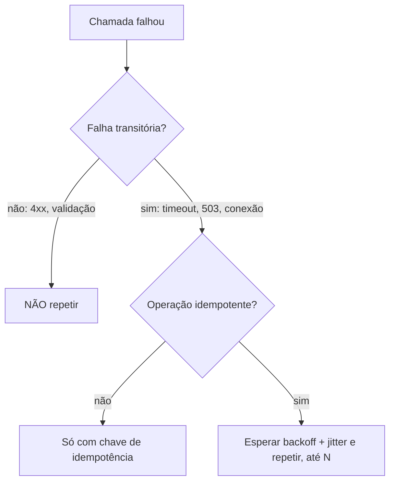

# P5.07 — Resilience4j I: timeouts e retry

> ⏱️ ~1h30 · 🔵 Pleno · Pré-requisitos: P5.01, P5.05, J6.06 (idempotência), J6.08 (`RestClient` com timeouts), P1 (concorrência, *threads*), P3.07–P3.08 (idempotência de consumidor, *backoff*)

> ⚠️ **Verificação:** tudo foi **executado** em `lab/integration-lab/resilience-lab` (JDK 25.0.5, Spring Boot **4.1.2**, **Resilience4j 2.4.0** via `resilience4j-spring-boot4`; **17 testes** verdes; servidor falso com `com.sun.net.httpserver`; **sem Docker**). **Saídas reais** em `out-T1.txt`, `out-T2.txt`, `out-T4.txt`, `out-T7.txt`. **Não executado:** `TimeLimiter` **dentro** de um fluxo reativo, *retry* com `RestClient` **do Spring Framework 7** (`@Retryable`/`RetryTemplate` do próprio Spring, que o PayFlow já usa na P2), métricas no Prometheus (P6). Os **valores** de tempo (200/300 ms, 3 tentativas) são **do laboratório**: **não são recomendações** para produção.

## 🎯 Objetivos
Ao final desta aula você consegue:
- **Explicar** por que "**lento** é pior que **fora do ar**" e por que o *timeout* é a **primeira** defesa.
- **Configurar** *timeout* de conexão e de **leitura** no `RestClient` e **provar** que o padrão do JDK **não tem** *timeout* de leitura.
- **Implementar** *retry* com **backoff exponencial e *jitter*** e **dizer quando NÃO usar** (4xx, `POST` sem idempotência).
- **Calcular** a **amplificação** de *retries* empilhados.
- **Evitar** a armadilha do *fallback* que **desliga** o `@Retry`.

## 🤔 Por que isso importa
Em sistema distribuído, a falha **mais cara** não é o serviço **cair** (a conexão é recusada em milissegundos), é o serviço ficar **lento**: cada chamada **segura** uma *thread*, uma conexão e memória do **chamador**, até ele também parar (a [P5.10](P5.10-estudo-de-caso-o-servico-de-notificacoes-que-derrubou-o-checkout.md) reproduz isso). O *retry* é a segunda defesa e a **mais mal usada**: sem critério, **multiplica a carga** sobre um serviço que já está doente.

## 💡 Intuição (explicação simples)
- **Timeout** é a regra "**se ninguém atender em 30 segundos, desligue o telefone**". Sem ela, você fica **na linha** para sempre e **ninguém mais** consegue ligar para você.
- **Retry** é **ligar de novo** quando dá ocupado. Ligar **uma vez mais, depois de uma pausa**, ajuda; **10 pessoas ligando sem parar** para a mesma linha ocupada a **derrubam** (efeito manada). Por isso o *retry* tem **pausa crescente e aleatória** (*backoff* com *jitter*).

## 🔬 Como funciona por dentro

### 1. Timeouts: o padrão é **esperar para sempre**
Três prazos diferentes:
| Prazo | O que limita | Onde |
|---|---|---|
| **Conexão** (*connect*) | abrir o TCP/TLS | `connectTimeout` |
| **Leitura** (*read*/*response*) | esperar a **resposta** depois de enviar | `readTimeout` |
| **Total** (*deadline*) | a operação **inteira**, com *retries* | orçamento da requisição do usuário |

**Medido** (`out-T1.txt`, servidor que demora 2.000 ms):
```
T1 sem timeout de leitura: respondeu apos 2003 ms (servidor demora 2000 ms)
T1 com timeout 300 ms: ResourceAccessException <- java.net.http.HttpTimeoutException: Request cancelled
T1 com timeout 300 ms: falhou apos 302 ms
T1 connect timeout 300 ms: ResourceAccessException <- java.net.http.HttpConnectTimeoutException apos 301 ms
```
O **cliente HTTP do JDK não tem *timeout* de leitura por padrão** (o servidor de 2 s foi esperado inteiro; um de 10 minutos seria esperado **10 minutos**). O de conexão (teste em um endereço que não responde) cortou em **301 ms** com **300 ms** configurados.

```java
// o cliente do laboratório: dois prazos explícitos (null = sem prazo, o padrão do JDK)
HttpClient.Builder http = HttpClient.newBuilder();
if (connect != null) http.connectTimeout(connect);
JdkClientHttpRequestFactory factory = new JdkClientHttpRequestFactory(http.build());
if (read != null) factory.setReadTimeout(read);
this.rest = RestClient.builder().baseUrl(baseUrl).requestFactory(factory).build();
```
No **Boot 4.1**, o caminho **sem código** é `spring.http.clients.connect-timeout` e `spring.http.clients.read-timeout` (executado **no gateway** da P5.05: cortou em 609 ms com 600 ms). **No PayFlow:** o `RestClient` da J6.08 **já** tem *timeouts*; confirme (**por leitura**) que **o do serviço de notificações usa** `NotificationsProperties` (P5.06).

**Como escolher o valor:** comece de uma **medição** (o **p99** da chamada em condição normal) e some uma **folga** (**2 a 3×** é ponto de partida comum; **não** é regra, **meça**). O *timeout* de leitura **tem de ser menor** que o prazo do **chamador** (senão o chamador desiste antes, e o trabalho continua **para ninguém**).

### 2. *Retry*: quando ajuda e quando atrapalha

**Medido:**
```
T2 retry: chamadas no servidor=3, retentativas em t(ms)=[6, 149], resposta={"ok":true}
T2 4xx: NotFound, chamadas=1
```
O servidor falhou 2 vezes (503) e atendeu na 3ª. Os instantes `[6, 149]` são os **eventos** `onRetry` (publicados **antes** de esperar): a **1ª espera** foi ~143 ms (faixa esperada **50 a 150 ms**: base 100 ms ± 50%) e a **2ª** seria de 100 a 300 ms. **4xx não se repete** (`retryExceptions` só inclui 5xx e erros de E/S): o `404` teve **1** chamada.

```java
RetryConfig cfg = RetryConfig.custom()
        .maxAttempts(3)                                                       // total, incluindo a 1ª
        .intervalFunction(IntervalFunction.ofExponentialRandomBackoff(Duration.ofMillis(100), 2.0, 0.5)) // base, multiplicador, jitter
        .retryExceptions(HttpServerErrorException.class, ResourceAccessException.class)
        .build();
Retry retry = Retry.of("notif", cfg);
String body = Retry.decorateSupplier(retry, () -> client.preferences("u1")).get();
```
O ***jitter*** (aleatoriedade) **desincroniza** os clientes: sem ele, mil clientes que falharam juntos **voltam juntos** ([AWS Builders' Library: *timeouts, retries and backoff with jitter*](https://aws.amazon.com/builders-library/timeouts-retries-and-backoff-with-jitter/)).

### 3. A amplificação (o risco do *retry*)
```
T2 amplificacao: 1 requisicao do usuario -> 27 chamadas ao servico (3 camadas x 3 tentativas)
```
Três camadas (ex.: gateway → monólito → cliente), **cada uma** com 3 tentativas, **contra um serviço que falha sempre**, enviaram **3³ = 27** chamadas por **uma** requisição. Em sobrecarga isso **piora o incêndio** (o [capítulo de falhas em cascata do SRE Book](https://sre.google/sre-book/addressing-cascading-failures/) trata disso). **Regras:**
1. **Uma camada** faz *retry* (normalmente a **mais próxima** do destino); as outras **só repassam** o erro.
2. **Limite o total** (orçamento de *retries*, ex.: no máximo ~10% das chamadas) *(prática comum; **não** implementada no laboratório)*.
3. **Respeite** `Retry-After` quando o servidor mandar.

### 4. *Retry* e **idempotência** (o ponto que mais dói)
```
T2 POST repetido: o cliente desistiu 3x, mas o servidor recebeu 3 mensagens (sem chave de idempotencia = 3 e-mails)
```
O servidor **processou** a requisição, mas **respondeu depois** do *timeout* do cliente; o cliente **repetiu**. Para `GET` (idempotente) isso é inofensivo; para um `POST` que **envia e-mail** ou **move dinheiro** é **duplicidade**. **Saída:** **chave de idempotência** (J6.06: `Idempotency-Key`, a transferência do PayFlow já a usa) **ou** não repetir. Do lado do **consumidor**, vale a P3.07. Sobre métodos seguros/idempotentes, o texto de referência é o [RFC 9110](https://www.rfc-editor.org/rfc/rfc9110); e há um [rascunho do IETF para `Idempotency-Key`](https://datatracker.ietf.org/doc/draft-ietf-httpapi-idempotency-key-header/) (**rascunho**, ainda **não** padrão).

### 5. `TimeLimiter`: **desiste, mas não interrompe**
```
T4 TimeLimiter 200 ms: chamador liberado apos 201 ms com TimeoutException; mas o servidor ainda tem 1 requisicao em andamento (o trabalho NAO foi interrompido)
```
O `TimeLimiter` do Resilience4j **libera o chamador** no prazo, mas o trabalho **continua** na outra *thread*/conexão (aqui, o cliente **sem** *timeout* de leitura seguiu esperando). Ele serve a chamadas **assíncronas** (`CompletionStage`); numa chamada **síncrona** com `RestClient`, **o *timeout* do cliente HTTP é a ferramenta certa**, porque **fecha a conexão**. Use o `TimeLimiter` como **segunda camada** ou para operações que **não** têm *timeout* próprio.

### 6. Resilience4j com anotações: a **ordem** e a armadilha do *fallback*
Dependências do laboratório: `resilience4j-spring-boot4` **2.4.0**, `spring-boot-starter-aspectj` (necessário para as anotações) e `spring-boot-starter-actuator`.
```java
@Retry(name = "notif", fallbackMethod = "fallback")   // CORRETO: fallback na anotação MAIS EXTERNA
@CircuitBreaker(name = "notif")
@RateLimiter(name = "notif")
@Bulkhead(name = "notif")
public String preferences(String userId) { return client.preferences(userId); }
```
```
T7 CORRETO (fallback no @Retry), 1 chamada logica com @Retry(3)+@CircuitBreaker: servidor recebeu 3 chamadas; o breaker registrou 3 falhas (estado CLOSED)
T7 ARMADILHA (fallback no @CircuitBreaker): servidor recebeu 1 chamada(s) apesar de @Retry(3); resposta: {"channel":"EMAIL","source":"fallback","cause":"ServiceUnavailable"}
```
Três lições:
1. **O `@Retry` envolve o `@CircuitBreaker`** (a ordem padrão é `Retry ( CircuitBreaker ( RateLimiter ( TimeLimiter ( Bulkhead ( função ) ) ) ) )`, [documentação do Resilience4j](https://resilience4j.readme.io/docs/getting-started-3)): o *breaker* **conta cada tentativa** (3 falhas, medido).
2. **O *fallback* na anotação interna converte a falha em sucesso**: o `@Retry` **nunca vê** a exceção e **não repete** (medido: **1** chamada em vez de 3). Coloque o `fallbackMethod` **na anotação mais externa**.
3. **O método de *fallback* precisa ser `public`.** No laboratório, com o `fallback` **sem modificador** (visibilidade de pacote), **1 a 2 requisições em 30** viraram **HTTP 500** em cerca de **metade das execuções completas** (**intermitente**, só com chamadas **concorrentes**; sozinho o teste passava). A causa, capturada com um `@RestControllerAdvice` temporário: `UndeclaredThrowableException ← IllegalAccessException: class io.github.resilience4j.spring6.fallback.FallbackMethod cannot access a member of class PreferencesGateway with package access`. Com o método **`public`**: **30/30 em 6 execuções seguidas** (e na suíte final). **Não** investiguei o código do Resilience4j para saber *por que* só falha sob concorrência (hipótese: a primeira chamada reflexiva ainda não liberou o acesso); trate como **regra prática**: `public`, ou teste **com concorrência**.

Configuração (`application.yml`; valores do laboratório):
```yaml
resilience4j:
  retry:
    instances:
      notif:
        max-attempts: 3
        wait-duration: 20ms
        retry-exceptions:
          - org.springframework.web.client.ResourceAccessException
          - org.springframework.web.client.HttpServerErrorException
```

## 🛠️ Exemplo prático: o cliente do serviço de notificações no PayFlow
**Decisão (132, ADR 0017):**
| Chamada | *Connect* | *Read* | *Retry* |
|---|---|---|---|
| `GET /internal/v1/users/{id}/preferences` (leitura) | 500 ms | **p99 medido × 2–3** (ponto de partida: 800 ms) | **até 3** tentativas, *backoff* exponencial + *jitter*, **só** 5xx e E/S |
| `POST …/messages` (efeito colateral) | 500 ms | idem | **só com** `Idempotency-Key` (o serviço **deduplica**) |
| **Qualquer 4xx** | — | — | **nunca** repetir |

E uma regra de **projeto**: a **transferência não chama** o serviço de notificações no caminho síncrono (decisão 104; a [P5.10](P5.10-estudo-de-caso-o-servico-de-notificacoes-que-derrubou-o-checkout.md) mostra o que acontece quando alguém faz isso). O que **resta** de chamada síncrona é a **tela de preferências**, via gateway.

## 🧠 Pausa para lógica: o orçamento do *retry*
Prazo do usuário: **3 s**. Cada tentativa tem *read timeout* de **800 ms**; *backoff* entre tentativas: 100 ms e 200 ms. Quantas tentativas **cabem**? E qual o **pior caso** com 3 tentativas?

<details><summary>Dica e solução</summary>

**Dica:** some tempos **sequenciais** (tentativa + espera).

**Solução:** pior caso com **3** tentativas: 800 + 100 + 800 + 200 + 800 = **2.700 ms** (< 3.000 ms: **cabe**, com 300 ms de folga). Com **4** tentativas: + 400 (backoff) + 800 = **3.900 ms** > 3.000 ms: a 4ª **não cabe** (o usuário já desistiu). **Regra:** o **pior caso** do *retry* **tem de caber** no prazo do chamador. **Variação:** com *jitter* de ±50% o *backoff* pode chegar a 150 e 300 ms (total **2.850 ms**): **continue conferindo** a conta com o **máximo** do *jitter*.
</details>

## ⚖️ Trade-offs e quando NÃO usar
- ***Retry* resolve falha **transitória***; **não** resolve serviço **doente** (piora). Combine com **circuit breaker** (P5.08).
- ***Retry* aumenta a latência da cauda** (p99): o usuário espera as tentativas.
- ***Retry* em várias camadas multiplica** (27 chamadas): escolha **uma**.
- **Fallback** é **decisão de negócio**: "mostrar o canal padrão" é aceitável; "dizer que o saldo é zero" **não** é.
- **Anotações × código:** anotações são **concisas**, mas a **ordem** dos aspectos e o *fallback* confundem; **código** (`Retry.decorateSupplier`) é **explícito** e **mais fácil de testar**.
- **Spring Framework 7** tem **`@Retryable`/`RetryTemplate`** próprios (usados na P2.02 para o `ConcurrencyFailureException`); para **resiliência de chamadas remotas** (breaker, bulkhead) o **Resilience4j** ainda é o conjunto **completo**. *(Comparação **não** executada aqui.)*

## ⚠️ Erros comuns e boas práticas de produção
- **Sem *timeout* de leitura** (medido: 2.003 ms; **sem limite** em produção).
- ***Timeout* maior que o do chamador:** o trabalho continua **para ninguém**.
- ***Retry* de `POST`** sem idempotência (medido: **3 mensagens**).
- ***Retry* de 4xx** ou de **erro de validação**: nunca vai dar certo.
- ***Retry* sem *backoff* nem *jitter*:** **rajada sincronizada** sobre o servidor doente.
- ***Fallback* na anotação errada** (medido: o *retry* **desapareceu**).
- ***Fallback* com visibilidade de pacote/`private`:** `IllegalAccessException` **intermitente** sob concorrência (medido: 1–2 em 30 requisições viraram 500). **Torne-o `public`**.
- **`TimeLimiter` esperando que "cancele" a chamada** (medido: **não** cancela).
- **Esquecer `spring-boot-starter-aspectj`:** as anotações **não** têm efeito (o aspecto não é criado).
  *Eu não reproduzi o erro ausente; confirme no seu projeto: o laboratório sempre teve a dependência.*

## 🧩 Exercícios
1. **Fixação:** (a) por que o padrão do JDK é perigoso? (b) por que `404` **não** se repete? (c) o que faz o *jitter*?
2. **Aplicação no PayFlow** (por leitura):
   - [ ] Configure `spring.http.clients.connect-timeout`/`read-timeout` (ou o `RestClient` do cliente de notificações) com valores de `NotificationsProperties`.
   - [ ] Escreva um teste **com servidor falso lento** (como `TimeoutsTest`) que **falha** se o cliente esperar mais que o prazo.
   - [ ] Configure `@Retry` **só** para `GET` e prove com teste que `POST` **sem** `Idempotency-Key` **não** é repetido.
   - Pronto quando: **toda** chamada remota do PayFlow tem *timeout* **e** o pior caso do *retry* cabe no prazo do chamador.
3. **Desafio:** meça o **p99** do `GET …/preferences` com o laboratório (servidor com latência aleatória) e derive o *read timeout* com **justificativa**.

<details><summary>Solução de referência (1)</summary>

(a) **Não limita** a espera pela resposta: o chamador **fica preso** (medido: 2.003 ms contra 2.000 ms do servidor). (b) Erro do **chamador** (pedido inválido/inexistente): repetir dá o **mesmo** resultado e gasta recurso. (c) **Desincroniza** os clientes para que não voltem **todos juntos** e sobrecarreguem o servidor que se recuperava.
</details>

## 🎤 Na entrevista
1. **"Qual a primeira defesa contra um serviço lento?"** **Timeout** (conexão **e** leitura) em **toda** chamada remota; sem ele o chamador **acumula** *threads*/conexões e cai junto.
2. **"Quando usar *retry*?"** Falhas **transitórias** em operações **idempotentes** (ou com **chave de idempotência**), com **backoff exponencial + *jitter***, **limite** de tentativas e **uma só** camada tentando.
3. **"O que é amplificação de *retry*?"** *Retries* em camadas **multiplicam** (3 camadas × 3 = **27** chamadas por requisição, medido), piorando a sobrecarga.
4. **"Por que o *fallback* pode desligar o *retry*?"** Porque o *fallback* na anotação **interna** transforma a exceção em **sucesso** antes que o `@Retry` (externo) a veja; ponha o *fallback* na **mais externa**.

## 📚 Para ir além
- 📄 [Resilience4j: começando (Spring Boot)](https://resilience4j.readme.io/docs/getting-started-3): dependências, anotações e **ordem** dos aspectos.
- 📄 [Resilience4j: Retry](https://resilience4j.readme.io/docs/retry) e [TimeLimiter](https://resilience4j.readme.io/docs/timeout): parâmetros e comportamento.
- 📄 [AWS Builders' Library: timeouts, retries and backoff with jitter](https://aws.amazon.com/builders-library/timeouts-retries-and-backoff-with-jitter/): o artigo de referência sobre o tema.
- 📄 [Google SRE Book: Addressing Cascading Failures](https://sre.google/sre-book/addressing-cascading-failures/): por que *retries* e filas ilimitadas derrubam sistemas.
- 📄 [Microsoft: padrão Retry](https://learn.microsoft.com/en-us/azure/architecture/patterns/retry): quando e como, com **cuidados**.
- 📄 [RFC 9110: semântica HTTP](https://www.rfc-editor.org/rfc/rfc9110): métodos seguros e idempotentes.
- 📑 *Release It!* (Nygard): padrões *Timeouts*, *Circuit Breaker* e *Bulkhead* (**de memória, não conferido**).
- 💻 `lab/integration-lab/resilience-lab`.

## ✅ Checklist da aula
- [ ] Sei que o padrão do JDK **não tem** *timeout* de leitura e como corrigir.
- [ ] Sei configurar *retry* com *backoff* + *jitter* e **quando não** usar.
- [ ] Sei calcular a **amplificação** e o **pior caso** dentro do prazo.
- [ ] Sei onde pôr o `fallbackMethod` e por quê.
