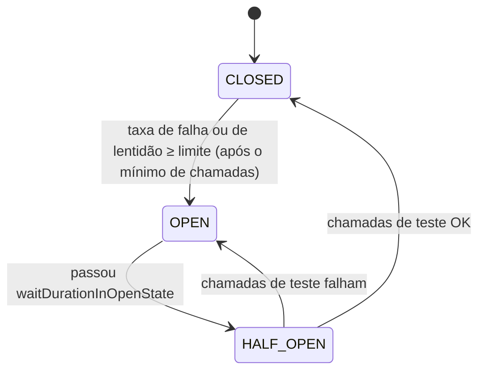

# P5.08 — Resilience4j II: circuit breaker, bulkhead e rate limiter

> ⏱️ ~1h30 · 🔵 Pleno · Pré-requisitos: P5.07, P3.01 (`L = λ × W`), P2.06 (*pool* de conexões), P1 (concorrência)

> ✅ **Validação final (2026-11-24):** módulo executado no PayFlow reconstruído; resultado e o que continua não executado no [README do módulo](README.md). Os avisos "não executado" / "por leitura" abaixo descrevem a escrita original.

> ⚠️ **Verificação:** tudo **executado** em `lab/integration-lab/resilience-lab` (JDK 25.0.5, Spring Boot **4.1.2**, **Resilience4j 2.4.0**; **17 testes** verdes; **sem Docker**). **Saídas reais** em `out-T3.txt`, `out-T4.txt`, `out-T7.txt` e `out-T10.txt`. **Não executado:** `ThreadPoolBulkhead`, `RateLimiter` **distribuído**, métricas/alertas no Prometheus (P6), `Bulkhead` com **threads virtuais** sob carga real. Valores como "janela de 10, mínimo de 5, 50%" são **do laboratório**, escolhidos para o teste **terminar rápido**: **meça** antes de copiar.

## 🎯 Objetivos
Ao final desta aula você consegue:
- **Descrever** os três estados do *circuit breaker* e **provar** as transições com um teste.
- **Configurar** o que **conta como falha** (5xx, *timeout*, **lentidão**) e o que **não** conta (4xx).
- **Dimensionar** um *bulkhead* com a **Lei de Little** e **explicar** o que ele protege.
- **Distinguir** *rate limiter* de **entrada** (proteger **você**) de **saída** (respeitar o **outro**).
- **Combinar** *timeout*, *retry*, *breaker*, *bulkhead* e *fallback* sem **se enganar** com o resultado.

## 🤔 Por que isso importa
O *timeout* limita o dano de **uma** chamada; o ***circuit breaker*** impede que você **continue tentando** enquanto o serviço **está doente**; o ***bulkhead*** garante que **um** serviço doente **não consuma todos** os seus recursos; o ***rate limiter*** protege **contra excesso** de chamadas. Juntos, eles fazem a diferença entre **degradar** (uma funcionalidade some) e **cair** (tudo para): a [P5.10](P5.10-estudo-de-caso-o-servico-de-notificacoes-que-derrubou-o-checkout.md) mostra os números.

## 💡 Intuição (explicação simples)
- **Circuit breaker:** o **disjuntor** da casa. Quando há **curto** (falhas demais), ele **desarma** e **corta** a corrente: nada pior acontece. Depois de um tempo você **rearma com cuidado** (algumas chamadas de teste); se o curto persiste, desarma de novo.
- **Bulkhead:** as **anteparas** de um navio: se um compartimento **alaga**, as paredes impedem que **o navio inteiro** afunde.
- **Rate limiter:** o **porteiro da balada**: entram **N por minuto**; os demais esperam ou voltam outro dia.

## 🔬 Como funciona por dentro

### 1. *Circuit breaker*: três estados

| Estado | Comportamento |
|---|---|
| **CLOSED** (fechado) | as chamadas **passam** e são **contadas** numa **janela** (por contagem ou por tempo) |
| **OPEN** (aberto) | as chamadas são **recusadas na hora** (`CallNotPermittedException`), **sem tocar** o serviço |
| **HALF_OPEN** | deixa passar um **número limitado** de chamadas de **teste** (`permittedNumberOfCallsInHalfOpenState`) |

**Executado** (`CircuitBreakerTest`, janela de **10** chamadas, **mínimo de 5**, limite de **50%**, espera de **300 ms**):
```
T3 aberto: chamada recusada em 1404 us, sem tocar o servidor (chamadas antes=5, depois=5)
T3 transicoes: [CLOSED->OPEN, OPEN->HALF_OPEN, HALF_OPEN->CLOSED] | metricas: 0 ok, 0 falhas, 0 recusadas
```
Quatro observações:
1. **Recusa sem tocar o servidor:** o contador do servidor ficou em **5** (antes e depois). A recusa levou **~1,4 ms** (**uma** medição, **inclui** a criação da exceção e código ainda "frio": **não** é *benchmark*; o ponto é que **não há chamada de rede**).
2. **A passagem OPEN → HALF_OPEN é preguiçosa:** sem **nova chamada**, o estado **continua `OPEN`** mesmo depois de a espera passar (o teste confirma). Quem quer a transição **automática** liga `automaticTransitionFromOpenToHalfOpenEnabled`.
3. **Ao fechar, a janela é zerada:** as métricas voltaram a **0/0/0** (não conte com o histórico para o *dashboard*).
4. O estado **é um singleton do contexto**: dois testes no mesmo contexto Spring **compartilham o *breaker*** (o meu primeiro teste das anotações **falhou por isso**; `reset()` no `@BeforeEach`).

### 2. O que **conta como falha** (a configuração que mais erra)
**Executado:**
```
T3 404 x20 com a configuracao PADRAO (toda excecao conta): estado=OPEN
T3 404 x20 com ignoreExceptions: estado=CLOSED (4xx = erro do chamador, nao da saude do servico)
T3 5 respostas 200 OK de 150 ms (limite de lentidao 100 ms): estado=OPEN
```
- Na configuração **padrão**, **toda exceção** é falha: **vinte `404`** (o **usuário** pediu algo que não existe) **abriram** o *breaker*, **cortando** quem **não** tinha problema nenhum. **Sempre** defina `recordExceptions` (5xx, E/S, *timeout*) e `ignoreExceptions` (4xx):
```java
CircuitBreakerConfig cfg = CircuitBreakerConfig.custom()
        .slidingWindowType(COUNT_BASED).slidingWindowSize(10).minimumNumberOfCalls(5)
        .failureRateThreshold(50)
        .slowCallDurationThreshold(Duration.ofMillis(100)).slowCallRateThreshold(50)
        .waitDurationInOpenState(Duration.ofMillis(300)).permittedNumberOfCallsInHalfOpenState(2)
        .recordExceptions(HttpServerErrorException.class, ResourceAccessException.class)
        .ignoreExceptions(HttpClientErrorException.class)
        .build();
```
- **Lentidão também conta**: cinco respostas **200 OK**, mas de **150 ms** (acima do limite de 100 ms), **abriram** o *breaker*. Um serviço **lento** é **doente** mesmo sem erro. *(Raciocínio, **não testado**: o `slowCallDurationThreshold` é avaliado quando a chamada **termina**; uma chamada **sem *timeout*** pode **nunca** terminar e então **não** seria contada: **o *timeout* continua obrigatório**.)*

### 3. *Bulkhead*: limitar **quantos ao mesmo tempo**
**Executado** (limite de **5** simultâneas; **20** chamadas ao mesmo tempo; servidor demora 300 ms):
```
T4 bulkhead 5: 20 chamadas simultaneas -> 5 executadas, 15 rejeitadas; maximo simultaneo no servidor=5
```
O `Bulkhead` (por **semáforo**) **limita a concorrência** a 5 e **rejeita** o resto na hora (`BulkheadFullException`, `maxWaitDuration` = 0). O servidor **nunca** viu mais de 5 chamadas ao mesmo tempo. Isso **protege o chamador**: o serviço lento **não pode** ocupar **todas** as *threads* do Tomcat.

**Como dimensionar (Lei de Little, P3.01):** `L = λ × W`.
Exemplo **ilustrativo**: a tela de preferências recebe **λ = 100 req/s** e a chamada leva **W = 50 ms** normalmente: `L = 100 × 0,05 =` **5** chamadas simultâneas em regime normal. Limite o *bulkhead* em **2 a 3 vezes** isso (**10 a 15**) para absorver variação; acima disso, **rejeitar** é melhor que **enfileirar**. **Meça** `λ` e `W` reais.

| Tipo | Como funciona | Quando |
|---|---|---|
| **Semáforo** (usado aqui) | limita **concorrência** na *thread* do chamador | padrão; combina com *threads* **virtuais** |
| **`ThreadPoolBulkhead`** | **pool** de *threads* próprio + fila | isolamento forte de *threads* de plataforma *(não executado)* |

### 4. *Rate limiter*: **dois** usos diferentes
**Executado:**
```
T4 rate limiter 10/s: 25 chamadas instantaneas -> 10 permitidas, 15 negadas (RequestNotPermitted)
```
| Uso | Onde | Exemplo no PayFlow |
|---|---|---|
| **Entrada** (proteger **você**) | **na borda** (gateway) ou por cliente | limitar **tentativas de login** (J8.06) e `POST /transfers` por usuário |
| **Saída** (respeitar o **outro**) | **no cliente** de um serviço externo | **cota** do provedor de e-mail/PSP (P3.10) |
O `RateLimiter` do Resilience4j limita **dentro de uma instância**: com **N réplicas**, o limite real é **N×** (*limite distribuído*: S1, Redis, P2.09; **não** executado).

### 5. Combinar tudo: a ordem e o que o cliente vê
Ordem padrão das anotações (P5.07): **`Retry ( CircuitBreaker ( RateLimiter ( TimeLimiter ( Bulkhead ( função ) ) ) ) )`**.
```
T7 breaker OPEN: chamadas ao servidor nao cresceram (5 -> 5); fallback: {"channel":"EMAIL","source":"fallback","cause":"CallNotPermittedException"}
```
Com o *breaker* aberto, a chamada protegida **responde o *fallback*** em microssegundos e **sem tocar** o servidor. O **resultado agregado** está na [P5.10](P5.10-estudo-de-caso-o-servico-de-notificacoes-que-derrubou-o-checkout.md): 30 *checkouts* com o serviço lento, **só 4 a 8** chamadas ao serviço doente (em vez de **30**) e a aplicação **inteira** responde.

## 🛠️ Exemplo prático: o desenho para o `payflow-notifications`
**Decisão (133, ADR 0017)** — valores **iniciais**, a **confirmar com medição** (P6):
```yaml
resilience4j:
  circuitbreaker:
    instances:
      notifications:
        sliding-window-type: COUNT_BASED
        sliding-window-size: 20
        minimum-number-of-calls: 10
        failure-rate-threshold: 50
        slow-call-duration-threshold: 1s     # acima do p99 normal
        slow-call-rate-threshold: 50
        wait-duration-in-open-state: 10s
        permitted-number-of-calls-in-half-open-state: 3
        record-exceptions: [ org.springframework.web.client.ResourceAccessException, org.springframework.web.client.HttpServerErrorException ]
        ignore-exceptions: [ org.springframework.web.client.HttpClientErrorException ]
  bulkhead:
    instances:
      notifications:
        max-concurrent-calls: 15             # L = λ × W com folga
        max-wait-duration: 0
```
**Regras do PayFlow:**
1. **Todo** *breaker* tem `record`/`ignore` **explícitos** (4xx **não** abre).
2. O estado do *breaker* **vira métrica e alerta** (P6): *fallback* **silencioso** **esconde** o problema (medido na P5.05 e na P5.10).
3. O ***fallback* é decisão de negócio** documentada (ex.: "mostrar o canal padrão e avisar 'preferências indisponíveis'"), **nunca** inventar dados financeiros.
4. **Nada** disso entra no **caminho** da transferência (decisão 104).

## 🧠 Pausa para lógica: quando o *breaker* abre?
Janela por **contagem** de **10**, `minimumNumberOfCalls` = **5**, limite **50%**. As chamadas, em ordem: ✅ ❌ ✅ ❌ ❌ ✅ ❌ ❌. Em qual chamada o *breaker* abre?

<details><summary>Dica e solução</summary>

**Dica:** só se avalia a taxa **depois** do mínimo de chamadas.

**Solução:** após a 5ª chamada (✅❌✅❌❌) há **3 falhas em 5 = 60%** ≥ 50% → **abre na 5ª** chamada. A 6ª em diante é **recusada** (não conta como sucesso). **Variação:** com `minimumNumberOfCalls = 10`, as **8** chamadas do enunciado **não bastam** para avaliar: o *breaker* continua **fechado** (a taxa de falha seria 5/8 = 62,5%, mas **ainda não conta**). **Lição:** o **mínimo** é um *trade-off* entre **reagir cedo** (e abrir por azar, com poucas amostras) e **reagir tarde** (e machucar mais chamadas).
</details>

## ⚖️ Trade-offs e quando NÃO usar
- **Breaker sensível demais** abre por **pico** e **corta tráfego bom**; **lento demais** deixa o dano passar. **Meça**; comece conservador.
- **Breaker por **instância** do cliente:** cada réplica **aprende sozinha** (e abre em momentos diferentes). Compartilhar estado **entre réplicas** é **complexo** (e raramente vale).
- **Bulkhead rejeitando** devolve **erro** ao usuário: é **melhor** que **travar** todos, mas **precisa** de *fallback* claro.
- **Rate limiter** protege, **mas** também **nega serviço legítimo** em pico: calibre por **cliente**, não globalmente.
- **Quando NÃO usar:** chamada **local** (mesmo processo), operação **crítica sem alternativa** (o *breaker* aberto = **indisponibilidade** garantida; aí o *fallback* **não existe** e a proteção é só o *timeout*), ou **dependência** que você **controla** e é **parte** da transação (banco do próprio serviço).

## ⚠️ Erros comuns e boas práticas de produção
- **Configuração padrão** (toda exceção conta): **404 abriu o breaker** (medido).
- ***Breaker* sem *timeout*:** a chamada **pendurada** nunca é contada (nem como lenta).
- ***Fallback* que esconde:** sem **alerta**, o serviço fica **morto semanas** sem ninguém ver.
- ***Bulkhead* grande demais:** vira **ausência** de limite; pequeno demais **rejeita tráfego normal**.
- **Compartilhar um *breaker* entre dependências diferentes:** uma doente **abre** para **todas** (use **um por dependência**).
- **Janela por tempo × por contagem:** com **pouco tráfego** a janela por contagem demora a "esquecer" falhas antigas (**use tempo**) e com **muito tráfego** a de tempo pode ter **poucas** amostras.
- **Testar só o caminho feliz:** sem teste que **abre** o *breaker* (como o do laboratório), você **não sabe** se a configuração funciona.

## 🧩 Exercícios
1. **Fixação:** (a) por que `404` **não** deve abrir o *breaker*? (b) o que o estado `HALF_OPEN` faz? (c) por que o *bulkhead* **rejeita** em vez de enfileirar?
2. **Aplicação no PayFlow** (por leitura):
   - [ ] Configure o *breaker* e o *bulkhead* de `notifications` com `record`/`ignore` explícitos.
   - [ ] Escreva um teste (como `CircuitBreakerTest`) que **abre** o *breaker* com 503, **confirma** que o servidor **não** é chamado, e **fecha** após a recuperação.
   - [ ] Exponha o estado do *breaker* como **métrica** (Micrometer) e escreva a **regra de alerta** (P6): "breaker aberto > 2 min".
   - Pronto quando: um teste **reprova** a configuração se `ignoreExceptions` não incluir `HttpClientErrorException`.
3. **Desafio:** repita a medição da **P5.10** com `bulkhead` **1**, **4** e **30** e explique o efeito no número de chamadas ao serviço doente e na latência dos *checkouts*.

<details><summary>Solução de referência (1)</summary>

(a) Porque é **erro do chamador** (pedido inválido), **não** sinal de saúde do serviço: vinte `404` **abriram** o *breaker* na configuração padrão (medido). (b) Deixa passar **poucas** chamadas de teste: se **dão certo**, fecha; se **falham**, reabre. (c) **Fila** esconde o problema: as chamadas **esperam** (e acumulam *threads* e latência); rejeitar na hora **mantém** o resto do sistema **respondendo**.
</details>

## 🎤 Na entrevista
1. **"Como funciona um circuit breaker?"** Três estados: **fechado** (passa e conta), **aberto** (recusa na hora, sem chamar o serviço) e **semiaberto** (poucas chamadas de teste). Abre quando a **taxa de falha ou de lentidão** passa do limite, depois de um **mínimo** de chamadas.
2. **"O que deve contar como falha?"** **5xx, *timeout*, erro de conexão e **lentidão***; **não** 4xx (erro do chamador). A configuração padrão conta **tudo**, e isso **abre** o *breaker* por motivos errados (medi: 20×404).
3. **"Bulkhead × rate limiter?"** *Bulkhead* limita **concorrência** (quantas ao **mesmo tempo**) e **isola recursos**; *rate limiter* limita **taxa** (quantas **por período**). Um protege **seus recursos** de um dependente lento; o outro, **contra excesso**.
4. **"Como dimensionar um bulkhead?"** **Lei de Little**: `L = λ × W` (concorrência = taxa × tempo de resposta), com folga de 2–3× e **medindo** `λ` e `W` reais.

## 📚 Para ir além
- 📄 [Resilience4j: CircuitBreaker](https://resilience4j.readme.io/docs/circuitbreaker): estados, janela, lentidão, `record`/`ignore`.
- 📄 [Resilience4j: Bulkhead](https://resilience4j.readme.io/docs/bulkhead) e [RateLimiter](https://resilience4j.readme.io/docs/ratelimiter): semáforo × *pool* e parâmetros.
- 📄 [Martin Fowler: Circuit Breaker](https://martinfowler.com/bliki/CircuitBreaker.html): a ideia original.
- 📄 [Microsoft: Circuit Breaker](https://learn.microsoft.com/en-us/azure/architecture/patterns/circuit-breaker), [Bulkhead](https://learn.microsoft.com/en-us/azure/architecture/patterns/bulkhead) e [Rate Limiting](https://learn.microsoft.com/en-us/azure/architecture/patterns/rate-limiting-pattern): quando e com que cuidados.
- 📄 [AWS Builders' Library: usando *load shedding* para evitar sobrecarga](https://aws.amazon.com/builders-library/using-load-shedding-to-avoid-overload/): recusar cedo para sobreviver.
- 📑 *Release It!* (Nygard) (**de memória, não conferido**).
- 💻 `lab/integration-lab/resilience-lab` (`CircuitBreakerTest`, `BulkheadRateLimiterTest`, `AnnotationsOrderTest`).

## ✅ Checklist da aula
- [ ] Sei os **3 estados** e **provo** as transições com teste.
- [ ] Sei configurar **o que conta como falha** (e que lentidão conta).
- [ ] Sei dimensionar um *bulkhead* com `L = λ × W`.
- [ ] Sei os **dois usos** do *rate limiter* e o limite por instância.
