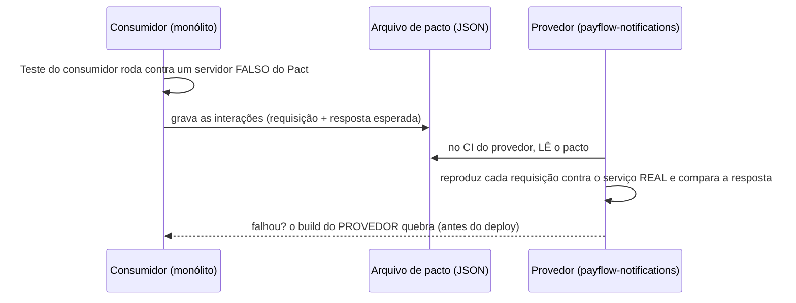

# P5.09 — Testes de contrato (Spring Cloud Contract ou Pact)

> ⏱️ ~1h30 · 🔵 Pleno · Pré-requisitos: P5.02, P5.04 (compatibilidade), J7 (pirâmide de testes, JUnit, `@SpringBootTest`), J6 (REST), P5.05

> ⚠️ **Verificação:** o fluxo **consumidor → arquivo de pacto → verificação no provedor**, a **prova** de que um provedor que **renomeia** ou **muda o tipo** de um campo **falha** e que um que **só acrescenta** **passa** foram **executados** em `lab/integration-lab/contract-lab` (JDK 25.0.5, Spring Boot **4.1.2**, **Pact JVM 4.7.7**; **8 testes** verdes; **sem Docker**, **sem Pact Broker**). **Saídas reais** em `out-contract-break.txt` e `out-pact.json`. **Não executado:** **Spring Cloud Contract** (a versão **5.0.3** existe no Maven Central e o BOM `2025.1.4` o inclui, mas **não foi rodado**; cai no mesmo aviso de compatibilidade com o Boot 4.1 da P5.05), **Pact Broker** e `can-i-deploy`, **pactos de mensagem** (eventos), `@PactBroker` na CI.

## 🎯 Objetivos
Ao final desta aula você consegue:
- **Explicar** o que um teste de contrato resolve que **testes de unidade e ponta a ponta** não resolvem.
- **Escrever** o teste do **consumidor** (gera o pacto) e a verificação do **provedor** (usa o pacto) com Pact.
- **Provar** que uma **quebra de contrato** é **detectada no CI do provedor** (e que uma mudança **aditiva** não é).
- **Comparar** **Pact** (guiado pelo **consumidor**) e **Spring Cloud Contract** (guiado pelo **provedor**).
- **Decidir** o que **entra** num contrato e o que **não**.

## 🤔 Por que isso importa
O teste "ponta a ponta" com **todos os serviços** no ar é **lento, frágil e caro**; o teste de unidade com **mock** do outro serviço **não sabe** se o mock **diz a verdade**. O **teste de contrato** fecha a lacuna: o **consumidor** registra **o que espera** do provedor; o **provedor** **prova**, no **seu** CI, que ainda cumpre. Assim, **renomear um campo** quebra o **build do provedor** (**antes** do deploy), não a produção (a história da [P5.04](P5.04-eventos-e-compatibilidade-de-apis-e-de-schemas.md): o renomeado vira `null` silencioso).

## 💡 Intuição (explicação simples)
Um **pedido por escrito** entre vizinhos: o **consumidor** (quem pede) escreve **"preciso de um `userId` e de uma lista `channels`"**; o **provedor** (quem entrega) guarda o pedido e, **toda vez** que muda a receita, **confere** se ainda consegue atender **todos** os pedidos. **Não** é um contrato de **tudo** que o provedor faz, só do que **alguém realmente usa**.

## 🔬 Como funciona por dentro

### 1. O fluxo (consumer-driven contracts)

Ideia vinda de [*Consumer-Driven Contracts*](https://martinfowler.com/articles/consumerDrivenContracts.html) (Fowler). O Pact explica o fluxo em [*How Pact works*](https://docs.pact.io/getting_started/how_pact_works).

### 2. Dependências do laboratório
```xml
<dependency><groupId>au.com.dius.pact.consumer</groupId><artifactId>junit5</artifactId><version>4.7.7</version><scope>test</scope></dependency>
<dependency><groupId>au.com.dius.pact.provider</groupId><artifactId>junit5</artifactId><version>4.7.7</version><scope>test</scope></dependency>
```
```xml
<!-- surefire: o Pact envia métricas anônimas por padrão; desligamos -->
<systemPropertyVariables><pact_do_not_track>true</pact_do_not_track></systemPropertyVariables>
```
> **Privacidade:** a primeira execução sem a propriedade mostrou o aviso `To disable tracking, set the 'pact_do_not_track' system property`. **Desligue** (`pact_do_not_track=true`) em CI e laboratório, como política da equipe.

### 3. O teste do **consumidor** (gera o pacto)
```java
@ExtendWith(PactConsumerTestExt.class)
@PactDirectory("src/test/resources/pacts")                       // onde o pacto é gravado
@PactTestFor(providerName = "notifications", pactVersion = PactSpecVersion.V3)
class ConsumerPactTest {

    @Pact(consumer = "payflow-monolith", provider = "notifications")
    RequestResponsePact preferencesOfExistingUser(PactDslWithProvider builder) {
        return builder
                .given("user u1 has preferences")                // ESTADO que o provedor deve preparar
                .uponReceiving("a request for the preferences of u1")
                    .path("/internal/v1/users/u1/preferences").method("GET")
                .willRespondWith()
                    .status(200)
                    .headers(Map.of("Content-Type", "application/json"))
                    .body(new PactDslJsonBody()
                            .stringValue("userId", "u1")
                            .minArrayLike("channels", 1, PactDslJsonRootValue.stringMatcher("EMAIL|PUSH|SMS", "EMAIL")))
                .toPact();
    }

    @Test
    @PactTestFor(pactMethod = "preferencesOfExistingUser")
    void clientReadsTheFieldsItUses(MockServer mock) {
        Preferences p = new NotificationClient(mock.getUrl()).preferences("u1");   // o cliente REAL do monólito
        assertThat(p.userId()).isEqualTo("u1");
        assertThat(p.channels()).isNotEmpty();
    }
}
```
O trecho do pacto gravado (`out-pact.json`, resumido): o corpo de **exemplo** e as **regras de correspondência** (*matchers*):
```json
"response": { "status": 200,
  "body": { "channels": ["EMAIL","EMAIL"], "userId": "u1" },
  "matchingRules": { "body": {
      "$.channels":   { "matchers": [ { "match": "type", "min": 1 } ] },
      "$.channels[*]":{ "matchers": [ { "match": "regex", "regex": "EMAIL|PUSH|SMS" } ] } } } }
```
Repare: o **provedor não precisa devolver exatamente** `["EMAIL","EMAIL"]`: basta ser uma **lista com pelo menos 1 item**, cada um **casando** a regex. O pacto descreve **forma**, não **valores**.

**Duas surpresas do laboratório:**
1. **Cada método `@Pact` com várias interações exige que o teste faça TODAS**: meu primeiro arquivo tinha duas interações num só `@Pact` e **os dois testes falharam** com `PactMismatchesException … The following requests were not received`. Solução: **um `@Pact` por cenário**.
2. O `minArrayLike("channels", 1, …)` gravou **dois** itens de exemplo (`["EMAIL","EMAIL"]`) apesar de `min = 1`: o **exemplo** não é o **mínimo**; o **mínimo** está nas regras.

### 4. A verificação do **provedor** (usa o pacto)
```java
@Provider("notifications")
@PactFolder("src/test/resources/pacts")
@SpringBootTest(webEnvironment = SpringBootTest.WebEnvironment.RANDOM_PORT)
class ProviderPactVerificationTest {

    @LocalServerPort int port;

    @BeforeEach
    void target(PactVerificationContext context) { context.setTarget(new HttpTestTarget("localhost", port)); }

    @TestTemplate
    @ExtendWith(PactVerificationInvocationContextProvider.class)
    void verify(PactVerificationContext context) { context.verifyInteraction(); }

    @State("user u1 has preferences")
    void u1Exists() { PreferencesController.STORE.put("u1", List.of("EMAIL", "PUSH")); }

    @State("user ghost does not exist")
    void ghostDoesNotExist() { PreferencesController.STORE.remove("ghost"); }
}
```
Cada `@State` **prepara os dados** que a interação pressupõe ("dado que o usuário u1 tem preferências"). O Pact **sobe o serviço real**, dispara cada requisição do pacto e **compara** a resposta com as regras.

### 5. A **prova**: o provedor que quebra (executada)
O `PreferencesController` do laboratório aceita a propriedade `lab.break` para **simular** versões do provedor. Resultado (`out-contract-break.txt`):
| Mudança no **provedor** | Resultado da verificação | Mensagem real |
|---|---|---|
| `additive`: **acrescenta** `quietHours` | **passa** (`has a matching body (OK)`) | — |
| `rename`: `channels` → `notificationChannels` | **FALHA** | `body: $ Actual map is missing the following keys: channels` |
| `type`: `channels` vira *string* `"EMAIL,PUSH"` | **FALHA** | `body: $.channels Type mismatch: Expected 'EMAIL,PUSH' (String) to be the same type as ["EMAIL","EMAIL"] (Array)` |
Um teste de contrato **que nunca falhou não prova nada**: aqui **vimos** falhar (e **vimos** passar a mudança **aditiva**, que é exatamente a **tolerância** da P5.04).

### 6. Pact × Spring Cloud Contract
| | **Pact** | **Spring Cloud Contract** |
|---|---|---|
| **Quem escreve o contrato** | o **consumidor** (código de teste) | o **provedor** (Groovy/YAML/Kotlin) |
| **Direção** | **guiado pelo consumidor** | **guiado pelo provedor** (consumidores recebem **stubs**) |
| **Linguagens** | **poliglota** (JVM, JS, Go, .NET, …) | **JVM/Spring** (com *stubs* HTTP para qualquer cliente) |
| **Compartilhar** | arquivo de pacto / **Pact Broker** (com `can-i-deploy`) | JAR de *stubs* num repositório de artefatos |
| **Quando** | **vários consumidores/times**, **poliglota**, provedor quer saber **quem usa o quê** | **time dono** dos dois lados, **ecossistema Spring**, provedor **dita** o contrato |
| **Neste treinamento** | **executado** | **não executado** ([documentação](https://docs.spring.io/spring-cloud-contract/reference/)) |
**Decisão (134, ADR 0017):** **Pact** (consumer-driven) como padrão: o **monólito** é consumidor da **API HTTP** do serviço de notificações; para **eventos**, o consumidor é o serviço (P5.04). Além disso, o **Pact não pertence ao trem do Spring Cloud** (o aviso de versão da P5.05 **não** se aplica a ele). **Spring Cloud Contract** fica **citado** como alternativa quando o provedor quiser **ditar** o contrato.

### 7. O que **entra** num contrato (e o que não)
| Entra | **Não** entra |
|---|---|
| **Campos que o consumidor usa** (nome, **tipo**, obrigatório) | campos que ninguém usa |
| **Status** e cabeçalhos **relevantes** (`Content-Type`) | **regras de negócio** (isso é teste do **provedor**) |
| **Erros** que o consumidor **trata** (404, 422) | **valores exatos** (use `matchers` de tipo/regex) |
| **Estados** do provedor (`@State`) | **desempenho** e **segurança** |
Regra de ouro: o **contrato** cobre o **formato da conversa**; o **significado** é do **teste de funcionalidade** de cada lado.

### 8. **Eventos** (Kafka) e contratos
Para o evento `payflow.transfers.v1`, o **equivalente** é o teste de **leitura tolerante** do consumidor sobre **amostras** do produtor (P5.04, `EventCompatibilityTest`, **executado**). O Pact também tem **pactos de mensagem** (assíncronos) *(não executado)* e o Spring Cloud Contract tem **contratos de mensageria** *(não executado)*. Em ambos o objetivo é o mesmo: **o produtor falha o build** se **quebrar** o que um consumidor lê.

## 🛠️ Exemplo prático: o pipeline do PayFlow
1. **Repositório do consumidor** (`payflow`, monólito): `ConsumerPactTest` **gera** `payflow-monolith-notifications.json`; o CI **publica** o arquivo (como **artefato** do build; um **Pact Broker** vem na P8).
2. **Repositório do provedor** (`payflow-notifications`): `ProviderPactVerificationTest` **baixa** o pacto da **versão em produção** do consumidor e **verifica** a cada PR.
3. **Quebra:** o PR que renomeia `channels` **falha** com a mensagem acima; o autor **descobre antes do merge** e usa **expandir → migrar → contrair** (P5.04).
4. **Fixture de evento** no repositório do produtor: amostras de `TransferCompletedV1` lidas pelo `JsonMapper` do consumidor.
5. **Antes do deploy** (P8): `can-i-deploy` **pergunta ao Broker** se a versão do provedor **cumpre todos** os consumidores em produção ([docs](https://docs.pact.io/pact_broker/can_i_deploy), **não executado**).

## 🧠 Pausa para lógica: qual contrato quebra?
Um pacto diz: `GET /preferences` → `200` com `userId` (*string*) e `channels` (lista de pelo menos 1, valores `EMAIL|PUSH|SMS`). Para cada versão do provedor, diga se a verificação **passa** ou **falha**: (a) acrescenta `locale: "pt-BR"`; (b) devolve `channels: []` para um usuário sem canais; (c) acrescenta o valor `WHATSAPP` à lista; (d) troca `userId` de *string* para número; (e) passa a devolver `404` para usuário **sem** preferências (antes devolvia 200 com padrão).

<details><summary>Dica e solução</summary>

**Dica:** o pacto só vê o que o **consumidor declarou**.

**Solução:** (a) **passa** (campo extra é ignorado; **tolerância**). (b) **falha** (`min: 1` exige pelo menos 1). (c) **falha** *se o usuário do estado* tiver `WHATSAPP` (a regex é `EMAIL|PUSH|SMS`): o **consumidor** precisa **primeiro** aceitar o valor (atualize o pacto) — igual ao enum da P5.04. (d) **falha** (tipo diferente). (e) **passa**: o `404` só aparece num **estado** "usuário sem preferências" e **nenhuma** interação do pacto o cobre; o contrato **não protege** o que o consumidor **não declarou**. **Lição:** **declare** os estados que importam (inclusive **vazio** e **erro**).
</details>

## ⚖️ Trade-offs e quando NÃO usar
- **Contrato × ponta a ponta:** o contrato **não** prova que o **sistema todo** funciona; prova que **as duas pontas combinam** (e é **rápido**). Mantenha **poucos** testes de ponta a ponta para o **fluxo crítico**.
- **Custo de manter:** cada consumidor = **um pacto** a manter; com **um** consumidor e **um** time, **testes de integração do cliente** já bastam.
- **Pacto vira regra de negócio:** quando o consumidor **verifica valores exatos**, o provedor **não** consegue evoluir; **use tipos e regex**.
- **Pact Broker/`can-i-deploy`** é **mais uma peça** a operar; com **dois** serviços um **artefato de CI** pode bastar.
- **Provedor "dono do contrato"** (poucos consumidores, mesma empresa) combina melhor com **Spring Cloud Contract**.

## ⚠️ Erros comuns e boas práticas de produção
- **Contrato gigante** que copia a resposta **inteira**: qualquer campo novo quebra o provedor. **Só o que o consumidor usa**.
- **Sem estados** (`@State`): a verificação **depende** do que estiver no banco por acaso.
- **Valores fixos** (`"EMAIL"`) em vez de *matchers*: contrato **frágil**.
- **Pacto desatualizado** (copiado à mão): ele **precisa** ser **gerado** pelo teste do consumidor.
- **Verificar o pacto contra um *mock*** do provedor: **perde o sentido**; suba o **serviço real**.
- **Dois `@Pact` misturados** num método (medido: **falha**): **um cenário por método**.
- **Esquecer `pact_do_not_track`**: métricas anônimas saem do CI.
- **Tratar o teste verde como "compatível com todos"**: só vale para os **pactos** existentes.

## 🧩 Exercícios
1. **Fixação:** (a) quem escreve o pacto no modelo do Pact? (b) o que é um `@State`? (c) por que *matchers* em vez de valores?
2. **Aplicação no PayFlow** (por leitura):
   - [ ] Crie `ConsumerPactTest` no monólito para `GET /internal/v1/users/{id}/preferences` (200 e 404) e **guarde** o pacto como artefato do CI.
   - [ ] Crie `ProviderPactVerificationTest` em `payflow-notifications` com os `@State` necessários.
   - [ ] **Prove** que a verificação **falha** renomeando um campo (o teste do laboratório com `lab.break`) e que **passa** acrescentando um.
   - Pronto quando: um PR de provedor que renomeia `channels` **falha** no CI; um que acrescenta campo **passa**.
3. **Desafio:** escreva um **pacto de mensagem** para `TransferCompleted` (ou o contrato equivalente no Spring Cloud Contract) e compare o esforço com o teste de leitura tolerante.

<details><summary>Solução de referência (1)</summary>

(a) O **consumidor**, no código do **seu** teste (o Pact grava o arquivo). (b) Uma **precondição** do provedor ("dado que o usuário u1 existe"): o método `@State` **prepara** os dados antes de cada interação. (c) Para que o contrato descreva a **forma** (tipo, formato) e **não** valores específicos, deixando o provedor **evoluir** sem quebrar.
</details>

## 🎤 Na entrevista
1. **"O que é teste de contrato e por que não basta o de integração?"** Verifica que **consumidor e provedor combinam** sobre a interface, **sem subir tudo**. O **consumidor** declara o que usa; o **provedor** prova, no **seu** CI, que ainda cumpre. Detecta quebra **antes do deploy**, com **feedback rápido** e **sem** ambiente completo.
2. **"Pact × Spring Cloud Contract?"** Pact: **guiado pelo consumidor**, poliglota, com Broker. SCC: **guiado pelo provedor**, ecossistema Spring/JVM, **stubs** para os consumidores. Escolho pelo **dono do contrato** e pelo **número de consumidores**.
3. **"O que um bom contrato contém?"** **Só o que o consumidor usa**: campos, **tipos**, status, cabeçalhos relevantes e erros tratados; *matchers* em vez de valores; **nada** de regra de negócio.
4. **"Como o contrato evita o `null` silencioso do campo renomeado?"** O **provedor falha o build** (`missing the following keys`), com a mensagem que **aponta** o campo e a interação.

## 📚 Para ir além
- 📄 [Pact: documentação](https://docs.pact.io/) e [*How Pact works*](https://docs.pact.io/getting_started/how_pact_works): o modelo mental.
- 📄 [Pact JVM: consumidor com JUnit 5](https://docs.pact.io/implementation_guides/jvm/consumer/junit5) e [provedor com JUnit 5](https://docs.pact.io/implementation_guides/jvm/provider/junit5): as anotações e a configuração usadas aqui.
- 📄 [Pact: `can-i-deploy`](https://docs.pact.io/pact_broker/can_i_deploy): o portão de implantação (P8).
- 📄 [Spring Cloud Contract](https://docs.spring.io/spring-cloud-contract/reference/): a alternativa guiada pelo provedor.
- 📄 [Martin Fowler: Consumer-Driven Contracts](https://martinfowler.com/articles/consumerDrivenContracts.html): a ideia original.
- 💻 [pact-jvm no GitHub](https://github.com/pact-foundation/pact-jvm) e `lab/integration-lab/contract-lab`.

## ✅ Checklist da aula
- [ ] Sei o **fluxo** (consumidor grava, provedor verifica) e **por que** é rápido.
- [ ] Sei escrever `@Pact`, `@State` e a verificação.
- [ ] Sei **provar** que o contrato **falha** quando deve e **passa** na mudança aditiva.
- [ ] Sei **escolher** entre Pact e Spring Cloud Contract e o que **não** pôr no contrato.
