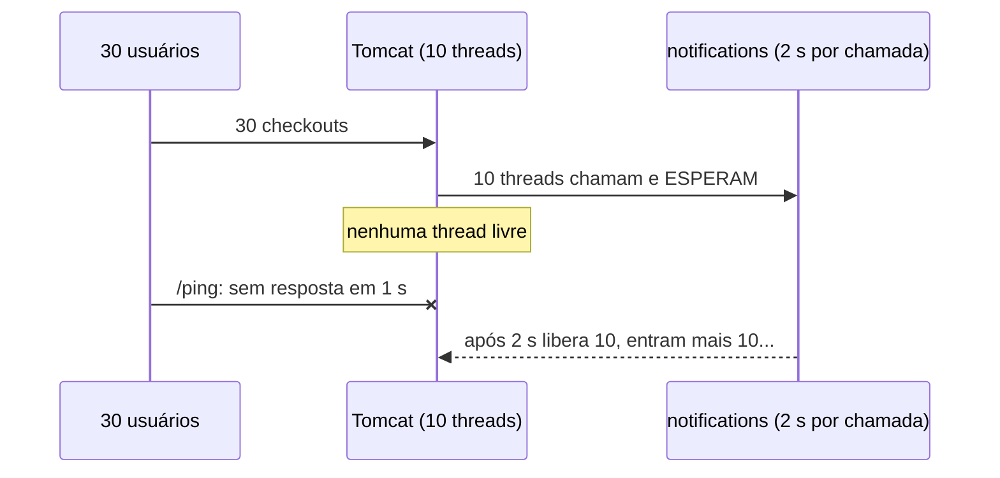

# P5.10 — 🏗️ Estudo de caso: o serviço de notificações que derrubou o checkout

> ⏱️ ~1h30 · 🔵 Pleno · Pré-requisitos: P5.01–P5.09, P3.13 (formato de postmortem), P4.11 (ADR de incidente), P1 (*pools* e *threads*)

> ⚠️ **Verificação:** o **incidente** é **fictício** (narrativa), mas a **mecânica** foi **reproduzida de verdade** em `lab/integration-lab/resilience-lab` (JDK 25.0.5, Spring Boot **4.1.2**, **Tomcat embutido com 10 *threads*** e *threads* de plataforma, Resilience4j **2.4.0**; **17 testes verdes**; **sem Docker**). **Saída real** em `out-T10.txt`. Os **tempos** da narrativa (horas, "p95 de 300 ms") são **ilustrativos**; os **números do laboratório** (30 requisições, 2 s de latência, 10 *threads*) são **medidos** e **pequenos de propósito** para o efeito aparecer em segundos. **Não executado:** *thread dump* (`jcmd`/`jstack`) do incidente, Tomcat com *threads* virtuais, métricas em Prometheus.

## 🎯 Objetivos
Ao final desta aula você consegue:
- **Diagnosticar** uma **falha em cascata**: um serviço **lento** derruba o **chamador** inteiro.
- **Explicar** por que **uma rota que não tem nada a ver** (`/ping`) **também** para.
- **Corrigir** em **camadas** (remover do caminho crítico, *timeout*, *breaker*, *bulkhead*, *fallback*) e **medir** o efeito.
- **Impor** a regra no CI com um **teste que simula a lentidão**.
- **Escrever** um postmortem **sem culpa** com ações **mecânicas**.

## 🤔 Por que isso importa
A frase **"foi só um e-mail"** já derrubou muito sistema. O serviço de notificações é **opcional** para o negócio (a transferência **vale** sem e-mail), mas **se for chamado de forma síncrona e sem proteção**, ele passa a ser **tão crítico quanto o banco**. O problema **não** é ele estar lento (acontece); é **não ter sido desenhado** para estar lento.

## 💡 Intuição (explicação simples)
Um restaurante com **10 garçons**. Para **fechar cada conta**, o garçom precisa **ligar para a gráfica** que imprime o **cartão de agradecimento**. Um dia a gráfica **demora 2 minutos** para atender. Em minutos, **os 10 garçons** estão **no telefone esperando**; **ninguém** serve mesa, **nem quem só queria água** (o `/ping`). O restaurante **não** quebrou por causa da gráfica; quebrou porque **o telefone não tinha limite de espera**.

## 🔬 Como funciona por dentro

### O incidente (narrativa)
> **Contexto.** O PayFlow já extraiu o `payflow-notifications` (P5.02). Numa *sprint* corrida, alguém acrescenta ao **checkout** (a transferência) uma **consulta síncrona** às **preferências** do usuário ("para decidir já se o recibo vai por e-mail ou push"), com o `RestClient` **padrão**: **sem *timeout*** (P5.07).
> **Sexta, 16h40.** O provedor de e-mail do serviço de notificações **degrada**; o serviço passa a responder em **2 s** (em vez de 30 ms).
> **16h42.** O p95 do **checkout** sobe de 300 ms para **dezenas de segundos**. **16h45.** O **monólito inteiro** deixa de responder, **inclusive o `/ping` do balanceador**, que **retira** as instâncias do ar. **16h50.** Ninguém consegue fazer transferência. O serviço de notificações **continua "no ar"**, só **lento**.

### 1. A mecânica (reproduzida): o que o laboratório mediu
O laboratório tem **um** `CheckoutController` com duas rotas **idênticas** no trabalho local (5 ms) que chamam o serviço de notificações (**2 s** por chamada), mais um `/ping` (sem relação). O Tomcat tem **10 *threads*** (`server.tomcat.threads.max=10`). **30 requisições** simultâneas ao *checkout*:

**Sem proteção** (`/checkout-naive`: cliente **sem *timeout***):
```
T10 saudavel: /ping = Result[status=200, ms=63]
T10 SEM protecao, 0,5 s depois: /ping (nao tem nada a ver com notificacoes) = Result[status=-1, ms=1000]  <- NAO respondeu em 1 s
T10 SEM protecao: 30 checkouts -> 30/30 com 200; mediana 4024 ms; maior 6034 ms; chamadas ao servico lento=30
```
- Em **0,5 s** as **10 *threads*** já estavam **presas** esperando o serviço; o `/ping` **não respondeu em 1 s** (`-1` = o chamador desistiu): **a aplicação inteira parou**, não só o *checkout*.
- Os 30 *checkouts* **terminaram "bem"** (todos **200**), mas com **mediana de 4,0 s** e **máximo de 6,0 s** (3 "ondas" de 10 *threads* × 2 s): para o usuário, **parece fora do ar**.
- **30** chamadas foram feitas ao serviço **doente** (nenhuma foi **poupada**).

**Com proteção** (`/checkout-protected`: *timeout* de 300 ms + `@Retry` + `@CircuitBreaker` + `@RateLimiter` + `@Bulkhead` de 4 + *fallback*):
```
T10 COM protecao, 0,5 s depois: /ping = Result[status=200, ms=3]
T10 COM protecao: 30 checkouts -> 30/30 com 200; mediana 37 ms; maior 665 ms; chamadas ao servico lento=8
```
- O `/ping` respondeu em **3 ms**: a aplicação **continuou saudável**.
- **30/30** deram `200`, **mediana de 37 ms**, **máximo de 665 ms** (as primeiras que esperaram o *timeout* de 300 ms, com tentativas).
- **Só 8** chamadas chegaram ao serviço doente (em vez de **30**): o **bulkhead** (4 simultâneas) e o ***breaker*** (aberto após as primeiras falhas) **pouparam** o resto. **Ressalva honesta:** **uma** rodada por cenário aqui; a **mediana protegida variou de 36 a 186 ms** entre execuções (a máquina é **compartilhada**), o `8` repetiu em **todas** as execuções.
- O custo: **a resposta traz o *fallback*** ("canal EMAIL padrão"), **não** a preferência **real**: o usuário **não** vê erro, mas o dado **é uma suposição**. Isso é **decisão de negócio** (P5.08).



### 2. Diagnóstico (como se descobre)
Os sinais, **em ordem**:
1. **Latência do *checkout*** sobe **sem aumento de CPU** (as *threads* estão **esperando**, não trabalhando).
2. **`/ping` e rotas não relacionadas** também degradam: sinal de **esgotamento de *pool*** compartilhado.
3. **Métricas do Tomcat:** *threads* ocupadas = máximo; fila de conexões cheia (P6).
4. ***Thread dump*** (`jcmd <pid> Thread.print`, *não executado aqui*): dezenas de *threads* **paradas na mesma pilha** (`HttpClient`/`RestClient` → leitura de socket → `NotificationClient.preferences`).
5. **Tracing** (P6): o *span* do cliente de notificações **domina** o tempo total.
**A causa raiz não é o provedor de e-mail**: é **a chamada síncrona, no caminho crítico, sem *timeout* nem isolamento**.

### 3. As opções (e o que cada uma custa)
| Opção | Resolve? | Custo / risco |
|---|---|---|
| **A. Pedir ao time de notificações "ficar rápido"** | não (a lentidão **vai** acontecer de novo) | nenhum, e **nada muda** |
| **B. Aumentar o *pool* do Tomcat** (10 → 200) | **adia** (200 *threads* também enchem) | mais memória/CPU; esconde o defeito |
| **C. Só *timeout*** | **limita** a espera (300 ms) | ainda **gasta** uma *thread* por tentativa; sem *breaker*, todas esperam 300 ms **cada** |
| **D. *Timeout* + *breaker* + *bulkhead* + *fallback*** (medido) | **sim**: app saudável, 8/30 chamadas ao doente | **mais configuração**; *fallback* é decisão de negócio |
| **E. Tirar a chamada do caminho crítico** (evento/Outbox, P3) | **sim, na raiz**: o checkout **nem depende** do serviço | muda o **desenho** (a preferência vem por **evento/cópia**, P5.04) |
| **F. Voltar o módulo ao monólito** | sim | **perde** o isolamento que motivou o serviço (P5.01) |

## 🛠️ Exemplo prático: a decisão (formato ADR)
**Contexto.** Incidente acima. **Decisão (135, ADR 0017):**
1. **Opção E como regra:** **o *checkout* não faz chamada síncrona** ao serviço de notificações. Preferências que o monólito precise **chegam por evento** (`NotificationPreferencesChanged`) e ficam numa **cópia própria** (P4.11, P5.04); a **notificação** continua **por evento/fila** (P3).
2. **Opção D para o que sobrar síncrono** (a tela de preferências, via gateway): *timeout*, *breaker* com `record`/`ignore` **explícitos**, *bulkhead* por **Lei de Little**, *fallback* **documentado** e **alerta** quando o *breaker* abrir (P5.07/P5.08).
3. **Regra de CI:** **todo cliente HTTP** tem **teste com servidor lento** (como `TimeoutsTest`/`CascadeFailureTest`) que **falha** se o chamador esperar **mais** que o prazo.
4. **Revisão de PR:** "esta chamada está no **caminho crítico**? O que acontece se o destino levar 30 s?".

**Consequências.** (+) O checkout **independe** do serviço; (+) degradação **visível** (métrica/alerta); (−) a cópia de preferências é **eventualmente consistente** (decisão aceita: preferência velha por segundos **não** é dano); (−) mais teste e configuração.

## 🧠 Pausa para lógica: quanto tempo até parar?
O Tomcat tem **200 *threads***; o serviço de notificações passa a levar **10 s**; o *checkout* recebe **50 req/s**, todas chamando-o. Em quanto tempo as *threads* **acabam**? Com **timeout de 300 ms**, quantas *threads* o serviço doente **segura** em regime?

<details><summary>Dica e solução</summary>

**Dica:** `L = λ × W` (P3.01): *threads* ocupadas = taxa × tempo de espera.

**Solução:** sem *timeout*, cada requisição **segura** uma *thread* por **10 s**; a taxa de **50 req/s** consome **50 *threads* por segundo** (e libera 0 nos primeiros 10 s): **200 ÷ 50 = 4 s** até o *pool* acabar. Em regime, o ocupado seria `50 × 10 =` **500** > 200 (**não cabe**). Com *timeout* de 300 ms: `50 × 0,3 =` **15 *threads*** ocupadas em regime (e menos ainda com *breaker* aberto, que **recusa na hora**). **Lição:** **o *timeout* transforma "a espera ilimitada" em "um custo limitado" e calculável.** **Variação:** com **threads virtuais** (P3.12) o *pool* **não** se esgota do mesmo jeito, mas o **pool de conexões** e a **memória** sim: o *timeout* **continua** necessário (**não** executado aqui).
</details>

## ⚖️ Trade-offs e quando NÃO usar
- **Proteger com *breaker*/*bulkhead*** **não conserta** um desenho que **depende** do serviço: **degrada** em vez de cair, mas a **funcionalidade** some. A correção **de raiz** é **tirar do caminho crítico** (E).
- **Fallback** "bonzinho" **esconde** o incidente (medido: 30/30 com 200). **Alerte** pelo estado do *breaker* (P6), senão ninguém fica sabendo por **semanas**.
- **Evento + cópia** troca acoplamento **síncrono** por **consistência eventual** e **duplicação**: ótimo para preferências, **péssimo** para **saldo** (dinheiro **não** vai por cópia: decisão 104).
- **Aumentar o *pool*** (B) é **a pior** das saídas: **adia** e **encarece**.

## ⚠️ Erros comuns e boas práticas de produção
- **"É só um e-mail"**: **todo** serviço no caminho síncrono é **crítico** até provarem o contrário.
- **Chamada remota sem *timeout*** (medido: **toda** a aplicação parou em 0,5 s).
- **Health check do balanceador** no mesmo *pool* de *threads* das requisições: a instância é **retirada** exatamente quando mais se precisa dela. Considere um *endpoint* de *liveness* **separado**/porta de gerenciamento (P6/P7).
- **Testar só o caminho feliz** do cliente: **ninguém** viu o serviço lento **antes** da sexta às 16h40.
- **Fallback sem alerta**; **retry sem limite** (P5.07); **bulkhead único** para dependências diferentes.
- **Culpar o time do serviço lento** em vez do **desenho** do chamador.

## 🧩 Exercícios
1. **Fixação:** (a) por que o `/ping` parou? (b) o que mudou no número de chamadas ao serviço lento (30 → 8) e quem **poupou** o resto? (c) por que "aumentar o *pool*" **não** resolve?
2. **Aplicação no PayFlow** (por leitura):
   - [ ] Escreva `NotificationClientSlowTest`: servidor falso com **2 s**, cliente com **timeout 300 ms**; **falha** se a chamada levar > 500 ms.
   - [ ] Remova a chamada síncrona do *checkout* e crie a **cópia de preferências** alimentada pelo evento `NotificationPreferencesChanged` (com **idempotência**, P3.07).
   - [ ] Configure o **alerta** "breaker de `notifications` aberto > 2 min" (P6) e escreva o **runbook** de **uma página**.
   - Pronto quando: o teste de **servidor lento** passa, o *checkout* funciona com o serviço de notificações **parado** (teste), e o **postmortem** tem **ação mecânica** (CI).
3. **Desafio:** repita a medição do laboratório com **`spring.threads.virtual.enabled=true`** e discuta: o que muda? (O *pool* esgota? E a **memória** e as **conexões**?).

<details><summary>Solução de referência (1)</summary>

(a) Porque as **10 *threads*** do Tomcat estavam **todas presas** na chamada lenta; **qualquer** requisição (inclusive `/ping`) precisa de **uma *thread*** e **não havia** nenhuma livre. (b) O **bulkhead** (máx. 4 simultâneas) e o **breaker** (aberto após as primeiras falhas) **recusaram** as outras chamadas **na hora**: **8** chegaram ao serviço, não 30. (c) Porque com **espera ilimitada** qualquer *pool* **finito** se esgota (a **taxa de chegada × o tempo de espera** passa do tamanho); o *pool* maior só **demora mais** a encher e consome **mais memória**.
</details>

## 📝 Postmortem (sem culpa), modelo preenchido
| Campo | Conteúdo |
|---|---|
| **Impacto** | transferências **indisponíveis** por ~10 min (16h40–16h50); nenhum dado perdido (a transferência é **atômica**, decisão 104) |
| **Causa raiz** | chamada **síncrona** ao serviço de notificações no *checkout*, **sem *timeout*, *breaker* nem *bulkhead***; *pool* de 10 *threads* esgotado |
| **Fatores contribuintes** | revisão de PR **não** perguntou pelo caminho crítico; **sem teste** de dependência lenta; *health check* no mesmo *pool* |
| **Detecção** | alerta de **latência do *checkout***; o *dashboard* de **threads** ocupadas **não existia** |
| **O que foi bem** | transferência **atômica**: **nenhum** saldo inconsistente |
| **Ações (mecânicas)** | (1) teste de **servidor lento** em **todo** cliente HTTP (**CI**); (2) remover a chamada do *checkout* (evento + cópia); (3) *timeouts* obrigatórios por **propriedade sem padrão** (a app **não sobe** sem eles); (4) **alerta** de *breaker* aberto; (5) pergunta "caminho crítico?" no **modelo de PR** |

## 🎤 Na entrevista
1. **"Um serviço lento pode derrubar o seu? Como?"** Sim: cada chamada **segura** uma *thread*/conexão; com **espera ilimitada** o *pool* **esgota** e **tudo** (até o *health check*) para. Medi: **10 *threads***, 30 requisições a um serviço de 2 s → `/ping` **sem resposta** em 1 s.
2. **"Como evitar?"** **Tirar** a chamada do caminho crítico (evento/assíncrono) e, o que for síncrono, **timeout** + **circuit breaker** + **bulkhead** + ***fallback*** com **alerta**.
3. **"Por que só aumentar o *pool* não resolve?"** Porque a espera é **ilimitada**: qualquer *pool* finito **enche** (Little: taxa × espera); só **adia** e gasta mais memória.
4. **"Como você garante que isso não volta?"** **Teste de dependência lenta** no CI (falha se o chamador esperar além do prazo), propriedades de *timeout* **obrigatórias**, alerta do *breaker* e **revisão** de caminho crítico.

## 📚 Para ir além
- 📄 [Google SRE Book: Addressing Cascading Failures](https://sre.google/sre-book/addressing-cascading-failures/): o capítulo sobre falhas em cascata, com as causas e as defesas.
- 📄 [AWS Builders' Library: timeouts, retries and backoff with jitter](https://aws.amazon.com/builders-library/timeouts-retries-and-backoff-with-jitter/) e [*load shedding*](https://aws.amazon.com/builders-library/using-load-shedding-to-avoid-overload/): recusar cedo para sobreviver.
- 📄 [Microsoft: Bulkhead](https://learn.microsoft.com/en-us/azure/architecture/patterns/bulkhead) e [Circuit Breaker](https://learn.microsoft.com/en-us/azure/architecture/patterns/circuit-breaker): as anteparas e o disjuntor.
- 📄 [Resilience4j](https://resilience4j.readme.io/docs/getting-started-3): a biblioteca usada na medição.
- 📑 *Release It!* (Nygard), capítulos sobre **estabilidade** e *anti-patterns* (**de memória, não conferido**).
- 💻 `lab/integration-lab/resilience-lab` (`CascadeFailureTest`).

## ✅ Checklist da aula
- [ ] Sei explicar **por que o `/ping` parou** (esgotamento de *pool*).
- [ ] Sei as **camadas** de correção e qual é a **de raiz** (tirar do caminho crítico).
- [ ] Sei **escrever o teste** de dependência lenta que impede a volta do problema.
- [ ] Sei preencher um **postmortem** sem culpa com ações **mecânicas**.
