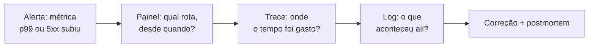

# P6.01 — Os três pilares e logs estruturados com correlation ID

> ⏱️ ~1h30 · 🔵 Pleno · Pré-requisitos: J5.14 (SLF4J/Logback, MDC, decisão 38), J6.04 (Problem Details), P3.02 (`@Async` e `TaskDecorator`), P5.10 (a falha em cascata)

> ✅ **Validação final (2026-11-24):** módulo executado no PayFlow reconstruído; resultado e o que continua não executado no [README do módulo](README.md). Os avisos "não executado" / "por leitura" abaixo descrevem a escrita original.

> ⚠️ **Verificação:** tudo que está marcado como "medido" foi **executado** em `lab/observability-lab` (JDK 25.0.5, Spring Boot **4.1.2**, Micrometer 1.17.2; **31 testes** verdes; **sem Docker** nesta aula). **Saídas reais** em `out-T1.txt`. **Por leitura:** a aplicação do `payflow` do aluno (o repositório não existe nesta máquina; os testes práticos do PayFlow ficam para o **fim do treinamento**, por decisão do aluno).

## 🎯 Objetivos
Ao final desta aula você consegue:
- **Distinguir** os três pilares (logs, métricas, traces), dizer **que pergunta cada um responde** e em que **ordem** usá-los num incidente.
- **Configurar** logs **estruturados** (JSON, formato ECS) no Spring Boot 4.1 sem escrever um *encoder*.
- **Propagar** dois identificadores (`requestId` de suporte e `traceId` técnico) até o **log**, a **resposta de erro** e as **threads** de `@Async`.
- **Decidir** o que é `WARN`, o que é `ERROR` e por que um *catch-all* ingênuo **polui** o monitoramento.
- **Provar** com teste que o contexto atravessa (ou **não** atravessa) a thread.

## 🤔 Por que isso importa
Na [P5.10](../P5-microsservicos-integracao/P5.10-estudo-de-caso-o-servico-de-notificacoes-que-derrubou-o-checkout.md) o PayFlow **caiu** porque um serviço lento esgotou as *threads*. Como alguém **descobre** isso às 3 da manhã, sem o repositório aberto e sem poder reproduzir? Olhando **o que o sistema contou sobre si mesmo**. Se ele só contou frases soltas em texto (`transfer completed`), você faz `grep` e reza; se ele contou **eventos estruturados com a chave que liga uma requisição às outras**, você **pergunta** ("todas as linhas com este `traceId`") e **recebe**.

No nível pleno, **observabilidade** deixa de ser "instalar um painel" e vira **uma propriedade do sistema**: a capacidade de responder a perguntas que **você não previu** olhando só para os sinais que ele emite. Em entrevista e no *on-call* a diferença aparece rápido.

## 💡 Intuição (explicação simples)
Pense no **prontuário de um hospital**:
- A **temperatura, a pressão e os batimentos** (métricas) dizem **que há um problema**, mas não **qual**.
- As **anotações do médico** (logs) dizem **o que aconteceu** em cada atendimento, em detalhe.
- O **caminho do paciente** pelos setores (traces) mostra **onde o tempo foi gasto**: triagem, exame, fila do raio-X.
- O **número da ficha** escrito em **todo** papel é o *correlation ID*: sem ele, as anotações de setores diferentes nunca se juntam.

Um prontuário com anotações em letra ilegível e sem número de ficha é um **log em texto livre sem ID**.

## 🔬 Como funciona por dentro

### 1. Os três pilares e a ordem de uso
| | Métricas | Logs | Traces |
|---|---|---|---|
| **Pergunta** | "**Há** problema? Quanto? Desde quando?" | "**O que** aconteceu neste caso?" | "**Onde** o tempo foi gasto / **qual** serviço falhou?" |
| **Forma** | números agregados (série temporal) | eventos discretos | árvore de *spans* de **uma** requisição |
| **Custo** | **barato** (cresce com **séries**, não com tráfego) | **caro** (cresce com o **tráfego**) | médio/alto (por isso se **amostra**) |
| **Cardinalidade** | **baixa** obrigatória (P6.02) | alta é normal | alta é normal (nos atributos) |
| **Usa-se para** | alertar, ver tendência | explicar, auditar | localizar o gargalo entre serviços |


**A ordem importa:** **métrica** acha (barato, agregado), **traço** localiza (um caminho), **log** explica (o detalhe). Ir direto ao log sem saber **qual** requisição procurar é procurar agulha em palheiro; é o erro mais comum de quem só tem logs.

> **Observabilidade × monitoramento.** *Monitorar* é vigiar o que você **já sabe** que pode dar errado (painéis, alertas). *Observabilidade* é poder **investigar o que você não previu**. Uma exige a outra, mas só a segunda aguenta o incidente **novo**.

### 2. Log em texto × log estruturado
Mesmo evento, duas formas (ambas **medidas** no laboratório):
```
linha em texto: 2026-11-14T03:55:43.358-03:00  INFO requestId=req-text-0001 2207431 --- [payflow-obs-lab] [o-auto-1-exec-2] [35ecbaa44e628bd07202669f97e2984a-f16c087220df0ce8] com.payflow.lab.obs.TransferService      : transfer completed transferId=bef21462-4820-4ae9-a7fc-ffbf43180c96 riskScore=29
```
E a versão estruturada (formato **ECS**, uma linha de **~450 bytes**, mostrada indentada):
```json
{
  "@timestamp": "2026-11-14T06:55:33.438694894Z",
  "log": {
    "level": "INFO",
    "logger": "com.payflow.lab.obs.TransferService"
  },
  "process": {
    "pid": 2207188,
    "thread": {
      "name": "http-nio-auto-1-exec-5"
    }
  },
  "service": {
    "name": "payflow-obs-lab",
    "node": {}
  },
  "message": "transfer completed transferId=044c3b72-4546-42a8-a0e1-12989f71d25c riskScore=29",
  "traceId": "85a5b7665853cd9ef2aecda19fb96af1",
  "spanId": "161efb2450988b76",
  "requestId": "req-12345678",
  "ecs": {
    "version": "8.11"
  }
}
```
Por que a segunda vence em produção:
- **Consulta por campo:** `requestId = "ticket-4711"` e `log.level = "ERROR"` em vez de **expressão regular** sobre texto.
- **Evento inteiro numa linha:** a *stack trace* vira **um campo** (`error.stack_trace`) em vez de **dezenas de linhas** que o coletor corta ou mistura com outras requisições (em texto, cada linha da *stack* vira um "evento" separado).
- **Sem `grep` frágil:** mudar a frase da mensagem **não** quebra o painel nem o alerta.

O Spring Boot 4.1 faz isso **sem código**: `logging.structured.format.console: ecs` (também `logstash` e `gelf`). Os valores do **MDC** (`requestId`, `traceId`, `spanId`) entram **como campos de topo**, sem configuração extra (medido). Dois ajustes úteis, ambos testados em `LoggingRenameTest`:
```
logging.structured.json.rename[traceId]=trace.id     # padroniza o nome para o ECS do Elastic
logging.structured.json.add.deployment=lab           # campo fixo em toda linha
```
Note os **colchetes** em `rename[traceId]`: **sem eles** (`rename.traceId=...`) a chave perde a caixa alta na ligação de propriedades e **a renomeação não acontece** (medido: o teste falhou até eu usar colchetes). E o resultado é a chave **plana** `"trace.id"`, como o ECS pede.

> **No PayFlow:** em produção o log é **JSON no console** (decisão 74: a aplicação loga só no console; o Docker/plataforma coleta). Em `dev`, **texto** (você lê no terminal). Mantemos `traceId`/`spanId`/`requestId` **sem renomear** (nomes legíveis em qualquer coletor); se um dia o destino for Elasticsearch, a renomeação acima resolve.

### 3. Dois identificadores, dois papéis
| | `requestId` (**suporte/negócio**) | `traceId` (**técnico**) |
|---|---|---|
| **Quem gera** | borda: o cliente **pode** enviar `X-Request-Id`; senão o PayFlow gera | a instrumentação (Micrometer/OpenTelemetry) ao receber a requisição |
| **Formato** | texto livre **validado** (`[A-Za-z0-9._-]{8,64}`) | 32 *hex* (W3C Trace Context, P6.05) |
| **Atravessa serviços?** | só se você **repassar** o cabeçalho | **sim**, automaticamente (`traceparent`) |
| **Para que serve** | o usuário **cita** ao suporte ("ticket 4711") | juntar **logs, métricas e spans** da mesma requisição |

Os dois **coexistem** porque têm donos diferentes: o `requestId` é **do cliente** (ele pode reaproveitá-lo em tentativas), o `traceId` é **do sistema**. O `X-Request-Id` **volta na resposta**, e o `traceId` **volta no corpo de erro** (Problem Details, extensão `traceId`): quem reporta o problema **já entrega a chave**.

**Validar a entrada é segurança:** um `X-Request-Id` com `{"forjado":1}` ou quebra de linha, copiado para o log, forja linhas (*log injection*, decisão 65). O filtro aceita **só** o padrão seguro e **gera outro** caso contrário (medido: `nao seguro {"forjado":1}` virou um UUID).

### 4. Quem loga o quê, em que nível
Regras do PayFlow (decisão 38, agora **provadas**):
- **Negócio esperado** (saldo insuficiente) = `WARN`, **sem** *stack trace*, resposta **422**. Medido: 1 linha `WARN`, nenhum campo `error`, nenhuma linha `ERROR`.
- **Inesperado** = `ERROR` **uma única vez**, **na borda** (o `@RestControllerAdvice`), **com** a *stack*. Medido: exatamente **1** linha `ERROR`, com `error.type` e `error.stack_trace` (4.824 caracteres).
- **`ERROR` significa "alguém precisa olhar"**: se tudo vira `ERROR`, o alerta de erros **grita sempre** e o time **aprende a ignorar** (fadiga de alerta, P6.04).

**A armadilha que o laboratório achou em mim:** meu primeiro `@ExceptionHandler(Exception.class)` pegava **tudo**, inclusive o `NoResourceFoundException` de uma rota inexistente (um *scanner* batendo em `/wp-admin`): a resposta virou **500** e o log ganhou **`ERROR` com *stack* de 30 linhas** para cada tentativa. A correção é estender `ResponseEntityExceptionHandler` (que mantém 404/405/400 do Spring MVC) e **só** tratar o inesperado no *catch-all*:
```
rota inexistente: 404 {"detail":"No static resource nao/existe.","instance":"/nao/existe","status":404,"title":"Not Found"}
```
(404, Problem Details correto, **nenhuma** linha `ERROR`: teste `unknownRouteIsA404WithoutAnErrorLine`.)

### 5. O contexto **não atravessa threads sozinho**
O MDC é um `ThreadLocal`: quando o relé do Outbox roda em outra *thread* (`@Async`, P3.02), **o log dele perde** `requestId` e `traceId`. Três configurações **medidas** (`Async*Test`):
```
@Async padrão: thread http-nio-auto-1-exec-1 -> task-1 | traceId http='7106f705...' async='' | requestId async=''
MdcTaskDecorator próprio: thread http-nio-auto-1-exec-1 -> task-1 | traceId http='d4f58dcb...' async='d4f58dcb...' | requestId async='req-async-0001'
propagate-context=true: thread http-nio-auto-1-exec-1 -> task-1 | traceId http='c479a838...' async='c479a838...' | requestId async=''
```
| Configuração | `traceId` na *thread* assíncrona | `requestId` |
|---|---|---|
| `@Async` padrão | **vazio** | **vazio** |
| `spring.task.execution.propagate-context=true` | **presente** | **vazio** |
| `MdcTaskDecorator` próprio (copia o MDC) | presente | **presente** |

Duas lições: (1) a propriedade do Boot (`ContextPropagatingTaskDecorator`, desligada por padrão: lido no código-fonte do `TaskExecutorConfigurations`) restaura o **traço**, mas o `requestId` é **seu** MDC e **só** o seu `TaskDecorator` o leva; (2) **teste** isso: sem teste, o log do relé "funciona" e só falha na **investigação**.

## 🛠️ Exemplo prático
Tudo em `lab/observability-lab` (a aplicação mínima "PayFlow Lite" com uma transferência fake, um serviço de risco interno, um relé de Outbox assíncrono e interruptores de falha).

**O filtro do `requestId`** (validação + MDC + eco na resposta):
```java
@Component
@Order(Ordered.HIGHEST_PRECEDENCE)
class CorrelationFilter extends OncePerRequestFilter {
    static final String HEADER = "X-Request-Id";
    static final String MDC_KEY = "requestId";
    private static final Pattern SAFE = Pattern.compile("^[A-Za-z0-9._-]{8,64}$");

    @Override
    protected void doFilterInternal(HttpServletRequest req, HttpServletResponse res, FilterChain chain)
            throws ServletException, IOException {
        String incoming = req.getHeader(HEADER);
        String id = incoming != null && SAFE.matcher(incoming).matches() ? incoming : UUID.randomUUID().toString();
        MDC.put(MDC_KEY, id);
        res.setHeader(HEADER, id);
        try {
            chain.doFilter(req, res);
        } finally {
            MDC.remove(MDC_KEY);
        }
    }
}
```
**O `TaskDecorator` que carrega o MDC para o `@Async`:**
```java
@Component
@ConditionalOnProperty(name = "lab.mdc-task-decorator", havingValue = "true")
class MdcTaskDecorator implements TaskDecorator {
    @Override
    public Runnable decorate(Runnable task) {
        Map<String, String> context = MDC.getCopyOfContextMap();
        return () -> {
            Map<String, String> previous = MDC.getCopyOfContextMap();
            if (context != null) {
                MDC.setContextMap(context);
            }
            try {
                task.run();
            } finally {
                if (previous != null) {
                    MDC.setContextMap(previous);
                } else {
                    MDC.clear();
                }
            }
        };
    }
}
```
**O tratamento de erro** (Problem Details **com** `traceId`; *catch-all* só do inesperado):
```java
@RestControllerAdvice
class ProblemAdvice extends ResponseEntityExceptionHandler {   // 404, 405, 400 do Spring MVC mantêm o status correto e NÃO viram ERROR
    private static final Logger log = LoggerFactory.getLogger(ProblemAdvice.class);
    private final Tracer tracer;

    ProblemAdvice(Tracer tracer) {
        this.tracer = tracer;
    }

    @ExceptionHandler(Rejection.class)
    ProblemDetail rejection(Rejection e) {
        return withTrace(ProblemDetail.forStatusAndDetail(HttpStatus.UNPROCESSABLE_CONTENT, e.getMessage()));
    }

    @ExceptionHandler(Exception.class)
    ProblemDetail unexpected(Exception e) {
        log.error("unexpected failure", e);   // ERROR uma vez, na borda, com a stack
        return withTrace(ProblemDetail.forStatusAndDetail(HttpStatus.INTERNAL_SERVER_ERROR, "Unexpected error"));
    }

    private ProblemDetail withTrace(ProblemDetail pd) {
        Span span = tracer.currentSpan();
        if (span != null) {
            pd.setProperty("traceId", span.context().traceId());
        }
        return pd;
    }
}
```
**A resposta de erro que o usuário recebe** (e que ele cola no chat do suporte) e o log correspondente:
```
corpo da resposta (Problem Details): {"detail":"Unexpected error","instance":"/api/v1/transfers","status":500,"title":"Internal Server Error","traceId":"eac65c1d3ce20495d94ce59e7e127278"}
ERROR (sem a stack): ERROR error.type=java.lang.IllegalStateException stack_trace.length=4824
```
O `traceId` da resposta **é igual** ao do log do `ERROR` (assertiva do teste `unexpectedFailureLogsErrorOnceWithStackAndTheProblemCarriesTheSameTraceId`). Isso é a **correlação** funcionando: **um número** liga a queixa do usuário ao evento.

**Como rodar** (sem Docker):
```bash
cd 2-pleno/P6-observabilidade/lab/observability-lab
JAVA_HOME=/usr/lib/jvm/java-25-openjdk-amd64 mvn -B test -Dtest='Logging*Test,Async*Test'
```
Saída esperada: `Tests run: 5` (`LoggingTest`), `1` (`LoggingTextTest`), `1` (`LoggingRenameTest`), `1` (`LoggingEmptyFormatTest`), `1` × 3 (`Async*Test`), todos `Failures: 0`.

> **Detalhe de teste que custou tempo:** o formato de log é **global da JVM**. Classes de teste com formatos diferentes (texto × ECS) na **mesma JVM** se contaminam (o segundo teste via **texto** mesmo pedindo ECS). O `pom.xml` do laboratório usa `reuseForks=false` (**uma JVM por classe**).

## 🧠 Pausa para lógica: quanto custa guardar os logs?
**Enunciado.** O PayFlow recebe **50 requisições/s** no pico. Cada transferência produz **3 linhas** de log JSON de **~450 bytes** (a linha ECS acima tem **~450 bytes**, medido). (a) Quantos GB por dia? (b) Se a retenção for de 14 dias, quanto armazenamento? (c) Se o `INFO` do relé (1 linha por transferência) for removido, quanto se **economiza** por dia?

**Dica.** Bytes/s × segundos/dia. Cuidado: o pico **não** dura 24 h (use a conta como **teto**).

<details><summary>Solução</summary>

(a) 50 × 3 × 450 = **67.500 B/s**; × 86.400 s = **5,832 GB/dia** (≈ 5,43 GiB), **se** o pico durasse o dia todo (é um **teto**). (b) 14 × 5,832 = **81,6 GB** (sem compressão; JSON comprime bem, mas **não invente** o fator: meça no seu coletor). (c) 1 linha de 3 = **1/3**: ≈ **1,94 GB/dia** a menos.

**Variação mais difícil:** se o `INFO` for **amostrado a 10%** e `WARN`/`ERROR` mantidos a **100%** (suponha que **2%** das linhas sejam `WARN`/`ERROR`), quanto fica por dia? **Resposta:** fração mantida = 0,02 + 0,98 × 0,10 = **0,118**; 5,832 × 0,118 ≈ **0,69 GB/dia** (−88%). Note o preço: com amostragem você **perde** o `INFO` de 90% das requisições; por isso o **traço** (P6.05) e as **métricas** (P6.02) existem: eles **não** dependem de ler a linha.
</details>

## ⚖️ Trade-offs e quando NÃO usar
- **JSON é pior para humanos.** Em `dev`, texto; em produção, **`jq`** (exercício 3) ou a interface do coletor. Se o aluno nunca lê log em produção, JSON é só custo: **não é o caso aqui**.
- **Log é o pilar mais caro** (cresce com o tráfego). Não use log para **contar** coisas (isso é métrica, P6.02) nem para **medir tempo** (isso é métrica/trace).
- **Muito campo no MDC** vira custo em **toda** linha. Coloque ali **só** o que serve para **juntar** eventos (`requestId`, `traceId`), nunca dados pessoais (decisões 38/65/67).
- **`propagate-context=true` não substitui** o `TaskDecorator` do `requestId` (medido): usar os dois quando houver *thread pool* próprio.
- **Não faça** *log* de corpo de requisição/resposta "para depurar": é o caminho mais curto para vazar senha, token ou CPF (J8, LGPD).

## ⚠️ Erros comuns e boas práticas de produção
- **`logging.structured.json.rename.traceId=...` "não faz nada":** use `rename[traceId]` (colchetes). A chave sem colchetes passa pela ligação relaxada do Spring e perde a caixa.
- **404 virando `ERROR` com *stack*** por causa de um *catch-all* (medido). Estenda `ResponseEntityExceptionHandler`.
- **`ERROR` repetido pela mesma falha** em cada camada (`catch`, `log.error`, `throw`): o log fica com a mesma *stack* **N** vezes. Logue **uma vez**, na borda.
- **MDC esquecido ao criar `ThreadPoolExecutor` à mão:** o `@Async` do Boot usa o `applicationTaskExecutor` (que aceita o `TaskDecorator`); um executor **seu** **não** o aplica sozinho.
- **Log de teste e de produção no mesmo formato "por acaso":** em testes que olham o formato, isole por JVM (acima).
- **Mensagem que concatena dado do usuário** (`"login " + email`): é *log injection* e vaza dado pessoal. Use `{}` e **mascare** (`Masking`, decisão 52).

## 🧩 Exercícios
1. **Fixação:** (a) Qual pilar você consulta **primeiro** num alerta de lentidão e por quê? (b) Por que o `traceId` não substitui o `requestId`? (c) Por que o `propagate-context` não resolve o `requestId`?
2. **Aplicação no PayFlow** (por leitura; **não executado** no repositório do aluno):
   - [ ] `application.yml` (base = produção, decisão 31): `logging.structured.format.console: ecs`; `application-dev.yml`: `logging.structured.format.console:` **vazio** (medido em `LoggingEmptyFormatTest`: a propriedade vazia **volta ao texto**).
   - [ ] Manter o `RequestIdFilter` (decisão 38) **e** garantir `traceId` no log (dependência `spring-boot-starter-opentelemetry`, P6.05).
   - [ ] `MdcTaskDecorator` no executor do relé do Outbox e nos `@Async` (P3.02/P3.09) **com teste** que fala "o log do relé tem o `requestId` e o `traceId` da requisição de origem".
   - [ ] O Problem Details do `ApiErrors` ganha a extensão `traceId` (404/405/400 **sem** `ERROR`; só o 500 loga `ERROR`).
   - Pronto quando: um teste reprova se um `404` gerar linha `ERROR`; um teste reprova se o log da *thread* assíncrona perder o `requestId`.
3. **Desafio:** com o log ECS do laboratório em arquivo, escreva consultas `jq` para (i) todas as linhas de um `requestId`, (ii) a contagem de linhas por `log.level`, (iii) as `error.type` distintas.

<details><summary>Solução de referência (1 e 3)</summary>

**1.** (a) **Métrica** (qual rota, desde quando) → **trace** (onde o tempo foi gasto) → **log** (o detalhe): ir direto ao log sem uma requisição para procurar é **agulha em palheiro**. (b) O `requestId` é **do cliente**, repetível entre tentativas e citável ao suporte; o `traceId` é **do sistema**, uma árvore de uma execução. (c) O `ContextPropagatingTaskDecorator` leva o que está registrado no *context-propagation* (traço/observação); o `requestId` é um **MDC próprio**, só o seu `TaskDecorator` o copia (medido: `requestId=''` com a propriedade ligada).

**3.** `jq -c 'select(.requestId=="ticket-4711")' app.log`; `jq -r '.log.level' app.log | sort | uniq -c`; `jq -r 'select(.error) | .error.type' app.log | sort -u`.
</details>

## 🎤 Na entrevista
1. **"Quais são os três pilares da observabilidade e quando você usa cada um?"** — *Métricas* para saber **se** e **quanto** (agregado, barato, alerta); *traces* para saber **onde** (caminho e latência entre serviços); *logs* para saber **o quê** (detalhe do caso). Na investigação, nessa **ordem**; o que os junta é um identificador comum (`traceId`).
2. **"O que é log estruturado e por que importa?"** — Evento com **campos** (JSON), não frase: consulta por campo, *stack* em um campo só, alertas que não quebram quando alguém muda o texto. No Spring Boot 4.1: `logging.structured.format.console=ecs`.
3. **"Como você correlaciona uma queixa do usuário com o que aconteceu?"** — O erro devolve um **ID** (o `traceId` no Problem Details, mais o `X-Request-Id`); o suporte o cola, e eu busco **todas** as linhas e o **traço** com ele. E testo que o ID **atravessa** as *threads* assíncronas.
4. **"O que você nunca coloca em log?"** — Senha, token, CPF/e-mail inteiro, corpo de requisição; valor que o atacante controla sem sanitizar (*log injection*).

## 📚 Para ir além
- 📄 [Spring Boot: Logging](https://docs.spring.io/spring-boot/reference/features/logging.html): a seção de **structured logging** (`ecs`, `logstash`, `gelf`, `json.rename`/`add`).
- 📄 [Elastic Common Schema (ECS)](https://www.elastic.co/guide/en/ecs/current/ecs-reference.html): os nomes de campo padronizados (`log.level`, `trace.id`, `error.stack_trace`).
- 📄 [OWASP: Logging Cheat Sheet](https://cheatsheetseries.owasp.org/cheatsheets/Logging_Cheat_Sheet.html) e [Log Injection](https://owasp.org/www-community/attacks/Log_Injection): o que logar e como não ser forjado.
- 📄 [OpenTelemetry: Signals](https://opentelemetry.io/docs/concepts/signals/): a definição oficial de traces, métricas e logs.
- 📄 [Spring Framework: Observability](https://docs.spring.io/spring-framework/reference/integration/observability.html): `ObservationRegistry` e o que o Framework já instrumenta.
- 📑 *Observability Engineering* (Majors, Fong-Jones, Miranda) (**de memória, não conferido**: a página da editora respondeu 403 ao `curl`).
- 🎥 ⚠️ Nenhum vídeo verificado nesta aula: procure palestras de observabilidade com Spring (Spring I/O, canal oficial; confira data e duração **antes**: a API mudou do Boot 3 para o 4).
- 💻 `lab/observability-lab` (`LoggingTest`, `AsyncContextBase`, `ProblemAdvice`).

## ✅ Checklist da aula
- [ ] Sei dizer **que pergunta** cada pilar responde e a **ordem** de uso.
- [ ] Liguei o log **estruturado** (ECS) e li uma linha real.
- [ ] Sei a diferença entre `requestId` e `traceId` e onde cada um aparece.
- [ ] `WARN` para negócio, `ERROR` **uma vez** na borda; 404 **não** é `ERROR`.
- [ ] **Provei** que o contexto atravessa (ou não) a *thread* assíncrona.
