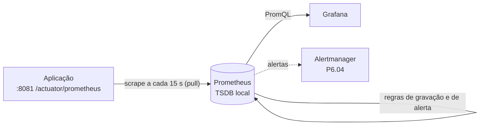

# P6.03 — Prometheus e Grafana: métricas RED/USE e dashboards

> ⏱️ ~1h30 · 🔵 Pleno · Pré-requisitos: P6.02, P1.03 (GC), P2.06 (pool de conexões), P3.09 (Outbox), J9.03 (Compose)

> ✅ **Validação final (2026-11-24):** módulo executado no PayFlow reconstruído; resultado e o que continua não executado no [README do módulo](README.md). Os avisos "não executado" / "por leitura" abaixo descrevem a escrita original.

> ⚠️ **Verificação:** **executado** com **Prometheus 3.16.0**, **Grafana 13.3.0** e a aplicação do `lab/observability-lab` (Docker, rede *host*, contêineres `lab-p6-*`, removidos ao fim; **sem** o PayFlow real). **Saídas reais** em `out-T5.txt` (incidente), `out-T6.txt` (pilha) e `out-T8.txt`. **Não executado:** Alertmanager, Grafana com **dados de produção**, *dashboards* no navegador (conferi as **consultas** dos 14 painéis pela API do Grafana, não a aparência).

## 🎯 Objetivos
Ao final desta aula você consegue:
- **Explicar** o modelo do Prometheus (*scrape*, série, etiqueta, `up`) e **escrever** as consultas PromQL do dia a dia (`rate`, `sum by`, `histogram_quantile`).
- **Aplicar** os métodos **RED** (serviços) e **USE** (recursos) e dizer a diferença para os **quatro sinais de ouro**.
- **Calcular** um percentil de histograma à mão e **explicar** por que ele é uma **estimativa**.
- **Provar** com números que **a média mente** quando a lentidão atinge um subconjunto.
- **Versionar** *dashboards* e fontes de dados no Git (**provisionamento**), não "clicando".

## 🤔 Por que isso importa
Métrica sem painel é número guardado; painel sem método é **colagem de gráficos bonitos** que ninguém consegue ler às 3 da manhã. O pleno é quem **desenha** o painel: sabe **quais** poucas perguntas ele responde (RED/USE), qual consulta é **honesta** (percentil de histograma, razão de erros) e qual **engana** (média, `rate` de gauge). E o painel **precisa estar no Git**: o editado na interface some no próximo ambiente.

## 💡 Intuição (explicação simples)
- O **Prometheus** é um **fotógrafo** que, a cada 15 segundos, tira uma foto do painel de instrumentos de cada instância e **guarda o álbum**. Ele **não conversa** com o carro: a aplicação só **mostra** o painel, o fotógrafo **vem buscar**.
- **PromQL** é a linguagem para fazer **perguntas ao álbum**: "quantas voltas por minuto?", "qual a volta mais lenta de 95% dos pilotos?".
- O **Grafana** é a **parede de TVs** da sala de operação: não guarda nada, só **desenha** o que o Prometheus responde.
- **RED** é o "boletim do **cliente**" (quantos pedidos, quantos falharam, quanto demoraram). **USE** é o "exame de **saúde das máquinas**" (quanto estão ocupadas, se há fila, se há falha).

## 🔬 Como funciona por dentro

### 1. O modelo do Prometheus

- Uma **série** é `nome{etiquetas}` + a sequência de amostras (tempo, valor). O Prometheus acrescenta `job` e `instance` e uma série **`up`** (1 = o *scrape* funcionou, 0 = falhou): é o **primeiro** alerta que toda equipe precisa (P6.04).
- **Retenção local** padrão: **15 dias** (`--storage.tsdb.retention.time`, lido em `prometheus --help`). É armazenamento **de uma máquina**: não é HA nem longo prazo (trade-offs abaixo).
- Medido: o alvo `payflow` (`http://localhost:8081/actuator/prometheus`) ficou `up`; o grupo de regras carregou **9 + 3** regras `ok`:
```
versões: Prometheus 3.16.0 ; Grafana 13.3.0 ; Jaeger v2.23.0
alvo payflow http://localhost:8081/actuator/prometheus up
grupo de regras payflow-alerts 9 regras {'ok'}
grupo de regras payflow-recording 3 regras {'ok'}
```

### 2. PromQL que você usa todo dia
| Pergunta | Consulta | Por quê |
|---|---|---|
| Requisições por segundo, por rota | `sum by (uri) (rate(http_server_requests_seconds_count[5m]))` | `rate` só vale em **counter**; `sum by` mantém só a etiqueta que você quer |
| Razão de erros 5xx | `sum(rate(..._count{status=~"5.."}[5m])) / sum(rate(..._count[5m]))` | razão é **comparável** ao longo do tempo (contagem não é) |
| p95 de **uma** rota | `histogram_quantile(0.95, sum by (le) (rate(..._bucket{uri="/api/v1/transfers"}[5m])))` | **sempre** `sum by (le)`: o `le` é o limite do balde |
| Média | `rate(..._sum[5m]) / rate(..._count[5m])` | existe, mas **esconde a cauda** (ver 4) |
| Instância fora | `up{job="payflow"} == 0` | o *scrape* falhou |

Regras de ouro: `rate()` exige **pelo menos 2 amostras** na janela (janela ≥ **2× o intervalo de *scrape***); `rate` de **gauge** não faz sentido (use o valor ou `deriv`); contadores **zeram** quando a instância reinicia e o `rate` já **compensa** isso.

### 3. RED, USE e os "sinais de ouro"
| Método | Para quê | O que olhar | No PayFlow |
|---|---|---|---|
| **RED** (Rate, Errors, Duration) | **serviços** (o que o cliente sente) | taxa, **razão** de erros, duração (p50/p95/p99) | `http_server_requests_*` por rota |
| **USE** (Utilization, Saturation, Errors) | **recursos** (CPU, memória, pool, fila) | % de uso, **fila/espera**, erros do recurso | heap, CPU, GC, pool Hikari (`hikaricp_connections_pending`), fila do executor |
| **4 sinais de ouro** (SRE) | síntese | latência, tráfego, erros, **saturação** | RED + a **saturação** do USE |

Em prosa: **RED** diz **se o usuário sofre**; **USE** diz **por que** (qual recurso faltou). Alerte em **sintoma** (RED), investigue **causa** (USE), P6.04.

### 4. Percentil de histograma e por que a média mente
O Prometheus **não guarda** cada duração: guarda **quantas** requisições cabem em cada **balde** (`le` = "menor ou igual a") e **estima** o percentil por **interpolação linear** dentro do balde onde o percentil cai.

**Medido** (`prometheus/histogram-pause.test.yml`, `promtool test rules`: **SUCCESS**): 100 requisições, 90 até 0,1 s, 97 até 0,5 s, 99 até 1 s: o **p95** cai no balde (0,1; 0,5], com 90 antes e 7 dentro: `0,1 + 0,4 × (95 − 90) / 7 = 0,3857 s`. Mesmo que **nenhuma** requisição tenha demorado exatamente isso: é **estimativa**, e **só tão precisa quanto os baldes**. Por isso o PayFlow declara baldes **em volta do SLO** (`50ms,100ms,250ms,500ms,1s,2s`, P6.02).

**A média mente.** No incidente do laboratório (ver P6.07), o serviço de risco ficou lento **só para uma conta** (1 em 9 requisições). **Medido** (`out-T5.txt`, janela de 1 minuto):
```
A p50=0.0041s p95=0.0055s p99=0.0056s
A média=0.0042s  fração>1s=0.0000
B p50=0.0038s p95=1.5338s p99=1.7384s
B média=0.1056s  fração>1s=0.0700
```
Com o tráfego normal, p50, p95, p99 e média são **quase iguais** (milissegundos). Com ~7% das requisições lentas: o **p50 não se mexe**, a **média** vai a ~106 ms, o **p95** a **1,5 s** e o **p99** a **1,74 s**. Quem alerta em média **não vê** o problema; quem alerta em p50 **também não**. (Numa execução **exploratória não gravada**, com a janela de **5 minutos** e só 4,4% de requisições lentas, o **p95 ficou em 7,9 ms** e só o **p99 (1,7 s)** acusou: **a janela dilui** e a fração lenta tem de passar de 5% para o p95 sentir.) **Alerte em p95/p99 e em razão, nunca em média.**

### 5. Grafana: *dashboards* como código
- **Fonte de dados** e **dashboard** vão para o Git e são **provisionados** na subida (`/etc/grafana/provisioning/...`): `allowUiUpdates: false`: **edição na tela não persiste** (é de propósito: a fonte da verdade é o repositório).
- **Variáveis** (`$instance` de `label_values(up{job="payflow"}, instance)`) e `$__rate_interval` (uma variável **do Grafana**, não do Prometheus: no console do Prometheus use `[1m]`).
- O painel do PayFlow tem **14 consultas** em 4 linhas: **RED** (taxa por rota, razão de 5xx com a linha do limite do alerta, p50/p95/p99 da transferência), **negócio** (transferências por resultado, `outbox pending` com limite 100, publicados/s), **USE da JVM** (heap/máximo, CPU, pausas de GC, *threads* e conexões esperando) e o **p95 do cliente HTTP** (chamada ao serviço de risco).

**Medido** pela API do Grafana (login `admin`, senha **só de laboratório**): o *dashboard* foi **provisionado** e **cada** consulta rodou pelo *proxy* do Grafana:
```
dashboard provisionado: payflow-red | PayFlow — RED + negócio + JVM
painéis com dado: 13; sem série (esperado só o do Hikari, sem banco no laboratório): ['Threads vivas e pool de conexões (se hou']
```
O único painel sem série é o de **conexões do Hikari**: o laboratório **não tem banco** (no PayFlow ele aparece). Lição: **"sem dados" também precisa de teste**; descobri pela mesma verificação que o painel do **p95 do cliente** estava vazio até eu ligar o histograma do `http.client.requests` (P6.02).

### 6. Regras de gravação (*recording rules*)
Consulta cara ou usada em vários lugares vira **regra de gravação**, calculada uma vez a cada intervalo: `payflow:http_errors:ratio5m`, `payflow:http_request_duration_seconds:p95_5m` e `payflow:http_requests:rate5m`. Convenção de nome: `nível:métrica:operações`. O **painel** e o **alerta** usam a **mesma** série (nunca divergem).

## 🛠️ Exemplo prático
**Provisionamento** (`grafana/provisioning/datasources/prometheus.yml` e `.../dashboards/payflow.yml`):
```yaml
apiVersion: 1
datasources:
  - name: Prometheus
    uid: prometheus
    type: prometheus
    access: proxy
    url: http://localhost:9090
    isDefault: true
    jsonData:
      timeInterval: 5s
```
```yaml
apiVersion: 1
providers:
  - name: payflow
    type: file
    disableDeletion: true
    allowUiUpdates: false        # o dashboard vem do Git; editar na tela não persiste
    options:
      path: /var/lib/grafana/dashboards
```
**Configuração do Prometheus** (laboratório: sem autenticação; `prometheus.payflow.yml` é a referência com `basic_auth` + `password_file`, validada com `promtool check config`):
```yaml
# Prometheus do laboratório (rede "host": a aplicação escuta em 8080/8081 do host)
global:
  scrape_interval: 5s          # laboratório; produção: 15s a 30s
  evaluation_interval: 5s
rule_files:
  - /etc/prometheus/alerts.yml
scrape_configs:
  - job_name: payflow
    metrics_path: /actuator/prometheus
    static_configs:
      - targets: ["localhost:8081"]    # a porta de GESTÃO, nunca a da aplicação
        labels:
          env: lab
```
**Regras de gravação** (trecho de `prometheus/alerts.yml`):
```yaml
  - name: payflow-recording
    rules:
      # RED por rota (o actuator não entra: está em outra porta, mas o filtro protege se alguém juntar as portas)
      - record: payflow:http_requests:rate5m
        expr: sum by (uri) (rate(http_server_requests_seconds_count{job="payflow", uri!~"/actuator.*"}[5m]))
      - record: payflow:http_errors:ratio5m
        expr: |
          sum(rate(http_server_requests_seconds_count{job="payflow", status=~"5..", uri!~"/actuator.*"}[5m]))
          /
          sum(rate(http_server_requests_seconds_count{job="payflow", uri!~"/actuator.*"}[5m]))
      - record: payflow:http_request_duration_seconds:p95_5m
        expr: |
          histogram_quantile(0.95,
            sum by (le, uri) (rate(http_server_requests_seconds_bucket{job="payflow", uri!~"/actuator.*"}[5m])))

  - name: payflow-alerts
```
**Subir a pilha** (Docker; ~40 s) e gerar tráfego:
```bash
cd 2-pleno/P6-observabilidade/lab/observability-lab
./run-stack.sh                 # app :8080/:8081, Prometheus :9090, Grafana :3000, Jaeger :16686
./traffic.sh 200 0.03          # tráfego sintético (8% de rejeições, 2% de falhas)
# Prometheus em http://localhost:9090 ; Grafana em http://localhost:3000 (admin / lab-only-admin)
./check-stack.sh               # confere alvo, regras, dashboard e as 14 consultas
./stop-stack.sh                # remove contêineres e arquivos
```
> **Segredo do Grafana por arquivo** (para o PayFlow real, **sem** senha no Compose): `GF_SECURITY_ADMIN_PASSWORD__FILE=/run/secrets/grafana_admin_password` (**medido**: o login funcionou com a senha do arquivo e `admin/admin` deu **401**).

**No PayFlow (por leitura, não executado):** `compose.observability.yaml` com perfil `observability` (Prometheus, Grafana e Jaeger), portas **só em `127.0.0.1`** (decisão 72), segredos por arquivo (decisão 71), a **porta de gestão (8081) não publicada** (o Prometheus a alcança pela rede do Compose, `app:8081`), e os arquivos `prometheus/`, `grafana/` **do Git**. Em produção, essas peças são **serviços gerenciados** (P9 compara o equivalente na AWS/Azure/GCP).

## 🧠 Pausa para lógica: o p95 de uma média de p95
**Enunciado.** Duas instâncias do PayFlow reportam p95 de **100 ms** (instância A, 9.000 requisições) e **900 ms** (instância B, 1.000 requisições). (a) O p95 **do serviço** é a média (500 ms)? (b) Dê um exemplo numérico em que o p95 combinado seja **muito diferente** da média dos p95. (c) Por que a **soma dos baldes** (histograma) resolve e o percentil calculado no cliente **não**?

**Dica.** Percentil **não é aditivo**; o que se soma são **contagens**.

<details><summary>Solução</summary>

(a) **Não.** Com 9.000 das 10.000 requisições em A, o p95 combinado cai na **cauda de A + as de B**: ele depende da **distribuição**, não dos dois números. (b) Suponha que **todas** as 9.000 requisições de A durem **100 ms** e **todas** as 1.000 de B durem **900 ms**: o p95 de A é 100 ms, o de B é 900 ms, a média dos p95 é **500 ms**, mas **10% das requisições do serviço** levam 900 ms, então o p95 **do serviço** é **900 ms**. Nem a média simples (500) nem a ponderada pelas requisições (180) acertam: **só** somar os **baldes** de A e de B (`sum by (le)`) e interpolar dá a resposta certa. (c) Contagens por balde **somam**; percentis **não**.

**Variação (exercício com a mesma conta do texto):** reproduza 100 requisições (90/97/99/100 nos baldes 0,1/0,5/1/+Inf) e calcule o **p50** (rank 50 no balde `(0; 0,1]`: `0,1 × 50/90 = 0,0556 s`) e o **p99,5** (rank 99,5 no balde `(1; +Inf]`: o Prometheus devolve o **limite superior do último balde finito**, **1 s**). Ambos **conferidos** em `histogram-pause.test.yml`.
</details>

## ⚖️ Trade-offs e quando NÃO usar
- **Prometheus é de uma máquina:** sem HA nem retenção longa. Para anos de histórico e várias regiões: Thanos/Mimir ou serviço gerenciado (Amazon Managed Service for Prometheus, etc.; P9/S4). Para **um** PayFlow, **um** Prometheus basta.
- **Pull exige alcance e descoberta:** `static_configs` serve para o laboratório; em Kubernetes, descoberta pelo próprio cluster (P7).
- **Grafana "pronto da internet":** *dashboards* importados trazem **dezenas** de painéis que ninguém entende. Comece pelos **poucos** painéis que respondem RED/USE.
- **Muito painel, pouca decisão:** cada painel deve responder a **uma pergunta** ("a transferência está lenta?") e ter um **limite** visível (a linha do alerta).
- **Quando NÃO usar métricas:** para investigar **um** pedido específico (traço/log) ou guardar dado de auditoria.

## ⚠️ Erros comuns e boas práticas de produção
- **`rate()` sobre *gauge*** (nonsense) ou **sobre janela curta demais** (`[10s]` com *scrape* de 15 s → **sem dados**).
- **`histogram_quantile` sem `sum by (le)`:** devolve **um** p95 por série (por instância/status), não o do serviço, ou `NaN`.
- **`sum(...)` sem `by`** apaga etiquetas que você ainda precisava.
- **Média como alerta** (medido: a média foi de 4 ms a ~106 ms; o p99, de 5,6 ms a 1,74 s).
- **"No data" no Grafana** com variável `$instance` "All": confira se a expressão usa `=~` (regex), não `=`.
- **Painel editado na tela e perdido:** o `allowUiUpdates: false` existe para isso; mude o JSON no Git.
- **Intervalo de *scrape* de 5 s** (do laboratório) em produção: **multiplica** o custo. Use 15 a 30 s.
- **Expor `9090`/`3000` na internet** (Docker contorna o `ufw`, J9): `127.0.0.1:` ou rede interna.

## 🧩 Exercícios
1. **Fixação:** (a) Por que `rate()` e não o valor bruto de um *counter*? (b) O que é o `le` e por que a consulta de percentil precisa de `sum by (le)`? (c) RED × USE: qual alerta de **sintoma** e qual de **causa**?
2. **Aplicação no PayFlow** (por leitura):
   - [ ] `compose.observability.yaml` (perfil `observability`): Prometheus, Grafana, Jaeger; portas em `127.0.0.1`; segredos por arquivo; volumes de dados.
   - [ ] `prometheus.yml` com o *scrape* da **porta de gestão** por `basic_auth` (papel `METRICS`, P6.02).
   - [ ] `grafana/dashboards/payflow-red.json` e o provisionamento (cópia dos do laboratório, trocando o *job* se necessário).
   - [ ] As **recording rules** e os **baldes do SLO** da P6.02.
   - Pronto quando: `up{job="payflow"} == 1`, os 14 painéis têm dado (exceto os que dependem de recurso que ainda não existe) e **um teste** (script) confere que **cada** consulta do *dashboard* roda sem erro (como o `check-stack.sh`).
3. **Desafio:** monte uma consulta que mostre **qual rota** mais contribui para o erro 5xx do serviço (`topk`, `sum by (uri)`), e explique por que ela é melhor que a **razão global**.

<details><summary>Solução de referência (1 e 3)</summary>

**1.** (a) O valor bruto **só cresce** e **zera** no reinício; o `rate` dá a **velocidade** (por segundo) e compensa o reinício. (b) `le` ("less or equal") é o **limite do balde**; o `histogram_quantile` precisa **de todos os baldes** de cada série **somados entre instâncias**, por isso `sum by (le)`. (c) **Sintoma (RED):** razão de 5xx > 2% ou p95 > 1 s; **causa (USE):** pool saturado (`hikaricp_connections_pending > 0`), heap > 90%.

**3.** `topk(3, sum by (uri) (rate(http_server_requests_seconds_count{status=~"5.."}[5m])))` mostra **onde** falha; a razão global dilui uma rota pouco usada que falha 100%.
</details>

## 🎤 Na entrevista
1. **"Como o Prometheus coleta e guarda métricas?"** — *Pull*: busca o texto de cada alvo a cada N segundos, guarda séries (nome + etiquetas) num banco de séries temporais local; `up` indica se o *scrape* funcionou. É de **uma** máquina; para histórico longo/HA se usa Thanos/Mimir ou gerenciado.
2. **"O que é RED e USE?"** — RED (taxa, erros, duração) para **serviços**; USE (utilização, saturação, erros) para **recursos**. RED diz se o usuário sofre; USE diz qual recurso faltou.
3. **"Por que não alertar na média?"** — Esconde a cauda; medi p50 estável e p99 de 5,6 ms a 1,74 s com ~7% das requisições lentas. Use p95/p99 por **histograma** e a **razão** de erros.
4. **"Como você calcula o p95 no Prometheus e qual a limitação?"** — `histogram_quantile(0.95, sum by (le)(rate(..._bucket[5m])))`; é **estimativa interpolada** dentro do balde, só tão precisa quanto os baldes declarados.

## 📚 Para ir além
- 📄 [Prometheus: visão geral](https://prometheus.io/docs/introduction/overview/), [PromQL (básico)](https://prometheus.io/docs/prometheus/latest/querying/basics/) e [funções](https://prometheus.io/docs/prometheus/latest/querying/functions/): `rate`, `histogram_quantile`, `absent`.
- 📄 [Prometheus: histogramas e sumários](https://prometheus.io/docs/practices/histograms/): a interpolação e o erro por balde.
- 📄 [Prometheus: regras de gravação](https://prometheus.io/docs/prometheus/latest/configuration/recording_rules/): convenção de nomes.
- 📄 [Grafana: boas práticas de *dashboards*](https://grafana.com/docs/grafana/latest/dashboards/build-dashboards/best-practices/) e [provisionamento](https://grafana.com/docs/grafana/latest/administration/provisioning/): código em vez de cliques.
- 📄 [O método RED (Grafana)](https://grafana.com/blog/the-red-method-how-to-instrument-your-services/) e [o método USE (Brendan Gregg)](https://www.brendangregg.com/usemethod.html): as duas listas de verificação.
- 📄 [Google SRE Book: Monitoring Distributed Systems](https://sre.google/sre-book/monitoring-distributed-systems/): os quatro sinais de ouro.
- 📑 *Site Reliability Engineering* (Google, gratuito online): [sumário](https://sre.google/sre-book/table-of-contents/).
- 🎥 ⚠️ Nenhum vídeo verificado nesta aula: procure palestras sobre PromQL/Prometheus (canais oficiais da Prometheus e da Grafana) e confira data e duração **antes**.
- 💻 `lab/observability-lab` (`prometheus/`, `grafana/`, `run-stack.sh`, `check-stack.sh`).

## ✅ Checklist da aula
- [ ] Sei o ciclo *scrape* → série → PromQL → Grafana e o papel do `up`.
- [ ] Escrevo `rate`, `sum by` e `histogram_quantile` sem errar o `le`.
- [ ] Diferencio **RED** e **USE** e sei qual usar em cada pergunta.
- [ ] Calculei um percentil de histograma **à mão** e sei por que é estimativa.
- [ ] Meu *dashboard* e minha fonte de dados estão **no Git** e provisionados.
