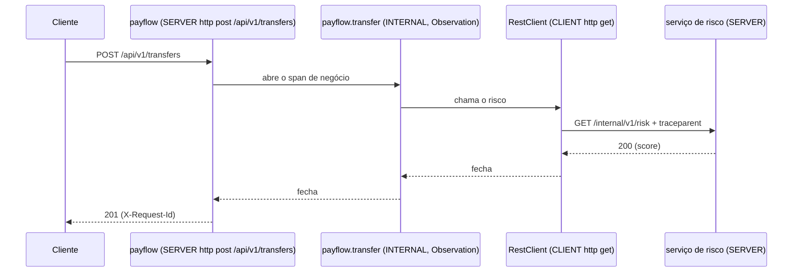

# P6.05 — Tracing distribuído com OpenTelemetry

> ⏱️ ~1h30 · 🔵 Pleno · Pré-requisitos: P6.01, P6.02, J2 (cabeçalhos HTTP), P3.02 (`@Async`), P5.07 (*timeouts*), P5.10 (cascata)

> ✅ **Validação final (2026-11-24):** módulo executado no PayFlow reconstruído; resultado e o que continua não executado no [README do módulo](README.md). Os avisos "não executado" / "por leitura" abaixo descrevem a escrita original.

> ⚠️ **Verificação:** **executado** em `lab/observability-lab` (Spring Boot **4.1.2**, `spring-boot-starter-opentelemetry`, Micrometer Tracing **1.7.2**, OpenTelemetry Java **1.62.0**) com `InMemorySpanExporter` nos testes **e** com o **Jaeger 2.23.0** real recebendo **OTLP/HTTP** (`out-T4.txt`, `out-T5.txt`). **Lido nos metadados, não executado:** propriedades de observação do Kafka e do RabbitMQ. **Não executado:** OpenTelemetry **Collector** e amostragem **por cauda**, *agent* Java (auto-instrumentação), propagação por Kafka/RabbitMQ, Prometheus/Grafana lendo **exemplars**.

## 🎯 Objetivos
Ao final desta aula você consegue:
- **Explicar** *trace*, *span*, contexto e o cabeçalho W3C `traceparent`.
- **Configurar** o OpenTelemetry no Spring Boot 4.1 e **exportar** para um *backend* (Jaeger) por OTLP.
- **Ler** uma árvore de *spans* para **achar o gargalo** e **provar** que a propagação atravessou a rede.
- **Escolher** a amostragem e **dizer** o que ela perde (e o que **não** perde).
- **Reconhecer** as três formas de **quebrar** um traço (cliente sem instrumentação, *thread*, mensageria).

## 🤔 Por que isso importa
Na [P5.10](../P5-microsservicos-integracao/P5.10-estudo-de-caso-o-servico-de-notificacoes-que-derrubou-o-checkout.md) a pergunta era "**onde** o tempo foi?". A métrica diz **que** o p99 subiu; o log diz **o quê** aconteceu em **uma** linha; só o **traço** mostra o **caminho** inteiro de **uma** requisição (quem chamou quem, **quanto cada degrau demorou**) e responde "o tempo está no serviço de risco, não no banco". Em microsserviços (e já no PayFlow: monólito + risco + notificações) é a ferramenta que **encurta o diagnóstico de horas para minutos**.

## 💡 Intuição (explicação simples)
Uma **encomenda** nos Correios tem **um código de rastreio** (o `traceId`). Cada centro de triagem por onde ela passa **carimba** com a hora de entrada e saída (cada carimbo é um *span*) e anota **de qual centro veio** (o *span* pai). Quando você abre o rastreio, vê a **linha do tempo inteira** e percebe que a encomenda ficou **3 dias parada num só centro**. O **código de rastreio** viaja **na própria etiqueta** da encomenda (o cabeçalho `traceparent`): se alguém joga a encomenda numa **caixa nova sem a etiqueta**, o rastreio **recomeça do zero** (traço quebrado).

## 🔬 Como funciona por dentro

### 1. Os conceitos
- **Trace:** a história de **uma** requisição (um `traceId`, 32 *hex*).
- **Span:** **um degrau** dela: nome, início, duração, **pai**, atributos, eventos (ex.: a exceção), status (OK/ERROR) e *kind* (`SERVER`, `CLIENT`, `INTERNAL`).
- **Contexto:** `traceId` + `spanId` atual, guardado em um `ThreadLocal` e **levado** para o próximo serviço no cabeçalho **`traceparent`** (padrão W3C): `00-<traceId 32 hex>-<spanId pai 16 hex>-<flags>`, onde `01` = **amostrado**.



### 2. O que o Spring Boot 4.1 faz por você
A dependência **`spring-boot-starter-opentelemetry`** traz: a **ponte** Micrometer → OpenTelemetry (`micrometer-tracing-bridge-otel`), o **SDK** do OpenTelemetry, o **exportador OTLP** de *traces* e (atenção: P6.02) o registro **OTLP de métricas**. Tudo o que o Boot **já observa** (servidor HTTP, `RestClient`, `@Scheduled`...) **vira *span*** sem código. Propriedades **(lidas nos metadados do Boot 4.1.2)**:

| Propriedade | Padrão | Para quê |
|---|---|---|
| `management.tracing.sampling.probability` | **0.1** | fração de traços **amostrados** (laboratório: 1.0) |
| `management.opentelemetry.tracing.sampler` | `parent-based-trace-id-ratio` | quem **herda** a decisão do pai |
| `management.opentelemetry.tracing.export.otlp.endpoint` | (nenhum) | `http://localhost:4318/v1/traces` |
| `management.opentelemetry.tracing.export.otlp.transport` | `http` | `http` (4318) ou `grpc` (4317) |
| `management.opentelemetry.tracing.export.schedule-delay` | **5 s** | de quanto em quanto tempo o lote é enviado |
| `management.tracing.export.otlp.enabled` | `true` | desligar o exportador (testes) |
| `management.tracing.propagation.produce` / `consume` | `W3C` / `W3C, B3, B3_MULTI` | formatos de cabeçalho |

> **Cuidado ao copiar de tutoriais do Boot 3:** `management.otlp.tracing.endpoint` e `management.tracing.opentelemetry.export.*` aparecem nos metadados como **antigos/substituídos**; o Boot 4.1 usa o prefixo **`management.opentelemetry.tracing.export.*`**.

**A conexão de mensageria é opt-in.** `spring.kafka.template.observation-enabled`, `spring.kafka.listener.observation-enabled` e os equivalentes do RabbitMQ (`spring.rabbitmq.template.observation-enabled`, `...listener.simple.observation-enabled`) têm padrão **`false`** (lido nos metadados): **sem ligá-los, o traço morre no *broker*** (a mensagem não leva o contexto). **Não executei** a propagação por Kafka/RabbitMQ.

### 3. A árvore de *spans* (medida)
O laboratório: uma transferência, um span de negócio (`Observation`), a chamada HTTP ao serviço de risco. Com o `InMemorySpanExporter` (`TracingTest`), **medido**:
```
span: trace=0af765 id=18be3e parent=979393 kind=CLIENT   name=http get
span: trace=0af765 id=22bb58 parent=b7ad6b kind=SERVER   name=http post /api/v1/transfers
span: trace=0af765 id=979393 parent=22bb58 kind=INTERNAL name=payflow.transfer
span: trace=0af765 id=d68b89 parent=18be3e kind=SERVER   name=http get /internal/v1/risk
atributos do span de negócio: AttributesMap{data={payflow.source.account=acc-1, outcome=completed}, capacity=128, totalAddedValues=2}
```
- **Mesmo `trace`** nos quatro *spans* e **cada filho aponta para o pai** (`parent=`): o `payflow.transfer` é filho do `SERVER`, o `CLIENT` é filho do `payflow.transfer`, e o `SERVER` do risco é filho do `CLIENT` (**o `traceparent` atravessou a rede**: assertiva do teste).
- Nesta execução eu **enviei** o cabeçalho `traceparent: 00-0af7651916cd43dd8448eb211c80319c-b7ad6b7169203331-01` e ele foi **continuado**: o `SERVER` do PayFlow é filho do `b7ad6b7…` (um sistema à frente do PayFlow **entra** no mesmo traço em vez de abrir outro).
- O atributo **`payflow.source.account=acc-1`** (alta cardinalidade) está **só no span**, como combinamos na P6.02, e o `outcome=completed` (baixa) também.

**Nomes dos atributos (medido pelo Jaeger):** o Micrometer, por padrão, usa os nomes **dele** (`method`, `status`, `outcome`, `uri`, `exception`, `http.url`), **não** as convenções semânticas do OpenTelemetry (`http.request.method`, `http.response.status_code`...). Na busca do Jaeger você filtra por **`status=500`** ou **`outcome=SERVER_ERROR`**.

### 4. Quem é marcado como erro (e quem **não** é)
No incidente da fase C (o serviço de risco passou do *timeout* de 2 s), **medido**:
```
C   http post /api/v1/transfers      2003.1 ms  otel.status_code=-     status=500          outcome=SERVER_ERROR exception=none
C   payflow.transfer                 2001.4 ms  otel.status_code=ERROR status=-            outcome=failed       exception=-
C   http get                         2001.1 ms  otel.status_code=ERROR status=CLIENT_ERROR outcome=UNKNOWN      exception=ResourceAccessException
C   http get /internal/v1/risk       2500.7 ms  otel.status_code=-     status=200          outcome=SUCCESS      exception=none
```
- O `payflow.transfer` e o `CLIENT` ficam `otel.status_code=ERROR`, com a exceção (`ResourceAccessException`) como **evento** do span (com a *stack*).
- O **`SERVER` raiz** do `POST` **não** é `ERROR`: ele tem `status=500` e `outcome=SERVER_ERROR`, mas **sem** `otel.status_code`. A exceção foi **convertida em resposta** pelo `@RestControllerAdvice`, e a observação do servidor só marca erro quando a exceção **propaga**. **Consequência:** filtrar "só traços com erro" no Jaeger (`error=true`) acha os *spans* filhos, **não** o raiz; busque por `status=500`.
- O `SERVER` do **risco** terminou com **200 depois de 2.500 ms**, **500 ms depois** que o cliente **desistiu** (2 s): trabalho feito **para ninguém** (a imagem do P5.07 num traço).

### 5. Três formas de **quebrar** o traço
1. **Cliente criado à mão.** `RestClient.create(...)` **não** usa o *builder* instrumentado: **medido** (`TracingTest`): **0 *spans* `CLIENT`**, e o serviço de risco abriu **outro `traceId`** (sem pai). Use **sempre** o `RestClient.Builder` **injetado** (P5/J6: ele precisa de `spring-boot-starter-restclient`).
2. **Troca de *thread*.** O `@Async` (ou um *executor* seu) **perde** o contexto (P6.01): **medido**: o *log* do relé ficou **sem `traceId`** até ligar `spring.task.execution.propagate-context=true` (**o traço** volta; o `requestId` precisa do seu `TaskDecorator`).
3. **Mensageria** (Kafka/RabbitMQ): propriedades `observation-enabled` **desligadas por padrão** (acima).
```
RestClient.create(): mesmo traceId nos dois servidores?: false
RestClient.create(): spans CLIENT: 0
```

### 6. Amostragem: o que ela perde e o que **não** perde
Cada *span* custa memória, rede e armazenamento, então **amostra-se**. A **amostragem por cabeça** (*head-based*, a do Boot) decide **no início** da requisição: `probability 0.1` = **10%** dos traços (e quem herda a decisão do pai, `parent-based`).

**Medido** com `management.tracing.sampling.probability=0.0` (`TracingSamplingTest`):
```
amostragem 0.0: spans exportados: 0
amostragem 0.0: traceId no log do ERROR: 8bab7d3c62eba3a3188a35edd307ce3e
```
**Zero *spans* exportados**, **mas o `traceId` continua** no log do `ERROR` **e** no corpo da resposta ao usuário. **A correlação do log não depende de amostrar**: o que se perde são **os *spans* (a árvore)**, não o identificador. Por isso o `traceId` no Problem Details é **barato** e **sempre** vale.

**O custo da amostra:** com **10%**, um erro raro **pode não ter traço**. A conta (🧠 abaixo) mostra quanto tempo se espera até ter uma amostra. **Amostragem por cauda** (*tail-based*: decidir **depois**, guardando **todos os traços com erro ou lentos**) é o que resolve, mas exige um **Collector** no meio: **não executado**.

### 7. *Exemplars*: da métrica ao traço
Um ***exemplar*** é um **`traceId` colado a uma amostra de métrica**: no gráfico de latência, o ponto lento **aponta** para o traço que o causou. **Medido** (formato OpenMetrics, `ExemplarTest`):
```
exemplar: Content-Type OpenMetrics: application/openmetrics-text;version=1.0.0;charset=utf-8
exemplar: linha: http_server_requests_seconds_bucket{application="payflow-obs-lab",error="none",exception="none",method="POST",outcome="SUCCESS",status="201",uri="/api/v1/transfers",le="0.447392426"} 1 # {span_id="006f038d0e865aff",trace_id="a5e01840d96156ff4d7ef3ea1c12d9e0"} 0.412982352 1794639321.896
```
O formato **clássico** do Prometheus (`text/plain`) **não** carrega exemplars (assertiva do teste); eles só aparecem com `Accept: application/openmetrics-text`. **Não executei** o Prometheus/Grafana **lendo** esses exemplars (requer ligá-los no Prometheus e na fonte de dados): só **verifiquei o formato exposto**.

### 8. O *backend*: Jaeger 2.23.0
O Jaeger v2 aceita **OTLP/HTTP em `:4318`** e tem a interface em `:16686`. **Surpresa (medida):** a **busca** da API v1 (`/api/traces?service=...`) responde **404** no v2; a busca é a **API v3** (`/api/v3/traces?query.service_name=...&query.duration_min=1s`, resposta em OTLP/JSON); só o **`GET /api/traces/<traceId>`** (por id) continua. O *script* `incident.sh` faz as duas.

## 🛠️ Exemplo prático
**Dependência e configuração** (a mesma do PayFlow):
```xml
<dependency>
  <groupId>org.springframework.boot</groupId>
  <artifactId>spring-boot-starter-opentelemetry</artifactId>
</dependency>
```
```yaml
management:
  tracing:
    sampling:
      probability: 1.0            # laboratório; PayFlow em produção: 0.1 (padrão) ou menos
  opentelemetry:
    tracing:
      export:
        otlp:
          endpoint: http://localhost:4318/v1/traces
```
**A observação de negócio** (`TransferService`, P6.02): **uma** `Observation` produz o *timer* **e** o *span* `payflow.transfer`, com a conta só no span.

**Achar o traço de uma falha a partir do que o usuário recebeu** (o fluxo real do incidente):
```
C resposta ao usuário: {"detail":"Unexpected error","instance":"/api/v1/transfers","status":500,"title":"Internal Server Error","traceId":"9687baaa32305a7e29310a88e3690139"}
C traço 9687baaa32305a7e29310a88e3690139:
```
A resposta traz o `traceId`; `GET localhost:16686/api/traces/<traceId>` devolve a árvore; e **`grep` do mesmo `traceId` no log JSON** mostra as linhas (P6.01).

**Procurar por atributo** (a conta é atributo do span, então **é pesquisável**; **medido** na fase B, `duration_min=1s`):
```
B Jaeger (duração >= 1 s): 17 traços; contas (atributo payflow.source.account): {'acc-7': 17}
B Jaeger (duração < 1 s, amostra): 300 traços; contas (atributo payflow.source.account): {'acc-8': 35, 'acc-1': 35, 'acc-5': 35, 'acc-6': 35, 'acc-2': 36, 'acc-3': 35, 'acc-9': 35, 'acc-4': 35, 'acc-7': 19}
```
**Todos os traços lentos (≥ 1 s) são da conta `acc-7`**; os rápidos vêm de **todas** as contas (a própria `acc-7` aparece na segunda linha com os traços **de antes** da injeção). É **a** resposta que a métrica **não** podia dar (conta como etiqueta = explosão de séries, P6.02).

**Rodar** (`TracingTest` não precisa de Docker; a pilha, sim):
```bash
cd 2-pleno/P6-observabilidade/lab/observability-lab
JAVA_HOME=/usr/lib/jvm/java-25-openjdk-amd64 mvn -B test -Dtest='Tracing*Test,ExemplarTest'   # 5 + 1 + 1 testes
./run-stack.sh && ./traffic.sh 100 && echo "abra http://localhost:16686 (serviço payflow-obs-lab)"
```
> **Atraso do exportador:** os *spans* chegam ao Jaeger em lotes (`schedule-delay` de **5 s**). Meus *scripts* esperam **7 s** antes de consultar; sem isso o traço "não existe ainda" e você acha que a instrumentação falhou.

## 🧠 Pausa para lógica: quanto tempo até ver um erro raro?
**Enunciado.** O PayFlow recebe **50 requisições/s**; **1 em 1.000** falha (5xx). A amostragem é **10%** (por cabeça, independente do resultado). (a) Quantas falhas por minuto? (b) Quantas falhas **seguidas** são necessárias para ter **95%** de chance de ter amostrado **ao menos uma**? (c) Em quanto tempo isso acontece?

**Dica.** A chance de **não** amostrar uma falha é 0,9; de não amostrar `n` falhas, `0,9ⁿ`.

<details><summary>Solução</summary>

(a) 50 × 60 / 1.000 = **3 falhas/min**. (b) Quero `1 − 0,9ⁿ ≥ 0,95` → `0,9ⁿ ≤ 0,05`: `0,9²⁸ = 0,0523` (**insuficiente**), `0,9²⁹ = 0,0471` (**ok**, 95,3% de chance) → **29 falhas**. (c) 29 / 3 por min ≈ **9,7 min**. Em 1 min (3 falhas) a chance é `1 − 0,9³ = 27%`.

**Variação:** com **tail sampling** que mantém **100% dos erros**, a chance é de **100%** na **primeira** falha (e o custo continua baixo, porque os traços **sem** erro seguem amostrados a 10%). É a razão de existir da amostragem por cauda.
</details>

## ⚖️ Trade-offs e quando NÃO usar
- **Tracing completo (100%) em produção** custa caro em rede/armazenamento: comece com **10%** e **meça** o volume (spans/s = requisições/s × *spans* por requisição × amostra: aqui **4** por transferência).
- **Boot starter × *agent* Java do OpenTelemetry.** O *starter* (usado) instrumenta o que o Spring conhece e dá **controle** por `Observation`; o *agent* instrumenta bibliotecas **sem código** (JDBC, Kafka), mas é **outra** peça de produção (arquivo `.jar`, versão, JVM). Em Java moderno, o *starter* é o ponto de partida; o *agent* é **opção** (⚠️ **não executado**).
- **Atributo com dado pessoal:** o *span* vai para um sistema de terceiros/retido por dias: nada de e-mail, CPF, token (decisões 38/65/67). O `payflow.source.account` é **id interno** (aceitável, mas **decida** com a LGPD em mente).
- **Tracing não substitui métrica** (agregado, alerta) **nem log** (detalhe/auditoria): é o **mapa**, não o **inventário**.
- **Traço em tudo, inclusive `/actuator`:** a porta de gestão separada (P6.02) **evita** ruído de *health checks* nos traços.

## ⚠️ Erros comuns e boas práticas de produção
- **"Não vejo nenhum traço":** (1) amostragem 0,1 e pouco tráfego; (2) o `endpoint` aponta a porta errada (`4318` HTTP, `4317` gRPC; o `transport` padrão é `http`); (3) o lote de 5 s ainda não saiu; (4) `management.tracing.export.otlp.enabled=false` no ambiente.
- **Erros de conexão do exportador** no *log* ("Failed to export spans") quando o *backend* está fora: **aceitável** (o exportador **não derruba a requisição**), mas **alerte** em ausência de traços se isso importar.
- **Traço partido por `RestClient.create()`** (medido), `new RestTemplate()` ou `HttpClient` do JDK direto: sem *builder* instrumentado **não há** cabeçalho.
- **Contexto perdido em `@Async`/`CompletableFuture`/executor seu:** use `propagate-context` ou um `TaskDecorator`.
- **Nome de *span* de alta cardinalidade** (`http get /accounts/acc-123`): o nome tem de ser o **template** (o do servidor **é**; o do cliente é só `http get` com o `uri` como atributo, medido).
- **Misturar B3 e W3C sem querer:** o padrão **produz** W3C e **aceita** B3; se um sistema antigo só entende B3, configure `management.tracing.propagation.produce` (⚠️ não executado).

## 🧩 Exercícios
1. **Fixação:** (a) O que o `traceparent` carrega? (b) Por que o `traceId` ainda aparece no log com amostragem 0? (c) Por que filtrar `error=true` não acha o *span* raiz de um 500 tratado por `@RestControllerAdvice`?
2. **Aplicação no PayFlow** (por leitura):
   - [ ] `spring-boot-starter-opentelemetry` no `pom.xml`; `application.yml` com amostragem `0.1` (e `1.0` no `dev`) e o `endpoint` OTLP por **variável de ambiente** (sem URL fixa).
   - [ ] **Todo** cliente HTTP vem do `RestClient.Builder` injetado (pesquise no código por `RestClient.create`, `new RestTemplate`): **teste** (ArchUnit, P4.10) que **reprova** `RestClient.create` fora de testes.
   - [ ] `observation-enabled: true` em `spring.kafka.template`/`listener` e `spring.rabbitmq.template`/`listener.simple` (⚠️ **não executado**: valide o traço **atravessando** o Outbox → Kafka → consumidor).
   - [ ] Extensão `traceId` no Problem Details (P6.01) **e** `X-Request-Id` na resposta.
   - Pronto quando: um **teste** com `InMemorySpanExporter` prova que o `traceparent` chega ao serviço chamado (como `oneRequestIsOneTraceWithFourSpansLinkedByParent`), e um teste prova que um cliente criado à mão **quebra** o traço (como o do laboratório).
3. **Desafio:** com a pilha do laboratório, injete latência no serviço de risco para **uma** conta (`POST /lab/risk-latency?account=acc-7&ms=1500`), e **ache o traço mais lento** só pela interface do Jaeger (filtro `payflow.source.account=acc-7`, `minDuration`). Qual *span* concentra o tempo?

<details><summary>Solução de referência (1 e 3)</summary>

**1.** (a) A versão (`00`), o **`traceId`** (32 hex), o **`spanId` do pai** (16 hex) e as **flags** (`01` = amostrado). (b) A **amostragem** decide se os *spans* são **exportados**; o contexto (`traceId`) **existe** do mesmo jeito e vai para o MDC e para a resposta. (c) A exceção **não propagou** (o *advice* a transformou em resposta 500), então a observação do servidor registra `status=500` e `outcome=SERVER_ERROR`, mas **não** marca o span como `ERROR`; os *spans* filhos onde a exceção **foi lançada** são marcados.

**3.** O `CLIENT` `http get` (chamada ao risco) concentra ~1,5 s; o `payflow.transfer` (pai) tem a **mesma** duração, e o `SERVER` do risco também: **o tempo está no serviço de risco, para aquela conta**.
</details>

## 🎤 Na entrevista
1. **"O que é tracing distribuído e como funciona a propagação?"** — Um *trace* é a árvore de *spans* de **uma** requisição entre serviços; o contexto (`traceId`, `spanId`, flags) viaja no cabeçalho **`traceparent`** (W3C), e cada serviço cria *spans* filhos. Se um cliente HTTP ou a mensageria **não** repassam o cabeçalho, o traço **quebra**.
2. **"Como escolher a amostragem?"** — Por cabeça (probabilidade, simples e barata; perde erros raros) ou por cauda (decide depois; guarda erros e lentos; exige Collector). Comece com ~10% e **meça**; o `traceId` no log e na resposta continua mesmo sem amostrar.
3. **"Trace, log e métrica: quando cada um?"** — Métrica acha (agregado, alerta), traço **localiza** (onde o tempo foi), log **explica**. Ligados pelo `traceId` e, na métrica, por **exemplars**.
4. **"O que é OpenTelemetry?"** — Padrão aberto (API, SDK, protocolo **OTLP**, convenções semânticas) para traces, métricas e logs, **independente de fornecedor**: a aplicação emite OTLP e o *backend* (Jaeger, Tempo, comercial) é **trocável**.

## 📚 Para ir além
- 📄 [Spring Boot: Tracing](https://docs.spring.io/spring-boot/reference/actuator/tracing.html) e [Observabilidade](https://docs.spring.io/spring-boot/reference/actuator/observability.html): a configuração do Boot 4.1.
- 📄 [Micrometer Tracing](https://docs.micrometer.io/tracing/reference/) e [Micrometer: Observation](https://docs.micrometer.io/micrometer/reference/observation.html): a ponte e a API de observações.
- 📄 [OpenTelemetry: Traces](https://opentelemetry.io/docs/concepts/signals/traces/), [Context propagation](https://opentelemetry.io/docs/concepts/context-propagation/) e [Sampling](https://opentelemetry.io/docs/concepts/sampling/): os conceitos oficiais.
- 📄 [W3C Trace Context](https://www.w3.org/TR/trace-context/): o formato do `traceparent`.
- 📄 [OpenTelemetry: OTLP](https://opentelemetry.io/docs/specs/otlp/) e [Collector](https://opentelemetry.io/docs/collector/): o protocolo e o componente de amostragem por cauda.
- 📄 [Jaeger: documentação](https://www.jaegertracing.io/docs/latest/) e [primeiros passos](https://www.jaegertracing.io/docs/latest/getting-started/).
- 📑 *Distributed Tracing in Practice* (Parker et al.) (**de memória, não conferido**).
- 🎥 ⚠️ Nenhum vídeo verificado nesta aula: procure palestras "OpenTelemetry com Spring Boot" (Spring I/O, canal oficial; CNCF) e confira **a versão** (a API mudou do Boot 3 para o 4).
- 💻 `lab/observability-lab` (`TracingTest`, `TracingSamplingTest`, `ExemplarTest`, `incident.sh`).

## ✅ Checklist da aula
- [ ] Sei o que são *trace*, *span*, contexto e o `traceparent`.
- [ ] Configurei o exportador OTLP e vi um traço no Jaeger.
- [ ] **Provei** (teste) que o `traceparent` atravessa e que `RestClient.create()` **quebra** o traço.
- [ ] Sei o que a amostragem perde (os *spans*) e o que **não** perde (o `traceId`).
- [ ] Achei, pela interface, o *span* que concentra a lentidão.
