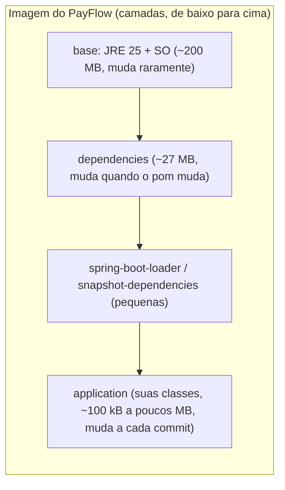

# P7.01 — Imagens otimizadas: layered jars, Buildpacks e Jib

> ⏱️ ~1h30 · 🔵 Pleno · Pré-requisitos: J9.02 (Dockerfile multi-stage, JAR em camadas, usuário não root), J10 (CI), P6.06 (desligamento gracioso)

> ⚠️ **Verificação:** **executado** nesta geração (Linux, Docker 29.9.2, Maven 3.9.12, JDK 25.0.5, Spring Boot **4.1.2**, `jib-maven-plugin` **3.5.2**, builder `paketobuildpacks/builder-noble-java-tiny`): as **três** formas de construir foram feitas sobre o **PayFlow Lite** da J9 (`1-junior/J9-docker/lab/docker-lab`). Os tempos vêm de uma máquina **compartilhada** (12 núcleos, carga alta): valem como **ordem de grandeza**, não como benchmark. **Não executado:** o `Dockerfile` sobre o **PayFlow do aluno** (não existe em disco), `docker push` a um registro, varredura de vulnerabilidades, assinatura e SBOM.

## 🎯 Objetivos
Ao final desta aula você consegue:
- **Construir** a mesma aplicação de três formas (Dockerfile com *layers*, Buildpacks e Jib) e **comparar** tamanho, camadas e tempo de reconstrução.
- **Explicar** por que o JAR "gordo" gera imagens lentas de enviar e como as **camadas** resolvem.
- **Escolher** uma forma para o PayFlow e **justificar**.
- **Aplicar** as regras de uma imagem de produção: tag imutável (ou *digest*), usuário não root, sem segredo, sem `latest`.

## 🤔 Por que isso importa
No Kubernetes **a imagem é o artefato que viaja**: o CI a constrói, o registro a guarda, cada nó a baixa. Uma imagem de 700 MB que muda **inteira** a cada *commit* torna cada atualização lenta (cada nó novo baixa tudo), enche o registro e atrasa a **escala** (o HPA da P7.06 só ajuda se o pod novo subir rápido). E uma imagem com `latest`, root ou segredo dentro é um incidente à espera. O que a J9 fez na mão aqui vira **decisão de equipe**: qual ferramenta, qual base, qual tag.

## 💡 Intuição (explicação simples)
Mudar de casa. O **JAR gordo** é uma caixa única: se você troca **um** livro, refaz a caixa inteira e o caminhão leva tudo. As **camadas** são caixas por cômodo: a caixa "móveis pesados" (dependências) quase nunca muda e já está no destino; só a caixa "objetos do dia a dia" (suas classes) viaja de novo. **Buildpacks** são uma transportadora que escolhe as caixas por você (e traz embalagem padrão); **Jib** é um montador que não precisa do caminhão (o *daemon* do Docker).

## 🔬 Como funciona por dentro

### 1. O que é uma imagem (revisão com foco no Kubernetes)
Uma imagem é uma lista **ordenada de camadas** (cada uma, um `tar` com mudanças no sistema de arquivos) mais um **manifesto** e uma configuração (usuário, `ENTRYPOINT`, variáveis). O registro guarda cada camada **uma vez**, pelo *digest* do conteúdo; um nó só baixa as camadas que **ainda não tem**. Logo: **o que muda pouco vai embaixo, o que muda sempre vai em cima** (J9.02).



No Spring Boot, `java -Djarmode=tools -jar app.jar extract --layers` separa o JAR em `dependencies`, `spring-boot-loader`, `snapshot-dependencies` e `application` (a J9.02 já fez). Os três caminhos desta aula usam essa ideia.

### 2. As três formas, medidas
O mesmo projeto, as mesmas versões:

| Forma | Comando | Tamanho | Camadas | Reconstrução após mudar **1** `.java` (medido) | Daemon Docker? |
|---|---|---|---|---|---|
| **Dockerfile** multi-stage (J9.02, JRE **Alpine**) | `docker build .` | **357 MB** | poucas, à mão | **3,4 s** (cache) | sim |
| **Jib** (JRE Ubuntu `eclipse-temurin:25-jre`) | `mvn …jib-maven-plugin:3.5.2:dockerBuild` | **527 MB** | **10** (dependências, recursos, classes) | **4,6 s** | **não** (com `build`, vai direto ao registro) |
| **Buildpacks** (`spring-boot:build-image`, base Ubuntu *tiny*) | `mvn spring-boot:build-image` | **686 MB** | **20** | **10,7 s** | sim (usa o *builder*) |

Leia com cuidado: **tamanho** depende da **base** (Alpine × Ubuntu) e do **JRE** que cada ferramenta escolhe, não da ferramenta em si; o Jib, apontado para a mesma base Ubuntu da J9, repetiu os **527 MB** que a J9 mediu com o `Dockerfile` Ubuntu. O que **muda de fato**:

- **Buildpacks** trazem **coisas prontas**: usuário não root (medido: `user=1002:1001`), um **calculador de memória**, certificados de CA, **SBOM** na imagem (a camada "Software Bill-of-Materials") e a base **atualizável sem tocar no seu código**. O preço: imagem maior, 20 camadas, menos controle e um *builder* de **1,4 GB** para baixar uma vez.
- **Jib** não precisa de Dockerfile nem de *daemon* (no CI, `jib:build` empurra direto ao registro) e monta camadas por tipo de arquivo; o **usuário padrão é root** (medido: tive de passar `-Djib.container.user=10001`).
- **Dockerfile**: **controle total** e a imagem menor aqui, ao custo de **você** manter o arquivo (e acertar `USER`, sinais, camadas).

### 3. O que o calculador de memória dos Buildpacks mostrou
Ao iniciar a imagem do Buildpacks com `--memory 768m` o log imprimiu:

```
Calculated JVM Memory Configuration: -XX:MaxDirectMemorySize=10M -Xmx188175K -XX:MaxMetaspaceSize=86256K
  -XX:ReservedCodeCacheSize=240M -Xss1M (Total Memory: 768M, Thread Count: 250, Loaded Class Count: 12815, Headroom: 0%)
```

e o `JAVA_TOOL_OPTIONS` incluiu `-XX:+ExitOnOutOfMemoryError`, **Native Memory Tracking** ligado e os certificados de CA. Repare: com 768 MB, o calculador deu só **~184 MiB de *heap*** (ele **reserva** `Thread Count × Xss`, metaspace e *code cache* para o pior caso, com 250 *threads* por padrão). É **conservador** e **ajustável** (variáveis `BPL_JVM_*`, na documentação do Paketo), mas é uma **decisão de memória tomada por você ou pela ferramenta**: a P7.02 mostra como decidir de propósito.

### 4. Regras de uma imagem de produção
1. **Tag imutável**: `payflow:1.7.3-<sha curto>` (nunca `latest`, que muda debaixo de você: o mesmo manifesto passa a rodar código diferente) e, no deploy, o *digest* (`@sha256:…`) quando possível. O Kubernetes decide `imagePullPolicy` pela tag (`latest` → `Always`; outra → `IfNotPresent`).
2. **Usuário não root** com *uid* numérico (a J9.02 usa 10001; o `runAsNonRoot` da P7.05 **exige** número, não nome).
3. **Nenhum segredo na imagem** (J9.04: sem `.dockerignore` o segredo ia junto; no Kubernetes o segredo entra **na execução**, P7.04).
4. **Base mínima e atualizada**: rebuild periódico para pegar correção de SO; varredura no CI (P8).
5. **Um processo, `ENTRYPOINT` na forma *exec*** (recebe o `SIGTERM`: J9.02, 143 × 137).
6. **Reprodutível**: versões fixadas (J9.02 fixa Maven e JRE por tag).

## 🛠️ Exemplo prático
**Dockerfile do PayFlow** (o da J9.02, com a tag de saída desta aula):
```bash
docker build -t payflow:p7 .
docker run --rm --entrypoint id payflow:p7 2>/dev/null || true   # JRE Alpine tem 'id' (busybox): uid=10001(payflow)
```
**Buildpacks** (sem Dockerfile; *builder* baixado uma vez):
```bash
JAVA_HOME=/usr/lib/jvm/java-25-openjdk-amd64 ./mvnw -B spring-boot:build-image -Dspring-boot.build-image.imageName=payflow:p7-bp
docker image inspect payflow:p7-bp --format 'user={{.Config.User}} entry={{.Config.Entrypoint}}'
# saída medida no laboratório: user=1002:1001 entry=[/cnb/process/web]
```
**Jib** (no `pom.xml`, em um perfil `jib` para não pesar no *build* normal; ou na linha de comando como medi):
```xml
<plugin>
  <groupId>com.google.cloud.tools</groupId>
  <artifactId>jib-maven-plugin</artifactId>
  <version>3.5.2</version>
  <configuration>
    <from><image>eclipse-temurin:25-jre</image></from>
    <to><image>payflow:p7-jib</image></to>
    <container><user>10001</user></container>
  </configuration>
</plugin>
```
```bash
./mvnw -B -DskipTests com.google.cloud.tools:jib-maven-plugin:3.5.2:dockerBuild
docker image inspect payflow:p7-jib --format 'user={{.Config.User}} layers={{len .RootFS.Layers}}'
# medido: user=10001 layers=10
```
O `jib:dockerBuild` usa o *daemon* local; `jib:build` envia ao **registro** sem *daemon* (é o modo do CI). Nenhum desses comandos foi executado **sobre o PayFlow real**, só sobre o PayFlow Lite.

## 🏗️ Estudo de caso: qual forma o PayFlow adota?
O time precisa escolher. Critérios: (a) já existe e **funciona** o Dockerfile da J9; (b) o CI (P8) terá *runner* com Docker; (c) ninguém quer manter um `Dockerfile` por serviço quando o PayFlow virar vários (P5: `payflow-notifications`, `payflow-gateway`); (d) segurança pede **SBOM** e rebuild da base.

<details><summary>Proposta (decisão 147)</summary>

**Dockerfile da J9 como padrão** (já testado, menor imagem, controle sobre usuário/sinais, nenhuma ferramenta nova), com **tag = versão + SHA** e **digest** no deploy. **Buildpacks** ficam como **alternativa documentada** se a equipe passar a ter vários serviços iguais e preferir *não* manter Dockerfiles (ganha SBOM e atualização de base; paga imagem maior e o ajuste do calculador de memória). **Jib** só se o CI **não puder** ter Docker (P8). **Reavaliar** se a manutenção do Dockerfile virar dor medida (regra de três da P4.03). Não é um "melhor" absoluto: é o menor passo que serve hoje.
</details>

## ⚖️ Trade-offs e quando NÃO usar
- **Alpine (musl) × Ubuntu (glibc):** Alpine é menor (357 × 527 MB medidos), mas bibliotecas nativas e diagnósticos às vezes esperam glibc (J9.02). Em dúvida, meça e teste com o **seu** código.
- **Buildpacks:** ótimos quando **muitos** serviços iguais; ruins quando você precisa de algo fora do padrão (um binário extra, um usuário específico) ou quando o tamanho da imagem importa.
- **Jib:** não serve se você precisa de passos de SO (instalar um pacote); só monta camadas Java sobre uma base.
- **Imagem *distroless*/`jlink`:** menor ainda, mas sem *shell* para depurar (`kubectl debug` com contêiner efêmero compensa, P7.09). Fica como evolução.
- **GraalVM *native image*:** fora do escopo do Pleno do PayFlow (build lento, reflexão do Hibernate/Spring exigem *hints*).

## ⚠️ Erros comuns e boas práticas de produção
- `docker run … :latest` em produção: ninguém sabe qual versão roda. **Tag imutável.**
- Imagem **root** (Jib por padrão!): o `runAsNonRoot: true` da P7.05 faz o pod **não iniciar** com `container has runAsNonRoot and image will run as root`.
- `USER payflow` por **nome** + `runAsNonRoot`: o `kubelet` não consegue verificar nome; use `USER 10001`.
- Reconstruir **tudo** a cada mudança por copiar `src` antes do `pom.xml` (J9.02).
- Depender do **cache do Docker** no CI sem plano: o `--mount=type=cache` não existe em *runners* efêmeros (P8).
- Segredo em `ENV`/`ARG` ou em camada: fica no histórico da imagem (`docker history`).

## 🧩 Exercícios
1. **Fixação:** por que a ordem das camadas (dependências antes das classes) reduz o que cada nó baixa? Quantos MB viajam quando só uma classe muda (use `docker history` e as camadas da tabela)?
2. **Aplicação no PayFlow:** tagueie a imagem com `<versão>-<sha curto>` num script `scripts/build-image.sh` e imprima o *digest*. Critérios: ☐ nenhum `latest`; ☐ `docker image inspect --format '{{.Config.User}}'` mostra número; ☐ `docker history` sem segredo; ☐ o build sem mudança leva segundos.
3. **Desafio:** construa a mesma imagem com Buildpacks e defina `BPL_JVM_THREAD_COUNT=50` (variável do Paketo; confira o nome na documentação do Paketo antes). O *heap* calculado subiu? Quanto, e o que você arriscou?

<details><summary>Soluções de referência</summary>

1. As camadas `dependencies` (~27 MB) e a base ficam em cache no nó e no registro; só a camada `application` (centenas de kB a poucos MB) é nova. Medido na J9: contexto de **47 MB → 1 kB** com `.dockerignore`, rebuild de 3,7 s mudando um `.java`.
2. `docker build -t payflow:$(git describe --tags --always) . && docker inspect --format '{{index .RepoDigests 0}}'` (o digest só existe depois do `push`; local, use `.Id`).
3. O calculador reserva `threads × Xss`; reduzir o número de *threads* devolve memória ao *heap* e **aumenta o risco** se a aplicação precisar de mais *threads* (Tomcat com 200 + *pools* de P2/P3). Meça `jcmd <pid> Thread.print | grep -c '^"'`.
</details>

## 🎤 Na entrevista
- **"Como você deixa a imagem de uma aplicação Spring Boot menor e mais rápida de atualizar?"** *Camadas* (dependências em baixo, código em cima), multi-stage, base JRE (não JDK), `.dockerignore`, `extract --layers`; só a camada da aplicação muda a cada *commit*.
- **"Dockerfile, Buildpacks ou Jib?"** Depende: Dockerfile para controle, Buildpacks para padronizar muitos serviços e ganhar SBOM/atualização de base, Jib quando não há Docker no CI. **Meça** e escolha a que a equipe consegue manter.
- **"Por que não usar `latest`?"** Não é reprodutível nem auditável; o mesmo manifesto passa a executar outra coisa e o *rollback* não sabe para onde voltar.

## 📚 Para ir além
- 📄 [Spring Boot: Container Images](https://docs.spring.io/spring-boot/reference/packaging/container-images/index.html) e [Efficient Container Images](https://docs.spring.io/spring-boot/reference/packaging/container-images/efficient-images.html): o `extract --layers` oficial.
- 📄 [Spring Boot: Cloud Native Buildpacks](https://docs.spring.io/spring-boot/reference/packaging/container-images/cloud-native-buildpacks.html) e o [`spring-boot:build-image`](https://docs.spring.io/spring-boot/maven-plugin/build-image.html): opções do *builder*.
- 📄 [Paketo (documentação)](https://paketo.io/docs/): variáveis do calculador de memória e *buildpacks* Java.
- 💻 [Jib (repositório)](https://github.com/GoogleContainerTools/jib): leia o README para `jib:build` e o contêiner de usuário.
- 📄 [Docker: multi-stage](https://docs.docker.com/build/building/multi-stage/) e [cache](https://docs.docker.com/build/cache/).
- Nenhum vídeo verificado.

## ✅ Checklist da aula
- [ ] Construí a imagem de **três** formas (ou entendi a tabela) e sei dizer por que os tamanhos diferem.
- [ ] Sei explicar camadas e o que viaja quando uma classe muda.
- [ ] Adotei tag imutável, `USER` numérico e nenhum segredo na imagem.
- [ ] Registrei **por que** o PayFlow usa o Dockerfile da J9 (decisão 147).
