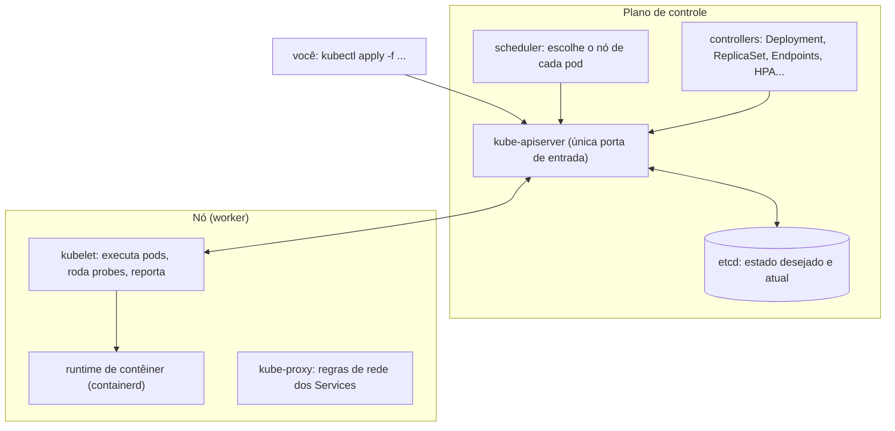

# P7.03 — Kubernetes: pods, deployments e services

> ⏱️ ~1h30 · 🔵 Pleno · Pré-requisitos: J9 (Docker, Compose, redes, `healthcheck`), P5.06 (por que o Kubernetes substitui Eureka e Config Server), P7.01, P7.02

> ✅ **Validação final (2026-11-24):** módulo executado no PayFlow reconstruído; resultado e o que continua não executado no [README do módulo](README.md). Os avisos "não executado" / "por leitura" abaixo descrevem a escrita original.

> ⚠️ **Verificação:** os **manifestos** (`lab/k8s-lab/manifests/`) tiveram a **sintaxe YAML validada** (PyYAML) e foram **revisados contra a documentação oficial** (kubernetes.io, páginas listadas em "Para ir além", conferidas nesta geração). **Não executados:** **nenhum comando `kubectl`**: o ambiente desta geração **não permitiu instalar `kind`/`kubectl`/`helm`** e, por decisão do aluno, os testes práticos do PayFlow ficam para o fim do treinamento. As **saídas de `kubectl` mostradas** abaixo são o **formato típico** (não capturadas aqui) e estão marcadas assim; **confira** na sua execução.

## 🎯 Objetivos
Ao final desta aula você consegue:
- **Descrever** a arquitetura de um cluster (plano de controle, nós, `kubelet`) e o que acontece quando você aplica um manifesto.
- **Distinguir** Pod, ReplicaSet, Deployment e Service, e **dizer por que não se cria Pod "solto"**.
- **Escrever** um Deployment e um Service do PayFlow com rótulos, estratégia de atualização e nomes estáveis.
- **Explicar** como um Service encontra os pods (seletor, `EndpointSlice`, DNS) e por que a **prontidão** decide quem recebe tráfego.
- **Usar** `kubectl` para aplicar, observar, depurar e desfazer.

## 🤔 Por que isso importa
O `compose.yaml` da J9 sobe **um** contêiner de cada em **uma** máquina. Em produção você quer: várias réplicas, **reposição automática** quando uma morre, **atualização sem parar** e **descoberta de serviços** por nome (o que a P5.06 adiou: "o `Service` do Kubernetes"). O Kubernetes é um **reconciliador**: você declara o estado desejado ("2 réplicas desta imagem") e ele trabalha continuamente para **igualar** o real ao desejado. Entender esse laço é a base para entender tudo o mais (probes, HPA, falhas).

## 💡 Intuição (explicação simples)
Um **gerente de restaurante com um quadro de metas**: "sempre 2 cozinheiros no turno, ambos com este avental (imagem)". Você só **escreve a meta** no quadro (manifesto). O gerente (controlador) olha o salão de tempos em tempos: faltou um cozinheiro? Chama outro. Quer mudar o avental? Troca um por vez, mantendo o restaurante aberto. O **Service** é o **balcão com um número fixo de telefone**: os cozinheiros mudam, o telefone não; a atendente só transfere para quem está **pronto**.

## 🔬 Como funciona por dentro

### 1. Peças do cluster

- **apiserver** é a única entrada: `kubectl`, controladores e `kubelet` conversam **com ele**; ele grava tudo no **etcd**.
- **scheduler** só decide **em qual nó** cada pod novo roda (considera `requests`, rótulos, espalhamento: P7.05).
- **controllers** são os laços de reconciliação ("há 1 ReplicaSet com 2 pods? crie o que falta").
- **kubelet** (em cada nó) transforma o pod em contêineres, executa as **sondas** e reporta o estado.
- No **kind** (P7.07) cada "nó" é um **contêiner Docker**; o resto é Kubernetes de verdade.

### 2. Os objetos que importam
| Objeto | O que é | Quem cria |
|---|---|---|
| **Pod** | menor unidade: 1+ contêineres que **compartilham rede (um IP) e volumes**; efêmero | o ReplicaSet |
| **ReplicaSet** | mantém **N pods iguais** | o Deployment |
| **Deployment** | descreve o pod, o nº de réplicas e **como atualizar** (RollingUpdate) | **você** |
| **Service** | **nome e IP estáveis** que balanceiam entre pods **prontos** | você |
| **Namespace** | espaço de nomes para agrupar/isolar (`payflow`) | você |
| **ConfigMap / Secret** | configuração / segredo (P7.04) | você |

**Pod nunca é "estimado"**: se um Pod criado direto morre, **ninguém o recria**; o Deployment (via ReplicaSet) **sim**. Por isso o PayFlow nunca usa `kind: Pod`.

### 3. O Deployment do PayFlow (leia o arquivo real: `manifests/30-deployment.yaml`)
Trechos que importam nesta aula:
```yaml
apiVersion: apps/v1
kind: Deployment
metadata: {name: payflow, namespace: payflow, labels: {app.kubernetes.io/name: payflow}}
spec:
  replicas: 2
  revisionHistoryLimit: 5
  strategy:
    type: RollingUpdate
    rollingUpdate: {maxSurge: 1, maxUnavailable: 0}     # sobe 1 novo; só derruba um velho quando o novo estiver PRONTO
  selector:
    matchLabels: {app.kubernetes.io/name: payflow}       # IMUTÁVEL depois de criado
  template:
    metadata:
      labels: {app.kubernetes.io/name: payflow}          # tem de bater com o selector
    spec:
      containers:
        - name: payflow
          image: payflow:p7                              # tag imutável (P7.01)
          ports: [{name: http, containerPort: 8080}, {name: mgmt, containerPort: 8081}]
```
- **Rótulos** (`labels`) são o **cola** entre objetos: o ReplicaSet, o Service e o HPA encontram pods **por rótulo**. Use os rótulos recomendados `app.kubernetes.io/name`, `…/part-of` etc.
- O **`selector` é imutável** e deve casar com os rótulos do *template*; errar isso é o erro de *primeiro dia*.
- **Atualização:** mudou o *template* (imagem, variável, recurso) → o Deployment cria um **novo ReplicaSet** e troca pods aos poucos. Com `maxUnavailable: 0` + `maxSurge: 1` a capacidade **nunca** fica abaixo de 2 (mas **precisa de espaço** para um 3º pod por instantes).
- `kubectl rollout status|history|undo deployment/payflow` observa e **desfaz** (guarda `revisionHistoryLimit` ReplicaSets antigos).

### 4. O Service e a descoberta por nome
```yaml
apiVersion: v1
kind: Service
metadata: {name: payflow, namespace: payflow}
spec:
  type: ClusterIP
  selector: {app.kubernetes.io/name: payflow}
  ports: [{name: http, port: 80, targetPort: http}]
```
- `ClusterIP` (padrão): um IP **virtual** estável **dentro** do cluster. O DNS interno resolve `payflow.payflow.svc.cluster.local` (`<serviço>.<namespace>.svc.cluster.local`; dentro do mesmo namespace basta `payflow`). **Isto é o que a P5.06 chamou de "o `Service` do Kubernetes"**: o `payflow.notifications.base-url` aponta para um nome de Service.
- O controlador de **EndpointSlice** lista **só os pods que estão `Ready`** (a *readiness* da P6.06): um pod que não passa na prontidão **sai do balanceamento** sem ser reiniciado.
- `port` (do Service) × `targetPort` (do contêiner): note que usamos o **nome** `http`, e a porta **8081 (gestão)** **não** está no Service: ninguém de fora do pod alcança o Actuator (decisão 138). O Prometheus (P6) acessa o IP do pod diretamente.
- Outros tipos: `NodePort` e `LoadBalancer` (expor para fora), `Headless` (`clusterIP: None`, usado pelo banco do laboratório) e `ExternalName`. **Para fora do cluster usa-se Ingress/Gateway** (P7.04).

### 5. O laço de reconciliação, em ação
1. `kubectl apply -f manifests/30-deployment.yaml` → apiserver grava no etcd.
2. O controlador do Deployment cria um **ReplicaSet**; este cria **2 Pods** (sem nó ainda).
3. O **scheduler** atribui um nó a cada Pod; o **kubelet** baixa a imagem e sobe o contêiner.
4. As **sondas** (P7.05) passam a `Ready`; o **EndpointSlice** inclui o pod; o Service passa a mandar tráfego.
5. Um pod morre (ou o nó cai) → o ReplicaSet vê 1 de 2 → cria outro. **Você não fez nada.**

## 🛠️ Exemplo prático
Comandos (formato típico; **não executados** aqui, ver o aviso):
```bash
kubectl apply -f lab/k8s-lab/manifests/00-namespace.yaml
kubectl -n payflow get deploy,rs,pods,svc -o wide
kubectl -n payflow describe pod -l app.kubernetes.io/name=payflow     # eventos: Scheduled, Pulled, Created, Started
kubectl -n payflow logs deploy/payflow --tail=50                        # logs (stdout, JSON ECS: P6.01)
kubectl -n payflow rollout status deploy/payflow
kubectl -n payflow rollout history deploy/payflow
kubectl -n payflow rollout undo deploy/payflow                          # volta à revisão anterior
kubectl -n payflow port-forward svc/payflow 8080:80                     # acesso local temporário (depuração)
kubectl -n payflow get endpointslices -l kubernetes.io/service-name=payflow
```
Saída típica de `get pods` (formato; não capturada):
```
NAME                       READY   STATUS    RESTARTS   AGE
payflow-6d9c7b8f5d-4kq2x   1/1     Running   0          2m
payflow-6d9c7b8f5d-tz8v9   1/1     Running   0          2m
```
**Declarativo × imperativo:** `kubectl apply -f` (declarativo; guarde os arquivos no Git) é o padrão. `kubectl create/run/scale/edit` são atalhos de **depuração**: o que não está no Git some na próxima implantação.

## 🧠 Pausa para lógica
Você tem `replicas: 2`, `maxSurge: 1`, `maxUnavailable: 0` e o novo pod **nunca fica `Ready`** (a imagem tem um bug de configuração). O que acontece? Quantos pods atendem tráfego? Como você sabe? Como desfaz?

<details><summary>Solução</summary>

O Deployment cria **1** pod novo (surge) e **não derruba** nenhum antigo (`maxUnavailable: 0`): ficam **2 antigos atendendo** + 1 novo `Running` 0/1, a atualização **trava** (`rollout status` espera até o `progressDeadlineSeconds`, padrão 600 s, e então marca `ProgressDeadlineExceeded`). **O serviço continua de pé**: é exatamente a vantagem da estratégia e da *readiness*. Desfazer: `kubectl rollout undo deploy/payflow`. Investigar: `describe pod`/`logs` do pod novo.
</details>

## ⚖️ Trade-offs e quando NÃO usar
- **Kubernetes para o PayFlow de hoje?** Para **2 serviços e uma VM** (J10) é **mais** peça do que o problema pede. Ele se paga com **vários serviços**, **escala**, **atualizações frequentes** e **times**. Serviço **gerenciado** (ECS/Fargate, P9) entrega boa parte do valor com menos operação: a P9 compara.
- **Local (kind) ≠ produção:** o kind é para **aprender e testar manifestos**, um cluster descartável; produção é EKS/GKE/AKS ou semelhante (P9), com rede, armazenamento e segurança próprios.
- **Banco no cluster:** o `StatefulSet` do laboratório serve para estudar; em produção o banco é **gerenciado** (RDS) ou operado por um *operator* maduro; dados exigem backup, replicação e *failover* que um manifesto simples não dá.
- **`StatefulSet` × Deployment:** o StatefulSet dá identidade estável e volume por réplica; o PayFlow é **sem estado** (o estado está no banco), logo é Deployment.

## ⚠️ Erros comuns e boas práticas de produção
- `selector` não bate com o `template.metadata.labels`: `The Deployment "payflow" is invalid: spec.template.metadata.labels: Invalid value ... selector does not match template labels`.
- `ImagePullBackOff`/`ErrImagePull`: imagem inexistente/sem permissão; no **kind** é preciso `kind load docker-image` (P7.07).
- `CrashLoopBackOff`: o contêiner **sai** repetidamente; veja `kubectl logs --previous` (P7.07).
- `Pending`: o scheduler não achou nó (`0/3 nodes are available: ... Insufficient memory`): `requests` demais (P7.05).
- Service sem pods: `selector` com rótulo errado → `kubectl get endpointslices` vazio.
- Editar no cluster com `kubectl edit` e esquecer o Git (deriva).
- **Um Deployment por aplicação, rótulos padronizados, tudo no Git, nada de `latest`.**

## 🧩 Exercícios
1. **Fixação:** por que um Pod criado diretamente não volta quando morre e um criado por Deployment, sim? Qual objeto faz a reposição?
2. **Aplicação no PayFlow:** escreva do zero o Deployment e o Service (sem olhar `lab/k8s-lab/manifests`) e compare. Critérios: ☐ rótulos `app.kubernetes.io/name`; ☐ `maxUnavailable: 0`; ☐ portas **nomeadas** `http` e `mgmt`; ☐ a 8081 **fora** do Service; ☐ imagem com tag fixa; ☐ `kubectl apply --dry-run=client -f` sem erro (quando houver `kubectl`).
3. **Desafio:** explique, com os controladores envolvidos, o que acontece **segundo a segundo** quando um nó inteiro some.

<details><summary>Soluções de referência</summary>

1. O Pod não tem dono: ninguém reconcilia. O **ReplicaSet** (criado pelo Deployment) conta pods com o seu rótulo e cria o que falta.
2. Compare com `manifests/30-deployment.yaml` e `31-service.yaml`; a diferença típica é esquecer `targetPort: http` (nome) ou colocar `8081` no Service.
3. O `kubelet` para de reportar; após o tempo de tolerância (`node-monitor-grace-period`, padrão de ~40 s na documentação do `kube-controller-manager`; **confira** o valor da sua versão) o nó vira `NotReady` e os pods são marcados para remoção; o ReplicaSet cria substitutos em **outros** nós; o EndpointSlice já havia tirado os pods não prontos. A **PodDisruptionBudget** (P7.05) só protege de remoções **voluntárias** (`drain`), não de queda de nó.
</details>

## 🎤 Na entrevista
- **"Diferença entre Pod, ReplicaSet e Deployment?"** Pod = unidade efêmera; ReplicaSet = mantém N pods iguais; Deployment = gerencia ReplicaSets e atualização (rolling, rollback).
- **"Como um Service encontra os pods?"** Por **seletor de rótulos**; o controlador de EndpointSlice lista os pods **Ready**; DNS `<svc>.<ns>.svc.cluster.local`; kube-proxy programa o balanceamento.
- **"O que é uma atualização *rolling* e como evitar perda de capacidade?"** Troca gradual de pods; `maxUnavailable: 0` e `maxSurge: 1`, mais *readiness* correta.

## 📚 Para ir além
- 📄 [Pods](https://kubernetes.io/docs/concepts/workloads/pods/), [Deployment](https://kubernetes.io/docs/concepts/workloads/controllers/deployment/), [ReplicaSet](https://kubernetes.io/docs/concepts/workloads/controllers/replicaset/) e [Service](https://kubernetes.io/docs/concepts/services-networking/service/) (kubernetes.io).
- 📄 [DNS para Services e Pods](https://kubernetes.io/docs/concepts/services-networking/dns-pod-service/) e [Labels](https://kubernetes.io/docs/concepts/overview/working-with-objects/labels/).
- 📄 [Tutorial oficial: noções básicas de Kubernetes](https://kubernetes.io/docs/tutorials/kubernetes-basics/): interativo, ótimo para a primeira hora.
- 📄 [kubectl: referência rápida](https://kubernetes.io/docs/reference/kubectl/quick-reference/): para consultar, não decorar.
- 📄 [Kubernetes: componentes e StatefulSet](https://kubernetes.io/docs/concepts/workloads/controllers/statefulset/) (para entender o banco do laboratório).
- 📄 [Kubernetes: visão geral](https://kubernetes.io/docs/concepts/overview/) e [kind](https://kind.sigs.k8s.io/) (o cluster local).
- Nenhum vídeo verificado.

## ✅ Checklist da aula
- [ ] Desenhei o caminho `kubectl apply` → pod rodando e sei o papel de cada componente.
- [ ] Sei por que não se cria Pod solto e o que é `maxSurge`/`maxUnavailable`.
- [ ] Sei como um Service encontra pods e por que a *readiness* tira um pod do tráfego.
- [ ] Os manifestos do PayFlow estão no Git (decisão 149).
