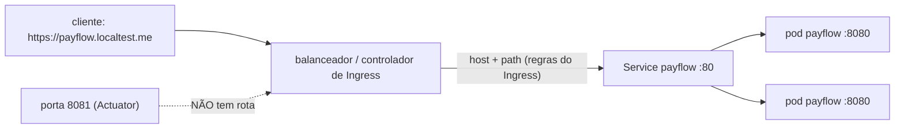

# P7.04 — Ingress, ConfigMaps e Secrets

> ⏱️ ~1h30 · 🔵 Pleno · Pré-requisitos: P7.03, J9.03 (variáveis, `.env`, segredos por arquivo e `configtree`), J8 (segredos e JWT), P5.05 (gateway), P5.06

> ✅ **Validação final (2026-11-24):** módulo executado no PayFlow reconstruído; resultado e o que continua não executado no [README do módulo](README.md). Os avisos "não executado" / "por leitura" abaixo descrevem a escrita original.

> ⚠️ **Verificação:** **lido e conferido** na documentação oficial desta geração (kubernetes.io: Ingress, Secret, ConfigMap, Pod Security Standards; kind: guia de Ingress; Spring Boot: *config tree*; aviso de **aposentadoria do ingress-nginx**); YAML dos manifestos **validado sintaticamente**. **Não executado:** nenhum `kubectl`, nenhum controlador de Ingress, o **Cloud Provider KIND**, a leitura do Secret pelo `configtree` num pod e a criptografia em repouso. O que dependeu de **comportamento** (ex.: *symlinks* do volume de Secret com o `configtree`) está marcado ⚠️ e vai na lista "a validar no fim do treinamento".

## 🎯 Objetivos
Ao final desta aula você consegue:
- **Expor** o PayFlow para fora do cluster com um `Ingress`, **explicar** o papel do controlador e **dizer por que** o ingress-nginx **não** é mais a escolha padrão.
- **Descrever** a Gateway API e **quando** ela substitui o Ingress.
- **Externalizar** configuração em `ConfigMap` e segredos em `Secret`, com a aplicação lendo-os **como arquivos** (`configtree`).
- **Explicar** por que **base64 não é criptografia** e listar os controles reais (RBAC, criptografia em repouso, gerenciador externo, rotação).

## 🤔 Por que isso importa
Entrar no cluster (**tráfego**) e configurar a aplicação (**dados e segredos**) são os dois lugares onde a segurança do PayFlow se decide. Um Ingress mal configurado expõe o Actuator; um Secret mal tratado vaza a chave do JWT **no repositório** (que é onde a maioria dos segredos vaza). A J9.03 já separou "configuração × segredo" no Compose; aqui o mesmo princípio ganha os objetos do Kubernetes.

## 💡 Intuição (explicação simples)
Um **prédio comercial**. O **Service** é o ramal interno; o **Ingress** é a **portaria**: um único endereço de rua que, conforme o que o visitante pede ("PayFlow, por favor"), o encaminha para a sala certa (e só para as portas que existem). O **ConfigMap** é o **quadro de avisos** (horário de funcionamento: público). O **Secret** é o **cofre** do síndico: a chave **não** fica no quadro, só quem precisa a recebe, e o cofre **em si** precisa ser protegido (não basta ter o nome "cofre").

## 🔬 Como funciona por dentro

### 1. Ingress: a API e o controlador

- O objeto **`Ingress`** é só uma **declaração** de regras (host/caminho → Service). **Quem as executa** é um **controlador de Ingress** (um programa que lê os `Ingress` e configura um *proxy* reverso). Sem controlador, o `Ingress` **não faz nada**.
- No manifesto `manifests/40-ingress.yaml` **só `/`** vai para o Service `payflow:http` (porta 80 → 8080). **Não há rota** para `8081`, e o Service nem a expõe: o Actuator fica inalcançável de fora (decisão 138).
- **`pathType`**: `Prefix` (casa por prefixo de caminho, separado por `/`), `Exact` ou `ImplementationSpecific` (depende do controlador). Use `Prefix`/`Exact`.

### 2. A situação do ecossistema (importante em 2026)
- A **API Ingress está "congelada"**: continua **estável e suportada**, **sem plano de remoção**, mas **sem novidades**; o projeto Kubernetes **recomenda a Gateway API** para o que é novo (kubernetes.io, página do Ingress, lida nesta geração).
- O **ingress-nginx** (o controlador mais usado por anos) teve **manutenção "no melhor esforço" até **março de 2026**; depois disso, **sem novas versões, correções ou correções de segurança** (aviso oficial da SIG Network, 2025-11-11). As instalações existentes continuam funcionando, mas **você não deve começar um projeto novo nele**. (O aviso cita alternativas e a **Ingress2Gateway** para migrar; o texto integral não foi lido por completo: confira.)
- **No kind**, a documentação atual (lida nesta geração) usa o **Cloud Provider KIND**, que provê `LoadBalancer` e **atende Ingress e Gateway API** sem controlador de terceiros; o `Ingress` do exemplo oficial **não define `ingressClassName`** e o endereço aparece em `kubectl get ingress` (`status.loadBalancer.ingress[0].ip`). Para controladores de terceiros (Traefik, Contour, etc.), siga a documentação deles.

### 3. Gateway API (visão geral)
A **Gateway API** separa papéis: a infraestrutura define **`GatewayClass`** e **`Gateway`** (o ponto de entrada e os *listeners*) e o time da aplicação define **`HTTPRoute`** (regras). Ganha em **expressividade** (cabeçalhos, pesos para *canary*, *timeouts*, TLS por rota) e **portabilidade** (menos anotações específicas de controlador). Forma de uma rota (ilustrativa, **não executada**; confira a versão da API na documentação do seu controlador):
```yaml
apiVersion: gateway.networking.k8s.io/v1
kind: HTTPRoute
metadata: {name: payflow, namespace: payflow}
spec:
  parentRefs: [{name: entrada}]            # o Gateway criado pelo time de plataforma
  hostnames: ["payflow.localtest.me"]
  rules:
    - matches: [{path: {type: PathPrefix, value: /}}]
      backendRefs: [{name: payflow, port: 80}]
```
**Decisão para o PayFlow (150):** **Ingress** agora (simples, estável, é o que o kind atende sem peças extras) e **Gateway API** quando surgirem necessidades que ele não cobre (divisão de tráfego, *timeouts* por rota, múltiplas equipes). Atenção: o **`payflow-gateway`** da P5.05 (Spring Cloud Gateway) é **outra coisa**: lógica de aplicação (rotas, resiliência); o Ingress/Gateway API é a **entrada de rede** do cluster. Os dois podem coexistir (Ingress → `payflow-gateway` → serviços).

### 4. ConfigMap: configuração **não secreta**
Pares chave/valor (ou arquivos) **versionados no Git**: URL do banco, perfil, porta de gestão, `JAVA_TOOL_OPTIONS` (P7.02). Há **duas** formas de entregar ao pod:
- **Variáveis de ambiente** (`envFrom: configMapRef`): simples; o Spring Boot lê `SPRING_DATASOURCE_URL` → `spring.datasource.url` (ligação relaxada, J5.05). **Só são lidas na partida**: mudar o ConfigMap **não** muda pods em execução.
- **Volume** (cada chave vira um arquivo): o `kubelet` **atualiza** os arquivos depois de um tempo; a aplicação só vê a mudança se **reler** (o Spring Boot não relê sozinho). Para **forçar** um novo *rollout* quando a configuração muda, use o **hash** do ConfigMap numa anotação do *template* (o chart da P7.08 faz isso).

### 5. Secret: segredos **como arquivos**
```yaml
# NÃO versione isto. Criado por scripts/make-k8s-secrets.sh a partir de secrets/ (fora do Git)
kubectl -n payflow create secret generic payflow-app \
  --from-file=spring.datasource.password=secrets/db_password \
  --from-file=payflow.security.jwt.secret=secrets/jwt_secret
```
E no Deployment (já em `30-deployment.yaml`):
```yaml
env/envFrom:  SPRING_CONFIG_IMPORT: configtree:/run/secrets/app/      # (no ConfigMap)
volumeMounts: [{name: app-secret, mountPath: /run/secrets/app, readOnly: true}]
volumes:      [{name: app-secret, secret: {secretName: payflow-app, defaultMode: 0440}}]
```
- **Cada chave do Secret vira um arquivo** (`/run/secrets/app/spring.datasource.password`); o **`configtree:`** (J9.03) transforma o **nome do arquivo** em propriedade e o **conteúdo** em valor. A documentação do Spring Boot (lida nesta geração) cita explicitamente o caso de **ConfigMaps e Secrets montados como volume** com o prefixo `configtree:`. ⚠️ **Não executado:** o volume de Secret é uma árvore com *symlinks* (`..data`); confirme na sua execução que a propriedade chega (um `kubectl exec … ls -la /run/secrets/app` e o log de partida).
- **Por que arquivo e não variável de ambiente?** Uma variável de ambiente fica em `/proc/<pid>/environ`, pode ir parar em *dumps* de falha e é **herdada por processos filhos**; um arquivo com permissão **0440** + `fsGroup` é mais controlável. É o mesmo raciocínio da J9.03 (`docker inspect` não mostrava o segredo montado).
- **`defaultMode: 0440`** + `fsGroup: 10001` (no `securityContext` do pod): o grupo `10001` lê; ninguém mais. (O Compose ignorava `uid`/`mode`: J9.03; **no Kubernetes eles valem**, medido em lugar nenhum aqui: ⚠️ conferir.)

### 6. **Base64 não é criptografia**
Um Secret guarda valores em **base64** só para acomodar bytes; qualquer um que **leia o objeto** (`kubectl get secret -o yaml`) obtém o segredo com `base64 -d`. A segurança real vem de **outros controles**:
1. **RBAC** de **menor privilégio**: quem pode `get`/`list` Secrets no namespace? (`list` também vaza valores.) Não dê ao `ServiceAccount` do PayFlow nenhuma permissão (`automountServiceAccountToken: false`, já no Deployment).
2. **Criptografia em repouso no etcd** (configuração do plano de controle; **serviços gerenciados** costumam oferecer, com KMS: P9/P10). Por padrão, os Secrets ficam **sem criptografia** no etcd.
3. **Nunca no Git** em claro (use o script, um gerenciador externo ou ferramentas de Secret **criptografado** no repositório; a escolha fica para a P8/P10).
4. **Gerenciador externo** (AWS Secrets Manager e *External Secrets*/CSI driver: P9/P10) com **rotação**.
5. **Imutabilidade e rotação**: troca de segredo = **novo** Secret/versão + *rollout*.

### 7. Endurecimento do namespace (Pod Security Standards)
O `00-namespace.yaml` aplica o rótulo `pod-security.kubernetes.io/enforce: restricted`: o *admission* **recusa** pods que não cumpram o perfil *restricted* (executar como não root, `allowPrivilegeEscalation: false`, **descartar** *capabilities*, `seccompProfile` `RuntimeDefault`). Os manifestos do PayFlow já cumprem. Se o pod for recusado, a mensagem diz o que falta (formato típico: `violates PodSecurity "restricted:latest": allowPrivilegeEscalation != false ...`).

## 🛠️ Exemplo prático
```bash
# 1. segredos (script do laboratório; cria secrets/ com valores aleatórios, fora do Git)
./lab/k8s-lab/scripts/make-k8s-secrets.sh
# 2. configuração e aplicação
kubectl apply -f lab/k8s-lab/manifests/20-configmap.yaml -f lab/k8s-lab/manifests/30-deployment.yaml -f lab/k8s-lab/manifests/31-service.yaml
# 3. entrada
kubectl apply -f lab/k8s-lab/manifests/40-ingress.yaml
kubectl -n payflow get ingress                      # ADDRESS preenchido pelo Cloud Provider KIND (se estiver em execução)
curl -i -H 'Host: payflow.localtest.me' http://<ADDRESS>/actuator/health     # esperado: 404 (a 8081 não é exposta; /actuator na 8080 não existe)
# 4. o segredo não deve aparecer na descrição
kubectl -n payflow describe pod -l app.kubernetes.io/name=payflow | grep -i -E 'password|secret'   # só o NOME do Secret e o ponto de montagem
```
Todos **não executados**; o esperado vem do desenho (porta de gestão separada, P6.02) e do aviso acima. Prove isso na sua execução e registre.

## 🧠 Pausa para lógica
Alguém commitou `secret.yaml` com `data: {jwt: c3VwZXJzZWNyZXQ=}` "porque está em base64". (a) O que o atacante lê? (b) O que você faz **além** de apagar o arquivo? (c) Por que `git rm` não basta?

<details><summary>Solução</summary>

(a) `echo c3VwZXJzZWNyZXQ= | base64 -d` → `supersecret`: o segredo **inteiro**. (b) **Rotacionar** a chave do JWT (invalida tokens), trocar a senha do banco se estiver junto, investigar acessos e **reescrever o histórico/avisar** o time; adicionar `secrets/` ao `.gitignore` e um *hook*/CI de varredura (J7/J10: `check-secrets.sh`). (c) O segredo **continua no histórico do Git** (e em clones/forks/caches): só a **rotação** resolve.
</details>

## ⚖️ Trade-offs e quando NÃO usar
- **Ingress × Gateway API × LoadBalancer por serviço:** `LoadBalancer` por serviço é simples, mas **caro** (um por serviço, nuvem real: 💸) e sem roteamento por caminho; Ingress/Gateway concentra a entrada.
- **Env × arquivo para segredos:** env é mais simples e funciona; arquivo é mais seguro e exige leitura no código/`configtree`. Para o PayFlow: arquivo.
- **Secret nativo × gerenciador externo:** o nativo é suficiente para **estudo**; produção pede KMS/rotação/auditoria (P9/P10).
- **ConfigMap por variável × volume:** variável exige reinício para mudar (previsível); volume muda "ao vivo", o que pode **surpreender**. Preferir o previsível.
- **Terminar TLS no Ingress × no pod:** no Ingress é o usual (certificados em um só lugar); *mTLS* entre serviços é assunto do S5. TLS é obrigatório fora do laboratório (J2/J8); o laboratório usa HTTP em `localhost`.

## ⚠️ Erros comuns e boas práticas de produção
- Ingress **sem controlador**: `ADDRESS` vazio para sempre.
- `ingressClassName` errado/ausente quando há vários controladores: o Ingress é ignorado. Confira `kubectl get ingressclass`.
- Expor o Actuator pela rota `/` (porta 8080) por ter movido de porta: confira que só `/api/**` e a UI estão acessíveis (P6.02).
- Segredo em `ConfigMap` ("é só uma senha de dev"): vira hábito.
- `kubectl get secret -o yaml` colado em chat/ticket.
- Permitir que **qualquer** `ServiceAccount` leia Secrets do namespace.
- Montar o Secret **sem** `readOnly: true` e com permissão **0644**.

## 🧩 Exercícios
1. **Fixação:** o que um `Ingress` faz sozinho, sem controlador? E por que o ingress-nginx é uma escolha **ruim** para um projeto novo em 2026?
2. **Aplicação no PayFlow:** externalize a configuração e os segredos. Critérios: ☐ **nenhum** segredo em `ConfigMap` nem no Git (`git grep` por `password`); ☐ o Secret montado em `/run/secrets/app` com `0440` e `fsGroup`; ☐ só `/` (8080) roteado e `/actuator/*` **404** pelo Ingress; ☐ `automountServiceAccountToken: false`; ☐ o namespace com *enforce restricted* e o pod **admitido**.
3. **Desafio:** escreva o `Gateway` + `HTTPRoute` equivalentes ao Ingress e liste **uma** coisa que o Ingress não expressa bem (ex.: 90/10 de tráfego).

<details><summary>Soluções de referência</summary>

1. Nada: é só dado. O controlador o transforma em proxy. O ingress-nginx **saiu de manutenção em março de 2026** (sem correções de segurança): risco para um componente **de borda**.
2. Use `make-k8s-secrets.sh`; verifique com `kubectl auth can-i get secrets --as=system:serviceaccount:payflow:default -n payflow` (esperado `no`).
3. Veja o `HTTPRoute` acima mais um `Gateway` com `gatewayClassName` do seu controlador; pesos em `backendRefs` (`weight`) permitem *canary*: **confira** o campo na documentação da Gateway API antes de usar.
</details>

## 🎤 Na entrevista
- **"Ingress ou Gateway API?"** Ingress é estável e simples mas congelado; Gateway API é o caminho recomendado para novos requisitos (papéis separados, mais recursos). Mantenho Ingress enquanto basta e planejo a migração.
- **"Secrets do Kubernetes são seguros?"** Por padrão são só base64 no etcd. Segurança vem de RBAC, criptografia em repouso, **não versionar em claro**, gerenciador externo e rotação.
- **"ConfigMap como env ou volume?"** Env: lido na partida, previsível; volume: atualiza, mas a app precisa reler. Em ambos, mudança que importa deve **disparar um novo rollout**.

## 📚 Para ir além
- 📄 [Ingress](https://kubernetes.io/docs/concepts/services-networking/ingress/) e [Gateway](https://kubernetes.io/docs/concepts/services-networking/gateway/) (kubernetes.io) e o site da [Gateway API](https://gateway-api.sigs.k8s.io/).
- 📄 [Aviso de aposentadoria do ingress-nginx](https://kubernetes.io/blog/2025/11/11/ingress-nginx-retirement/): datas e o que significa.
- 📄 [kind: Ingress](https://kind.sigs.k8s.io/docs/user/ingress/) e [kind: LoadBalancer](https://kind.sigs.k8s.io/docs/user/loadbalancer/) (Cloud Provider KIND).
- 📄 [ConfigMap](https://kubernetes.io/docs/concepts/configuration/configmap/), [Secret](https://kubernetes.io/docs/concepts/configuration/secret/) e [Pod Security Standards](https://kubernetes.io/docs/concepts/security/pod-security-standards/).
- 📄 [Spring Boot: configuração externa (*config tree*)](https://docs.spring.io/spring-boot/reference/features/external-config.html).
- 📄 [The Twelve-Factor App: Config](https://12factor.net/config).
- Nenhum vídeo verificado.

## ✅ Checklist da aula
- [ ] Sei dizer o que o Ingress é, quem o executa e por que o ingress-nginx não é mais a escolha padrão.
- [ ] Segredos do PayFlow em `Secret` montado como arquivo, **fora do Git**; configuração no `ConfigMap`.
- [ ] Sei por que base64 não é criptografia e citei os controles reais.
- [ ] Só a porta da aplicação é exposta; o Actuator (8081) não (decisão 150).
