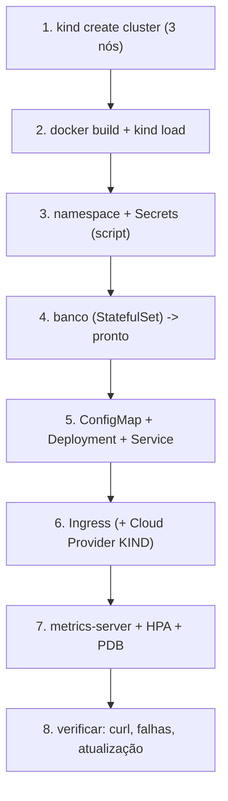

# P7.07 — Deploy do PayFlow no kind

> ⏱️ ~1h30 · 🔵 Pleno · Pré-requisitos: P7.01 a P7.06, J9.03 (Compose, segredos), P6.06

> ⚠️ **Verificação:** esta é a aula **prática** do módulo e é onde **menos** foi executado, por duas razões honestas: (1) o ambiente desta geração **não permitiu instalar** `kind`, `kubectl` e `helm`; (2) o **PayFlow do aluno não existe em disco**, e por decisão do aluno os testes práticos ficam para o **fim do treinamento**. **Foi feito:** sintaxe YAML dos manifestos validada; `bash -n` no script de segredos; o `Dockerfile`/imagem medidos no **PayFlow Lite** (P7.01) e a JVM sob limite (P7.02). **Todo o roteiro abaixo (`kind create`, `kubectl apply`, `rollout`, falhas provocadas) está sem execução**; as saídas são o **formato típico**. Tratar este roteiro como a **lista de verificação** do fim do treinamento: registre, em "Correções pendentes", o que **diferir** na sua execução.

## 🎯 Objetivos
Ao final desta aula você consegue:
- **Criar** um cluster `kind` de 3 nós e **carregar** a imagem do PayFlow nele.
- **Implantar** banco, configuração, segredos, aplicação, Service, Ingress, HPA e PDB **na ordem certa** e **verificar** cada etapa.
- **Diagnosticar** os cinco erros mais comuns (`ImagePullBackOff`, `CrashLoopBackOff`, `Pending`, `0/1 Running`, Service sem endpoints).
- **Provar** a atualização sem 5xx e a recuperação de falhas, e **registrar** o resultado.

## 🤔 Por que isso importa
Tudo até aqui foi **explicação**; esta aula é o **ensaio geral**: o PayFlow rodando em um cluster de verdade (descartável). É o que separa "li o manual" de "sei operar". Também revela o que **só aparece integrado**: a imagem não carregada no nó, o Secret ilegível pelo usuário não root, a sonda que mata a partida lenta.

## 💡 Intuição (explicação simples)
O **ensaio de uma peça de teatro** no palco de verdade, com figurino, luz e a plateia (um *curl*). Falhar no ensaio é o objetivo: é lá que se descobre que a porta do cenário não abre.

## 🔬 Como funciona por dentro

### 1. O que é o kind
**kind** ("Kubernetes IN Docker") roda cada **nó** do cluster como um **contêiner Docker**; é feito para testar o Kubernetes e **aplicações em CI/local**. Não é produção. Imagens do seu Docker **não** aparecem nos nós sozinhas: `kind load docker-image` as copia (a documentação do kind descreve esse fluxo, **lido** nesta geração), e por isso o Deployment usa `imagePullPolicy: IfNotPresent` e **uma tag** que não seja `latest`.

### 2. Ordem de implantação

A ordem importa: o Secret e o ConfigMap **antes** do Deployment (senão o pod fica em `CreateContainerConfigError`); o banco **antes** da aplicação (a *readiness* depende dele, mas o Kubernetes **tolera** a ordem errada: o pod só demora a ficar `Ready`).

## 🛠️ Exemplo prático (roteiro; **não executado**, ver o aviso)

### Passo 1: cluster
```bash
kind create cluster --name payflow --config lab/k8s-lab/kind-config.yaml    # 1 control-plane + 2 workers
kubectl cluster-info --context kind-payflow
kubectl get nodes                                                            # 3 nós Ready
```
O `kind` baixa a imagem do nó (`kindest/node`, **~1 GB**: a versão do Kubernetes depende da versão do kind; confira nas *release notes*). Memória: 3 nós consomem **vários GB**; em máquina modesta, use **1** nó (apague os `worker` do `kind-config.yaml`).

### Passo 2: imagem
```bash
docker build -t payflow:p7 .                        # Dockerfile da J9 (P7.01)
kind load docker-image payflow:p7 --name payflow     # copia para os nós
docker exec payflow-worker crictl images | grep payflow     # confere dentro do nó (o nome do nó: kind get nodes --name payflow)
```

### Passo 3: segredos e namespace
```bash
./lab/k8s-lab/scripts/make-k8s-secrets.sh            # cria namespace "payflow" (com Pod Security restricted) e os Secrets
kubectl -n payflow get secret
```

### Passo 4: banco
```bash
kubectl apply -f lab/k8s-lab/manifests/10-postgres.yaml
kubectl -n payflow rollout status statefulset/db --timeout=180s
kubectl -n payflow exec db-0 -- pg_isready -U payflow -d payflow
```
Se falhar com `initdb: error: directory "/var/lib/postgresql/18/docker" exists but is not empty` ou permissão: reveja o `PGDATA` e o `fsGroup` do manifesto (a pasta de dados deve ser **subdiretório** do volume).

### Passo 5: aplicação
```bash
kubectl apply -f lab/k8s-lab/manifests/20-configmap.yaml -f lab/k8s-lab/manifests/30-deployment.yaml -f lab/k8s-lab/manifests/31-service.yaml
kubectl -n payflow rollout status deploy/payflow --timeout=240s
kubectl -n payflow get pods -o wide                 # 2 pods, 1/1 Running, em nós diferentes (se houver 2 workers)
kubectl -n payflow logs deploy/payflow --tail=20    # JSON ECS (P6.01): procure "Started ... Application"
kubectl -n payflow port-forward svc/payflow 8080:80 &
curl -s -o /dev/null -w '%{http_code}\n' localhost:8080/login     # exemplo; use uma rota pública do PayFlow
```

### Passo 6: Ingress
Rode o **Cloud Provider KIND** (binário do projeto, em **outro terminal**, com privilégios para abrir portas; documentação: kind → *LoadBalancer*/*Ingress*; **não instalado aqui**). Depois:
```bash
kubectl apply -f lab/k8s-lab/manifests/40-ingress.yaml
kubectl -n payflow get ingress                       # ADDRESS preenchido
curl -s -H 'Host: payflow.localtest.me' http://<ADDRESS>/login -o /dev/null -w '%{http_code}\n'
curl -s -H 'Host: payflow.localtest.me' http://<ADDRESS>/actuator/health -o /dev/null -w '%{http_code}\n'   # esperado: 404 (gestão não exposta)
```
(`*.localtest.me` resolve para `127.0.0.1`; com o `Host:` explícito, o *curl* funciona sem DNS.)

### Passo 7: escala e disponibilidade
```bash
# metrics-server (README do projeto; no kind, geralmente --kubelet-insecure-tls)
kubectl apply -f lab/k8s-lab/manifests/50-hpa.yaml -f lab/k8s-lab/manifests/60-pdb.yaml
kubectl -n payflow get hpa,pdb
```

### Passo 8: o que **provar** (registre cada resultado)
| # | Experimento | Comando | Esperado (pelo desenho) |
|---|---|---|---|
| 1 | pod morre e volta | `kubectl -n payflow delete pod -l app.kubernetes.io/name=payflow --wait=false` | 2 pods de novo; o Service nunca fica sem endpoints (há 2 réplicas) |
| 2 | atualização sem erro | `curl` em laço + `kubectl -n payflow rollout restart deploy/payflow` | **0** respostas 5xx; `rollout status` conclui |
| 3 | banco fora | `kubectl -n payflow scale statefulset/db --replicas=0` | `READY 0/1`, **0 reinícios**, 503 na readiness; volta ao subir o banco |
| 4 | `OOMKilled` | P7.09 | `Reason: OOMKilled`, exit 137 |
| 5 | segredo ilegível | remova o `fsGroup` do Deployment | a aplicação falha ao subir lendo `/run/secrets/app/...` (`AccessDeniedException`, **como na J9.03**) |
| 6 | desfazer | `kubectl -n payflow rollout undo deploy/payflow` | volta à revisão anterior |
| 7 | escala | carga (P7.06) | HPA aumenta de 2 a até 6 |

### Passo 9: limpeza
```bash
kind delete cluster --name payflow                    # apaga os nós (contêineres) e os volumes do cluster
docker volume prune                                    # CUIDADO: remove TODOS os volumes sem uso, de qualquer projeto
```
Prefira **só** `kind delete cluster`. O `docker volume prune` é opcional e **destrutivo** (confira `docker volume ls` antes).

## 🧠 Pausa para lógica
O `rollout status` fica "Waiting for deployment "payflow" rollout to finish: 1 out of 2 new replicas have been updated..." por 10 minutos e termina com `error: deployment "payflow" exceeded its progress deadline`. Liste **cinco** causas possíveis e o comando que testa cada uma.

<details><summary>Solução</summary>

(1) Imagem não encontrada no nó: `describe pod` → `ImagePullBackOff`/`ErrImagePull`; `kind load`. (2) Sonda de partida falha: `describe pod` → `Startup probe failed`; `logs --previous`. (3) `readiness` falha porque o banco não está pronto: `kubectl exec ... pg_isready`, `get pods db-0`. (4) `Pending` por falta de recurso (`Insufficient memory`): `describe pod` → `FailedScheduling`; reduza `requests` ou use mais nós. (5) Secret ausente/ilegível: `CreateContainerConfigError` ou `AccessDeniedException` nos logs. (6) Pod Security: o ReplicaSet não cria pods (`kubectl -n payflow get events` → `violates PodSecurity`).
</details>

## ⚖️ Trade-offs e quando NÃO usar
- **kind × minikube × k3d × cluster gerenciado:** kind é leve e bom para **CI**; minikube tem *addons*; k3d/k3s são mais leves; um cluster gerenciado (P9) reproduz a produção (rede, discos, balanceadores) mas **custa dinheiro** 💸 (desfazer: apague o cluster e os balanceadores).
- **Banco no cluster:** só no laboratório (P7.03).
- **`kubectl apply` à mão × GitOps:** à mão serve ao ensaio; em produção, **pipeline** (P8) e/ou GitOps (Argo CD/Flux, citado, não ensinado).
- **Três nós:** mostra espalhamento, mas custa memória; um nó basta para a maior parte.

## ⚠️ Erros comuns e boas práticas de produção
- `ErrImagePull`/`ImagePullBackOff` com `payflow:p7`: esqueceu o `kind load` **ou** a tag é `latest` (política `Always` tenta baixar de um registro).
- `CrashLoopBackOff`: `kubectl logs --previous` (a saída do contêiner **anterior**, que morreu).
- `CreateContainerConfigError`: Secret/ConfigMap inexistente (`kubectl describe pod` → `secret "payflow-app" not found`).
- `Error from server (Forbidden): ... violates PodSecurity "restricted:latest"`: o manifesto não cumpre o perfil; a mensagem lista o campo.
- **Contexto errado do `kubectl`**: confirme `kubectl config current-context` **antes** de `apply`/`delete` (o desastre clássico é apagar no cluster errado). **Nunca** aponte o laboratório para um cluster de trabalho.
- `port-forward` serve a **depuração**, não é acesso de produção.
- Recursos do cluster que **sobram**: apague o cluster ao final.

## 🧩 Exercícios
1. **Fixação:** por que o `kind` não "enxerga" a imagem que você acabou de construir com `docker build`? Qual comando resolve e por que a tag não pode ser `latest` com `imagePullPolicy` padrão?
2. **Aplicação no PayFlow:** execute o roteiro (no fim do treinamento) e preencha uma tabela **esperado × obtido** para os 7 experimentos. Critérios: ☐ cada divergência vira uma **entrada** em "Correções pendentes" e uma **correção** nos manifestos; ☐ tag `payflow-P7`; ☐ `docs/kubernetes.md` com o roteiro e o diagrama; ☐ o `README` do repositório explica como subir/derrubar o cluster.
3. **Desafio:** adicione ao CI (P8) um *job* que sobe o kind, aplica os manifestos e roda um teste de fumaça.

<details><summary>Soluções de referência</summary>

1. Cada nó é um contêiner com **seu próprio** armazenamento de imagens; o Docker do host não o compartilha. `kind load docker-image payflow:p7 --name payflow`. Com `latest`, a política padrão é `Always` e o nó tenta baixar de um registro.
2. Esta tabela é o **entregável**; o histórico das divergências vale mais do que um "tudo passou".
3. Veja P8: o *runner* precisa de Docker; o `kind` instala-se por *action* oficial ou binário fixado por versão **e** *checksum*; tempo e memória viram o custo do *job*.
</details>

## 🎤 Na entrevista
- **"Como você testa manifestos Kubernetes localmente?"** kind/minikube/k3d; `kubectl apply --dry-run=client|server`, validação (`kubeconform`, citado), testes de fumaça e de falha (matar pod, banco fora).
- **"O pod está em `CrashLoopBackOff`; e agora?"** `describe pod` (eventos, `lastState`, código de saída), `logs --previous`, sondas, recursos, configuração/segredos.
- **"Como você garante que uma atualização não gera erro?"** *readiness*, `maxUnavailable: 0`, `preStop`, *graceful shutdown*, e um teste que **mede** 5xx durante o `rollout`.

## 📚 Para ir além
- 📄 [kind: início rápido](https://kind.sigs.k8s.io/docs/user/quick-start/) (criar cluster, `kind load docker-image`) e [configuração](https://kind.sigs.k8s.io/docs/user/configuration/).
- 📄 [kind: Ingress](https://kind.sigs.k8s.io/docs/user/ingress/) e [LoadBalancer](https://kind.sigs.k8s.io/docs/user/loadbalancer/).
- 📄 [Depurar Pods](https://kubernetes.io/docs/tasks/debug/debug-application/debug-pods/) e [determinar a razão da falha de um Pod](https://kubernetes.io/docs/tasks/debug/debug-application/determine-reason-pod-failure/).
- 📄 [`kubectl`: referência rápida](https://kubernetes.io/docs/reference/kubectl/quick-reference/).
- 📄 [Kustomize](https://kubernetes.io/docs/tasks/manage-kubernetes-objects/kustomization/) (alternativa a Helm, citada na P7.08).
- Nenhum vídeo verificado.

## ✅ Checklist da aula
- [ ] Sei criar o cluster, carregar a imagem e aplicar os manifestos **na ordem certa**.
- [ ] Sei diagnosticar os cinco erros mais comuns com o comando certo.
- [ ] (No fim do treinamento) preenchi a tabela **esperado × obtido** e registrei as divergências.
- [ ] Apaguei o cluster ao terminar e confirmei o contexto do `kubectl` (decisão 153).
