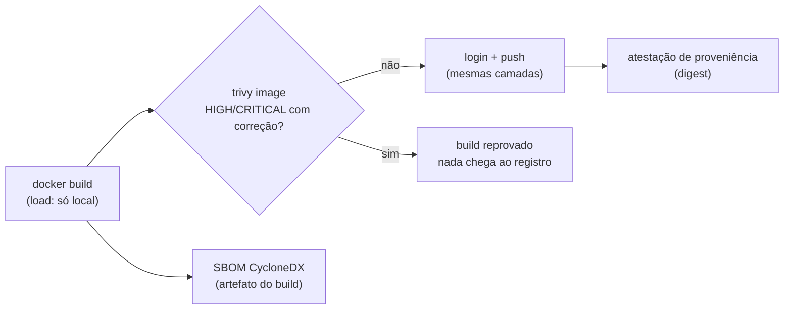

# P8.02 — Scan de segurança e publicação de imagem

> ⏱️ ~1h30 · 🔵 Pleno · Pré-requisitos: P8.01 (pipeline), P7.01 (imagem, tag imutável, digest), J8.07 (dependências vulneráveis), J10.06 (ECR e OIDC)

> ⚠️ **Verificação:** o **Trivy 0.76.2 foi executado de verdade** (contêiner fixado por *digest*; banco de vulnerabilidades baixado em 2026-11-14): varredura de **imagem** (`alpine:3.17` e `eclipse-temurin:25-jre`, ambas locais), de **configuração** (Terraform do `lab/iac-lab`, manifestos e *chart* da P7, Dockerfile da J10), de **dependências** (`pom.xml` da J10) e geração de **SBOM** CycloneDX; também o *gate* com exceção **válida** e **vencida**. **Não executado:** o *push* para o ECR, a **atestação** (`actions/attest`), a verificação da atestação, o *scan on push* do ECR (sem conta AWS) e o `release.yml` no GitHub. As imagens varridas **não** são a imagem do PayFlow (que não existe em disco): são as bases reais do treinamento. Os **achados mudam todo dia** (o banco é atualizado): **seus números serão outros**.

## 🎯 Objetivos
Ao final desta aula você consegue:
- **Escolher** onde cada *scan* entra (dependências, configuração, imagem) e **por que antes do *push***.
- **Configurar** um *gate* de CI com `--severity`, `--ignore-unfixed` e `--exit-code`, e **tratar** exceções **com motivo e validade**.
- **Gerar** um **SBOM** e **explicar** para que serve (e o que **não** prova).
- **Publicar** uma imagem com **tag imutável** e **proveniência** (quem construiu, de qual *commit*).
- **Reconhecer** falso positivo e decidir entre corrigir, aceitar com prazo ou ignorar.

## 🤔 Por que isso importa
A imagem do PayFlow carrega **um sistema operacional inteiro** (a base) mais as bibliotecas Java. Cada pacote é uma superfície de ataque, e **novas falhas são publicadas todo dia**: uma imagem "limpa" ontem pode ter um CVE `HIGH` hoje, **sem você ter mudado uma linha**. Ao mesmo tempo, o pipeline é um alvo: quem controla o que é publicado controla o que roda em produção. Esta aula põe **um portão automático** antes da imagem sair e **deixa um recibo** (SBOM + proveniência) de **o que** saiu e **quem** a construiu. (A cadeia de suprimentos a fundo, com assinatura e política de admissão, é a **P10**.)

## 💡 Intuição (explicação simples)
Um **porto de exportação**. Antes de embarcar o contêiner, a **alfândega** abre e confere o conteúdo contra uma lista de itens proibidos (o *scan*). Se passa, recebe um **lacre** com o número do lote (o *digest*), um **inventário** do que tem dentro (o SBOM) e um **carimbo** de quem embalou e onde (a proveniência). A lista de proibidos **muda todo dia**: um contêiner já embarcado pode virar problema amanhã, por isso a alfândega também **reconfere o estoque** periodicamente.

## 🔬 Como funciona por dentro

### Três scans, três perguntas
| Scan | Pergunta | Onde roda | Comando (Trivy) |
|---|---|---|---|
| **Dependências** (`fs`) | alguma biblioteca do `pom.xml` tem CVE conhecido? | PR (barato, segundos) | `trivy fs --scanners vuln` |
| **Configuração** (`config`) | o Terraform/YAML/Dockerfile está **mal configurado**? | PR | `trivy config` |
| **Imagem** (`image`) | o **sistema operacional** e os pacotes da imagem têm CVE? | `release`, **antes do push** | `trivy image --input` |

O Trivy compara o que **encontra** (pacotes e versões) com um **banco de vulnerabilidades** local. Logo: (a) só acha o que **está no banco** (CVE ainda não publicado passa); (b) o resultado **depende da data** do banco; (c) precisa de **rede** para atualizá-lo (o cache do banco é caro: guarde-o, como o do Maven).

### Onde o portão fica no fluxo

Escanear **antes** do *push* é a decisão central: uma imagem vulnerável **nunca** entra no registro, então nenhum cluster a puxa por engano. O *scan on push* do ECR ([documentação](https://docs.aws.amazon.com/AmazonECR/latest/userguide/image-scanning.html)) é **complementar** (reavalia o que já está lá), não substituto.

### O Trivy também é uma dependência (da cadeia)
No `ci.yml` o Trivy roda como **contêiner fixado por *digest*** (`ghcr.io/aquasecurity/trivy:0.76.2@sha256:8f6bb9…`). Uma **tag** (`:latest`, até `:0.76.2`) pode ser **movida** para outra imagem; um *digest* **não** (ele é o *hash* do conteúdo). Medi: `trivy:0.76.2` e `trivy:latest` apontavam, em 2026-11-14, para o **mesmo** *digest*; amanhã `latest` pode não apontar. O mesmo raciocínio vale para as **ações** do GitHub (P8.01, SHA em vez de tag) e para a **imagem do PayFlow** (P7.01).

## 🛠️ Exemplo prático

### 1. O *gate* de imagem (executado)
```bash
docker save alpine:3.17 -o alpine317.tar
docker run --rm -v ~/.cache/p8-trivy:/root/.cache/ -v "$PWD":/work -w /work \
  ghcr.io/aquasecurity/trivy:0.76.2@sha256:8f6bb947dbc528902e11f2f5be52f7b519f6a39d5d148f41166f2040499768fb \
  image --input /work/alpine317.tar --severity HIGH,CRITICAL --exit-code 1 --no-progress
echo "exit=$?"
```
```
/work/alpine317.tar (alpine 3.17.10)
Total: 6 (HIGH: 6, CRITICAL: 0)
│ libcrypto3 │ CVE-2025-15467 │ HIGH │ fixed │ 3.0.15-r0 │ 3.0.19-r0 │ openssl: ... Remote code execution or Denial of Service ... │
│ libssl3    │ CVE-2025-15467 │ HIGH │ fixed │ ...
│ musl       │ CVE-2025-26519 │ HIGH │ fixed │ 1.2.3-r5  │ 1.2.3-r6  │ musl libc ... out-of-bounds write ...                       │
exit=1
```
Três observações:
1. **`docker save | --input`**: o Trivy lê um arquivo `.tar`. A alternativa, montar o *socket* do Docker (`/var/run/docker.sock`) no contêiner do scanner, dá a ele **poder de root no host**: evite.
2. O JSON do mesmo *scan* diz `"EOSL": true` para `alpine 3.17.10`: a versão **saiu de suporte** (não recebe mais correções). **Nenhum** rebuild resolve: só **trocar a base** (`alpine:3.22`, por exemplo, ou a imagem da P7.01).
3. A coluna **Status = `fixed`** significa que **já existe versão corrigida**: o conserto é *rebuild* (ou atualizar o pacote). `--ignore-unfixed` esconde os que **ainda não têm** correção (você não pode agir neles).

### 2. A imagem que o treinamento usa: `eclipse-temurin:25-jre`
```
Detected OS  family="ubuntu" version="26.04"
Total: 2 (HIGH: 2, CRITICAL: 0)
│ apt          │ CVE-2026-109518 │ HIGH │ fixed │ 3.2.0 │ 3.2.1ubuntu0.1 │ apt: Remote code execution via hard link reuse during package download ... │
│ libapt-pkg7.0│ CVE-2026-109518 │ HIGH │ fixed │ 3.2.0 │ 3.2.1ubuntu0.1 │ ...
```
**Dois achados `HIGH`, ambos `fixed`**, nos pacotes **`apt`/`libapt-pkg7.0`**: ferramentas de **instalar** pacotes, que **ninguém executa** dentro do contêiner em produção. Mesmo com `--ignore-unfixed` o *gate* **reprova** (a correção existe). Três decisões possíveis:

| Decisão | Quando | Custo |
|---|---|---|
| **Corrigir:** *rebuild* com a base atualizada | a base já publicou a correção | quase zero; **é o padrão** |
| **Aceitar com prazo:** `.trivyignore.yaml` com `statement` e `expired_at` | a correção ainda não chegou à base e o risco real é baixo (aqui: `apt` não roda) | dívida **com data** |
| **Remover o pacote** (imagem *distroless*/mínima) | quer eliminar a **classe** de achados | muda a base (P7.01 comparou) |

```yaml
# .trivyignore.yaml: toda exceção tem MOTIVO e VALIDADE (uma exceção que nunca vence é um buraco)
vulnerabilities:
  - id: CVE-2026-109518
    statement: "apt/libapt are in the base image but nothing runs apt in the container; the fix arrives with the next base-image rebuild"
    expired_at: 2026-12-15
```
**Executado:** com a exceção válida, `scan-image.sh` terminou com **`exit=0`**; trocando `expired_at` para uma data **passada**, voltou a **`exit=1`** (`Total: 2 (HIGH: 2)`). Ou seja: **a exceção vence sozinha e o pipeline volta a falhar**, que é o desenho certo (a dívida **cobra**). Detalhe que **só a execução mostrou**: a minha primeira versão tinha `paths: ["usr/bin/apt"]` e a exceção **não funcionou** (para pacotes do sistema, o caminho não é o critério, e o `libapt-pkg7.0` continuou reprovando); a versão acima, **sem `paths`**, cobre os dois pacotes.

### 3. SBOM: o inventário (executado)
```bash
trivy image --input /work/image.tar --format cyclonedx --output /work/sbom.cdx.json
```
```
bomFormat=CycloneDX  specVersion=1.7  components=119   (eclipse-temurin:25-jre; arquivo de ~250 KB)
```
Um **SBOM** (*Software Bill of Materials*) lista **o que tem dentro** (pacote, versão, origem). Serve para: responder **"estamos afetados pelo CVE de ontem?"** consultando o inventário **sem reescanear**; auditoria e licenças. **Não** prova que a imagem é segura nem que **foi** construída por quem diz (isso é a proveniência). O formato é o [CycloneDX](https://cyclonedx.org/); o `release.yml` o guarda como artefato por 90 dias.

### 4. Dependências e configuração
```
$ trivy fs --scanners vuln --severity HIGH,CRITICAL --ignore-unfixed .     (pom.xml da J10, ~/.m2 montado para resolver transitivas)
pom.xml │ pom │ 0 vulnerabilidades
```
**Zero**: honestamente, **nesta data e com o `~/.m2` montado**; sem resolver as dependências transitivas o Trivy vê **menos**. É por isso que o PayFlow **também** tem o OWASP Dependency-Check semanal (J10.02) e o *dependency-review* no PR: ferramentas diferentes, bancos diferentes, **resultados diferentes**.

A varredura de **configuração** é a mais produtiva para o que vem a seguir (a P8.07 detalha os 13 achados no Terraform). Nos arquivos **da P7** (que **não foram aplicados a um cluster**, mas agora foram **lidos por uma máquina**):
```
manifests/10-postgres.yaml  KSV-0014 HIGH   Root file system is not read-only      (banco de laboratório)
manifests/20-configmap.yaml KSV-01010 MEDIUM ConfigMap with sensitive content: 'MANAGEMENT_SERVER_PORT', 'SPRING_DATASOURCE_USERNAME'
chart/.../deployment.yaml   KSV-0110 LOW    Workloads in the default namespace
Dockerfile (J10)            DS-0026  LOW    No HEALTHCHECK defined
```
**Falso positivo**: o `KSV-01010` acusa "conteúdo sensível" porque o **nome** da chave contém `USERNAME`; o valor (`payflow`) **não é segredo** e a senha **nunca** está no ConfigMap (decisão 150). Duas lições: (1) **leia o achado**, não só a contagem; (2) falso positivo se **registra** (com o motivo) em vez de deixar o *scan* "fora do CI". O `KSV-0110` ("namespace `default`") aparece porque o Trivy **renderiza o *chart* sem namespace**: o *chart* é implantado com `--namespace` (P8.03). E o `DS-0026` (sem `HEALTHCHECK`) **não se aplica** ao Kubernetes: lá as sondas são do Pod (P7.05) e a P7 já mostrou o porquê.

### 5. Publicar: tag imutável, digest e proveniência (`release.yml`)
Trechos (arquivo completo em `lab/pipeline-lab/.github/workflows/release.yml`, validado pelo `actionlint`):
```yaml
      - name: Build (load only)                       # 1) nada sai da máquina ainda
        uses: docker/build-push-action@c3c9e263c25d99ce0380d002d59b67737d91b0dc # v7.4.0
        with: {context: ., load: true, tags: "payflow:candidate"}
      - name: Scan the image (HIGH/CRITICAL with a fix fail the build) and write the SBOM
        run: bash scripts/ci/scan-image.sh payflow:candidate   # 2) portão ANTES do push
      - uses: aws-actions/configure-aws-credentials@e1253824e5c10ff9df46874f81ed3ec929e19cfd # v6.3.0
        with: {role-to-assume: "${{ vars.AWS_ROLE_ARN }}", aws-region: "${{ vars.AWS_REGION }}"}   # 3) OIDC (J10.06)
      - name: Push (the same layers that were scanned)
        id: push
        uses: docker/build-push-action@c3c9e263c25d99ce0380d002d59b67737d91b0dc # v7.4.0
        with: {context: ., push: true, tags: "${{ env.REGISTRY }}/${{ vars.ECR_REPOSITORY }}:${{ steps.meta.outputs.tag }}"}
      - name: Attest build provenance                 # 4) recibo: quem, de qual commit, em qual workflow
        uses: actions/attest@1e69f48acb82d1966a394da916b4c1698aa569d6 # v4.2.2
        with:
          subject-name: ${{ env.REGISTRY }}/${{ vars.ECR_REPOSITORY }}
          subject-digest: ${{ steps.push.outputs.digest }}
          push-to-registry: true
```
- A **tag** é `<versão>-<sha7>` (P7.01), nunca `latest`; o ECR do Terraform (P8.05) é **`IMMUTABLE`**: reenviar a mesma tag **falha**. O que vai para o deploy é o ***digest***.
- A **atestação** (`subject-name`, `subject-digest`, `push-to-registry`: **entradas conferidas** no `action.yml` da v4.2.2) registra a **proveniência**: *"este digest foi construído pelo workflow X, do commit Y"* (a [documentação do GitHub](https://docs.github.com/en/actions/security-for-github-actions/using-artifact-attestations/using-artifact-attestations-to-establish-provenance-for-builds) e o [SLSA](https://slsa.dev/) explicam o modelo). **Ela só tem valor se alguém a verificar** antes de implantar: a verificação **no cluster** (política de admissão) é **P10**.
- ⚠️ **Rebuild "com as mesmas camadas":** o segundo `build-push-action` reutiliza o cache do primeiro (`cache-from: type=gha`); o *digest* publicado só é **idêntico** ao do *scan* se o *build* for **reprodutível**. **Não verificado aqui**: a forma mais segura é `docker push` da **mesma** imagem local escaneada (alternativa registrada como exercício).

## 🏗️ Estudo de caso: o CVE de sexta à noite
> **Cenário fictício.** Sexta, 18h: o *scan* semanal acusa um `CRITICAL` **com correção** na biblioteca de TLS da base. O *release* de segunda está pronto.

**Diagnóstico.** (1) A imagem em produção **tem** a falha? O **SBOM** do *release* em produção responde **sem reescanear**: `jq` no `sbom.cdx.json` pelo componente e versão. (2) É **alcançável**? Depende de a aplicação usar a função afetada (se TLS é terminado no Caddy/Ingress, o risco muda). (3) Há correção? Sim: *rebuild*.

**Opções:** (A) **aceitar** com exceção (prazo curto) até segunda; (B) **rebuild de emergência** hoje; (C) **mitigar** na borda (WAF/regra) e corrigir segunda.
**Decisão (ADR resumido):** **B**, porque o caminho já é automático (o pipeline faz *rebuild* + *scan* + deploy em minutos) e uma exceção de fim de semana é a que **ninguém lembra de revisar**. *Consequência:* deploy numa sexta, com *rollback* pronto (P8.03). Se o pipeline levasse horas, **C** e segunda.

## ⚖️ Trade-offs e quando NÃO usar
- **Gate em tudo (`LOW` também):** barulho; o time passa a **ignorar** o vermelho. Comece em `HIGH,CRITICAL` **com correção** e endureça com o tempo.
- **Gate só no PR:** o banco muda; **reescaneie periodicamente** (o `security.yml` da J10 já tem *cron*) e a imagem **já publicada**.
- **`--ignore-unfixed`:** sem ele, você é reprovado por algo **que não pode consertar**; com ele, você **não vê** o risco até a correção sair. Registre os `unfixed` num relatório (não no gate).
- **SBOM + atestação:** valem quando **alguém consome** (auditoria, política de admissão). Gerar e **nunca** olhar é cerimônia.
- **Mais um scanner (Grype, Snyk, ECR Enhanced):** bancos diferentes acham coisas diferentes, mas **duplicam** triagem. Um no *gate*, outro no relatório semanal é razoável.

## ⚠️ Erros comuns e boas práticas de produção
- **Scanner como `latest`:** o **scanner** é parte da cadeia. Fixe por *digest*.
- **Cache do banco ausente:** cada execução baixa o banco (centenas de MB; no laboratório a **primeira** varredura levou ~11 s por causa do download, as seguintes ficaram em segundos). Guarde `~/.cache/trivy` com `actions/cache`.
- **Disco cheio:** o Trivy baixa o banco de Java e o de vulnerabilidades. Erro real que tive: `write /root/.cache/trivy/java-db/trivy-java.db: no space left on device` (o `/tmp` do laboratório era um `tmpfs` de 9,4 GB cheio). Sempre aponte o cache para um disco com espaço.
- **Exceção sem prazo** ou **com o mesmo `id` para tudo**: use `expired_at` e `statement`.
- **Corrigir o sintoma:** apagar o pacote vulnerável com `apt remove` no Dockerfile **muda a imagem** sem tratar a **base**: troque a base.
- **Ler "0 vulnerabilidades" como "seguro":** significa **"nenhuma conhecida pelo banco de hoje, nos pacotes que o scanner entendeu"**.
- **Segredo na imagem:** o Trivy também procura segredos (`Secrets` na tabela); `COPY .env` ainda é erro seu (J9.02).

## 🧩 Exercícios
1. **Fixação.** Explique `fixed`, `--ignore-unfixed` e `EOSL`. Por que o `alpine:3.17` **não tem como** passar no *gate* só reconstruindo?
2. **Aplicação no PayFlow.** Acrescente ao repositório `scripts/ci/scan-image.sh`, `scan-config.sh`, `scan-fs.sh` e `.trivyignore.yaml`.
   - [ ] O *gate* de imagem reprova uma imagem **propositalmente velha** (`alpine:3.17`).
   - [ ] A exceção tem `statement` **e** `expired_at`; testei com a data **vencida** e o *gate* voltou a reprovar.
   - [ ] O SBOM é guardado como artefato; consigo responder "estamos usando a versão X da biblioteca Y?" com `jq`.
   - [ ] O Trivy está fixado por *digest* e o cache do banco é guardado.
   - [ ] Um falso positivo (ex.: `KSV-01010`) está registrado **com o motivo**.
3. **Desafio.** Troque o segundo `build-push-action` por **`docker push`** da imagem **local escaneada** (com `docker tag` para o ECR) e explique por que o *digest* publicado é **garantidamente** o que foi escaneado.

<details><summary>Solução do exercício 1</summary>

`fixed`: já existe versão com a correção. `--ignore-unfixed`: omite achados **sem** correção. `EOSL` (*end of support life*): a distribuição **não publica mais** correções; um *rebuild* só traz as mesmas versões velhas. A saída é **trocar a base** para uma versão suportada.
</details>

<details><summary>Solução do exercício 2 (consulta ao SBOM)</summary>

```bash
jq -r '.components[] | select(.name=="libssl3") | "\(.name) \(.version)"' sbom.cdx.json
```
(O campo `components[].name`/`version` é o do CycloneDX; confira o nome exato do pacote no seu SBOM.)
</details>

<details><summary>Solução do exercício 3</summary>

Com `docker push`, você envia **o mesmo conjunto de camadas** que o `docker save` entregou ao Trivy: o *digest* é função **do conteúdo**, então não há segunda construção que possa divergir. É a forma de eliminar o ⚠️ da seção 5. A desvantagem: o *cache* de camadas do Buildx no GitHub (`type=gha`) deixa de ser aproveitado no *push*.
</details>

## 🎤 Na entrevista
- **"Onde você põe o scan de vulnerabilidades no pipeline?"** — Em **três lugares**: dependências no PR (rápido), configuração no PR, e **a imagem antes do push**; mais um *cron* para reavaliar o que **já está** publicado, porque o banco muda.
- **"O scan acusou um CVE que não afeta a gente. E agora?"** — Confirmar a **alcançabilidade**, registrar uma **exceção com motivo e validade** (não desligar o scan) e revisar no vencimento.
- **"Para que serve um SBOM? E uma atestação?"** — SBOM: **inventário** (consultar "estamos afetados?" sem reescanear). Atestação: **proveniência** (quem construiu, de qual *commit*). Nenhum dos dois prova ausência de falha; só valem se **alguém os consome**.
- **"Por que fixar por digest?"** — Tag é um **ponteiro mutável**; *digest* é o *hash* do conteúdo. Vale para imagens, ações e o próprio scanner.

## 📚 Para ir além
- 📄 [Documentação do Trivy](https://trivy.dev/docs/latest/): visão geral; veja *Filtering* e *Misconfiguration scanning*.
- 📄 [Trivy: filtragem e `.trivyignore.yaml`](https://trivy.dev/docs/latest/guide/configuration/filtering/): o formato de exceção com `expired_at`.
- 📄 [Trivy: varredura de imagem](https://trivy.dev/docs/latest/guide/target/container_image/): `--input` e imagens locais.
- 📄 [Trivy: configuração (IaC)](https://trivy.dev/docs/latest/guide/scanner/misconfiguration/): o que ele checa em Terraform/Kubernetes/Dockerfile.
- 📄 [Atestações de artefato (GitHub)](https://docs.github.com/en/actions/security-for-github-actions/using-artifact-attestations/using-artifact-attestations-to-establish-provenance-for-builds) e [SLSA](https://slsa.dev/): o modelo de proveniência.
- 📄 [CycloneDX](https://cyclonedx.org/): o formato do SBOM.
- 📄 [ECR: *image scanning*](https://docs.aws.amazon.com/AmazonECR/latest/userguide/image-scanning.html) e [*tag immutability*](https://docs.aws.amazon.com/AmazonECR/latest/userguide/image-tag-mutability.html).
- 💻 [`aquasecurity/trivy`](https://github.com/aquasecurity/trivy): o repositório da ferramenta.
- 🎥 Nenhum vídeo verificado nesta aula.

## ✅ Checklist da aula
- [ ] Sei dizer **onde** cada scan roda e por que a imagem é escaneada **antes** do *push*.
- [ ] Meu *gate* usa severidade, `--ignore-unfixed` e `--exit-code`, e o Trivy está fixado por *digest*.
- [ ] Toda exceção tem motivo **e** validade, e vi o *gate* voltar a falhar quando venceu.
- [ ] Gerei um SBOM e sei o que ele **não** prova.
- [ ] Sei que a atestação e o *push* ao ECR **não foram executados** aqui.
