# P8.03 — Rolling, blue/green e canary

> ⏱️ ~1h30 · 🔵 Pleno · Pré-requisitos: P8.01, P8.02 (pipeline e digest), P7.03 e P7.05 (Deployment, `RollingUpdate`, sondas), P6.04 (alertas), J3.12 (migrações Flyway)

> ⚠️ **Verificação:** os **mecanismos foram medidos de verdade** em Docker com `nginx:1.29-alpine` (`lab/deploy-lab`: recreate, rolling, blue/green e canary, com 3.000–4.000 requisições por experimento) e a **migração *expand/contract*** no **PostgreSQL 18** real. Os "pods" são **contêineres nginx** e o "Service" é um **roteador nginx**: provam a **lógica** (erros, proporções, tempo de troca), **não** o Kubernetes. O *startup* da aplicação é **simulado** (5 s; um Spring Boot real leva outro tempo, **a medir**). **Não executado:** todo o Kubernetes (sem `kind`/`kubectl`/`helm`), Gateway API, Argo Rollouts e o `deploy.yml` no GitHub. Os trechos de Kubernetes abaixo vêm da **documentação oficial** e estão **marcados**.

## 🎯 Objetivos
Ao final desta aula você consegue:
- **Comparar** *recreate*, *rolling*, *blue/green* e *canary* por **risco, custo, tempo de reversão e exigências** (banco, sessão, capacidade).
- **Medir** a indisponibilidade de cada estratégia e **explicar** por que o *rolling* não derrubou nada.
- **Mostrar** que uma sonda de *readiness* **não basta** contra uma versão "meio quebrada" e **desenhar** a decisão de canary pela taxa de erro **da versão nova**.
- **Aplicar** *expand/contract* para mudar o banco **sem** quebrar a versão antiga que ainda roda.
- **Escolher** a estratégia para uma mudança do PayFlow e **definir** o gatilho de reversão.

## 🤔 Por que isso importa
O deploy é o momento de **maior risco** de um sistema: a maior parte dos incidentes começa com uma mudança. Um pleno decide **como** a mudança chega aos usuários: de uma vez, aos poucos, ou com um interruptor de volta. O PayFlow move **dinheiro**: um deploy que derruba o checkout por 6 segundos, ou que cobra errado em 5% das transferências, tem custo real. A estratégia certa **limita o estrago** e **encurta o caminho de volta**.

## 💡 Intuição (explicação simples)
Trocar o **motor de um avião**:
- **Recreate:** pousar, desligar tudo, trocar o motor, decolar de novo. Simples; os passageiros esperam.
- **Rolling:** em voo, trocar **um motor por vez** (o avião tem quatro). Ninguém desce; por um tempo há motores de dois tipos.
- **Blue/green:** ter **dois aviões** idênticos, testar o novo no solo e **passar os passageiros** de um para o outro de uma vez. Voltar é passar de novo.
- **Canary:** pôr **5% dos passageiros** no avião novo e olhar os instrumentos antes de passar os outros. (O nome vem do **canário** que os mineiros levavam à mina: se ele sentia mal, todos saíam antes de ser tarde.)

## 🔬 Como funciona por dentro

### As quatro estratégias

```mermaid
flowchart TB
    subgraph R["Recreate"]
      R1["v1 ✕"] --> R2["(fora do ar)"] --> R3["v2 ✓"]
    end
    subgraph RO["Rolling"]
      RO1["v1 v1 v1 v1"] --> RO2["v2 v1 v1 v1"] --> RO3["v2 v2 v1 v1"] --> RO4["v2 v2 v2 v2"]
    end
    subgraph BG["Blue/green"]
      BG1["blue=v1 (100%)<br/>green=v2 (0%, aquecido)"] --> BG2["troca o roteador"] --> BG3["green=v2 (100%)<br/>blue=v1 (parado, pronto p/ voltar)"]
    end
    subgraph C["Canary"]
      C1["v1 95% · v2 5%"] --> C2["analisa erro/latência de v2"] --> C3["25% → 50% → 100% ou volta a 0%"]
    end
```


| | Recreate | Rolling | Blue/green | Canary |
|---|---|---|---|---|
| **Fora do ar** | sim (janela) | não | não | não |
| **Versões ao mesmo tempo** | não | **sim** (misturadas) | sim (isoladas) | **sim** (proporção controlada) |
| **Capacidade extra** | zero | pouca (`maxSurge`) | **2×** durante a troca | pouca |
| **Reversão** | novo deploy | novo *rolling* (minutos) | **trocar de volta (segundos)** | voltar o peso a 0 |
| **Banco** | pode quebrar compatibilidade | **precisa** ser compatível N e N-1 | **precisa** ser compatível N e N-1 | **precisa** ser compatível N e N-1 |
| **Risco para o usuário** | janela inteira | misturado, sem controle | 100% de uma vez após a troca | **limitado** à fatia |
| **Exige** | nada | readiness correta | roteador/Service e capacidade | roteamento por peso **e métrica por versão** |

A linha do **banco** é a mais importante e a mais esquecida: em **todas** as estratégias que não derrubam o sistema, **duas versões da aplicação rodam ao mesmo tempo contra o mesmo banco** (ver "*expand/contract*" abaixo).

## 🛠️ Exemplo prático (executado em Docker; ver o aviso do topo)

Preparação: dois "serviços" nginx respondem a versão no cabeçalho `X-Version`; um **roteador** nginx balanceia; `load.py` envia **3.000–4.000 requisições** (4 *threads*, ~100 req/s por *thread*) **enquanto** o deploy acontece. `run-all.sh` regrava os `out-*.txt`.

### 1. Recreate: a janela fora do ar
```
>> 3000 requests / 4 threads; at t=1s v1 is removed and v2 starts (simulated startup: 5s)
[action ran at t=1.00s, took 6.08s]
total=3000 failures=44 duration=14.1s
  version=?     status=502                       20 (0.7%)
  version=?     status=504                       24 (0.8%)
  version=v1    status=200                      385 (12.8%)
  version=v2    status=200                     2571 (85.7%)
  first failure at t=1.07s, last at t=7.19s (window 6.12s)
```
A **janela de 6,12 s** (5 s de *startup* simulado + a sonda) é o que importa. **Atenção ao "44 falhas":** o gerador de carga é **de ciclo fechado** (cada *thread* espera a resposta; 504 espera 1 s do *timeout*), então **poucas** requisições chegam a falhar enquanto estão presas. Em produção, a carga **não espera**: o número real de usuários afetados seria **muito maior**. Compare **janelas**, não contagens.

### 2. Rolling com *readiness*: zero falhas
```
>> 4000 requests / 4 threads; at t=1s the rolling update starts (BAD_ROLLOUT=0)
[action ran at t=1.00s, took 8.69s]
total=4000 failures=0 duration=10.9s
  version=v1    status=200                     1945 (48.6%)
  version=v2    status=200                     2055 (51.4%)
```
**0 falhas**, e **as duas versões atenderam ao mesmo tempo** (48,6% × 51,4% do total). A lógica do laboratório (função `rolling` em `lib.sh`): sobe o novo (*surge*), **espera ficar pronto** (3 `200` seguidos em `/health`), **só então** o põe no *pool* e **tira** o antigo do *pool* **antes** de removê-lo (o **desvio de tráfego antes de matar** é o que o `preStop` + `terminationGracePeriodSeconds` da P7.05 fazem no Kubernetes). No Kubernetes, isso é o `RollingUpdate` com `maxSurge: 1` e `maxUnavailable: 0` (P7.03).

### 3. Quando o *rolling* te protege (versão morta) e quando não (versão "meio quebrada")
**Versão morta** (todo `/health` falha): o *rollout* **para no passo 1** e **os usuários nunca veem v2**:
```
  [rollout] lab-p8-app-new1 NEVER became ready -> rollout stopped at step 1/4
total=4000 failures=0 duration=11.7s
  version=v1    status=200                     4000 (100.0%)
```
**Versão instável** (30% das requisições, e do `/health`, falham): a *readiness* **deixou passar** e o *rolling* **completou**:
```
total=4000 failures=364 duration=14.8s
  version=v1    status=200                     2813 (70.3%)
  version=v2    status=200                      823 (20.6%)
  version=v2    status=500                      364 (9.1%)
  first failure at t=2.85s, last at t=11.30s (window 8.44s)
```
**9,1% das requisições falharam**, e o *rollout* **terminou "com sucesso"**. Por quê? Uma sonda que **continua tentando** só precisa de **3 sucessos seguidos uma vez** (o mesmo no laboratório do *blue/green*: a versão instável passou no teste de fumaça **10 de 10** rodadas). **Conclusão central da aula:** *readiness* detecta **"não sobe"**, **não** detecta **"sobe e erra 30% das vezes"**. Para isso você precisa **olhar o tráfego real da versão nova**: o *canary* com métrica por versão (seção 5).

### 4. Blue/green: trocar e voltar em milissegundos
```
>> 3000 requests; green is up and warm; at t=1s we switch to green, at t=4s we ROLL BACK to blue
  [switch] router -> lab-p8-app-green
  [switch] router -> lab-p8-app-blue
[action ran at t=1.00s, took 0.09s]
total=3000 failures=0 duration=8.1s
  version=v1    status=200                     1895 (63.2%)
  version=v2    status=200                      1105 (36.8%)
>> smoke test BEFORE switching: a DEAD green (every /health fails)
  green failed its readiness -> the switch is NEVER made
```
A troca levou **0,09 s** (um `nginx -s reload`) e **0 requisição falhou**, **nos dois sentidos** (ida a t=1 s e **volta a t=4 s**). O *green* **foi aquecido e testado antes**, e uma versão **morta** nunca recebe tráfego. O **custo** é ter **o dobro** de capacidade durante a troca. No Kubernetes, a troca é trocar o seletor do `Service` (de `version: blue` para `green`) ou o peso da rota (100/0 → 0/100); o tempo até todos os nós verem o novo *endpoint* **não foi medido aqui** (⚠️).

### 5. Canary: a decisão certa olha a versão **nova**, não o total
Regra do laboratório (`exp4-canary.sh`): a cada degrau (5% → 25%), enviar 4.000 requisições e **abortar se a taxa de erro da versão canário passar de 2%**.

**Canário saudável:**
```
>> canary at 5% (BAD=0): 4000 requests
  version=v1    status=200                     3789 (94.7%)
  version=v2    status=200                      211 (5.3%)
  canary: 211 requests, 0 errors -> 0.0% ; rule: abort above 2%
  DECISION: promote to the next step
>> canary at 25% (BAD=0): 4000 requests
  version=v2    status=200                      994 (24.9%)
  DECISION: promote to the next step
```
A divisão por `split_clients` ficou em **5,3%** e **24,9%** (alvos 5% e 25%): estatística, não exatidão.

**Canário instável** (30% de erro):
```
>> canary at 5% (BAD=1): 4000 requests
total=4000 failures=63 duration=10.8s
  version=v1    status=200                     3805 (95.1%)
  version=v2    status=200                      132 (3.3%)
  version=v2    status=500                       63 (1.6%)
  canary: 195 requests, 63 errors -> 32.3% ; rule: abort above 2%
  DECISION: ABORT (canary back to 0%)
  canary back to 0%; checking 500 requests:
    total=500 failures=0 duration=1.4s
      version=v1    status=200                      500 (100.0%)
```
**A armadilha:** a taxa de erro **do serviço inteiro** foi **1,6%** (63 de 4.000): **abaixo** de qualquer alerta de 2–5% (P6.04). Só a taxa **da versão nova** (**32,3%**) denuncia o problema. **Regra:** métrica **por versão** (um rótulo `version`/`track` no Micrometer, P6.02) e a decisão compara **canário × estável**. Depois do aborto, **500 de 500 requisições** voltaram a `v1`.

> 🐛 **O que a execução revelou (erro meu):** a primeira versão do `exp4-canary.sh` "abortava" chamando `nginx` com `0% canary;`, que o nginx **rejeita**: o roteador **continuava** com 5% no canário e o script morria por `set -e` **sem avisar**. A verificação final ("500 de 500 em v1") foi acrescentada **por isso**. Um *rollback* automático que ninguém **verifica** é um *rollback* que talvez não exista.

### 6. Como isso aparece no Kubernetes (⚠️ não executado)
- **Rolling:** é o padrão do `Deployment` (P7.03). O `deploy.yml` usa `helm upgrade --install … --rollback-on-failure --wait --timeout 5m` (flag do Helm 4, P7.08): se o *rollout* não ficar pronto, o Helm **volta sozinho** à revisão anterior.
- **Blue/green:** dois `Deployment` (`payflow-blue`, `payflow-green`) e um `Service` cujo seletor aponta para um deles; a troca é um `kubectl patch` do seletor. Mantenha o *blue* parado (`replicas: 0`) ou vivo até confirmar.
- **Canary por peso (Gateway API):** a [documentação oficial](https://gateway-api.sigs.k8s.io/guides/traffic-splitting/) mostra a `HTTPRoute` com `backendRefs` e `weight` (aqui 95/5, **adaptado** do guia; ⚠️ os nomes dos `Service` são nossos):
```yaml
apiVersion: gateway.networking.k8s.io/v1
kind: HTTPRoute
metadata: {name: payflow, namespace: payflow}
spec:
  parentRefs: [{name: payflow-gateway}]
  rules:
    - backendRefs:
        - {name: payflow-stable, port: 8080, weight: 95}
        - {name: payflow-canary, port: 8080, weight: 5}
```
- **Canary automatizado (Argo Rollouts):** o `Rollout` troca o `Deployment` por `strategy.canary.steps` (`setWeight`, `pause`) e **análise** automática; a [documentação](https://argo-rollouts.readthedocs.io/en/stable/features/canary/) descreve `setWeight` ("percentual de tráfego para o canário") e `pause`. É a **ferramenta certa** quando o canary vira rotina; **não** está instalada aqui.
- **Não use** as anotações de *canary* do **ingress-nginx**: o projeto está **sem manutenção desde março de 2026** (decisão 150).

### 7. O banco: *expand/contract* (executado no PostgreSQL 18)
No *rolling*, *blue/green* e *canary* as **duas versões coexistem**. Uma migração que **renomeia** uma coluna quebra a antiga:
```sql
alter table accounts rename column owner_name to holder_name;      -- migração da v2
select owner_name from accounts where id = 1;                       -- a v1, ainda no ar
```
```
ERROR:  column "owner_name" does not exist
LINE 1: select owner_name from accounts where id = 1;
HINT:  Perhaps you meant to reference the column "accounts.holder_name".
```
O padrão ***parallel change*** ([Fowler](https://martinfowler.com/bliki/ParallelChange.html)), em três *releases*:
1. **Expand:** acrescenta `holder_name`, **mantém** `owner_name`, copia os dados e **sincroniza as duas** (no laboratório, um *trigger*; `owner_name` perde o `NOT NULL`). A v1 **continua funcionando** e a v2 também; a inserção da v2 (`Carla`) é **visível** para a v1.
2. **Migrate:** a aplicação passa a ler/escrever só `holder_name`; implanta-se com qualquer estratégia acima.
3. **Contract:** **depois** que **nenhuma** versão antiga roda, remove o *trigger*, a coluna antiga e põe `NOT NULL` na nova.

Saída real do passo 3: `holder_name` com `Ana`, `Bruno`, `Carla`. **Regras do PayFlow** (decisão 158): migração Flyway **aditiva** (J3.12/P2.05); **nunca** renomear/remover no mesmo *release* que a aplicação que deixa de usar; `CREATE INDEX CONCURRENTLY` com `transactional-lock: false` (P2.05). **Nenhuma migração nova** foi criada nesta aula (a próxima livre continua V12; o `accounts` acima é um modelo de laboratório).

## 🏗️ Estudo de caso: a alteração do limite de transferência
**Cenário (fictício).** O time muda o **cálculo de limite diário** da transferência (regra de dinheiro). O teste passa; o risco é um caso real que o teste não cobre.

| Opção | Reversão | Risco | Custo |
|---|---|---|---|
| **Rolling** | novo *rolling* (minutos) | 100% dos usuários ficam expostos em poucos minutos | nenhum |
| **Blue/green** | segundos | 100% de uma vez após a troca | 2× capacidade |
| **Canary 5% → 25% → 100%**, comparando a taxa de **limite excedido** por versão | segundos (peso a 0) | só 5% por vez | métrica por versão e peso |
| **Feature flag** (P8.04) sobre o canário | **desligar o *flag***, sem deploy | só a fatia do *flag* | código de *flag* |

**Decisão (ADR resumido, decisão 158):** *canary* de **5% → 25% → 100%** com **degraus de ≥ 15 min** e gatilho de **aborto** automático se (a) a taxa de **5xx** do canário passar de 2% **ou** (b) a taxa de **`limit_exceeded`** do canário for **> 1,5× a do estável** (o limite novo bloqueando demais). *Consequências:* exige o rótulo `version` nas métricas (P6.02) e capacidade de roteamento por peso (Gateway API/Argo Rollouts, **P9** traz o cluster); *até lá*, **rolling** com *readiness* + *smoke test* + `--rollback-on-failure`.

## ⚖️ Trade-offs e quando NÃO usar
- **Recreate:** aceitável para **ambiente de teste** e para **uma única instância** em horário morto. Para o PayFlow em produção, **não**.
- **Rolling:** **mistura versões**: não serve se a v2 é **incompatível** com a v1 (formato de mensagem no Kafka, esquema do banco) **sem** *expand/contract*.
- **Blue/green:** **dobra** a capacidade; **não** resolve estado compartilhado (o banco é um só); **sessões em memória** somem na troca (o PayFlow usa JWT *stateless*, J8).
- **Canary:** só funciona com **tráfego suficiente** para a fatia ter significado: 5% de 20 req/min são **1 requisição/min**; com 195 requisições o intervalo de confiança da taxa de erro é **largo**. Pouco tráfego → **degraus mais longos** ou outra estratégia.
- **Tudo isso** pressupõe que a **reversão é segura**: se a v2 já **escreveu** dados no formato novo, "voltar o código" **não** desfaz o dado (por isso a P3.13 usa estorno por compensação, e *expand/contract* mantém o formato antigo legível).

## ⚠️ Erros comuns e boas práticas de produção
- **Confiar só na *readiness*** (seção 3): sobe-e-erra passa.
- **Olhar a taxa de erro do total** em vez da da **versão nova** (seção 5).
- **Migração destrutiva no mesmo deploy** (seção 7): `ERROR: column "owner_name" does not exist` **na versão antiga**, em produção.
- **Rollback que nunca foi testado**: ensaie o *rollback* **antes** do dia (o *rollback* do laboratório só funcionou depois de eu **verificar**).
- **Sessão e *cache* por versão:** o `HttpSession` em memória (painel Thymeleaf, J8) some na troca; **chaves de cache** com formato novo (P2.09) devem ser **versionadas**.
- **Contagem de falhas com carga de ciclo fechado** (seção 1): compare **janelas**.
- **Deploy sem dono acordado:** a regra "não faça deploy na sexta" é sobre **ter quem olhe**; automatizar a reversão a torna menos importante, **não** irrelevante.

## 🧩 Exercícios
1. **Fixação.** Por que o *rolling* completou com 9,1% de erro? O que a *readiness* verifica e o que **não** verifica?
2. **Aplicação no PayFlow.** Adicione ao `deploy.yml` (P8.01/P8.03) a etapa de **reversão automática** e escreva o *runbook* de reversão.
   - [ ] `helm upgrade … --rollback-on-failure --wait --timeout 5m` (Helm 4) no *script* de deploy.
   - [ ] O *smoke test* roda **depois** e, se falhar, o *job* executa `helm rollback` (revisão anterior) e **falha**.
   - [ ] O *runbook* `docs/runbooks/rollback.md` diz: **quando** reverter (gatilhos numéricos), **como** (`helm history`, `helm rollback`), **o que verificar** depois.
   - [ ] Existe uma regra escrita de **migração compatível** (*expand/contract*) na revisão de PR.
3. **Desafio.** Rode `exp4-canary.sh` com `BAD=1` mas mude a regra para **abortar pela taxa total > 2%**. Em quantos degraus o canário ruim passa? (Resposta esperada: **passa**, 1,6% < 2%.)

<details><summary>Solução do exercício 1</summary>

A sonda **exige 3 `200` seguidos e continua tentando**; um serviço que acerta 70% das vezes **conseguirá** 3 seguidos em algum momento. A *readiness* responde **"este processo está pronto para receber tráfego?"**; **não** mede **taxa de erro sob carga real**, **latência**, nem **correção** das respostas. Para isso: *canary* com métrica por versão e, se for o caso, **testes sintéticos** no tráfego real.
</details>

<details><summary>Solução do exercício 2 (esboço do passo de reversão)</summary>

```yaml
      - name: Smoke test (rolls back on failure)
        env: {BASE_URL: "${{ vars.PRODUCTION_URL }}"}
        run: |
          if ! bash scripts/ci/smoke-test.sh "$BASE_URL"; then
            helm rollback payflow -n payflow --wait --timeout 5m
            echo "::error::smoke test failed; rolled back"
            exit 1
          fi
```
`helm rollback` sem número de revisão volta à **anterior**. ⚠️ Não executado aqui.
</details>

## 🎤 Na entrevista
- **"Qual a diferença entre blue/green e canary?"** — Blue/green troca **todo** o tráfego de uma vez entre dois ambientes (reversão em segundos, custo 2×). Canary desloca uma **fatia** e **observa** antes de ampliar (risco limitado, exige métrica por versão).
- **"Como você faz uma mudança de esquema sem *downtime*?"** — *Expand/contract* em três *releases*: acrescenta compatível, migra a aplicação, remove o antigo **depois** que ninguém o usa. Nunca renomear/remover no mesmo deploy.
- **"A readiness passou. Por que ainda assim deu incidente?"** — Readiness mede **"sobe"**, não **"funciona sob carga real"**; precisa de análise de canário (erro/latência **da versão nova**) e *smoke test* no caminho de negócio.
- **"Como você decide reverter?"** — Gatilhos **numéricos e combinados antes** (taxa de 5xx do canário, razão de métrica de negócio × estável, latência p95), não "achismo" no meio do incidente.

## 📚 Para ir além
- 📄 [Kubernetes: Deployment e estratégias de atualização](https://kubernetes.io/docs/concepts/workloads/controllers/deployment/): `RollingUpdate`, `maxSurge`, `maxUnavailable`.
- 📄 [Gateway API: divisão de tráfego](https://gateway-api.sigs.k8s.io/guides/traffic-splitting/): `weight` na `HTTPRoute`, canary e blue/green.
- 📄 [Argo Rollouts: canary](https://argo-rollouts.readthedocs.io/en/stable/features/canary/): passos, pausas e análise.
- 📄 [`helm upgrade`](https://helm.sh/docs/helm/helm_upgrade/): flags de espera e reversão.
- 📑 [BlueGreenDeployment](https://martinfowler.com/bliki/BlueGreenDeployment.html), [CanaryRelease](https://martinfowler.com/bliki/CanaryRelease.html) e [ParallelChange](https://martinfowler.com/bliki/ParallelChange.html) (Martin Fowler): os conceitos, curtos.
- 📑 [*Canarying releases* (SRE Workbook)](https://sre.google/workbook/canarying-releases/): como o Google decide o tamanho e o tempo de um canário.
- 📑 [*Automating safe, hands-off deployments* (Amazon Builders' Library)](https://aws.amazon.com/builders-library/automating-safe-hands-off-deployments/): ondas por região, *bake time*, reversão automática.
- 📚 Livro: *Release It!* (Nygard), capítulos sobre implantação e *circuit breaker* (só pelo título, **de memória**: ⚠️ não verificado).
- 🎥 Nenhum vídeo verificado nesta aula.

## ✅ Checklist da aula
- [ ] Sei comparar as quatro estratégias e **medi** pelo menos *recreate* × *rolling*.
- [ ] Entendo por que a *readiness* não detecta "sobe e erra" e como o *canary* detecta.
- [ ] Minha decisão de *canary* compara **canário × estável**, não o total.
- [ ] Apliquei *expand/contract* e vi o erro `column "owner_name" does not exist`.
- [ ] Sei o que **não** foi executado (Kubernetes, Gateway API, Argo Rollouts, `deploy.yml`).
