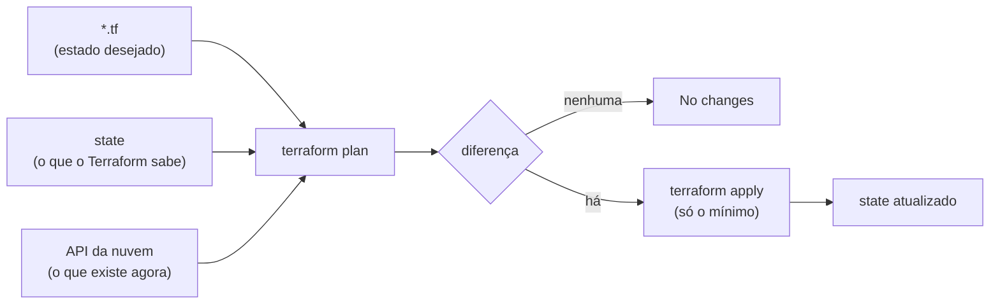

# P8.05 — Terraform I: providers, recursos e state

> ⏱️ ~1h30 · 🔵 Pleno · Pré-requisitos: J10.03 a J10.07 (nuvem, IAM, EC2/RDS/S3/ECR, destruir tudo), P8.01 (pipeline), P8.02 (scan de configuração)

> ⚠️ **Verificação:** **executado** (Linux, Terraform **1.17.1** instalado, AWS provider **6.73.0**, Docker 29.9.2) contra o **moto** (`motoserver/moto`, um emulador de AWS) **sem nenhuma conta AWS real**: `init`, `validate`, `plan`, `apply`, `state list`, segundo `plan`, ***drift*** (alteração manual) e ***count × for_each*** (offline, com `terraform_data`). O moto prova a **sintaxe e a ordem** das chamadas, **não** o comportamento da AWS: há **três** diferenças que ele introduz (abaixo, marcadas) e os **tempos** (o RDS "demora" 1 min 20 s no emulador) **não** valem para a AWS real. **Não executado:** qualquer `apply` na AWS real (💸). A versão **1.17.2** é a mais recente (o `terraform version` avisou); a série é a mesma.

## 🎯 Objetivos
Ao final desta aula você consegue:
- **Explicar** o que é infraestrutura como código (IaC) e **por que** declarar o estado desejado é melhor que rodar *scripts* de passos (como os `scripts/aws/*.sh` da J10).
- **Escrever** uma configuração Terraform com ***providers***, **recursos**, ***data sources***, **variáveis** (com validação) e ***outputs***.
- **Ler** um `plan` (`+`, `~`, `-`, `(known after apply)`) e **explicar** o ciclo `init → validate → plan → apply → destroy`.
- **Explicar** o ***state***: o que guarda, por que **nunca** vai para o Git, por que contém **segredos** e como o Terraform detecta ***drift***.
- **Escolher** entre `count` e `for_each` e **mostrar** o que cada um faz quando um item sai da lista.

## 🤔 Por que isso importa
Na J10 você criou EC2, RDS, S3 e IAM com **scripts** do AWS CLI (`scripts/aws/10-… a 60-…`) e os destruiu com outro script. Funciona, mas tem três problemas que um pleno enfrenta rápido: (1) o script diz **"faça isto"**, não **"o mundo deve ficar assim"**: rodá-lo duas vezes cria duplicatas ou falha; (2) **ninguém sabe** o que existe de verdade sem rodar listagens (o `91-verify-empty.sh` teve de ser escrito para isso); (3) uma mudança ("aumente o disco") exige **escrever** um script novo. O Terraform inverte: você **descreve o resultado**, ele **compara** com o que existe e calcula **o mínimo** de mudanças.

## 💡 Intuição (explicação simples)
Uma **planta de obra** (a configuração) e um **caderno do engenheiro** (o *state*). A planta diz: "a casa tem 3 quartos". O caderno anota **o que já foi construído** e com quais números de registro. Quando você muda a planta ("agora 4 quartos"), o engenheiro **não demole a casa**: ele olha o caderno, vê que já há 3 e **constrói só o quarto novo**. Se alguém **perde o caderno**, o engenheiro acha que a obra não começou e tenta construir **tudo de novo** por cima do que já existe. Se alguém **derruba uma parede** à noite (alteração manual), o engenheiro percebe na próxima vistoria (o `plan`) e propõe **reconstruí-la**.

## 🔬 Como funciona por dentro

### O ciclo

`plan` compara **três** coisas: a **configuração**, o ***state*** e a **realidade** (ele *refresca*: consulta a API para cada recurso do *state*). O `apply` executa o plano **na ordem das dependências**: se `aws_db_instance` referencia `aws_security_group.db.id`, o Terraform cria o SG **primeiro** (uma **dependência implícita por referência**; `depends_on` só para as que **não** aparecem em nenhuma referência).

### *Providers*: quem fala com a nuvem
O Terraform em si **não conhece a AWS**: o ***provider*** (`hashicorp/aws`) é um *plugin* que traduz recursos em chamadas de API. Você o declara com **versão**:
```hcl
terraform {
  required_version = ">= 1.14"
  required_providers {
    aws = { source = "hashicorp/aws", version = "~> 6.0" }   # 6.x, nunca 7.0
  }
}
```
`~> 6.0` aceita `6.1`, `6.73`… e **recusa** `7.0` (uma versão maior pode **quebrar** a configuração). O `terraform init` baixou o **6.73.0** e gravou o `.terraform.lock.hcl` (versão exata + *hashes*). **Esse arquivo vai para o Git** (ao contrário do `.terraform/`): garante que **todos** (você, o colega e o CI) usem **o mesmo binário** de *provider*. A [documentação](https://developer.hashicorp.com/terraform/language/providers/requirements) descreve as restrições de versão.

> 💾 **Medido:** o *provider* da AWS ocupa **~772 MB** por diretório `.terraform` (três cópias = 2,3 GB no laboratório). Use `TF_PLUGIN_CACHE_DIR` (um cache compartilhado) no seu computador e `actions/cache` no CI.

### Os blocos da linguagem (HCL)
| Bloco | Papel | Exemplo no PayFlow |
|---|---|---|
| `resource` | **cria e gerencia** algo | `aws_ecr_repository.this` |
| `data` | **lê** algo que já existe (não gerencia) | `data "aws_vpc" "default"` |
| `variable` | **entrada** (com tipo e `validation`) | `var.keep_images` |
| `locals` | nome para uma expressão | `local.emulated` |
| `output` | **saída** (para outro módulo ou para você) | `repository_url` |
| `module` | **reúsa** um conjunto de recursos | P8.06 |
| `provider` | configura o *plugin* (região, credenciais) | `provider "aws"` |

### O *plan* por dentro (executado)
O `plan` do ambiente de estudo (`lab/iac-lab/terraform/envs/study`) sobre o emulador:
```
$ terraform plan -out=tfplan
# aws_s3_bucket.deploy will be created
# aws_s3_bucket_versioning.deploy will be created
# module.app_host.aws_instance.app will be created
# module.database.aws_db_instance.this will be created
# module.github_oidc.aws_iam_role.deploy will be created
# module.registry.aws_ecr_repository.this will be created
  ... (20 recursos)
Plan: 20 to add, 0 to change, 0 to destroy.
```
Os símbolos: **`+`** criar, **`~`** alterar no lugar, **`-`** destruir, **`-/+`** **destruir e recriar** (o mais perigoso: leia **sempre** o motivo, `# forces replacement`), `(known after apply)` valor que só existe **depois** (um ID gerado pela nuvem). `-out=tfplan` **salva** o plano: o `apply tfplan` executa **exatamente** aquilo que você revisou (a base da P8.07).

### O `apply` (executado)
```
$ terraform apply tfplan
module.registry.aws_ecr_repository.this: Creation complete after 0s
module.database.aws_db_instance.this: Creation complete after 1m20s
Apply complete! Resources: 20 added, 0 changed, 0 destroyed.
ecr_repository_url = "123456789012.dkr.ecr.us-east-1.amazonaws.com/payflow"
(apply took 84s)
```
O **RDS dominou** o tempo (1 min 20 s): **no emulador**; na AWS real, criar um RDS leva **minutos** (não medido). Note também que **os recursos independentes foram criados em paralelo** (vários `Creation complete after 0s` seguidos).

### O ***state***: o caderno do engenheiro
```
$ terraform state list | wc -l
28           # 20 recursos gerenciados + 8 data sources
```
O *state* é um **arquivo JSON** (~55 KB aqui) que liga **cada bloco** da configuração ao **objeto real** (ID, atributos). É o que permite ao Terraform saber que `aws_ecr_repository.this` **é** o repositório `payflow` e que **não precisa** criá-lo de novo. Três consequências:

1. **O *state* contém TUDO que o *provider* leu**, **inclusive o que está marcado `sensitive`**: `sensitive` só **esconde da tela**, **não do arquivo**. Por isso o *state* **nunca** vai para o Git e deve ficar num **armazenamento cifrado, versionado e com acesso restrito** (P8.06). O PayFlow **evita** a senha do banco **no state**: usa `manage_master_user_password = true` (a senha nasce no **Secrets Manager**, o cofre de segredos da AWS: ele é tema da **P9**; aqui basta saber que a senha **não** passa pelo código); no *state* do laboratório os campos `password` e `password_wo` aparecem como **`null`**.
2. **Perder o *state* = perder o mapa**: o Terraform acha que nada existe e tenta criar tudo de novo (seção "Estudo de caso").
3. **Duas pessoas** com o mesmo *state* **ao mesmo tempo** o corrompem: daí o **bloqueio** (*lock*) da P8.06.

### Idempotência e o segundo `plan` (executado)
Depois do `apply`, o `plan` deveria dizer **`No changes`**: é a **idempotência**. No laboratório ele mostrou **2 diferenças** que **não são do Terraform**, são do **emulador**:
```
$ terraform plan   (second run, nothing changed in the code)
# aws_s3_bucket.deploy will be updated in-place      (+ tags_all: o moto não devolve as tags do bucket)
# module.database.aws_vpc_security_group_ingress_rule.from_app will be updated in-place
    ~ referenced_security_group_id = "123456789012/sg-a1094ece88a801d99" -> "sg-a1094ece88a801d99"   (o moto prefixa a conta no ID)
Plan: 0 to add, 2 to change, 0 to destroy.
```
**Na AWS real** o segundo `plan` é `No changes`; um `plan` que **nunca** converge costuma ser um atributo que a nuvem **normaliza** de outra forma (JSON de política com ordem diferente, por exemplo): investigue em vez de aplicar "para sempre".

### *Drift*: alguém mexeu à mão (executado)
```
$ aws ecr put-image-tag-mutability --repository-name payflow --image-tag-mutability MUTABLE   (alguém clica no console)
$ terraform plan
# module.registry.aws_ecr_repository.this will be updated in-place
~ image_tag_mutability = "MUTABLE" -> "IMMUTABLE"
$ terraform apply -auto-approve      (o Terraform repõe)
now: IMMUTABLE
```
O repositório do ECR **tinha** tags imutáveis (a regra da P7.01); alguém as tornou mutáveis; o `plan` **viu** e o `apply` **repôs**. (O `apply` alterou **3** recursos: o ECR e os **dois** artefatos do emulador acima.) **`terraform plan -refresh-only`** só **atualiza o *state*** com a realidade, sem mudar a nuvem: útil para **aceitar** uma mudança manual legítima **registrando-a** no código depois.

### `count` × `for_each` (executado, offline com `terraform_data`)
```hcl
resource "terraform_data" "by_count" { count = length(var.names)   input = var.names[count.index] }
resource "terraform_data" "by_key"   { for_each = toset(var.names)  input = each.key }
```
Remover `"alpha"` de `["alpha","bravo","charlie"]`:
```
# terraform_data.by_count[0] will be updated in-place      ← bravo ocupou o índice 0
# terraform_data.by_count[1] will be updated in-place      ← charlie ocupou o índice 1
# terraform_data.by_count[2] will be destroyed
# terraform_data.by_key["alpha"] will be destroyed          ← só o que saiu
```
Com `count`, os recursos são identificados por **posição**: remover o primeiro **desloca todos** (e, com bancos ou discos, isso significa **destruir e recriar** o errado). Com `for_each`, a identidade é a **chave**: só `alpha` some. **Regra:** `for_each` com chaves estáveis; `count` só para "0 ou 1" (`count = var.enabled ? 1 : 0`).

No mesmo exemplo, `for_each` sobre um mapa de ambientes (`staging`, `production`) e a expressão `{ for k, v in var.environments : k => "payflow-${k}" }` criaram `terraform_data.env["production"]` e `["staging"]`; **acrescentar** `preview` ao mapa produziu `Plan: 1 to add` (só a nova instância).

## 🛠️ Exemplo prático
O ambiente de estudo (`lab/iac-lab/terraform/envs/study`) cria o **mesmo** conjunto da J10 (ECR, S3, EC2, RDS, IAM com OIDC, SSM), agora **como código**. Os arquivos:
```
envs/study/{versions.tf, variables.tf, main.tf, outputs.tf}
```
Trechos de `main.tf`:
```hcl
provider "aws" {
  region = var.region
  # Só quando fala com o emulador (variável emulator_endpoint != null):
  access_key = local.emulated ? "test" : null
  skip_credentials_validation = local.emulated
  s3_use_path_style           = local.emulated
  dynamic "endpoints" {
    for_each = local.emulated ? [1] : []
    content { s3 = var.emulator_endpoint  ecr = var.emulator_endpoint  rds = var.emulator_endpoint  /* ... */ }
  }
  default_tags { tags = { project = var.project, managedby = "terraform" } }   # toda coisa criada leva as etiquetas
}

data "aws_vpc" "default" { default = true }       # o VPC padrão (como na J10), sem criar rede nova

resource "aws_s3_bucket" "deploy" {
  bucket        = "${var.project}-deploy-${data.aws_caller_identity.current.account_id}-${var.region}"
  force_destroy = var.force_destroy                # SÓ no ambiente de estudo
}
```
**Comandos** (no laboratório; **na AWS real**: remova `-var emulator_endpoint=…` e use credenciais do **papel** de *plan/apply* da P8.07, **💸**):
```bash
cd lab/iac-lab/terraform/envs/study
terraform init
terraform validate
terraform plan  -var emulator_endpoint=http://localhost:5088 -out=tfplan
terraform apply tfplan
terraform destroy -var emulator_endpoint=http://localhost:5088
```
`default_tags` é a versão em código da regra da J10 (`project=payflow`): **todo** recurso nasce etiquetado, então o `91-verify-empty.sh` da J10 poderia ser substituído por `terraform state list` **vazio** depois do `destroy`.

**`.gitignore` do repositório de infraestrutura:**
```
.terraform/
*.tfstate
*.tfstate.*
tfplan
*.tfplan
backend.hcl        # só se contiver algo sensível; o exemplo do laboratório não contém
# NÃO ignore: .terraform.lock.hcl
```

## 🏗️ Estudo de caso: "terraform apply" no laptop de um colega
> **Cenário fictício.** Duas pessoas aplicam a mesma configuração **cada uma do seu laptop**, com o *state* **local** em cada máquina. A primeira cria a infraestrutura. A segunda, sem o *state* da primeira, roda `terraform apply`.

**O que acontece (executado no emulador, com um ECR e um bucket):**
```
$ terraform apply                     (laptop A)
Apply complete! Resources: 2 added, 0 changed, 0 destroyed.
$ rm terraform.tfstate*               (o laptop B nunca o teve / ele se perdeu)
$ terraform plan
# aws_ecr_repository.repo will be created
# aws_s3_bucket.deploy will be created
Plan: 2 to add, 0 to change, 0 to destroy.          ← o Terraform acha que nada existe
$ terraform apply
Error: creating ECR Repository (payflow): operation error ECR: CreateRepository, https response error
  StatusCode: 400, ... RepositoryAlreadyExistsException: The repository with name 'payflow' already exists in the registry with id '123456789012'
Error: creating S3 Bucket (payflow-deploy-demo): BucketAlreadyExists
```
O `plan` **não avisou** de nada: ele só conhece o que o *state* diz. **Foi o `apply` que esbarrou** na realidade, e só porque os nomes eram **fixos**. Os recursos **sem nome fixo** (instâncias EC2, volumes, endereços IP) **não** dão erro: seriam **duplicados** e começariam a cobrar. (⚠️ As mensagens são do **emulador**, que imita a AWS; o texto exato na AWS real pode diferir, e o S3 tem particularidades próprias para o mesmo nome na mesma conta.)

**Opções:** (A) compartilhar o arquivo por chat; (B) comitar o `.tfstate` no Git; (C) **state remoto** com **bloqueio** e **versionamento** (P8.06); (D) importar o que já existe (`import`, P8.06).
**Decisão:** **C**. **A** e **B** vazam segredos (o *state* os contém) e permitem **duas versões divergentes**; **D** é o remédio **depois** do erro, não a prevenção. *Consequência:* um **bootstrap** (o balde do *state*) que se cria **antes**, na P8.06.

## ⚖️ Trade-offs e quando NÃO usar
- **IaC × scripts do CLI:** scripts são **mais simples** para algo **descartável** (o laboratório de uma tarde). IaC compensa quando a infraestrutura **vive** e muda: ele dá **plano**, **idempotência** e **mapa**.
- **Terraform × CloudFormation (AWS) × OpenTofu × Pulumi:** o Terraform tem o **maior ecossistema** e serve a várias nuvens; o CloudFormation é **nativo da AWS** (o estado fica na AWS, sem *state* para você guardar); o OpenTofu é um *fork* de código aberto compatível com a sintaxe ([opentofu.org](https://opentofu.org/)); o Pulumi usa linguagens de programação. ⚠️ Esta comparação é **conceitual**: só o Terraform foi executado.
- **Gerenciar tudo pelo Terraform:** recursos com **dados** (banco, bucket com conteúdo) são perigosos de **destruir por engano**: `prevent_destroy`, `deletion_protection` e *snapshot* final em produção (o laboratório os desliga **só** porque é descartável, e o Trivy acusa isso: P8.07).
- **Uma configuração gigante** (rede + banco + aplicação) tem **raio de explosão** grande e `plan` lento: separe por **ciclo de vida** (P8.06).

## ⚠️ Erros comuns e boas práticas de produção
- **`terraform apply -auto-approve` em produção** sem ter visto o `plan`. Use o `plan` salvo (`-out`) e o `apply tfplan` revisado.
- **Alterar à mão** o que o Terraform gerencia (*drift*): o próximo `apply` **desfaz**. Mude pelo código.
- **`-/+` ("must be replaced") em banco:** leia o motivo antes de aplicar; um atributo "inocente" pode recriar o RDS **e apagar os dados**.
- **Segredo em variável ou no código:** `password = "..."` vai para o *state*, o histórico do Git e o log do CI. Use o Secrets Manager (`manage_master_user_password`) ou variáveis **efêmeras** e injeção por ambiente.
- **Credenciais fixas** (chave de acesso) no CI: use **OIDC** (J10.06, P8.07).
- **Não comitar o `.terraform.lock.hcl`:** cada máquina baixa uma versão de *provider* diferente.
- **Erro real que apareceu no laboratório:** `Error: Module not installed … Run "terraform init" to install all modules` ao **renomear** um módulo sem rodar `init` de novo.
- **`terraform fmt` e `validate` no CI** (P8.01): barato e pega a maioria dos erros de digitação.

## 🧩 Exercícios
1. **Fixação.** O que o `plan` compara? O que significam `~`, `-/+` e `(known after apply)`? Por que `sensitive = true` **não** protege o arquivo de *state*?
2. **Aplicação no PayFlow.** Rode o ambiente de estudo contra o **moto**.
   - [ ] `docker run -d -p 127.0.0.1:5088:5000 motoserver/moto` e `terraform apply` com `-var emulator_endpoint=http://localhost:5088`.
   - [ ] `terraform state list` mostra os 20 recursos gerenciados; o `.terraform.lock.hcl` está no Git e o `.terraform/` está ignorado.
   - [ ] Provoque ***drift*** (mude a mutabilidade do ECR pelo `aws ecr …`) e veja o `plan` propor repor.
   - [ ] `terraform destroy` e confirme com `aws ... describe-*` que **nada** sobrou (o equivalente do `91-verify-empty.sh`).
   - [ ] Registre quais diferenças do **segundo `plan`** são do emulador.
3. **Desafio.** Troque `count` por `for_each` num recurso seu e prove, com `terraform plan`, que remover o **primeiro** item não toca nos demais.

<details><summary>Solução do exercício 1</summary>

O `plan` compara **configuração × *state* × realidade** (após *refresh*). `~` altera no lugar; `-/+` **destrói e recria** (mostra `# forces replacement` com o atributo culpado); `(known after apply)` é um valor que só existirá após a criação (um ID). `sensitive` apenas **omite o valor na saída**; o `terraform.tfstate` é um JSON em **texto claro** com o valor completo. Proteja o **arquivo**, não confie no rótulo.
</details>

<details><summary>Solução do exercício 3 (pista)</summary>

Use `for_each = toset(var.nomes)` (ou um mapa) e `each.key`. Remova o primeiro elemento da lista e rode `terraform plan -var 'nomes=[…]'`: deve aparecer **um** `will be destroyed` (o do item removido) e **nenhum** `will be updated in-place` nos demais. Com `count`, aparecem alterações nos índices deslocados.
</details>

## 🎤 Na entrevista
- **"O que é o state do Terraform e por que não vai para o Git?"** — É o mapa entre o código e os objetos reais; contém atributos (inclusive segredos) em texto claro e precisa de **bloqueio** para evitar escrita concorrente; vai para um armazenamento remoto, cifrado e versionado.
- **"O que é drift e como você lida com ele?"** — Divergência entre o código/state e a realidade (alguém mexeu à mão). `plan` o mostra; `apply` repõe; `-refresh-only` aceita; a prevenção é permissão (ninguém altera pelo console) e *plan* agendado.
- **"count ou for_each?"** — `for_each` com chaves estáveis; `count` só para ligar/desligar (0 ou 1), porque remover um item de uma lista **desloca índices** e altera/recria recursos que não deveriam mudar.
- **"Terraform é declarativo. O que isso muda?"** — Você descreve o **resultado**; ele calcula as diferenças. É idempotente: rodar duas vezes dá o mesmo estado.

## 📚 Para ir além
- 📄 [Terraform: *state*](https://developer.hashicorp.com/terraform/language/state): o que é, para que serve e os cuidados.
- 📄 [Requisitos de *providers*](https://developer.hashicorp.com/terraform/language/providers/requirements) e [restrições de versão](https://developer.hashicorp.com/terraform/language/expressions/version-constraints): `~>`, `>=`, o *lock file*.
- 📄 [Variáveis de entrada](https://developer.hashicorp.com/terraform/language/block/variable): tipos, `validation`, `sensitive`.
- 📄 [Meta-argumento `lifecycle`](https://developer.hashicorp.com/terraform/language/meta-arguments/lifecycle): `prevent_destroy`, `ignore_changes`, `create_before_destroy`.
- 📄 [AWS provider (registro)](https://registry.terraform.io/providers/hashicorp/aws/latest/docs) e [*endpoints* personalizados](https://registry.terraform.io/providers/hashicorp/aws/latest/docs/guides/custom-service-endpoints): como apontar para o emulador.
- 💻 [`getmoto/moto`](https://github.com/getmoto/moto): o emulador usado aqui; 💻 [`opentofu.org`](https://opentofu.org/): o *fork* aberto.
- 🎥 Nenhum vídeo verificado nesta aula.
- 📚 Livro: *Terraform: Up & Running* (Yevgeniy Brikman), capítulos sobre *state* e módulos (só pelo título, **de memória**: ⚠️ não verificado).

## ✅ Checklist da aula
- [ ] Sei descrever o ciclo `init → plan → apply → destroy` e o papel do `plan -out`.
- [ ] Sei explicar *state*, *drift* e idempotência, e por que o *state* guarda segredos.
- [ ] Sei escolher `for_each` e mostrar por que `count` desloca índices.
- [ ] Comitei o `.terraform.lock.hcl` e ignorei `.terraform/` e `*.tfstate`.
- [ ] Sei que **nada** foi aplicado na AWS real e que o emulador introduz diferenças.
