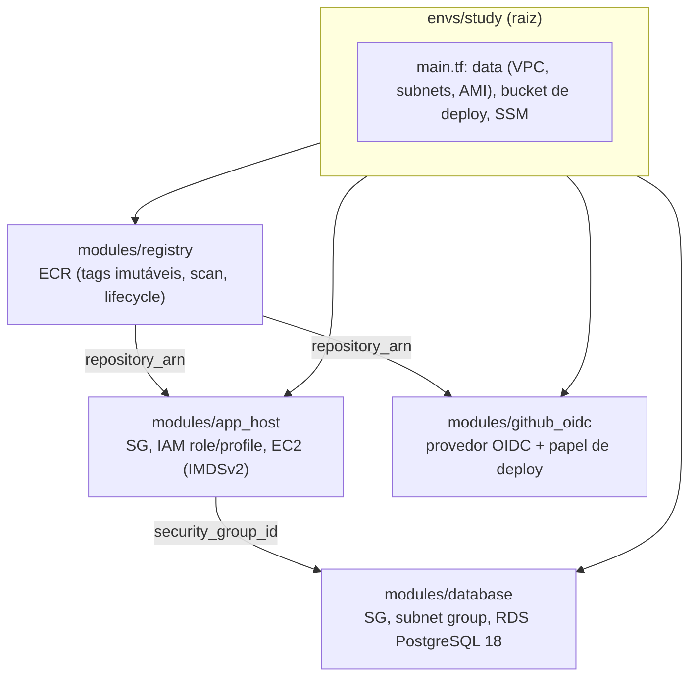
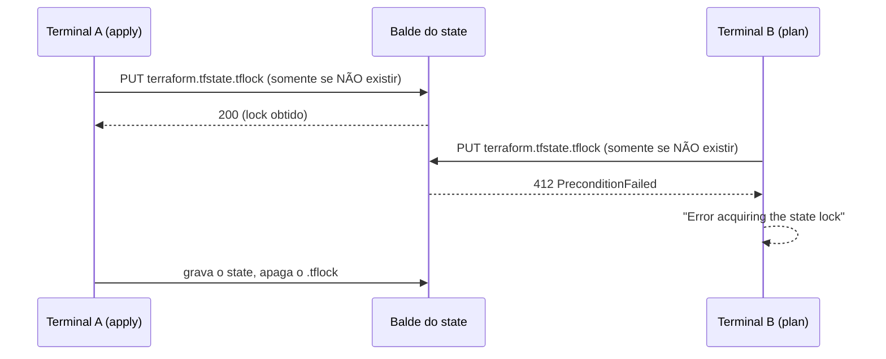

# P8.06 — Terraform II: módulos e state remoto

> ⏱️ ~1h30 · 🔵 Pleno · Pré-requisitos: P8.05 (providers, recursos, state), J10.04 (IAM, OIDC), P8.02 (scan de configuração)

> ⚠️ **Verificação:** **executado** (Terraform 1.17.1, AWS provider 6.73.0) contra o **moto** (emulador de AWS; **sem conta AWS real**): quatro módulos próprios, **`terraform test` com `mock_provider`** (5 testes + **mutantes**), ***state* remoto** em S3 com **`use_lockfile`** (inclusive a **disputa do bloqueio**), migração de *state*, `prevent_destroy`, bloco `moved` e bloco `import`. O moto **emula** o S3 e aceitou as escritas condicionais do bloqueio; **a AWS real não foi tocada** (💸). O **valor** do `412 PreconditionFailed` vem do emulador. **Não executado:** `terraform force-unlock` (descrito pela documentação), `workspaces` e módulos de **registro público** (só lidos).

## 🎯 Objetivos
Ao final desta aula você consegue:
- **Extrair** um **módulo** (entradas, saídas, validação) e **decidir** quando **não** vale a pena.
- **Configurar** ***state* remoto** no S3 com **bloqueio** (`use_lockfile`), **versionamento** e cifragem, e **criar** o balde pelo ***bootstrap***.
- **Migrar** o *state* de local para remoto e **provar** que o bloqueio impede duas escritas.
- **Refatorar** sem destruir (`moved`) e **adotar** o que já existe (`import`).
- **Testar** módulos com `terraform test` e `mock_provider`, e **provar** que os testes **falham** quando o módulo quebra.

## 🤔 Por que isso importa
Um arquivo `main.tf` de 600 linhas vira o "arquivo que ninguém ousa tocar". **Módulos** dão **nomes e fronteiras** (o "registro de imagens", o "banco"). E o *state* local, que a P8.05 mostrou ser um **mapa frágil**, precisa morar num lugar **compartilhado, versionado e bloqueado** antes de **duas pessoas** (ou o CI e uma pessoa) tocarem a mesma infraestrutura. Esta aula fecha as duas pontas: **estrutura** e **segurança do estado**.

## 💡 Intuição (explicação simples)
**Módulo** é uma **receita de cozinha** com ingredientes (entradas) e um prato pronto (saídas): você não reescreve "como fazer bolo" a cada aniversário. O ***state* remoto com bloqueio** é o **caderno de pedidos na bancada**, com **uma caneta só**: quem a pega escreve; quem chegar depois **espera** (ou desiste), em vez de os dois escreverem por cima um do outro. Fazer uma **cópia do caderno** a cada alteração (versionamento) permite **desfazer** um erro.

## 🔬 Como funciona por dentro

### Módulos: a estrutura do PayFlow

Um módulo é só **uma pasta** com `variable`, `resource` e `output`; quem o usa o chama com `module "registry" { source = "../../modules/registry" … }`. Regras que o PayFlow segue (decisão 161):
1. **Interface pequena:** poucas `variable`, **com tipo e `validation`**; o que não varia **não** vira variável (o `registry` **fixa** `IMMUTABLE`: a regra da P7.01 **não é opcional**).
2. **Saídas explícitas** (`repository_arn`, `security_group_id`): o módulo `database` **recebe** o SG do `app_host` **por parâmetro**, nunca o procura sozinho. Isso torna a **dependência visível** no grafo.
3. **O módulo não configura o *provider*:** quem chama passa o *provider* (o emulador, a região). Um módulo com `provider` dentro é difícil de reusar e de testar.
4. **Quando NÃO extrair:** um recurso usado **uma vez** (o `aws_s3_bucket.deploy` e o parâmetro SSM ficaram na raiz). Regra dos três: extraia na **terceira** repetição, não na primeira.

**Validação de entrada** (executada nos testes):
```hcl
variable "keep_images" {
  type    = number
  default = 20
  validation {
    condition     = var.keep_images >= 5
    error_message = "keep_images must be at least 5 (a rollback needs history)."
  }
}
variable "github_repository" {
  type = string
  validation {
    condition     = can(regex("^[A-Za-z0-9._-]+/[A-Za-z0-9._-]+$", var.github_repository))
    error_message = "github_repository must look like owner/repo."
  }
}
```
A validação **recusa o erro antes do `plan`** (na API, o erro só apareceria no `apply`).

### Módulos de terceiros: o registro
Existem módulos prontos (por exemplo, [`terraform-aws-modules/terraform-aws-vpc`](https://github.com/terraform-aws-modules/terraform-aws-vpc)). **Vantagem:** testados por milhares de usuários. **Custo:** **versão fixada** (`version = "~> 6.0"`), **ler** o que ele cria (um "módulo de VPC" pode criar NATs que **cobram** 💸) e **aceitar** a interface dele. O PayFlow, com **4 recursos pequenos por módulo**, escreveu os próprios: nenhum justificava uma dependência externa. A **rede** (P9) é um bom candidato a módulo de terceiros.

### *State* remoto com bloqueio

O **bloqueio nativo** do S3 (`use_lockfile = true`) grava um **objeto** `<chave>.tflock` com uma **escrita condicional** ("só se não existir"). A [documentação do backend S3](https://developer.hashicorp.com/terraform/language/backend/s3) descreve `use_lockfile` e marca o **DynamoDB como obsoleto** (*deprecated*): **não crie uma tabela** só para isso. Também **recomenda** habilitar o **versionamento** do balde.

**O *bootstrap* (o ovo e a galinha):** o balde do *state* precisa existir **antes** de qualquer *state* remoto. Ele vive numa configuração **à parte** (`terraform/bootstrap`) com *state* **local** (pequeno, quase nunca muda) e com cuidados:
```hcl
resource "aws_s3_bucket" "state" {
  bucket = "payflow-tfstate-${data.aws_caller_identity.current.account_id}-${var.region}"
  lifecycle { prevent_destroy = true }          # perder o state = perder o mapa
}
resource "aws_s3_bucket_versioning" "state" {   # cada versão do state fica guardada
  bucket = aws_s3_bucket.state.id
  versioning_configuration { status = "Enabled" }
}
# + criptografia AES256 e bloqueio de acesso público
```
Executado:
```
$ (bootstrap) terraform apply   -> the bucket that will hold the state
Apply complete! Resources: 4 added, 0 changed, 0 destroyed.
state_bucket = "payflow-tfstate-123456789012-us-east-1"
```
**Configuração parcial** do *backend* (o nome do balde **não** fica no código versionado):
```hcl
# backend.tf
terraform { backend "s3" {} }
```
```hcl
# backend.hcl
bucket       = "payflow-tfstate-<ACCOUNT_ID>-us-east-1"
key          = "study/terraform.tfstate"
region       = "us-east-1"
encrypt      = true
use_lockfile = true
```
**Migração (executada):**
```
$ terraform init -migrate-state -backend-config=backend.hcl
Successfully configured the backend "s3"! Terraform will automatically
Terraform has been successfully initialized!
$ aws s3 ls s3://payflow-tfstate-.../study/
55788 terraform.tfstate
```
(No laboratório, `backend.hcl` também aponta o *endpoint* do emulador; **na AWS real** essas linhas não existem.)

**A disputa pelo bloqueio (executada):** no terminal A, um `terraform apply` **esperando o `yes`** (segura o bloqueio); no B, um `plan`:
```
$ aws s3 ls (while A waits)
55788 terraform.tfstate
  255 terraform.tfstate.tflock                       ← o objeto de bloqueio
$ terraform plan   (terminal B)
Error: Error acquiring the state lock
  StatusCode: 412, ... api error PreconditionFailed: At least one of the pre-conditions you specified did not hold
Lock Info:
  Operation: OperationTypeApply
  Who:       <user>@<host>
  Version:   1.17.1
$ aws s3 ls (after A gave up)
55788 terraform.tfstate                              ← o .tflock sumiu: o bloqueio foi liberado
```
O B **não esperou nem corrompeu** nada. O `Lock Info` diz **quem** segura, **qual operação** e **a versão do Terraform**. (O campo *Who* traz **usuário@máquina**; aqui foi anonimizado.) **Se o processo do A morresse** (queda de rede, `kill -9`), o `.tflock` **ficaria**; a documentação prevê `terraform force-unlock <ID>` para esse caso (⚠️ **não executado**): use **só** depois de confirmar que **ninguém** está aplicando.

### Refatorar sem destruir: `moved`
Renomear `module "registry"` para `module "container_registry"` **sem** avisar o Terraform:
```
# the rename WITHOUT a moved block
# module.container_registry.aws_ecr_repository.this will be created
# module.registry.aws_ecr_repository.this will be destroyed
Plan: 2 to add, 3 to change, 2 to destroy.
```
**O repositório seria destruído e recriado** (com as imagens dentro!). Com o bloco `moved`:
```hcl
moved {
  from = module.registry
  to   = module.container_registry
}
```
```
# module.registry.aws_ecr_repository.this has moved to module.container_registry.aws_ecr_repository.this
Plan: 0 to add, 1 to change, 0 to destroy.
```
(O `1 to change` é o artefato do emulador da P8.05.) O `moved` **registra a mudança de endereço** no *state* **sem tocar na nuvem**: deixe-o por um ciclo para que **todos** os ambientes o apliquem. [Documentação do `moved`](https://developer.hashicorp.com/terraform/language/block/moved).

### Adotar o que já existe: `import`
```
$ terraform state rm aws_ssm_parameter.db_endpoint     (o recurso AINDA existe na nuvem)
$ terraform plan
# aws_ssm_parameter.db_endpoint will be created         ← o Terraform acha que falta
$ terraform plan   (with an import block)
# aws_ssm_parameter.db_endpoint will be imported
Plan: 1 to import, 0 to add, 1 to change, 0 to destroy.
aws_ssm_parameter.db_endpoint: Import complete [id=/payflow/db/endpoint]
Apply complete! Resources: 1 imported, 0 added, 1 changed, 0 destroyed.
```
```hcl
import {
  to = aws_ssm_parameter.db_endpoint
  id = "/payflow/db/endpoint"
}
```
O bloco `import` entra **no `plan`**: você **vê** o que será adotado e o revisa em PR (o comando antigo `terraform import` mexia no *state* às cegas). **Escreva o recurso no código primeiro**; depois do *import*, `plan` deve dar **`No changes`** (se não der, o código **difere** da realidade). [Documentação do `import`](https://developer.hashicorp.com/terraform/language/import). É o caminho para **trazer para o código** o que a J10 criou com scripts.

### Testar módulos: `terraform test` + `mock_provider` (executado)
`tests/registry.tftest.hcl` (dentro do módulo) roda **sem nuvem nenhuma**:
```hcl
mock_provider "aws" {}                    # um provider de mentira: nada é criado, nada é chamado
variables { name = "payflow" }

run "tags_are_immutable_and_scanned" {
  command = plan
  assert {
    condition     = aws_ecr_repository.this.image_tag_mutability == "IMMUTABLE"
    error_message = "tags must be immutable (P7.01: a tag never changes)"
  }
}
run "rejects_too_little_history" {
  command = plan
  variables { keep_images = 2 }
  expect_failures = [var.keep_images]     # o teste PASSA se a validação REPROVAR
}
```
```
$ (modules/registry) terraform test
run "tags_are_immutable_and_scanned"... pass
run "lifecycle_keeps_requested_history"... pass
run "rejects_too_little_history"... pass
Success! 3 passed, 0 failed.
$ (modules/github_oidc) terraform test
run "trust_is_pinned_to_one_repo_and_environment"... pass
run "rejects_a_malformed_repository"... pass
Success! 2 passed, 0 failed.
```
**Um teste que nunca falhou não prova nada: mutantes** (executados): troquei `IMMUTABLE` por `MUTABLE` no `registry` e, no `github_oidc`, o `StringEquals` exato por `StringLike` com `repo:acme/*`:
```
$ (mutant of modules/registry) terraform test
tags must be immutable (P7.01: a tag never changes)
run "tags_are_immutable_and_scanned"... fail
Failure! 2 passed, 1 failed.
$ (mutant of modules/github_oidc) terraform test
the sub claim must name the repository AND the environment
StringLike with a wildcard would let any repository of the owner deploy
run "trust_is_pinned_to_one_repo_and_environment"... fail
Failure! 1 passed, 1 failed.
```
Os dois **reprovaram**. O segundo é a **regra de segurança mais importante do pipeline**: o papel de *deploy* só pode ser assumido pelo **repositório e ambiente certos** (J10.06); um `repo:acme/*` deixaria **qualquer** repositório da organização implantar em produção.

> 🐛 **O que a execução revelou:** o `mock_provider` **inventa um texto aleatório para todo atributo calculado**, inclusive o `.json` de um `aws_iam_policy_document`; o primeiro teste do `github_oidc` quebrou com `"policy" contains an invalid JSON policy: not a JSON object`. A saída: um `mock_data` com um JSON fixo, e **asserções sobre os argumentos do bloco** (`statement[0].condition`), que são **nossos**, não sobre o JSON gerado. Teste **o que você escreveu**, não o que o *provider* calcula.

### `prevent_destroy` (executado)
```
$ (bootstrap) terraform destroy
Error: Instance cannot be destroyed
Resource aws_s3_bucket.state has lifecycle.prevent_destroy set, but the plan ...
```
O `destroy` do ***bootstrap*** é **recusado**: protege o balde do *state*. (Para destruir de verdade, remova o `prevent_destroy` **conscientemente**, num commit revisado.)

## 🛠️ Exemplo prático
Tudo está em `lab/iac-lab/` (`run-iac.sh` reproduz **cada saída** acima, regrava `out-*.txt` e limpa depois):
```bash
cd lab/iac-lab
bash run-iac.sh          # ~5 min; precisa de Docker, Terraform e AWS CLI; NÃO usa conta AWS
```
Para o PayFlow **real** (💸), a ordem é: (1) `bootstrap` **uma vez** com credenciais de administrador; (2) copiar `backend.tf.example` para `backend.tf` e `backend.hcl.example` para `backend.hcl` (com o nome do balde); (3) `terraform init -migrate-state`; (4) `terraform plan`.

**Um *state* por ambiente e por ciclo de vida:** `study/terraform.tfstate`, `production/terraform.tfstate`; e, quando a rede (P9) entrar, `network/terraform.tfstate` **separado** do `app/`: a rede **muda raramente** e **todo mundo depende dela**; separar reduz o **raio de explosão** de um `apply` errado. As saídas de um *state* são lidas por outro com `data "terraform_remote_state"` (ou, melhor, **procurando o recurso** com `data` pela etiqueta).

## 🏗️ Estudo de caso: o apply que ninguém reviu
> **Cenário fictício.** Uma PR "só renomeia o módulo do registro". O `plan` do CI mostra `Plan: 2 to add, 3 to change, 2 to destroy`. O revisor lê o título, **aprova sem abrir o `plan`**, e o `apply` automático **destrói o repositório ECR** (com todas as imagens) e cria um vazio. O deploy seguinte falha: a imagem em produção **sumiu**.

**Diagnóstico.** A causa não é o rename: é **a falta do bloco `moved`** e **o `apply` sem olho humano no `plan`**. O ECR **tinha** `force_delete`? No ambiente de estudo, sim (decisão consciente); em produção, **nunca**.

**Opções:** (A) pedir "mais atenção" na revisão; (B) tornar o `plan` **obrigatório e visível** no PR (resumo em `GITHUB_STEP_SUMMARY`, P8.07) **e** exigir aprovação no `apply`; (C) **`prevent_destroy`** nos recursos com dados (ECR, RDS, S3 de dados); (D) um teste/regra que **reprova** `plan` com `destroy` de recursos protegidos.
**Decisão (decisão 161):** **B + C** em produção; **D** como evolução (política em código, P10). *Consequência:* alguns `destroy` legítimos exigem **um commit extra** removendo a proteção, que é exatamente a fricção desejada. **A** isolada falha: atenção humana **não escala**.

## ⚖️ Trade-offs e quando NÃO usar
- **Módulo para tudo:** abstração prematura. Um módulo com **12 variáveis** que só você entende é pior que o recurso solto.
- **Registro público × módulo próprio:** o público economiza tempo e **traz** o que você não pediu (custos, permissões). Para peças pequenas e de segurança (o papel OIDC!), **escreva e teste**.
- **S3 com `use_lockfile` × HCP Terraform (Terraform Cloud) × DynamoDB:** o S3 nativo é **o mais simples** e basta para um time pequeno; um serviço gerenciado traz **execução remota, políticas e histórico** (e um custo e um fornecedor); o DynamoDB é **obsoleto** para o bloqueio. ⚠️ A parte do HCP Terraform é **conceitual** (não verificada aqui).
- **`workspaces`** (vários *states* na mesma configuração) são práticos para **ambientes idênticos** e **perigosos** quando os ambientes **divergem** (variáveis e *states* escondidos atrás de um nome). O PayFlow usa **diretórios** (`envs/study`, `envs/production`): explícito e revisável.
- **Um único *state* para tudo:** o *plan* demora (cada recurso é *refrescado*) e **todos** esperam pelo mesmo bloqueio.
- **`mock_provider` × teste com nuvem real:** o *mock* é **rápido e grátis**, mas **não** descobre que a AWS recusa um parâmetro; **um** teste de integração com `apply` real (na conta de estudo, que se destrói) cobre isso.

## ⚠️ Erros comuns e boas práticas de produção
- **Balde de *state* sem versionamento:** um `apply` errado ou um *state* corrompido vira **perda total**. Versionamento + `prevent_destroy`.
- **Acesso amplo ao balde do *state*:** o *state* tem **segredos**; restrinja por política (só o papel de CI e os administradores) e **audite**.
- **`force-unlock` por impaciência:** se alguém **de fato** está aplicando, você cria **dois** escritores. Confirme antes.
- **Rename sem `moved`**: o `plan` mostra `destroy`; **leia o `plan`** (estudo de caso).
- **Módulo com `provider` dentro**, ou que lê variáveis de ambiente: não é testável nem reusável.
- **Testes que dependem de `data` reais:** use `mock_provider`/`override_data` (ou `mock_data`) para que o teste rode em qualquer lugar.
- **`terraform test` verde sem mutante:** você **não sabe** se ele detecta algo.
- **Erro real que apareceu:** `Error: Module not installed. This module is not yet installed. Run "terraform init" to install all modules` ao renomear o módulo.

## 🧩 Exercícios
1. **Fixação.** Como o bloqueio `use_lockfile` impede duas escritas? O que o `412 PreconditionFailed` significa nesse contexto? Por que o *bootstrap* tem *state* local?
2. **Aplicação no PayFlow.** Leve o *state* do estudo para o S3 (no moto) e prove o bloqueio.
   - [ ] O `bootstrap` cria o balde com versionamento, cifragem, bloqueio de acesso público **e `prevent_destroy`**.
   - [ ] `terraform init -migrate-state` move o *state*; o arquivo `.tfstate` local **não** é mais a fonte.
   - [ ] Com um `apply` pendente de confirmação no terminal A, o `plan` no B falha com o erro de bloqueio; depois o `.tflock` some.
   - [ ] Os módulos `registry` e `github_oidc` têm `tests/*.tftest.hcl` e **você os quebrou de propósito** e eles reprovaram.
   - [ ] Existe um `moved` para um rename e **você viu** o `plan` sem ele (`2 to destroy`).
3. **Desafio.** Escreva um teste para o módulo `database` garantindo `storage_encrypted = true`, `publicly_accessible = false` e `manage_master_user_password = true` e um **mutante** para cada um.

<details><summary>Solução do exercício 1</summary>

O Terraform grava `terraform.tfstate.tflock` com uma escrita **condicional** ("somente se não existir"). O primeiro a escrever consegue; o segundo recebe **`412 PreconditionFailed`** (a pré-condição "não existir" **não vale**) e o Terraform traduz como "Error acquiring the state lock". Ao terminar (ou desistir), o dono **apaga** o objeto. O *bootstrap* tem *state* **local** porque ele **cria** o lugar onde o *state* remoto vai morar: não há onde guardá-lo antes disso (o ovo e a galinha); ele é pequeno e raramente muda.
</details>

<details><summary>Solução do exercício 3 (esboço)</summary>

```hcl
mock_provider "aws" {}
variables { name = "t"  vpc_id = "vpc-1"  subnet_ids = ["subnet-1", "subnet-2"]  client_security_group_id = "sg-1" }
run "database_is_private_encrypted_and_has_no_stored_password" {
  command = plan
  assert { condition = aws_db_instance.this.storage_encrypted               error_message = "storage must be encrypted" }
  assert { condition = !aws_db_instance.this.publicly_accessible            error_message = "must not be public" }
  assert { condition = aws_db_instance.this.manage_master_user_password     error_message = "the password must live in Secrets Manager" }
}
```
Mutantes: troque cada valor e confirme `fail`. (⚠️ O esboço **não** foi executado.)
</details>

## 🎤 Na entrevista
- **"Como você guarda o state do Terraform num time?"** — Remoto (S3 com versionamento e cifragem), com **bloqueio** (`use_lockfile`), acesso restrito, um *state* por ambiente/ciclo de vida; criado por um *bootstrap* separado.
- **"Renomeei um recurso e o plan quer destruí-lo. O que faço?"** — Um bloco `moved` (de → para): ele muda o **endereço no state** sem tocar na nuvem. E leio **sempre** o `plan`.
- **"Como trazer para o Terraform algo criado à mão?"** — Escrever o recurso no código e usar um bloco `import`, que aparece no `plan` (revisável); conferir que o `plan` seguinte dá `No changes`.
- **"Como você testa Terraform?"** — `fmt`/`validate`, `terraform test` com `mock_provider` para a lógica e validações, um teste de integração real numa conta descartável, e **mutantes** para provar que os testes detectam.

## 📚 Para ir além
- 📄 [Backend S3](https://developer.hashicorp.com/terraform/language/backend/s3): `use_lockfile`, versionamento recomendado, DynamoDB obsoleto.
- 📄 [Módulos](https://developer.hashicorp.com/terraform/language/modules): estrutura, entradas/saídas, versionamento.
- 📄 [Testes do Terraform](https://developer.hashicorp.com/terraform/language/tests): `run`, `assert`, `expect_failures`, `mock_provider`.
- 📄 [Bloco `moved`](https://developer.hashicorp.com/terraform/language/block/moved) e [bloco `import`](https://developer.hashicorp.com/terraform/language/import).
- 📄 [Estado (*state*)](https://developer.hashicorp.com/terraform/language/state) e [`lifecycle`](https://developer.hashicorp.com/terraform/language/meta-arguments/lifecycle).
- 💻 [`terraform-aws-modules/terraform-aws-vpc`](https://github.com/terraform-aws-modules/terraform-aws-vpc): um módulo de terceiros muito usado (leia o que ele cria antes de adotar).
- 🎥 Nenhum vídeo verificado nesta aula.

## ✅ Checklist da aula
- [ ] Sei extrair um módulo com validação e **sei quando não** extrair.
- [ ] O *state* está em S3 com versionamento, cifragem, bloqueio e `prevent_destroy` no balde; vi o erro `412` na disputa.
- [ ] Usei `moved` e `import` e li o `plan` antes e depois.
- [ ] Meus testes de módulo foram **reprovados** por mutantes.
- [ ] Sei que a AWS real e o `force-unlock` **não** foram executados.
