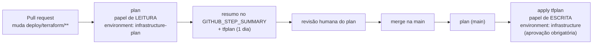

# P8.07 — 💸 Infraestrutura do PayFlow com Terraform

> ⏱️ ~1h30 · 🔵 Pleno · Pré-requisitos: P8.01 (pipeline), P8.02 (scan), P8.05 e P8.06 (Terraform, módulos, *state* remoto), J10.04 a J10.07 (IAM, EC2/RDS, deploy, destruir tudo)

> 💸 **Esta aula fala de recursos que cobram** (RDS, EC2, disco, endereços IP, transferência de dados). **Nada foi criado na AWS real.** Tudo foi executado contra o **moto** (emulador). Se **você** aplicar na AWS real: faça-o **no mesmo dia em que vai destruir**, com o alerta de custo da J10.04 ativo, e rode `terraform destroy` **e** a conferência do fim da aula.

> ⚠️ **Verificação:** **executado** (Terraform 1.17.1, AWS provider 6.73.0, Trivy 0.76.2, `actionlint` 1.7.12): `plan`/`apply`/`destroy` dos **20 recursos** do PayFlow no moto; **`terraform plan -detailed-exitcode`** (códigos 0 e 2); **recriação do banco** por uma mudança "inocente" (`forces replacement`) e a proteção `prevent_destroy`; varredura **Trivy** do Terraform (**13 achados → 4 corrigidos, 9 aceitados com motivo → 0**); os *workflows* `infra.yml` e `drift.yml` passam no `actionlint`. **Não executado:** a AWS real, o OIDC real (os papéis de *plan*/*apply* **não** foram criados), o GitHub Actions, o `user_data` (a variável existe; o *script* da J10 **não** foi ligado) e o **orçamento** em Terraform. Nenhum **preço** é citado: confira a [calculadora da AWS](https://calculator.aws/) **na hora**.

## 🎯 Objetivos
Ao final desta aula você consegue:
- **Mapear** os `scripts/aws/*.sh` da J10 para **recursos e módulos** Terraform e **dizer o que fica fora** do código.
- **Montar** o pipeline de infraestrutura: ***plan* na PR** (papel de leitura), ***apply* só na `main`** (papel de escrita, com aprovação e o plano **revisado**).
- **Detectar *drift*** de forma agendada com `terraform plan -detailed-exitcode`.
- **Ler um `plan`** procurando o que **recria** ou **destrói** (e proteger o que tem dados).
- **Varrer** o Terraform com o Trivy, **corrigir** o que vale e **aceitar com motivo** o que não vale.
- **Destruir e provar** que nada sobrou.

## 🤔 Por que isso importa
Na J10 você subiu a pilha com scripts e **destruiu na ordem inversa**. Isso resolve **uma tarde**; não resolve **um time por um ano**. Com Terraform, a infraestrutura do PayFlow é **revisada em PR**, **reproduzível** e **auditável** (o Git diz quem mudou o quê). Em contrapartida, **o `apply` é a operação mais perigosa do pipeline**: ele pode **destruir o banco**. Esta aula junta o que importa: **quem pode aplicar**, **o que é revisado antes** e **o que protege os dados**.

## 💡 Intuição (explicação simples)
Uma **reforma de apartamento** com projeto aprovado: o **arquiteto** (o `plan`) mostra a planta nova e **quais paredes serão derrubadas**; o **síndico** (a aprovação do ambiente) assina; só então o **pedreiro** (o `apply`) trabalha **seguindo exatamente aquela planta** (o plano salvo). E há paredes **tombadas** (as proteções contra destruição) que o pedreiro **não pode** derrubar sem um **segundo** papel assinado. Toda semana, alguém **confere** se o apartamento ainda bate com a planta (a detecção de *drift*).

## 🔬 Como funciona por dentro

### Dos scripts da J10 ao Terraform
| Script da J10 (`scripts/aws/`) | No Terraform (`lab/iac-lab/terraform`) | Observação |
|---|---|---|
| `20-iam.sh` (OIDC, papéis) | `modules/github_oidc`, `modules/app_host` (papel da EC2) | a *trust policy* é **testada** (P8.06) |
| `30-storage.sh` (S3, ECR) | `aws_s3_bucket.deploy` (raiz), `modules/registry` | ECR com **tags imutáveis** (P7.01) |
| `40-network.sh` (SGs) | SGs dentro de `app_host` e `database` | usa o **VPC padrão** (rede própria é a **P9**) |
| `50-database.sh` (RDS) | `modules/database` | senha no **Secrets Manager** (`manage_master_user_password`) |
| `60-instance.sh` (EC2) | `modules/app_host` | **IMDSv2 obrigatório**, disco cifrado; `user_data` opcional |
| `10-budget.sh` (alerta de custo) | **fora do Terraform** (exercício) | a conta/orçamento/MFA **raiz** ficam manuais (J10.04) |
| `90-teardown.sh` + `91-verify-empty.sh` | `terraform destroy` + conferência | `default_tags` etiqueta tudo |

**O que fica fora de propósito:** a **conta**, o **MFA do usuário raiz** e o **primeiro** papel de administrador (alguém precisa existir **antes** do Terraform). O balde do *state* tem o seu próprio **bootstrap** (P8.06).

### O pipeline de infraestrutura (`infra.yml`)

Pontos de projeto (decisão 162), cada um com o **porquê**:
1. **Dois papéis**, dois `environment`: o ***plan*** (`infrastructure-plan`, **sem** revisores) assume um papel de **leitura**; o ***apply*** (`infrastructure`, **com revisores obrigatórios**) assume o de **escrita**. Quem abre uma PR **nunca** obtém a credencial que muda a nuvem. O `sub` do OIDC identifica o ambiente: `repo:OWNER/REPO:environment:infrastructure` (formato **conferido** na [documentação do GitHub](https://docs.github.com/en/actions/security-for-github-actions/security-hardening-your-deployments/about-security-hardening-with-openid-connect), exemplo `repo:octo-org/octo-repo:environment:prod`).
2. **Plano salvo** (`terraform plan -out=tfplan`, `terraform apply tfplan`): o `apply` executa **exatamente** o que o revisor viu; sem ele, o estado da nuvem poderia mudar entre o `plan` e o `apply`.
3. **`terraform_wrapper: false`** no `hashicorp/setup-terraform`: o *wrapper* embrulha a saída e **atrapalha** o código de saída e a leitura do plano.
4. **`concurrency` com `cancel-in-progress: false`**: **nunca** cancele um `apply` no meio (deixaria o bloqueio do *state* e a infraestrutura pela metade).
5. **O arquivo do plano pode conter segredos** (como o *state*): artefato **privado**, retenção de **1 dia**.
6. **Um papel de *plan* não é só leitura:** para **bloquear** o *state* o Terraform **escreve** o objeto `.tflock` no balde; a [documentação do *backend*](https://developer.hashicorp.com/terraform/language/backend/s3) lista as permissões S3 necessárias (`PutObject`/`DeleteObject` no `.tflock`). Dê ao papel de leitura **só isso** de escrita, ou rode `plan -lock=false`. (O **desenho fino** das políticas de IAM é **P10**.)

`infra.yml` e `drift.yml` estão em `lab/pipeline-lab/.github/workflows/` e passam no `actionlint`. ⚠️ **Não executados** no GitHub, e os papéis `TF_PLAN_ROLE_ARN`/`TF_APPLY_ROLE_ARN` **não existem** (criá-los é o exercício).

### Detectar *drift* sem ninguém olhar (executado)
`terraform plan -detailed-exitcode` devolve um código que o CI entende:
```
no drift:                              exit=0
drift (tags made mutable by hand):     exit=2
invalid configuration (bad value):     exit=1
```
**0** = nenhuma mudança; **1** = erro; **2** = há mudanças (o código e a nuvem **divergem**). O `drift.yml` roda `plan` **todo dia útil** e **falha** com `::error::drift detected` se o código for 2. Um *drift* **detectado cedo** (alguém clicou no console) é uma conversa; um **descoberto** durante um incidente é um problema.

### Ler o `plan` como um revisor
Antes de aprovar, procure **nesta ordem**:
1. **`destroy` e `-/+`** (destruir e recriar): em **banco, disco, bucket com dados, repositório com imagens**, **pare**.
2. **IAM:** novas permissões com `"*"`, novas relações de confiança, `sts:AssumeRole`.
3. **Rede:** `0.0.0.0/0` em **entrada**; portas 22/3389/5432 abertas.
4. **`forces replacement`**: o atributo que força a recriação (às vezes um campo "inocente").
5. **Contagem:** `Plan: X to add, Y to change, Z to destroy`: o número cabe na **descrição da PR**?

### Uma mudança "inocente" que recria o banco (executado)
Mudança de uma linha no módulo `database`: `db_name = "payflow"` → `"payflow2"`.
```
$ terraform plan
# module.database.aws_db_instance.this must be replaced
~ db_name                               = "payflow" -> "payflow2" # forces replacement
Plan: 1 to add, 2 to change, 1 to destroy.
```
O RDS **será destruído e recriado** (`1 to add, 1 to destroy`; os `2 to change` incluem os dois artefatos do emulador da P8.05). O `db_name` parecia um detalhe; **forçar recriação** é o que o provider declara para esse atributo. Agora a rede de segurança, `lifecycle { prevent_destroy = true }` no banco:
```
$ terraform plan
Error: Instance cannot be destroyed
Resource module.database.aws_db_instance.this has lifecycle.prevent_destroy ...
```

`prevent_destroy` transforma o erro **silencioso e caro** (recriar o banco) em **erro barulhento e barato** (o `plan` recusa). **Em produção**, use **os dois**: `prevent_destroy` **e** `deletion_protection = true` (este último a **própria AWS** aplica, mesmo se alguém apagar o código). No laboratório, `deletion_protection = false` é **só** porque precisamos destruir tudo no fim (o Trivy acusa isso: abaixo).

## 🛠️ Exemplo prático

### 1. Aplicar e destruir no emulador (executado)
```
$ terraform apply tfplan
Apply complete! Resources: 20 added, 0 changed, 0 destroyed.     (apply took 84s; o RDS "demorou" 1m20s no emulador)
$ terraform destroy
Destroy complete! Resources: 20 destroyed.                         (destroy took 87s)
$ what is left in the account (should be only the state bucket)
ec2 not terminated: 0
rds: 0
ecr: 0
ssm /payflow: 0
iam roles payflow*: 0
buckets: payflow-tfstate-123456789012-us-east-1                    ← o balde do state (do bootstrap) é o único
$ (bootstrap) terraform destroy   -> prevent_destroy protects the state bucket
Error: Instance cannot be destroyed
```
Compare com a J10.07: ali, **dois scripts** (`90-teardown.sh` com a ordem certa e `91-verify-empty.sh`); aqui, **um comando** que **conhece as dependências** e uma conferência. O **balde do *state*** sobrevive **de propósito**: apagá-lo exige remover o `prevent_destroy` conscientemente.

**💸 Conferência do fim do dia (na AWS real):** (1) `terraform destroy` terminou **sem erro**; (2) `terraform state list` está **vazio**; (3) o *Cost Explorer* e o **orçamento** da J10.04 **no dia seguinte** (a cobrança aparece com atraso); (4) o que **não** é do Terraform (volumes e *snapshots* **órfãos**, IPs elásticos, *logs*) **também** (a J10.07 lista).

### 2. O Trivy lê o Terraform (executado)
`trivy config` sobre o Terraform do laboratório:

| Achado | Gravidade | O que fiz |
|---|---|---|
| **AWS-0104** SG com saída irrestrita (`0.0.0.0/0`) | **CRÍTICA** | **aceitei, com motivo e prazo**: sem NAT/VPC *endpoints* a EC2 alcança ECR/SSM pela internet (**P9 restringe**) |
| **AWS-0132** S3 sem chave gerenciada pelo cliente (×2: *state* e deploy) | ALTA | aceitei: AES256; uma chave própria **custa** (💸) e é decisão da **P10** |
| AWS-0090 S3 sem versionamento (deploy) | MÉDIA | **corrigi** (`aws_s3_bucket_versioning`) |
| AWS-0077 *backup* do RDS muito curto | MÉDIA | **corrigi** (`backup_days = 7`) |
| AWS-0176 RDS sem autenticação IAM | MÉDIA | aceitei: a aplicação usa a senha do Secrets Manager (**P10**) |
| AWS-0177 RDS sem proteção contra exclusão | MÉDIA | aceitei **só no estudo**: produção `true` |
| AWS-0124 regra de SG sem descrição (×2) | BAIXA | **corrigi** (`description`) |
| AWS-0133 RDS sem Performance Insights | BAIXA | aceitei: indisponível em `db.t4g.micro` |
| AWS-0033 ECR sem KMS próprio | BAIXA | aceitei (mesma razão do AWS-0132) |
| AWS-0089 S3 sem *logs* de acesso (×2) | BAIXA | aceitei: um balde só para *logs* não compensa no estudo |
**13 achados → 4 corrigidos + 9 aceitos (cada um com um comentário `# trivy:ignore:AWS-xxxx <motivo>` acima do recurso) → 0**, e a execução **sem** os comentários reabre os **9**. Duas lições que **só a execução** deu: (1) **a exceção precisa estar numa linha só, colada ao recurso**: com um comentário de continuação entre duas diretivas, a primeira **não valeu**; (2) o achado **AWS-0132** aparece **no recurso de criptografia** (`aws_s3_bucket_server_side_encryption_configuration`), **não** no balde, quando ele existe: o `ignore` tem de ficar **lá**. Retirar **um** `ignore` (o do ECR) fez o *scan* **reprovar** de novo.

> 🔎 **O achado crítico é o mais "aceitável" e o mais perigoso de aceitar em silêncio.** Foi aceito **com prazo e com a promessa da P9**; sem isso, "saída aberta" vira o padrão para sempre. Uma saída irrestrita facilita **exfiltração** se a instância for comprometida: a mitigação real é a **rede privada com *endpoints*** (P9) e a **política de saída** restritiva.

### 3. O que o `apply` da AWS real exigiria (⚠️ não executado)
- **Credenciais:** o papel de *apply* via OIDC (nunca chave fixa). Para o **primeiro** `apply` (criar o próprio provedor OIDC), alguém usa uma credencial administrativa **uma vez**.
- **Variáveis:** `emulator_endpoint = null` (o padrão) e `github_repository = "seu-usuario/payflow"`.
- **`user_data`:** `user_data = file("${path.root}/../../../deploy/user-data.sh")` (o script da J10.06), com `user_data_replace_on_change = true` (já no módulo): **mudar o script recria a instância** (nada de ajuste manual no servidor).
- **Produção × estudo:** `force_destroy = false`, `deletion_protection = true`, `skip_final_snapshot = false`, `multi_az = true` (P9), `prevent_destroy` no RDS e no ECR.

### Tabela de equivalência (⚠️ de memória: confira nas documentações)
| Papel | **AWS** (usado aqui) | **Azure** | **GCP** |
|---|---|---|---|
| Registro de imagens | ECR | Azure Container Registry | Artifact Registry |
| Pipeline gerenciado | (CodeBuild/CodePipeline) ou **GitHub Actions** | Azure Pipelines | Cloud Build |
| IaC nativa | CloudFormation (CDK) | Bicep/ARM | (Infrastructure Manager, baseado em Terraform) |
| Identidade federada do CI | OIDC → papel IAM | *workload identity federation* | *workload identity federation* |
| *State* do Terraform | S3 (`use_lockfile`) | conta de *storage* (*blob*) | bucket do Cloud Storage |
O **Terraform** serve às três; só mudam os *providers* (`azurerm`, `google`) e os recursos.

## 🏗️ Estudo de caso: o plan que recriava o banco
> **Cenário fictício.** Uma PR "padroniza o nome do banco" muda `db_name`. O `plan` do CI mostra `1 to add, 1 to destroy` entre outros itens. O revisor está atrasado e aprova.

**Diagnóstico.** Executamos a mesma mudança (acima): o `plan` marca `aws_db_instance.this must be replaced` e aponta o **`db_name`** como causador. Na AWS real, **recriar um RDS** significa **criar um banco novo e vazio e apagar o antigo** (com `skip_final_snapshot = true`, **sem** *snapshot*): **todos os dados do PayFlow somem**.

**Opções:** (A) "olhar com mais atenção"; (B) **`prevent_destroy`** + `deletion_protection` + **`skip_final_snapshot = false`** em produção; (C) **política em código** que reprova `plan` com `destroy` de tipos protegidos (P10); (D) **separar** o banco num *state* próprio, aplicado por um papel **à parte**.
**Decisão (decisão 162):** **B hoje** (barato, imediato, e o `plan` **falha alto**), **D** quando a rede/banco entrarem na P9, **C** na P10. *Consequência:* uma mudança legítima que recria o banco exige **um commit extra** removendo a proteção **e** uma **migração de dados planejada** (`pg_dump`/restauração, P3/S3). *A é rejeitada:* atenção humana **não é** controle.

## ⚖️ Trade-offs e quando NÃO usar
- **`apply` automático na `main`:** rápido e **sem fricção**; perigoso sem aprovação. O PayFlow exige **ambiente com revisores**. Times maiores usam **filas de `apply`** (Atlantis, HCP Terraform): ⚠️ nomes citados **de memória**.
- **Infra e aplicação no mesmo repositório:** simples para um time pequeno; **ciclos diferentes** (a infra muda mensalmente, a aplicação diariamente) pedem **pipelines separados** (é o que `infra.yml` e `release.yml` já são).
- **Terraform para o que muda toda hora** (a versão da imagem no Kubernetes): **não**. O Terraform cria a **plataforma**; o **Helm/GitOps** (P8.03/P8.08) implanta a **aplicação**. Dois donos para o mesmo recurso brigam.
- **Estudo × produção no mesmo código:** variáveis (`force_destroy`, `deletion_protection`) controlam a diferença; **dois diretórios** (`envs/study`, `envs/production`) com o mesmo conjunto de módulos são **mais explícitos** que um monte de `if`.
- **Emulador × AWS real:** o moto **valida a sintaxe e a ordem**; **não** valida políticas de IAM de verdade, limites de cota nem preços. **Um `apply` real num ambiente descartável** é o teste final.

## ⚠️ Erros comuns e boas práticas de produção
- **`terraform apply -auto-approve` no laptop** "só dessa vez".
- **`apply` sem o plano salvo:** a nuvem pode mudar entre o `plan` e o `apply`.
- **Revisar o código e não o `plan`:** o **código** não diz o que **será destruído**.
- **Segredos:** nada de `password = "..."`; o plano e o *state* os guardariam.
- **Esquecer `default_tags`** e perder a conferência do que sobrou.
- **Duas fontes para o mesmo recurso** (Terraform e console, ou Terraform e Helm): *drift* garantido.
- **`terraform destroy` em produção** com credenciais de estudo no ambiente: confira **a conta** (`aws sts get-caller-identity`) antes (a mesma regra do contexto do `kubectl` da P7.07).
- **Sem `timeout-minutes`/`-lock-timeout`:** um bloqueio preso segura o pipeline para sempre.

## 🧩 Exercícios
1. **Fixação.** Por que o `apply` usa o **plano salvo**? Por que o papel de *plan* **não** é 100% só leitura? O que cada código de `-detailed-exitcode` significa?
2. **Aplicação no PayFlow.** Complete a infraestrutura como código do PayFlow.
   - [ ] `terraform fmt -check`, `validate` e `test` passam (`scripts/ci/terraform-check.sh`), e o `trivy config` está limpo (os 9 `ignore` **com motivo**).
   - [ ] `infra.yml` e `drift.yml` passam no `actionlint`; os *environments* `infrastructure-plan` e `infrastructure` estão **descritos** em `docs/infra.md`, este último **com revisores**.
   - [ ] Os **papéis** de *plan* e *apply* estão **descritos** (confiança por `environment`; permissões mínimas) em `docs/infra.md` (a criação real é a **P10**).
   - [ ] Você **reproduziu** a recriação do banco (`db_name`) e viu o `plan` **recusar** com `prevent_destroy`.
   - [ ] `terraform destroy` + a conferência: só o balde do *state* sobrou; o *checklist* de custo (💸) está no `docs/infra.md`.
3. **Desafio.** Acrescente um `aws_budgets_budget` (alerta de custo da J10.04) ao Terraform **e** um teste `mock_provider` que garanta um **limite** e um **e-mail** configurados.

<details><summary>Solução do exercício 1</summary>

Plano salvo: o `apply tfplan` executa **exatamente** o que foi revisado; sem ele, se a nuvem mudou depois do `plan`, o `apply` recalcula e pode fazer **outra coisa**. O papel de *plan* precisa **escrever** o objeto `.tflock` para obter o bloqueio do *state* no S3 (ou rodar com `-lock=false`). `-detailed-exitcode`: **0** sem mudanças, **1** erro, **2** há mudanças (medido: 0 sem *drift*, 2 com *drift*, 1 com configuração inválida).
</details>

<details><summary>Solução do exercício 3 (pista)</summary>

O recurso é `aws_budgets_budget` (`limit_amount`, `limit_unit`, `time_unit = "MONTHLY"`, `notification { … subscriber_email_addresses = [...] }`); confira os argumentos **no registro do provider** antes de escrever (a página `…/resources/budgets_budget`). O teste: `assert { condition = aws_budgets_budget.monthly.limit_amount == "10" … }` e `expect_failures` para um e-mail vazio (via `validation`). ⚠️ Não executado.
</details>

## 🎤 Na entrevista
- **"Como você roda Terraform num pipeline com segurança?"** — OIDC (sem chave fixa); `plan` na PR com papel **de leitura**; `apply` só na `main`, **do plano salvo**, num ambiente com **aprovação**; *state* remoto com bloqueio; artefato do plano privado e de vida curta.
- **"Como você evita destruir o banco por engano?"** — Ler o `plan` procurando `destroy`/`-/+`; `prevent_destroy` + `deletion_protection` + *snapshot* final; banco em *state* e papel separados; política em código que reprova `destroy` de tipos protegidos.
- **"Como detecta drift?"** — `plan -detailed-exitcode` agendado (exit 2); prevenção: ninguém altera pelo console (permissão), e mudança de emergência **volta** ao código.
- **"Terraform ou Helm?"** — Terraform cria a **plataforma** (rede, banco, cluster, registro); Helm/GitOps implanta a **aplicação**; nunca os dois para o mesmo recurso.

## 📚 Para ir além
- 📄 [Backend S3](https://developer.hashicorp.com/terraform/language/backend/s3): permissões necessárias e `use_lockfile`.
- 📄 [OIDC no GitHub Actions](https://docs.github.com/en/actions/security-for-github-actions/security-hardening-your-deployments/about-security-hardening-with-openid-connect): o `sub` por ambiente.
- 📄 [*Environments* para implantação](https://docs.github.com/en/actions/managing-workflow-runs-and-deployments/managing-deployments/managing-environments-for-deployment): revisores obrigatórios.
- 📄 [Provider AWS: `aws_db_instance`](https://registry.terraform.io/providers/hashicorp/aws/latest/docs/resources/db_instance): `manage_master_user_password`, `deletion_protection` e o que força recriação.
- 📄 [Trivy: varredura de configuração](https://trivy.dev/docs/latest/guide/scanner/misconfiguration/) e [`lifecycle` do Terraform](https://developer.hashicorp.com/terraform/language/meta-arguments/lifecycle).
- 📑 [*Automating safe, hands-off deployments* (Amazon Builders' Library)](https://aws.amazon.com/builders-library/automating-safe-hands-off-deployments/): ondas, *bake time*, reversão automática.
- 📄 [Calculadora de preços da AWS](https://calculator.aws/): para estimar **antes** de aplicar.
- 🎥 Nenhum vídeo verificado nesta aula.

## ✅ Checklist da aula
- [ ] Sei mapear cada script da J10 para um recurso/módulo e dizer o que fica fora.
- [ ] O pipeline tem *plan* na PR (leitura), *apply* só na `main` do plano salvo e com aprovação, e *drift* agendado.
- [ ] Sei ler um `plan` procurando `destroy`, `-/+`, IAM, `0.0.0.0/0` e `forces replacement`.
- [ ] O banco tem `prevent_destroy` (e proteção da AWS em produção); cada exceção do Trivy tem motivo.
- [ ] **Destruí e provei** que nada sobrou; 💸 e o que **não** foi executado estão claros.
