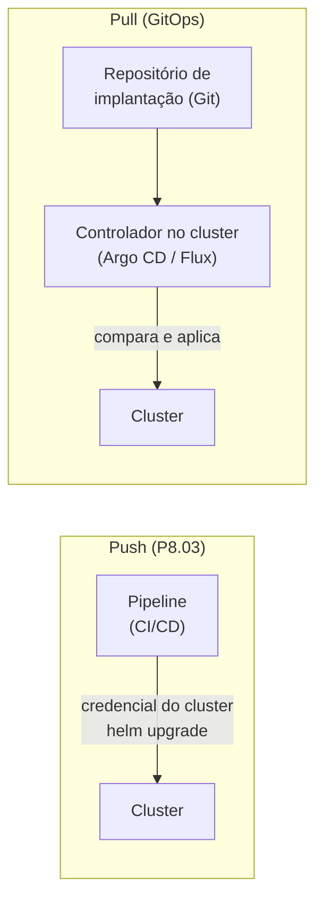

# P8.08 — GitOps (visão geral) e Jenkins para legado

> ⏱️ ~1h30 · 🔵 Pleno · Pré-requisitos: P8.01 a P8.03 (pipeline, imagem, estratégias de deploy), P7.08 (Helm), P8.05 a P8.07 (Terraform)

> ⚠️ **Verificação:** **nada desta aula foi executado**. **Argo CD, Flux e Jenkins não estão instalados** e não há cluster. O que **foi feito**: (1) o manifesto `Application` do Argo CD (`lab/pipeline-lab/deploy/gitops/payflow-production.yaml`) foi validado **só como YAML**; (2) o `Jenkinsfile` (`lab/pipeline-lab/Jenkinsfile`) passou numa checagem **só de chaves e parênteses balanceados**; (3) os **princípios do GitOps** foram lidos em [opengitops.dev](https://opengitops.dev/) (v1.0.0), e as **opções de sintaxe** `abortPrevious`, `buildDiscarder`, `numToKeepStr`, `disableConcurrentBuilds` e `agent none` foram **encontradas** na referência oficial do Jenkins; o *pruning* e o *self-heal* do Argo CD, na página oficial de sincronização automática. ⚠️ **Não verificado:** que o `Jenkinsfile` e o `Application` **funcionam** (depende de servidor/cluster), a opção `allowEmptyArchive` do `archiveArtifacts` (parâmetro de *step*, que **não** está na página de sintaxe consultada) e qualquer **comportamento** descrito para Argo CD/Flux além do que a documentação diz. Trate esta aula como **mapa**, não como receita testada.

## 🎯 Objetivos
Ao final desta aula você consegue:
- **Explicar** GitOps pelos **quatro princípios** e **diferenciar** o modelo ***pull*** (o cluster busca) do ***push*** (o pipeline empurra).
- **Desenhar** o fluxo "CI constrói → um PR no repositório de implantação troca o *digest* → o controlador sincroniza" e **dizer** onde ficam os **segredos**.
- **Comparar** Argo CD e Flux **sem** instalá-los, e **decidir** quando o PayFlow **não** precisa de GitOps.
- **Ler** um `Jenkinsfile` declarativo e **mapear** cada estágio para o equivalente do GitHub Actions.
- **Planejar** a **migração gradual** de um Jenkins legado.

## 🤔 Por que isso importa
Dois cenários que um pleno encontra: (1) o time **já tem** um Jenkins de 8 anos com 200 *jobs*: você vai **mantê-lo** e, talvez, **tirá-lo** aos poucos; (2) o time cresce e o *deploy* "empurrado" pelo pipeline (P8.03) deixa de caber: ninguém sabe **o que está rodando** no cluster, alguém faz `kubectl edit` em produção às pressas, e o ambiente **diverge** do Git. O GitOps responde ao segundo cenário; saber ler Jenkins responde ao primeiro.

## 💡 Intuição (explicação simples)
GitOps é a **planta da obra** na parede do canteiro. Hoje, o pedreiro (o pipeline) **recebe ordens** do engenheiro: "ponha o tijolo ali". No GitOps, a **planta** (o Git) é a única fonte da verdade e **um mestre de obras residente** (o controlador) **compara a obra com a planta o dia todo** e corrige qualquer desvio: se alguém derruba uma parede por conta própria, o mestre a reconstrói. **Mudar a obra = mudar a planta** (um PR). E **reverter** é pôr a planta antiga de volta.

O Jenkins, por sua vez, é a **fábrica antiga** que ainda produz: funciona, tem peças feitas à mão e **só o João sabe operar**. Você não a demole em um fim de semana.

## 🔬 Como funciona por dentro

### Os quatro princípios (OpenGitOps v1.0.0)
Segundo [opengitops.dev](https://opengitops.dev/):
1. **Declarativo:** o estado desejado é **descrito** (YAML), não por um *script* de passos.
2. **Versionado e imutável:** guardado de modo que **force versionamento e imutabilidade** e preserve o **histórico completo** (o Git).
3. **Obtido automaticamente (*pulled*):** agentes de software **puxam** o estado desejado da fonte.
4. **Reconciliado continuamente:** agentes **observam** o estado real e **tentam aplicar** o desejado.

O princípio 3 + 4 é o que o diferencia do "pipeline que roda `helm upgrade`": o `helm upgrade` roda **uma vez**; o controlador **nunca para de comparar**.

### Push × pull

| | Push (pipeline) | Pull (GitOps) |
|---|---|---|
| **Quem tem a credencial do cluster** | **o CI** (alvo de ataque valioso) | **só o controlador**, dentro do cluster |
| **Detecta divergência (*drift*)** | não (só quando roda de novo) | **sim**, continuamente |
| **Reversão** | rodar o pipeline com a versão anterior | **`git revert`** (e a trilha de auditoria é o Git) |
| **Complexidade** | menor | mais uma peça para operar e entender |
| **Falha** | o *job* fica vermelho | o controlador mostra *OutOfSync*/*Degraded* (precisa de alerta) |

### O fluxo completo do PayFlow em GitOps
```mermaid
sequenceDiagram
    participant Dev
    participant CI as CI (app repo)
    participant Reg as Registro (ECR)
    participant Dep as Repo de implantação
    participant Ctl as Argo CD / Flux
    participant K as Cluster
    Dev->>CI: merge na main
    CI->>CI: build, testes, scan (P8.01–02)
    CI->>Reg: push imagem + digest
    CI->>Dep: abre PR: image.digest = sha256:...
    Dep->>Dep: revisão e merge (staging automático; produção com aprovação)
    Ctl->>Dep: detecta o commit novo
    Ctl->>K: aplica (rolling, P8.03)
    Ctl-->>Dep: status Synced / Healthy
```
Pontos de projeto:
- **Dois repositórios:** o do **código** (`payflow`) e o de **implantação** (`payflow-deploy`, só manifestos/*values*). Misturar faz **cada commit de código** disparar sincronização e **cada commit de configuração** disparar o CI da aplicação.
- **Quem altera o repositório de implantação?** O CI **abre um PR** (com **o digest**, P8.02); *staging* faz *merge* automático, **produção exige aprovação** (o equivalente ao `environment: production` do `deploy.yml`).
- **Segredos:** **não** vão para o Git em claro (decisão 150). As opções reais (o **P10** aprofunda): **Sealed Secrets** (segredo cifrado no Git), **External Secrets** (o cluster busca no Secrets Manager) ou **SOPS**. ⚠️ Nomes citados de memória; **não** verificados nesta execução.

### O manifesto do Argo CD (⚠️ validado só como YAML)
```yaml
apiVersion: argoproj.io/v1alpha1
kind: Application
metadata: {name: payflow-production, namespace: argocd}
spec:
  project: payflow
  source:
    repoURL: https://github.com/your-user/payflow-deploy.git
    targetRevision: main
    path: environments/production
  destination: {server: https://kubernetes.default.svc, namespace: payflow}
  syncPolicy:
    automated:
      prune: true        # o que saiu do Git sai do cluster
      selfHeal: true     # edição manual com kubectl é desfeita
```
A documentação de [sincronização automática](https://argo-cd.readthedocs.io/en/stable/user-guide/auto_sync/) trata **Automatic Pruning** e **Automatic Self-Healing**. **`prune: true` apaga recursos**: ligue com cuidado (um erro no repositório pode **apagar** o banco de laboratório do cluster). Em produção, comece **sem** `prune` e **sem** `selfHeal`, observe e só então ligue.

### Argo CD × Flux (resumo, sem executar)
| | **Argo CD** | **Flux** |
|---|---|---|
| **Foco** | **aplicação** com interface web e visão do estado | **conjunto de controladores** (Kubernetes puro, sem interface própria) |
| **Interface** | **sim** (diagrama de recursos, *diff*, *rollback*) | não nativa |
| **Modelo** | CRD `Application` | CRDs `GitRepository`/`Kustomization`/`HelmRelease` |
| **Quando** | times que querem **ver** e operar pelo painel | times que preferem **tudo em YAML**, sem componente de UI |
Ambos são projetos graduados da CNCF ([Argo CD](https://argo-cd.readthedocs.io/en/stable/), [Flux](https://fluxcd.io/flux/)): ⚠️ o status de "graduado" é **de memória**, não verificado aqui. **Escolha** pela **familiaridade do time**; trocar depois é possível porque **o Git é a fonte da verdade**.

### Jenkins para legado: ler e migrar
O `Jenkinsfile` do laboratório (`lab/pipeline-lab/Jenkinsfile`) tem **os mesmos portões** do `ci.yml`:
```groovy
pipeline {
  agent none
  options {
    timeout(time: 30, unit: 'MINUTES')
    disableConcurrentBuilds(abortPrevious: true)
    buildDiscarder(logRotator(numToKeepStr: '30'))
  }
  stages {
    stage('Static analysis') {
      agent { label 'linux && docker' }
      steps { sh './mvnw -B -ntp validate' }
    }
    stage('Build and test') {
      agent { label 'linux && docker' }
      steps { sh './mvnw -B -ntp verify' }
      post { always { junit 'target/surefire-reports/*.xml' } }
    }
    stage('Dependencies and IaC') {
      parallel {
        stage('Trivy fs') {
          agent { label 'linux && docker' }
          steps { sh 'bash scripts/ci/scan-fs.sh' }
        }
        stage('Terraform') {
          agent { label 'linux && docker' }
          steps { sh 'bash scripts/ci/terraform-check.sh deploy/terraform' }
        }
      }
    }
  }
}
```
| Conceito | **Jenkins** | **GitHub Actions** (P8.01) |
|---|---|---|
| Definição | `Jenkinsfile` (Groovy declarativo) | `.github/workflows/*.yml` |
| Onde roda | **agentes** (`agent { label '…' }`) que **você** mantém | *runners* do GitHub (ou seus) |
| Paralelismo | `parallel { stage… }` | *jobs* independentes |
| Reuso | ***Shared Libraries*** | `workflow_call` / ações |
| Segredos | *Credentials* + `withCredentials` | *Secrets*/OIDC |
| Descartar build antigo | `disableConcurrentBuilds(abortPrevious: true)` | `concurrency` + `cancel-in-progress` |
| Relatório de testes | `junit '…/*.xml'` | *artifact* + resumo |

**Por que o Jenkins ainda existe:** é **autogerenciado** (dados e rede dentro da empresa), tem **milhares de plugins** e **anos** de *jobs* acumulados. **Custo real:** você **opera** o servidor (atualiza, aplica correções de segurança, cuida de **plugins** e de **agentes**), e **cada plugin** é superfície de ataque. Os *jobs* "de interface" (configurados por cliques) **não estão no Git**: são o equivalente do *ClickOps*.

**Migração gradual (estratégia do estrangulador):**
1. **Inventariar** os *jobs*: o que **roda**, quem **depende** do resultado, o que está **sem dono**.
2. **Converter** para `Jenkinsfile` **no repositório** (versionado) **antes** de trocar de ferramenta: ganho imediato e vira o **roteiro** da migração.
3. **Migrar por serviço**, começando pelo **mais novo e mais simples**; rodar **os dois** em paralelo até o novo ser **confiável**.
4. **Desligar** o *job* antigo **só** depois de uma janela sem diferença; manter o **servidor** até o último.
O **portão** (status obrigatório da branch) **muda de nome** no meio: renomeie sem criar uma janela sem proteção.

## 🛠️ Exemplo prático
Esta aula **não tem código executável** (ver o aviso). O exercício é de **projeto**: desenhar o fluxo e **decidir** com critérios, que é o que um pleno faz antes de instalar qualquer ferramenta.

**Tabela de decisão do PayFlow** (em `docs/delivery.md`):
| Pergunta | Resposta hoje | Consequência |
|---|---|---|
| Quantos ambientes/clusters? | 2 (staging, produção), **1 time** | push com `helm` + aprovação **basta** |
| Já houve *drift* (alguém mexeu no cluster)? | não registrado | **sem GitOps agora** |
| Quem tem a credencial do cluster? | o papel de *deploy* via OIDC (P8.01/P9) | **aceitável** com menor privilégio |
| Precisa de auditoria de "o que rodava quando"? | sim | `helm history` + *digest* nos *releases* |
**Decisão (ADR 0020, decisão 163):** **não adotar** Argo CD/Flux **agora**; manter **push** (`deploy.yml`, P8.03) com **digest, aprovação e reversão automática**; **reavaliar** quando ocorrer **qualquer um**: (a) mais de **3 clusters/ambientes**, (b) um **incidente causado por *drift***, (c) **mais de um time** implantando no mesmo cluster. O repositório já separa **o que implantar** (`deploy/chart`, `values-*.yaml`) do código, o que torna a migração **barata**.

## 🏗️ Estudo de caso: o deploy que só o João sabia fazer
> **Cenário fictício.** O deploy do *legado de cobrança* é um *job* do Jenkins com **onze passos manuais** (copiar um `.war`, reiniciar três serviços, rodar um SQL "colado" num chat). O João está de férias; ninguém consegue implantar uma correção **urgente**.

**Diagnóstico.** (1) **Ponto único de conhecimento** (o *bus factor* é 1). (2) O passo mais perigoso (o SQL) **não está versionado**. (3) Não há **reversão**.

**Opções:** (A) **documentar** os onze passos; (B) **automatizar** os passos em um `Jenkinsfile` **no repositório** e **versionar** o SQL como migração (Flyway); (C) **migrar tudo** para GitHub Actions + GitOps de uma vez.
**Decisão:** **B primeiro** (ganho em **dias**, risco baixo: continua no Jenkins), com **dois ensaios** em *staging* **com alguém que não seja o João**; **C** depois, **serviço a serviço**, quando o B estiver estável. *Por que não C direto:* trocar de ferramenta **e** de processo ao mesmo tempo mistura as causas das falhas. *Por que não só A:* documentação desatualiza; **código** executa.

## ⚖️ Trade-offs e quando NÃO usar
- **GitOps com um time e um cluster** costuma ser **excesso**: um componente a mais para atualizar e debugar. Ele paga quando há **vários ambientes**, **vários times**, **auditoria obrigatória** ou **drift recorrente**.
- **`selfHeal`:** desfaz a edição manual **inclusive a legítima** do incidente (alguém aumenta réplicas à mão e o controlador **desfaz**). Em incidente, **desligue o `selfHeal` conscientemente** ou faça a mudança **pelo Git**.
- **Dois repositórios:** mais um PR por mudança de versão, mas **auditoria limpa**; um repositório só é mais simples e mistura os ciclos.
- **Jenkins novo:** **não** comece um projeto novo em Jenkins sem motivo (rede isolada, requisito de *on-premises*); o custo de operação é seu.
- **Migrar por migrar:** se o Jenkins **funciona, está no Git (`Jenkinsfile`) e tem dono**, o benefício de migrar é pequeno; **priorize** os *jobs* sem dono e sem versionamento.

## ⚠️ Erros comuns e boas práticas de produção
- **Segredo em claro no repositório de implantação** (`Secret` com `data:` em base64 no Git): base64 **não** é criptografia (P7.04).
- **`prune: true` sem revisão:** um *path* errado pode **apagar** recursos do cluster.
- **Controlador sem alerta:** *OutOfSync* e *Degraded* precisam **chegar a alguém** (P6.04); caso contrário o GitOps falha em silêncio.
- **Tag no lugar do *digest*** no repositório de implantação: reabre a porta para a mutabilidade (P8.02).
- **Credenciais do Jenkins no *job*:** use *Credentials* do Jenkins (`withCredentials`), **nunca** no `Jenkinsfile`. **Plugins desatualizados** são a rota de ataque clássica: mantenha uma rotina de atualização.
- **Jenkins "snowflake":** o servidor configurado por cliques **não se reconstrói**; descreva-o como código (*Configuration as Code*) ou **aceite** que ele é insubstituível. ⚠️ Nome citado de memória.
- **Migrar o pipeline sem migrar o portão da branch:** o PR passa a **não ter** status obrigatório durante a troca.

## 🧩 Exercícios
1. **Fixação.** Cite os quatro princípios do GitOps. Qual deles o "pipeline que roda `helm upgrade`" **não** cumpre?
2. **Aplicação no PayFlow.** Escreva `docs/delivery.md` com o fluxo de entrega do PayFlow e a **tabela de decisão** da seção acima.
   - [ ] O fluxo mostra **onde** estão: o *digest*, a aprovação e a reversão.
   - [ ] Há **três** gatilhos objetivos para reavaliar o GitOps.
   - [ ] Diz **onde** ficam os segredos (nunca em claro no Git).
   - [ ] Diz o que acontece quando o *deploy* falha (reversão automática, P8.03).
3. **Desafio.** Converta o `ci.yml` (ou o `Jenkinsfile`) para o **outro** formato **sem** consultar a tabela e confira o resultado com ela. (Se tiver um Jenkins de teste, valide-o **lá**: esta aula **não** o validou.)

<details><summary>Solução do exercício 1</summary>

(1) declarativo; (2) versionado e imutável; (3) obtido automaticamente (*pulled*); (4) reconciliado continuamente. O pipeline com `helm upgrade` é **empurrado** (*push*) e roda **uma vez**: não cumpre o **3** nem o **4**.
</details>

## 🎤 Na entrevista
- **"O que é GitOps?"** — O estado desejado do sistema **vive no Git** de forma declarativa e **um agente no cluster** o puxa e o **reconcilia continuamente**; mudar é fazer um PR, reverter é `git revert`.
- **"GitOps ou pipeline com `helm upgrade`?"** — Pipeline basta com poucos ambientes e um time; GitOps compensa com **muitos ambientes/times**, **auditoria** e **drift**; há ainda a vantagem de segurança de **não dar a credencial do cluster ao CI**.
- **"Como você migraria um Jenkins legado?"** — Inventariar; versionar os *jobs* como `Jenkinsfile` **antes** de trocar de ferramenta; migrar **serviço a serviço** rodando os dois em paralelo; só então desligar.
- **"Quais os riscos do `selfHeal`/`prune`?"** — Desfazer correção manual legítima em incidente; apagar recursos por erro de caminho. Ligar **depois** de observar.

## 📚 Para ir além
- 📄 [OpenGitOps: princípios v1.0.0](https://opengitops.dev/): os quatro princípios.
- 📄 [Argo CD](https://argo-cd.readthedocs.io/en/stable/) e [sincronização automática](https://argo-cd.readthedocs.io/en/stable/user-guide/auto_sync/): *prune*, *self-heal*.
- 📄 [Flux](https://fluxcd.io/flux/): visão geral e conceitos.
- 📄 [Jenkins: Pipeline](https://www.jenkins.io/doc/book/pipeline/) e [Jenkinsfile](https://www.jenkins.io/doc/book/pipeline/jenkinsfile/): a sintaxe declarativa e o uso de credenciais.
- 📑 [Guia das métricas DORA](https://dora.dev/guides/dora-metrics/): como saber se a mudança de processo **melhorou** algo.
- 🎥 Nenhum vídeo verificado nesta aula.

## ✅ Checklist da aula
- [ ] Sei os quatro princípios do GitOps e a diferença *push* × *pull*.
- [ ] Sei dizer **quando o PayFlow não precisa** de GitOps e **quando precisa**.
- [ ] Sei ler um `Jenkinsfile` declarativo e mapear cada parte para o GitHub Actions.
- [ ] Tenho um plano de migração gradual (inventário → versionar → migrar por serviço → desligar).
- [ ] Sei que **nada** desta aula foi executado.
