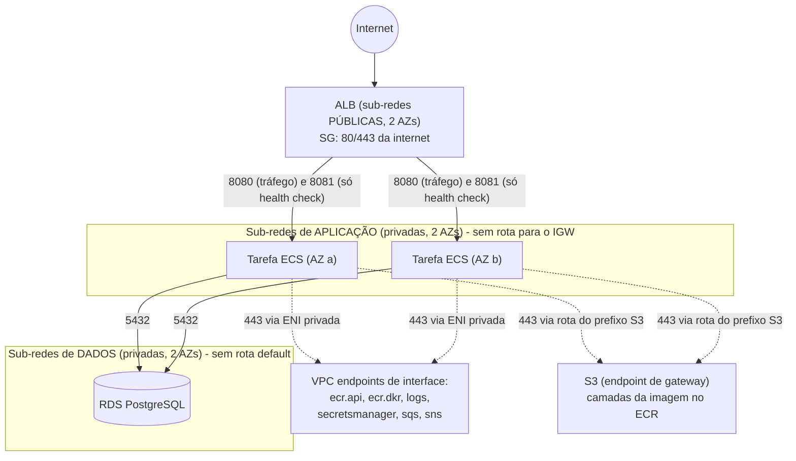

# P9.01 — 💸 Redes: VPC, sub-redes, NAT e load balancers

> ⏱️ ~1h30 · 🔵 Pleno · Pré-requisitos: J10.04 a J10.07 (conta, IAM, EC2/RDS, *Security Groups*, destruir tudo), P8.05 a P8.07 (Terraform, módulos, a exceção **AWS-0104**), P7.03 (Service/Ingress), P6.06 (*readiness*)

> 💸 **Esta aula fala de recursos que cobram** (NAT Gateway, *endpoints* de interface, ALB, endereços IPv4 públicos, transferência de dados). **Nada foi criado na AWS real.** Tudo foi executado contra o **moto** (emulador de API: **não** move pacotes, **não** prova conectividade). Se **você** aplicar na AWS real: faça-o **no mesmo dia em que vai destruir**, com o alerta de custo da J10.04 ativo, e rode `terraform destroy` **e** a conferência do fim da aula.

> ⚠️ **Verificação:** **executado** (Terraform 1.17.1, AWS provider 6.73.0, moto, JDK 25.0.5, Trivy 0.76.2): `terraform test` do módulo `network` (6 casos + **2 mutantes**), `apply` de **96 recursos** (a rede inteira: VPC, 6 sub-redes, tabelas de rotas, 7 *endpoints*, 4 SGs, ALB), a consulta da **rede real** com `check-network.sh` (e o que ele diz depois de uma "correção" feita à mão), `cidrsubnet()` no `terraform console`, o `CidrLab.java` (aritmética de CIDR) e a varredura **Trivy**. **Não foi executado:** **nenhum pacote trafegou** (o moto não tem rede): "a tarefa consegue puxar a imagem pelo *endpoint*" é afirmação da **documentação**, não medida; **NAT Gateway** (`nat_gateways = 1`: só o *plan* e os testes), **ALB atendendo requisições**, *VPC Flow Logs*, **AWS real**.

## 🎯 Objetivos
Ao final desta aula você consegue:
- **Desenhar** uma VPC de três camadas (pública, aplicação, dados) em **duas AZs** e **calcular** os blocos CIDR com `cidrsubnet()`.
- **Explicar** o que torna uma sub-rede "pública" (**uma rota**, não o nome) e provar, na rede real, que as de aplicação e dados **não** têm rota para o *Internet Gateway*.
- **Escolher** entre **NAT Gateway** e **VPC *endpoints*** para a saída de tarefas privadas, com o custo de cada um.
- **Restringir** a saída (*egress*) do PayFlow a **três destinos** e fechar a exceção **AWS-0104** prometida na P8.
- **Diferenciar** *Security Group* (com estado) de **NACL** (sem estado) e **ALB** de **NLB**.

## 🤔 Por que isso importa
Na J10 o PayFlow rodou numa EC2 na **VPC padrão**, com a saída aberta (`0.0.0.0/0`), e a P8 **aceitou** essa exceção (AWS-0104) **com a promessa de que a P9 a fecharia**. Esta aula cumpre a promessa. Em equipes reais, a rede é o que **limita o estrago** quando algo dá errado: uma tarefa comprometida numa sub-rede sem rota para a internet e com saída restrita **não consegue exfiltrar dados nem baixar uma ferramenta de ataque**. Também é onde nascem os problemas mais **teimosos** de entrega: "a tarefa não sobe porque não alcança o registro de imagens" é, quase sempre, **rota ou *endpoint* faltando**.

## 💡 Intuição (explicação simples)
Um **condomínio**. A **portaria** (o *load balancer*) fica na rua e é a **única** porta que recebe visitas. Os **apartamentos** (as tarefas da aplicação) ficam nos andares internos: não têm porta para a rua. O **cofre do síndico** (o banco) fica no subsolo, **sem nenhuma saída** além do elevador que sobe para os apartamentos. Quando um morador precisa de algo de fora (uma encomenda do correio = a imagem no ECR; uma ligação para o banco = o SQS), há **duas** maneiras: uma **saída de serviço pela portaria** (o **NAT**: o morador sai, mas ninguém de fora entra por ali) ou **tubulações privadas diretas** para cada fornecedor (os ***endpoints***). A primeira é uma saída **para qualquer lugar**; a segunda só leva **aonde você instalou um cano**.

## 🔬 Como funciona por dentro

### Os blocos
| Peça | O que é | Detalhe que importa |
|---|---|---|
| **VPC** | rede virtual isolada, com um bloco CIDR | o bloco permitido vai de **/16 (65.536 endereços) a /28 (16)** ([documentação](https://docs.aws.amazon.com/vpc/latest/userguide/vpc-cidr-blocks.html)); **escolha antes de precisar conectar** (VPCs com blocos sobrepostos não se interligam) |
| **Sub-rede** | fatia da VPC, **dentro de uma AZ** | a AWS **reserva 5 endereços** por sub-rede (rede, roteador, DNS, reservado, difusão): um /24 dá **251** úteis ([documentação](https://docs.aws.amazon.com/vpc/latest/userguide/subnet-sizing.html)) |
| **Tabela de rotas** | para onde vai o tráfego de cada destino | o que torna uma sub-rede **"pública"** é a rota `0.0.0.0/0 → Internet Gateway`; **nada** no nome |
| **Internet Gateway (IGW)** | porta da VPC para a internet | gratuito; só faz algo se houver **rota** para ele |
| **NAT Gateway** | permite **saída** de quem não tem IP público | fica numa sub-rede **pública**, exige um **Elastic IP**, e quem está atrás **não recebe conexões não solicitadas** ([documentação](https://docs.aws.amazon.com/vpc/latest/userguide/vpc-nat-gateway.html)) |
| **Endpoint de gateway** | rota privada até **S3** (e DynamoDB) | **sem cobrança adicional** ([documentação](https://docs.aws.amazon.com/vpc/latest/privatelink/vpc-endpoints-s3.html)); entra na **tabela de rotas** |
| **Endpoint de interface** | uma **interface de rede** (ENI) com IP privado na sua sub-rede que leva a um serviço (PrivateLink) | **cobra por hora e por AZ** + por GB ([preços](https://aws.amazon.com/privatelink/pricing/)); o **DNS privado** faz o SDK usar o nome normal (`sqs.us-east-1.amazonaws.com`) e cair no *endpoint* |
| ***Security Group*** | firewall **com estado** na interface do recurso | só **regras de permissão**; a resposta de uma conexão permitida volta sozinha |
| **NACL** | firewall **sem estado** na **sub-rede** | a resposta **não** volta sozinha: precisa de regra nos dois sentidos ([documentação](https://docs.aws.amazon.com/vpc/latest/userguide/vpc-network-acls.html)) |
| **ALB** | balanceador de **camada 7** (HTTP) | avalia regras de *listener* em ordem de prioridade e escolhe um alvo; exige **sub-redes em pelo menos 2 AZs**, **/27 ou maior** e **8 IPs livres** por sub-rede para poder escalar ([documentação](https://docs.aws.amazon.com/elasticloadbalancing/latest/application/application-load-balancers.html)) |

### O desenho do PayFlow

Os **três destinos** que o *Security Group* da aplicação permite na saída são exatamente os do diagrama: **os *endpoints*** (SG deles), **o S3** (lista de prefixos do *endpoint* de gateway) e **o banco** (SG dele). Não existe `0.0.0.0/0` na saída.

### Por que **estes seis** *endpoints* de interface
A documentação do ECR lista o que uma tarefa Fargate em sub-rede privada precisa para puxar a imagem sem NAT: **`ecr.api`**, **`ecr.dkr`** e o **gateway do S3** (as camadas da imagem ficam no S3), e, para o `awslogs`, o **endpoint do CloudWatch Logs** ([documentação](https://docs.aws.amazon.com/AmazonECR/latest/userguide/vpc-endpoints.html)). O PayFlow acrescenta **`secretsmanager`** (o ECS lê os segredos ao iniciar, P9.06) e **`sqs`** e **`sns`** (o código chama as duas APIs, P9.04). **Cada serviço novo que a aplicação passa a chamar é um *endpoint* novo** (ou a saída volta a ser aberta).

### NAT × *endpoints*: a decisão (ADR 0021, decisão 164)
| | NAT Gateway | *Endpoints* (gateway + interface) |
|---|---|---|
| Para onde a tarefa **consegue** ir | **qualquer** endereço da internet (a rota é `0.0.0.0/0`) | **só** os serviços em que você instalou um *endpoint* |
| Risco de exfiltração | **alto**: um código comprometido fala com o mundo | **baixo**: não há caminho para a internet |
| Custo (da página de preços da AWS, valores de **exemplo**, mudam por região) | **por hora** que existe **+ por GB** processado: o exemplo da página usa **US$ 0,045 por hora e US$ 0,045 por GB** ([preços](https://aws.amazon.com/vpc/pricing/)) | **por hora, por AZ, por *endpoint*** + US$ 0,01 por GB nos primeiros 1 PB ([preços](https://aws.amazon.com/privatelink/pricing/)); o gateway do S3 é **gratuito** |
| Manutenção | um recurso; funciona para o que a aplicação passar a chamar | **um *endpoint* por serviço novo** (e uma regra de SG) |
| Quando vale | **muitos** destinos externos (APIs de terceiros, `apt`, `npm`) | **poucos** serviços AWS conhecidos e **dados sensíveis** (o caso do PayFlow) |

> 🔎 **A conta não é óbvia.** Seis *endpoints* de interface em **duas AZs** são 12 interfaces cobradas por hora; um NAT são 1 ou 2 (um por AZ) mais o **tráfego**. Para **pouco tráfego**, o NAT costuma ser **mais barato**; para **muito tráfego para a AWS**, os *endpoints* ganham (o GB deles custa menos). **Faça a conta com a [Calculadora de Preços da AWS](https://calculator.aws/) e o seu volume**: eu **não** a refiz aqui (os preços regionais completos não estão em texto na página). **No estudo** o PayFlow usa `endpoint_az_count = 1` (os seis *endpoints* só na AZ *a*: **não é alta disponibilidade**; produção usa 2).

## 🛠️ Exemplo prático
Tudo em `lab/cloud-lab/terraform/` (módulo `modules/network`; ambiente `envs/study`). O módulo recebe **duas AZs**, **0 a 2 NATs** e a lista de *endpoints*; os blocos saem de `cidrsubnet()`:
```hcl
locals {
  public_cidrs = [for i, _ in var.azs : cidrsubnet(var.cidr, 8, i)]      # 10.20.0.0/24, 10.20.1.0/24
  app_cidrs    = [for i, _ in var.azs : cidrsubnet(var.cidr, 8, 10 + i)] # 10.20.10.0/24, 10.20.11.0/24
  data_cidrs   = [for i, _ in var.azs : cidrsubnet(var.cidr, 8, 20 + i)] # 10.20.20.0/24, 10.20.21.0/24
}
```
**A única rota "para fora" de uma sub-rede privada é um NAT, e só se você o pedir; as de dados não têm rota nenhuma:**
```hcl
resource "aws_route" "app_nat" {
  count                  = var.nat_gateways > 0 ? length(var.azs) : 0
  route_table_id         = aws_route_table.app[count.index].id
  destination_cidr_block = "0.0.0.0/0"
  nat_gateway_id         = aws_nat_gateway.this[min(count.index, var.nat_gateways - 1)].id
}
```
**As regras de SG referenciam *outros SGs*, nunca blocos CIDR** (o banco só aceita o SG da aplicação) e a saída da aplicação tem **três** regras:
```hcl
resource "aws_vpc_security_group_egress_rule" "app_to_s3" {
  security_group_id = aws_security_group.app.id
  prefix_list_id    = aws_vpc_endpoint.s3.prefix_list_id   # só o S3, pelo endpoint de gateway
  ip_protocol       = "tcp"
  from_port         = 443
  to_port           = 443
}
```

### 1) Os testes do módulo (e dois mutantes que **precisam** reprovar)
`terraform test` com `mock_provider` (sem AWS, sem moto). Comando e saída **reais**:
```
$ (cd modules/network && terraform test)
  run "no_nat_means_private_subnets_have_no_default_route"... pass
  run "one_nat_is_shared_by_both_app_route_tables"... pass
  run "cidr_plan_is_stable"... pass
  run "the_database_is_reachable_only_from_the_application"... pass
  run "three_azs_are_refused"... pass
  run "three_nats_are_refused"... pass
Success! 6 passed, 0 failed.
```
> **Um teste que nunca falhou não prova nada.** O `run-cloud.sh` copia o módulo, troca a regra do banco por `cidr_ipv4 = "0.0.0.0/0"` e roda de novo:
```
# MUTANT: the database rule opens 5432 to 0.0.0.0/0 (a CIDR instead of a security-group reference)
  run "the_database_is_reachable_only_from_the_application"... fail
the database rule must be a security-group reference, never a CIDR
Failure! 5 passed, 1 failed.
```

### 2) A rede **real** (emulada): `apply` de 96 recursos e a consulta
```
$ terraform apply tfplan
Apply complete! Resources: 96 added, 0 changed, 0 destroyed.   (apply took ~90s no emulador)
```
```
$ aws ec2 describe-subnets (name, CIDR, free IPs, public IP on launch)
payflow-public-us-east-1a  10.20.0.0/24   251  False
payflow-public-us-east-1b  10.20.1.0/24   251  False
payflow-app-us-east-1a     10.20.10.0/24  245  False
payflow-app-us-east-1b     10.20.11.0/24  251  False
payflow-data-us-east-1a    10.20.20.0/24  251  False
payflow-data-us-east-1b    10.20.21.0/24  251  False
```
**Leia a coluna 3:** a `app-a` tem **245** endereços livres, não 251: são os **6 *endpoints* de interface** (`endpoint_az_count = 1`), cada um com **uma ENI** ocupando um IP. **Os *endpoints* e as tarefas disputam os endereços da mesma sub-rede.** O `CidrLab` (abaixo) faz essa conta para o pior caso de um *deploy*.
```
$ non-local routes of each route table (destination -> target)
(main table, unused)     (only the local VPC route)
payflow-app-us-east-1a   (S3 prefix list) -> vpce-...
payflow-app-us-east-1b   (S3 prefix list) -> vpce-...
payflow-data             (S3 prefix list) -> vpce-...
payflow-public           0.0.0.0/0 -> igw-...
NAT gateways in this VPC: 0
$ egress rules of the application security group
tcp  443   443   <s3-prefix-list>
tcp  443   443   <sg>
tcp  5432  5432  <sg>
```
Só a **tabela pública** tem rota para o IGW; as de aplicação e dados só têm a **rota local** e a do prefixo do S3 (o *endpoint* de gateway). **Não existe NAT.**

### 3) `check-network.sh`: verificar a rede, não o código
O Terraform descreve **o que você declarou**; alguém pode "consertar" um problema pelo console. O `check-network.sh` pergunta **à rede**: "alguma sub-rede de aplicação ou dados tem rota para o IGW?"
```
$ check-network.sh   (the real network, not the code)
ok: no app/data subnet routes to the internet gateway (igw-...)
# someone "fixes" a deploy problem in the console: a route from the app route table to the internet gateway
$ check-network.sh
VIOLATION: app subnet subnet-... (route table rtb-...) has a route to the internet gateway igw-...
(exit 1)
# route removed again
ok: no app/data subnet routes to the internet gateway (igw-...)
```
É o mesmo raciocínio do mutante, aplicado ao **ambiente** em vez do **código**. Em produção ele roda no CI diário (junto do `drift.yml` da P8.07) com um papel de **leitura**.

### 4) Pausa de lógica: aritmética de CIDR sem biblioteca
> 🧠 **Pausa para lógica: quantos endereços cabem em cada sub-rede?** Um CIDR `10.20.5.7/24` é válido? Quantos IPs a `app-a` consome no **pior momento de um *deploy*** (autoscaling no máximo de 6 tarefas, `deployment_maximum_percent = 200`, 6 ENIs de *endpoints*)? Um /28 serve? **Dica:** `tamanho = 2^(32 − prefixo)`; a AWS tira 5; durante o *rolling* as tarefas **velhas e novas** coexistem. A solução está no `lab/cidr-lab/CidrLab.java` (Java puro, `java CidrLab.java`; o programa **falha com código 1** se uma afirmação estiver errada). Saída real (trecho):
<details><summary>Solução comentada</summary>

```
VPC 10.20.0.0/16: 65536 addresses
  app-a     10.20.10.0/24    size= 256  usable on AWS= 251  (10.20.10.0 .. 10.20.10.255)
  ok   cidrsubnet("10.20.0.0/16", 8, 10) == 10.20.10.0/24 (confirmed against terraform console below)
  ok   6 subnets: no overlap, all inside the VPC
  ok   a /24 has 256 - 5 = 251 usable addresses
  tasks per AZ at max during a rolling deploy: 6, endpoint ENIs: 6 -> 12 of 251 usable
  a /28 (10.20.50.0/28) would have 11 usable: does NOT fit -> deploy would stall
  ok   10.20.5.7/24 -> 10.20.5.7/24 has host bits set; did you mean 10.20.5.0/24?
  ok   10.20.0.0/16 overlaps the corporate 10.20.0.0/14: choose the VPC range BEFORE you need to connect it
ALL CHECKS PASSED
```
e a confirmação **contra o Terraform** (a afirmação do primeiro `ok`): `echo 'cidrsubnet("10.20.0.0/16", 8, 10)' | terraform console` → `"10.20.10.0/24"`. `10.20.5.7/24` tem **bits de host** ligados (o endereço de rede é `10.20.5.0`): o programa recusa e sugere o certo, como a AWS recusaria o `CreateSubnet`. O /28 **não cabe** (11 úteis < 12 necessários): o *deploy* ficaria **parado esperando IPs**.

**Variação mais difícil:** some o ALB (8 IPs livres **por sub-rede pública**, regra do ELB) e uma 3ª AZ; reescreva o plano com `cidrsubnet(var.cidr, 6, n)` para obter /22 e diga quantas sub-redes de cada tipo cabem em um /16.
</details>

### 5) Varredura de segurança (Trivy) e o que o módulo **deixou de precisar** ignorar
```
$ trivy config terraform/   (summary per file, MEDIUM and above; ignores are inline with the reason)
no findings
$ trivy config (the SAME code with the inline ignores removed: what the ignores hide)
modules/alb/main.tf  2  AWS-0053,AWS-0054
modules/database/main.tf  3  AWS-0176,AWS-0177
modules/messaging/main.tf  1  AWS-0136
modules/network/main.tf  1  AWS-0178
modules/observability/main.tf  1  AWS-0136
```
A **AWS-0104** (SG com saída irrestrita), **CRÍTICA** e aceita na P8, **não aparece mais**: ela era a prova de que "a EC2 alcança o ECR e o SSM pela internet". Os **oito** achados restantes (2 + 3 + 1 + 1 + 1) estão **aceitos por escrito, com o motivo na linha** (`# trivy:ignore:AWS-0053 Accepted: ...`): o ALB **é** a porta pública (AWS-0053/0054, este último **só no estudo**: sem domínio, sem certificado), a chave do SNS é a gerenciada pela AWS (AWS-0136: chave própria é **P10**), e o **AWS-0178 (VPC Flow Logs desligado)** é **dívida de verdade**: Flow Logs cobram a ingestão no CloudWatch; **em produção, ligue** (exercício 3).

## ⚖️ Trade-offs e quando NÃO usar
- **Um NAT por AZ × um NAT só.** Um NAT compartilhado é uma **dependência de AZ**: se a AZ dele cair, as outras perdem a saída. Um por AZ custa mais e **isola** a falha. Com *endpoints* o problema não existe (cada AZ tem a sua ENI).
- **Sub-redes privadas custam complexidade.** Para **uma aplicação de estudo** sem dados sensíveis, tarefas em sub-rede **pública** com IP público e SG fechado (só o ALB entra) funcionam e **não** pagam NAT nem *endpoints*. O PayFlow **mexe com dinheiro**: a saída restrita compensa. Decida pelo **valor do que a rede protege**.
- **NACL: quase nunca.** O SG resolve 95% dos casos; a NACL entra para **bloquear** (ela é a única com regra de **negação**) um IP abusivo em toda a sub-rede. **Não** duplique as regras do SG na NACL: sem estado, qualquer erro derruba a resposta.
- **ALB × NLB.** ALB (camada 7) entende HTTP, faz roteamento por caminho/*host* e termina TLS. O NLB (camada 4) é para TCP/UDP em volume ou IP fixo. Para o PayFlow, **ALB**.
- **Planejar CIDR "folgado".** Um /16 inteiro para o ambiente de estudo parece exagero, mas **recriar** uma VPC é o tipo de mudança que **destrói tudo** dentro dela. Comece generoso.

## ⚠️ Erros comuns e boas práticas de produção
- **"A tarefa fica em `PROVISIONING` e depois `STOPPED`" sem rota ou *endpoint*.** A causa típica é **não alcançar o ECR** (faltou `ecr.dkr`, o gateway do S3, ou o SG do *endpoint* não aceita a aplicação). ⚠️ **Mensagem exata não reproduzida aqui** (o moto não executa tarefas): leia **"Stopped reason"** em `aws ecs describe-tasks`.
- **Esquecer o DNS privado do *endpoint* de interface** (`private_dns_enabled = true`, com `enable_dns_hostnames` na VPC): o SDK continua chamando o endereço **público** e a chamada **cai no vazio** (sem NAT). O módulo liga os dois.
- **Um serviço novo na aplicação = um *endpoint* novo.** Uma chamada que "funcionava no seu computador" **expira** em produção. Torne isso um **item do *checklist* de PR**.
- **`map_public_ip_on_launch` ligado numa sub-rede privada** (o Trivy acusa) entrega IP público a quem não devia. O módulo o **desliga** e um teste confere.
- **Dois blocos que se sobrepõem** quando você for conectar redes (VPN, *peering*): `10.0.0.0/16` é o padrão de **todo** tutorial. O PayFlow usa `10.20.0.0/16` e, mesmo assim, **combine com a rede da empresa** (o `CidrLab` mostra a colisão com um `/14`).
- **Não use a VPC padrão** para nada que importe (ela já nasce com sub-redes públicas e o SG padrão permissivo). O módulo **zera** o SG padrão da nova VPC (`aws_default_security_group`).
- **`terraform destroy` não apaga o que ele não criou.** Interfaces de rede deixadas por *endpoints* ou Lambdas em VPC **seguram** a sub-rede; a conferência final lista as **VPCs não padrão** (zero, no emulador).

## 🧩 Exercícios
1. **Fixação.** Sem olhar a aula: (a) por que o /24 de `app-a` mostra **245** IPs livres? (b) qual a diferença entre **SG** e **NACL** em **uma frase**? (c) o que torna uma sub-rede "pública"?
2. **Aplicação no PayFlow** (critérios de pronto):
   - [ ] `terraform test` do módulo `network` **verde** (6/6) e o mutante do banco **reprovando**.
   - [ ] `check-network.sh` **passa** na rede aplicada e **reprova** depois de você criar a rota à mão (e voltar a passar ao removê-la).
   - [ ] Os *endpoints* e o SG de **saída** da aplicação **batem** com o diagrama (3 regras, nenhuma `0.0.0.0/0`).
   - [ ] **Nenhuma** sub-rede de aplicação/dados com `map_public_ip_on_launch`.
3. **Desafio.** Ligue **VPC Flow Logs** (para um *log group* com retenção de 14 dias, IAM mínimo) no módulo `network`, atrás de `var.flow_logs` (padrão `false`), com um teste `mock_provider`; rode o Trivy e **remova** o `trivy:ignore:AWS-0178` quando `flow_logs = true`.
<details><summary>Solução de referência (exercício 1 e esqueleto do 3)</summary>

(a) as **6 ENIs** dos *endpoints* de interface (`endpoint_az_count = 1`) ocupam IPs: 251 − 6 = 245. (b) SG: **com estado**, na interface do recurso, só permite; NACL: **sem estado**, na sub-rede, permite e nega. (c) **uma rota** `0.0.0.0/0` para o **Internet Gateway** na tabela de rotas da sub-rede.

Esqueleto do 3:
```hcl
variable "flow_logs" {
  type    = bool
  default = false
}

resource "aws_cloudwatch_log_group" "flow" {
  count             = var.flow_logs ? 1 : 0
  name              = "/vpc/${var.name}/flow"
  retention_in_days = 14
}

resource "aws_flow_log" "this" {
  count           = var.flow_logs ? 1 : 0
  vpc_id          = aws_vpc.this.id
  traffic_type    = "ALL"
  log_destination = aws_cloudwatch_log_group.flow[0].arn
  iam_role_arn    = aws_iam_role.flow[0].arn   # trust: vpc-flow-logs.amazonaws.com; logs:CreateLogStream/PutLogEvents no grupo
}
```
⚠️ **Não executado** (não está no laboratório): confira os nomes dos atributos na documentação do provedor antes de aplicar.
</details>

## 🎤 Na entrevista
1. **Qual a diferença entre uma sub-rede pública e uma privada na AWS?** *Resposta-modelo:* é a **tabela de rotas**: pública tem rota `0.0.0.0/0` para um *Internet Gateway*; privada não (se precisa sair, usa um NAT ou *endpoints*). O nome não muda nada; o que protege é a **ausência de rota** mais o SG.
2. **Security Group ou NACL?** *Resposta-modelo:* SG é **com estado**, anexado à interface, só permite e pode referenciar outros SGs (o jeito certo de dizer "só a aplicação fala com o banco"). NACL é **sem estado**, por sub-rede, tem regra de negação e exige regra de ida **e** volta; uso para bloquear um abuso amplo, não para o desenho normal.
3. **Uma tarefa em sub-rede privada precisa puxar uma imagem do ECR. Como?** *Resposta-modelo:* por um **NAT Gateway** (saída para a internet) **ou** por *endpoints*: `ecr.api`, `ecr.dkr` e o **gateway do S3** (as camadas estão no S3), mais `logs` se usa `awslogs`. *Endpoints* dão saída **restrita**; NAT dá saída **aberta**.
4. **Quanto custa um NAT e como reduzir?** *Resposta-modelo:* cobra **por hora** que existe **e por GB** processado. Reduz-se com **endpoints de gateway** (S3/DynamoDB são gratuitos), *endpoints* de interface para o tráfego pesado para serviços AWS, e **não** empurrar imagens grandes pelo NAT.

## 📚 Para ir além
- 📄 [Amazon VPC: tamanho de sub-rede (5 IPs reservados)](https://docs.aws.amazon.com/vpc/latest/userguide/subnet-sizing.html) — confira a lista dos cinco endereços reservados; é a origem do "251".
- 📄 [NAT gateways](https://docs.aws.amazon.com/vpc/latest/userguide/vpc-nat-gateway.html) — público × privado e a regra do Elastic IP.
- 📄 [Endpoints do ECR (PrivateLink)](https://docs.aws.amazon.com/AmazonECR/latest/userguide/vpc-endpoints.html) — a lista exata de *endpoints* para puxar imagem sem NAT.
- 📄 [Application Load Balancer: sub-redes](https://docs.aws.amazon.com/elasticloadbalancing/latest/application/application-load-balancers.html) — /27 e 8 IPs livres.
- 📄 [Preços da VPC](https://aws.amazon.com/vpc/pricing/) e [do PrivateLink](https://aws.amazon.com/privatelink/pricing/) — o que cobra em NAT e em *endpoints* (leia a data: os valores mudam).
- 📄 [`cidrsubnet`](https://developer.hashicorp.com/terraform/language/functions/cidrsubnet) — a função que o módulo usa.
- 🎥 Nenhum vídeo verificado nesta aula.
- 📑 [Amazon Builders' Library](https://aws.amazon.com/builders-library/) — artigos de engenheiros da AWS sobre operação de sistemas em escala.
- 💻 `lab/cloud-lab/terraform/modules/network`, `lab/cloud-lab/check-network.sh`, `lab/cidr-lab/CidrLab.java`.
- 🔁 **Equivalência AWS ↔ Azure ↔ GCP** (conferida nas páginas de comparação da [Microsoft](https://learn.microsoft.com/en-us/azure/architecture/aws-professional/networking) e do [Google Cloud](https://cloud.google.com/docs/get-started/aws-azure-gcp-service-comparison); **aproximada**: os serviços **não** são idênticos):

| AWS | Azure | Google Cloud |
|---|---|---|
| VPC / sub-rede | Virtual Network (VNet) | VPC |
| NAT Gateway | NAT Gateway | Cloud NAT |
| Endpoint de interface (PrivateLink) | Private Link | ⚠️ não conferido na tabela do Google (Private Service Connect, **de memória**) |
| ALB (camada 7) / NLB (camada 4) | Application Gateway / Load Balancer | Cloud Load Balancing |
| Security Group / NACL | NSG (Network Security Group) | regras de *firewall* da VPC (⚠️ **de memória**) |

## ✅ Checklist da aula
- [ ] Sei calcular `cidrsubnet()` e os 5 IPs reservados de cabeça.
- [ ] Rodei `terraform test` do módulo `network` e vi o **mutante** reprovar.
- [ ] Rodei o `check-network.sh` e provoquei a violação.
- [ ] Sei dizer os **três** destinos de saída da aplicação e por que **não** há `0.0.0.0/0`.
- [ ] Sei por que um *endpoint* novo é necessário a cada serviço AWS novo.
- [ ] Fiz a conta NAT × *endpoints* com a Calculadora (ou marquei como pendência).
