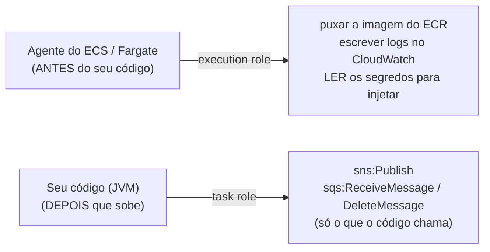

# P9.02 — 💸 ECS/Fargate

> ⏱️ ~1h30 · 🔵 Pleno · Pré-requisitos: P9.01 (VPC, sub-redes, SGs, ALB), P7.02 a P7.06 (JVM em contêiner, Deployment, sondas, HPA), P8.02 e P8.03 (imagem por *digest*, *rollback*), P8.05 a P8.07 (Terraform, módulos), J10.04 (IAM)

> 💸 **Esta aula fala de recursos que cobram** (tarefas Fargate cobram por **vCPU e GB por hora/segundo**, o ALB cobra por hora, *Container Insights* e logs cobram por volume). **Nada foi criado na AWS real.** Tudo foi executado contra o **moto**, que é uma **emulação de API**: **ele não executa contêineres**. Se **você** aplicar na AWS real: no mesmo dia em que vai destruir, com o alerta de custo da J10.04 ativo.

> ⚠️ **Verificação:** **executado** (Terraform 1.17.1, AWS provider 6.73.0, moto, Docker 29.9.2, `actionlint` 1.7.12, `shellcheck` 0.11.0): `terraform test` do módulo `ecs_service` (4 casos, incluindo a **recusa de tag mutável**), `apply` do cluster/serviço/definição de tarefa/papéis/ALB no moto e a leitura dos objetos criados, o **`ecs-deploy.sh`** contra o moto (nova revisão, serviço apontando para ela, recusa de tag), `actionlint` no `deploy-ecs.yml`, `shellcheck`, e a **medição do orçamento de memória da JVM** sob os limites de um contêiner de 0,5 vCPU / 1 GiB (Docker). **Não foi executado:** **nenhuma tarefa rodou** (o moto não executa contêineres): o ***health check* do ALB**, o ***deployment circuit breaker* disparando**, a **autoescala** (`aws_appautoscaling_target` **trava no moto**: o laboratório a desliga), o **`ecs wait services-stable`**, o **ECS Exec**, o **GitHub Actions** de verdade, a **AWS real**.

## 🎯 Objetivos
Ao final desta aula você consegue:
- **Explicar** cluster, **definição de tarefa**, tarefa e **serviço** e **mapear** cada um para o Kubernetes da P7.
- **Separar** o ***task role*** (o seu código) do ***execution role*** (o agente do ECS) e dizer **o que cada um precisa**.
- **Configurar** o serviço do PayFlow: Fargate/ARM64, 2–6 tarefas, ALB com *health check* na porta de gestão, **parada ordenada**, ***circuit breaker* com *rollback*** e imagem **por *digest***.
- **Calcular** o orçamento de memória da JVM dentro de uma tarefa de 1 GiB.
- **Implantar** uma nova versão com o `ecs-deploy.sh` e saber **quem é dono** de cada coisa (Terraform × pipeline).

## 🤔 Por que isso importa
A P7 pôs o PayFlow em Kubernetes; a P8 construiu o pipeline que entrega **por *digest***. Falta **onde** isso roda na AWS sem você operar servidores. O **ECS com Fargate** é o caminho mais curto: você descreve **uma tarefa** (imagem, CPU, memória, portas, papéis, segredos) e a AWS a executa, **sem nós para atualizar**. Para um time pequeno com **uma aplicação** e alguns serviços, costuma ser a **menor quantidade de peças móveis** que ainda é produção de verdade. A **P9.03** compara com o EKS; esta aula entrega o que o PayFlow **realmente usa**.

## 💡 Intuição (explicação simples)
O **Kubernetes** é uma **cozinha industrial** que você monta e opera: fogões (nós), prateleiras, escala de turnos. O **ECS com Fargate** é **terceirizar a cozinha**: você entrega **a receita** (a definição de tarefa), diz **quantas porções** quer (o serviço) e **quem pode abrir o estoque** (os papéis). A AWS escolhe o fogão. Você deixa de se preocupar com o **fogão** (nós, sistema operacional, *patches*) e passa a se preocupar com o **contrato**: a receita tem que estar **completa**, porque ninguém vai "entrar na cozinha" para ajeitar (por padrão, **nem o ECS Exec está ligado**).

## 🔬 Como funciona por dentro

### Os quatro objetos e o equivalente no Kubernetes
| ECS | O que é | Kubernetes (P7) |
|---|---|---|
| **Cluster** | agrupamento lógico de serviços e tarefas (no Fargate **não há máquinas para gerir**) | o cluster (sem nós para você) |
| **Definição de tarefa** (*task definition*) | a "receita": imagem, CPU/memória **da tarefa**, portas, variáveis, segredos, volumes, papéis, *logs*; **versionada em revisões imutáveis** | o *pod template* do `Deployment` |
| **Tarefa** (*task*) | **uma execução** da definição; no Fargate (modo `awsvpc`) tem **sua própria interface de rede** e IP ([documentação](https://docs.aws.amazon.com/AmazonECS/latest/developerguide/fargate-task-networking.html)) | o *pod* |
| **Serviço** (*service*) | mantém **N tarefas** vivas, registra no ALB, faz o ***rolling*** | o `Deployment` + `Service` |
| *Health check* do ALB | tira do rodízio a tarefa que não responde na rota configurada | a *readiness probe* (P7.05) |
| *Application Auto Scaling* (*target tracking*) | liga/desliga tarefas para manter uma métrica no alvo | o HPA (P7.06) |
| `deployment_minimum_healthy_percent` / `maximum_percent` | quanto da capacidade pode cair / subir durante um *deploy* | `maxUnavailable` / `maxSurge` |
| `secrets` (`valueFrom`) | o agente **injeta o segredo como variável de ambiente** ao iniciar | o `Secret` (P7.04: **arquivo montado**: ver P9.06) |
| *Task role* | credencial AWS **do seu código** | *IRSA*/*Pod Identity* (P9.03) |

**Tamanhos são pares fixos:** no Fargate o CPU e a memória **da tarefa** só aceitam combinações da documentação ([tabela](https://docs.aws.amazon.com/AmazonECS/latest/developerguide/task_definition_parameters.html)): `512` (0,5 vCPU) aceita **1, 2, 3 ou 4 GB**; `1024` (1 vCPU) aceita **2 a 8 GB**. Não existe "requisição 768 MiB e limite 768 MiB" como na P7: o PayFlow usa **0,5 vCPU e 1 GiB** (a menor combinação com 1 GB).

### Dois papéis, dois usuários (o erro mais comum de IAM no ECS)

- O ***execution role*** é do **agente**: usa a política gerenciada `AmazonECSTaskExecutionRolePolicy` (ECR + logs) e **o que você acrescentar** para ler os **segredos que serão injetados** (`secretsmanager:GetSecretValue` nos ARNs exatos) ([documentação](https://docs.aws.amazon.com/AmazonECS/latest/developerguide/task_execution_IAM_role.html)).
- O ***task role*** é do **seu código**: as credenciais são entregues **à tarefa** (e o CloudTrail registra **qual tarefa** as usou) ([documentação](https://docs.aws.amazon.com/AmazonECS/latest/developerguide/task-iam-roles.html)). É onde mora o **menor privilégio** da aplicação.
**Misturar os dois** é o pior caminho: pôr no *execution role* o que o código precisa dá ao **agente** poderes de aplicação, e pôr no *task role* o acesso ao ECR faz o código poder **baixar qualquer imagem**.

### O que o `ecs_service` configura (e por quê)
| Decisão (ADR 0021, decisão 165) | Valor | Motivo |
|---|---|---|
| Plataforma | **Fargate**, `ARM64`, `awsvpc` | Graviton (mesma arquitetura da EC2 da J10); **a imagem precisa ser construída para arm64** |
| Tamanho | `cpu = 512`, `memory = 1024` | combinação válida mínima com 1 GB |
| Réplicas | `desired_count = 2` (**ignorado** depois), autoescala **2–6** | 2 para sobreviver a uma AZ; 6 × *pool* 10 < `max_connections` (decisão 152) |
| Escala | *target tracking* de **CPU a 60%**, *scale-out* 60 s / *scale-in* 300 s | mesmo alvo do HPA da P7.06 |
| *Deploy* | `minimum_healthy_percent = 100`, `maximum_percent = 200` | nunca cair abaixo da capacidade atual (= `maxUnavailable: 0`) |
| ***Circuit breaker*** | `enable = true`, `rollback = true` | um *deploy* cujas tarefas **nunca ficam saudáveis** é **interrompido** e **volta** para a revisão anterior |
| Saúde | ALB → `GET :8081/actuator/health/readiness` (200), intervalo 15 s, 2 sucessos / 3 falhas | a **readiness** da P6.06 (banco + processo); porta de gestão **só** acessível do ALB (SG) |
| Parada | `stopTimeout = 45`, `deregistration_delay = 30` | 45 s = `terminationGracePeriodSeconds` da P7.05 (> 20 s de *shutdown*, decisão 73); o **padrão do ALB é 300 s** e travaria cada *deploy* |
| *Grace period* | `health_check_grace_period_seconds = 90` | o Spring Boot + Flyway demoram a subir; **sem isso** o ALB mata a tarefa antes dela ficar pronta |
| Contêiner | `readonlyRootFilesystem`, `user = "10001"`, volume `tmp` em `/tmp`, `initProcessEnabled` | o `securityContext` da P7.03, em ECS |
| `enable_execute_command` | **false** | ECS Exec é **um *shell* dentro da produção** ([documentação](https://docs.aws.amazon.com/AmazonECS/latest/developerguide/ecs-exec.html)): ligue **só** para investigar, com política de IAM que limita quem pode |
| Imagem | **`repo@sha256:<64 hex>`** (`validation` no módulo) | o que foi escaneado é o que roda (decisão 158) |

> 🔎 **O *circuit breaker* não é um *canary*.** A documentação diz que, no 2º estágio, ele valida os *health checks* do ELB e do contêiner e conta as tarefas **substituídas por falhas de saúde** ([documentação](https://docs.aws.amazon.com/AmazonECS/latest/developerguide/deployment-circuit-breaker.html)). Uma versão que **passa no *health check*** mas **erra 30% das requisições** (o caso da P8.03: 364 falhas em 4.000) **não é "falha de tarefa"**: o *rolling* **conclui**. O *circuit breaker* protege de **"não sobe"**; para **"sobe e funciona mal"** continua valendo o ***canary* por versão** da P8.03 e o alarme de 5xx da P9.07. ⚠️ **O *circuit breaker* disparando não foi executado** (nenhuma tarefa roda no moto).

### O orçamento de memória da JVM, **medido**
A P7.02 dimensionou a JVM para 768 MiB. No Fargate o tamanho mínimo útil é **1 GiB**: dá para ser **mais generoso** com a memória que **não** é *heap*. Medido no `jvm-budget.sh` (Docker com `--memory=1024m --cpus=0.5`, imagem `eclipse-temurin:25-jre`; **o Docker emula os limites, não o Fargate**):
```
$ docker run --memory=1024m --cpus=0.5 java -XX:MaxRAMPercentage=70            (NO explicit collector)
 bool UseG1GC = false
 bool UseSerialGC = true
$ docker run --memory=1024m --cpus=0.5 java -XX:+UseG1GC -XX:MaxRAMPercentage=70   (what the task definition sets)
 size_t MaxHeapSize = 752877568
 bool UseG1GC = true
max heap = 718 MiB of 1024 MiB -> 306 MiB left for metaspace, code cache, thread stacks, direct buffers and the OS
$ the same with the 768 MiB limit of the Kubernetes manifests (P7.02), 1 CPU
max heap = 538 MiB of 768 MiB -> 230 MiB left
```
Duas lições: (1) com **0,5 vCPU** a JVM escolhe **o coletor *Serial*** (ergonomia: menos de 2 CPUs), por isso o `JAVA_TOOL_OPTIONS` do módulo diz **`-XX:+UseG1GC` explicitamente** (a mesma decisão da P7.02: não deixe o coletor ao acaso); (2) **70%** de 1 GiB dá **718 MiB** de *heap*, restando **306 MiB** para tudo que não é *heap*, mais folga do que os **230 MiB** dos 768 MiB. Se o `MemoryUtilization` do alarme (P9.07) ficar perto de 85%, **aumente a memória**, não a porcentagem.

## 🛠️ Exemplo prático
Tudo em `lab/cloud-lab/terraform/modules/ecs_service` e `modules/alb`.

### 1) Os testes do módulo
```
$ (cd modules/ecs_service && terraform test)
  run "a_mutable_tag_is_refused"... pass
  run "the_service_rolls_back_a_bad_deploy_and_never_drops_capacity"... pass
  run "the_container_is_locked_down"... pass
  run "secrets_are_injected_by_reference_never_by_value"... pass
Success! 4 passed, 0 failed.
```
O primeiro prova a `validation` da imagem (`payflow:latest` é **recusada**, `payflow@sha256:...` passa); o terceiro confere `readonlyRootFilesystem`, `user`, `ARM64` e que **os dois papéis são diferentes**; o quarto, que a definição de tarefa carrega **só o ARN** do segredo (P9.06).

### 2) O que foi criado, lido de volta da API
```
$ aws ecs describe-task-definition (what the container receives)
{ "family": "payflow", "cpu": "512", "memory": "1024", "networkMode": "awsvpc",
  "runtimePlatform": { "cpuArchitecture": "ARM64", "operatingSystemFamily": "LINUX" },
  "taskRole": "payflow-ecs-task", "executionRole": "payflow-ecs-execution",
  "container": { "image": "000000000000.dkr.ecr.us-east-1.amazonaws.com/payflow@sha256:887615a1d994...",
    "readonlyRootFilesystem": true, "user": "10001", "stopTimeout": 45,
    "environment": ["JAVA_TOOL_OPTIONS","PAYFLOW_EVENTS_TOPIC_ARN","PAYFLOW_PARAM_PREFIX","PAYFLOW_QUEUE_ANTIFR_URL","PAYFLOW_QUEUE_NOTIFS_URL","SPRING_DATASOURCE_URL"],
    "secrets": { "PAYFLOW_SECURITY_JWT_SECRET": "arn:aws:secretsmanager:...:secret:payflow/study/jwt-signing-key-xxxxxx",
                 "SPRING_DATASOURCE_PASSWORD": "arn:aws:secretsmanager:...:secret:rds!db-...-xxxxxx:password::",
                 "SPRING_DATASOURCE_USERNAME": "arn:aws:secretsmanager:...:secret:rds!db-...-xxxxxx:username::" } } }
$ IAM: attached and inline policies of the execution role vs the task role
[payflow-ecs-execution] attached: AmazonECSTaskExecutionRolePolicy  inline: read-injected-secrets
[payflow-ecs-task] attached:   inline: application
$ task role policy (what YOUR code may do)
["PublishTransferEvents","sns:Publish","<sns>:payflow-transfers"]
["ConsumeOwnQueues",["sqs:ReceiveMessage","sqs:GetQueueUrl","sqs:GetQueueAttributes","sqs:DeleteMessage","sqs:ChangeMessageVisibility"],["<sqs>:payflow-notifications","<sqs>:payflow-antifraud"]]
$ aws elbv2 describe-target-groups (health check)
{"type":"ip","port":8080,"hcPort":"8081","hcPath":"/actuator/health/readiness","matcher":"200","interval":15,"healthy":2,"unhealthy":3}
deregistration_delay.timeout_seconds: 30
```
Veja o desenho do **menor privilégio**: o *task role* só pode **publicar no tópico** e **consumir as duas filas dele**; **não** pode criar filas, apagar filas, enviar mensagens para elas ou ler segredos (o *execution role* lê; o código **não precisa**: o valor já chega como variável). E o `valueFrom` dos segredos do RDS usa a sintaxe **`ARN:chave-json:estágio:versão`** (`:password::`) da [documentação](https://docs.aws.amazon.com/AmazonECS/latest/developerguide/secrets-envvar-secrets-manager.html).

### 3) O *deploy*: nova revisão por *digest* (`ecs-deploy.sh`)
O Terraform cria a **revisão 1**; o **pipeline** cria as seguintes (o serviço tem `ignore_changes = [desired_count, task_definition]`: **um dono por coisa**, senão o próximo `apply` desfaria o *deploy*). O script lê a revisão atual, troca **só** a imagem, registra a nova, aponta o serviço e **espera** a estabilidade:
```text
$ scripts/ci/ecs-deploy.sh <cluster> <service> <repo> sha256:... (ECS_WAIT=0: moto runs no tasks, so the service never "becomes stable")
current task definition: payflow:1
registered: payflow:2  image=000000000000.dkr.ecr.us-east-1.amazonaws.com/payflow@sha256:c61c51fdb762...
deployed payflow:2
the service now points to: payflow:2
image of that revision:    000000000000.dkr.ecr.us-east-1.amazonaws.com/payflow@sha256:c61c51fdb762...
$ the same script with a TAG instead of a digest
::error::not a digest (a tag is mutable): latest
(exit 2)
$ terraform plan after the pipeline moved the service to revision 2: what would Terraform change on the ECS service?
module.app.aws_ecs_service.app: actions=update attributes=health_check_grace_period_seconds
# task_definition is NOT in the list: the pipeline owns it (ignore_changes). The attribute listed is an emulator artifact (moto does not echo health_check_grace_period_seconds).
```
(Os identificadores e o *digest* variam entre execuções; o que vale é o **comportamento**: revisão 1 → 2, tag recusada com `exit 2` e **`task_definition` fora da lista** do que o Terraform quer mudar depois do *deploy* do pipeline. **O único atributo** que o `plan` ainda quer mexer, `health_check_grace_period_seconds`, é **artefato do emulador**: o moto **não devolve** o valor configurado e o provedor vê uma "diferença" que **não existe na AWS real**.) O `deploy-ecs.yml` (`staging` → `production` **com aprovação**, OIDC, `ecs-deploy.sh`, *smoke test*) passa no `actionlint` e o script no `shellcheck`. **Os verificadores também foram provados com mutantes** (`lab/pipeline-lab/out-lint.txt`): `needs: stagng` → o `actionlint` acusa `job "production" needs job "stagng" which does not exist` (`job-needs`); uma variável sem aspas no `ecs-deploy.sh` → o `shellcheck` acusa `SC2086`. ⚠️ **Nem o *workflow* nem o `ecs wait services-stable` rodaram de verdade**; a variável `ECS_WAIT=0` existe **só** para o emulador.

## 🏗️ Estudo de caso: a tarefa que nunca ficava pronta
> **Sintoma:** depois de um *deploy*, o serviço mostra tarefas **iniciando e morrendo** em ciclo; o *circuit breaker* **reverte** a versão em minutos. **Hipóteses e como eliminá-las:**
> 1. **Falta de rota/endpoint** (P9.01): a tarefa fica `PROVISIONING` e para antes de iniciar → leia *stopped reason* (`describe-tasks`).
> 2. **Segredo ilegível:** o *execution role* não tem `GetSecretValue` no ARN (o erro aparece **antes** do contêiner existir) → a política do papel.
> 3. **Ela sobe, mas o ALB a mata:** o *health check* na 8081 leva **mais** que o *grace period* (90 s) por causa do Flyway com uma migração longa → aumente `health_check_grace_period_seconds` **ou** (melhor) **desacople a migração** (P8.03: *expand/contract* e migração **antes** do *deploy*).
> 4. **A JVM sofre `OOMKilled`:** `MemoryUtilization` perto de 100% antes de cada morte → o orçamento (acima) e o `ExitOnOutOfMemoryError` (P7.09): sai com código 3 (JVM) × 137 (kernel).
> **Decisão registrada (ADR 0021):** o *grace period* de 90 s vale **enquanto** a migração for pequena; qualquer migração que passe de ~30 s vai para **um passo próprio** antes do *deploy*.

## ⚖️ Trade-offs e quando NÃO usar
- **Fargate × EC2 (ECS sobre instâncias).** Fargate: **zero** operação de nós, **mais caro por vCPU/GB** a longo prazo e **sem** acesso à máquina (sem DaemonSets, sem disco local grande). EC2: mais barato com **carga estável e alta utilização**, mas **você** aplica *patches*, dimensiona e escala as instâncias. Para um time pequeno, **comece no Fargate** e **meça** antes de otimizar.
- **ECS × EKS** (P9.03): ECS é **proprietário da AWS** e **mais simples**; EKS é Kubernetes (portabilidade, ecossistema, a P7), com **uma camada a mais** de conceitos e um **custo fixo** do plano de controle.
- **ECS × Lambda** (P9.05): Lambda para **eventos curtos**; ECS para **processos de longa vida** com *pool* de conexões e *warm JIT* (o caso da API do PayFlow).
- **Service Connect/descoberta.** O ECS tem o **Service Connect** para chamadas entre serviços por nome curto ([documentação](https://docs.aws.amazon.com/AmazonECS/latest/developerguide/service-connect.html)); o PayFlow **tem um serviço só** (o `payflow-notifications` da P5 é opcional): **não adote** antes de precisar.
- **ECS Exec em produção.** Útil e **perigoso**; deixe **desligado** e abra **por incidente**, com *log* de cada comando (a documentação descreve a trilha no CloudTrail).

## ⚠️ Erros comuns e boas práticas de produção
- **Misturar os dois papéis** (acima). Mensagem típica do agente quando falta permissão: ⚠️ **texto exato não reproduzido aqui** (o moto não executa tarefas); procure `ResourceInitializationError` ou *"unable to pull secrets"* na razão de parada.
- **`desired_count` no Terraform com autoescala ligada:** cada `apply` **reseta** o número de tarefas. O módulo **ignora** o campo (o mesmo princípio de omitir `replicas` com um HPA).
- **Tag mutável (`latest`) na definição:** a mesma revisão passa a rodar **imagens diferentes** em tarefas novas. A `validation` **recusa**.
- **Esquecer o *grace period*:** o ALB reprova a tarefa **enquanto** o Spring ainda sobe e o ECS a **mata**: ciclo infinito (acima).
- **Segredo mudou e nada mudou:** o ECS injeta o segredo **só na partida da tarefa**; "se o segredo for atualizado ou **rotacionado**, o contêiner **não** recebe o valor novo automaticamente: é preciso uma **nova tarefa** ou **forçar um novo *deployment***" ([documentação](https://docs.aws.amazon.com/AmazonECS/latest/developerguide/secrets-envvar-secrets-manager.html)). Fecha a P9.06.
- **`assign_public_ip = true` por conveniência** numa sub-rede privada **não funciona** e numa pública **abre** a tarefa: o módulo usa `false`.
- **Imagem `amd64` numa tarefa `ARM64`:** a tarefa **não inicia** (erro de formato de execução). Construa **multi-arquitetura** (`docker buildx --platform linux/amd64,linux/arm64`) ou só `arm64`. ⚠️ **Não executado** aqui.

## 🧩 Exercícios
1. **Fixação.** (a) Qual papel precisa de `secretsmanager:GetSecretValue` para o segredo **injetado**: o *task role* ou o *execution role*? E para o código **chamar** o Secrets Manager por conta própria? (b) Por que `deregistration_delay` padrão (300 s) é ruim para *deploys*? (c) O que o *circuit breaker* **não** pega?
2. **Aplicação no PayFlow** (critérios de pronto):
   - [ ] `terraform test` do `ecs_service` **verde** (4/4) e `payflow:latest` **recusado**.
   - [ ] O *task role* tem **exatamente** `sns:Publish` (1 tópico) e as 5 ações de consumo das **2** filas; nenhum `*`.
   - [ ] `ecs-deploy.sh` cria a **revisão 2** e o `terraform plan` **não** lista `task_definition` entre as mudanças (só o artefato do emulador).
   - [ ] `actionlint` e `shellcheck` **limpos**; `deploy-ecs.yml` com **aprovação** em `production`.
3. **Desafio.** Escreva um teste do módulo que **reprove** se alguém trocar `rollback = true` por `false` (e rode um **mutante** que faça isso). Em seguida, acrescente um **alarme** de CloudWatch para o evento de **falha de *deployment*** do ECS (a documentação diz que o ECS envia um evento ao EventBridge quando o *circuit breaker* falha).
<details><summary>Soluções de referência</summary>

1(a) o ***execution role*** (é o **agente** que lê para injetar); se o **código** chamar a API do Secrets Manager (por SDK), é o ***task role***. (b) cada tarefa velha **espera 5 minutos** para sair do ALB antes de morrer: o *deploy* leva 5 min × número de ondas; a parada ordenada do PayFlow dura 20 s. (c) uma versão que **passa nos *health checks*** e erra respostas (**sai-boa-mas-funciona-mal**): `canary` por versão e alarme de 5xx.

3: o teste já existe para o *circuit breaker* (`deployment_circuit_breaker[0].rollback`). O mutante: `sed -i 's/rollback = true/rollback = false/' main.tf` e `terraform test` deve **falhar** em `the_service_rolls_back_a_bad_deploy_and_never_drops_capacity`. Para o alarme: uma regra do EventBridge com padrão `{"source":["aws.ecs"],"detail-type":["ECS Deployment State Change"],"detail":{"eventName":["SERVICE_DEPLOYMENT_FAILED"]}}` e alvo no tópico de alertas (⚠️ **nomes de evento a conferir na documentação** de eventos do ECS antes de aplicar; **não executado**).
</details>

## 🎤 Na entrevista
1. **Qual a diferença entre *task role* e *execution role*?** *Resposta-modelo:* o *execution role* é do **agente do ECS**: puxa a imagem do ECR, escreve logs e lê os segredos que serão **injetados**, tudo **antes** do código. O *task role* é do **seu código**, entregue à tarefa; é onde vai o menor privilégio da aplicação (publicar na fila, ler um segredo específico).
2. **Como você faz *deploy* sem derrubar o serviço no ECS?** *Resposta-modelo:* serviço atrás de um ALB com *rolling* (`minimum_healthy_percent = 100`, `maximum_percent = 200`), *health check* que reflete **prontidão** (a *readiness*), *grace period* para o início, **parada ordenada** (`stopTimeout`) e ***deployment circuit breaker*** com *rollback*. Ressalva: ele pega "não sobe", **não** "sobe e erra"; para isso, *canary* e alarme de erro.
3. **Fargate ou EC2?** *Resposta-modelo:* Fargate remove a gestão de nós (sem *patch*, sem *bin packing*), ao custo de preço unitário maior e menos controle; EC2 vale com **carga estável e alta** onde o custo domina e há quem opere. Começo no Fargate e **meço**.
4. **Por que `desired_count` fica fora do Terraform com autoescala?** *Resposta-modelo:* dois donos do mesmo número: o *apply* reseta o que o autoscaler decidiu. `ignore_changes` deixa o autoscaler como dono.

## 📚 Para ir além
- 📄 [Fargate: rede da tarefa](https://docs.aws.amazon.com/AmazonECS/latest/developerguide/fargate-task-networking.html) — por que cada tarefa tem ENI e IP próprios (o consumo de IPs da P9.01).
- 📄 [Parâmetros da definição de tarefa](https://docs.aws.amazon.com/AmazonECS/latest/developerguide/task_definition_parameters.html) — a tabela de CPU × memória, `stopTimeout` (máx. 120 s), `readonlyRootFilesystem`.
- 📄 [*Deployment circuit breaker*](https://docs.aws.amazon.com/AmazonECS/latest/developerguide/deployment-circuit-breaker.html) — os dois estágios e o que ele valida.
- 📄 [Papel de execução da tarefa](https://docs.aws.amazon.com/AmazonECS/latest/developerguide/task_execution_IAM_role.html) e [papéis da tarefa](https://docs.aws.amazon.com/AmazonECS/latest/developerguide/task-iam-roles.html) — quem faz o quê.
- 📄 [Atributos do *target group* (*deregistration delay*, padrão 300 s)](https://docs.aws.amazon.com/elasticloadbalancing/latest/application/edit-target-group-attributes.html) — o atraso de desregistro.
- 📄 [Escala de serviço (*Application Auto Scaling*)](https://docs.aws.amazon.com/AmazonECS/latest/developerguide/service-auto-scaling.html) — *target tracking*, *cooldown*.
- 📄 [Preços do Fargate](https://aws.amazon.com/fargate/pricing/) — vCPU/hora e GB/hora **por região** (não citei números: a página carrega os preços dinamicamente).
- 🎥 Nenhum vídeo verificado nesta aula.
- 💻 `lab/cloud-lab/terraform/modules/ecs_service`, `lab/pipeline-lab/scripts/ci/ecs-deploy.sh`, `lab/pipeline-lab/.github/workflows/deploy-ecs.yml`, `lab/cloud-lab/jvm-budget.sh`.
- 🔁 **Equivalência AWS ↔ Azure ↔ GCP** (páginas de comparação da [Microsoft](https://learn.microsoft.com/en-us/azure/architecture/aws-professional/compute) e do [Google](https://cloud.google.com/docs/get-started/aws-azure-gcp-service-comparison); **aproximada**):

| AWS | Azure | Google Cloud |
|---|---|---|
| ECS/Fargate (contêineres sem servidor) | Azure Container Apps / Container Instances | **Cloud Run** (o Google lista Fargate, App Runner e Lambda como equivalentes) |
| ECR | Azure Container Registry (⚠️ de memória) | Artifact Registry (⚠️ de memória) |
| Application Auto Scaling | Autoescala do Container Apps (⚠️ de memória) | autoescala do Cloud Run (⚠️ de memória) |

## ✅ Checklist da aula
- [ ] Sei dizer o que o ***execution role*** e o ***task role*** podem fazer, **cada um**.
- [ ] Rodei `terraform test` do módulo e vi a **tag mutável** ser recusada.
- [ ] Rodei o `ecs-deploy.sh` no laboratório e vi a **revisão 2** e a recusa da tag.
- [ ] Sei por que o coletor é `-XX:+UseG1GC` **explícito** (0,5 vCPU escolhe Serial).
- [ ] Sei o que o *circuit breaker* **não** protege.
- [ ] Sei por que o ECS **não** atualiza o segredo de uma tarefa em execução.
