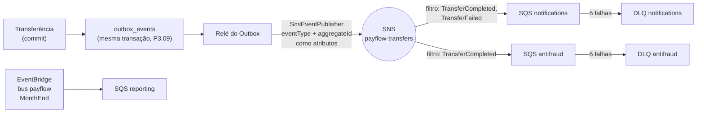

# P9.04 — 💸 SQS, SNS e EventBridge

> ⏱️ ~1h30 · 🔵 Pleno · Pré-requisitos: **P3.03 a P3.09** (filas × tópicos, entrega *at-least-once*, **idempotência**, retentativas e **DLQ**, **Outbox**), P4.02 (portas e adaptadores), P9.01 (os *endpoints* `sqs` e `sns`), P9.02 (*task role*)

> ✅ **Validação final (2026-11-24):** módulo executado no PayFlow reconstruído; resultado e o que continua não executado no [README do módulo](README.md). Os avisos "não executado" / "por leitura" abaixo descrevem a escrita original.

> 💸 **Esta aula fala de serviços que cobram por uso** (requisições SQS/SNS, eventos do EventBridge, dados). **Nada foi criado na AWS real.** Tudo foi executado contra o **moto** (emulador de API). A [página de preços do SQS](https://aws.amazon.com/sqs/pricing/) informa que **todo cliente tem 1 milhão de requisições grátis por mês**; para o resto, **leia a página** e use a Calculadora (os valores por milhão carregam dinamicamente e **não** foram citados).

> ⚠️ **Verificação:** **executado** (Terraform 1.17.1, AWS provider 6.73.0, moto, JDK 25.0.5, AWS SDK for Java 2.59.1, JUnit 6.0.3): o módulo `messaging` (`terraform test`: 4 casos) e **`apply`** no moto; o **fan-out SNS → SQS com filtro** pela CLI; **EventBridge** com um evento que casa e outro que não; e **5 testes Java** contra o moto (`FanOutTest`, `PoisonMessageTest`, `VisibilityTimeoutTest`, `FifoOrderingTest`, e o `SecretRotationTest` da P9.06) com **2 mutantes que precisam reprovar**. **Não foi executado:** o **comportamento temporal real do SQS** (o moto não é o SQS: o *redrive* após `maxReceiveCount` e o *visibility timeout* foram **observados no emulador**, que pode diferir em detalhes), a **política de permissão do DLQ** (`aws_sqs_queue_redrive_allow_policy`: o moto **não devolve** o atributo e o provedor **trava**: o laboratório a desliga), **throughput**, **FIFO sob carga**, **EventBridge Scheduler/Pipes**, **Spring Cloud AWS** e **o PayFlow do aluno**.

## 🎯 Objetivos
Ao final desta aula você consegue:
- **Escolher** entre **fila (SQS)**, **tópico (SNS)** e **barramento de eventos (EventBridge)** para um caso concreto do PayFlow.
- **Montar** o ***fan-out* SNS → SQS** com **uma fila por consumidor**, **DLQ**, **filtro por atributo** e **entrega crua** (*raw*), tudo em Terraform.
- **Configurar** `visibility_timeout`, `maxReceiveCount`, retenção e *long polling* com **o porquê** de cada número.
- **Escrever** o adaptador de saída (`SnsEventPublisher`) e o consumidor **idempotente** que **só apaga depois de processar**.
- **Comparar** com Kafka/RabbitMQ da P3 e **dizer o que se perde** (ordem global, releitura do histórico).

## 🤔 Por que isso importa
Na P3 o PayFlow ganhou **Outbox**, Kafka e RabbitMQ, mas **rodando em contêineres do seu laptop**. Na AWS, **operar um *broker*** (patches, discos, partições, ZooKeeper/KRaft, atualizações) é um **trabalho a mais**. **SQS e SNS são "mensageria sem servidor"**: não há máquina para administrar, nem partição para dimensionar. O preço: **menos recursos** que o Kafka (sem **log persistente relido**, sem **ordem global**) e um **vocabulário próprio**. Um pleno precisa saber **quando isso basta** (a maioria dos casos de "avisar outro componente") e **quando não**.

## 💡 Intuição (explicação simples)
- **SQS** é a **caixa de correio de um funcionário**: as cartas chegam, **ele** as pega **uma por vez**, e depois de resolvidas **ele as joga fora**. Se ele pega e **some** sem resolver, a carta **volta para a caixa** depois de um tempo.
- **SNS** é o **alto-falante do prédio**: **uma** mensagem, **vários** ouvintes. Para que cada setor tenha **a sua** caixa de correio, o alto-falante **deposita uma cópia** na caixa de **cada** um (o *fan-out*).
- **EventBridge** é **a central de roteamento dos Correios**: lê o **envelope** (origem, tipo) e decide **para quem** vai, **por regras**; é a escolha para eventos **de negócio** e **agendados**, não para o fluxo pesado de transferências.
- A **DLQ** é a **gaveta de "devolvidas"**: depois de **N tentativas**, a carta vai para lá para **alguém** olhar. **Gaveta que ninguém abre** é um **incidente esperando** (P9.07).

## 🔬 Como funciona por dentro

### Quem é quem
| | **SQS** (fila) | **SNS** (tópico) | **EventBridge** (barramento) |
|---|---|---|---|
| Modelo | **um** consumidor lógico por fila; a mensagem **some** ao ser apagada | **publica/assina**: entrega **cópias** a assinantes (SQS, HTTP, Lambda...) | **regras** sobre o conteúdo do evento levam a **alvos** |
| Entrega | ***at-least-once*** (a [documentação](https://docs.aws.amazon.com/AWSSimpleQueueService/latest/SQSDeveloperGuide/standard-queues.html) diz que **pode** chegar **mais de uma cópia** e **fora de ordem**) | não guarda mensagens: entrega ou falha | roteia por padrão; a documentação atual descreve **dois** tipos de barramento (abaixo) |
| Ordem | **padrão:** "melhor esforço"; **FIFO:** por **grupo** de mensagens | **tópico FIFO** com ordenação e deduplicação | no barramento **novo**, "entrega ordenada" é recurso listado |
| Retenção | **4 dias** por padrão, de 1 minuto a **14 dias** ([documentação](https://docs.aws.amazon.com/AWSSimpleQueueService/latest/SQSDeveloperGuide/quotas-messages.html)) | nenhuma | o barramento novo "retém eventos por um período que você define" |
| Tamanho máximo | **1 MiB** (1.048.576 bytes) | idem (ver quotas) | ver quotas |
| Uso no PayFlow | **uma fila por consumidor** (notificações, antifraude) | **o canal de eventos de transferência** | eventos **de negócio/agendados** (`MonthEnd`) |

> 🔎 **EventBridge mudou.** A documentação lida em 2026-11-14 diz que o EventBridge "oferece **dois** barramentos": o ***Custom Event Bus*** (com retenção configurável, **entrega ordenada**, ***replay*** e *payloads* não JSON) e o ***Custom Event Bus - Classic***, "que roteia eventos usando regras e alvos que você escreve"; e acrescenta: **"para novas aplicações, comece pelo Custom Event Bus"** ([documentação](https://docs.aws.amazon.com/eventbridge/latest/userguide/eb-what-is.html)). **O laboratório usa o modelo clássico** (regra + alvo: é o que o provedor Terraform e o moto expõem). ⚠️ **Não verifiquei** se o `aws_cloudwatch_event_bus` do provedor 6.73.0 já cria o tipo novo nem como se declaram os recursos dele: **confira na documentação do provedor antes de adotar**.

### O desenho do PayFlow (decisão 167, ADR 0021)

O **relé do Outbox** (P3.09) continua sendo **o único** que publica; só **muda o adaptador de saída**: na AWS, em vez de `KafkaTemplate`/`RabbitTemplate`, ele chama a porta `EventPublisher`, implementada por `SnsEventPublisher`. **O consumidor continua idempotente** (`processed_messages`, P3.07): o SQS entrega **pelo menos uma vez**.

## 🛠️ Exemplo prático

### 1) Infraestrutura (Terraform, módulo `messaging`)
Uma **fila + uma DLQ por consumidor**; o tópico; a **política** que deixa **só aquele tópico** escrever na fila; a **assinatura** crua e filtrada:
```hcl
resource "aws_sns_topic" "events" {
  name              = "${var.name}-transfers"
  kms_master_key_id = "alias/aws/sns" # encrypted at rest (AWS managed key; a customer key is P10)
}

# Dead-letter queues first: the main queues point at them.
resource "aws_sqs_queue" "dlq" {
  for_each                  = var.consumers
  name                      = "${var.name}-${each.key}-dlq"
  message_retention_seconds = 1209600 # 14 days (the maximum): time to investigate and redrive
  sqs_managed_sse_enabled   = true
}

resource "aws_sqs_queue" "main" {
  for_each                   = var.consumers
  name                       = "${var.name}-${each.key}"
  visibility_timeout_seconds = var.visibility_timeout
  receive_wait_time_seconds  = 20 # long polling: fewer empty receives
  message_retention_seconds  = 345600
  sqs_managed_sse_enabled    = true

  redrive_policy = jsonencode({
    deadLetterTargetArn = aws_sqs_queue.dlq[each.key].arn
    maxReceiveCount     = var.max_receive_count
  })
}
```
```hcl
data "aws_iam_policy_document" "from_sns" {
  for_each = var.consumers
  statement {
    sid       = "AllowTopicToSend"
    actions   = ["sqs:SendMessage"]
    resources = [aws_sqs_queue.main[each.key].arn]
    principals {
      type        = "Service"
      identifiers = ["sns.amazonaws.com"]
    }
    condition {
      test     = "ArnEquals"
      variable = "aws:SourceArn"
      values   = [aws_sns_topic.events.arn] # ONLY this topic, not any SNS topic in the world
    }
  }
}

resource "aws_sqs_queue_policy" "from_sns" {
  for_each  = var.consumers
  queue_url = aws_sqs_queue.main[each.key].id
  policy    = data.aws_iam_policy_document.from_sns[each.key].json
}

resource "aws_sns_topic_subscription" "queue" {
  for_each             = var.consumers
  topic_arn            = aws_sns_topic.events.arn
  protocol             = "sqs"
  endpoint             = aws_sqs_queue.main[each.key].arn
  raw_message_delivery = true # the queue receives exactly the event JSON, without the SNS envelope
  filter_policy_scope  = "MessageAttributes"
  filter_policy        = jsonencode({ eventType = each.value.event_types })
}
```
**Por que cada número:**
| Parâmetro | Valor | Motivo |
|---|---|---|
| `visibility_timeout_seconds` | **60** | **maior que o pior caso** de processamento de **uma** mensagem; se for menor, outro consumidor **pega a mesma mensagem enquanto o primeiro ainda trabalha** (duplicata). O padrão do SQS é **30 s**, o máximo **12 horas** ([documentação](https://docs.aws.amazon.com/AWSSimpleQueueService/latest/SQSDeveloperGuide/sqs-visibility-timeout.html)) |
| `receive_wait_time_seconds` | **20** | ***long polling***: o `ReceiveMessage` **espera** até 20 s por mensagem, em vez de devolver vazio e gerar **requisições pagas à toa** |
| `maxReceiveCount` | **5** | número de vezes que um consumidor pode **receber** a mensagem antes de ela ir para a DLQ; **1** é perigoso (uma única falha transitória já descarta) ([documentação](https://docs.aws.amazon.com/AWSSimpleQueueService/latest/SQSDeveloperGuide/sqs-dead-letter-queues.html)) |
| Retenção da **DLQ** | **14 dias** (máximo) | a documentação avisa: **ao entrar na DLQ, o relógio da retenção continua o da mensagem original** (o *timestamp* de entrada **não** muda); uma DLQ com a mesma retenção da fila **"perde" a mensagem antes de você olhar** |
| `sqs_managed_sse_enabled` | **true** | criptografia em repouso **sem custo de chave** (chave gerenciada pelo SQS; chave própria: P10) |
| `raw_message_delivery` | **true** | a fila recebe **exatamente o JSON do evento**, sem o envelope do SNS: a [documentação](https://docs.aws.amazon.com/sns/latest/dg/sns-large-payload-raw-message-delivery.html) diz que "os metadados do SNS são retirados"; com a entrega crua, **no máximo 10 atributos** de mensagem chegam |
| `filter_policy` (`MessageAttributes`) | `eventType` | cada consumidor recebe **só** o que lhe interessa |

Testes do módulo (`terraform test`, `mock_provider`):
```text
$ (cd modules/messaging && terraform test)
  run "every_consumer_has_a_dlq_with_14_days_and_a_redrive_policy"... pass
  run "subscriptions_are_raw_and_filtered"... pass
  run "a_zero_max_receive_count_is_refused"... pass
  run "a_visibility_timeout_over_12_hours_is_refused"... pass
Success! 4 passed, 0 failed.
```
A `validation` recusa `max_receive_count = 0` e `visibility_timeout` acima de **12 horas** (o máximo do SQS).

### 2) O *fan-out* real (pela CLI, contra o que o Terraform criou)
```text
$ aws sns publish x3 (TransferCompleted, TransferFailed, TransferCompleted) with the eventType message attribute
notifications queue: 3 messages   (filter: TransferCompleted + TransferFailed)
antifraud queue:     2 messages   (filter: TransferCompleted)
$ aws sns publish WITHOUT the eventType attribute
notifications queue: 3   antifraud queue: 2   <- unchanged: a filter policy drops the message silently
$ aws sqs receive-message (raw delivery: the body is exactly the event)
{"type":"TransferCompleted","amount":"10.00"}
```
```text
$ queue attributes that matter
{"VisibilityTimeout":"60","ReceiveMessageWaitTimeSeconds":"20","RedrivePolicy":"{\"deadLetterTargetArn\": \"<sqs>:payflow-notifications-dlq\", \"maxReceiveCount\": 5}","MessageRetentionPeriod":"345600","SqsManagedSseEnabled":"true"}
{"dlq_retention":"1209600"}
```
Dois detalhes que **doem em produção**: (1) a **política de filtro descarta em silêncio** a mensagem **sem** o atributo `eventType` (a última publicação **não chegou a ninguém**: ninguém recebe erro; **por isso** o publicador **sempre** define o atributo e há um teste para isso); (2) com **entrega crua** o corpo é **exatamente o evento** (`{"type":"TransferCompleted","amount":"10.00"}`): **dinheiro como *string*** (decisão 11).

### 3) O adaptador de saída e o consumidor (Java, SDK v2 puro)
**Sem Spring Cloud AWS:** a versão `4.x` do projeto declara compatibilidade com Spring Boot **4.0.x** (a tabela de compatibilidade do repositório, lida em 2026-11-14), e o PayFlow está no **4.1.2**: é o **mesmo problema** que a P5 achou com o Spring Cloud. O SDK da AWS v2 **atrás da porta** (P4) evita a dependência e **o código do consumidor não conhece a AWS**. (Spring Cloud AWS continua uma opção legítima; ⚠️ **não executado**.)
```java
package com.payflow.cloud;

/** Output port of the application (P4): "publish a domain event". The AWS SDK never leaks past the adapter. */
public interface EventPublisher {

    /**
     * @param eventType used by subscribers to FILTER (SNS message attribute {@code eventType})
     * @param key       ordering key (FIFO MessageGroupId): events of the same account stay in order
     * @param json      the event, money as a string (decision 11)
     */
    void publish(String eventType, String key, String json);
}
```
```java
package com.payflow.cloud;

import java.util.Map;
import software.amazon.awssdk.services.sns.SnsClient;
import software.amazon.awssdk.services.sns.model.MessageAttributeValue;
import software.amazon.awssdk.services.sns.model.PublishRequest;

/** Adapter: publishes to an SNS topic. Standard topic: no ordering guarantee (see the FIFO test for the alternative). */
public final class SnsEventPublisher implements EventPublisher {

    private final SnsClient sns;
    private final String topicArn;

    public SnsEventPublisher(SnsClient sns, String topicArn) {
        this.sns = sns;
        this.topicArn = topicArn;
    }

    @Override
    public void publish(String eventType, String key, String json) {
        sns.publish(PublishRequest.builder()
                .topicArn(topicArn)
                .message(json)
                .messageAttributes(Map.of(
                        "eventType", MessageAttributeValue.builder().dataType("String").stringValue(eventType).build(),
                        "aggregateId", MessageAttributeValue.builder().dataType("String").stringValue(key).build()))
                .build());
    }
}
```
**Os clientes não têm endpoint, credencial nem região no código** (`AwsClients`): a cadeia padrão do SDK acha **o papel da tarefa** (P9.02) e `AWS_REGION`, e, no laboratório, **`AWS_ENDPOINT_URL`** aponta para o moto. Um cliente **por serviço, criado uma vez** (são seguros entre *threads* e **caros** de construir).

O consumidor: **recebe, processa, e só então apaga**:
```java
package com.payflow.cloud;

import java.util.List;
import software.amazon.awssdk.services.sqs.SqsClient;
import software.amazon.awssdk.services.sqs.model.Message;
import software.amazon.awssdk.services.sqs.model.MessageSystemAttributeName;
import software.amazon.awssdk.services.sqs.model.ReceiveMessageRequest;
import software.amazon.awssdk.services.sqs.model.DeleteMessageRequest;

/**
 * One polling round: receive (long polling), handle, DELETE only after success.
 * If the handler throws, the message is NOT deleted: it reappears after the visibility timeout and, after
 * maxReceiveCount deliveries, SQS moves it to the dead-letter queue by itself.
 */
public final class QueueWorker {

    private final SqsClient sqs;
    private final String queueUrl;
    private final IdempotentHandler handler;
    private final int waitSeconds;

    public QueueWorker(SqsClient sqs, String queueUrl, IdempotentHandler handler, int waitSeconds) {
        this.sqs = sqs;
        this.queueUrl = queueUrl;
        this.handler = handler;
        this.waitSeconds = waitSeconds;
    }

    /** @return how many messages were received in this round (including failures and duplicates) */
    public int pollOnce() {
        List<Message> messages = sqs.receiveMessage(ReceiveMessageRequest.builder()
                .queueUrl(queueUrl)
                .maxNumberOfMessages(10)
                .waitTimeSeconds(waitSeconds)
                .messageSystemAttributeNames(MessageSystemAttributeName.APPROXIMATE_RECEIVE_COUNT)
                .build()).messages();
        for (Message m : messages) {
            try {
                handler.handle(m.messageId(), m.body());
                sqs.deleteMessage(DeleteMessageRequest.builder().queueUrl(queueUrl).receiptHandle(m.receiptHandle()).build());
            } catch (RuntimeException e) {
                // keep the message: no delete. Log with the receive count so the operator sees the retry climbing.
                System.out.printf("handler failed (receiveCount=%s): %s%n",
                        m.attributes().get(MessageSystemAttributeName.APPROXIMATE_RECEIVE_COUNT), e.getMessage());
            }
        }
        return messages.size();
    }
}
```
```java
package com.payflow.cloud;

import java.util.Set;
import java.util.concurrent.ConcurrentHashMap;
import java.util.function.Consumer;

/**
 * SQS (standard) delivers AT LEAST ONCE (docs): the same message can arrive twice. The handler remembers the
 * message id and does the work once. In PayFlow this is the processed_messages table of P3.07 (UNIQUE key);
 * the lab uses a set so the test needs no database.
 */
public final class IdempotentHandler {

    private final Set<String> processed = ConcurrentHashMap.newKeySet();
    private final Consumer<String> action;

    public IdempotentHandler(Consumer<String> action) {
        this.action = action;
    }

    /** @return true if the action ran now, false if it was a duplicate */
    public boolean handle(String messageKey, String body) {
        if (!processed.add(messageKey)) {
            return false;
        }
        try {
            action.accept(body);
            return true;
        } catch (RuntimeException e) {
            processed.remove(messageKey); // failed: allow the redelivery to try again
            throw e;
        }
    }
}
```
Se o *handler* lança, **a mensagem não é apagada**: volta depois do *visibility timeout* e, depois de `maxReceiveCount` recebimentos, o **SQS** a move para a DLQ **sozinho**. Em produção o `processed` é a **tabela `processed_messages` com `UNIQUE`** da P3.07 (o conjunto em memória do laboratório **não** sobrevive a um *restart*).

### 4) Os testes (5 classes contra o moto) e a saída **real**
```text
T9.1 notifications received 3 (TransferCompleted + TransferFailed)
T9.1 antifraud received     2 (TransferCompleted only)
T9.1 raw body (no SNS envelope): {"amount":"10.00"}
T9.2 processed normally: [ok-1, ok-2]
T9.2 poison handler attempts before the DLQ: 3 (maxReceiveCount=3)
T9.2 dead-letter queue holds: [poison]
T9.3 first receive : id=b96c43ad receiveCount=1
T9.3 while hidden  : nothing (message is invisible)
T9.3 second receive: id=b96c43ad receiveCount=2
T9.3 handler ran for delivery 1: true, for delivery 2: false -> effects=[transfer-42]
T9.3 a naive consumer (no id check) would have produced: [transfer-42, transfer-42]
T9.4 sent 6 messages (1 duplicate dedup id), received 5
T9.4 acc-1 in order: [acc-1:deposit-1, acc-1:deposit-2, acc-1:deposit-3]
T9.4 acc-2 in order: [acc-2:deposit-1, acc-2:deposit-2]
handler failed (receiveCount=1): cannot parse event
handler failed (receiveCount=2): cannot parse event
handler failed (receiveCount=3): cannot parse event
Tests run: 1, Failures: 0, Errors: 0, Skipped: 0 -- in com.payflow.cloud.PoisonMessageTest
Tests run: 1, Failures: 0, Errors: 0, Skipped: 0 -- in com.payflow.cloud.SecretRotationTest
Tests run: 1, Failures: 0, Errors: 0, Skipped: 0 -- in com.payflow.cloud.FifoOrderingTest
Tests run: 1, Failures: 0, Errors: 0, Skipped: 0 -- in com.payflow.cloud.VisibilityTimeoutTest
Tests run: 1, Failures: 0, Errors: 0, Skipped: 0 -- in com.payflow.cloud.FanOutTest
```
Leia o que cada um **prova**:
- **T9.1** (fan-out): 3 eventos → notificações recebe **3**, antifraude **2** (o `TransferFailed` não chega a ele) e o corpo é o JSON cru.
- **T9.2** (veneno): `ok-1` e `ok-2` **são processadas** (a mensagem ruim **não trava a fila**), o *handler* falha **3 vezes** (`maxReceiveCount = 3` no teste) e **só então** a mensagem aparece **na DLQ**.
- **T9.3** (duplicata): o consumidor A recebe e **"morre"** sem apagar; **enquanto invisível**, ninguém a vê; depois do *timeout* o B recebe **a mesma** mensagem (`receiveCount = 2`). O `IdempotentHandler` executa **uma vez**; um consumidor ingênuo produziria **dois efeitos**.
- **T9.4** (FIFO): 6 envios (um com o **mesmo** `MessageDeduplicationId`), **5** recebidos, e **a ordem dentro de cada conta preservada**. ⚠️ **O moto não reordena filas padrão**: este teste **não prova** que a fila padrão desordena; quem diz isso é a **documentação**.

> **Um teste que nunca falhou não prova nada.** O `run-sdk.sh` quebra o código **de propósito** e exige que os testes reprovem:
```text
BUILD SUCCESS
# MUTANT 1: the handler forgets to remember message ids (no idempotency) -> VisibilityTimeoutTest must FAIL
[ERROR] Tests run: 1, Failures: 1, Errors: 0, Skipped: 0, Time elapsed: 2.858 s <<< FAILURE! -- in com.payflow.cloud.VisibilityTimeoutTest
# MUTANT 2: the worker DELETES the message even when the handler failed -> PoisonMessageTest must FAIL (the poison never reaches the DLQ)
[ERROR] Tests run: 1, Failures: 1, Errors: 0, Skipped: 0, Time elapsed: 20.63 s <<< FAILURE! -- in com.payflow.cloud.PoisonMessageTest
[INFO] BUILD FAILURE
```

## 🧠 Pausa para lógica: quanto tempo até a DLQ?
> **Enunciado.** Uma fila com `visibility_timeout = 60 s` e `maxReceiveCount = 5`. Uma mensagem **veneno** (o *handler* **sempre** falha **logo depois de receber**). (a) **Quanto tempo**, no mínimo, até ela aparecer na DLQ? (b) E se o *handler* **demorar 50 s** antes de falhar? (c) Com retenção da fila de **4 dias** e da DLQ de **14 dias**, ela **sobrevive** quanto tempo na DLQ? **Dica:** cada recebimento deixa a mensagem **invisível por 60 s**; a falha **não** a apaga e **não** a devolve antes do tempo (a menos que você chame `ChangeMessageVisibility`).
<details><summary>Solução comentada</summary>

(a) Cada tentativa fica invisível **60 s** (o *handler* falhou, mas a mensagem só **reaparece** quando o *timeout* expira): **≈ 4 × 60 s = 4 minutos** entre a 1ª e a 5ª recepção (+ a espera até o SQS mover). **Mensagens veneno não são imediatas**: o alarme de **idade** (P9.07) existe por isso. (b) **igual**: o tempo entre recepções é o **visibility timeout**, não o tempo do *handler*; mas se o *handler* levar **mais de 60 s**, a mensagem **reaparece enquanto ainda é processada** (duplicata concorrente): daí a regra "visibility > pior caso". (c) **A retenção conta a partir do envio original** (documentação): se a mensagem ficou **3 dias** na fila antes do veneno, restam **11 dias** na DLQ, **não** 14. **Variação mais difícil:** reduza o `visibility_timeout` para 5 s com um *handler* de 8 s e use o `VisibilityTimeoutTest` como modelo para provar a **duplicata concorrente**.
</details>

## 🏗️ Estudo de caso: SQS/SNS, MSK ou Kafka sozinho? (decisão 167)
> **Contexto:** a P3 escolheu Kafka (ordem por conta, releitura) e RabbitMQ. Na AWS há **Amazon MSK** (Kafka gerenciado) e **Amazon MQ** (RabbitMQ gerenciado). Os consumidores atuais são **reações assíncronas** (notificações, antifraude): **não** definem o saldo.
> **Opções:** (A) **SNS + SQS**. (B) Kafka gerenciado (MSK). (C) Kafka/RabbitMQ em contêineres próprios.
> **Trade-offs:** (A) **nada para operar**, cobrança por uso, **entrega pelo menos uma vez**, **ordem só com FIFO** (com limites de vazão), **sem releitura do histórico** (reprocessar = reemitir do Outbox). (B) **log persistente, ordem por chave, *replay***; mas **você dimensiona partições e brokers** e paga por **capacidade ocupada** mesmo ocioso. (C) máximo controle e **máximo trabalho**.
> **Decisão (A):** **SNS + SQS padrão**, **idempotência obrigatória** (P3.07), **sem exigir ordem** (nenhum consumidor atual precisa: o saldo **nunca** vai por mensageria, decisão 104). **Reavaliar** quando um consumidor **precisar de ordem por conta** (aí **FIFO**: `MessageGroupId = accountId`, **respeitando os limites de vazão** acima) **ou de releitura** do histórico (aí **MSK**).
> **Consequências:** o relé do Outbox ganha o adaptador `SnsEventPublisher` (a porta não muda); o **contrato do evento** (P5.04: aditivo, dinheiro como *string*) **vale igual**; **o alarme de DLQ vira obrigatório** (P9.07); os `compose.yaml` com Kafka/RabbitMQ **continuam** para o desenvolvimento local.

## ⚖️ Trade-offs e quando NÃO usar
- **SQS padrão × FIFO:** FIFO dá **ordem por grupo** e **deduplicação** (por uma **janela de tempo**; no teste T9.4 o mesmo `MessageDeduplicationId` foi descartado), com **limites de vazão**: a documentação do modo de alta vazão diz que **cada partição** aceita até **3.000 mensagens por segundo com *batching*** ou **300 por segundo** sem ele, em regiões suportadas ([documentação](https://docs.aws.amazon.com/AWSSimpleQueueService/latest/SQSDeveloperGuide/high-throughput-fifo.html)); o nome da fila termina em **`.fifo`**. Use **só** quando a ordem importa **por entidade**.
- **SNS × EventBridge:** SNS para **fan-out de alto volume** com filtro simples; EventBridge para **roteamento por conteúdo**, **agendamentos** e **integração entre contas/serviços** (aceita padrões ricos).
- **Pull (SQS) × push (SNS → HTTP/Lambda):** o *pull* dá **contrapressão** (o consumidor vai no seu ritmo); *push* para **webhook** exige **idempotência no destinatário** (P3.10).
- **Mensagem grande:** o limite é **1 MiB**; acima disso a documentação indica a *Extended Client Library* (S3 + ponteiro). **Não** mande o **extrato inteiro** num evento: mande o **identificador** e deixe o consumidor buscar.
- **Não use SQS como banco de tarefas com consulta** ("quais mensagens estão pendentes de X?"): ela **não** foi feita para isso.
- **Não esqueça o custo de requisições:** *polling* curto (`WaitTimeSeconds = 0`) com fila vazia **gera chamadas pagas sem nada**: use **20**.

## ⚠️ Erros comuns e boas práticas de produção
- **`visibility_timeout` menor que o processamento:** duplicatas **concorrentes**; use `ChangeMessageVisibility` para **estender** em tarefas longas (teto de 12 horas **desde o primeiro recebimento**, documentação).
- **DLQ sem alarme e sem dono:** cresce **em silêncio**. **Alarme de qualquer mensagem visível** (P9.07) e um **runbook** de *redrive*.
- **DLQ com retenção menor ou igual à da fila:** a mensagem **expira** antes de você agir (a retenção conta do **envio original**).
- **Fila sem política para o tópico:** o SNS **recebe** o `Publish`, mas a entrega **falha** (a fila recusa). A política **com `aws:SourceArn`** do módulo aceita **só** o tópico do PayFlow, **não qualquer tópico do mundo** (o "*confused deputy*").
- **Esquecer o atributo de filtro:** a mensagem **some**. ⚠️ **Mensagens de erro de permissão exatas não reproduzidas** (o moto não impõe políticas de fila).
- **Consumidor que apaga antes de processar:** perde a mensagem se a JVM cair no meio (o mesmo defeito do `autoCommit` do Kafka da P3.06). O `QueueWorker` **apaga depois**.
- **Esperar que o SQS padrão mantenha a ordem:** **não mantém** (documentação); o `QueueWorker`+`IdempotentHandler` **não dependem de ordem**.
- **Criar/destruir fila com o mesmo nome:** a AWS impõe um **intervalo** para recriar uma fila com o nome de uma recém-apagada (⚠️ **valor não verificado aqui**).

## 🧩 Exercícios
1. **Fixação.** (a) Por que o consumidor **apaga depois** de processar? (b) O que acontece com uma mensagem **sem** o atributo `eventType` neste desenho? (c) Para que serve a **retenção de 14 dias** da DLQ **e** por que ela **não** reinicia quando a mensagem entra nela?
2. **Aplicação no PayFlow** (critérios de pronto):
   - [ ] `terraform test` do módulo `messaging` **verde** (4/4) e `max_receive_count = 0` **recusado**.
   - [ ] **Duas filas + duas DLQs + tópico + 2 assinaturas cruas e filtradas** aplicadas no moto; os **5** testes Java **verdes** e os **2 mutantes reprovando**.
   - [ ] O **task role** só tem `sns:Publish` (1 tópico) e as 5 ações de consumo **das duas filas** (P9.02).
   - [ ] O `SnsEventPublisher` **sempre** define `eventType` (teste).
3. **Desafio.** Acrescente a **terceira** fila, `reporting`, assinada **só** em `TransferCompleted` com `amount` **>= 1000,00**: o filtro do SNS tem **operadores numéricos**, mas o **dinheiro é *string*** (decisão 11). Qual o dilema e como **você** o resolveria **sem** abrir mão da decisão 11?
<details><summary>Soluções de referência</summary>

1(a) porque, se a JVM cair **entre** o recebimento e o processamento, a mensagem **precisa reaparecer**; apagar antes **a perderia**. (b) o SNS **descarta** (não casa com nenhum filtro) e **ninguém é avisado**. (c) é o tempo para **investigar e reenviar**; **não reinicia** porque o *timestamp* de entrada **é o do envio original** (documentação).

3: filtros numéricos exigem **número**; o PayFlow guarda dinheiro como `string` (decisão 11) para **não perder precisão**. Soluções: (1) um **atributo auxiliar** `amountBand` (`"HIGH"`/`"LOW"`) calculado **na aplicação** com `BigDecimal`, usado só para **roteamento** (o valor continua `string` no corpo); (2) filtrar **no consumidor**. Evitar: converter o valor para `number` no atributo (**quebra** a decisão e arredonda em `double`). ⚠️ **Não executado** (o laboratório não cria essa fila).
</details>

## 🎤 Na entrevista
1. **Qual a diferença entre SQS e SNS?** *Resposta-modelo:* SQS é uma **fila**: **um** consumidor lógico, a mensagem é **apagada** depois de processada. SNS é **publica/assina**: **uma** publicação gera **cópias** para vários assinantes. A combinação clássica é o ***fan-out***: **um tópico** SNS e **uma fila SQS por consumidor** (cada um no seu ritmo, com a sua DLQ).
2. **O SQS garante entrega exatamente uma vez?** *Resposta-modelo:* **não**: a fila padrão entrega **pelo menos uma vez** e pode **reordenar**; por isso o consumidor é **idempotente**. A fila **FIFO** acrescenta **ordem por grupo** e **deduplicação** (a documentação diz que ela **não introduz duplicatas** e tem **vazão limitada**), mas a idempotência **continua** necessária: a deduplicação vale por **janela de tempo** e o **consumidor** também pode repetir o efeito.
3. **Para que serve o *visibility timeout*?** *Resposta-modelo:* esconde a mensagem dos outros consumidores **enquanto um a processa**; se ele **não apaga** a tempo, a mensagem **reaparece**. Deve ser **maior que o pior caso** de processamento; padrão 30 s, máximo 12 horas.
4. **Como você trata mensagens que sempre falham?** *Resposta-modelo:* **DLQ** com `maxReceiveCount` razoável (5), retenção máxima, **alarme** para qualquer mensagem visível e um **runbook** de investigação e ***redrive***; e **idempotência** para o reenvio ser seguro.

## 📚 Para ir além
- 📄 [Filas padrão do SQS](https://docs.aws.amazon.com/AWSSimpleQueueService/latest/SQSDeveloperGuide/standard-queues.html) — *at-least-once* e ordem "melhor esforço".
- 📄 [*Visibility timeout*](https://docs.aws.amazon.com/AWSSimpleQueueService/latest/SQSDeveloperGuide/sqs-visibility-timeout.html) e [*dead-letter queues*](https://docs.aws.amazon.com/AWSSimpleQueueService/latest/SQSDeveloperGuide/sqs-dead-letter-queues.html) — 30 s a 12 h; `maxReceiveCount`; retenção da DLQ.
- 📄 [Quotas de mensagem do SQS](https://docs.aws.amazon.com/AWSSimpleQueueService/latest/SQSDeveloperGuide/quotas-messages.html) — retenção, tamanho, *long polling*.
- 📄 [SNS: entrega de mensagem crua](https://docs.aws.amazon.com/sns/latest/dg/sns-large-payload-raw-message-delivery.html) e [tópicos FIFO](https://docs.aws.amazon.com/sns/latest/dg/sns-fifo-topics.html) — o que muda no corpo.
- 📄 [O que é o EventBridge](https://docs.aws.amazon.com/eventbridge/latest/userguide/eb-what-is.html) e [padrões de evento](https://docs.aws.amazon.com/eventbridge/latest/userguide/eb-event-patterns.html) — os dois barramentos e o casamento por conteúdo.
- 📄 [Preços do SQS](https://aws.amazon.com/sqs/pricing/) — 1 milhão de requisições grátis por mês.
- 🎥 Nenhum vídeo verificado nesta aula.
- 💻 `lab/cloud-lab/terraform/modules/messaging`, `lab/aws-sdk-lab/` (`run-sdk.sh`).
- 🔁 **Equivalência AWS ↔ Azure ↔ GCP** ([Microsoft](https://learn.microsoft.com/en-us/azure/architecture/aws-professional/messaging), [Google](https://cloud.google.com/docs/get-started/aws-azure-gcp-service-comparison); **aproximada**):

| AWS | Azure | Google Cloud |
|---|---|---|
| SQS | Queue Storage / Service Bus (fila) | ⚠️ **Pub/Sub** (o Google lista Pub/Sub ao lado de Kinesis/Amazon MQ e de Service Bus; **não** é 1:1 com SQS) |
| SNS | Service Bus (tópicos) / Event Grid | Pub/Sub (⚠️ mesma observação) |
| EventBridge | Event Grid | (o Google lista **Cloud Scheduler** ao lado de EventBridge/Logic Apps para **agendamento**) |

## ✅ Checklist da aula
- [ ] Sei desenhar o ***fan-out*** SNS → uma SQS por consumidor com DLQ.
- [ ] Sei explicar `visibility_timeout`, `maxReceiveCount` e a retenção da DLQ, com **o porquê** do número.
- [ ] Rodei os **5 testes Java** e vi os **2 mutantes** reprovarem.
- [ ] Sei por que a mensagem sem `eventType` **some** e como evitar.
- [ ] Sei defender **SNS+SQS agora** e **quando** migrar para FIFO ou MSK.
