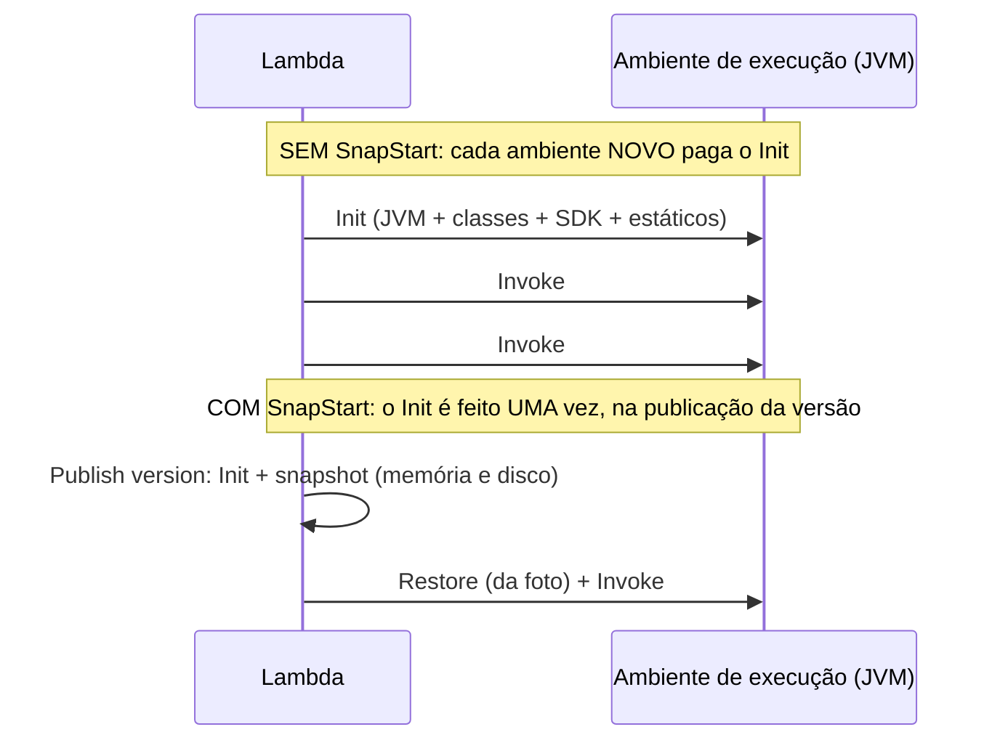

# P9.05 — 💸 Lambda e cold start em Java (SnapStart)

> ⏱️ ~1h30 · 🔵 Pleno · Pré-requisitos: **P1.01 e P1.02** (classloading, JIT e aquecimento), P1.05 (`ExecutorService`), P5.08 (**`L = λ × W`** do *bulkhead*), P9.02 (ECS/Fargate), P9.04 (EventBridge), P8.05 a P8.07 (Terraform)

> ✅ **Validação final (2026-11-24):** módulo executado no PayFlow reconstruído; resultado e o que continua não executado no [README do módulo](README.md). Os avisos "não executado" / "por leitura" abaixo descrevem a escrita original.

> 💸 **Lambda cobra por invocação e por GB-segundo** (e o **SnapStart** acrescenta cobranças de **cache** e de **restauração**, segundo a [documentação](https://docs.aws.amazon.com/lambda/latest/dg/snapstart.html)). **Nada foi criado na AWS real** e **nenhuma função foi invocada**: o moto aceitou a **configuração** da função, **não a executa** (nem o SnapStart). Os números desta aula são de uma **JVM local** (abaixo): **não** são tempos de Lambda.

> ⚠️ **Verificação:** **executado** (Terraform 1.17.1, AWS provider 6.73.0, moto, JDK 25.0.5, AWS SDK for Java 2.59.1): o módulo `lambda_fn` (função `java25`, `arm64`, `snap_start`, *alias*, regra agendada, permissão) **aplicado ao moto** e lido de volta; o **handler** compilado contra `aws-lambda-java-core` 1.4.1 e empacotado; e a **medição de *cold start* de uma JVM local** (cliente do SDK + 1ª chamada) com **sete variantes**: padrão, `C1` só, sem CDS, **AppCDS** e **cache AOT** do JDK 25. **Não foi executado:** **qualquer invocação de Lambda**, **o SnapStart de verdade** (o moto devolve `ApplyOn: None`), o **`provisioned concurrency`**, o **Spring Boot em Lambda**, **GraalVM *native image***, **CRaC** (`org.crac`), VPC/ENI e **a AWS real**.

## 🎯 Objetivos
Ao final desta aula você consegue:
- **Explicar** o ciclo de vida de uma execução (**init → invoke**, e **restore** com SnapStart) e **do que um *cold start* de Java é feito**.
- **Calcular** a **concorrência** de uma função com `L = λ × W` e dizer quantos *cold starts* uma rajada provoca.
- **Medir**, numa JVM local, o efeito de **CDS/AppCDS** e do **cache AOT** na partida (e **dizer o que a medição não prova**).
- **Configurar** uma função Java no Terraform com **SnapStart** em **versão publicada + *alias***.
- **Decidir** o que do PayFlow é **candidato a Lambda** e o que **não é**, com os critérios escritos.

## 🤔 Por que isso importa
Lambda é o "**funciona sem servidor nenhum**": você entrega **uma função**, a AWS cria **ambientes de execução** conforme chegam requisições e **cobra por uso**. Para tarefas **esporádicas** (agendadas, reação a evento), isso é **quase de graça** e **sem operação**. O problema de Java é o **começo**: a JVM precisa **carregar classes**, **inicializar o SDK** e **aquecer** (P1.01, P1.02) **a cada ambiente novo**, e a documentação da própria AWS o diz: linguagens compiladas como Java "são em geral **mais lentas para inicializar**, mas **executam rápido** no *handler*" ([documentação](https://docs.aws.amazon.com/lambda/latest/dg/lambda-runtimes.html)). Em entrevista, "Java em Lambda" quase sempre vira **"como você lida com o *cold start*?"**.

## 💡 Intuição (explicação simples)
Um **food truck**. Se há **fila** (tráfego constante), o fogão **já está quente**: cada pedido sai rápido (*warm*). Se o caminhão **ficou parado** e chega o primeiro cliente, é preciso **estacionar, ligar o gás e esquentar a chapa** antes de fritar (*cold start*). Java é um fogão de **chapa grossa**: esquenta devagar, mas **frita rápido depois**. O **SnapStart** é **guardar o fogão já aceso numa foto**: em vez de acender do zero, a AWS **restaura a foto** (mais rápido, **mas** com cuidados: tudo que estava na foto, **incluindo números "aleatórios" e conexões**, volta **igual**). O ***provisioned concurrency*** é **deixar N fogões ligados o tempo todo** (e pagar por eles).

## 🔬 Como funciona por dentro

### O ciclo de vida
A documentação descreve três fases ([ambiente de execução](https://docs.aws.amazon.com/lambda/latest/dg/lambda-runtime-environment.html)): **Init** (inicia extensões, **o *runtime***, e roda **o código de inicialização da função**: construtores estáticos, criação de clientes), **Invoke** (o *handler*) e **Shutdown**. Com **SnapStart** há a fase **Restore**: o ambiente é **restaurado de um *snapshot*** tirado **depois do Init**, em vez de refazer o Init.

**Concorrência.** "Concorrência é o número de requisições **em andamento ao mesmo tempo**. Para cada requisição concorrente, o Lambda provisiona **uma instância separada** do ambiente de execução" ([documentação](https://docs.aws.amazon.com/lambda/latest/dg/lambda-concurrency.html)). Cada ambiente novo é **um *cold start***. A conta é a **lei de Little** que você já usou no *bulkhead* (P5.08):

> **concorrência `L` = taxa de chegada `λ` × duração `W`.** Uma função chamada **50 vezes por segundo**, cada chamada de **200 ms**: `L = 50 × 0,2 = 10` ambientes **simultâneos**. Se ela estava **parada** e chega essa rajada, **10 *cold starts*** acontecem **quase juntos**.

### Do que é feito um *cold start* de Java? **Medido**
O `ColdStartHandler.java` imita uma função: **"init"** = construir o `SqsClient` do SDK v2 (estático, **uma vez**); **"invoke"** = a **primeira chamada** (`listQueues`) contra o moto. `run-coldstart.sh` roda **7 vezes** cada variante e dá a **mediana** (JDK 25.0.5, 12 núcleos, máquina quase ociosa: *load average* baixo (0,07 a 0,5 nas execuções)). **Isto é uma JVM local numa máquina de desenvolvimento: não é Lambda** (a Lambda tem CPU proporcional à memória, disco e rede próprios, e o *runtime* dela). O que a medição **mostra bem** é **a composição** do custo e **o que cada técnica corta**:
```text
# JDK: openjdk version "25.0.5.0.3" 2026-10-24   cores: 12   load: 0.51
# one warm call, for contrast:
jvm-boot=24ms  sdk-client-init=201ms  first-call=319ms  total-to-first-response=544ms  warm-call=4124us
# cold start variants (7 runs each, median):
default (-Xshare:auto, tiered)               init= 208ms  first-call= 112ms  total=  344ms  (median of 7)
-XX:TieredStopAtLevel=1 (C1 only)            init= 186ms  first-call=  89ms  total=  297ms  (median of 7)
-Xshare:off (no class-data sharing at all)   init= 217ms  first-call= 116ms  total=  380ms  (median of 7)
# AppCDS archive size: 11692 KiB
AppCDS (-XX:SharedArchiveFile)               init= 112ms  first-call=  43ms  total=  170ms  (median of 7)
AppCDS + C1 only                             init= 100ms  first-call=  36ms  total=  151ms  (median of 7)
# AOT cache size: 27732 KiB
AOT cache (-XX:AOTCache)                     init=  72ms  first-call=  18ms  total=  108ms  (median of 7)
```
Leia assim:
- A **mesma** chamada, **aquecida**, leva **~4 ms** (`warm-call=4124us`). **A primeira leva ~112 ms** e o **`init` do cliente ~208 ms**: quase **toda** a latência é **carregar e inicializar classes**, não trabalho útil.
- **`C1` só** (`-XX:TieredStopAtLevel=1`) corta a **compilação cara** (C2) da fase de partida: **344 → 297 ms**. O preço é **pico de desempenho menor** para uma função que fica quente por muito tempo.
- **Sem CDS** (`-Xshare:off`) é **mais lento** (380 ms): o JDK **já usa** um arquivo de classes compartilhado para as classes do próprio JDK (`-Xshare:auto` é o padrão).
- **AppCDS** (um arquivo com **as classes da sua aplicação e do SDK** já "analisadas": 11,7 MiB aqui) derruba o total para **170 ms (~2×)**. **O cache AOT** do JDK 25 (27,8 MiB) vai além: **108 ms (~3×)**, porque guarda também o **carregamento e a ligação** das classes (a ideia do [JEP 483](https://openjdk.org/jeps/483), do JDK 24). ⚠️ **O que mais o cache AOT do JDK 25 guarda eu não verifiquei**: leia os JEPs antes de afirmar detalhes.
- **O que a medição NÃO prova:** que **Lambda** terá esses números. Um **Spring Boot** inteiro (contexto, *autoconfiguration*, Hibernate, Flyway) é **ordens de grandeza** maior que **um cliente SQS**: ⚠️ **não medi**; por isso a API do PayFlow **não** vai para Lambda (decisão 168).

### O que o SnapStart muda (e o que ele cobra)
Segundo a documentação ([SnapStart](https://docs.aws.amazon.com/lambda/latest/dg/snapstart.html)):
- **Funciona** em **Java 11 e posteriores** (e Python/.NET recentes). O *runtime* **`java25`** consta da tabela de *runtimes* da AWS (lida em 2026-11-14, com fim de suporte em **2029**).
- **Só** em **versões publicadas** e em ***aliases*** que apontam para versões: **não** no `$LATEST`.
- **Não** funciona com ***provisioned concurrency***, **Amazon EFS** nem **armazenamento efêmero > 512 MB**.
- **Você paga:** **cada restauração** gera uma **cobrança de restauração**, que depende da **memória** configurada (+ o **cache** do *snapshot*); a duração do *handler* cobra como sempre.
- ***Hooks* de *runtime*:** código antes do *snapshot* (`beforeCheckpoint`) e depois da restauração (`afterRestore`), pela API **CRaC** (`org.crac`): para **aquecer** (invocar o *handler* uma vez, **sem efeito colateral**), **fechar** conexões e **refazer** o que não sobrevive à foto.
- **Unicidade (o ponto de segurança):** a foto é **um estado único restaurado em vários ambientes**. A documentação adverte: **IDs únicos, segredos e entropia gerados no Init ficam **iguais** em todos os ambientes**; **conexões de rede** abertas no Init **não têm estado garantido** (reabra no *handler* ou no *hook* de restauração); e **não use o nome do host** como identificador único do ambiente. Para o PayFlow isso significa: **nunca gere chaves, UUIDs de idempotência ou *seeds* no Init**; **nunca guarde um segredo lido no Init** sem revalidar (P9.06).
- **Memória e CPU:** "o Lambda aloca CPU **proporcional à memória**" ([documentação](https://docs.aws.amazon.com/lambda/latest/dg/configuration-memory.html)): **mais memória = mais CPU = *cold start* mais curto**; **subir a memória pode sair mais barato** se a duração cair.

### Alternativas para o *cold start* (qual problema cada uma resolve)
| Técnica | O que faz | Custo/limitação |
|---|---|---|
| **SnapStart** | restaura uma **foto** em vez de refazer o Init | cobra restauração e cache; **unicidade** e conexões; só versões/*alias* |
| ***Provisioned concurrency*** | **N ambientes sempre prontos** ("tempos de resposta de dois dígitos de ms") | **paga o tempo parado**; **incompatível com SnapStart** |
| **AppCDS / AOT** (no seu JAR/imagem) | classes **pré-processadas** | gerenciar o arquivo; em Lambda por **imagem de contêiner** ou *runtime* customizado (⚠️ **não executado**) |
| **Menos dependências no Init** | menos classes para carregar | refatoração; vale **sempre** |
| ***GraalVM native image*** | sem JVM: partida **de milissegundos** | build lento, **reflexão/proxies** exigem configuração; **S2** (não executado) |
| **Não usar Lambda** (ECS/Fargate) | processo **de longa vida**, JIT aquecido | custo **fixo** ligado |

## 🛠️ Exemplo prático
### 1) O *handler* (a tarefa **agendada** do PayFlow)
```java
public class StatementExporter implements RequestHandler<Map<String, Object>, String> {
    @Override
    public String handleRequest(Map<String, Object> event, Context context) {
        return "exported at " + java.time.Instant.now() + " remaining=" + context.getRemainingTimeInMillis();
    }
}
```
`lab/lambda-lab/handler/` compila contra `aws-lambda-java-core` **1.4.1** (a versão mais recente no Maven Central em 2026-11-14) e vira `exporter.zip`. É **só o contrato** (`RequestHandler`): a exportação real leria a **réplica de leitura** (P9.08).

### 2) O módulo Terraform
```hcl
resource "aws_lambda_function" "exporter" {
  function_name    = "${var.name}-statement-exporter"
  role             = aws_iam_role.fn.arn
  runtime          = "java25"
  handler          = var.handler
  architectures    = ["arm64"]
  memory_size      = var.memory_mb
  timeout          = 60
  filename         = var.zip_path
  source_code_hash = filebase64sha256(var.zip_path)
  publish          = true # SnapStart works on PUBLISHED versions only, never on $LATEST

  dynamic "snap_start" {
    for_each = var.snap_start ? [1] : []
    content {
      apply_on = "PublishedVersions"
    }
  }
}

resource "aws_lambda_alias" "live" {
  name             = "live"
  function_name    = aws_lambda_function.exporter.function_name
  function_version = aws_lambda_function.exporter.version # the schedule calls the ALIAS, i.e. a snapshot-backed version
}

resource "aws_cloudwatch_event_rule" "schedule" {
  name                = "${var.name}-statement-exporter"
  schedule_expression = var.schedule
}

resource "aws_cloudwatch_event_target" "fn" {
  rule      = aws_cloudwatch_event_rule.schedule.name
  target_id = "exporter"
  arn       = aws_lambda_alias.live.arn
}

resource "aws_lambda_permission" "events" {
  statement_id  = "AllowSchedule"
  action        = "lambda:InvokeFunction"
  function_name = aws_lambda_function.exporter.function_name
  qualifier     = aws_lambda_alias.live.name
  principal     = "events.amazonaws.com"
  source_arn    = aws_cloudwatch_event_rule.schedule.arn
}
```
Os detalhes que importam: `publish = true` (o SnapStart **exige** versão publicada), o **alias `live`** (a regra do EventBridge chama o **alias**, não o `$LATEST`), `memory_size = 1024` (**CPU proporcional**), `architectures = ["arm64"]` e a **permissão** do EventBridge limitada à **regra** e ao **alias** (`source_arn`, `qualifier`).

Aplicado ao moto e **lido de volta**:
```text
$ aws lambda get-function-configuration (the Terraform-created function)
{"runtime":"java25","handler":"com.payflow.exporter.StatementExporter::handleRequest","arch":["arm64"],"memory":1024,"timeout":60,"snapStart":{"ApplyOn":"None","OptimizationStatus":"Off"}}
$ aws lambda list-aliases
live	3
(SnapStart restore is NOT emulated by moto: this only proves the configuration shape.)
```
**Leia com ceticismo:** `"snapStart":{"ApplyOn":"None","OptimizationStatus":"Off"}`: o Terraform pediu `PublishedVersions`, mas o **moto ignora** o recurso. O **segundo `plan`** (P9.01–P9.08) por isso mostra `snap_start` como diferença: **é artefato do emulador**. **Só a AWS real** diz se o *snapshot* é criado, quanto leva e se o seu código **sobrevive à restauração**. O número da **versão** do *alias* também sobe a cada `apply` que muda algo (cada `publish = true` cria uma versão).

## 🧠 Pausa para lógica: quantos *cold starts* numa rajada?
> **Enunciado.** O exportador de extratos roda **uma vez por conta** e há um dia de pico: **100 execuções começam por segundo**, **durante 5 segundos**, e cada execução dura **2 s**. (a) Qual a **concorrência em regime** pela lei de Little? (b) Quantos **ambientes novos** (*cold starts*) são criados **se nenhum estava quente**? (c) Com **SnapStart**, o que muda na **latência** e **o que não muda no custo**? **Dica:** `L = λ × W`; cada requisição **concorrente** usa **seu próprio** ambiente; um ambiente que **terminou** pode ser **reaproveitado** (quente).
<details><summary>Solução comentada</summary>

(a) `λ = 100 /s`, `W = 2 s` → **`L = 200`** ambientes simultâneos **em regime**. (b) No **1º segundo** chegam 100 e **nenhum** ambiente existe: **100 *cold starts***. No **2º segundo** chegam mais 100 e os 100 primeiros **ainda estão ocupados** (duram 2 s): **mais 100 *cold starts*** (total **200**). A partir do **3º segundo** os do 1º segundo **terminam** e ficam **quentes**: as 100 novas **reaproveitam** esses ambientes (**0** *cold starts*), e assim por diante: **o total é ≈ 200 *cold starts* para 500 execuções (40%)**. Em **rajadas curtas** a fração de *cold starts* é **alta**. ⚠️ **A cota de concorrência da conta e a velocidade de escala** da função (documentadas no guia de concorrência) podem **estrangular** a rampa: **valores não verificados aqui**. (c) A latência de cada *cold start* cai (**restore** em vez de **init completo**), **mas** você **paga 200 restaurações**; a duração do *handler* (2 s) **não muda**: o SnapStart **não** reduz o trabalho útil. **Variação mais difícil:** a função grava no banco com um *pool* de 10 conexões (P2.06): **200 ambientes = 2.000 conexões**: derrubam o banco (P2.06: `max_connections`). Soluções: **RDS Proxy** (P9.08), **concorrência reservada** (um teto) ou **uma fila na frente** (SQS, P9.04).
</details>

## 🏗️ Estudo de caso: PayFlow e Lambda (decisão 168)
> **Contexto:** o que **poderia** ir para Lambda: (1) a **API** HTTP (Spring Boot); (2) o **consumidor de notificações**; (3) o **exportador mensal de extratos** (agendado).
> **Análise:** (1) **não**: *cold start* de segundos com Spring; o *pool* de conexões (P2.06) × **concorrência** (200 ambientes, 200 *pools*); o **JIT aquecido** (P1.02) é justamente o que o Fargate mantém. (2) **possível** (Lambda lê SQS), mas já existe **no mesmo processo** (P9.04) e o **idempotente** com banco precisaria de conexão: **não vale** hoje. (3) **bom candidato**: **esporádico** (1× por mês), **tolera latência**, **sem estado**, **idempotente por chave** (mês); custo fixo do Fargate **não** se justifica para rodar minutos por mês.
> **Decisão:** **a API fica no ECS/Fargate. Lambda não é adotada agora**; o módulo `lambda_fn` está **pronto e testado até onde o emulador permite** para **quando** o exportador (ou outra tarefa agendada) for implementado. **Critérios** para reavaliar a API em Lambda: **tráfego muito esparso** *e* **tolerância a *cold start* de segundos** *e* **medição** com o **código real** (não esta de uma JVM local).
> **Consequências:** nenhuma migração no monólito; o ADR 0021 registra **o que a medição desta aula não prova**.

## ⚖️ Trade-offs e quando NÃO usar
- **Quando Lambda ganha:** carga **esporádica e imprevisível**, **reação a eventos** (S3, SQS, EventBridge), tarefas **curtas** e **independentes**, **zero operação**.
- **Quando perde:** **latência baixa e constante** exigida; processos de **longa vida**; **muitas conexões** a bancos; **cargas contínuas** (o custo por GB-segundo **acima de certo uso** supera um contêiner sempre ligado; ⚠️ **ponto de equilíbrio não calculado**: use a Calculadora com os **seus** números).
- **Spring Boot em Lambda:** possível, mas **você paga o contexto inteiro** no Init; frameworks de **inicialização rápida** (Micronaut/Quarkus) e **native image** existem **por isso** (S2). **Não** há "Spring Boot completo em 200 ms" garantido.
- **SnapStart × *provisioned concurrency*:** **não combinam**; escolha **um**. SnapStart = **menos custo ocioso**, **mais cuidados**; PC = **latência previsível**, **paga parado**.
- **Lambda em VPC:** precisa de **ENI/sub-rede** e de **saída restrita** (P9.01): a função que chama o SQS **também precisa de *endpoint***.

## ⚠️ Erros comuns e boas práticas de produção
- **Gerar UUID/chave/semente no Init com SnapStart:** todos os ambientes **repetem** o valor. Gere **dentro do *handler*** ou no ***hook* de restauração**.
- **Cliente HTTP/banco aberto no Init:** a conexão pode estar **morta** na restauração (documentação). Reabra ou **valide**.
- **Subir um cliente do SDK por invocação:** é **o** custo medido acima (**~200 ms** de init). **Crie no Init, reuse**; o `AwsClients` da P9.04 já faz isso.
- **Aquecer o *handler* no *hook* com efeito colateral** (enviar e-mail, gravar no banco): o `beforeCheckpoint` roda **na publicação da versão**, **não** numa invocação real.
- **Esquecer de publicar versão** e apontar o *alias* para `$LATEST`: **o SnapStart não vale**. O módulo usa `publish = true` + *alias*.
- **Memória mínima por "economia":** CPU **proporcional**: 128 MB pode levar o **init** a **segundos**.
- **Medir *cold start* na sua máquina e tomar decisão:** como acima, **mede a composição**, **não** a Lambda.

## 🧩 Exercícios
1. **Fixação.** (a) Em quais fases o código **estático** da classe roda: **Init** ou **Invoke**? (b) Por que o SnapStart exige **versão publicada**? (c) O que **não** pode haver numa função com SnapStart: *provisioned concurrency*, EFS, ambos?
2. **Aplicação no PayFlow** (critérios de pronto):
   - [ ] `terraform apply` do módulo `lambda_fn` no moto e **`aws lambda list-aliases`** mostrando `live`.
   - [ ] Rodar `run-coldstart.sh` **duas vezes** e **comparar** as medianas (a variação entre execuções é parte da lição).
   - [ ] Escrever no ADR 0021 **a decisão 168** com **os critérios** e **o que a medição não prova**.
   - [ ] Nenhum UUID/chave gerado no `static {}` ou construtor do *handler* (revisão).
3. **Desafio.** Acrescente ao `ColdStartHandler` uma variante que **não cria o cliente** no *init* (cria dentro do *invoke*) e **mostre** o efeito na **invocação a quente**: por que é um **anti-padrão** no Lambda?
<details><summary>Soluções de referência</summary>

1(a) **Init** (executa uma vez por ambiente; **com SnapStart, uma vez na publicação**). (b) porque o *snapshot* é **da versão**: o `$LATEST` muda a cada deploy, uma versão **publicada é imutável** e pode ter **uma** foto. (c) **ambos** são **incompatíveis** com SnapStart (documentação).

3: invocar o construtor do cliente **dentro** do *handler* repete os **~200 ms** a **cada invocação** (e perde o **pool de conexões**); no *init* o custo é **uma vez por ambiente**. A medição `warm-call=4124us` (uma chamada aquecida) **contra** `init=208ms` mostra a ordem de grandeza.
</details>

## 🎤 Na entrevista
1. **O que é *cold start* e por que Java sofre mais?** *Resposta-modelo:* é o tempo para **criar um ambiente novo** (baixar código, iniciar o *runtime*, rodar o **Init**). Em Java, a JVM precisa **carregar e verificar classes**, **inicializar bibliotecas** (SDK, frameworks) e **compilar** (JIT): é **mais lento para iniciar**, **rápido depois**. Mitigações: **SnapStart**, *provisioned concurrency*, **menos dependências no Init**, **AppCDS/AOT**, *native image*.
2. **Como o SnapStart funciona e quais os riscos?** *Resposta-modelo:* a AWS **inicializa uma vez**, tira um ***snapshot*** da memória/disco e **restaura** nos novos ambientes. Riscos: **unicidade** (IDs, segredos e aleatoriedade gerados no Init **repetem**), **conexões** que não sobrevivem, não usar o *hostname* como identidade; só **versões publicadas**; incompatível com *provisioned concurrency* e EFS.
3. **Como você dimensiona a concorrência?** *Resposta-modelo:* **`L = λ × W`** (requisições por segundo × duração): é o número de **ambientes simultâneos**. Cada **requisição concorrente** usa um ambiente **próprio**; uma rajada gera **vários *cold starts*** e pode bater no **limite de concorrência da conta**.
4. **Lambda ou contêiner para uma API Spring Boot?** *Resposta-modelo:* **contêiner** (ECS/Fargate) para **tráfego constante** e **latência previsível** (JIT aquecido, *pool* de conexões); Lambda para **tarefas esporádicas e eventos**. Para API em Lambda, **meça com o código real** e considere SnapStart/native image.

## 📚 Para ir além
- 📄 [Lambda SnapStart](https://docs.aws.amazon.com/lambda/latest/dg/snapstart.html) — *runtimes* suportados, limites e cobrança.
- 📄 [Boas práticas do SnapStart](https://docs.aws.amazon.com/lambda/latest/dg/snapstart-best-practices.html) e [*hooks* de *runtime*](https://docs.aws.amazon.com/lambda/latest/dg/snapstart-runtime-hooks.html) — unicidade, conexões, pré-carregamento.
- 📄 [Ciclo de vida do ambiente de execução](https://docs.aws.amazon.com/lambda/latest/dg/lambda-runtime-environment.html) — Init, Restore, Invoke.
- 📄 [Concorrência no Lambda](https://docs.aws.amazon.com/lambda/latest/dg/lambda-concurrency.html) e [memória](https://docs.aws.amazon.com/lambda/latest/dg/configuration-memory.html) — a definição de concorrência e a relação CPU × memória.
- 📄 [*Runtimes* do Lambda](https://docs.aws.amazon.com/lambda/latest/dg/lambda-runtimes.html) — a tabela com `java25`, `java21` e as datas de suporte.
- 📄 [Preços do Lambda](https://aws.amazon.com/lambda/pricing/) — por requisição e por GB-segundo (os valores variam por região).
- 📄 [JEP 483 (carregamento e ligação antecipados)](https://openjdk.org/jeps/483) — a base do cache AOT medido.
- 🎥 Nenhum vídeo verificado nesta aula.
- 💻 `lab/lambda-lab/` (`ColdStartHandler.java`, `run-coldstart.sh`, `handler/`), `lab/cloud-lab/terraform/modules/lambda_fn`.
- 🔁 **Equivalência AWS ↔ Azure ↔ GCP** ([Microsoft](https://learn.microsoft.com/en-us/azure/architecture/aws-professional/compute), [Google](https://cloud.google.com/docs/get-started/aws-azure-gcp-service-comparison); **aproximada**):

| AWS | Azure | Google Cloud |
|---|---|---|
| Lambda | Azure Functions | Cloud Run functions |
| Lambda SnapStart / *provisioned concurrency* | ⚠️ **não conferido** (Functions Premium: de memória) | ⚠️ **não conferido** (instâncias mínimas do Cloud Run: de memória) |
| EventBridge (agendamento) | Logic Apps / Event Grid | Cloud Scheduler (o Google lista Cloud Scheduler ao lado do EventBridge) |

## ✅ Checklist da aula
- [ ] Sei as fases **Init / Invoke / Restore** e onde o código estático roda.
- [ ] Sei calcular a concorrência com `L = λ × W`.
- [ ] Rodei `run-coldstart.sh` e sei **o que ele prova e o que não prova**.
- [ ] Sei os **cuidados de unicidade** do SnapStart.
- [ ] Sei defender **"API no Fargate, exportador em Lambda (quando existir)"**.
