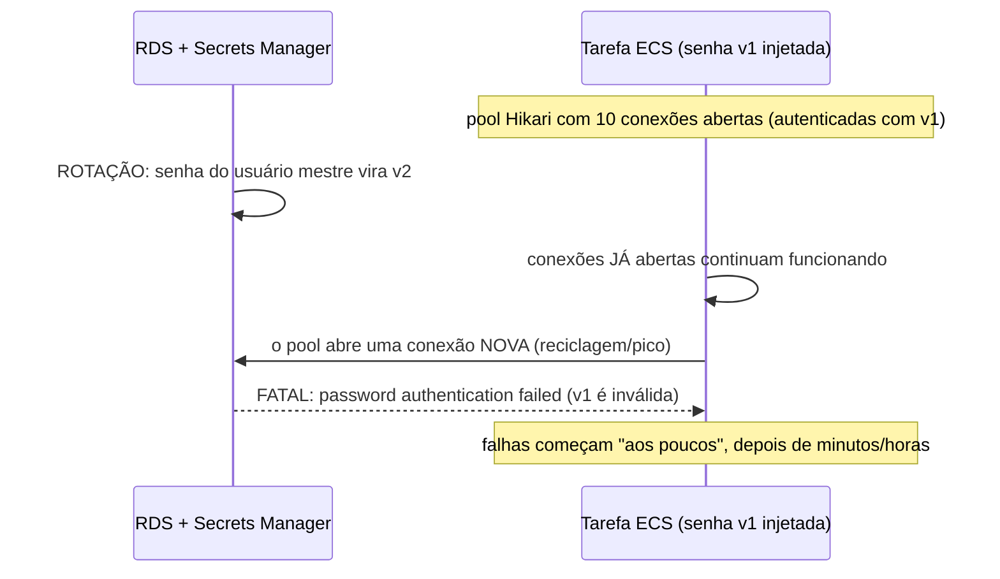

# P9.06 — 💸 Secrets Manager e Parameter Store

> ⏱️ ~1h30 · 🔵 Pleno · Pré-requisitos: **J8.05** (segredos fora do Git), J10.06 (Parameter Store `SecureString`), P7.04 (Secret como arquivo), P8.05 e P8.06 (Terraform: *state* guarda **tudo**), P9.02 (*execution role* × *task role*), P2.06 (*pool* de conexões)

> ✅ **Validação final (2026-11-24):** módulo executado no PayFlow reconstruído; resultado e o que continua não executado no [README do módulo](README.md). Os avisos "não executado" / "por leitura" abaixo descrevem a escrita original.

> 💸 **Secrets Manager cobra por segredo por mês e por 10.000 chamadas de API** ([preços](https://aws.amazon.com/secrets-manager/pricing/): os valores carregam dinamicamente e **não** foram citados); o **Parameter Store padrão** é **sem cobrança adicional** ([documentação](https://docs.aws.amazon.com/systems-manager/latest/userguide/parameter-store-advanced-parameters.html)). **Nada foi criado na AWS real**: tudo foi executado contra o **moto** (emulador de API; **não** faz criptografia KMS real nem rotação automática).

> ⚠️ **Verificação:** **executado** (Terraform 1.17.1, AWS provider 6.73.0, provedor `random` 3.9.1, moto, JDK 25.0.5, AWS SDK for Java 2.59.1): `apply` do módulo `secrets` (um segredo **com valor *write-only* de um recurso *ephemeral***, dois parâmetros) e do segredo **mestre do RDS** (`manage_master_user_password`); a **prova no *state***: o valor do segredo aparece **0 vezes** no `terraform.tfstate` e no plano com a técnica certa e **2 vezes** com a "óbvia"; `SecretRotationTest` (cache com TTL, rotação, `AWSPREVIOUS`, `invalidate`) contra o moto. **Não foi executado:** **rotação automática** (nem a gerenciada pelo RDS: o moto não rotaciona), **KMS** (chave própria), **política de recurso**, **replicação entre regiões**, o **ECS lendo o segredo e injetando** (nenhuma tarefa roda no moto), o **sidecar** que escreve o segredo em volume, **Spring Cloud AWS** e `aws-secretsmanager:` do Spring Boot.

## 🎯 Objetivos
Ao final desta aula você consegue:
- **Escolher** entre **Secrets Manager** e **Parameter Store** para cada dado do PayFlow, com o critério da documentação.
- **Entregar** segredos ao ECS por `valueFrom` (ARN, chave JSON) e **explicar** o risco de variável de ambiente e **quando ela só vale na partida**.
- **Impedir** que um segredo **vá parar no *state*** do Terraform (valor ***write-only*** + recurso ***ephemeral***), **provando** com `grep`.
- **Cachear** um segredo com TTL, **invalidar** quando ele for recusado e **prever** o que uma **rotação** faz com tarefas já em execução.
- **Dar menor privilégio**: quem lê o quê (*execution role* lê para injetar; o código **não precisa** ler).

## 🤔 Por que isso importa
A J8.05 disse "segredos fora do Git"; a J10.06 guardou a senha do banco no Parameter Store; a P8.05 mostrou que o **Terraform guarda no *state*** tudo que lê; a P7.04 montou o segredo **como arquivo**. A P9 junta tudo na AWS e **abre um problema novo**: **a senha do banco vai mudar** (a AWS rotaciona a senha mestra do RDS **a cada 7 dias, por padrão**) e **as suas tarefas estão rodando com a senha velha**. Vazamento de segredo é um dos incidentes mais caros que existem; **rotação mal pensada** é um dos mais comuns.

## 💡 Intuição (explicação simples)
- **Secrets Manager** é o **cofre do banco** com **gerente**: guarda **chaves**, tem **histórico de versões**, sabe **trocar a fechadura** sozinho (rotação) e cobra **aluguel por cofre**.
- **Parameter Store** é o **quadro de avisos do prédio**: ótimo para **horários e regras** (configuração), **de graça** no padrão, e com um **cadeado simples** (`SecureString`) se precisar; mas **não** troca fechaduras sozinho.
- O **ECS** é o **porteiro** que **entrega a chave ao morador no dia da mudança** (partida da tarefa). **Se você trocar a fechadura depois, o morador continua com a chave velha** até a próxima mudança (nova tarefa).

## 🔬 Como funciona por dentro

### Quem guarda o quê (decisão 169, ADR 0021)
A **documentação do Parameter Store** diz com todas as letras: *"para segredos como credenciais de banco, chaves de API ou tokens, **recomendamos o AWS Secrets Manager**, que oferece controles de segurança específicos, incluindo **rotação automática** e replicação entre regiões"*, e traz uma comparação: rotação de credenciais **nenhuma** (Parameter Store) × **automática, com integrações nativas de banco** (Secrets Manager); custo **padrão gratuito, avançado cobrado** × **por segredo por mês e por chamada** ([documentação](https://docs.aws.amazon.com/systems-manager/latest/userguide/systems-manager-parameter-store.html)).
| Dado do PayFlow | Onde | Por quê |
|---|---|---|
| Senha do banco (**mestra**, gerada pelo RDS) | **Secrets Manager**, **criado e rotacionado pelo RDS** (`manage_master_user_password`) | nada no código, no *state* (o atributo `password` é nulo, P8.07) nem no Git |
| Chave que assina os JWTs (J8.06) | **Secrets Manager** | segredo; versões; rotação por **nova versão** |
| `outbox/batch-size`, *flag* `features/webhook-dispatch` | **Parameter Store** (`String`, padrão) | **configuração**, não segredo; sem custo |
| ARNs, URLs de fila, nome do tópico | **variável de ambiente** (`environment`) | não são segredo; vêm do Terraform |

### Os dois modos de entregar ao ECS
1. **`secrets` com `valueFrom` (o do PayFlow):** o **agente** do ECS lê o segredo **com o *execution role*** e **injeta como variável de ambiente** ao iniciar. A sintaxe do ARN, da [documentação](https://docs.aws.amazon.com/AmazonECS/latest/developerguide/secrets-envvar-secrets-manager.html), é **`arn:aws:secretsmanager:região:conta:secret:nome:chave-json:estágio:versão`**; as partes opcionais **pedem os `:` mesmo vazios** (por isso `...:password::`).
2. **Um *sidecar* que lê o segredo e o escreve num **volume compartilhado** (arquivo).** A própria documentação do ECS **recomenda** isso porque *"há um risco elevado de vazamento de dados com **variáveis de ambiente**"* ([documentação](https://docs.aws.amazon.com/AmazonECS/latest/developerguide/specifying-sensitive-data-secrets.html)); e uma terceira: guardar o segredo num **S3 cifrado** e ler com o *task role*.

> ⚖️ **Esta é uma exceção à regra "segredo como arquivo, nunca como variável" (decisão 150).** A P7.04 montou um *Secret* como **arquivo** (`configtree`). No ECS, `valueFrom` **só** entrega variável de ambiente. A decisão 169 **aceita a variável de ambiente** com **três mitigações**: (a) **ECS Exec desligado** (P9.02) e `/actuator/env` **não exposto** (decisão 138: só `health`, `info`, `prometheus`); (b) o **valor nunca é registrado** em log (`SPRING_DATASOURCE_PASSWORD` não é impresso; a P6.01 já proíbe dado sensível); (c) **a variável só existe no processo da tarefa**. **O que a variável de ambiente ainda permite:** quem **tiver acesso ao processo** (um *heap dump*, uma execução de comando) a lê. **Quando mudar para o *sidecar*:** se um requisito (PCI, S5) exigir **arquivos com permissão** ou **rotação sem reiniciar**, o *sidecar* (com um *watcher*) é o caminho. ⚠️ **O *sidecar* não foi executado.**

### A armadilha da rotação: o segredo **só vale na partida**
A documentação do ECS é explícita: *"se o segredo for atualizado ou **rotacionado**, o contêiner **não** recebe o valor novo automaticamente: é preciso **lançar uma nova tarefa** ou, num serviço, **forçar um novo *deployment***"* ([documentação](https://docs.aws.amazon.com/AmazonECS/latest/developerguide/secrets-envvar-secrets-manager.html)). Junte com o que o RDS faz: *"o Amazon RDS **altera a senha do usuário mestre da instância** para coincidir com a nova versão do segredo"* ([documentação](https://docs.aws.amazon.com/AmazonRDS/latest/UserGuide/rds-secrets-manager.html)), **a cada 7 dias por padrão**.

**O que isso significa para o PayFlow:** **uma rotação sem tarefa nova faz o serviço falhar em câmera lenta**, começando pelas **conexões novas**. Opções **(decisão 169)**:
| Opção | Como | Custo |
|---|---|---|
| **A. Forçar novo *deployment* depois de cada rotação** | evento do Secrets Manager (EventBridge) → `update-service --force-new-deployment` | simples; **um *rolling*** a cada 7 dias; ⚠️ **não executado** |
| **B. Ler a senha em tempo de execução, com cache e recarga ao falhar** | o `CachedSecret` (abaixo) atrás de um `DataSource` que **recarrega ao receber "autenticação falhou"** | **código a mais** e **teste do pool** (P2.06); ⚠️ **não executado no PayFlow** |
| **C. Usuário de aplicação separado com rotação por "troca de usuários"** | **P10.05** (gestão e rotação de segredos) | **a certa** para produção; fora do escopo desta aula |
**Decisão:** **A** (a mais barata de entender) **e a dívida registrada**: a aplicação usa a **conta mestra** (por simplicidade do estudo): em produção ela deve usar **um usuário de aplicação com privilégios mínimos** (C). **Desligue a rotação automática do segredo mestre no estudo** se não houver o gatilho do **A**: um serviço que **quebra sozinho** em 7 dias é pior que uma senha velha por 7 dias.

### O cache de segredo (para o código que **lê** em tempo de execução)
Cada `GetSecretValue` é uma **chamada paga e de rede**. O cache com **TTL** evita ambos; o preço é a **janela de defasagem** depois de uma rotação:
```java
package com.payflow.cloud;

import java.time.Clock;
import java.time.Duration;
import java.time.Instant;
import java.util.function.Supplier;

/**
 * A secret read once and cached for a TTL. Why: every GetSecretValue is a billed API call (Secrets Manager charges
 * per 10,000 calls) AND a network round trip on the request path. The price: after a rotation the old value lives
 * until the TTL ends, so a rotation needs the old and the new credential both valid for a while (AWSPREVIOUS).
 */
public final class CachedSecret {

    private final Supplier<String> loader;
    private final Duration ttl;
    private final Clock clock;
    private String value;
    private Instant loadedAt;
    private int loads;

    public CachedSecret(Supplier<String> loader, Duration ttl, Clock clock) {
        this.loader = loader;
        this.ttl = ttl;
        this.clock = clock;
    }

    public synchronized String get() {
        Instant now = clock.instant();
        if (value == null || now.isAfter(loadedAt.plus(ttl))) {
            value = loader.get();
            loadedAt = now;
            loads++;
        }
        return value;
    }

    /** Call when the secret was REJECTED (e.g. authentication failed): the next get() reloads. */
    public synchronized void invalidate() {
        value = null;
    }

    public synchronized int loads() {
        return loads;
    }
}
```
O `SecretRotationTest` **move o relógio** (sem `Thread.sleep`, o mesmo princípio dos `Clock` da J1/J5) e usa o **moto de verdade** (`putSecretValue` cria a **nova versão** e passa o rótulo `AWSCURRENT` para ela; a anterior vira `AWSPREVIOUS`):
```text
T9.6 before rotation          : key-v1 (API calls so far: 1)
T9.6 after rotation, in TTL   : key-v1  <- STALE, no API call
T9.6 after rotation, TTL over : key-v2 (API calls so far: 2)
T9.6 AWSPREVIOUS still readable: key-v1
T9.6 after invalidate()       : key-v3 (reloaded at once)
```
Leia: depois da rotação, **dentro do TTL** o código **ainda vê a chave velha** (`STALE`, **sem** chamar a API); só **depois do TTL** vê a nova (**2** chamadas no total, não 3); `invalidate()` **recarrega na hora** (o que se faz quando o segredo é **recusado**); e `AWSPREVIOUS` **continua legível** (o que permite **os dois valores valerem por um tempo**: sem isso, a rotação vira **corte**). **Regra de ouro da rotação:** **a chave velha só é revogada quando nenhuma instância a usa mais**: **TTL do cache + tempo do *deployment* + margem**.

## 🛠️ Exemplo prático
### 1) O módulo `secrets`: o valor **nunca** passa pelo *state*
```hcl
ephemeral "random_password" "jwt_signing_key" {
  length  = 48
  special = false
}

resource "aws_secretsmanager_secret" "jwt" {
  name                    = "${var.name}/${var.environment}/jwt-signing-key"
  description             = "HMAC key that signs the PayFlow access tokens (rotated by replacing the version)"
  recovery_window_in_days = var.recovery_window_days
}

resource "aws_secretsmanager_secret_version" "jwt" {
  secret_id                = aws_secretsmanager_secret.jwt.id
  secret_string_wo         = ephemeral.random_password.jwt_signing_key.result # WRITE-ONLY: sent to AWS, never stored in the state
  secret_string_wo_version = 1                                                # bump to 2 to ROTATE (write-only values have no diff to detect)
}

```
Dois ingredientes (os dois exigem Terraform **1.11 ou superior**, a [documentação do provedor](https://registry.terraform.io/providers/hashicorp/aws/latest/docs/resources/secretsmanager_secret_version) diz que `secret_string_wo` é o argumento ***write-only*** que substitui `secret_string`, e que exige `secret_string_wo_version`):
- `ephemeral "random_password"`: o valor **existe só durante o `plan`/`apply`**, **não** é gravado no plano nem no *state*;
- `secret_string_wo` (***write-only***): é **enviado à AWS** e **não é guardado** no *state*. Como o Terraform **não tem valor para comparar**, **só** muda o segredo quando você **altera** `secret_string_wo_version`: **é o botão de rotação** (1 → 2).

**A prova** (o `run-cloud.sh` busca o valor **real** no Secrets Manager e procura no *state*):
```text
$ aws secretsmanager list-secrets (names only)
payflow/study/jwt-signing-key
rds!db-88eb5416-bb56-45af-b932-9874460a39e1
$ aws ssm get-parameters-by-path --path /payflow/study --recursive
/payflow/study/features/webhook-dispatch  String  false
/payflow/study/outbox/batch-size          String  50
secret length in Secrets Manager: 48 characters (the value itself is not printed)
$ grep the Terraform state and plan for that value (module: ephemeral random_password + secret_string_wo)
occurrences in terraform.tfstate: 0
occurrences in the saved plan   : 0

# the contrast: the same secret created the "obvious" way (regular random_password + secret_string)
ephemeral: value length 48, occurrences of the value in its terraform.tfstate = 0
leaky: value length 48, occurrences of the value in its terraform.tfstate = 2

```
O **mesmo segredo** criado do jeito **óbvio** (`random_password` comum + `secret_string`) aparece **2 vezes** no `terraform.tfstate`; do jeito **certo**, **0**. Isso **comprova a P8.05**: *"o *state* contém tudo que o provedor leu, inclusive o que é `sensitive`"*, e **mostra o jeito de sair da regra**. Uma ressalva **da documentação do recurso**: ele *"gerencia **uma versão específica** de um segredo"*; se **outra coisa** criar versões novas (**a rotação**, outra configuração, o console), o recurso **continua rastreando a sua versão**, mesmo que ela **já não seja a `AWSCURRENT`**: **não leia o valor "atual" pelo *state***; leia pela API.

### 2) O segredo mestre do RDS e a injeção no ECS
```
# RDS-managed master secret (manage_master_user_password): the JSON that ECS reads with ":username::" and ":password::"
master secret ARN present on the instance: yes
["password","username"]
```
No módulo do ECS (P9.02) os três segredos entram **por referência**:
```hcl
  # The two ways to hand a secret to ECS: valueFrom with the ARN (+ ":json-key::" for RDS' JSON secret)
  secrets = {
    SPRING_DATASOURCE_USERNAME  = "${module.database.master_secret_arn}:username::"
    SPRING_DATASOURCE_PASSWORD  = "${module.database.master_secret_arn}:password::"
    PAYFLOW_SECURITY_JWT_SECRET = module.secrets.jwt_secret_arn
  }
  secret_arns = [module.database.master_secret_arn, module.secrets.jwt_secret_arn]
```
O `terraform test` do `ecs_service` **prova** que a definição da tarefa carrega **só o ARN** (`secrets_are_injected_by_reference_never_by_value`), **não** o valor. **O *execution role*** recebe `secretsmanager:GetSecretValue` **só nesses dois ARNs** (P9.02); o ***task role* não lê segredo nenhum**: o valor **já chegou** como variável.

### 3) Parameter Store: configuração
```
$ aws ssm get-parameters-by-path --path /payflow/study --recursive
/payflow/study/features/webhook-dispatch  String  false
/payflow/study/outbox/batch-size          String  50
```
A hierarquia `/payflow/<ambiente>/...` permite **uma política de IAM por caminho** (`ssm:GetParametersByPath` em `/payflow/study/*`). Para **mudar um *flag* em segundos**, o **P8.04** escolheu a **tabela + cache curto** (decisão 159); o Parameter Store seria uma **terceira opção** (⚠️ **não avaliada**: o limite de requisições e o atraso de propagação dependem da camada e da vazão: ver a [documentação](https://docs.aws.amazon.com/systems-manager/latest/userguide/parameter-store-advanced-parameters.html)).

## 🧠 Pausa para lógica: quando posso revogar a chave velha?
> **Enunciado.** A chave de assinatura dos JWTs (J8.06) é rotacionada. O Secrets Manager passa a devolver a **v2** como `AWSCURRENT`. As tarefas injetaram a **v1** na partida e **não** a recarregam. Você aplica o **A** (forçar *deployment*): o *rolling* leva **6 min** (3 ondas de 2 min) e cada JWT dura **15 min** (a J8.06 usa expiração curta). (a) **Em que instante** a v1 deixa de **assinar** (nenhuma tarefa a usa)? (b) **Em que instante** pode ser **revogada** (rejeitada na **validação**)? (c) E se o código **cacheasse** a chave com TTL de **5 min**? **Dica:** assinar e **validar** são coisas diferentes: tokens **assinados com a v1** continuam **válidos** até **expirar**.
<details><summary>Solução comentada</summary>

(a) Quando a **última** tarefa velha é substituída: **T0 + 6 min** (T0 = início do *deployment*). (b) Um token assinado **no último instante** em que a v1 assinava (T0 + 6 min) vale **mais 15 min**: a v1 só pode ser **rejeitada na validação** em **T0 + 6 + 15 = T0 + 21 min** (+ margem). **Revogar antes** invalida **tokens legítimos** e **desloga usuários**. (c) Com TTL de 5 min, tarefas **recarregam** a chave até **5 min depois** da rotação: o **tempo em que alguém ainda assina com a v1** vai a **T0_rotação + 5 min** (no *cache*) **ou** até a tarefa sair no *rolling* (o que vier **depois**): então a janela de **assinatura** termina em `max(5 min, tempo do rolling)`, e a de **validação** soma **15 min** de novo. **Moral:** a **janela de coexistência** = **tempo de propagação (TTL ou *deploy*) + vida do token**; por isso a rotação segura **valida com as duas chaves** (`kid`, JWKS: P10) durante esse intervalo. **Variação mais difícil:** modele a rotação com **três** chaves (v1, v2, v3) e **um** servidor atrasado que só recarrega a cada 30 min.
</details>

## 🏗️ Estudo de caso: o serviço que quebrou sete dias depois do *deploy*
> **Sintoma:** o PayFlow roda **perfeito** por uma semana e, **no mesmo horário** de uma terça-feira, o alarme de 5xx dispara; o *log* mostra `FATAL: password authentication failed for user "payflow_admin"` **apenas em conexões novas**; **reiniciar** as tarefas **resolve**.
> **Diagnóstico:** (1) **só conexões novas** falham → o *pool* tem conexões **antigas** vivas → a **credencial mudou depois** da partida; (2) a **data** bate com **sete dias** → a **rotação padrão** do segredo mestre do RDS (documentação); (3) **reiniciar** resolve → o ECS injeta o segredo **só na partida** (documentação). **Causa:** o segredo foi **rotacionado** e **as tarefas não foram renovadas**.
> **Opções:** A (forçar *deployment* por evento), B (ler em tempo de execução com recarga ao falhar), C (usuário de aplicação com rotação por troca de usuários), D (**desligar** a rotação).
> **Decisão (169):** **A** agora (evento do Secrets Manager → EventBridge → `force-new-deployment`), **C** na P10.05, e **um alarme** de `5xx` **e** de **erros de autenticação do banco** (P9.07). **D** é **aceitável no estudo**, **inaceitável** em produção sem C. **Consequência:** a rotação **passa a ser um deploy**: ela **herda** o `circuit breaker` e o `rollback`.

## ⚖️ Trade-offs e quando NÃO usar
- **Secrets Manager × Parameter Store `SecureString`:** o **primeiro** custa **por segredo** e rotaciona; o **segundo** é **grátis no padrão** e **não rotaciona**. **Segredo que precisa girar → Secrets Manager.** **Valor sensível estático e barato → `SecureString`** (a própria documentação recomenda o Secrets Manager para credenciais).
- **Variável de ambiente × arquivo (sidecar):** variável é **simples** e **vaza mais fácil**; arquivo dá **permissão** e **recarga sem reiniciar**, ao custo de **um contêiner a mais** e **um *watcher*** na aplicação.
- **Cache com TTL longo × curto:** longo = **menos chamadas** e **mais defasagem após rotação**; curto = o contrário. **TTL maior que o tempo de coexistência das duas chaves quebra a rotação.**
- **KMS próprio:** cobre **auditoria e revogação de chave**; **custo e política** (P10). O padrão usa a chave **gerenciada**.
- **Segredo no Terraform:** **evite**; quando inevitável, **só *write-only*/*ephemeral***. Um `variable ... sensitive` **não** o tira do *state*.
- **Não centralize tudo:** **cada segredo a mais** = **custo mensal** e **superfície** de acesso; **um segredo por finalidade**, **não um por variável**.

## ⚠️ Erros comuns e boas práticas de produção
- **Segredo no *state* "porque o `sensitive` esconde":** ele só esconde **da tela** (P8.05). A prova está acima: **2 ocorrências** × **0**.
- **Política `secretsmanager:*` com `Resource: "*"`** no *task role*: **qualquer** compromisso lê **tudo**. O módulo lê **dois ARNs** e **só o *execution role***.
- **Esquecer `kms:Decrypt`** quando o segredo usa **chave própria** (a documentação do papel de execução lista a permissão): o erro aparece **antes de o contêiner iniciar**. ⚠️ **Texto exato não reproduzido** (o moto não impõe políticas).
- **Colocar a chave `:password::` sem os dois-pontos finais:** a sintaxe **exige** os `:` mesmo com campos vazios (documentação).
- **Ler o segredo "atual" do *state*** quando outra coisa o rotacionou (a nota da documentação do recurso).
- **Logar o valor** (`log.info("senha=" + pwd)`) ou **devolvê-lo no Problem Details**: um **teste** que procura o valor nos logs (P6.01) vale.
- **Rotacionar sem pensar na janela:** a "pausa" acima.
- **Usar o segredo mestre na aplicação** (dívida registrada): **uma injeção de SQL** (J8) vira **controle do banco**.
- **Segredo na imagem Docker ou no `docker compose` versionado** (J9): **nunca**; o `check-secrets.sh` da J8 e o `security.yml` pegam o padrão.

## 🧩 Exercícios
1. **Fixação.** (a) Por que o ECS **não** atualiza o segredo de uma tarefa **em execução**? (b) Qual a **vantagem** de `secret_string_wo` sobre `secret_string`? (c) O que acontece com os **tokens** já emitidos quando você revoga a chave velha **cedo demais**?
2. **Aplicação no PayFlow** (critérios de pronto):
   - [ ] O valor do segredo JWT aparece **0 vezes** em `terraform.tfstate` (`grep -c`) **e** o mutante "óbvio" aparece **2** (prova).
   - [ ] O `ecs_service` recebe **só ARNs** e o *execution role* lê **só 2 segredos**; o *task role* **nenhum**.
   - [ ] `SecretRotationTest` **verde** (5 afirmações: v1, v1 dentro do TTL, v2 depois, `AWSPREVIOUS`, `invalidate`).
   - [ ] ADR 0021 registra a **dívida** (conta mestra) e a **decisão A** (forçar *deployment*).
3. **Desafio.** Escreva (sem aplicar) a regra do EventBridge e a **política do alvo** que dispara `ecs:UpdateService --force-new-deployment` quando o Secrets Manager registra uma **rotação** do segredo mestre. Qual o **padrão de evento**? **Quem** precisa de que **permissão**? (**Não** execute em AWS real.)
<details><summary>Soluções de referência</summary>

1(a) o agente injeta **ao iniciar** a tarefa; depois disso o valor é **uma variável do processo**, que ninguém reescreve (documentação do ECS). (b) o valor **não fica no *state*** nem no plano. (c) **tokens legítimos** passam a ser **rejeitados**: usuários **deslogam**.

3: o evento do Secrets Manager pelo **CloudTrail** (`aws.secretsmanager`, detalhe `RotationSucceeded`/`RotateSecret`: ⚠️ **nomes de evento a conferir** na documentação do Secrets Manager e do EventBridge); alvo: `ecs:UpdateService` via **uma regra com papel** que só pode `ecs:UpdateService` **nesse serviço** (`Resource` = ARN do serviço). **Cuidado:** um laço (a forçada de *deployment* gera outro evento) deve ser **impossível** por desenho.
</details>

## 🎤 Na entrevista
1. **Secrets Manager ou Parameter Store?** *Resposta-modelo:* **Parameter Store** para **configuração** (padrão grátis, hierárquico). **Secrets Manager** para **credenciais**: tem **rotação automática** (integrada a bancos), **versões** (`AWSCURRENT`/`AWSPREVIOUS`) e **replicação**, ao custo **por segredo e por chamada**. A própria documentação do Parameter Store **recomenda** o Secrets Manager para credenciais.
2. **Como um contêiner no ECS recebe um segredo?** *Resposta-modelo:* o **papel de execução** lê o segredo e o agente **injeta como variável de ambiente** (`valueFrom` com o ARN, e `:chave:` para JSON). **Só na partida**: rotacionar exige **nova tarefa**. Alternativa mais segura: **sidecar** escrevendo num volume, ou ler pelo **task role** em tempo de execução.
3. **Como evitar segredo no *state* do Terraform?** *Resposta-modelo:* **recursos *ephemeral*** (`ephemeral "random_password"`) e **argumentos *write-only*** (`secret_string_wo` + `_version`), com Terraform **1.11+**; ou **nunca** deixar o Terraform ler/gerar o segredo (o RDS **gera** e **gerencia** o dele).
4. **O que acontece quando o RDS rotaciona a senha mestra e a app usa a antiga?** *Resposta-modelo:* **conexões abertas continuam**, **conexões novas falham** com *authentication failed*; sintoma **tardio e parcial**. Mitigação: **forçar novo *deployment*** na rotação, **recarregar a credencial ao falhar**, ou, melhor, **usuário de aplicação** com **rotação por troca de usuários**.

## 📚 Para ir além
- 📄 [O que é o AWS Secrets Manager](https://docs.aws.amazon.com/secretsmanager/latest/userguide/intro.html) e [rotação](https://docs.aws.amazon.com/secretsmanager/latest/userguide/rotating-secrets.html) — o modelo de versões e a rotação.
- 📄 [ECS: segredo do Secrets Manager como variável](https://docs.aws.amazon.com/AmazonECS/latest/developerguide/secrets-envvar-secrets-manager.html) — a sintaxe do `valueFrom` e o aviso sobre rotação.
- 📄 [ECS: passar dados sensíveis](https://docs.aws.amazon.com/AmazonECS/latest/developerguide/specifying-sensitive-data-secrets.html) — as opções e o *sidecar*.
- 📄 [RDS e Secrets Manager (senha mestra)](https://docs.aws.amazon.com/AmazonRDS/latest/UserGuide/rds-secrets-manager.html) — rotação a cada 7 dias, por padrão.
- 📄 [Parameter Store](https://docs.aws.amazon.com/systems-manager/latest/userguide/systems-manager-parameter-store.html) e [camadas padrão × avançada](https://docs.aws.amazon.com/systems-manager/latest/userguide/parameter-store-advanced-parameters.html) — a comparação com o Secrets Manager.
- 📄 [Recurso `aws_secretsmanager_secret_version` (provedor AWS)](https://registry.terraform.io/providers/hashicorp/aws/latest/docs/resources/secretsmanager_secret_version) — `secret_string_wo`.
- 📄 [Recursos *ephemeral* e argumentos *write-only* (Terraform)](https://developer.hashicorp.com/terraform/language/resources/ephemeral) — o modelo.
- 🎥 Nenhum vídeo verificado nesta aula.
- 💻 `lab/cloud-lab/terraform/modules/secrets`, `lab/cloud-lab/secret-state-lab/` (a prova no *state*), `lab/aws-sdk-lab` (`CachedSecret`, `SecretRotationTest`).
- 🔁 **Equivalência AWS ↔ Azure ↔ GCP** ([Microsoft](https://learn.microsoft.com/en-us/azure/architecture/aws-professional/security-identity), [Google](https://cloud.google.com/docs/get-started/aws-azure-gcp-service-comparison); **aproximada**):

| AWS | Azure | Google Cloud |
|---|---|---|
| Secrets Manager / Parameter Store | **Key Vault** (a página do Google lista as duas AWS ao lado do Key Vault) | **Secret Manager** |
| KMS | ⚠️ não conferido (de memória: Key Vault/Managed HSM) | Cloud KMS (a página do Google lista) |

## ✅ Checklist da aula
- [ ] Sei o que vai em **Secrets Manager** e o que vai em **Parameter Store**.
- [ ] Rodei a **prova do *state***: **0** × **2** ocorrências.
- [ ] Sei que o ECS injeta o segredo **só na partida** e o que isso faz com a rotação do RDS.
- [ ] Sei o que o `CachedSecret` entrega e o **custo** (defasagem).
- [ ] Sei por que a **janela de coexistência** das chaves existe.
- [ ] Registrei a **dívida**: a aplicação usa a conta **mestra**.
