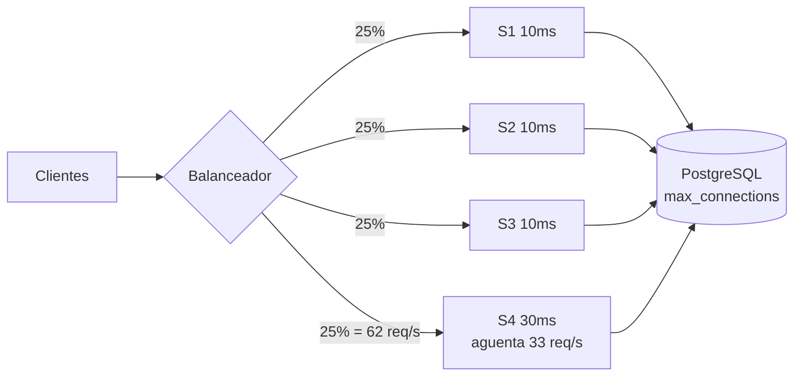

# S1.01 — Escalabilidade vertical vs horizontal e balanceamento de carga

> ⏱️ ~1h30 · 🟣 Sênior · Pré-requisitos: P3.01 (Lei de Little, disponibilidade que se multiplica), P2.06 (pool e `max_connections`), P7.06 (HPA, decisão 152), P9.01 (ALB), P5.10 (cascata)

> ⚠️ **Verificação:** a simulação `lab/LoadBalancerLab.java` **foi executada** (JDK 25.0.5, Linux, 12 núcleos; `java LoadBalancerLab.java`; saída real em `lab/out-s101.txt`). É um **modelo de filas** (um servidor = uma fila FIFO com tempo de serviço exponencial), **não** um balanceador real: os números mostram a **forma** do efeito, não o desempenho de um ALB ou Envoy. **Não executado:** ALB/NLB reais, Envoy, *health checks* com falha real, o PayFlow do aluno. As **fórmulas** de Amdahl são cálculo, não medição.

## 🎯 Objetivos
Ao final desta aula você consegue:
- **Distinguir** escala vertical, horizontal e **por partição**, e **dizer o que impede** cada uma de continuar.
- **Calcular** o teto de ganho de paralelizar (Amdahl) e **explicar** por que "mais máquinas" não é linear.
- **Comparar** aleatório, *round-robin*, **menos requisições em andamento** e **duas escolhas (P2C)** com **dados**.
- **Projetar** um serviço **sem estado** (e dizer onde o estado foi parar) para poder escalar horizontalmente.
- **Aplicar** a conta de **conexões** do banco (decisão 171) a qualquer plano de escala.

## 🤔 Por que isso importa
No Pleno você aprendeu a **colocar** o PayFlow em 2–6 tarefas (P7.06, P9.02). Sênior é **saber quando isso para de ajudar**: o gargalo muda de lugar (CPU → conexões → banco → um único *lock*), e cada passo de escala traz **uma nova classe de falha**. Em entrevista de *system design* a primeira pergunta depois dos requisitos é "o que escala e o que não escala aqui?".

## 💡 Intuição (explicação simples)
Uma padaria com fila no balcão. **Vertical:** contratar um padeiro **mais rápido** (e mais caro) — tem limite: ninguém é 10× mais rápido. **Horizontal:** abrir **mais balcões** — mas agora é preciso decidir **para qual balcão** cada cliente vai (o balanceador) e **todos os balcões dependem do mesmo forno** (o banco). Se o forno só assa 100 pães por hora, o 20º balcão **não vende mais pão**.

## 🔬 Como funciona por dentro

### 1. Três eixos de escala
| Eixo | O que faz | Limite típico | Custo escondido |
|---|---|---|---|
| **Vertical** (*scale up*) | máquina maior | maior instância disponível; **ponto único de falha**; preço **não linear** | reinício para trocar; a JVM com *heap* enorme muda o comportamento do GC (P1) |
| **Horizontal** (*scale out*) | mais cópias iguais atrás de um balanceador | **estado compartilhado** (banco, sessão, cache) e o próprio balanceador | consistência, conexões, observabilidade de N réplicas |
| **Por partição** (*sharding*, S1.03) | cada cópia cuida de **um pedaço** dos dados | operações que cruzam pedaços (transferência entre contas de *shards* diferentes) | transações distribuídas → *sagas* (S1.07) |

**Regra de bolso:** escale **verticalmente primeiro** o que é **estado** (o banco: mais simples e o PostgreSQL agradece), e **horizontalmente** o que é **sem estado** (a aplicação). Só particione o banco quando **medir** que a vertical + réplicas de leitura (P9.08) não bastam.

### 2. Por que "2× máquinas" não dá "2× vazão": Amdahl e além
Se uma fração `p` do trabalho é paralelizável e `1 − p` é **serial** (um *lock*, uma linha quente, um banco único), o ganho com `n` cópias é
`S(n) = 1 / ((1 − p) + p / n)`. Saída do laboratório (**cálculo**, não medição):
```
p=0.90  n=2:1.8x  n=4:3.1x  n=8:4.7x  n=16:6.4x  n=64:8.8x  n=1024:9.9x  limite=10x
p=0.95  n=2:1.9x  n=4:3.5x  n=8:5.9x  n=16:9.1x  n=64:15.4x  n=1024:19.6x  limite=20x
p=0.99  n=2:2.0x  n=4:3.9x  n=8:7.5x  n=16:13.9x  n=64:39.3x  n=1024:91.2x  limite=100x
```
Com **5%** serial (um único `UPDATE` na linha de uma conta quente, P2.02), **1024 máquinas dão 19,6×**. A **Lei de Escalabilidade Universal** (Gunther) acrescenta o custo de **coerência** (`β`): depois de certo `n` a vazão **cai**, porque as cópias gastam tempo se coordenando ([Gunther](https://www.perfdynamics.com/Manifesto/USLscalability.html)). O PayFlow já viu isso: **lock de linha** na conta destino (P2.02) e **`max_connections`** (P2.06) são a parte "serial".

### 3. Sem estado: o que isso exige
Uma instância é **intercambiável** se **nada** que ela guarda é necessário na próxima requisição:
- **Sessão:** J8 já saiu do *session cookie* para o JWT do Keycloak (P10): **a instância não guarda sessão**.
- **Cache local:** serve, mas é **por instância** (cada uma tem o seu; S1.04).
- **`@Scheduled` e *locks* em memória:** quebram com N instâncias (decisões 90, 111: ShedLock).
- **Arquivos em disco local:** não sobrevivem a *deploy*; use o S3.
- **Conexões:** `N × pool` (decisão 181). **Esta é a parte que mais surpreende.**

### 4. Balanceamento: quem escolhe o servidor e com que informação
Camada 4 (TCP, NLB) escolhe por **conexão**; camada 7 (HTTP, ALB, Envoy, Gateway) escolhe por **requisição** e pode usar o **caminho** e os *headers*. Algoritmos:

| Algoritmo | Informação usada | Ponto fraco |
|---|---|---|
| **Aleatório / *round-robin*** | nenhuma | trata servidores **diferentes** como iguais; requisições de **custos diferentes** como iguais |
| **Menos requisições em andamento** (*least outstanding requests*) | contagem de pedidos abertos em **cada** servidor | precisa do **estado global** do balanceador; vários balanceadores têm **visões diferentes** |
| **Duas escolhas** (*power of two choices*, P2C) | sorteia **2** servidores e escolhe o **menos ocupado** | quase tão bom quanto o anterior com **muito menos** estado ([Mitzenmacher](https://www.eecs.harvard.edu/~michaelm/postscripts/tpds2001.pdf)) |
| **Hash consistente** (S1.03) | uma **chave** (conta, usuário) | afinidade ≠ equilíbrio: uma chave quente sobrecarrega **um** servidor |

O **ALB** da AWS oferece `round_robin`, `least_outstanding_requests` e `weighted_random` por *target group*, com o atributo `load_balancing.algorithm.type` ([documentação](https://docs.aws.amazon.com/elasticloadbalancing/latest/application/edit-target-group-attributes.html), conferida em 2026-11-14); o `nginx` e o Envoy têm equivalentes ([nginx](https://nginx.org/en/docs/http/load_balancing.html), [Envoy](https://www.envoyproxy.io/docs/envoy/latest/intro/arch_overview/upstream/load_balancing/overview)).

## 🛠️ Exemplo prático: o servidor lento que o *round-robin* não vê
O laboratório simula **4 servidores**; três atendem em **10 ms** (média) e o quarto em **30 ms** (instância "ruidosa": vizinho barulhento, JIT frio, disco lento). Carga: **75% da capacidade total** (250 req/s de 333 req/s), 400 mil requisições. Rode:
```bash
cd 3-senior/S1-sistemas-distribuidos/lab
JAVA_HOME=/usr/lib/jvm/java-25-openjdk-amd64 $JAVA_HOME/bin/java LoadBalancerLab.java
```
Saída **real** (`lab/out-s101.txt`):
```
capacidade total = 333.3 req/s; carga oferecida = 250.0 req/s (75%); servidor 3 e 3x mais lento
aleatorio          p50=   29.4 ms  p99=1332730.0 ms  p99.9=1384004.2 ms  pedidos por servidor=[100174, 99689, 100417, 99720]
round-robin        p50=   20.1 ms  p99=1340639.9 ms  p99.9=1392261.8 ms  pedidos por servidor=[100000, 100000, 100000, 100000]
menos conexoes     p50=   13.5 ms  p99=   116.3 ms  p99.9=   222.2 ms  pedidos por servidor=[134496, 121468, 103852, 40184]
2 escolhas (P2C)   p50=   20.3 ms  p99=   243.7 ms  p99.9=   386.7 ms  pedidos por servidor=[116337, 115994, 116149, 51520]
```
**Leitura:**
- Com **75% da capacidade total**, o sistema como um todo está **folgado**, mas o *round-robin* manda **25%** do tráfego (62,5 req/s) ao servidor que só aguenta **33 req/s**: a fila dele **cresce sem limite**. Os **1,3 milhão de ms** de p99 (≈ 22 min) são **o tamanho da fila ao fim da simulação**: **dependem da duração do teste**; o que importa é que a fila é **instável** (em produção isso vira *timeout*, P5.07, e retentativas que **pioram** tudo).
- **Menos requisições em andamento** e **P2C** **descarregam** o servidor lento (40 mil e 51 mil pedidos em vez de 100 mil) **sem ninguém configurar peso**. P2C paga **~2×** o p99 do ótimo, mas **só olha 2 servidores**.
- **Ressalva honesta:** **uma** semente e **um** modelo (filas exponenciais, sem *health check*, sem latência de rede, **um** balanceador com **visão perfeita**). Com **vários** balanceadores a visão é **parcial** e o ganho **encolhe**.



## 🏗️ Estudo de caso: "dobramos as tarefas e o p99 piorou"
**Cenário (ilustrativo).** Num pico, o HPA leva o PayFlow de 4 para 6 tarefas (P7.06). O p99 do `POST /transfers` **sobe** de 400 ms para 2 s.
**Diagnóstico.** (1) CPU das tarefas **baixa**; (2) `hikaricp_connections_pending` **> 0** (P6.02); (3) `pg_stat_activity` com **conexões em `idle in transaction`** e **fila de *lock*** na conta do lojista.
**Causa.** Escalar a aplicação **aumentou a concorrência sobre as mesmas linhas**: a parte **serial** (lock da conta quente) não escala (Amdahl), e `6 × 10 = 60` conexões brigam por **uma** linha.
**Opções:** (A) mais tarefas (**piora**); (B) banco maior (não resolve o *lock*); (C) **reduzir a seção crítica** (tirar rede de dentro da transação, P2.02); (D) **dividir o recurso quente** (saldo do lojista em *N* sub-contas somadas na leitura); (E) **fila por conta** (um escritor por conta, via Kafka com chave = conta, decisão 105).
**Decisão (ADR 0024):** medir a **espera por lock** antes de escalar (`pg_stat_activity.wait_event_type = 'Lock'`); escalar a aplicação **só** quando a espera for CPU; recurso quente → (C) e depois (D)/(E).

## 🧠 Pausa para lógica
Um serviço tem **p = 0,95** paralelizável. Quantas máquinas dão **10×**? E **15×**?

<details><summary>Dica e solução</summary>

**Dica:** resolva `S(n) = 10` para `n`: `1/((1−p)+p/n) = 10` → `(1−p) + p/n = 0,1` → `p/n = 0,05` → `n = p/0,05`.

**Solução:** `n = 0,95/0,05 = 19` máquinas para **10×**. Para **15×**: `0,95/n = 1/15 − 0,05 = 0,01667` → `n = 57`. Triplicar o custo (19 → 57) para ganhar **50%** a mais: é a **curva de retornos decrescentes**. **Variação:** com **p = 0,99**, 10× custa **11** máquinas (`0,99/(0,1−0,01)`).
</details>

## ⚖️ Trade-offs e quando NÃO usar
- **Horizontal sem medir** vira **custo** e **mais falha** (N instâncias, N caches, N pools). **Vertical** é **mais simples** enquanto couber.
- **Menos conexões / P2C** exigem **informação**; com dependências **lentas** (banco) todos os servidores ficam "ocupados" e o algoritmo **não ajuda**: o gargalo é **a dependência**.
- **Afinidade de sessão** (*sticky sessions*) **esconde** estado local e **desequilibra** a carga; use só para **cache de arquivos**, nunca para correção.
- **Autoscaling** reage **tarde** (métrica + *cold start*, P9.05); para picos **previsíveis** (dia de pagamento), **escala agendada**.

## ⚠️ Erros comuns e boas práticas de produção
- **Esquecer a conta de conexões** (`N × maximum_percent/100 × pool + administração ≤ max_connections`, **por banco**: decisão 181). Erro real: `FATAL: remaining connection slots are reserved for non-replication superuser connections`.
- **Balanceador como ponto único**: o ALB é **gerenciado e multi-AZ**; o seu `nginx` numa VM **não** é (P9.01).
- **Health check que só diz "o processo está de pé"** manda tráfego a instância **sem banco** (P6.06: *readiness* ≠ *liveness*).
- **Retentativa do cliente + do balanceador** multiplicam a carga (P5.07): `3 × 3 = 9`.
- **Escala de saída sem teste de falha de uma instância** (retire uma e olhe o p99): é o teste mais **barato** de confiabilidade.

## 🧩 Exercícios
1. **Fixação:** (a) por que o *round-robin* falhou no laboratório mesmo com 75% de carga total? (b) o que o P2C precisa saber de cada servidor? (c) por que 1024 máquinas dão 19,6× com p = 0,95?
2. **Aplicação no PayFlow** (por leitura; **não executado**):
   - [ ] No *target group* do ALB do PayFlow (P9.01/P9.02), **troque** o algoritmo para `least_outstanding_requests` **no Terraform** (`aws_lb_target_group.load_balancing_algorithm_type`; **confira o nome do atributo** no *provider* da versão fixada, P8) e **meça** o p95 com uma tarefa **artificialmente lenta** (`Thread.sleep` num *endpoint* de teste).
   - [ ] Escreva, em `docs/escala.md`, a **tabela de teto por componente**: aplicação (CPU), conexões (`max_connections`), linha quente (lock), Kafka (partições = 3, decisão 105), Redis. Para cada um: **o que mede** o teto e **qual alerta** avisa.
   - [ ] Refaça a **conta de conexões** para 6 tarefas com `maximum_percent = 200` e pool 10: `6 × 2 × 10 = 120` (**passa** de `max_connections = 100`; decisão 171).
   - Pronto quando: a tabela existe com **medidas ou "a medir"**, a conta está escrita e o alarme de **conexões > 80%** tem *runbook*.
3. **Desafio:** altere `LoadBalancerLab` para **2 balanceadores** com **visões independentes** do estado (cada um só conta o que **ele** enviou) e compare o p99 do "menos conexões" com o do P2C. O que muda?

<details><summary>Solução de referência (1)</summary>

(a) Porque a **média** da carga não importa: **cada fila** tem de ser **estável** (`λ_i < μ_i`). O *round-robin* deu **62,5 req/s** a quem aguenta **33**. (b) Só do **número de requisições em andamento** dos **dois** sorteados (estado **local** e barato). (c) Porque a fração **serial** (5%) **limita** o ganho a `1/0,05 = 20×`; com `n = 1024` o termo `p/n` é ~0, sobra **19,6×**.
</details>

## 🎤 Na entrevista
1. **"Como você escalaria um serviço Java com banco?"** Aplicação **sem estado** atrás de balanceador (horizontal); banco **vertical** + **réplicas de leitura** para relatórios; antes de qualquer escala, **achar o gargalo** (CPU, conexões, *lock*, I/O) e checar a **conta de conexões**. Partição só com **medida** que justifique.
2. **"Por que dobrar as máquinas não dobra a vazão?"** **Lei de Amdahl:** a parte **serial** (lock, banco único) limita o ganho a `1/(1−p)`; e a **coerência** (USL) pode até **reduzir** a vazão.
3. **"Round-robin ou menos conexões?"** *Round-robin* só serve com servidores **iguais** e requisições **parecidas**; com heterogeneidade, **menos requisições em andamento** ou **P2C** (medi: p99 de **116–244 ms** contra uma fila instável).
4. **"O que significa serviço sem estado?"** Nenhuma informação **necessária à próxima requisição** mora na instância; o estado vai para **banco, cache ou token**.

## 📚 Para ir além
- 📄 [AWS Builders' Library: Using load shedding to avoid overload](https://aws.amazon.com/builders-library/using-load-shedding-to-avoid-overload/): o que fazer **quando** o balanceamento não basta (recusar cedo).
- 📄 [Google: The Tail at Scale](https://research.google/pubs/the-tail-at-scale/): por que o **p99** domina em sistemas com muitas chamadas e as técnicas (requisições redundantes, *hedging*).
- 📄 [Mitzenmacher: The Power of Two Choices in Randomized Load Balancing](https://www.eecs.harvard.edu/~michaelm/postscripts/tpds2001.pdf): a prova de por que **2** basta.
- 📄 [AWS Builders' Library: Static stability using Availability Zones](https://aws.amazon.com/builders-library/static-stability-using-availability-zones/): capacidade **reservada** para sobreviver à perda de uma zona.
- 📑 *Designing Data-Intensive Applications* (Kleppmann), cap. 1 (**escalabilidade** e descrição de carga) e cap. 6 (particionamento) (**de memória, não conferido**).

## ✅ Checklist da aula
- [ ] Sei dizer o teto de cada eixo de escala e **o que o limita**.
- [ ] Calculei Amdahl para um `p` do **meu** sistema.
- [ ] Rodei `LoadBalancerLab` e expliquei por que o *round-robin* falha.
- [ ] Refiz a conta de conexões com `maximum_percent`.
