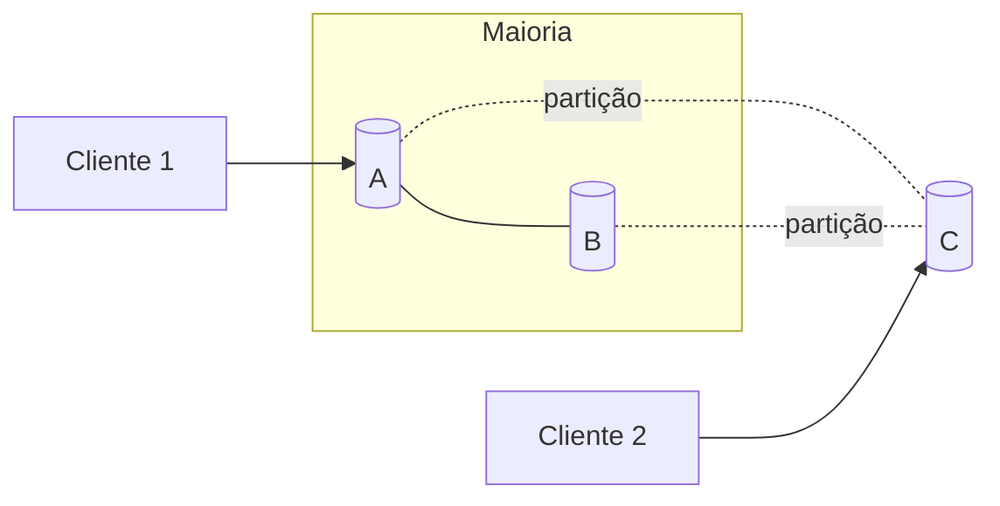

# S1.02 — CAP, PACELC e modelos de consistência

> ⏱️ ~1h30 · 🟣 Sênior · Pré-requisitos: S1.01, P2.01 (isolamento e anomalias), P3.06 (garantias de entrega), P9.08 (réplica de leitura e atraso), P3.04 (Kafka)

> ⚠️ **Verificação:** `lab/ConsistencyLab.java` **foi executado** (JDK 25.0.5; `lab/out-s102.txt`). É uma **simulação** de réplicas e de partição (sem rede, sem banco real): mostra a **lógica** dos quóruns e do LWW, **não** o comportamento do PostgreSQL, do Kafka ou do Redis. As **classificações** (CP/AP, PACELC) de produtos reais são **leitura de documentação**, não teste (e a aula explica por que classificar produto é arriscado). **Não executado:** *failover* real, partição de rede real (Jepsen), `synchronous_commit` no PayFlow.

## 🎯 Objetivos
Ao final desta aula você consegue:
- **Enunciar** o teorema CAP **corretamente** (o que ele diz e o que **não** diz) e o **PACELC**.
- **Ordenar** os modelos de consistência (linearizável → sequencial → causal → sessão → eventual) e **dar um exemplo do PayFlow** de cada.
- **Calcular** quóruns (`R + W > N`) e **provar** com simulação quando a leitura **pode** vir velha.
- **Escolher a consistência por operação** (e não por sistema) para o PayFlow, justificando.
- **Detectar** o erro "LWW descarta escrita silenciosamente".

## 🤔 Por que isso importa
"Esse banco é CP ou AP?" é a pergunta de entrevista mais **mal respondida**. Na prática o sênior decide **por operação**: transferir dinheiro **precisa** de consistência forte; a lista de notificações **não**. Quem decide "tudo forte" **paga latência e disponibilidade**; quem decide "tudo eventual" **perde dinheiro**. A decisão tem de estar **escrita** (ADR 0024).

## 💡 Intuição (explicação simples)
Duas agências do mesmo banco, com **o telefone entre elas cortado** (partição). Chega um cliente em cada uma e pede para **sacar tudo** da mesma conta. Opção 1: as agências **recusam** o saque (**consistência**, mas indisponível). Opção 2: **ambas pagam** (**disponibilidade**) e depois descobrem que **pagaram o dobro**. Não existe opção 3 **enquanto o telefone está cortado**. O CAP é só isso; o resto da aula é o **que fazer o resto do tempo**, quando o telefone **funciona** mas é **lento**.

## 🔬 Como funciona por dentro

### 1. CAP sem mitos
- **C (consistência)** no CAP = **linearizabilidade**: cada operação parece acontecer **em um instante** entre o pedido e a resposta, numa **ordem única** que todos veem ([Gilbert e Lynch](https://groups.csail.mit.edu/tds/papers/Gilbert/Brewer2.pdf)). **Não** é o "C" do ACID (que é "o banco respeita as invariantes").
- **A (disponibilidade)** = **todo** nó que **não falhou** responde **toda** requisição (não "99,9% de uptime").
- **P (partição)**: a rede **vai** perder ou atrasar mensagens. **Não é opção**: é uma **condição**.
- Enunciado correto: **durante uma partição**, escolha entre **C** e **A**. Fora da partição **nenhum dos dois precisa ser sacrificado** pelo CAP.
- **Armadilhas:** "escolha 2 de 3" é **enganoso** (Brewer o revisou em [CAP Twelve Years Later](https://www.infoq.com/articles/cap-twelve-years-later-how-the-rules-have-changed/)); e **rotular produtos** como CP/AP é **frágil**: depende da **configuração** e da **operação** ([Kleppmann: Please stop calling databases CP or AP](https://martin.kleppmann.com/2015/05/11/please-stop-calling-databases-cp-or-ap.html)).

### 2. PACELC: o que acontece quando **não** há partição
Daniel Abadi: **P**artição → escolha **A** ou **C**; **E**lse (senão) → escolha **L**atência ou **C**onsistência ([PACELC](https://www.cs.umd.edu/~abadi/papers/abadi-pacelc.pdf)). **Replicar** custa **ida e volta de rede**: esperar a réplica (consistência) **soma latência**; não esperar (latência) deixa a réplica **atrás**. No PayFlow isso **já aconteceu**: P9.08 mediu **96%** de perda de leitura imediata na réplica com ~3 ms de atraso. **PACELC é a decisão do dia a dia; CAP é a do desastre.**

### 3. A escada de consistência (do mais forte ao mais fraco)
| Modelo | Garantia | Exemplo no PayFlow | Custo |
|---|---|---|---|
| **Linearizável** | uma ordem global, "tempo real" | saldo e transferência **no primário** (P2.01/P2.02) | latência e disponibilidade |
| **Sequencial** | uma ordem global, não necessariamente "tempo real" | ordem dos lançamentos **por conta** (partição Kafka, decisão 105) | menor |
| **Causal** | respeita "A causou B" | "recibo" depois do "débito" no extrato | metadados (relógios, S1.10) |
| **Garantias de sessão** | *read-your-writes*, leituras **monotônicas** | "acabei de transferir e **vejo** a transferência" | roteamento por sessão |
| **Eventual** | **converge** se as escritas pararem | contador de notificações não lidas; `ledger_monthly` (decisão 103) | **conflitos** |
O mapa completo está em [jepsen.io/consistency](https://jepsen.io/consistency). **Anomalias do Pleno (P2.01)** são o mesmo assunto **dentro de um banco**: *dirty read*, *lost update*, *write skew*; aqui o assunto é **entre réplicas**.

### 4. Quóruns: `R + W > N`
Num grupo de `N` réplicas, uma escrita é considerada feita quando `W` confirmam, uma leitura consulta `R` e pega a **versão mais nova**. Se `R + W > N`, **todo** conjunto de leitura **cruza** todo conjunto de escrita: a leitura **vê** a última escrita **confirmada**. É a ideia do **Dynamo** ([paper](https://www.allthingsdistributed.com/files/amazon-dynamo-sosp2007.pdf)) e dos sistemas que o imitam. **Cuidado:** quórum **não** dá linearizabilidade sozinho (há casos com escritas **concorrentes**, falhas parciais e relógios); dá **leituras sem defasagem** só no caso simples.

## 🛠️ Exemplo prático: o laboratório
```bash
cd 3-senior/S1-sistemas-distribuidos/lab
JAVA_HOME=/usr/lib/jvm/java-25-openjdk-amd64 $JAVA_HOME/bin/java ConsistencyLab.java
```
### Parte 1: quóruns (N = 3; 100 mil pares escrita→leitura **imediata**, antes da propagação assíncrona)
```
W=1 R=1  W+R=2 <= N  leituras velhas:  66547 de 100000 (66.55%)
W=1 R=2  W+R=3 <= N  leituras velhas:  33418 de 100000 (33.42%)
W=2 R=1  W+R=3 <= N  leituras velhas:  33343 de 100000 (33.34%)
W=2 R=2  W+R=4 > N  leituras velhas:      0 de 100000 (0.00%)
W=3 R=1  W+R=4 > N  leituras velhas:      0 de 100000 (0.00%)
W=1 R=3  W+R=4 > N  leituras velhas:      0 de 100000 (0.00%)
```
- **`R + W ≤ N`: há leituras velhas** (66,6% com 1+1; 33% com soma = N, pois ainda é possível **não cruzar**). **`R + W > N`: zero** em 100 mil tentativas, como a teoria diz (**prova** por cruzamento de conjuntos).
- Os valores 66,6% e 33,3% batem com a conta: com `W=1,R=1` a leitura acerta a réplica escrita com probabilidade `1/3`; com soma `N` acerta `2/3`.

### Parte 2: leituras que voltam no tempo
Um cliente escreve `v1…v50`; 3 réplicas seguidoras recebem com atraso de 0 a 4 *ticks*; ele lê **uma réplica aleatória** a cada *tick*:
```
leituras que voltaram no tempo (versao menor que a ja vista): 7 de 50; leituras defasadas em relacao ao lider: 40
lendo SEMPRE da mesma replica (sticky): leituras que voltaram no tempo = 0
```
A tela mostra **R$ 400** e, no *refresh*, **R$ 300** (porque caiu em outra réplica **mais atrasada**). **Leitura monotônica** se garante **sem** consistência forte: basta **fixar** a réplica da sessão (ou carregar a "versão mínima" no pedido, S1.05).

### Parte 3: partição `{A,B} | {C}` e o LWW
```
CP (so a maioria grava)
   A grava 80: aceita
   C grava 60: RECUSADA (sem quorum)
   B grava 70: aceita
   C grava 50: RECUSADA (sem quorum)
   gravacoes aceitas=2 recusadas=2; apos curar (LWW) todos ficam com 70
AP (todos gravam, LWW ao curar)
   A grava 80: aceita
   C grava 60: aceita
   B grava 70: aceita
   C grava 50: aceita
   gravacoes aceitas=4 recusadas=0; apos curar (LWW) todos ficam com 50  <- as gravacoes 80, 60 e 70 foram DESCARTADAS silenciosamente
```
- **CP:** o lado **minoritário** (C) **recusa** (o cliente vê erro e **sabe**); ao curar, **nada** a reconciliar.
- **AP + LWW** (*last write wins*): todos aceitam e, ao curar, **uma** escrita vence e **as outras somem sem aviso**. Para **saldo** isso é **perder dinheiro**. Para "último dispositivo usado" é **aceitável**. **AP serve quando o dado tem uma regra de fusão** (contador, conjunto, *CRDT*), **não** quando a regra é "vale a última".



## 🏗️ Estudo de caso: "a transferência sumiu da tela" (e o que fazer)
**Cenário (ilustrativo).** O app mostra o extrato lendo da **réplica** (P9.08). O usuário transfere R$ 100 e, ao voltar ao extrato, **não vê** a transferência; faz de novo; **duas** transferências.
**Diagnóstico.** (1) Escrita no **primário**; (2) leitura na **réplica** com atraso (P9.08: 96% de perda na leitura imediata); (3) sem *read-your-writes*.
**Opções:** (A) ler tudo do primário (**simples**, carga alta no primário); (B) **réplica só para relatório** (decisão 171) e o que o usuário **acabou de fazer** do primário; (C) **token de versão** no retorno do `POST` (`X-Ledger-Seq`) e a leitura **espera** a réplica alcançá-lo (S1.05); (D) `synchronous_commit = remote_apply` para um **subconjunto** de transações ([documentação](https://www.postgresql.org/docs/18/runtime-config-wal.html)): **paga latência em toda escrita**.
**Decisão (ADR 0024):** **(B) hoje** (já decisão 171) e **(C) no extrato** (S1.05); (D) **não**: latência **em toda** transferência para evitar um problema que **só** o extrato tem.

## 🧠 Pausa para lógica
Com **N = 5**, quais pares `(W, R)` dão leitura sem defasagem e **qual** minimiza a latência de **escrita** (que é mais cara)? E se uma réplica **cair**, quais ainda **funcionam**?

<details><summary>Dica e solução</summary>

**Dica:** `R + W > 5`; a latência da escrita cresce com `W`; tolerar `f` falhas exige `W ≤ N − f` **e** `R ≤ N − f`.

**Solução:** o menor `W` com leitura **correta** é `W = 1, R = 5` (escrita **rápida**, leitura **lenta** e **sem tolerância a falha** de nenhuma réplica na leitura). O equilíbrio comum é **`W = R = 3`**: tolera **2** falhas em cada operação (`3 ≤ 5 − 2`) e `3 + 3 = 6 > 5`. Com **1** réplica caída, `W=3,R=3` continua; `W=1,R=5` **perde** a leitura. **Lição:** `R + W > N` é **condição de correção**; `W` e `R` são o **botão** latência × disponibilidade.
</details>

## ⚖️ Trade-offs e quando NÃO usar
- **Consistência forte global** (um **só** líder, *consenso* tipo Raft: [paper](https://raft.github.io/raft.pdf)) custa **latência entre regiões** e **disponibilidade** se o líder cair; **não** use para tudo.
- **Eventual** só quando a **fusão** é **definida** (somar, unir conjuntos, "o mais novo **por campo**"); com LWW **por registro inteiro** você escolhe quem perde.
- **Quórum em PostgreSQL?** Não é o modelo dele: **um** primário e réplicas (síncronas ou assíncronas). Não force vocabulário de Dynamo em tudo.
- **Rotular "o PayFlow é CP"** é **inútil**: o **saldo** é CP, o **contador de notificações** é AP, o **extrato** é **sessão**.

## ⚠️ Erros comuns e boas práticas de produção
- Dizer "**C do CAP** é o C do ACID". **Não é.**
- **Réplica assíncrona + failover automático** pode **perder** as últimas escritas (o RPO da réplica assíncrona **não é zero**; S4 trata RPO/RTO).
- **Ler da réplica logo após escrever** (visto: 96%).
- **LWW com relógio de parede** descarta a escrita **mais nova** se o relógio da máquina **estiver atrasado** (S1.10).
- **Escolher consistência no cliente** sem ADR: a decisão vira **folclore**.

## 🧩 Exercícios
1. **Fixação:** (a) por que `W=2,R=1` com `N=3` ainda deu 33% de leituras velhas? (b) o que o CAP **exige** quando **não** há partição? (c) por que o `AP + LWW` do laboratório **descartou** 3 escritas?
2. **Aplicação no PayFlow** (por leitura; **não executado**): preencha em `docs/consistencia.md` a tabela **operação → modelo → mecanismo → o que o usuário vê se falhar**:
   - [ ] `POST /transfers` → linearizável → primário + `@Version`/lock (P2) → erro `503` (**não** aceitar escrita sem primário).
   - [ ] `GET /accounts/{id}` (saldo) → linearizável → primário.
   - [ ] `GET /accounts/{id}/statement` → *read-your-writes* → S1.05.
   - [ ] contador de notificações → eventual → fusão = **soma** idempotente (S1.08).
   - [ ] relatório mensal → eventual com "**atualizado em**" (decisão 103) → réplica.
   - Pronto quando: **cada linha** tem **mecanismo** e **mensagem de erro**, e a tabela está na ADR 0024.
3. **Desafio:** estenda `ConsistencyLab` para a escrita **depender** do tempo (relógio de parede com desvio) e mostre quando o **quórum** `W=2,R=2` **ainda** devolve dado velho (dica: escritas **concorrentes** com versões **iguais**).

<details><summary>Solução de referência (1)</summary>

(a) Com `W + R = N` ainda existem **conjuntos que não se cruzam**: com `W=2,R=1`, só **2 das 3** réplicas têm a escrita, então a leitura de **1** réplica cai na que **não** tem com probabilidade `1/3` (medido: 33,34%). (b) Nada: **pode** ser C **e** A; o custo aparece na **latência** (PACELC). (c) Porque **LWW** mantém só a de **maior *timestamp***: a de C (50, ts 4) venceu as de A (80), C (60) e B (70).
</details>

## 🎤 Na entrevista
1. **"Explique o CAP."** **Durante uma partição**, um sistema **não** consegue ser **linearizável** e **totalmente disponível** ao mesmo tempo; escolhe-se **qual sacrificar**. O "C" é **linearizabilidade**, não o C do ACID. **Fora** da partição a escolha é **latência × consistência** (PACELC).
2. **"O PostgreSQL é CP ou AP?"** **Depende da operação e da configuração**: escrita no **primário** único é consistente e **indisponível** sem primário; ler de réplica assíncrona **sacrifica** consistência por latência. Rotular o produto é impreciso.
3. **"O que é `R + W > N`?"** Condição para que **leitura e escrita se cruzem** em ao menos uma réplica; mede-se: **0%** de leituras velhas contra **33–67%** quando `R + W ≤ N` (simulação).
4. **"Quando aceitar consistência eventual?"** Quando há **regra de fusão** (somar, unir) **e** o erro temporário **não é dano** (preferência, contador); **nunca** para **saldo**.

## 📚 Para ir além
- 📄 [Gilbert e Lynch: Brewer's conjecture and the feasibility of consistent, available, partition-tolerant web services](https://groups.csail.mit.edu/tds/papers/Gilbert/Brewer2.pdf): a **prova** do CAP e as definições precisas.
- 📄 [Abadi: Consistency Tradeoffs in Modern Distributed Database System Design (PACELC)](https://www.cs.umd.edu/~abadi/papers/abadi-pacelc.pdf): por que o **dia a dia** importa mais que a partição.
- 📄 [Kleppmann: Please stop calling databases CP or AP](https://martin.kleppmann.com/2015/05/11/please-stop-calling-databases-cp-or-ap.html): por que rotular produtos engana.
- 📄 [Jepsen: Consistency models](https://jepsen.io/consistency): o **mapa** dos modelos e as relações entre eles.
- 📄 [DeCandia et al.: Dynamo](https://www.allthingsdistributed.com/files/amazon-dynamo-sosp2007.pdf): quóruns, *hinted handoff*, vetores de versão.
- 📑 *Designing Data-Intensive Applications*, cap. 5 (replicação) e cap. 9 (consistência e consenso) (**de memória, não conferido**).

## ✅ Checklist da aula
- [ ] Enuncio o CAP **sem** "escolha 2 de 3".
- [ ] Sei o que o PACELC acrescenta.
- [ ] Rodei o laboratório e expliquei os 0% e os 33%.
- [ ] A tabela **operação → consistência** do PayFlow está escrita.
