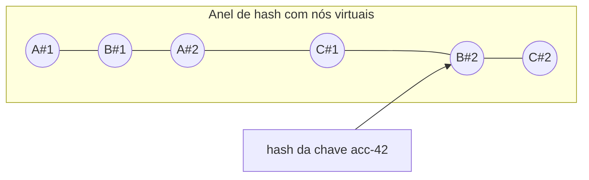

# S1.03 — Replicação e particionamento

> ⏱️ ~1h30 · 🟣 Sênior · Pré-requisitos: S1.01, S1.02, P9.08 (réplica de leitura), P3.04/P3.05 (partições Kafka e chave), P2.06 (conexões)

> ⚠️ **Verificação:** `lab/ShardingLab.java` **foi executado** (JDK 25.0.5; `lab/out-s103.txt`): é um **modelo** (anel de *hash* em memória, distribuição Zipf sintética), **não** um cluster. **Não executado:** *sharding* real no PostgreSQL (FDW/Citus), Redis Cluster, replicação síncrona/lógica no PayFlow, *rebalanceamento* com dados. As citações de **documentação** (16384 *slots* do Redis; `max_prepared_transactions` = 0 por padrão) foram **conferidas** em 2026-11-14.

## 🎯 Objetivos
Ao final desta aula você consegue:
- **Comparar** replicação **líder-seguidor** (síncrona, assíncrona), **multi-líder** e **sem líder**.
- **Escolher** a **chave de partição** e a **estratégia** (faixa, *hash*, *hash* consistente) para um caso, **justificando**.
- **Medir** (no laboratório) o que acontece com as chaves ao **adicionar um nó**, o efeito dos **nós virtuais** e a **chave quente**.
- **Explicar** por que o PayFlow **não** particiona hoje e **qual evidência** mudaria a decisão.
- **Identificar** operações que **atravessam partições** e **o que elas custam** (→ S1.07).

## 🤔 Por que isso importa
Replicar é **como se sobrevive** (disponibilidade, leitura); particionar é **como se cresce** além de **uma máquina** (escrita, volume). São respostas a problemas **diferentes** e se **combinam**. O erro típico do Pleno é particionar **cedo demais** ("vai crescer") e herdar **para sempre** a perda de transações simples, *joins* e *foreign keys* entre partições.

## 💡 Intuição (explicação simples)
Uma biblioteca. **Replicar** = ter **cópias do mesmo livro** em várias filiais (mais gente lê ao mesmo tempo; se uma filial pega fogo, o livro existe; mas **atualizar uma edição** exige avisar todas). **Particionar** = **dividir o acervo**: filial A guarda autores A–F, filial B guarda G–M... (cabe mais livros). Se **todo mundo** quer o mesmo best-seller (**chave quente**), a filial que o guarda **lota**, mesmo com 10 filiais. E um **empréstimo entre filiais** (transferência entre duas partições) exige **combinar** as duas.

## 🔬 Como funciona por dentro

### 1. Replicação: quem aceita escrita
| Modelo | Como | Bom para | Custo / risco |
|---|---|---|---|
| **Líder-seguidor** (primário-réplica) | **um** líder escreve; seguidores copiam o log | **PostgreSQL** (P9.08), MySQL, Kafka (por partição) | *failover* (promover um seguidor), **atraso** (S1.02) |
| **Síncrona** × **assíncrona** | líder espera (ou não) o seguidor confirmar | síncrona: **RPO ≈ 0**; assíncrona: **latência** | síncrona **para** escrita se o seguidor cai; assíncrona **perde** as últimas escritas num *failover* |
| **Multi-líder** | vários aceitam escrita (ex.: um por região) | latência local; funcionamento **offline** | **conflitos** de escrita (exigem regra de fusão: S1.02, S1.10) |
| **Sem líder** (Dynamo) | qualquer nó aceita; **quóruns** `R+W>N` | disponibilidade alta | leitura com **reparo**, relógios, conflitos |
No PostgreSQL: `synchronous_commit` e `synchronous_standby_names` controlam **quem** confirma antes do `COMMIT` voltar ([documentação](https://www.postgresql.org/docs/18/runtime-config-wal.html)); o resumo das opções de **alta disponibilidade** e **balanceamento de leitura** está em [High Availability](https://www.postgresql.org/docs/18/high-availability.html).

### 2. Particionamento (*sharding*): como dividir
| Estratégia | Regra | Vantagem | Problema |
|---|---|---|---|
| **Por faixa** | chave em intervalos (`A–F`, 2026-01..03) | **varreduras por faixa** baratas | **chave monotônica** (tempo, ID crescente) → **todas as escritas novas no mesmo shard** |
| **Por *hash* mod N** | `hash(chave) % N` | distribui **bem** | **mudar N move quase tudo** |
| **Hash consistente** | nós e chaves num **anel**; a chave pertence ao **próximo nó** | adicionar um nó move **~1/N** | sem **nós virtuais** o equilíbrio é **ruim** |
| **Slots fixos** | `hash → slot` (muitos) → `slot → nó` | mover **slots**, não chaves | tabela de slots a manter. **Redis Cluster** usa **16384 *slots*** (`CRC16(chave) mod 16384`) ([documentação](https://redis.io/docs/latest/operate/oss_and_stack/management/scaling/)) |
| **Por diretório** | uma tabela diz **onde** cada chave está | flexível (mover uma conta) | o diretório vira **gargalo** e **ponto único** |

**Particionamento secundário:** índices por **outra** coluna ou **vão para todos os shards** (consulta em *scatter-gather*) ou ficam **locais** a cada shard; nenhum é grátis.

## 🛠️ Exemplo prático: três medições
```bash
cd 3-senior/S1-sistemas-distribuidos/lab
JAVA_HOME=/usr/lib/jvm/java-25-openjdk-amd64 $JAVA_HOME/bin/java ShardingLab.java
```
### 1. Acrescentar o 5º nó a um grupo de 4 (100 mil chaves)
```
hash mod N      : 79979 chaves mudam de no (80.0%)
anel vnodes=  1 :  22634 chaves mudam (22.6%); com 5 nos: maior no=57047 menor no=3219 (ideal 20000; maior/ideal=2.85)
anel vnodes= 16 :  16405 chaves mudam (16.4%); com 5 nos: maior no=24216 menor no=16405 (ideal 20000; maior/ideal=1.21)
anel vnodes=128 :  19205 chaves mudam (19.2%); com 5 nos: maior no=22018 menor no=18192 (ideal 20000; maior/ideal=1.10)
anel vnodes=512 :  21417 chaves mudam (21.4%); com 5 nos: maior no=21417 menor no=18018 (ideal 20000; maior/ideal=1.07)
(ideal ao acrescentar o 5o no: 1/5 = 20,0% das chaves)
```
- **`hash mod N`: 80%** das chaves **trocam de nó** (cache **frio** ou **dados a mover**). O **anel** move **~20%** (o ideal `1/5`).
- **1 nó virtual por servidor** equilibra **mal** (o maior nó fica com **2,85×** o ideal; o menor, com 3,2 mil de 20 mil). **16** nós virtuais já dão 1,21×; **128**, 1,10×; **512**, 1,07×. O **custo** é **memória** do anel e tempo de **construção**.
- (Em `vnodes=512` o "maior" é igual a "mudam" **por coincidência de contagem**: o nó novo recebe **todas** as chaves que se movem.)

### 2. Chave quente (1 milhão de acessos; 10 mil contas; Zipf s = 1,1; 8 *shards* por *hash* da conta)
```
acessos por shard = [89913, 94880, 207869, 110413, 114152, 215890, 73979, 92904]; maior/media = 1.73; a conta mais quente sozinha = 151438 acessos (15.1% do total)
```
**Dois** *shards* recebem **~2×** o tráfego dos demais, e **uma conta** sozinha responde por **15,1%**: **nenhum *hash*** resolve isso, porque a **mesma chave** sempre cai no **mesmo** lugar. Técnicas: **cache** na frente (S1.04), **dividir a chave** (`conta#0…#7`, **somar** na leitura), **fila por chave** (um escritor), ***hedging***.

### 3. Chave monotônica (1 milhão de escritas "agora", 8 *shards*)
```
particao por FAIXA do tempo : [0, 0, 0, 0, 1000000, 0, 0, 0]
particao por HASH da chave  : [125084, 124725, 125209, 125029, 124985, 124661, 125230, 125077]
```
Por **faixa de tempo**, **100%** das escritas novas vão para **um** *shard*; por *hash*, **12,5%** cada. **UUIDv7** (decisão 14) é **ordenado no tempo**: ótimo para **índice B-tree** (P2.05), **ruim** como chave de **faixa** de *sharding*. **Moral:** a chave que serve para **índice** não é necessariamente a que serve para **partição**.



## 🏗️ Estudo de caso: "quando o PayFlow deveria particionar?"
**Contexto.** O PayFlow hoje: **um** PostgreSQL 18 (primário) + **uma** réplica para relatório (decisão 171). A pergunta do time: "temos de *shardear* o `ledger_entries`?".
**Evidência necessária (nada disso foi medido no PayFlow do aluno):**
1. **Escrita:** o primário passa de **~70% de CPU/IOPS** com **otimizações** feitas (índices P2.05, *batch* P2.08, locks curtos P2.02)?
2. **Volume:** a tabela passa de **centenas de milhões** de linhas e o *vacuum*/índice **não** acompanha? (**particionar a tabela** no mesmo banco, S3, vem **antes** de *sharding*).
3. **Isolamento:** um tenant/cliente grande precisa de **isolamento** de falha?
**Opções:** (A) **não** particionar, escalar o primário **verticalmente** e cortar leitura para réplicas; (B) **particionar a tabela** por mês no **mesmo** banco (S3); (C) ***sharding* por `account_id`** em N bancos; (D) banco **distribuído** (CockroachDB, Spanner, YugabyteDB: **não** avaliados aqui).
**Consequência de (C) para o PayFlow:** a **transferência** (`source` → `target`) cruza *shards* quando as contas estão em lugares diferentes: **perde a transação ACID de um banco** e vira **saga** (S1.07) com **idempotência** (S1.08) e **conciliação** (S1.12). O `PREPARE TRANSACTION` do PostgreSQL (2PC) existe, mas **`max_prepared_transactions` vem em `0` por padrão** ([documentação](https://www.postgresql.org/docs/18/runtime-config-resource.html)), exige **coordenador** e **bloqueia** linhas se ele cair (medido em S1.07).
**Decisão (ADR 0024):** **(A) agora**, com **gatilhos** escritos: reabrir a discussão se (1) o primário passar de 70% **depois** das otimizações **ou** (2) a maior tabela passar de um limite **medido** de manutenção. **Chave de *shard* futura = `account_id`** (a mesma das partições Kafka, decisão 105); **UUIDv7 não** serve como chave de faixa.

## 🧠 Pausa para lógica
Um anel de *hash* tem **K** nós físicos com **v** nós virtuais cada. Ao **remover** um nó, **quanto** das chaves muda de dono, em média? E **para onde** vão?

<details><summary>Dica e solução</summary>

**Dica:** as chaves do nó removido são as únicas que se movem; cada nó virtual dele entrega suas chaves ao **próximo** nó virtual no anel.

**Solução:** muda **`1/K`** das chaves (as do nó removido). Com **v alto**, elas se **espalham** pelos `K−1` restantes (cada um recebe ~`1/(K(K−1))` do total); com **v = 1**, **todas** vão para **um** vizinho, que **dobra** de carga (risco de **cascata**: ele cai e passa o dobro ao próximo). **Lição:** os nós virtuais também protegem **na falha**, não só na adição.
</details>

## ⚖️ Trade-offs e quando NÃO usar
- **Sharding** custa **JOINs, FKs, transações e índices globais**. **Não** use enquanto **um** servidor (vertical) + **réplicas** + **particionamento de tabela** (S3) resolvem.
- **Multi-líder** só com **regra de fusão** **e** necessidade real (multirregião com escrita local). **Não** para dinheiro.
- **Replicação síncrona** dá RPO ≈ 0 e **para** a escrita se o seguidor cai: use **mais de um** seguidor candidato ou aceite **degradar** (`synchronous_standby_names` com `ANY`/`FIRST`).
- **Hash mod N** só se **N nunca muda** ou se **recarregar tudo** é barato.

## ⚠️ Erros comuns e boas práticas de produção
- **Chave de *shard* mal escolhida** (data, ID sequencial, país): **uma** partição vira ponto quente (medido: 100% no mesmo *shard*).
- **Esquecer a chave quente** (o lojista famoso): *hash* não resolve.
- **Rebalancear com tráfego** sem **limite de vazão** da cópia: derruba a origem.
- **Trocar réplica por *shard* achando que é "escalar leitura"**: são problemas distintos.
- **Consulta *scatter-gather* em todo pedido**: a latência é a **do mais lento** dos N (cauda; [The Tail at Scale](https://research.google/pubs/the-tail-at-scale/)).

## 🧩 Exercícios
1. **Fixação:** (a) por que `hash mod N` move 80% ao ir de 4 para 5? (b) o que os nós virtuais mudam no equilíbrio? (c) por que a chave quente **não** some com mais *shards*?
2. **Aplicação no PayFlow** (por leitura; **não executado**):
   - [ ] Escreva em `docs/particionamento.md` a **análise de chaves** para `ledger_entries`: `account_id` (bom: uma conta num *shard*), `created_at` (**ruim**: quente), `transfer_id` (**ruim**: espalha as duas pernas).
   - [ ] Liste as **operações que cruzam contas** (transferência, estorno `reversal_of`, conciliação, extrato conjunto) e marque **o que vira saga**.
   - [ ] Defina os **gatilhos** numéricos (a medir) para reabrir a decisão e **onde** o alerta mora (P6.04).
   - Pronto quando: há **uma tabela** de chaves com veredito, **a lista de operações cruzadas** e **os gatilhos com dono**.
3. **Desafio:** altere o laboratório para **adicionar** o 5º nó **e** simular a **remoção** do 3º; compare o **maior/ideal** de `vnodes=1` e `vnodes=128` **após a remoção**.

<details><summary>Solução de referência (1)</summary>

(a) Porque `k mod 4` e `k mod 5` **coincidem** só quando `k mod 20 < 4`: `4/20 = 20%` das chaves ficam; **80%** mudam (medido: 79.979 de 100.000). (b) Cada nó físico ocupa **muitos pontos** pequenos no anel; a **soma** dos arcos fica **próxima de `1/K`** (maior/ideal cai de 2,85 para 1,10 com 128). (c) Porque a **mesma chave** sempre vai para o **mesmo** *shard*: mais *shards* dividem as **outras** chaves, **não** a quente.
</details>

## 🎤 Na entrevista
1. **"Replicação × particionamento?"** Replicar **copia os mesmos dados** (leitura e disponibilidade); particionar **divide os dados** (escrita e volume). Combinam-se: cada *shard* tem **réplicas**.
2. **"Como escolher a chave de partição?"** Pelo **padrão de acesso**: a que mantém **uma operação em um *shard***, **distribui** bem e **não** é monotônica. Medi: tempo por faixa → **100%** num *shard*; *hash* → **12,5%** cada. **Chave quente** exige tratamento extra.
3. **"Por que hash consistente?"** Porque `hash mod N` **move 80%** das chaves ao mudar N (medido) e o anel move **~1/N**; com **nós virtuais** o equilíbrio fica **~1,1×** o ideal.
4. **"Vocês deveriam fazer *sharding*?"** **Só com evidência** (CPU/IOPS do primário **após** otimizar, volume que o *vacuum* não acompanha) e **sabendo** o preço: transações viram **sagas**.

## 📚 Para ir além
- 📄 [PostgreSQL: High Availability, Load Balancing, and Replication](https://www.postgresql.org/docs/18/high-availability.html): as opções (síncrona, assíncrona, lógica) e seus **limites**.
- 📄 [PostgreSQL: Table Partitioning](https://www.postgresql.org/docs/18/ddl-partitioning.html): **particionar a tabela** sem *sharding* (retomado na S3).
- 📄 [Redis: Scale with Redis Cluster](https://redis.io/docs/latest/operate/oss_and_stack/management/scaling/): *hash slots*, `{hash tags}`, o que **não** funciona em chaves de *slots* diferentes.
- 📄 [AWS Builders' Library: Workload isolation using shuffle sharding](https://aws.amazon.com/builders-library/workload-isolation-using-shuffle-sharding/): limitar o **raio de explosão** de um cliente ruim.
- 📄 [DeCandia et al.: Dynamo](https://www.allthingsdistributed.com/files/amazon-dynamo-sosp2007.pdf): hash consistente com nós virtuais em produção.
- 📑 *Designing Data-Intensive Applications*, cap. 5 e 6 (**de memória, não conferido**).

## ✅ Checklist da aula
- [ ] Sei **quando** replicar e **quando** particionar.
- [ ] Rodei o laboratório e expliquei o **80%** e o **2,85×**.
- [ ] O PayFlow tem **gatilhos escritos** para o *sharding*.
- [ ] Listei as operações que **cruzam** partições.
