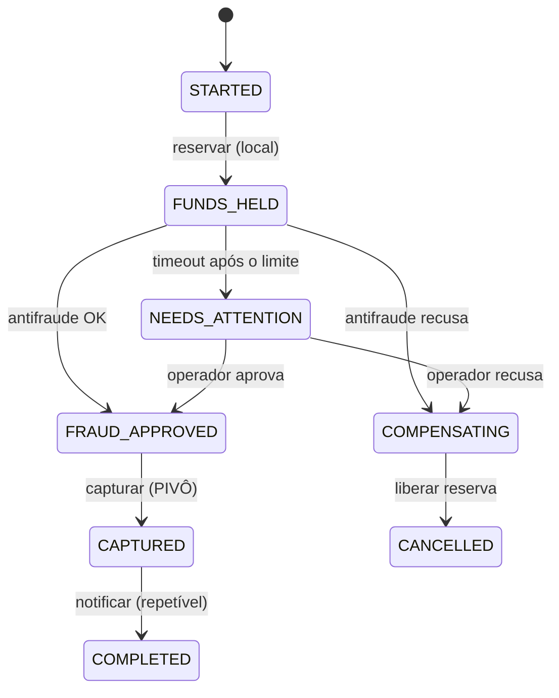

# S1.07 — Sagas e transações distribuídas (por que evitar 2PC)

> ⏱️ ~1h30 · 🟣 Sênior · Pré-requisitos: S1.02, S1.05, P3.07 (idempotência), P3.08 (retry e DLQ), P3.09 (Outbox), P3.10 (pagamento por QR, webhook), P5.07/P5.08 (timeout, breaker), P2.02 (locks)

> ⚠️ **Verificação:** `lab/SagaLab.java` **foi executado** (JDK 25.0.5; `lab/out-s107.txt`): uma **saga orquestrada em memória** (4 passos, falhas injetadas em cada um, compensação com falha e *retry*, queda do orquestrador com recuperação pelo log) e uma **simulação de 2PC** bloqueado. **Não é** um motor de *workflow* (Temporal, Camunda) nem o PayFlow do aluno. **Não executado:** o orquestrador `payment` do PayFlow (**por leitura**), `PREPARE TRANSACTION` real, XA, Kafka/HTTP entre serviços. A **extração do antifraude** como serviço é **hipótese de estudo** desta aula (decisão 190), não código existente.

## 🎯 Objetivos
Ao final desta aula você consegue:
- **Explicar** por que uma **transação ACID entre serviços/bancos** é difícil e **por que o 2PC bloqueia**.
- **Projetar** uma **saga orquestrada** com **passos**, **compensações**, **pivô** e **passos repetíveis**.
- **Tratar** o **timeout** como **"resultado desconhecido"**, não como "falhou".
- **Comparar** orquestração × coreografia e **escolher** com justificativa.
- **Persistir** o estado da saga para **sobreviver a quedas** e **provar** com teste que o **dinheiro se conserva** em cada falha.

## 🤔 Por que isso importa
No monólito, a transferência é **uma transação** (J3.10, J6.03). Assim que um passo vive **em outro serviço** (antifraude, PSP, notificações), **não existe** `COMMIT` que cubra tudo. O sênior sabe **três coisas**: (1) **evitar** o problema (manter dinheiro **na mesma transação**: decisão 104); (2) quando não der, **compensar** em vez de **travar**; (3) **cada passo** pode **falhar, repetir ou ficar em dúvida**.

## 💡 Intuição (explicação simples)
**Reservar uma viagem:** voo, hotel, carro. Cada reserva é **uma ligação** para empresas diferentes. Se o **hotel** recusar, você **liga para a companhia aérea cancelar** (compensação). **2PC** seria **todos** concordarem **antes** de qualquer um confirmar, **todos** esperando **o mesmo atendente**: se ele **desmaia** no meio, **ninguém** libera a reserva. A **saga** aceita que cada ligação é **definitiva na hora** e **desfaz com outra ligação**.

## 🔬 Como funciona por dentro

### 1. Por que não 2PC
**Two-Phase Commit:** um **coordenador** pede `PREPARE` a todos (fase 1: "você **consegue** confirmar? **trave** os recursos e **prometa**"); se **todos** dizem sim, manda `COMMIT` (fase 2).
- **Bloqueio:** depois de votar **sim**, o participante **não pode decidir sozinho**: tem de **esperar** o coordenador. Se o coordenador **cai** entre as fases, **os participantes ficam presos**, com **locks** abertos. Medido (simulação, `lab`):
```
participantes votaram SIM e nao podem decidir sozinhos: bloqueados por 500 de 1000 ticks; 137 operacoes novas na mesma conta esperaram (ou falharam) nesse intervalo
```
(**Modelo:** o coordenador volta no *tick* 500; 30% dos *ticks* chega uma operação **à conta presa**. Os números ilustram o **mecanismo**, não uma taxa real.)
- **Disponibilidade que se multiplica** (P3.01): a transação só termina se **todos** os participantes **e** o coordenador estiverem de pé.
- **Heterogeneidade:** **Kafka, HTTP, e-mail, PSP** **não** participam de XA/2PC. Só **bancos** (e filas JMS) falam XA.
- **No PostgreSQL**, `PREPARE TRANSACTION` existe, mas **`max_prepared_transactions` é `0` por padrão** (recurso desligado) ([documentação](https://www.postgresql.org/docs/18/runtime-config-resource.html), conferida em 2026-11-14; [`PREPARE TRANSACTION`](https://www.postgresql.org/docs/18/sql-prepare-transaction.html)); transações preparadas **esquecidas** seguram *locks* e **impedem o *vacuum***.
- **Quando 2PC é aceitável:** **dois bancos do mesmo time**, rede **confiável**, **coordenador** robusto (ex.: dentro de um produto que o encapsula, como Spanner). **Entre serviços de times diferentes: evite.**

### 2. Saga: a ideia
**Saga** (Garcia-Molina e Salem, 1987: [paper](https://www.cs.cornell.edu/andru/cs711/2002fa/reading/sagas.pdf)): uma **sequência de transações locais** `T1…Tn`, cada uma com uma **compensação** `C1…Cn−1`. Se `Tk` falha, executam-se `Ck−1…C1` **em ordem reversa**. **Não há isolamento** entre os passos: **outros veem os estados intermediários** (a saga é **ACD sem o I**). Descrições: [microservices.io: Saga](https://microservices.io/patterns/data/saga.html) e [Microsoft: Saga](https://learn.microsoft.com/en-us/azure/architecture/patterns/saga).

**Três tipos de passo** (decida **cada um** na hora de desenhar):
| Tipo | Regra | Exemplo no PayFlow |
|---|---|---|
| **Compensável** | tem desfazer **semântico** | **reservar fundos** (`HELD`) → compensação **liberar** |
| **Pivô** | ponto **sem volta**: depois dele, **só avança** | **capturar** (lançar débito e crédito) |
| **Repetível** | depois do pivô; **idempotente**, repete **até dar certo** | **notificar**, publicar evento |
**Compensar é semântico, não um `ROLLBACK`:** "estornar" um crédito é um **novo lançamento** (decisão 114), **visível** no extrato.

### 3. O resultado medido: a saga do pagamento
O laboratório tem 4 passos (`reservar → antifraude → creditar → notificar`) com saldo 500 e pagamento de 100. Saída **real**:
```
caminho feliz                                -> COMPLETA                                         pagador=400 lojista=100 reservado=0 dinheiro conservado=true
saldo insuficiente (saldo 50)                -> COMPENSADA (saldo insuficiente)                  pagador=50 lojista=0 reservado=0 dinheiro conservado=true
antifraude recusa                            -> COMPENSADA (antifraude recusou)                  pagador=500 lojista=0 reservado=0 dinheiro conservado=true
falha em 'creditar'                          -> COMPENSADA (falha injetada no passo creditar)    pagador=500 lojista=0 reservado=0 dinheiro conservado=true
falha em 'notificar' tratada como compensavel -> COMPENSADA (falha injetada no passo notificar)   pagador=500 lojista=0 reservado=0 dinheiro conservado=true
idem, e o estorno de 'creditar' falha 3x     -> COMPENSADA (falha injetada no passo notificar)   pagador=500 lojista=0 reservado=0 dinheiro conservado=true
   log: OK reservar | OK antifraude | OK creditar | FALHA falha injetada no passo notificar | DESFEZ creditar (apos 3 tentativa(s) falha(s)) | DESFEZ antifraude | DESFEZ reservar
falha em 'notificar' REPETIDA (apos o pivo)  -> COMPLETA                                         pagador=400 lojista=100 reservado=0 dinheiro conservado=true

```
**Leituras:**
- Em **todos** os cenários **o dinheiro se conserva** (`pagador + lojista + reservado = 500`): é o **invariante** que **o teste prova**.
- **A compensação também falha:** o estorno de `creditar` falhou **3×** e foi **repetido** até dar certo (por isso a compensação **tem de ser idempotente e repetível**, S1.08).
- **O erro de projeto está na 5ª linha:** tratar "**notificar**" como **compensável** **estorna o dinheiro por causa de um e-mail**. A **correta** é a última: **depois do pivô**, o passo falho é **repetido** (aqui, 2 falhas e sucesso) e a saga **completa**. **Regra:** **não** compense dinheiro por falha de **passo repetível**.

### 4. Timeout = "resultado desconhecido"
`antifraude` não respondeu em 300 ms (P5.07). **O comando pode ter sido executado** (e a resposta se perdeu). **Não** é "falhou": é **desconhecido**. Procedimento:
1. **Repita** o comando com a **mesma chave** `sagaId:antifraude` (S1.08): o serviço **devolve** a decisão **já tomada**.
2. **Consulte** o estado (`GET /assessments/{sagaId}`) em vez de reenviar.
3. Esgotou o limite (ex.: 5 tentativas em 2 min)? **Política de negócio**, **escrita**: p.ex. pagamentos **até R$ 100** seguem (`APPROVED_BY_TIMEOUT`, **sinalizado**) e **acima disso** vão para **revisão manual** (`NEEDS_ATTENTION`), **mantendo a reserva** até alguém decidir. **Nunca** "aprovar tudo" nem "recusar tudo" por padrão **sem decisão de negócio**.

### 5. Orquestração × coreografia
| | **Orquestração** (um **coordenador** manda) | **Coreografia** (cada serviço **reage** a eventos) |
|---|---|---|
| Visibilidade | **uma** tabela de estado; fácil perguntar "onde está o pagamento X?" | espalhada em N serviços; precisa de **tracing** (P6.05) |
| Acoplamento | o orquestrador **conhece** os passos | serviços **desacoplados**, mas com **dependências implícitas** (ciclos) |
| Compensação | **explícita** no orquestrador | cada serviço escuta falhas dos outros |
| Risco | orquestrador vira **"deus"** | **ninguém** sabe o fluxo inteiro |
| Bom para | fluxos **longos, ≥ 3 passos, com compensação** | fluxos **curtos**, **2–3** participantes |
**Decisão (190):** **orquestração** no módulo `payment` (poucos passos, **dinheiro**, necessidade de **visibilidade** e de **auditoria**); **coreografia** só para os **efeitos colaterais** (notificar, relatório), por **eventos** (P3).

### 6. O estado da saga **precisa sobreviver**
A saga **é** uma máquina de estados persistida. Medido: **queda do orquestrador** após o 2º passo e **retomada pelo log**:
```
QUEDA apos 'antifraude'. Estado: pagador=400 reservado=100 lojista=0 ; log durável=[OK reservar, OK antifraude]
apos a recuperacao: pagador=400 reservado=0 lojista=100 ; log=[OK reservar, OK antifraude, OK creditar, OK notificar]
```
O novo processo **lê o log** e **retoma do primeiro passo sem `OK`**. Por isso cada passo é **idempotente** (se a queda foi **depois** do efeito e **antes** do registro, ele **repete**: S1.08) e o **estado** é gravado **na mesma transação** que o **comando** do Outbox (P3.09): sem isso, "mudei o estado mas não enviei o comando" (ou o inverso).



## 🛠️ Exemplo prático: o desenho no PayFlow (por leitura; **não executado**)
**Migração V15** (depois de V13/V14 da S1.05):
```sql
CREATE TABLE account_holds (
    id         UUID PRIMARY KEY DEFAULT uuidv7(),
    account_id UUID          NOT NULL REFERENCES accounts(id),
    saga_id    UUID          NOT NULL,
    amount     NUMERIC(19,2) NOT NULL CHECK (amount > 0),
    status     VARCHAR(10)   NOT NULL CHECK (status IN ('HELD','CAPTURED','RELEASED')),
    CONSTRAINT uk_account_holds_saga_id UNIQUE (saga_id)            -- idempotência da reserva
);
CREATE TABLE payment_sagas (
    id                 UUID PRIMARY KEY,                             -- = Idempotency-Key do cliente (derivada)
    payment_request_id UUID          NOT NULL UNIQUE,
    state              VARCHAR(20)   NOT NULL,
    version            BIGINT        NOT NULL,                       -- @Version
    attempts           INT           NOT NULL DEFAULT 0,
    last_error         VARCHAR(300),
    updated_at         TIMESTAMPTZ   NOT NULL DEFAULT now()
);
```
**Saldo disponível** = `balance − Σ holds HELD` (a regra 1 **continua** valendo: nunca negativo); **o saldo de verdade só muda no pivô**, com os lançamentos (regra 5).
**Passos** (cada um **idempotente** pela chave `sagaId:passo`):
```java
enum State { STARTED, FUNDS_HELD, FRAUD_APPROVED, CAPTURED, COMPLETED, COMPENSATING, CANCELLED, NEEDS_ATTENTION }

interface SagaStep {
    State from(); State to();
    void execute(PaymentSaga s);          // IDEMPOTENTE: repetir não repete o efeito
    default void compensate(PaymentSaga s) {}   // IDEMPOTENTE; só nos compensáveis
}
// no orquestrador (uma transação por transição):
@Transactional
void advance(UUID sagaId) {
    var s = sagas.findForUpdate(sagaId);                       // lock da linha da saga
    var step = steps.next(s.state());
    step.execute(s);                                           // efeito local OU grava o comando no Outbox
    s.moveTo(step.to());                                       // mesma transação
}
```
**Varredura** de sagas paradas: `@Scheduled` + **ShedLock** (decisão 111) lê sagas `state NOT IN (COMPLETED, CANCELLED)` e `updated_at < now() − 2 min` e chama `advance` (ou escala para `NEEDS_ATTENTION`). **Resposta** ao cliente: `202 Accepted` com `Location: /payments/{id}` (decisão 104); o estado final chega por **SSE** (P3.11) ou *polling*.
**Teste** (a fazer): `PaymentSagaTest` **injeta falha em cada passo** (como o laboratório) e verifica o **invariante** `Σ saldos + Σ holds HELD = constante`; **mutante**: remover a compensação de `FUNDS_HELD` **reprova** o teste.

## 🏗️ Estudo de caso: "o dinheiro ficou preso"
**Cenário (ilustrativo).** Num domingo, o antifraude fica **indisponível por 40 min**. Dezenas de pagamentos ficam em `FUNDS_HELD`; os usuários veem **"saldo disponível" menor** e **nada acontece**.
**Diagnóstico.** (1) `payment_sagas` com muitas linhas em `FUNDS_HELD` e `attempts` alto; (2) *breaker* do antifraude **aberto** (P5.08); (3) `account_holds.HELD` crescendo; **não** há perda de dinheiro (o saldo real **não** mudou).
**Opções:** (A) **liberar** todas as reservas após 5 min (**tira o pagamento do usuário** sem decisão de risco); (B) **aprovar** por *timeout* (**abre mão** do antifraude: risco de **fraude**); (C) **política por valor**: até o limite **segue** (sinalizado), acima **fica** em `NEEDS_ATTENTION` com **alerta** e **prazo** (24 h) para **liberar** a reserva; (D) **substituir** o passo síncrono por um **desfecho assíncrono** (a saga **espera o evento** de decisão, sem *timeout* do cliente).
**Decisão (ADR 0024):** **(C)** + alerta "sagas em `NEEDS_ATTENTION` > N" + *runbook*; a **reserva** **expira** sozinha em 24 h (`released_by_timeout`). O **dinheiro nunca** fica preso **sem dono**.

## 🧠 Pausa para lógica
Uma saga de **5 passos**: `A (compensável) → B (compensável) → C (pivô) → D (repetível) → E (repetível)`. (a) Se **B** falha, quais compensações rodam e **em que ordem**? (b) Se **D** falha, o que se faz? (c) Se a **queda** ocorre **entre** C e o registro de "C feito", o que acontece na retomada?

<details><summary>Dica e solução</summary>

**Dica:** compensações vão **para trás** e **só** nos passos **já feitos**; depois do pivô, **só para frente**.

**Solução:** (a) **só `A`** (`B` falhou: **não** foi feito, **não** se compensa): roda `C_A`. (b) **Repetir `D`** (com *backoff* e limite) **até dar certo** e **depois** `E`; **não** compensa `C`. (c) Na retomada, o log **não** tem "C feito", então **repete `C`**: **só é seguro** se `C` for **idempotente** (chave `sagaId:C`, `UNIQUE`); por isso a **idempotência é pré-requisito** de qualquer saga.
</details>

## ⚖️ Trade-offs e quando NÃO usar
- **Primeiro, evite**: se dá para manter os passos **na mesma transação** (mesmo banco), **faça**. O PayFlow mantém **débito e crédito** juntos (decisão 104); a saga só envolve o que **realmente** está fora.
- **Sagas não têm isolamento**: outros veem `FUNDS_HELD`. Contramedidas: ***semantic lock*** (a **reserva** é exatamente isso), operações **comutativas**, **reler** antes de agir.
- **Compensação nem sempre existe** (e-mail enviado, dinheiro **fora** do sistema): o passo vai para **depois do pivô** ou **exige aprovação humana**.
- **Orquestrador** é **mais um componente**: se for um **motor** (Temporal, Camunda), é **mais uma plataforma** para operar. Para **uma** saga de 4 passos, **uma tabela e um `@Scheduled`** bastam.
- **2PC**: **não** entre serviços; **talvez** entre **dois bancos seus**, com `max_prepared_transactions` e **monitoramento** de preparadas esquecidas.

## ⚠️ Erros comuns e boas práticas de produção
- **Tratar timeout como falha** (e compensar um passo que **foi** executado): duplica efeito ou estorna dinheiro **que saiu**.
- **Compensação que não é idempotente** (estorna **duas vezes**).
- **Compensar passo repetível** (visto no laboratório).
- **Estado da saga fora da transação do comando**: **comando perdido** ou **duplicado**.
- **Sem varredura** de sagas paradas: elas ficam **para sempre**.
- **Sem `correlation id`**: não se acha a saga nos logs (P6.01); use `sagaId` como `traceId`/`baggage`.

## 🧩 Exercícios
1. **Fixação:** (a) por que o 2PC bloqueia? (b) o que é o **pivô**? (c) por que **timeout ≠ falha**?
2. **Aplicação no PayFlow** (por leitura; **não executado**):
   - [ ] Desenhe a **máquina de estados** (acima) em `docs/payment-saga.md`, marcando **cada passo** como compensável/pivô/repetível **e** a **chave de idempotência** de cada um.
   - [ ] Escreva `PaymentSagaTest` com **falha injetada em cada passo** e o **invariante de conservação**; **mutante** (sem compensação) **reprova**.
   - [ ] Escreva a **política de timeout do antifraude** (valor-limite, prazo da reserva) **aprovada** por quem decide risco (anote **quem**), e o **runbook** de `NEEDS_ATTENTION`.
   - Pronto quando: **todos** os estados têm **saída** (nenhum "beco"), o **mutante falha**, e há **alerta** de saga parada.
3. **Desafio:** em `SagaLab`, acrescente um **passo "PSP"** **sem compensação** (envio de TED) e **reordene** para que ele seja o **pivô**; mostre **quais** falhas **antes** dele **ainda** compensam.

<details><summary>Solução de referência (1)</summary>

(a) Depois do `PREPARE` o participante **prometeu** e **segura** os recursos; só o **coordenador** decide. Se ele **cai**, **ninguém** pode decidir sozinho **sem risco de divergir**: **bloqueio** (medido: 500 de 1000 *ticks*). (b) O passo **a partir do qual não se desfaz**; antes dele **compensa-se**, depois **só se avança** (repetindo). (c) Porque o chamador **não viu a resposta**, mas o **efeito pode ter ocorrido**; só **repetir com a mesma chave** (ou **consultar**) resolve **sem duplicar**.
</details>

## 🎤 Na entrevista
1. **"Como você faz uma transação entre dois serviços?"** **Saga**: transações **locais** com **compensações**; **orquestrada** quando há visibilidade/compensação; **cada passo idempotente**; **pivô** e **passos repetíveis**; **estado persistido** com o comando (Outbox).
2. **"Por que não 2PC?"** **Bloqueia** se o coordenador cai (medi: 500 de 1000 ticks presos), a **disponibilidade se multiplica**, heterogêneos (Kafka/HTTP) **não** participam, e no PostgreSQL vem **desligado** (`max_prepared_transactions = 0`).
3. **"A compensação falha. E agora?"** **Repetir** (ela é **idempotente**), com *backoff*; se esgotar, **alerta** e **intervenção humana**; **nunca** abandonar em silêncio. Medi: estorno com 3 falhas e sucesso na 4ª.
4. **"Saga tem isolamento?"** **Não**: ACD sem I. Use **reserva** (*semantic lock*), operações comutativas e **releitura**.

## 📚 Para ir além
- 📄 [Garcia-Molina e Salem: Sagas (1987)](https://www.cs.cornell.edu/andru/cs711/2002fa/reading/sagas.pdf): o **paper original** (transações longas, compensação).
- 📄 [microservices.io: Saga](https://microservices.io/patterns/data/saga.html): orquestração × coreografia e **contramedidas** à falta de isolamento.
- 📄 [Microsoft: Saga pattern](https://learn.microsoft.com/en-us/azure/architecture/patterns/saga): problemas e **quando evitar**.
- 📄 [PostgreSQL: PREPARE TRANSACTION](https://www.postgresql.org/docs/18/sql-prepare-transaction.html): o 2PC **do banco** e o aviso sobre transações **esquecidas**.
- 📄 [Temporal: Workflows](https://docs.temporal.io/workflows): **execução durável** (estado reconstruído do histórico) como alternativa a escrever o orquestrador.
- 📑 Pat Helland, *Life beyond Distributed Transactions: an Apostate's Opinion* (ACM Queue, 2016) (**⚠️ link não verificado**: o site da ACM recusou o `curl`; procure pelo título).

## ✅ Checklist da aula
- [ ] Sei **por que** 2PC bloqueia e **quando** ele ainda cabe.
- [ ] Classifiquei cada passo: **compensável / pivô / repetível**.
- [ ] Trato **timeout como desconhecido** e escrevi a **política**.
- [ ] O **estado** da saga está na **mesma transação** do comando.
