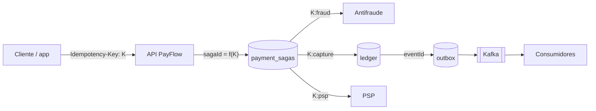

# S1.08 — Idempotência ponta a ponta

> ⏱️ ~1h30 · 🟣 Sênior · Pré-requisitos: S1.07, J6.06 (`Idempotency-Key` na API), P3.06/P3.07 (entrega e consumidor idempotente), P3.09 (Outbox), P3.13 (pagamento debitado duas vezes), P5.07 (retry)

> ⚠️ **Verificação:** `lab/IdempotencyLab.java` **foi executado** (JDK 25.0.5; `lab/out-s108.txt`): um "banco" em memória cuja **transação** é simulada por um monitor (`synchronized`): **modela a semântica**, **não** o PostgreSQL (a versão com banco real, `INSERT … ON CONFLICT`, é a P3.07, **executada** no PostgreSQL 18). A **perda de resposta (30%)** é sorteada com semente fixa. **Não executado:** o `IdempotencyFilter` do PayFlow do aluno e o PSP real. O **rascunho IETF** do cabeçalho `Idempotency-Key` foi **lido** em 2026-11-14 (**draft-08**, ainda **rascunho**, não é RFC).

## 🎯 Objetivos
Ao final desta aula você consegue:
- **Definir** idempotência **de efeito** e **mapear** onde ela precisa existir **em cada salto** (cliente → API → saga → serviço → PSP → evento → consumidor).
- **Projetar** a **chave de idempotência** (quem gera, qual escopo, quanto tempo vale, **o que fazer com corpo diferente** e com **requisição concorrente**).
- **Garantir** que **efeito e registro da chave** acontecem **na mesma transação** e **provar** o que falha sem isso.
- **Derivar** chaves por **passo** (`sagaId:passo`) e **propagar** até o PSP.
- **Medir** (no laboratório) o **excesso de efeitos** com retentativa **sem** chave.

## 🤔 Por que isso importa
Rede **perde respostas**; clientes **repetem**; brokers **reentregam** (at-least-once, P3.06); orquestradores **retomam** (S1.07). **Todo** salto repete. **Um** passo sem idempotência **duplica dinheiro** (P3.13). A idempotência é **ponta a ponta**: **um elo fraco** anula todos os outros.

## 💡 Intuição (explicação simples)
O **botão do elevador**: apertar 5 vezes **não chama 5 elevadores**. Um **cheque** com número: se for depositado duas vezes, o banco **reconhece o número** e **recusa o segundo**. A **chave de idempotência** é o **número do cheque**; a regra é: **mesmo número → mesmo resultado**, **sempre**.

## 🔬 Como funciona por dentro

### 1. O que idempotente significa (e o que não)
Uma operação é **idempotente** se **repetir** produz o **mesmo estado final** que fazer **uma vez** ([RFC 9110: métodos idempotentes](https://www.rfc-editor.org/rfc/rfc9110.html#name-idempotent-methods): `PUT`, `DELETE`, `GET` o são por definição do **protocolo**; **`POST` não**). A **implementação** precisa **garanti-lo**: `PUT` que **soma** ao saldo **não** é idempotente, **apesar** do verbo. E **a resposta** da repetição deve ser **a mesma** (ou equivalente) à da primeira.

### 2. A cadeia do PayFlow: **quem** repete em cada salto

| Salto | Quem repete | Mecanismo | Onde está |
|---|---|---|---|
| Cliente → API | rede, usuário (duplo clique), *retry* do gateway | `Idempotency-Key` + `UNIQUE (idempotency_key)` | J6.06, `transfers.idempotency_key` |
| API → saga | requisição repetida | `payment_sagas.id = f(K)` | S1.07 |
| Saga → antifraude/PSP | orquestrador (*retry*, retomada) | **chave por passo** `K:passo` enviada ao destino | S1.07, esta aula |
| Efeito no banco | passo repetido | `UNIQUE` no efeito (`account_holds.saga_id`) | S1.07 |
| Outbox → Kafka | relé reenvia | `eventId` único (UUIDv7) | P3.09 |
| Kafka → consumidor | reentrega | `processed_messages (consumer, message_id)` | P3.07 |

### 3. Projetar a chave: seis decisões
1. **Quem gera:** o **cliente** (só ele sabe que duas chamadas são "a mesma intenção"); UUID v4/v7. **Nunca** o servidor (cada repetição ganharia chave nova).
2. **Escopo:** **por usuário/cliente e operação** (`(sub, K)`), **não** global (um usuário **não** pode "queimar" a chave de outro).
3. **Corpo diferente, mesma chave:** **422** (o rascunho IETF recomenda `422 Unprocessable Content`); guarda-se um **hash do corpo canônico** junto da chave.
4. **Requisição concorrente com a mesma chave:** a segunda **espera** ou recebe **409** (o rascunho: `409 Conflict` **enquanto a primeira ainda é processada**).
5. **Chave ausente** em operação que a exige: **400**.
6. **Validade:** guardar **por um prazo** (ex.: 24 h–7 dias) maior que **qualquer** janela de retentativa; **depois, expira** (job de limpeza, particionado por data, S3).
O rascunho define o cabeçalho e os **códigos de erro** ([draft-ietf-httpapi-idempotency-key-header](https://datatracker.ietf.org/doc/draft-ietf-httpapi-idempotency-key-header/), **rascunho 08**); a **Stripe** descreve o mesmo desenho (chave do cliente, mesma resposta na repetição) em [Designing robust and predictable APIs with idempotency](https://stripe.com/blog/idempotency).

### 4. O ponto crítico: **efeito e chave na mesma transação**
Se o efeito **grava** e a **chave não** (queda entre os dois), a **repetição não reconhece** a chave e **repete o efeito**. Medido (`out-s108.txt`):
```
== 3. Mesma chave, corpo diferente; e queda entre o efeito e o registro da chave ==
1o pedido (chave k1, R$ 10,00): 200 ok
repeticao igual               : 200 repetido: OK
mesma chave, valor diferente  : 422 chave reutilizada com outro corpo
queda no meio de k2: queda
saldo antes/depois da queda (atomico, efeito e chave na mesma transacao): 99999000 / 99999000 (efeito do k2 NAO ficou; o retry executa por inteiro)
SEM atomicidade (efeito gravado, chave nao): o retry de k2 -> 200 ok ; debitos = 2 (DUPLICADO)
```
- **Atômico** (mesma transação): a queda **desfez** o efeito (saldo **antes = depois**: `99999000`) e o *retry* **executa por inteiro**: **uma** vez.
- **Sem atomicidade** (efeito gravado, chave **não**): o *retry* **não reconhece** a chave e **debita de novo** (`debitos = 2`).
- **Ressalva honesta:** o laboratório **simula** o *rollback* (restaura o saldo ao lançar a exceção); quem **prova** o *rollback* de verdade é a **P3.07 no PostgreSQL 18** (executada). Em produção: `@Transactional`, `INSERT` da chave **e** o efeito no **mesmo `COMMIT`**.

### 5. Retentativa com resposta perdida (medido)
10.000 débitos de 10,00; **30%** das respostas se perdem e o cliente **repete**:
```
sem chave: 14253 tentativas -> 14253 debitos (esperado 10000); saldo=85747000 (esperado 90000000)
com chave: 14223 tentativas -> 10000 debitos (esperado 10000); saldo=90000000 (esperado 90000000)
```
**Sem chave:** **4.253 débitos a mais** (**42,5%** de excesso: 14.253 em vez de 10.000), **R$ 42.530,00** a menos no saldo (4.253 × 10,00). **Com chave:** **10.000** débitos, saldo **exato**, apesar de **4.223 repetições**. **A mesma taxa** de perda; o que muda é a **chave**.

### 6. A mesma chave **ao mesmo tempo**
```
debitos efetivos = 1000 de 1000 chaves (cada chave debitada exatamente uma vez: true)
```
Duas *threads* com a **mesma** chave (1.000 vezes): **1.000** débitos, **não** 2.000. No banco real quem garante é a **restrição `UNIQUE`** (a segunda `INSERT` **espera** a primeira **commitar** e então **falha** ou **retorna** o resultado): P3.07/P2.01.

## 🛠️ Exemplo prático
```bash
cd 3-senior/S1-sistemas-distribuidos/lab
JAVA_HOME=/usr/lib/jvm/java-25-openjdk-amd64 $JAVA_HOME/bin/java IdempotencyLab.java
```
**A tabela** (PostgreSQL, por leitura; **V17**; generaliza o `UNIQUE (idempotency_key)` da J6.06 para outras operações):
```sql
CREATE TABLE idempotency_keys (
    owner        VARCHAR(64)  NOT NULL,       -- sub do usuário ou client_id (azp)
    key          VARCHAR(80)  NOT NULL,
    request_hash CHAR(64)     NOT NULL,       -- SHA-256 do corpo canônico
    status       VARCHAR(12)  NOT NULL,       -- IN_PROGRESS | DONE
    response     JSONB,
    created_at   TIMESTAMPTZ  NOT NULL DEFAULT now(),
    CONSTRAINT pk_idempotency_keys PRIMARY KEY (owner, key)
);
```
**Fluxo** (numa transação): `INSERT … ON CONFLICT DO NOTHING` → **1 linha** = **primeira vez** (executa o efeito, grava `response`, `status = DONE`, **commit**); **0 linhas** = **repetição**: lê a linha e: `request_hash` diferente → **422**; `IN_PROGRESS` → **409**; `DONE` → **devolve `response`**. (O `IN_PROGRESS` **só é visível** a outras transações se o `INSERT` for **commitado antes** do efeito, o que reintroduz o problema do item 4; por isso **prefira** o desenho "**uma** transação" e deixe a **espera** a cargo do **lock do `UNIQUE`**.)

## 🏗️ Estudo de caso: "o PSP cobrou duas vezes"
**Cenário (ilustrativo).** A saga chama o PSP para **capturar** R$ 100. O PSP **processa** e a resposta **se perde**; o orquestrador **repete** a chamada. Sem chave **para o PSP**, ele cria **uma segunda captura**.
**Diagnóstico.** (1) A **conciliação** (S1.12) acha **duas** capturas no extrato do PSP para **um** pagamento; (2) os logs do PayFlow mostram **duas** chamadas com o **mesmo** `sagaId`; (3) o cabeçalho de idempotência **não** era enviado ao PSP.
**Causa.** A idempotência existia **só até a fronteira** (cliente → API → saga) e **não** foi **propagada** ao último salto.
**Decisão (ADR 0024, decisão 191):** **enviar sempre** a chave **derivada** (`sagaId:psp`) ao PSP (a maioria dos PSPs aceita cabeçalho próprio: **confira a documentação do seu PSP**) e, quando **não aceitar**, **consultar antes de repetir** (`GET` por referência externa = `sagaId`). **Teste de contrato** (P5.09) **falha** se uma chamada a um serviço externo de **escrita** sair **sem** chave. **Conciliação diária** como **rede de segurança**, não como **primeira** defesa.

## 🧠 Pausa para lógica
O cliente envia `POST /payments` com `Idempotency-Key: K` e corpo `{valor: 100}`. A resposta `201` **se perde**. Ele repete com **o mesmo `K`** mas, por um *bug* do app, o corpo agora é `{valor: 100.00}` (mesmo valor, **formato** diferente). O que o servidor deve fazer? E como **evitar** o falso conflito?

<details><summary>Dica e solução</summary>

**Dica:** compare **o que** o servidor compara: bytes ou **significado**?

**Solução:** se o hash for dos **bytes**, `{valor: 100}` ≠ `{valor: 100.00}` → **422** (falso conflito). **Evite** calculando o hash sobre o **corpo canônico**: **desserialize**, **normalize** (valor como `BigDecimal` com 2 casas, decisão 4; ordem de campos; remover espaços) e **só então** `SHA-256`. **Variação:** **campos que não mudam o efeito** (ex.: `clientTimestamp`) **ficam fora** do hash.
</details>

## ⚖️ Trade-offs e quando NÃO usar
- **Chave de idempotência** custa **uma escrita extra** e **armazenamento**: para operações **naturalmente idempotentes** (`PUT` absoluto, `DELETE`), **não** precisa.
- **Naturalmente idempotente > chave:** `UPDATE accounts SET status = 'BLOCKED'` é idempotente; `SET balance = balance - 10` **não**. Prefira **estado absoluto** quando o negócio permite.
- **Exactly-once** de ponta a ponta **não existe**: existe **at-least-once + efeito idempotente** (decisão 106).
- **Tempo de vida longo** da chave **cresce** a tabela: particione/expire.

## ⚠️ Erros comuns e boas práticas de produção
- **Gerar a chave no servidor** (cada *retry* ganha uma nova).
- **Chave global** em vez de **por usuário** (colisão e *DoS* entre clientes).
- **Efeito e chave em transações diferentes** (duplica na queda).
- **Responder `200 OK` "genérico"** na repetição em vez da **mesma resposta** (o cliente não sabe o **resultado**).
- **Hash do corpo bruto** (falsos conflitos).
- **Esquecer o PSP** e os **eventos** (os saltos **de saída**).
- **Mesmo `eventId` reaproveitado** em eventos **diferentes**: o consumidor **descarta** o segundo.

## 🧩 Exercícios
1. **Fixação:** (a) por que o `PUT` pode **não** ser idempotente? (b) por que a chave vem do **cliente**? (c) o que a **chave por passo** (`K:passo`) resolve?
2. **Aplicação no PayFlow** (por leitura; **não executado**):
   - [ ] Liste **todos os saltos** de saída do `payment` e, para **cada um**, **a chave** enviada e **onde** ela é **verificada**.
   - [ ] Escreva `IdempotencyIT`: (i) repetição **idêntica** → mesma resposta e **1** efeito; (ii) **mesma chave, corpo diferente** → **422**; (iii) **concorrência** (2 *threads*, mesma chave) → **1** efeito; (iv) **queda** entre efeito e registro (forçada com exceção) → **nada** ficou e o *retry* executa **inteiro**; (v) **mutante**: mover o registro da chave para **fora** da transação **reprova** (iv).
   - [ ] Adicione o **teste de contrato** que falha se chamada de **escrita** a serviço externo sair **sem** chave.
   - Pronto quando: os 5 testes existem, o **mutante falha**, e a **tabela de saltos** está na ADR 0024.
3. **Desafio:** em `IdempotencyLab`, troque o **monitor** por um **`BEGIN/COMMIT/ROLLBACK`** simulado (cópia do estado + restauração na exceção) e mostre que `saldo antes == saldo depois` na queda.

<details><summary>Solução de referência (1)</summary>

(a) Porque o **verbo** só **promete** idempotência no **protocolo**; se o **servidor** implementa `PUT` como "somar", repetir **soma de novo**. (b) Porque **só o cliente** sabe que **duas** chamadas são a **mesma intenção**; se o servidor gerasse a chave, cada repetição teria uma **nova**. (c) Que **cada passo** da saga seja **repetido** sem **repetir o efeito**, **mesmo** quando o orquestrador **retoma** depois de uma queda, e que a **chave** possa ser **enviada ao PSP**.
</details>

## 🎤 Na entrevista
1. **"Como evitar cobrança duplicada?"** **Chave de idempotência do cliente**, `UNIQUE (owner, key)` e **efeito e registro na mesma transação**; repetição devolve **a mesma resposta**; **propagar** a chave a **cada** salto (PSP, eventos). Medi: **sem chave**, 14.253 débitos para 10.000 pedidos; **com chave**, 10.000.
2. **"E se duas requisições com a mesma chave chegam juntas?"** O `UNIQUE` **serializa**: uma executa; a outra **espera** o `COMMIT` e recebe o **resultado** (ou `409` se ainda em andamento). Medi: 1.000 chaves, 1.000 efeitos.
3. **"Mesma chave, corpo diferente?"** **422**: guarda-se o **hash do corpo canônico**.
4. **"Idempotência é o mesmo que exactly-once?"** **Não**: exactly-once é **at-least-once + efeito idempotente**; o broker **sozinho** não protege o banco (decisão 106).

## 📚 Para ir além
- 📄 [Stripe: Designing robust and predictable APIs with idempotency](https://stripe.com/blog/idempotency): o **desenho de referência** (chave do cliente, mesma resposta, retentativa com *backoff*).
- 📄 [IETF: The Idempotency-Key HTTP Header Field (rascunho)](https://datatracker.ietf.org/doc/draft-ietf-httpapi-idempotency-key-header/): o cabeçalho e os **códigos 400/409/422**.
- 📄 [AWS Builders' Library: Making retries safe with idempotent APIs](https://aws.amazon.com/builders-library/making-retries-safe-with-idempotent-APIs/): **token de cliente**, janela, **reuso com parâmetros diferentes**.
- 📄 [RFC 9110: Idempotent Methods](https://www.rfc-editor.org/rfc/rfc9110.html#name-idempotent-methods): a definição **do protocolo**.
- 📑 *Designing Data-Intensive Applications*, cap. 11 (**processamento exatamente uma vez e idempotência**) (**de memória, não conferido**).

## ✅ Checklist da aula
- [ ] Tenho **a tabela de saltos** com **a chave de cada um**.
- [ ] Efeito e chave estão na **mesma transação** (e há **teste**).
- [ ] Defini **422/409/400** e o **hash canônico**.
- [ ] A chave chega ao **PSP** e aos **eventos**.
