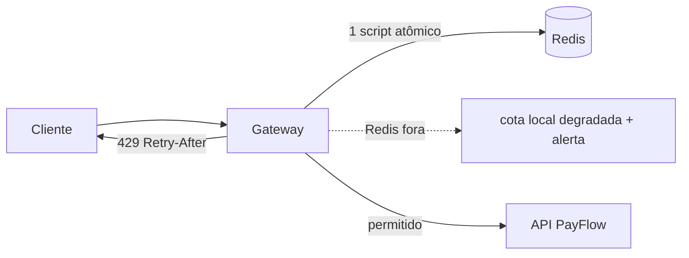

# S1.09 — Rate limiting distribuído

> ⏱️ ~1h30 · 🟣 Sênior · Pré-requisitos: S1.01, S1.04 (Redis como cache), P5.05 (gateway), P5.08 (rate limiter do Resilience4j: **lado cliente**), P10.03 (`sub`/`azp` no token), P2.09 (Redis)

> ⚠️ **Verificação:** `lab/RateLimitLab.java` **foi executado** (JDK 25.0.5; `lab/out-s109.txt`): simulação em **tempo virtual** (sem relógio real, sem rede, sem Redis). O **script Lua** e o filtro do gateway abaixo são **escritos por leitura** e **não executados** (validar com Redis 8 e o Spring Cloud Gateway no fim do treinamento). O comportamento do Redis (`EVAL` **atômico**, `TIME`) vem da documentação; o rascunho IETF dos cabeçalhos `RateLimit` foi **lido** em 2026-11-14 (**draft-11**, rascunho).

## 🎯 Objetivos
Ao final desta aula você consegue:
- **Distinguir** limitar **quem chama** (*rate limiting*), **quem sofre** (*bulkhead*, P5.08) e **o que sobra** (*load shedding*).
- **Comparar** **janela fixa**, **janela deslizante** e **balde de fichas** e **provar** a rajada na virada da janela.
- **Explicar** por que **limite por instância** **multiplica** o limite real e **o que fazer** (contador central, cotas, *gossip*).
- **Escolher** a **política de falha** do armazenamento (*fail-open* × *fail-closed* × **modo degradado**) com **custo medido**.
- **Responder** corretamente (`429`, `Retry-After`, cabeçalhos) e **escolher a chave** do limite.

## 🤔 Por que isso importa
Sem limite, **um cliente** (ou um *bug* em laço) **consome a capacidade de todos** e derruba o serviço (P5.10: cascata). Com limite **mal feito**, você **recusa clientes legítimos** ou **deixa passar** o abuso. Num sistema com **N instâncias**, o limite **correto** exige **coordenação**, que **tem custo e pode falhar**.

## 💡 Intuição (explicação simples)
**Catraca de estádio:** quem controla é **uma** pessoa por portão. Se o estádio tem **5 portões** e cada um deixa entrar **100 por minuto**, o estádio recebe **500**. Para limitar o **estádio** a 100, é preciso um **contador central** (todos os portões **ligam** para a bilheteria) **ou** dar **20 por portão** (e torcer para o público **se distribuir igual**).

## 🔬 Como funciona por dentro

### 1. Três famílias de proteção (não confunda)
| Mecanismo | Quem limita | Protege | Onde |
|---|---|---|---|
| ***Rate limiting*** | o **servidor**, por **cliente/chave** | o serviço do **abuso/excesso** de um cliente | gateway (esta aula) |
| ***Rate limiter* do Resilience4j** | o **cliente**, nas **suas** saídas | a **dependência** de **você** | P5.08 |
| ***Bulkhead*** / ***load shedding*** | o servidor, por **recurso** ou **carga total** | o servidor do **excesso total** | P5.08; [load shedding](https://aws.amazon.com/builders-library/using-load-shedding-to-avoid-overload/) |

### 2. Algoritmos (e a rajada que a janela fixa deixa passar)
| Algoritmo | Como | Ponto forte | Ponto fraco |
|---|---|---|---|
| **Janela fixa** | contador por janela (`minuto atual`) | **simples**, 1 chave | **rajada de até 2×** na virada |
| **Janela deslizante (log)** | guarda **cada** *timestamp* | **exato** | **memória** O(limite) por chave |
| **Janela deslizante (contador)** | média ponderada de 2 janelas | **barato**, aproximado | aproximação |
| **Balde de fichas** (*token bucket*) | fichas reabastecem a **taxa**; o balde tem **capacidade** | permite **rajada controlada**; padrão da **Stripe** ([Scaling your API with rate limiters](https://stripe.com/blog/rate-limiters)) | dois parâmetros (taxa, capacidade) |
| **Balde furado** (*leaky bucket*) | fila que **escoa** a taxa fixa | **suaviza** a saída | **atrasa** (fila) |
Medido (limite 100/min; 100 pedidos em 59,9 s e outros 100 em 60,1 s):
```
janela fixa      : aceitou 200 em ~0,2 s (limite configurado 100/min)
janela deslizante: aceitou 100
balde de fichas  : aceitou 100 (capacidade 100 = a rajada maxima permitida)
```
A **janela fixa** deixou passar **200 pedidos em 0,2 s** (o dobro do limite) **na virada do minuto**; a **deslizante** e o **balde** seguraram **100**. O balde **permite** uma rajada de **até a capacidade** (aqui 100) e depois **só a taxa** (100/60 por segundo): **escolha a capacidade** como a **rajada legítima** máxima.

### 3. O problema distribuído: N instâncias
Medido (limite **100 req/s** por cliente; **5 instâncias**; **1.000 req/s** do mesmo cliente; balanceador **aleatório**; 10 s virtuais):
```
(a) cada no limita 100/s sozinho           : 5000 aceitas em 10 s = 500/s (o limite real virou ~500/s)
(b) contador central atomico                : 1000 aceitas = 100/s
(c) cota local de 20/s por no, balanceio uniforme   : 100/s (correto)
(d) cota local de 20/s, cliente so em 2 nos         : 40/s (cliente legitimo recusado com folga ociosa nos outros 3 nos)
```
- **(a)** cada nó aplica **100/s** sozinho: o limite **real** vira **N × 100 = 500/s**.
- **(b)** **contador central atômico**: **100/s**, **exato**. **Custo:** **uma ida à rede por requisição** (latência + **ponto de falha**).
- **(c)** **cota local** (`limite/N` por nó): **barata** e **correta** **se** o tráfego se distribui **uniformemente**.
- **(d)** se o cliente **só** cai em **2** nós (afinidade, poucas conexões), recebe **40/s** em vez de **100/s**: **recusado com capacidade ociosa**. Cotas locais **falham** com tráfego **desequilibrado** (e o **número de instâncias muda** com o autoescala).
**Padrões reais:** (i) **contador central** em **Redis** (script **atômico**), com a **latência** de ~1 RTT; (ii) **cota local com reabastecimento** do central **em lotes** (cada nó pede "**20 fichas**" ao Redis de vez em quando: **troca exatidão por menos chamadas**); (iii) **limite no balanceador/gateway** (**um** ponto de aplicação, **poucos** nós).

### 4. A política de falha do armazenamento
O Redis do limitador **cai** (10% do tempo na simulação; 1 milhão de pedidos; 50% de um cliente abusivo):
```
fail-open  : 50110 pedidos do cliente abusivo passaram sem limite (10.0% dos abusivos)
fail-closed: 50061 pedidos LEGITIMOS recusados (10.0% dos legitimos)
```
**Fail-open** deixa **o abuso** passar na indisponibilidade; **fail-closed** **derruba clientes legítimos** (você transformou **um problema do limitador** numa **queda do serviço**). **Terceira via, a que o PayFlow adota (decisão 192): modo degradado** — **cota local** conservadora (`limite/N × 1,2`) **enquanto** o Redis está fora, **com alerta**: **protege** o serviço **sem** derrubar os legítimos. (Os números acima são **aritmética de uma simulação** com 10% de indisponibilidade fixa: ilustram o **dilema**, não uma taxa real.)

### 5. Qual a **chave** do limite?
| Chave | Protege contra | Ressalva |
|---|---|---|
| **IP** | varredura anônima | **NAT** (muitos usuários, um IP) e **IPv6** (muitos IPs por usuário) |
| **`sub`** (usuário) | uso excessivo por pessoa | só após **autenticar** |
| **`azp`/`client_id`** (aplicação) | **um** serviço/parceiro abusivo (P10.04) | ótimo para **serviço a serviço** |
| **Conta** (`account_id`) | **fraude** e abuso **de negócio** (ex.: 5 transferências/min) | regra **de negócio**, não só técnica |
| **Rota** | endpoint caro | combine com a chave de cliente |
**Camadas:** **IP** (grosso, **antes** da autenticação, no gateway) → **`sub`/`azp`** (após o JWT) → **conta** (no **caso de uso**, regra de negócio).

### 6. Como responder
`429 Too Many Requests` ([RFC 6585](https://www.rfc-editor.org/rfc/rfc6585)) com `Retry-After` (segundos) e corpo **Problem Details** (decisão 7). O rascunho IETF define os cabeçalhos `RateLimit-Policy` e `RateLimit` para **avisar** a política e o **restante** ([draft-ietf-httpapi-ratelimit-headers](https://datatracker.ietf.org/doc/draft-ietf-httpapi-ratelimit-headers/), **rascunho 11**; **versões antigas** usavam `RateLimit-Limit/Remaining/Reset`: confira **qual** seu cliente espera). **Nunca** ponha o **número de tentativas restantes de login** em cabeçalho público (J8.06).



## 🛠️ Exemplo prático
```bash
cd 3-senior/S1-sistemas-distribuidos/lab
JAVA_HOME=/usr/lib/jvm/java-25-openjdk-amd64 $JAVA_HOME/bin/java RateLimitLab.java
```
**Balde de fichas no Redis** (Lua, **por leitura; não executado**: `EVAL` roda **atômico**, então **ler, calcular e gravar** não corre risco de *check-then-act*, P1.09):
```lua
-- KEYS[1] = chave do balde (ex.: rl:v1:sub:{sub}); ARGV = capacidade, fichas/seg, custo
local cap, rate, cost = tonumber(ARGV[1]), tonumber(ARGV[2]), tonumber(ARGV[3])
local t = redis.call('TIME'); local now = t[1] * 1000 + math.floor(t[2] / 1000)   -- ms, relógio DO REDIS
local b = redis.call('HMGET', KEYS[1], 'tokens', 'ts')
local tokens = tonumber(b[1]) or cap
local ts = tonumber(b[2]) or now
tokens = math.min(cap, tokens + (now - ts) / 1000 * rate)
local allowed = 0
if tokens >= cost then tokens = tokens - cost; allowed = 1 end
redis.call('HSET', KEYS[1], 'tokens', tokens, 'ts', now)
redis.call('PEXPIRE', KEYS[1], math.ceil(cap / rate * 1000) * 2)
return { allowed, math.floor(tokens), (allowed == 1) and 0 or math.ceil((cost - tokens) / rate * 1000) }
```
Pontos: usa o **relógio do Redis** (`TIME`), **não** o das instâncias (S1.10: relógios divergem); o **`PEXPIRE`** apaga baldes **ociosos** (memória); o retorno traz **`retry_after_ms`**. No **Redis Cluster** o script só toca **uma** chave (um *slot*), como exige o modo cluster (S1.03).
**No gateway** (Spring Cloud Gateway WebMVC, P5.05; **por leitura**): um filtro chama o script com a chave `sub` (ou `azp`), e, se `allowed == 0`, responde `429` + `Retry-After` + Problem Details; se o Redis **falhar** (`RedisConnectionFailureException`) → **modo degradado**: aplica uma `Bucket` **local** (por exemplo, com [Bucket4j](https://bucket4j.com/); **confira a versão** compatível com o seu Spring Boot) e **incrementa** `ratelimit_degraded_total`.

## 🏗️ Estudo de caso: "o parceiro que derrubou a conciliação"
**Cenário (ilustrativo).** Um parceiro integra com `POST /payments/{id}/capture` e, por um *bug*, **repete** em laço fechado (**3.000 req/s**), numa instância só. Os **5xx** sobem para **todos**, inclusive o app dos clientes.
**Diagnóstico.** (1) CPU alta e **pool de conexões** esgotado (P2.06); (2) **um** `azp` responde por 90% das requisições (P6.03: *label* **de baixa cardinalidade**: **não** use o `sub` como *label*, P6.02); (3) não havia limite **por cliente**.
**Opções:** (A) **limite por instância** (`100/s`): com 5 instâncias, **500/s** passam (medido) e a **instância sobrecarregada** continua afetada; (B) **contador central no gateway** por `azp` (**100/s exatos**); (C) **cota por `azp`** + **bulkhead** por rota (P5.08); (D) **bloquear** o parceiro (**sanção**, não proteção).
**Decisão (ADR 0024):** **(B) + (C)**: **balde por `azp`** no gateway (Redis, **100/s**, rajada 200), **modo degradado** local se o Redis cair, e **alerta** por **taxa de 429** e por `ratelimit_degraded_total`; **cabeçalhos** informativos; **comunicação** com o parceiro (limite **documentado** na OpenAPI, J6.07).

## 🧠 Pausa para lógica
Balde com **capacidade 20**, **10 fichas/s**, **cheio** em t = 0. Chegam **30 pedidos em t = 0** e **depois 1 pedido a cada 0,05 s** durante 2 s (40 pedidos). Quantos são aceitos nos **primeiros 30** e **no total**? (custo = 1 ficha)

<details><summary>Dica e solução</summary>

**Dica:** o balde esvazia com a rajada; depois só entram **10 fichas por segundo** (1 a cada 0,1 s).

**Solução:** dos **30 em t=0**, **20** passam (o balde esvazia) e **10** são recusados. Depois, os pedidos chegam a **20/s** (1 a cada 0,05 s), mas só **10/s** entram: em **2 s**, entram **~20** (`10 × 2`) e **~20** são recusados dos 40. **Total aceito ≈ 40** (20 + ~20); **recusados ≈ 30**. **Lição:** o balde **permite a rajada inicial** (capacidade) e depois **impõe a taxa**.
</details>

## ⚖️ Trade-offs e quando NÃO usar
- **Contador central** = **exato** e **ponto de falha/latência**; **cota local** = **barato** e **impreciso**. Escolha pela **tolerância** ao erro (o limite é **proteção**, **não** contabilidade: 5% de erro **é aceitável**).
- **Limitar no gateway** protege **tudo atrás**, mas **não** protege chamadas **internas** entre serviços (use **bulkhead** e cotas por `azp`, P10.04).
- **Não** use limite como **controle de fraude**: ele **freia**, **não decide**; fraude é **antifraude** (S1.07).
- **Limite por IP** sozinho pune **NAT**; **por `sub`** exige autenticação.
- **Não** limite **health checks** e **webhooks do PSP** pelo mesmo balde dos clientes.

## ⚠️ Erros comuns e boas práticas de produção
- **Limite por instância** achando que é global (medido: **5×**).
- **Janela fixa** em rota **cara** (rajada de **2×** na virada).
- **Usar o relógio da instância** no cálculo (S1.10): **use o do Redis**.
- **Sem `Retry-After`**: o cliente repete **imediatamente** (*retry storm*, P5.07).
- **Falha fechada** que derruba o serviço quando o Redis cai.
- **`sub` como *label* de métrica** (cardinalidade explode, P6.02).
- **Chaves de Redis sem `PEXPIRE`**: memória **cresce** para sempre.

## 🧩 Exercícios
1. **Fixação:** (a) por que a janela fixa deixa passar 200 pedidos em 0,2 s? (b) por que 5 instâncias com limite local de 100/s dão 500/s? (c) por que a cota local de 20/s falhou no cenário (d)?
2. **Aplicação no PayFlow** (por leitura; **não executado**):
   - [ ] Escreva `docs/rate-limits.md`: **tabela** (rota × chave × algoritmo × taxa × capacidade × política de falha) para `/api/v1/transfers`, `/payments/*/capture`, `/auth` (Keycloak: **fora do escopo do PayFlow**), `/webhooks/psp` (**sem** limite por cliente: valide assinatura, P3.10).
   - [ ] Escreva o teste **`RateLimitFilterTest`**: dentro do limite → `200`; acima → `429` com `Retry-After`; **Redis fora** → **modo degradado** (e `ratelimit_degraded_total` incrementa); **mutante** (sem o degradado) **reprova**.
   - [ ] Alerta: "`429` por `azp` > 5% por 10 min" e "`ratelimit_degraded_total` > 0 por 5 min" (P6.04).
   - Pronto quando: a tabela existe, os **4 cenários** têm teste, **o mutante falha**, e o limite está **na OpenAPI**.
3. **Desafio:** estenda `RateLimitLab` com **cota local reabastecida do central em lotes** (cada nó pega 20 fichas por vez) e **meça** o **erro** (aceitas/limite) e o **número de idas ao central** para 1, 5 e 20 fichas por lote.

<details><summary>Solução de referência (1)</summary>

(a) A janela **zera** no minuto; 100 pedidos em 59,9 s entram na janela 0 e **100 em 60,1 s** entram na janela 1: **200 em 0,2 s**. (b) Cada nó **não sabe** dos outros e aplica **100/s**; o balanceador **espalha** o tráfego, então **cada** nó vê ~200/s, **limita a 100** e os **5** deixam passar **500**. (c) Porque o cliente só caiu em **2 nós**: `2 × 20 = 40/s`; os **outros 3** nós (60/s de cota) ficaram **ociosos**.
</details>

## 🎤 Na entrevista
1. **"Projete um rate limiter distribuído."** **Balde de fichas** por **chave** (`sub`/`azp`) num **Redis** com **script atômico** (relógio do Redis), aplicado no **gateway**; **429 + Retry-After**; **modo degradado** local se o Redis cair; **métricas** e **alertas**.
2. **"Por que não limitar por instância?"** Cada nó **limita sozinho** → o limite **real** é `N ×` (medi **500/s** com 5 nós e limite 100). Cotas locais só com tráfego **uniforme** (medi **40/s** com 2 nós).
3. **"Janela fixa ou balde?"** **Janela fixa** deixa **rajada de 2×** na virada (medi **200** em 0,2 s com limite 100); o **balde** permite **rajada controlada** (capacidade) e impõe a **taxa**.
4. **"E se o Redis do limitador cair?"** *Fail-open* **deixa o abuso passar**, *fail-closed* **derruba os legítimos**; use **modo degradado** com cota local **e alerta**.

## 📚 Para ir além
- 📄 [Stripe: Scaling your API with rate limiters](https://stripe.com/blog/rate-limiters): **quatro** tipos de limitadores em produção (taxa, concorrência, *fleet usage*, *worker utilization*) e o **balde de fichas**.
- 📄 [RFC 6585: 429 Too Many Requests](https://www.rfc-editor.org/rfc/rfc6585): o código e o `Retry-After`.
- 📄 [IETF: RateLimit header fields for HTTP (rascunho)](https://datatracker.ietf.org/doc/draft-ietf-httpapi-ratelimit-headers/): `RateLimit-Policy` e `RateLimit`.
- 📄 [AWS Builders' Library: Using load shedding to avoid overload](https://aws.amazon.com/builders-library/using-load-shedding-to-avoid-overload/): recusar **cedo** quando a carga **total** passa do limite.
- 📄 [Bucket4j](https://bucket4j.com/): biblioteca Java de **balde de fichas** (local e distribuído).
- 📑 *Designing Data-Intensive Applications*, cap. 8 (**relógios e falhas parciais**) (**de memória, não conferido**).

## ✅ Checklist da aula
- [ ] Sei por que a **janela fixa** deixa **2×** passar.
- [ ] Sei por que o **limite por instância** multiplica o limite.
- [ ] A **política de falha** do limitador está **escrita**.
- [ ] O limite está **documentado** na OpenAPI e com **429 + Retry-After**.
