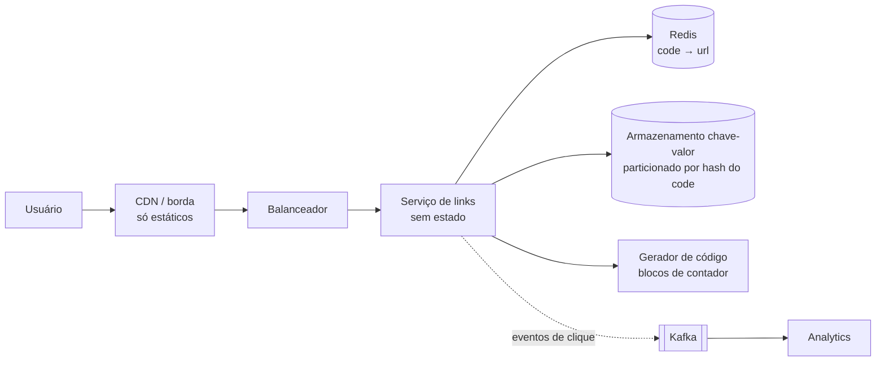

# S1.11 — Método de system design: encurtador de URL

> ⏱️ ~1h30 · 🟣 Sênior · Pré-requisitos: S1.01–S1.04, S1.08, S1.09 (os blocos que o método usa); J6.06 (idempotência), P3.10 (QR/PaymentRequest)

> ⚠️ **Verificação:** `lab/ShortenerLab.java` **foi executado** (JDK 25.0.5; `lab/out-s111.txt`): **base62**, **colisões de códigos aleatórios** (simuladas com até **50 milhões** de gerações; a teoria `n²/2M` foi **comparada**), **contador ofuscado** (Feistel) e **conta de armazenamento/tráfego** (**cálculo** a partir de **parâmetros** inventados para o exercício). **Não é** um encurtador real; **não executado:** banco, cache, CDN, redirecionamento HTTP, o campo `short_code` do `PaymentRequest`. O **método** é uma **proposta de trabalho**, não um padrão da indústria; os **tempos** da entrevista são **orientativos**.

## 🎯 Objetivos
Ao final desta aula você consegue:
- **Conduzir** um *system design* em **etapas** (requisitos → estimativas → API → desenho → aprofundamento → gargalos → evolução) **dentro de ~45 min**.
- **Estimar** tráfego e armazenamento (**ordem de grandeza**) e **dizer o que a conta decide**.
- **Projetar** um encurtador: **geração de código** (aleatório × hash × contador ofuscado), **leitura**, **expiração**, **abuso**.
- **Justificar** cada escolha com **número** (colisões, hit ratio) e **trade-off** (301 × 302).
- **Aplicar** o desenho a um caso do PayFlow (**link curto de cobrança**).

## 🤔 Por que isso importa
A entrevista de *system design* **não** avalia se você conhece "o" desenho: avalia **como você pensa**: faz **perguntas**, **estima**, **escolhe com critério**, **nomeia o que sacrifica** e **sabe aprofundar** onde importa. Um **método** evita os dois erros clássicos: **sair desenhando** sem requisitos e **gastar 40 min em um detalhe** (o banco) esquecendo o resto.

## 💡 Intuição (explicação simples)
Planejar uma **cidade**: primeiro **quantos habitantes** e **para quê** (requisitos), depois **quantas ruas** (estimativa), **as avenidas principais** (desenho geral), e **só então** o **cruzamento problemático** (aprofundamento). Quem começa pelo semáforo **esquece o hospital**.

## 🔬 Como funciona por dentro

### 1. O método (7 passos e orçamentos de tempo para 45 min)
| # | Passo | O que fazer | Tempo |
|---|---|---|---|
| 1 | **Requisitos** | funcionais (o que faz) e **não funcionais** (escala, latência, disponibilidade, consistência, **o que NÃO** faz) | 5 |
| 2 | **Estimativas** | tráfego (req/s), armazenamento, banda; **ordens de grandeza** | 5 |
| 3 | **API** | 2–4 *endpoints* com **idempotência** e **códigos** | 5 |
| 4 | **Desenho geral** | caixas e setas (cliente → LB → serviço → armazenamento → cache) | 10 |
| 5 | **Aprofundamento** | **1–2** pontos difíceis, **os que o entrevistador/negócio escolher** | 15 |
| 6 | **Gargalos e falhas** | o que quebra? ponto único? **o que mede?** | 5 |
| 7 | **Evolução** | o que muda com 10× a escala; **quando NÃO** fazer | (resto) |
**Regras:** **pergunte** antes de assumir; **escreva as premissas**; **diga o trade-off** de cada escolha em **uma frase** ("escolho X porque Y; custa Z"); **meça/estime** antes de afirmar; **comece simples** e **justifique cada complexidade** (cache, fila, *shard*).

### 2. Passo 1: requisitos do encurtador
**Funcionais:** criar link curto para uma URL; **redirecionar**; (opcional) **alias** personalizado, **expiração**, **contagem de cliques**, **excluir**.
**Não funcionais (premissas):** **100 milhões de novas URLs/mês**; leitura:escrita **100:1**; redirecionamento **p99 < 100 ms**; **alta disponibilidade** do redirecionamento (**mais importante** que a criação); **consistência**: criar → **ler logo** deve funcionar; **fora do escopo**: autenticação de usuários finais, painel.

### 3. Passo 2: estimativas (**cálculo**, não medição)
```
100 milhoes de novas URLs/mes = 39 escritas/s em media; razao leitura:escrita 100:1 = 3858 leituras/s; 500 bytes por registro, 5 anos = 3.0 TB
```
Conta: `100.000.000 / (30 × 86.400) = 38,6 escritas/s`; `× 100 = 3.858 leituras/s` (**média**; o **pico** costuma ser **várias vezes** a média: assuma **10×** → ~39 mil leituras/s); `100M × 12 × 5 × 500 B = 3,0 TB`. **O que a conta decide:** (a) **escrita** é **pouca** (39/s): **um** primário aguenta; (b) **leitura** é a carga: **cache** compensa (S1.04); (c) **3 TB** em 5 anos cabem em **um** PostgreSQL grande, mas **acesso é só por chave** → um **armazenamento chave-valor** (DynamoDB, Redis com persistência) **ou** PostgreSQL **particionado por *hash*** do código (S1.03).

### 4. Passo 3: a API
```
POST /api/v1/links              Idempotency-Key: <uuid>
  { "url": "https://…", "alias": "promo-2027" (opcional), "expiresAt": "2027-01-31T00:00:00Z" (opcional) }
→ 201 { "code": "FVclQUU", "shortUrl": "https://pf.ly/FVclQUU" } | 409 (alias em uso) | 422 (URL inválida/proibida) | 429
GET  /{code}  → 302 Location: <url>  | 404 | 410 (expirado)
```
`Idempotency-Key` (S1.08): repetir a criação **devolve o mesmo código** (**sem** gerar outro). **`301`** (permanente) ou **`302`** (temporário)? **`301`** é **guardado** pelos navegadores/CDN: **menos carga** e **sem contagem de cliques** (o clique **não chega a você**); **`302`** **sempre** passa por você: **conta** cliques, permite **trocar** o destino/expirar, **custa carga**. **Decisão típica:** **302** se há **analytics ou expiração**; **301** se o link **nunca** muda e a carga importa.

### 5. Passo 4: desenho geral

O **redirecionamento** lê **cache → banco**; a **criação** pede um código ao **gerador**, grava e (opcional) **preenche o cache**; **cliques** vão para **fila** (assíncrono: **não** atrasa o redirecionamento).

### 6. Passo 5: aprofundamento 1: **como gerar o código**
**Tamanho:** `62^7 = 3.521.614.606.208` (**3,5 trilhões**) de códigos; para 100M/mês × 12 × 5 = **6 bilhões**, **7 caracteres** bastam com folga (**6** dariam 56,8 bilhões: apertado se houver **desperdício**).
```
5 caracteres: 62^5 = 916,132,832 codigos
6 caracteres: 62^6 = 56,800,235,584 codigos
7 caracteres: 62^7 = 3,521,614,606,208 codigos
8 caracteres: 62^8 = 218,340,105,584,896 codigos
```
| Opção | Como | Colisão | Adivinhável? | Observação |
|---|---|---|---|---|
| **A. *Hash* da URL** (truncado) | `base62(hash(url))[:7]` | **sim**, e a **mesma URL** gera o **mesmo** código | não | precisa **tratar colisão**; "mesma URL = mesmo link" **pode ser desejado ou não** |
| **B. Aleatório + checagem** | 7 caracteres aleatórios; `INSERT`; se `UNIQUE` falhar, **gera outro** | **sim** (medida abaixo), **resolvida** por *retry* | não | **simples**; custo = **1 leitura/escrita** extra raramente |
| **C. Contador + base62** | `base62(próximo id)` | **nenhuma** | **sim** (vizinhos) | simples, **expõe** volume e permite **varredura** |
| **D. Contador + ofuscação (Feistel)** | `base62(feistel(id))` | **nenhuma** (permutação) | **não** (parece aleatório) | **melhor equilíbrio**; precisa de **bloco de ids** distribuído |
**Medido — aleatório puro (B), colisões esperadas × simuladas (7 caracteres):**
```
n=    100,000: colisoes simuladas =     0 ; teoria ~ 0.0
n=  1,000,000: colisoes simuladas =     1 ; teoria ~ 0.1
n= 10,000,000: colisoes simuladas =    17 ; teoria ~ 14.2
n= 50,000,000: colisoes simuladas =   373 ; teoria ~ 355.0
```
A conta do **paradoxo do aniversário** (`n²/2M`) **bate** com a simulação (373 contra 355 com 50 milhões; uma semente). **Poucas colisões** (373 em 50 milhões = 0,0007%), **mas certas**: **sempre** trate com `UNIQUE` + *retry* (**nunca** "é improvável").
**Medido — contador ofuscado (D):**
```
1.000.000 contadores -> codigos de 7 caracteres todos DISTINTOS: true
sequencial 1000000..1000004 : 4c92 4c93 4c94 4c95 4c96  (vizinhos adivinham-se)
ofuscado   1000000..1000004 : FVclQUU hUpnz6n bqnaSoj QVa4AHk hEaQ2FZ
```
Uma **permutação** (rede de Feistel de 4 rodadas, **reversível**) mapeia o contador a códigos **distintos** de 7 caracteres **sem colisão** e **sem padrão visível**. **Ressalva:** a ofuscação **não é criptografia** (o *mix* do laboratório **não** foi analisado contra ataque): é **dificultar varredura casual**.
**O contador distribuído sem gargalo:** cada instância pede ao banco **um bloco** (`1000` ids) por vez (`UPDATE counter SET next = next + 1000 RETURNING next − 1000`) e **gasta localmente**; se a instância **cai**, **perde** o resto do bloco (**ids desperdiçados**, irrelevante com 3,5 trilhões).
**Códigos não são segredo:** se existem **1 bilhão** de URLs no espaço de 3,5 trilhões, **chutar** um código **válido** acerta com **0,0284%** por tentativa (**medido por cálculo no laboratório**): **varredura** em escala **encontra** links. **Não** use encurtador para **dado privado**; para isso, **token longo** (≥ 128 bits) ou **autenticação** no destino.

### 7. Aprofundamento 2: leitura, expiração e abuso
- **Leitura:** **cache** por código (`code → url, expiresAt`); com acesso **Zipf**, **1%** das chaves acerta ~**51%** e **10%**, ~**73%** (S1.04, **medido com distribuição sintética**: **meça a sua**). *Stampede* de um link viral: *single-flight* (S1.04).
- **Expiração:** **lazy** (ao ler, `expiresAt < agora` → **410**) **+** *job* em lote que **apaga** (e **libera** o código? **Não reutilize** códigos: um link **velho** em e-mails antigos passaria a apontar para **outro destino**).
- **Abuso:** **phishing/malware**: verificação do destino na criação (lista de reputação), **rate limit** na criação (S1.09: por `sub`/IP), **denúncia** e **bloqueio**.
- **Disponibilidade:** o **redirecionamento** deve **sobreviver** a falha do banco **servindo do cache**; a **criação** pode **degradar**. **Multi-AZ** (P9.01).

### 8. Passos 6 e 7: gargalos e evolução
| O que quebra | Sinal | Resposta |
|---|---|---|
| Cache frio após *deploy* | pico de leituras no banco | *warm-up*, cache **externo** (Redis), não local |
| Link **viral** | **um** código com 50% do tráfego | cache + **CDN** com `302` curto (`max-age` baixo) |
| Colisão (B) | `UNIQUE` violado | *retry* (**medido**: raro) |
| Banco | CPU/IOPS | **particionar por hash** do código (S1.03), réplicas p/ leitura |
| **10×** de escala | — | CDN na **borda** para `GET /{code}`, multirregião (**consistência eventual** na criação: `409`/repetição) |

## 🛠️ Exemplo prático
```bash
cd 3-senior/S1-sistemas-distribuidos/lab
JAVA_HOME=/usr/lib/jvm/java-25-openjdk-amd64 $JAVA_HOME/bin/java ShortenerLab.java
```
**A aplicação no PayFlow** (por leitura; **não executado**): **link curto de cobrança** (`PaymentRequest`, P3.10). **Migração V16** (a próxima livre depois de V13–V15 da S1):
```sql
ALTER TABLE payment_requests ADD COLUMN short_code CHAR(7);
CREATE UNIQUE INDEX CONCURRENTLY uk_payment_requests_short_code ON payment_requests (short_code) WHERE short_code IS NOT NULL;
```
**Código** (opção D: contador do banco **em bloco** + Feistel): `short_code = Base62.encode(feistel(sequenceBlock.next()))` **dentro da transação** que cria a cobrança; o `GET /p/{code}` devolve **302** para o **checkout** e **respeita** o estado: `PAID` → página "já paga"; `EXPIRED` → **410**. **Nenhum dado pessoal** no destino além do **id** (LGPD, J8.07). O link **expira** junto com a cobrança.

## 🏗️ Estudo de caso: "o link curto que vazou cobranças"
**Cenário (ilustrativo).** Os links de cobrança usavam **contador sequencial** (`/p/4c92`, `/p/4c93`…). Um curioso **varre** `4c00…4cZZ` e **lê** valores e nomes de lojistas de cobranças **de outras pessoas** (**IDOR**, J8.06).
**Diagnóstico.** (1) **404/200** em sequência no *log* de um mesmo IP; (2) o destino mostrava **dados** sem **autenticação**; (3) o código era **adivinhável** e **não** havia **limite**.
**Opções:** (A) **ofuscar** o código (D); (B) **token longo** não adivinhável (≥ 22 caracteres base62 ≈ 131 bits) **e** mostrar **só** o mínimo antes de **autenticar**; (C) **autenticar** o destino; (D) **rate limit** por IP (S1.09).
**Decisão (ADR 0024):** **(B)+(C)+(D)**: o **link curto** (7 caracteres) vira **apenas** "porta" para um **checkout autenticado**; a **página pública** mostra **nada sensível**; **rate limit** por IP; **log de varredura** com alerta. **Código ofuscado não substitui autorização.**

## 🧠 Pausa para lógica
Com **7 caracteres base62** e **aleatório puro**, **quantas URLs** você pode gerar antes de a **probabilidade de pelo menos uma colisão** passar de **50%**? (aproximação do aniversário: `n ≈ 1,177 × √M`)

<details><summary>Dica e solução</summary>

**Dica:** `M = 62^7 ≈ 3,52 × 10^12`; `√M ≈ 1,876 × 10^6`.

**Solução:** `n ≈ 1,177 × 1,876 × 10^6 ≈` **2,2 milhões**. A **50%** de chance de **ao menos uma** colisão em **só 2,2 milhões** de códigos (que parece "nada" frente a **3,5 trilhões**). **Lição:** colisão é **inevitável** em aleatório: **projete o `UNIQUE` + *retry***. (Compatível com a simulação: com 1 milhão a teoria dá `0,14` colisão esperada.)
</details>

## ⚖️ Trade-offs e quando NÃO usar
- **Hash da URL** quando "mesma URL = mesmo link" é **requisito** (deduplicação); **senão** o aleatório/contador é mais **simples**.
- **Contador ofuscado** exige **bloco de ids** (coordenação mínima); **aleatório** **não** exige.
- **301** economiza carga e **perde** analytics; **302** o inverso.
- **Reutilizar códigos** apagados **economiza** espaço e **quebra** links antigos: **não**.
- **Encurtador** **não** é **mecanismo de segurança**.
- **Não** monte cluster de cache/banco **antes** de a **conta** (passo 2) dizer que precisa: 39 escritas/s cabem **num** banco.

## ⚠️ Erros comuns e boas práticas de produção
- **Começar pelo banco** sem requisitos/estimativa.
- **"Colisão é improvável"** (medido: **373** em 50 milhões).
- **Contador sequencial** público (varredura).
- **Cache local** por instância sem entender que **cada nova** instância é **fria**.
- **`301` por reflexo** e depois **precisar de analytics**.
- **Sem limite na criação** (abuso/*phishing*).
- **Resposta sem trade-off** ("uso Redis" **sem dizer por quê**).

## 🧩 Exercícios
1. **Fixação:** (a) por que o **aleatório** precisa de `UNIQUE` + *retry* mesmo "improvável"? (b) o que a conta de **39 escritas/s** decide? (c) **301 × 302**: quando cada um?
2. **Aplicação no PayFlow** (por leitura; **não executado**):
   - [ ] Escreva em `docs/system-design/url-curta.md` **os 7 passos** aplicados ao **link de cobrança**, com **premissas numéricas** (cobranças/dia, leituras/cobrança) e **a conta**.
   - [ ] Implemente `Base62` + `Feistel` (**classe de domínio pura**, sem Spring) com **testes**: **bijeção** em 1.000.000 contadores, **ida e volta** (`decode(encode(x)) == x`), **mutante** (trocar a rodada) **reprova** a bijeção.
   - [ ] Desenhe o **runbook** "varredura de códigos": alerta quando **um IP** gera **> 50** `404` em 1 min.
   - Pronto quando: os testes de bijeção **passam em 1 milhão**, o **mutante falha**, e o destino do link **exige autenticação**.
3. **Desafio:** **proponha** (e **estime**) o desenho **multirregião** do redirecionamento: onde ficam as **réplicas**, o que acontece com a **criação** de um alias **igual** em **duas** regiões ao mesmo tempo (dica: S1.02 e S1.10).

<details><summary>Solução de referência (1)</summary>

(a) Porque o **paradoxo do aniversário**: a probabilidade de **alguma** colisão passa de 50% com ~**2,2 milhões** de códigos de 7 caracteres, e **medi 17** colisões em 10 milhões. (b) Que **escrita não é o problema**: **um** primário aguenta; o **projeto** gira em torno de **leitura** (cache) e **disponibilidade**. (c) **302** se precisa **contar cliques**/**trocar** o destino/expirar; **301** se o link **nunca muda** e **a carga** importa mais que a métrica.
</details>

## 🎤 Na entrevista
1. **"Projete um encurtador de URL."** **Requisitos** → **estimativa** (39 escritas/s, 3,9 mil leituras/s, 3 TB em 5 anos, **premissas**) → **API** (`POST`/`GET`, 302, idempotência) → **código** de 7 caracteres base62 (**contador em blocos + Feistel**, ou aleatório com `UNIQUE`+*retry*) → **cache** na leitura → **cliques** por fila → **abuso**/expiração. **Diga os trade-offs.**
2. **"Como evitar colisão?"** **Contador/permutação** (sem colisão) **ou** aleatório com **`UNIQUE` + *retry*** (medi **17** colisões em 10 milhões).
3. **"301 ou 302?"** **302** se há analytics/expiração; **301** se imutável e a carga pesa.
4. **"É seguro para links privados?"** **Não**: curtos **são varridos** (0,0284% de acerto por chute com 1 bilhão); **autentique o destino** e use **token longo**.

## 📚 Para ir além
- 📄 [System Design Primer (Donne Martin)](https://github.com/donnemartin/system-design-primer): repositório **muito usado** com o método e **vários** exercícios (inclui encurtador e feed).
- 📄 [AWS Builders' Library: Workload isolation using shuffle sharding](https://aws.amazon.com/builders-library/workload-isolation-using-shuffle-sharding/): limitar o **raio de explosão** de um link/cliente abusivo.
- 📄 [Mozilla MDN: HTTP caching](https://developer.mozilla.org/en-US/docs/Web/HTTP/Guides/Caching): como **301/302** e `Cache-Control` afetam o redirecionamento.
- 📄 [RFC 9111: HTTP Caching](https://www.rfc-editor.org/rfc/rfc9111): **quem** pode guardar o quê.
- 📑 *System Design Interview* (Alex Xu), cap. "Design a URL Shortener" (**de memória, não conferido**) e *Designing Data-Intensive Applications* (cap. 6) (**idem**).

## ✅ Checklist da aula
- [ ] Sigo **os 7 passos** com **tempo**.
- [ ] Fiz a **conta** de tráfego e armazenamento.
- [ ] Sei **escolher o código** e **justificar** com colisão/adivinhação.
- [ ] Sei que **código curto ≠ segredo**.
