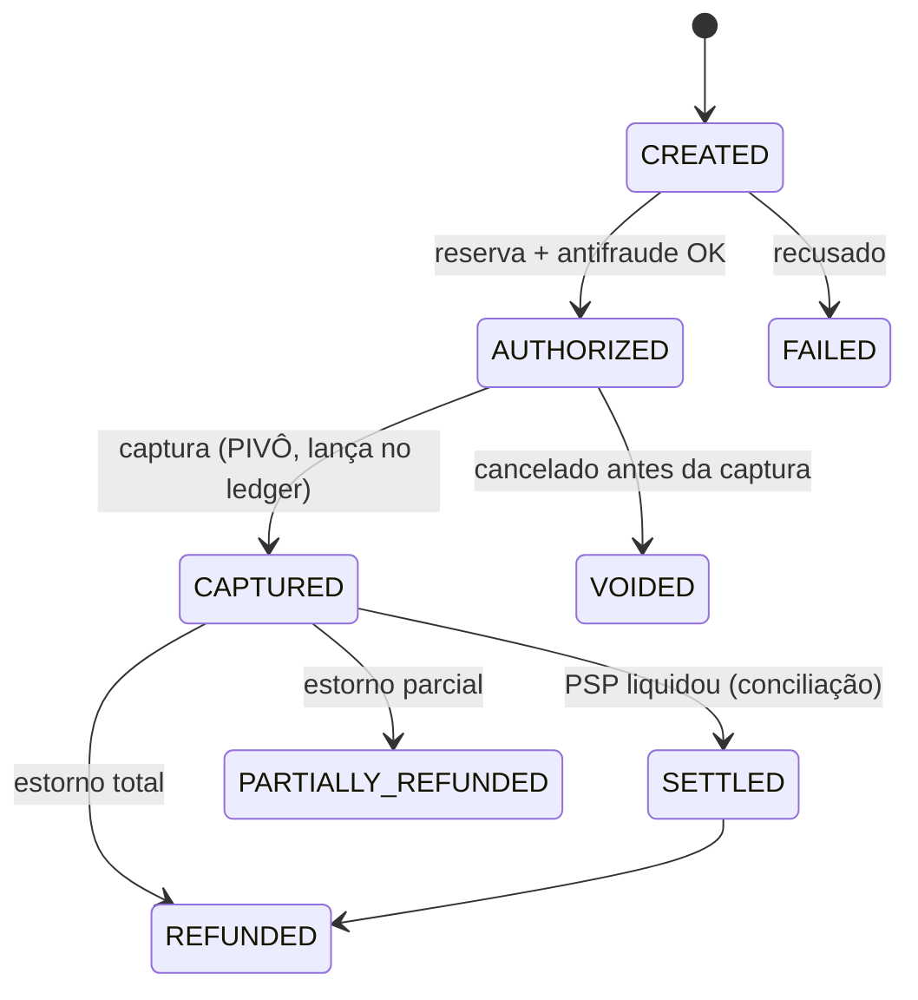
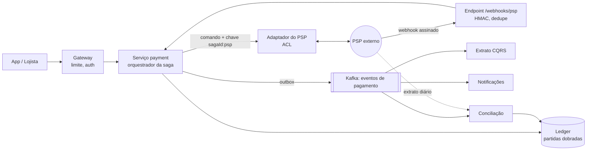

# S1.12 — System design: sistema de pagamentos

> ⏱️ ~1h30 · 🟣 Sênior · Pré-requisitos: S1.07 (saga), S1.08 (idempotência), S1.05 (CQRS), S1.02 (consistência), S1.11 (método), P3.10 (webhook e QR), P3.13 (pagamento duplicado), P4.08 (ACL do PSP)

> ⚠️ **Verificação:** `lab/ReconciliationLab.java` **foi executado** (JDK 25.0.5; `lab/out-s112.txt`): **100.000 pagamentos** sintéticos com **anomalias plantadas em posições conhecidas** e **partidas dobradas**. **Não é** um PSP, um adquirente nem um sistema de cartões: **nenhuma** regra de bandeira, **PCI-DSS**, antifraude real ou **Pix** foi estudada **nesta** aula (**PCI e LGPD ficam para a S5**; o fluxo **Pix** não foi verificado e **não** é descrito). A **arquitetura** é **uma proposta de estudo**; os **volumes** são **premissas inventadas** para o exercício. **Não executado:** o orquestrador/ledger/adaptador de PSP no PayFlow do aluno.

## 🎯 Objetivos
Ao final desta aula você consegue:
- **Conduzir** o método (S1.11) para um **sistema de pagamentos**, com **requisitos de correção** (o que **nunca** pode acontecer).
- **Modelar** o **ciclo de vida** de um pagamento (autorizar, capturar, liquidar, estornar) como **máquina de estados**.
- **Desenhar** um **livro-razão de partidas dobradas** e **conferir** seu invariante.
- **Integrar** um PSP **sem** duplicar nem perder dinheiro (**idempotência**, **webhooks**, **resultado desconhecido**).
- **Projetar** a **conciliação** e **medir** o que ela encontra.

## 🤔 Por que isso importa
Pagamentos reúnem **todas** as dificuldades do módulo: **consistência** (S1.02), **sagas** (S1.07), **idempotência** (S1.08), **ordem** (S1.10), **limites** (S1.09). Aqui **disponibilidade não é a prioridade**: **errar o dinheiro é pior que ficar fora do ar** por alguns minutos. É o *system design* que **mais** distingue um sênior: ele **começa pelo que não pode dar errado**.

## 💡 Intuição (explicação simples)
Um **cartório**: cada operação vira **uma linha num livro**, **nunca apagada**; cada linha tem **dois lados** (de onde saiu e para onde foi) e **a soma de tudo é zero**. Se **a conta não fecha**, **alguém errou**, e o livro **mostra onde**. O **banco do outro lado** (o PSP) tem **o livro dele**: **toda noite** comparam os livros (**conciliação**).

## 🔬 Como funciona por dentro

### 1. Passo 1: requisitos
**Funcionais:** o pagador **paga** uma cobrança (QR, P3.10) com o **saldo da carteira** ou **meio externo** (via PSP); o lojista **recebe**; **estorno** total/parcial; **extrato**; **notificação**.
**Não funcionais (nesta ordem):** (1) **corretude**: nenhum **débito sem crédito**, nenhuma **cobrança duplicada**, nenhum **dinheiro criado/destruído**; (2) **auditabilidade**: **cada centavo** rastreável; (3) **idempotência** em **todos** os saltos; (4) **disponibilidade** do **pagar** (alta, **mas** subordinada à corretude: **degradar** é melhor que **errar**); (5) **latência** p95 < 2 s (o PSP domina); (6) **segurança** (S5: **não** guardar dado de cartão; **tokens do PSP**).
**Fora do escopo:** antifraude **interno** (caixa-preta), **câmbio**, **disputas** (*chargeback*).

### 2. Passo 2: estimativas (**premissas** inventadas; **cálculo**)
`10 milhões de pagamentos/dia ÷ 86.400 =` **116/s** em média; **pico 10×** = **~1.160/s**. **Lançamentos:** ~**4 por pagamento** (débito pagador, crédito lojista, **tarifa**, **conta de compensação do PSP**) = **40 M/dia** ≈ **14,6 bilhões/ano**; a **100 B/linha** ≈ **1,5 TB/ano** só do *ledger* (**particionar por mês**, S3). **Chaves de idempotência** (7 dias × 10 M × ~200 B) ≈ **14 GB** (**expirar**). **O que a conta decide:** ~1,2 mil escritas/s no pico **cabem** num primário bem afinado (P2); o problema **não é volume**, é **correção**: **não** começar por *sharding* (S1.03).

### 3. Passo 3: o ciclo de vida do pagamento (máquina de estados)

**Autorizar** = **reservar** (S1.07: `account_holds`); **capturar** = **mover o dinheiro** (pivô); **liquidar** = o PSP **repassou** (confirmado pela **conciliação**, não pela promessa). Cada **transição** é **idempotente** e **registrada** (`payments.state` + `payment_events` imutáveis).

### 4. Passo 4: desenho geral

**Princípios:** (1) o **ledger** (PostgreSQL) é a **fonte da verdade** do dinheiro; **eventos** são **consequência**; (2) **nada** muda dinheiro **fora** de uma transação que **grava o lançamento e o evento** (Outbox, P3.09); (3) o **PSP** é **sistema externo não confiável**: **ACL** (P4.08), **timeout = desconhecido**, **chave de idempotência**, **webhook** como **confirmação assíncrona**.

### 5. Passo 5, aprofundamento A: **partidas dobradas**
Cada **evento econômico** vira **lançamentos** que **somam zero**: uma **conta é debitada** e **outra creditada** no **mesmo valor**:
| Evento: pagador paga R$ 100,00; tarifa R$ 1,00 | Débito | Crédito | Valor |
|---|---|---|---|
| Captura | conta do **pagador** | conta do **lojista** | 99,00 |
| Tarifa | conta do **pagador** | conta de **receita de tarifas** | 1,00 |
| Envio ao PSP (saída de caixa) | **compensação PSP** | **caixa** | … |
O **invariante global** é `Σ débitos = Σ créditos` (soma **zero**). Medido (`out-s112.txt`):
```
== Partidas dobradas: cada transferencia gera um debito e um credito de mesmo valor ==
soma dos debitos = 5020068914; soma dos creditos = 5020068914; invariante global (soma = 0): true
com UM credito perdido de 1 centavo: soma dos debitos - creditos = 1 -> o invariante detecta, mesmo sem saber qual lancamento
```
O invariante **detecta** a perda de **1 centavo** em **100.000** transferências **sem saber qual** (a **busca** vem do **agrupamento por pagamento**: `GROUP BY payment_id HAVING SUM(signed) <> 0`). No PayFlow isso é a **regra 3** (saldo = Σ lançamentos) elevada a **todas as contas**; um **teste** e um *job* diário a conferem.
**Tarifas e *rounding*:** use **`BigDecimal`** com 2 casas e `HALF_EVEN` (decisão 4); **divida** o centavo **sobrando** de forma **determinística** (ex.: para o lojista) para **sempre** somar zero.

### 6. Aprofundamento B: o PSP e **cada falha**
| Ponto de falha | O que acontece | Resposta |
|---|---|---|
| Chamada ao PSP **expira** | **desconhecido** (S1.07) | repetir com **`sagaId:psp`**; **ou consultar** por referência; **nunca** criar nova cobrança |
| PSP **responde** e a **resposta se perde** | idem | mesma chave → **mesmo resultado** (S1.08) |
| **Webhook** chega **duplicado** | at-least-once | **dedupe** por `eventId` na **mesma transação** do efeito (P3.07, P3.10) |
| Webhook chega **antes** da resposta da chamada | corrida | o estado **converge**: o handler **aceita** a transição **válida** e **ignora** a repetida |
| Webhook **não chega** | pagamento "preso" em `CAPTURED` | **varredura** consulta o PSP; **conciliação** pega o resto |
| PSP **fora** | disponibilidade | *breaker* (P5.08), **fila** de pagamentos pendentes (**202**) e **mensagem honesta** ao usuário |
| **Webhook forjado** | fraude | **HMAC** + janela de tempo (P3.10, decisão 110) |
**Regra de ouro:** o **estado final** do pagamento **só muda** por **transição válida** da máquina; **qualquer** mensagem (resposta, webhook, varredura) **pode chegar fora de ordem ou repetida**.

### 7. Aprofundamento C: **conciliação** (a rede de segurança)
**Toda noite**, compara-se **o seu ledger** com o **extrato do PSP**. As **categorias** de divergência: **falta no PSP**, **só no PSP**, **valor diferente**, **duplicado no PSP**. Medido (100.000 pagamentos; anomalias **plantadas**: 30 + 20 + 10 + 5):
```
== Conciliacao de 100000 pagamentos (extrato do PSP com anomalias plantadas) ==
encontradas por categoria: {DUPLICADO_NO_PSP=10, FALTA_NO_PSP=30, SO_NO_PSP=5, VALOR_DIFERENTE=20} em 20 ms (inclui geracao dos mapas)
plantadas = 30 FALTA_NO_PSP + 20 VALOR_DIFERENTE + 10 DUPLICADO_NO_PSP + 5 SO_NO_PSP; encontradas exatamente as plantadas: true
```
A conciliação **achou exatamente as 65 anomalias plantadas**, em **~20 ms** (em memória; **num banco**, a **junção** de milhões de linhas é **E/S**, **não** medida). **O que fazer com cada uma:** `FALTA_NO_PSP` → **consultar** o PSP e **repetir/estornar**; `DUPLICADO_NO_PSP` → **estornar o excedente** (**lançamento de compensação**, decisão 114) e **abrir caso**; `VALOR_DIFERENTE` → **investigar** (tarifa? câmbio?); `SO_NO_PSP` → **cobrança fantasma**: **alerta de segurança**. **Nunca** corrigir com `UPDATE` (regra 5): **sempre** com **novo lançamento** e **aprovação humana** (decisão 114).

## 🛠️ Exemplo prático
```bash
cd 3-senior/S1-sistemas-distribuidos/lab
JAVA_HOME=/usr/lib/jvm/java-25-openjdk-amd64 $JAVA_HOME/bin/java ReconciliationLab.java
```
**A consulta de conferência do ledger** (SQL; por leitura, não executada):
```sql
-- 1) cada pagamento deve somar zero
SELECT payment_id, SUM(CASE type WHEN 'DEBIT' THEN amount ELSE -amount END) AS diff
  FROM ledger_postings GROUP BY payment_id HAVING SUM(CASE type WHEN 'DEBIT' THEN amount ELSE -amount END) <> 0;
-- 2) o mundo todo soma zero
SELECT SUM(CASE type WHEN 'DEBIT' THEN amount ELSE -amount END) FROM ledger_postings;
```
(`ledger_postings` seria a **evolução** do `ledger_entries` com `payment_id`, **hipótese** deste desenho: o PayFlow hoje tem **um** lançamento por conta, com `transfer_id` opcional, ADR 0001; **migrar** para postagens de duas pernas é **decisão do ADR 0024**, **não** executada.)

## 🏗️ Estudo de caso: "a cobrança que o PSP fez duas vezes"
**Cenário (ilustrativo).** Na conciliação da segunda-feira aparecem **10 pagamentos** com **duas capturas** no PSP e **uma** no ledger. Soma: **R$ 1.240,00** a mais no PSP.
**Diagnóstico.** (1) `DUPLICADO_NO_PSP = 10`; (2) todos têm **chamada ao PSP com timeout** no *log* e **repetição** **sem** a mesma chave (a **segunda** chamada saía com `idempotency-key` **gerada de novo** por *retry* interno do cliente HTTP); (3) o **breaker** estava **fechado**.
**Causa.** A **chave** era gerada **dentro** do cliente HTTP (cada tentativa uma nova), **não** derivada do **`sagaId`** (S1.08).
**Decisão (ADR 0024):** a chave **vem do orquestrador** (`sagaId:psp`) e **atravessa** retentativas; **teste de contrato** (P5.09) **falha** se a chave **mudar** entre tentativas; os 10 duplicados são **estornados** por **lançamentos de compensação com aprovação**, e a **conciliação** vira **alerta** (não só relatório).

## 🧠 Pausa para lógica
Um pagamento de **R$ 100,00** tem **tarifa de 1,5%**, dividida entre **pagador** e **lojista** meio a meio, em **centavos inteiros**. Quanto paga cada um **e** como garantir que a **soma dê zero**?

<details><summary>Dica e solução</summary>

**Dica:** `1,5% de 100,00 = 1,50`; metade de `1,50` é `0,75`; e se a tarifa fosse `1,01`?

**Solução:** `1,50 / 2 = 0,75` cada: lançamentos: pagador −0,75, lojista −0,75, receita +1,50: **soma zero**. Com **tarifa `1,01`** (101 centavos), `101 / 2 = 50,5`: **não** divide: o **pagador** paga **50** e o **lojista 51** (o **centavo extra** vai para **um lado, sempre o mesmo** — regra **escrita** e **testada**), e a **receita** recebe **101**: soma **zero**. **Lição:** **arredondar cada parcela** isoladamente **cria ou destrói** centavos; **alocar o resto** de forma determinística **preserva** o invariante.
</details>

## ⚖️ Trade-offs e quando NÃO usar
- **Consistência × disponibilidade:** no **pagar**, **prefira recusar/degradar** a **arriscar** dinheiro; no **extrato**, **eventual** (S1.05) é aceitável.
- **Saga × transação única:** **fique no mesmo banco** enquanto for possível; **saga** só para o que está **fora** (PSP, antifraude).
- **Ledger relacional × *event sourcing*:** o ledger **imutável** dá o principal (S1.06).
- **Conciliação não substitui idempotência**: é a **última** rede, **detecta** depois do estrago.
- **Não** crie **duas fontes da verdade** (ledger e "saldo" no PSP): o PSP é **espelho externo**, **conferido**, **não** fonte.

## ⚠️ Erros comuns e boas práticas de produção
- **`double` para dinheiro** (S1.06: 0,6000000000000001).
- **Confiar na resposta síncrona do PSP** como **liquidação**.
- **Webhook sem assinatura/dedupe**; **processar fora de ordem** sem máquina de estados.
- **Corrigir dinheiro com `UPDATE`** (regra 5).
- **Idempotência só na entrada** (S1.08).
- **Sem conciliação diária** (**erro silencioso por meses**).
- **Dado de cartão** nos *logs*/banco (**S5**).
- **Retry infinito** de captura (P5.07): **limite** e **escalada**.

## 🧩 Exercícios
1. **Fixação:** (a) o que significa "partidas dobradas **somam zero**"? (b) por que `CAPTURED ≠ SETTLED`? (c) por que o *timeout* do PSP é **desconhecido** e não **falha**?
2. **Aplicação no PayFlow** (por leitura; **não executado**):
   - [ ] Escreva `docs/system-design/pagamentos.md` com os **7 passos**, **premissas numéricas** e a **tabela de falhas** (acima) **completa** (uma linha por salto).
   - [ ] Escreva `PaymentStateMachineTest`: **transições válidas** passam; **inválidas** (ex.: `REFUNDED → CAPTURED`) **lançam**; **mensagem repetida** é **ignorada**; **ordem trocada** (webhook antes da resposta) **converge**.
   - [ ] Escreva `LedgerInvariantTest` (`Σ débitos = Σ créditos` por pagamento e global) com **mutante** (perder um lançamento) que **reprova**.
   - [ ] Escreva o *job* `ReconciliationJob` (diário, ShedLock): **4 categorias** + **alerta** quando `SO_NO_PSP > 0`.
   - Pronto quando: as **máquinas e invariantes** têm teste com **mutante falhando**, e o **ADR** registra **o que o PayFlow NÃO faz** (câmbio, *chargeback*).
3. **Desafio:** estenda `ReconciliationLab` com **atraso de liquidação** (o PSP reporta o pagamento **no dia seguinte**): **não** marcar `FALTA_NO_PSP` **até D+2**; **meça** quantos **falsos positivos** isso elimina.

<details><summary>Solução de referência (1)</summary>

(a) Para **cada evento** há **débitos e créditos de mesmo total**; logo, **a soma de tudo** é zero; qualquer **diferença** indica **perda ou criação** de dinheiro (medi: **1 centavo** de diferença em 100 mil transferências). (b) `CAPTURED` é **o que nós registramos**; `SETTLED` é **o que o PSP confirmou ter repassado** (conciliação): podem divergir. (c) Porque a **chamada pode ter sido executada** e a **resposta** se perdeu: **não saber** é diferente de **falhou**; só **repetir com a mesma chave** ou **consultar** resolve **sem duplicar**.
</details>

## 🎤 Na entrevista
1. **"Projete um sistema de pagamentos."** **Corretude primeiro**: **ledger de partidas dobradas** imutável; **máquina de estados** do pagamento (autorizar/capturar/liquidar/estornar); **saga** para o que é externo; **idempotência por salto** (inclusive PSP); **webhook** assinado e deduplicado; **conciliação diária**; **disponibilidade subordinada à corretude**.
2. **"Como evitar cobrança duplicada?"** **Chave de idempotência** derivada do pedido (`sagaId:psp`), enviada ao PSP **e** `UNIQUE` local; **timeout = desconhecido** (consulta/repete com a mesma chave); **conciliação** como **rede**.
3. **"O que é conciliação?"** Comparar **o seu livro** com **o do PSP** (**faltas, sobras, valores, duplicidades**). Medi: **65 anomalias plantadas, 65 achadas**, em milissegundos em memória.
4. **"Como garantir que o dinheiro não some?"** **Partidas dobradas** com **invariante** `Σ = 0` (teste + *job*), **lançamentos imutáveis**, **correção por compensação** com **aprovação** (decisão 114).

## 📚 Para ir além
- 📄 [Square: Books, an immutable double-entry accounting database service](https://developer.squareup.com/blog/books-an-immutable-double-entry-accounting-database-service/): um *ledger* de **partidas dobradas** imutável **em produção** e as **decisões** de projeto.
- 📄 [Modern Treasury: Accounting for Developers, Part I](https://www.moderntreasury.com/journal/accounting-for-developers-part-i): **débito e crédito**, contas e o **modelo mental** para quem não é de contabilidade.
- 📄 [Stripe: Designing robust and predictable APIs with idempotency](https://stripe.com/blog/idempotency): a **referência** de idempotência em API de pagamento.
- 📄 [AWS Builders' Library: Making retries safe with idempotent APIs](https://aws.amazon.com/builders-library/making-retries-safe-with-idempotent-APIs/): **tokens** de cliente e janelas.
- 📄 [Microsoft: Saga pattern](https://learn.microsoft.com/en-us/azure/architecture/patterns/saga): compensação, pivô, resultado **desconhecido**.
- 📑 *Designing Data-Intensive Applications*, cap. 12 (**corretude de ponta a ponta**) (**de memória, não conferido**).

## ✅ Checklist da aula
- [ ] Comecei pelos **requisitos de corretude**.
- [ ] Tenho **máquina de estados** e **invariante de ledger** com teste.
- [ ] A **tabela de falhas do PSP** está completa.
- [ ] A **conciliação** existe e **alerta**.
