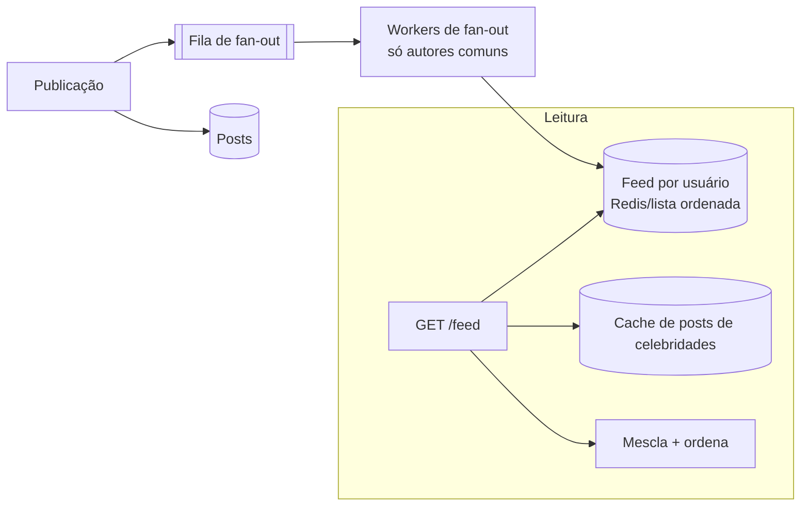
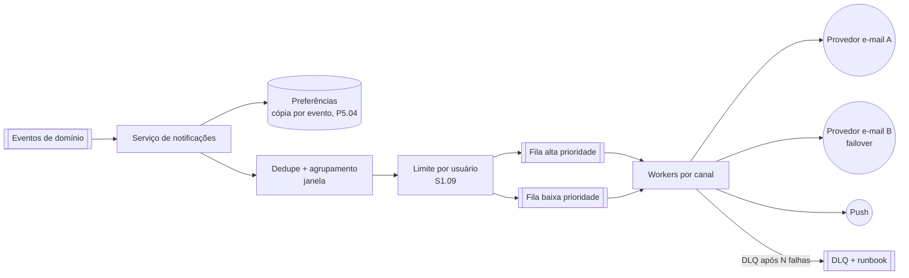

# S1.13 — System design: feed de notícias e notificações

> ⏱️ ~1h30 · 🟣 Sênior · Pré-requisitos: S1.11 (método), S1.03 (chave quente), S1.04 (cache), S1.05 (CQRS), S1.08 (idempotência), S1.09 (limites), P3.03–P3.05 (filas e Kafka), P3.11 (SSE), P5 (serviço de notificações)

> ⚠️ **Verificação:** `lab/FeedLab.java` **foi executado** (JDK 25.0.5; `lab/out-s113.txt`): é um **modelo estatístico** (100.000 usuários, 5 milhões de relações de seguir **sintéticas**, seguidores em **Zipf s = 1,0**), que **conta entregas** — **não** um *feed* real, **não** mede latência, **não** usa banco. Os **números** valem **para esse modelo**; **meça** no seu. **Não executado:** serviço de notificações com provedores reais (e-mail/push/SMS), **FCM/APNs** (não estudados), *ranking*. O **PayFlow** **não tem** um *feed* social: a parte de **notificações** é **real** (P5); o *feed* é **exercício de projeto**.

## 🎯 Objetivos
Ao final desta aula você consegue:
- **Comparar** *fan-out* **na escrita** (*push*), **na leitura** (*pull*) e **híbrido** **com números**.
- **Tratar** o **problema da celebridade** (um autor com milhões de seguidores).
- **Projetar** um **sistema de notificações**: canais, preferências, **deduplicação**, **agrupamento**, **limites**, **retentativa** e **falha de provedor**.
- **Garantir** *at-least-once* **sem** notificação duplicada (idempotência por `(usuário, tipo, referência)`).
- **Aplicar** o método (S1.11) e **dizer o que sacrifica**.

## 🤔 Por que isso importa
É o **exercício clássico** de entrevista e **o melhor** para **treinar a escolha de trade-off com número**: **escrever caro, ler barato** (ou o inverso). Também mostra o **limite** de "tudo assíncrono": notificação **é dinheiro de atenção**; **duplicar** ou **inundar** o usuário **destrói** o produto.

## 💡 Intuição (explicação simples)
**Jornal:** (a) a **banca** recebe **um** jornal e **cada leitor** vai buscar (*pull*: a gráfica trabalha **pouco**, o leitor **paga** o trajeto); (b) o **jornaleiro** **entrega em cada casa** (*push*: **muito** trabalho na **produção**, a leitura é **instantânea**). Para **assinantes comuns**, entregar em casa compensa; para um **jornal com 10 milhões de assinantes**, **ninguém** consegue entregar **tudo** ao mesmo tempo: esses **vão buscar na banca** (*híbrido*).

## 🔬 Como funciona por dentro

### 1. Passo 1: requisitos (feed)
**Funcionais:** **publicar**; **seguir/deixar de seguir**; **ver o feed** (posts de quem sigo, **mais recentes primeiro**, **paginado**); **curtir**. **Não funcionais (premissas):** **100.000** usuários **no modelo** (escala real: **milhões**), ~**50** seguidos por usuário, **leitura >> escrita**; **abrir o feed p95 < 200 ms**; **consistência eventual** aceitável (**segundos**); **disponibilidade** > consistência; **fora do escopo:** *ranking* por IA, anúncios.

### 2. Passo 2: o dilema do *fan-out*
| Estratégia | Na publicação | Na leitura | Bom para | Ruim para |
|---|---|---|---|---|
| ***Pull*** (fan-out na **leitura**) | grava o post **uma vez** | **busca** os posts de cada seguido e **mescla** | **muitos autores, poucos leitores**, celebridades | **leitura** lenta e **cara** (N consultas) |
| ***Push*** (fan-out na **escrita**) | **copia** o post para o **feed de cada seguidor** | lê **uma lista** pronta | leitura **rápida**; autores **comuns** | **celebridade**: **1 post = milhões de escritas** |
| ***Híbrido*** | *push* para **comuns**; **celebridades** em *pull* e **mescladas** na leitura | lista pronta **+** posts das celebridades que o usuário segue | **o que quase todos usam** | **complexidade** (dois caminhos) |

### 3. Os números (modelo sintético; `out-s113.txt`)
```
== 1. Modelo: 100.000 usuarios, 5.000.000 relacoes de seguir (Zipf s=1,0). Seguidores do maior autor = 99999; do 100o = 4136; do 10.000o = 41 ==
posts: 1,000,000; entregas na escrita (push puro) = 1,054,121,017 (amplificacao 1054x)
hibrido (autores com mais de 10,000 seguidores = 41 'celebridades' lidos na hora): entregas = 199,320,815 (18.9% do push puro)
um unico post do maior autor gera 99,999 escritas no push puro
```
- **Distribuição** muito **desigual**: o **maior** autor tem **99.999** seguidores; o **100º**, **4.136**; o **10.000º**, **41**. É a **cauda longa** (Zipf).
- **Push puro:** **1 milhão** de posts geram **1,054 bilhão** de **entregas** (amplificação **1.054×**): **cada** post **escreve 1.054 cópias** em média. **Um post** do maior autor = **99.999 escritas** de **uma vez** (rajada).
- **Híbrido** (limiar de **10.000** seguidores; **41** celebridades em *pull*): **199 milhões** de entregas, **18,9%** do *push* puro (**5,3× menos**). **Ressalva honesta:** o **modelo** supõe **posts por autor** com um **peso** (`1/√rank`) **inventado**; a **proporção** (18,9%) depende dele e do **limiar**; **calibre com seus dados**. Mesmo no **híbrido** restam **199 milhões** de escritas: a **cauda** (autores com 1–10 mil seguidores) **ainda pesa**: **o limiar é um botão** (mais baixo = menos escrita, mais leitura).
- **Custo na leitura do híbrido:** cada usuário segue, em média, **13,2** das 41 celebridades (calculado no modelo): a **leitura** mescla **1 lista pronta + ~13 consultas** de celebridades (**com cache**, S1.04: a **mesma** celebridade serve **milhões**).



### 4. Passo 4: desenho do feed (resumo)
- **Armazenamento:** `posts(id, autor, texto, criado_em)` (por **autor**, **chave** = `autor_id`); `follows(seguidor, seguido)` **nos dois sentidos** (para achar **seguidores** e **seguidos**); `feed:{usuário}` = **lista ordenada** (Redis, **tamanho limitado**, ex.: **800** itens; o **resto** vem do banco por *pull*).
- **Publicação:** grava o post, **publica `PostCreated`** (Outbox, P3.09) → **fan-out** assíncrono em **lotes**, **idempotente** (`ZADD` é **idempotente**), **limitado** (**backpressure**, não derrubar o Redis).
- **Leitura:** paginação por **cursor** (id do último item), **nunca** `OFFSET` (J6.05).
- **Consistência:** **eventual**; **read-your-writes** do **próprio** post: o **cliente** insere o post **localmente** (otimista) ou o servidor **mescla** os posts **recentes do próprio autor** (S1.05: token de versão).
- **Remoções** (post apagado, bloqueio): **filtro na leitura** + **limpeza** em segundo plano.

### 5. Passo 2 (parte 2): sistema de **notificações**
**Requisitos:** canais **push, e-mail, SMS, in-app**; **preferências** por usuário e tipo; **prioridade** (transação **crítica** × promoção); **entrega confiável** (*at-least-once*) **sem duplicar**; **limite** por usuário; **modelos** (templates), **horário silencioso**; **auditoria**.
**Fluxo** (o PayFlow **já tem** a base: P5, decisão 126 — `payflow-notifications` consome `payflow.transfers.v1` e filas do RabbitMQ):

**Garantias:** (1) **at-least-once** (P3.06) → **dedupe por `(usuário, tipo, referência)`** numa **janela**; (2) **prioridade** em **filas separadas** (a **promoção** **nunca** atrasa o **alerta de transferência**); (3) **limite** por usuário e canal (S1.09); (4) **retentativa** com *backoff* e **DLQ** (P3.08); (5) **failover** de provedor (**cuidado**: **reenviar** por outro provedor **pode duplicar** se o 1º **na verdade** entregou: o **resultado é "desconhecido"**, S1.07; aceite **duplicata rara** em **e-mail** informativo, **não** em **código OTP** sem **expiração** curta).

### 6. Os números das notificações (`out-s113.txt`)
```
eventos=1,000,000 entregues=750,000 descartados como duplicados=250,000 (esperado 250.000)
sem agrupar: 750,000 push; agrupando por usuario na janela: 20,000 push (97% menos)
```
- **Deduplicação:** de **1 milhão** de eventos com **25%** de **reentregas** (*at-least-once*), a chave `(usuário|tipo|referência)` **entregou 750.000** e **descartou os 250.000** duplicados (**exatamente**).
- **Agrupamento** ("*Maria e mais 12 curtiram…*"): **750.000** *push* viram **20.000** (**um por usuário** na janela): **97% menos**. **Ressalva:** o modelo **concentra** os 750 mil eventos em **20.000** usuários **sem** considerar **janela de tempo** real: o **ganho** depende da **janela** e do **tipo** (alerta de **transferência** **não** se agrupa).
- **Estado do dedupe:** o `Set` em memória do laboratório **não** vale em produção: use **Redis `SET NX EX`** (com **TTL da janela**) ou **tabela com `UNIQUE`** (P3.07). A **chave** é o **dedupe**, **a janela** é o **custo de memória**.

## 🛠️ Exemplo prático
```bash
cd 3-senior/S1-sistemas-distribuidos/lab
JAVA_HOME=/usr/lib/jvm/java-25-openjdk-amd64 $JAVA_HOME/bin/java FeedLab.java
```
**No PayFlow** (por leitura; **não executado**): a **notificação de transferência** já existe; **acrescente**: (i) **dedupe** `SET NX EX 86400` com a chave `notif:{userId}:{type}:{ref}` **antes** de enfileirar; (ii) **duas filas** `notifications.high`/`notifications.low` (P3.03: filas **duráveis**, decisão 105); (iii) **limite** de **10 push/h** por usuário para o tipo **marketing**, **sem** limite para `TRANSFER_RECEIVED`; (iv) **DLQ** com alerta (P9.07). **Preferências:** **cópia local** alimentada por `NotificationPreferencesChanged` (**nunca** chamada síncrona, P5.10).
```java
boolean firstTime = redis.opsForValue().setIfAbsent(key, "1", Duration.ofHours(24));   // SET NX EX
if (!firstTime) { metrics.counter("notif.deduplicated", "type", type).increment(); return; }
queue.send(priorityOf(type), message);          // se o envio falhar, REMOVA a chave (ou use o Outbox) para não "queimar" a notificação
```
(**Atenção ao erro clássico:** marcar o dedupe **antes** de enfileirar e **perder** a notificação se o envio **falhar** — a **chave** precisa ser **removida** ou o **envio** feito pelo **Outbox** na **mesma** transação, P3.09.)

## 🏗️ Estudo de caso: "o usuário recebeu 40 notificações iguais"
**Cenário (ilustrativo).** Depois de uma queda do Kafka, o consumidor de notificações **reprocessa** 2 horas de eventos (*offset* voltou). Milhares de usuários recebem **a mesma** notificação **várias vezes**; **3.200** reclamações; o **provedor** de e-mail **limita** a conta por **excesso de envios**.
**Diagnóstico.** (1) pico de `notifications_sent_total`; (2) **sem** dedupe (o consumidor era "idempotente" **só** no banco, e o **envio** de e-mail **não** passa pelo banco); (3) **mesmo `eventId`** processado **várias vezes**.
**Causa.** O **efeito colateral externo** (e-mail) **não tinha idempotência** (S1.08): o dedupe **só** protegia a **gravação**.
**Decisão (ADR 0024):** **dedupe por chave `(usuário, tipo, referência)` antes do envio**, com **TTL** maior que a **janela de reprocessamento**; **limite** por usuário; **filas por prioridade**; **runbook** de reprocessamento (**só** depois de **ativar o dedupe**); **teste** que **reprocessa** o mesmo lote duas vezes e **espera 1** envio.

## 🧠 Pausa para lógica
Um autor tem **2 milhões** de seguidores e posta **3×/dia**. Em *push* puro, quantas **escritas/dia** ele gera? Com *fan-out* em **lotes de 1.000** e **50 mil escritas/s** de capacidade, **quanto tempo** leva **um post** para chegar a **todos**?

<details><summary>Dica e solução</summary>

**Dica:** escritas = posts × seguidores; tempo = escritas ÷ taxa.

**Solução:** `3 × 2.000.000 =` **6 milhões** de escritas/dia **só** desse autor. **Um post:** `2.000.000 / 50.000 =` **40 s** para atingir **o último** seguidor (**se** a capacidade for **toda** dele; **na prática** divide com os outros autores: **minutos**). **Lição:** o *push* de celebridade tem **latência de entrega** **linear** no nº de seguidores: por isso o **híbrido** (leitura **no momento**).
</details>

## ⚖️ Trade-offs e quando NÃO usar
- **Push** quando **leitura** domina e os autores têm **poucos** seguidores; **pull** para **celebridades**; **híbrido** **por limiar medido**.
- **Pré-computar** o feed **gasta memória** para quem **nunca volta**: **só** para usuários **ativos** (os inativos são **reconstruídos** ao voltar).
- **Dedupe** por janela **troca memória** por **proteção**; janela **curta** demais **deixa passar** duplicata do reprocessamento.
- **Agrupar** **atrasa** a notificação: **nunca** para **alerta de dinheiro**.
- **Failover de provedor** **pode duplicar**: aceite **onde** o dano é **baixo**.
- **Não** monte *feed* **inteiro** no banco relacional **sem** medir: `JOIN` de **seguidos × posts** **não escala** (por isso **fan-out**).

## ⚠️ Erros comuns e boas práticas de produção
- **Push puro** com celebridade (**rajada**) **sem backpressure**.
- **`OFFSET`** na paginação do feed.
- **Notificação promocional** **atrasando** a **transacional** (mesma fila).
- **Dedupe só no banco** (efeito **externo** sem chave).
- **Marcar dedupe antes de enfileirar** e **perder** a notificação.
- **Sem limite por usuário** (**inundar** o usuário).
- **Chamada síncrona** a preferências (P5.10).
- **Cache** do feed com **dado privado** em **CDN** (S1.04).

## 🧩 Exercícios
1. **Fixação:** (a) por que o *push* puro gerou 1.054× de amplificação? (b) o que o **limiar** do híbrido controla? (c) por que o dedupe **antes** do envio e não **depois**?
2. **Aplicação no PayFlow** (por leitura; **não executado**):
   - [ ] Escreva `docs/system-design/notificacoes.md` com **os 7 passos**, **premissas** (eventos/dia, usuários) e a **tabela tipo × canal × prioridade × limite × agrupa?**.
   - [ ] Escreva `NotificationDedupeIT` (Testcontainers Redis, P7): **o mesmo lote duas vezes** → **1** envio; **falha** no envio **não** queima a chave; **mutante** (remover o `NX`) **reprova**.
   - [ ] Defina a **política de failover** do e-mail **por tipo** (`OTP`: **não** reenvia por outro provedor; `RECEIPT`: reenvia).
   - Pronto quando: o teste de **reprocessamento** passa, o **mutante falha**, e há **alerta** de DLQ **e** de taxa de envio **anômala**.
3. **Desafio:** em `FeedLab`, **varie o limiar** (1.000, 5.000, 10.000, 50.000) e **plote** (tabela) **entregas na escrita** × **nº de celebridades** (custo de leitura): **onde** fica o **joelho** da curva?

<details><summary>Solução de referência (1)</summary>

(a) Porque a **distribuição é desigual**: **poucos** autores têm **muitos** seguidores e **cada post deles** vira **dezenas de milhares** de escritas; a **média ponderada por posts** é **1.054** cópias por post. (b) O **ponto** a partir do qual o autor é lido por **pull**: **limiar menor** → **menos escritas** e **mais consultas na leitura**; **maior** → o inverso. (c) Porque, **depois**, o efeito **já ocorreu** (e-mail enviado): a **reentrega** **duplica**; o dedupe **tem de** barrar **antes** do efeito (e ser **desfeito** se o envio falhar).
</details>

## 🎤 Na entrevista
1. **"Projete o feed de notícias."** Requisitos e premissas → **fan-out híbrido** (*push* para comuns, *pull* para celebridades) → **feed em lista ordenada** (Redis, limitada) → **paginação por cursor** → **consistência eventual** → **o que mede**. **Número:** no meu modelo, *push* puro = **1.054×** de amplificação; híbrido = **18,9%** disso.
2. **"O que é o problema da celebridade?"** Um post vira **milhões** de escritas (**rajada** e **latência** de entrega); **trate-os** em *pull* e **mescle** na leitura.
3. **"Projete notificações."** **Eventos** → **dedupe** `(usuário, tipo, referência)` → **limite** por usuário → **filas por prioridade** → **workers por canal** → **retry/DLQ** → **failover** de provedor **sabendo** que pode **duplicar**. Medi: **250.000 duplicatas** barradas de **1 milhão** de eventos.
4. **"Como não duplicar notificação com at-least-once?"** **Idempotência do efeito externo**: chave **antes** do envio, **TTL** maior que a janela de **reprocessamento**, e **desfazer** a chave se o **envio falhar** (ou **Outbox**).

## 📚 Para ir além
- 📄 [System Design Primer](https://github.com/donnemartin/system-design-primer): repositório com exercícios de *system design* (inclui um de *timeline*: **de memória**, procure no índice).
- 📄 [AWS Builders' Library: Using load shedding to avoid overload](https://aws.amazon.com/builders-library/using-load-shedding-to-avoid-overload/): **recusar** cedo para **proteger** o resto.
- 📄 [AWS Builders' Library: Workload isolation using shuffle sharding](https://aws.amazon.com/builders-library/workload-isolation-using-shuffle-sharding/): **isolar** o cliente ruidoso.
- 📄 [Google: The Tail at Scale](https://research.google/pubs/the-tail-at-scale/): por que **mesclar muitas fontes** puxa o **p99**.
- 📑 *Designing Data-Intensive Applications*, cap. 1 (**o exemplo do *timeline* do Twitter**: *fan-out*) (**de memória, não conferido**).

## ✅ Checklist da aula
- [ ] Sei **push × pull × híbrido** e **o limiar**.
- [ ] Sei **dedupe**, **agrupamento**, **prioridade** e **limite**.
- [ ] Sei **onde o efeito externo precisa de chave**.
- [ ] Rodei o laboratório e **li** os números **com as ressalvas**.
