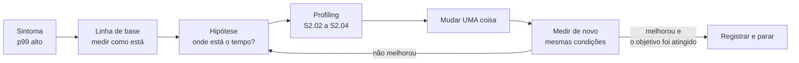

# S2.01 — Metodologia: medir antes de otimizar

> ⏱️ ~1h30 · 🟣 Sênior · Pré-requisitos: S1.01 (Amdahl, conta de conexões), P1.02 (JIT e aquecimento), P6.02/P6.03 (métricas, RED/USE), P2.04 (`EXPLAIN ANALYZE`)

> ✅ **Validação final (2026-11-24):** módulo executado no PayFlow reconstruído; resultado e o que continua não executado no [README do módulo](README.md). Os avisos "não executado" / "por leitura" abaixo descrevem a escrita original.

> ⚠️ **Verificação:** `lab/MethodLab.java` **foi executado** (JDK 25.0.5, Linux, 12 núcleos, **máquina compartilhada**; `lab/out-s201.txt`). A seção 2 usa uma **latência modelada** (semente fixa, parâmetros **inventados e declarados**) e a seção 3 usa **uma espera simulada** no lugar do banco: são **modelos para ensinar o método**, **não** medições do PayFlow. Os milissegundos **variam** a cada execução: vale a **forma**. **Não executado:** o PayFlow do aluno (o roteiro de medição fica como exercício, **por leitura**; testes práticos no fim do treinamento).

## 🎯 Objetivos
Ao final desta aula você consegue:
- **Aplicar** o ciclo **medir → hipótese → mudar **uma** coisa → medir de novo** e **recusar** otimização sem linha de base.
- **Explicar** por que o **primeiro número mente** (aquecimento, JIT) e por que **uma** medição não basta (**ruído**).
- **Ler** latência por **percentis** (p50, p95, p99) e **explicar** por que a média esconde a cauda e por que a cauda **aparece mais** quando uma página faz **muitas** chamadas.
- **Calcular** o **ganho máximo** de uma otimização com **Amdahl** a partir de onde o tempo está.
- **Escrever** um **orçamento de desempenho** e um **registro de experimento** para o PayFlow.

## 🤔 Por que isso importa
No nível sênior, "está lento" chega como **sintoma** (reclamação do cliente, alerta de p99), não como causa. Quem otimiza **por intuição** gasta semanas **acelerando o que não importa** (e **piora** a leitura do código). Quem **mede** acha o gargalo em minutos e **prova** o ganho. A frase de Knuth sobre "otimização prematura" costuma vir **cortada**: o problema não é otimizar, é otimizar **sem saber onde dói**.

## 💡 Intuição (explicação simples)
Um **médico** não opera porque "acha" que o joelho dói por causa do quadril: pede **exame**, formula uma hipótese, trata **uma** coisa e **reexamina**. Desempenho é igual. E o **cronômetro de uma volta só** não diz o ritmo do corredor: ele **aquece**, tem dia ruim e tropeça em 1 de cada 100 voltas, e é **essa** volta que o cliente sente.

## 🔬 Como funciona por dentro

### 1. O ciclo (e os cinco pecados)

Os pecados que o ciclo evita: **(1)** otimizar **sem linha de base**; **(2)** mudar **várias** coisas de uma vez (não se sabe **qual** ajudou); **(3)** medir em condição **diferente** da produção (máquina ociosa, banco vazio, `localhost`); **(4)** **uma** execução só; **(5)** **não parar** quando o objetivo foi atingido.

### 2. O primeiro número mente
Na seção 1 do laboratório, **a mesma chamada, 12 vezes seguidas**:
```
== 1. A mesma chamada, 12 vezes seguidas (work(200_000), ms) ==
#1=8.80 #2=6.59 #3=3.05 #4=1.86 #5=1.46 #6=1.40 #7=1.41 #8=1.59 #9=1.38 #10=1.35 #11=1.34 #12=2.00
```
A 1ª execução custou **~6×** a de regime: a JVM **interpreta**, **compila** (C1, depois C2) e só então roda "de verdade" (P1.02). Consequência: **medir uma vez** com `nanoTime()` (ou um `time` no terminal) mede **a JVM aquecendo**, não o seu código. O mesmo vale para **cache frio** do banco e do sistema de arquivos. O remédio é **descartar o aquecimento** e **repetir** (S2.08 ensina o instrumento certo: o **JMH**).

### 3. Média × percentis: a cauda manda
A seção 2 simula um serviço (**modelo**: 98% das chamadas ~8 ms e 2% ~300 ms, as lentas por *lock*, GC ou *retry*):
```
== 2. Latencia de um servico MODELADO (semente fixa): 98% rapidas, 2% lentas ==
media=15.3 ms  p50=8.0  p95=10.8  p99=356.6  p99.9=458.0  max=608.2
paginas com 100 chamadas que sofreram ao menos uma acima do p99: 63.6% (teoria: 1-0,99^100 = 63.4%)
```
- A **média** (15,3 ms) **não descreve ninguém**: **nenhuma** requisição levou 15 ms.
- **p50 = 8 ms**: metade das chamadas é **tão rápida**; **p99 = 357 ms**: **1 em 100** leva **44×** mais.
- **Por que a cauda importa mais do que parece:** uma página que faz **100 chamadas** ao serviço tem chance de **1 − 0,99¹⁰⁰ ≈ 63%** de pegar **pelo menos uma** acima do p99 (o modelo mediu **63,6%**; a conta dá **63,4%**). Com **muitas** chamadas por requisição do usuário, **o p99 do componente vira a experiência típica** (é o argumento do artigo [*The Tail at Scale*](https://research.google/pubs/the-tail-at-scale/)).
- **Regra:** **nunca** reporte desempenho só com **média**. Reporte **p50, p95, p99 (e p99,9 quando o volume permite) e a contagem** de amostras. E **nunca faça a média de percentis** entre instâncias (a média de dois p99 **não é** o p99 do conjunto; some **histogramas**, P6.03).

### 4. Onde está o tempo? (Amdahl na prática)
A seção 3 mede **três fases** de uma requisição (aqui o "banco" é uma **espera simulada** de 5 ms):
```
== 3. Uma requisicao com 3 fases: onde esta o tempo? (media de 200 execucoes, ms) ==
parse=0.005 (0.1%)  banco(modelado)=5.239 (93.3%)  serialize=0.370 (6.6%)  total=5.614
ganho total se parse ficar 10x mais rapido:     1.001x
ganho total se o banco ficar 10x mais rapido:    6.246x
ganho total se serialize ficar 10x mais rapido:  1.063x
```
Acelerar **10×** o *parse* rende **1,001×**; acelerar **10×** a fase de 93% rende **6,2×**. É a **Lei de Amdahl** da S1.01 aplicada **à requisição**: `ganho = 1 / ((1 − f) + f/k)` para uma fase que ocupa a fração `f` e fica `k` vezes mais rápida. **O teto de uma otimização é a fração do tempo que ela toca**: antes de escrever uma linha, **meça `f`**. (Se o tempo é **espera**, não há CPU a economizar: é **consulta, índice, pool ou chamada remota**, P2.04–P2.06.)

### 5. Ruído: repita e olhe o espalhamento
A seção 4 repete **a mesma** medição 15 vezes:
```
== 4. Ruido: a mesma medicao 15 vezes (cada uma = 30 execucoes de work(100_000), ms) ==
min=19.0  mediana=19.2  max=30.2  media=21.0  desvio=3.4 (16.3% da media)
```
A **mediana** (19,2 ms) e o **máximo** (30,2 ms) da **mesma** carga diferem em **~57%** (desvio de **16%** da média) numa máquina **compartilhada**. Consequências: **(a)** uma melhora de **5%** medida **uma vez** é **ruído**; **(b)** use **mediana/mínimo** e **repetições**; **(c)** **anote o ambiente** (CPU, carga, versão da JVM, dados); **(d)** compare **antes e depois na mesma sessão**, alternando se possível.

### 6. Ferramentas por pergunta (mapa do módulo)
| Pergunta | Ferramenta | Aula |
|---|---|---|
| Onde a **CPU** gasta? Quem **aloca**? Quem **espera um lock**? | **JFR** + JMC | S2.02 |
| Mesma pergunta, com **mais precisão** e **gráfico de chama** | **async-profiler** | S2.03 |
| A memória **só cresce**? Quem **segura** os objetos? | *heap dump*, histograma, `OldObjectSample` | S2.04 |
| A **pausa do GC** machuca o p99? | **logs/JFR de GC** e ajuste | S2.05 |
| Quanto o sistema **aguenta** e como a latência **degrada**? | **k6/Gatling** (carga **aberta**) | S2.06 |
| Vale **mudar o modelo de execução** (nativo, CRaC, AOT)? | **medir partida e memória** | S2.07 |
| Este **trecho de código** é mais rápido que aquele? | **JMH** | S2.08 |
**Duas famílias de método:** **USE** (para cada **recurso**: *Utilization*, *Saturation*, *Errors*; [Brendan Gregg](https://www.brendangregg.com/usemethod.html)) e **RED** (para cada **serviço**: *Rate*, *Errors*, *Duration*; P6.03) e os **quatro sinais de ouro** do SRE ([Monitoring Distributed Systems](https://sre.google/sre-book/monitoring-distributed-systems/): latência, tráfego, erros, saturação). **Comece pelo recurso mais saturado**, não pelo código que você acha feio.

## 🛠️ Exemplo prático
Rode o laboratório (Java 25, sem Maven):
```bash
cd 3-senior/S2-performance-eficiencia/lab
java MethodLab.java
```
O **trecho essencial** (percentis; a seção 2 inteira está no arquivo):
```java
static double pct(double[] sorted, double p) {
    int idx = (int) Math.ceil(p / 100.0 * sorted.length) - 1;       // "nearest rank"
    return sorted[Math.max(0, Math.min(idx, sorted.length - 1))];
}
```
E o **registro de experimento** que você deve preencher **antes e depois** de cada mudança (modelo para `docs/perf/experimentos.md`):
```markdown
## EXP-007 — Cache do saldo no extrato
- **Sintoma:** p99 de GET /accounts/{id}/statement = <medido> ms (alvo: <alvo>)
- **Ambiente:** <CPU, RAM, JVM, banco, volume de dados, carga>
- **Linha de base:** <n execuções>, mediana=<…> p95=<…> p99=<…>
- **Hipótese:** <onde está o tempo, com a evidência do profiling>
- **Mudança (uma):** <o quê>
- **Depois:** <mesmas condições>, mediana=<…> p95=<…> p99=<…>
- **Conclusão:** <melhorou? atingiu o alvo? efeito colateral?>
- **Reverter com:** <commit/flag>
```

## 🧠 Pausa para lógica
Uma requisição leva 100 ms: **80 ms** numa consulta SQL, **15 ms** em serialização JSON e **5 ms** de lógica. O time propõe reescrever a serialização para ficar **5× mais rápida**. **Qual o ganho total máximo?** E **se**, em vez disso, o índice certo reduzir a consulta de 80 para **20 ms**?
<details><summary>Dica e solução</summary>

`f = 0,15`, `k = 5`: `100 / (85 + 15/5) = 100/88 =` **1,14×** (100 → 88 ms). Com o índice: `100 − 80 + 20 =` **40 ms = 2,5×**. **A fração manda.** Mesmo com a serialização **instantânea** (`k → ∞`) o teto é `100/85 =` **1,18×**.
</details>

## 🏗️ Estudo de caso: "foi 30% mais rápido na minha máquina"
Um colega mede um *endpoint* **uma vez** no notebook (banco **vazio**, `localhost`) antes e depois de trocar `+=` por `StringBuilder` e anuncia **30%**. Em produção **nada mudou**. **Quais** dos cinco pecados ele cometeu?
<details><summary>Solução</summary>

**(1)** sem linha de base **repetida**; **(3)** condição diferente (banco vazio, sem rede); **(4)** **uma** execução (a 1ª é **aquecimento**, seção 2); e provavelmente **(2)** mudou outras coisas junto. Correção: **mesmo ambiente**, **≥ 15 repetições**, **mediana e p99**, dados **realistas** (S2.06) e o **profiling** confirmando que a concatenação **era** a fase relevante (`f`).
</details>

## ⚖️ Trade-offs e quando NÃO otimizar
- **Otimizar custa:** legibilidade, **tempo de revisão** e **risco** de bug. Se a **meta já foi atingida**, **pare**.
- **Não otimize** o que não está no **caminho crítico** nem no **orçamento** (o *parse* de 0,005 ms acima).
- **Às vezes a resposta é "não" ou "mais máquinas"** (S1.01: o teto é o componente com estado): **escala** é uma otimização **legítima** quando o gargalo **é** capacidade, **não** quando é **contenção** (lock, S2.02).
- **Microbenchmark ≠ sistema:** um trecho 3× mais rápido num JMH pode **não mudar** o p99 do serviço (Amdahl de novo).

## ⚠️ Erros comuns e boas práticas de produção
- **Medir só a média** (ou o "tempo médio" do APM): esconde a cauda.
- **Medir com dados de brinquedo:** o plano do `EXPLAIN` muda com volume (P2.04): use o **gerador de volume** da P2.
- **Medir na máquina com outras cargas** sem registrar a carga (o laboratório mostrou **16%** de desvio).
- **Comparar execuções de dias diferentes**; **trocar a versão da JVM** no meio; **esquecer de reverter** a *flag* de depuração.
- **Otimizar sem teste de correção:** a versão mais rápida precisa dar **o mesmo resultado** (S2.08 mostra um caso em que **não é garantido**: `double` para dinheiro).
- **Boa prática:** **orçamento de desempenho** por *endpoint* escrito **antes** (ex.: "p99 < X ms a Y req/s com Z linhas"), **registro de experimentos** versionado e um **teste de carga no CI** que **avisa** quando o p99 piora (S2.06).

## 🧩 Exercícios
1. **Fixação:** com `p = 0,995`, qual a chance de uma página com **50** chamadas pegar ao menos uma acima do p99,5? (`1 − 0,995⁵⁰`.) E por que **a média de 2 p99** não é o p99?
2. **PayFlow:** crie `docs/perf/orcamento.md` e `docs/perf/experimentos.md` (modelo acima). Critérios de pronto:
   - [ ] lista dos **5 *endpoints*** mais importantes (`POST /transfers`, `GET /accounts/{id}`, `GET /accounts/{id}/statement`, `POST /payments`, `GET /p/{code}`), cada um com **alvo de p99 e taxa** marcados como **"proposta, a validar na S2.06"** (**não invente números**: o SLO formal vem na S4);
   - [ ] **ambiente de referência** descrito (e a regra "só se compara com o **mesmo** ambiente");
   - [ ] o **ciclo** da seção 1 e os **cinco pecados** resumidos em 10 linhas;
   - [ ] regra do CI: **nenhuma PR de "performance"** sem **linha de base e experimento** anexados.
3. **Desafio (opcional):** estenda a seção 3 do `MethodLab` com uma **4ª fase** (por exemplo, uma consulta **N+1** modelada com 20 esperas de 1 ms) e **recalcule** qual otimização rende mais.
<details><summary>Solução da fixação (1)</summary>

`1 − 0,995⁵⁰ = 1 − 0,778 =` **22,2%**. A média de dois p99 **não** é o p99 do conjunto porque o percentil **não é linear**: some os **histogramas** (ou use *histogramas nativos* do Prometheus) e **só então** calcule o percentil.
</details>

## 🎤 Na entrevista
1. **"A API está lenta. O que você faz primeiro?"** **Medir**: reproduzir com **linha de base** (percentis, não média), olhar **saturação** (USE) e **onde o tempo está** (profiling/traces); **uma** hipótese, **uma** mudança, **medir de novo**. **Não** começo reescrevendo.
2. **"Por que o p99 importa mais que a média?"** A média **esconde** a cauda; e com **N chamadas por requisição**, a chance de pegar a cauda é `1 − p^N` (no modelo: **63,6%** com 100 chamadas).
3. **"Reduzi um método de 10 ms para 1 ms e o p99 quase não mudou. Por quê?"** **Amdahl**: se o método era **1%** do tempo, o teto é **1,01×**; o gargalo estava **em outro lugar** (espera, consulta, *lock*).
4. **"Como garantir que um benchmark é confiável?"** **Aquecer**, **repetir**, reportar **distribuição**, **mesmo ambiente**, **consumir o resultado** (o JIT apaga código morto) e usar **JMH** para microbenchmarks (S2.08).

## 📚 Para ir além
- 🎥 [*"How NOT to Measure Latency"* — Gil Tene (Strange Loop)](https://www.youtube.com/watch?v=lJ8ydIuPFeU): a palestra de referência sobre **percentis, p99,99 e omissão coordenada** (duração **não conferida**; é longa, cerca de uma hora).
- 📑 [*The Tail at Scale* (Dean e Barroso, Google)](https://research.google/pubs/the-tail-at-scale/): por que a **cauda** domina sistemas com **muitas chamadas**.
- 📄 [Brendan Gregg: The USE Method](https://www.brendangregg.com/usemethod.html): **checklist por recurso** para achar o gargalo.
- 📄 [Google SRE Book: Monitoring Distributed Systems](https://sre.google/sre-book/monitoring-distributed-systems/): os **quatro sinais de ouro**.
- 📑 *Systems Performance* (Brendan Gregg), caps. 1–2 (**metodologia**) (**de memória, não conferido**).

## ✅ Checklist da aula
- [ ] Sei o **ciclo** e os **cinco pecados**.
- [ ] Explico por que o **primeiro número mente** e por que **uma** medição não basta.
- [ ] Reporto **percentis** (nunca só média) e sei somar **histogramas**.
- [ ] Calculo o **teto de ganho** com Amdahl **antes** de otimizar.
- [ ] `docs/perf/orcamento.md` e `experimentos.md` criados (alvos **a validar**).
