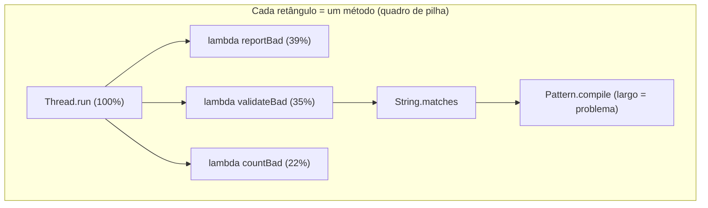

# S2.03 — async-profiler

> ⏱️ ~1h30 · 🟣 Sênior · Pré-requisitos: S2.02 (JFR e perfil de CPU × espera), P1.02 (JIT e *inlining*), P7.02 (JVM em contêiner)

> ⚠️ **Verificação:** o **async-profiler em si NÃO foi executado** (não foi baixado nem instalado: é um binário nativo que se acopla à JVM, e **não baixei nem instalei** binário nativo sem você pedir). O que **foi executado** (JDK 25.0.5, `lab/BiasLab.java`, `lab/FlameFold.java`, `lab/run-profile.sh`, saídas `out-s203-*.txt`): (a) o **experimento do viés de amostragem**, comparando um **amostrador "de pobre"** (`Thread.getStackTrace`) e o **JFR**; (b) a **conversão de uma gravação JFR em pilhas "colapsadas"** (o formato do *flame graph*) e numa **árvore** de texto. Os **comandos do async-profiler** abaixo vêm da **documentação do projeto** (README e `docs/`, lidos em 2026-11-14, **versão estável 4.6**) e **precisam ser validados** no seu ambiente (**fica para o fim do treinamento**).

## 🎯 Objetivos
Ao final desta aula você consegue:
- **Explicar** o **viés de ponto de segurança** (*safepoint bias*) e **quando** ele (e a **perda de informação de depuração** do JIT) engana um perfil.
- **Escolher** o **modo** do profiler: **CPU**, **relógio de parede** (*wall-clock*), **alocação** e **lock**.
- **Ler um *flame graph*** (largura = tempo; **não** é um eixo de tempo) e **converter** pilhas em formato **colapsado**.
- **Decidir** entre **JFR** e **async-profiler** para um problema.
- **Preparar** o ambiente (parâmetros do *kernel*, contêiner) e as *flags* da JVM.

## 🤔 Por que isso importa
O JFR (S2.02) responde à maioria das perguntas. Mas há dois casos em que um sênior **precisa de mais**: **(1)** o **perfil mente** (atribui o tempo ao método errado) e **(2)** é preciso ver **tempo de espera** (*wall-clock*) **e** CPU **no mesmo gráfico**, ou **o que a JVM faz fora do Java** (GC, JIT, o *kernel*). O async-profiler faz as duas coisas e gera o **gráfico de chama**, a ferramenta de leitura mais usada em desempenho.

## 💡 Intuição (explicação simples)
Imagine **fotografar uma fábrica** para saber onde os operários passam o tempo. Um fotógrafo **só tira foto quando o apito toca** (nos "pontos de segurança"): se os operários **só olham o relógio** quando o apito toca, **a foto mostra todo mundo olhando o relógio**. Outro fotógrafo tira foto **de surpresa**, por um **temporizador do sistema**: o retrato é **fiel**. O primeiro é o viés; o segundo é o que o async-profiler faz (e o JFR **também**, com ressalvas).

## 🔬 Como funciona por dentro

### 1. O viés de ponto de segurança
Amostradores **clássicos** (e o seu `jstack`/`Thread.getStackTrace` repetido) só enxergam uma *thread* **quando ela chega a um ponto de segurança** (retorno de método, volta de laço com *poll*). Um **laço contado de `int`** longo pode ficar **sem pontos de segurança**: o amostrador **espera**, e a amostra cai **onde** a *thread* parou, não **onde** ela passou o tempo. A documentação do async-profiler abre justamente dizendo que ele **não sofre** desse problema ([README](https://github.com/async-profiler/async-profiler); o texto clássico é o de [Nitsan Wakart](https://psy-lob-saw.blogspot.com/2016/02/why-most-sampling-java-profilers-are.html)).

### 2. O experimento (executado)
`BiasLab` tem **um** *thread* que alterna `heavy()` (laço contado de `int`, **~88–90%** da CPU) e `light()` (400 mil chamadas curtas, **~10–12%**). Dois "fotógrafos" olham a **mesma** execução: o amostrador de pobre (`Thread.getStackTrace` a cada 5 ms) e o **JFR** (`profile`). Três cenários:
```
### padrao (JDK 25)
amostrador de pobre (Thread.getStackTrace, 1941 amostras): 
  heavy     1719   88.6%
  light      222   11.4%
JFR:
Method                                                          Samples Percent
--------------------------------------------------------------- ------- -------
BiasLab.heavy()                                                     872  88.35%
BiasLab.light()                                                     114  11.55%

### sem pontos de seguranca em lacos contados (-XX:-UseCountedLoopSafepoints)
amostrador de pobre (Thread.getStackTrace, 1773 amostras): 
  lambda$main$0  1770   99.8%
  heavy        1    0.1%
  light        1    0.1%
  scopedValueBindings     1    0.1%
JFR:
Method                                                          Samples Percent
--------------------------------------------------------------- ------- -------
BiasLab.lambda$main$0(long)                                         983  99.90%
BiasLab.light()                                                       1   0.10%

### idem + -XX:+UnlockDiagnosticVMOptions -XX:+DebugNonSafepoints
amostrador de pobre (Thread.getStackTrace, 1784 amostras): 
  lambda$main$0  1782   99.9%
  heavy        1    0.1%
  scopedValueBindings     1    0.1%
JFR:
Method                                                          Samples Percent
--------------------------------------------------------------- ------- -------
BiasLab.heavy()                                                     873  88.63%
BiasLab.light()                                                     111  11.27%
```
**Como ler (honestamente):**
1. **Padrão (JDK 25):** os **dois** acertam (**~88% / ~12%** nas duas colunas). **O viés clássico não apareceu**: a JVM atual insere *polls* em laços contados (*loop strip mining*) e `getStackTrace` de **uma** *thread* não é mais uma parada global. **Não repita o "mito" de que `jstack` é sempre enganoso**: **meça**.
2. **Sem *polls* em laços contados** (`-XX:-UseCountedLoopSafepoints`): **os dois** erram! Todo o tempo vai para o **lambda** que chama `heavy()` e `light()` (o JIT **fundiu** os métodos, *inlining*): **não existe mais** a distinção que você queria.
3. **Com `-XX:+UnlockDiagnosticVMOptions -XX:+DebugNonSafepoints`:** o **JFR** volta a acertar (**~89% / ~11%**: o JIT passa a guardar informação de depuração **fora** dos pontos de segurança), mas o **amostrador de pobre continua errado** (**~100%** no lambda): ele **só vê** pontos de segurança.

**Duas causas diferentes de erro de atribuição:** **(a)** *viés do amostrador* (só amostra em pontos de segurança) e **(b)** **falta de informação de depuração** no código compilado. O async-profiler **resolve (a)** (usa um mecanismo assíncrono, sem esperar *polls*) e **depende de (b)**: por isso a documentação **recomenda** iniciar a JVM com `-XX:+UnlockDiagnosticVMOptions -XX:+DebugNonSafepoints` "para melhor precisão" (a menos que o profiler seja carregado **na partida** da JVM). O JFR **também** se beneficia da mesma *flag* (cenário 3). No JDK 25, o JFR usa **amostragem cooperativa** ([JEP 518](https://openjdk.org/jeps/518)): a pilha é percorrida **em pontos de segurança**, "**minimizando** o viés" (palavras do JEP): foi o que o cenário 3 **mediu** (o JFR acertou onde o `getStackTrace` não). O JDK 25 traz ainda um **perfil de tempo de CPU experimental** para Linux ([JEP 509](https://openjdk.org/jeps/509); a *view* `cpu-time-hot-methods` do `jfr view`): **não executado** aqui. **Regra prática:** em qualquer investigação séria, **inicie a JVM com `-XX:+UnlockDiagnosticVMOptions -XX:+DebugNonSafepoints`** (a documentação a chama de **diagnóstica**: use **na investigação**; o custo **não foi medido** aqui).

### 3. Modos do async-profiler (da documentação)
| Pergunta | Modo | Comando (exemplo da documentação) |
|---|---|---|
| Onde a **CPU** gasta? | `cpu` (padrão) | `asprof -d 30 -f flamegraph.html <PID>` |
| Onde as *threads* **passam o tempo**, **inclusive esperando**? | `wall` (por *thread*: `-t`) | `asprof -e wall -t -i 50ms -f result.html <PID>` |
| **Quem aloca** na pilha? | `alloc` | `asprof -e alloc -f alloc.html <PID>` (e `--alloc 2m` com intervalo) |
| **Quem espera** um *lock*? | `lock` | `asprof -e lock -t -i 5ms -f result.html <PID>` |
| Tudo junto, num arquivo `.jfr` | `-e cpu,alloc,lock` | `asprof -e cpu,alloc,lock -f profile.jfr <PID>` (JFR é o **único** formato que aceita **vários** eventos) |
- O modo **`wall`** amostra **todas** as *threads* **igualmente**, "esteja a *thread* rodando, dormindo ou bloqueada" (documentação): serve para **partida lenta** e para **latência dominada por espera** (o caso em que o perfil de CPU da S2.02 é **vazio**).
- No modo **`lock`**, o **topo** da pilha é a **classe do monitor** e o contador é o **tempo (ns) para entrar**.
- Ele também enxerga **threads fora do Java** (GC, JIT) e **quadros nativos e do *kernel***.
- Pré-requisitos do **Linux** (documentação): para pilhas do *kernel* sem ser *root*, `sysctl kernel.perf_event_paranoid=1` e `kernel.kptr_restrict=0`. **Em contêiner:** a documentação diz que pode ser preciso **relaxar o perfil seccomp** (`--security-opt seccomp=unconfined`) e, às vezes, `--cap-add SYS_ADMIN`: **isso enfraquece o contêiner**; só em **ambiente de investigação**, e o PayFlow roda com **Pod Security `restricted`** (P7): o caminho é o **JFR** em produção e o async-profiler **numa réplica de teste**.
- **Instalação** (releases do GitHub; **versão 4.6** no README lido): baixar o `.tar.gz`, descompactar e usar `asprof` (Linux x64/arm64, macOS). **Sempre confira o *checksum*/assinatura da release** antes de rodar um binário nativo **dentro de um processo de produção**.

### 4. Ler um *flame graph*

- **Largura = proporção das amostras** em que o método **estava na pilha** (**não** é tempo no eixo X: a ordem **horizontal é alfabética**, não cronológica).
- **Altura = profundidade** da pilha. **Procure "platôs" largos no topo**: **métodos folha largos** são onde a CPU **realmente** foi.
- Cores/cores de código variam por ferramenta; **não** têm significado universal.
- **Diferença entre dois gráficos** (antes × depois) é o melhor teste de uma otimização (S2.01).
O formato que **alimenta** quase todas as ferramentas de gráfico é o **colapsado**: **uma linha por pilha**, **da raiz à folha**, separada por `;`, seguida da **contagem** (é o que o async-profiler escreve com `-o collapsed` e o que o `flamegraph.pl` do Brendan Gregg consome; veja [flamegraphs](https://www.brendangregg.com/flamegraphs.html)).

### 5. Fazer o mesmo com o JFR: `FlameFold` (executado)
`FlameFold` lê a saída de `jfr print --events jdk.ExecutionSample --stack-depth 64` e produz **as pilhas colapsadas e uma árvore** de texto, aqui sobre **a gravação da versão com problemas** da S2.02:
```
== colapsado (as 5 pilhas mais frequentes) ==
1969  Thread.run;ProfileApp.lambda$main$1;ProfileApp.reportBad
739  Thread.run;ProfileApp.lambda$main$2;ProfileApp.countBad;String.hashCode;StringLatin1.hashCode
420  Thread.run;ProfileApp.lambda$main$0;ProfileApp.validateBad;String.matches;Pattern.matches;Pattern.compile;Pattern.<init>;Pattern.compile;Pattern.expr
348  Thread.run;ProfileApp.lambda$main$0;ProfileApp.validateBad;String.matches;Pattern.matches;Pattern.compile;Pattern.<init>;Pattern.compile;Pattern.expr;Pattern.sequence
266  Thread.run;ProfileApp.lambda$main$2;ProfileApp.countBad

== arvore (de cima para baixo; so ramos >= 3.0% do total) ==
100.0%  (todas as amostras)
  100.0%  Thread.run
     39.6%  ProfileApp.lambda$main$0
       33.7%  ProfileApp.validateBad
         33.7%  String.matches
           33.7%  Pattern.matches
        3.6%  StringConcatHelper$Concat1.concat
     38.5%  ProfileApp.lambda$main$1
       38.5%  ProfileApp.reportBad
     21.9%  ProfileApp.lambda$main$2
       18.2%  ProfileApp.countBad
         13.3%  String.hashCode
           13.3%  StringLatin1.hashCode
```
**Leitura:** `reportBad` (~39%) e `validateBad → String.matches → Pattern.matches → Pattern.compile` (~34%) são **os dois platôs largos**; `countBad` (~18%) é o **trabalho dentro do lock** (que **também** causa **espera**, **invisível** neste gráfico de CPU: só um perfil **`wall`** ou **`lock`** a mostraria). **Os mesmos números** da `hot-methods`, agora **como árvore** (as pilhas colapsadas servem de entrada para o `flamegraph.pl`).

## 🛠️ Exemplo prático
**Roteiro de investigação (a validar):**
```bash
# 0. JVM iniciada com informação de depuração fora dos pontos de segurança
java -XX:+UnlockDiagnosticVMOptions -XX:+DebugNonSafepoints -jar app.jar

# 1. CPU (30 s) -> gráfico de chama
asprof -d 30 -f /tmp/cpu.html <PID>

# 2. Parece lento mas a CPU está baixa? relógio de parede por thread
asprof -d 30 -e wall -t -i 50ms -f /tmp/wall.html <PID>

# 3. Quem aloca / quem espera lock, tudo num .jfr (abre no JMC)
asprof -d 60 -e cpu,alloc,lock -f /tmp/tudo.jfr <PID>
```
**E o que você roda hoje** (sem instalar nada):
```bash
cd 3-senior/S2-performance-eficiencia/lab
./run-profile.sh        # regrava out-s203-bias.txt e out-s203-flame.txt
```

## 🧠 Pausa para lógica
Num perfil de CPU de 30 s o método `RateLimiter.tryAcquire` aparece com **40%** das amostras, mas o serviço está a **15% de CPU** e a latência é de **400 ms**. **Duas explicações possíveis** (uma de **atribuição**, outra de **método**) e **o que você roda para decidir?**
<details><summary>Dica e solução</summary>

**(1) Atribuição:** o JIT fundiu métodos e a informação de depuração é grosseira; confirme com `-XX:+DebugNonSafepoints` e **repita**. **(2) Método:** o perfil de **CPU** só tem **uma fração** do tempo (15% de CPU!): o resto é **espera**; rode **`-e wall -t`** e **`-e lock`**. A fração de CPU **baixa** diz que o **tempo de verdade** está em **outro** perfil.
</details>

## 🏗️ Estudo de caso: "o JFR diz que o gargalo é `Object.hashCode`"
Na aula S2.02, após a correção, o topo do `hot-methods` era `StringLatin1.hashCode`, mas o código chama `hashCode()` **no máximo uma vez por requisição** (o *hash* da `String` é **cacheado**). **O que está acontecendo?**
<details><summary>Solução</summary>

O laço de "trabalho útil" do `countFixed` **repete** `k.hashCode()` 2.000 vezes **de propósito**: o JIT **inlinou** `String.hashCode` e a **linha** de informação de depuração aponta para o método **folha** mais próximo. É **atribuição aproximada** (seção 2). **Confirme** com `-XX:+DebugNonSafepoints` e olhando a **pilha** (`jfr print --stack-depth`) e o **código-fonte** (`countFixed:48`): a causa é **seu** laço, não o `hashCode`.
</details>

## ⚖️ Trade-offs e quando NÃO usar
- **Async-profiler** é um **agente nativo**: precisa ser **instalado**, **confiado** e (em contêiner) pede **privilégios**. **Não** o ligue em produção **sem** teste e aprovação de segurança (S5).
- **JFR** já basta para **a maioria** dos casos (S2.02) e **não precisa de privilégio extra**.
- **Perfil `wall` em muitas *threads*** gera **muito ruído** (todas as *threads* ociosas aparecem): **use `-t`** e **filtre** pelas *threads* que servem requisições.
- **Flame graph** mostra **proporção**, **não** causa: **leia a pilha** e **teste uma hipótese** (S2.01).

## ⚠️ Erros comuns e boas práticas de produção
- **Perfilar a JVM errada** (o `pid` do *wrapper* shell em vez do `java`): use `jps`/`pgrep -a java`.
- **Esquecer `DebugNonSafepoints`** e concluir que "o método X é o gargalo" (seção 2).
- **Comparar gráficos de cargas diferentes:** mesma carga, mesma duração.
- **Esquecer que o `.html` do *flame graph* mostra amostras do período**, não **a vida toda** do processo.
- **Rodar `perf_event_paranoid=-1` no *host* "para facilitar"** e deixar assim: restaure.
- **Boa prática:** **dois perfis por investigação** (CPU **e** `wall`); salvar o **colapsado** (texto, versionável, **diferenciável** com `diff`); e registrar **qual** *flag* e **qual** versão do profiler usou (S2.01).

## 🧩 Exercícios
1. **Fixação:** rode `BiasLab` com `-XX:-UseCountedLoopSafepoints` **e** com `-XX:+DebugNonSafepoints` **juntas** (como no 3º cenário). Por que o **JFR** acerta e o `Thread.getStackTrace` **não**?
2. **PayFlow (por leitura):** acrescente a `docs/perf/profiling.md` (S2.02) uma seção **"quando usar async-profiler"** com: (a) a **tabela de modos** da seção 3; (b) a regra de que o PayFlow **inicia com `-XX:+UnlockDiagnosticVMOptions -XX:+DebugNonSafepoints`** apenas no **ambiente de teste de carga** (`JAVA_TOOL_OPTIONS` no manifesto de teste), **nunca** por padrão em produção; (c) o roteiro de **réplica de teste** com o *flame graph* **antes × depois**. Critérios de pronto:
   - [ ] o doc diz **por que** o Pod Security `restricted` **impede** o async-profiler em produção e **o que usar no lugar**;
   - [ ] o doc **cita a versão** e o **checksum** da *release* escolhida;
   - [ ] **nenhum** perfil é salvo **com dados pessoais** (as pilhas não os têm; **os eventos de negócio** sim: S2.02).
3. **Desafio (opcional):** estenda o `FlameFold` para **ler dois arquivos** e imprimir a **diferença percentual** por pilha (um **diff** de *flame graphs*).
<details><summary>Solução da fixação (1)</summary>

A *flag* `DebugNonSafepoints` faz o **JIT guardar** informação de depuração em **qualquer** instrução (não só em *polls*); o JFR **registra** o ponto exato da amostra e **usa** essa informação para atribuir ao método certo. O `getStackTrace` **só enxerga a *thread* num ponto de segurança**, e **sem *polls* no laço** ela só aparece **depois** dele (no *chamador* fundido): o erro é **do amostrador**, e a *flag* **não** o conserta.
</details>

## 🎤 Na entrevista
1. **"O que é *safepoint bias*?"** Amostradores que só veem a *thread* em **pontos de segurança** atribuem o tempo ao **local da parada**, não ao **local do gasto** (laços sem *polls*). O async-profiler **não depende** de pontos de segurança para amostrar; o JFR do JDK 25 **minimiza** o viés (JEP 518); **ambos** dependem da informação de depuração do JIT (`DebugNonSafepoints`).
2. **"Como ler um *flame graph*?"** **Largura = proporção de amostras**, **altura = profundidade**; procuro **platôs largos no topo**; a ordem horizontal **não** é o tempo.
3. **"CPU ou *wall-clock*?"** **CPU** para "onde a CPU gasta"; **wall** para "onde o **tempo** passa" (incluindo **espera**); uso **os dois** quando a CPU está baixa e a latência alta.
4. **"JFR ou async-profiler em produção?"** **JFR** (já vem na JVM, sem privilégio); async-profiler em **réplica de teste** ou com **aprovação de segurança**.

## 📚 Para ir além
- 💻 [async-profiler (GitHub)](https://github.com/async-profiler/async-profiler): **download**, *Getting Started*, **modos**, **opções**, **perfil em contêiner** e **interpretação de *flame graphs*** (leia `docs/GettingStarted.md`, `ProfilingModes.md` e `ProfilingInContainer.md`).
- 📄 [Brendan Gregg: Flame Graphs](https://www.brendangregg.com/flamegraphs.html): **a origem** do gráfico e do formato colapsado.
- 📄 [Nitsan Wakart: Why (Most) Sampling Java Profilers Are Fundamentally Broken](https://psy-lob-saw.blogspot.com/2016/02/why-most-sampling-java-profilers-are.html): o **texto clássico** sobre o viés (leia com o **contexto de data**: 2016; **meça** na sua JVM, como fizemos).
- 🎥 a documentação do async-profiler aponta uma **lista de reprodução de 3 horas** no YouTube (link no README do projeto; **não conferi o conteúdo nem a duração** além do que o README diz).
- 📑 *Systems Performance* (Brendan Gregg), cap. sobre **profiling** (**de memória, não conferido**).

## ✅ Checklist da aula
- [ ] Explico o **viés de ponto de segurança** e a **falta de informação de depuração**.
- [ ] Sei escolher **cpu / wall / alloc / lock**.
- [ ] Leio um **flame graph** (largura, platôs) e o formato **colapsado**.
- [ ] Sei **por que** o async-profiler **não** vai em produção `restricted`.
- [ ] Seção **"quando usar async-profiler"** adicionada a `docs/perf/profiling.md`.
