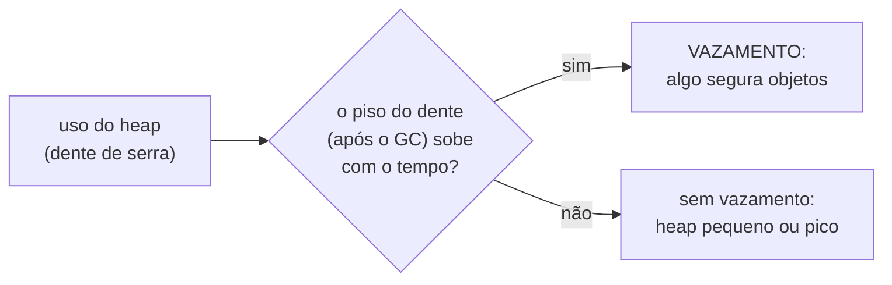

# S2.04 — Heap dumps e memory leaks

> ⏱️ ~1h30 · 🟣 Sênior · Pré-requisitos: S2.02 (JFR), P1.01 (áreas de memória), P1.03 (GC), P7.02/P7.09 (JVM em contêiner, `OOMKilled`), S1.04 (cache e TTL)

> ⚠️ **Verificação:** `lab/LeakLab.java` (vazamento plantado), `lab/HprofHisto.java` (leitor de *heap dump* **escrito para esta aula**) e os comandos `jcmd`/`jfr` **foram executados** (JDK 25.0.5; `lab/run-heap.sh` regrava as saídas `out-s204-*.txt`). **Não executado:** o **Eclipse MAT** e o **VisualVM** (interfaces gráficas: **não instalados**), o **dominador/tamanho retido** (o `HprofHisto` só calcula o **histograma**), *heap dump* em **contêiner/Kubernetes** (volume, `readOnlyRootFilesystem`) e a **memória fora do *heap*** (NMT). Os tamanhos e contagens **variam** a cada execução (a mesma carga dá números ligeiramente diferentes).

## 🎯 Objetivos
Ao final desta aula você consegue:
- **Distinguir** os "estouros de memória" (`Java heap space`, `Metaspace`, memória **direta**, **`OOMKilled`** do contêiner) e **reconhecer** um **vazamento** pela **tendência** do heap **após o GC**.
- **Capturar** um *heap dump* (`jcmd GC.heap_dump`, `-XX:+HeapDumpOnOutOfMemoryError`) e **um histograma de classes** ao vivo (`jcmd GC.class_histogram`).
- **Ler** o histograma e **achar quem segura** os objetos (**caminho até a raiz**: JFR `OldObjectSample`; dominador no MAT).
- **Corrigir** o vazamento e **provar** que o heap **estabilizou**.
- **Tratar** o *heap dump* como **dado sensível** (LGPD).

## 🤔 Por que isso importa
Um vazamento **não derruba a aplicação hoje**: ele a derruba **na madrugada de sexta**, depois de dias, quando o heap enche. O sintoma é **GC cada vez mais frequente** (p99 sobe, S2.05), depois `OutOfMemoryError`, depois **reinício** (e o ciclo recomeça: o time "resolve" **reiniciando toda noite**, o que **esconde** a causa). O sênior **acha o dono** dos objetos.

## 💡 Intuição (explicação simples)
Uma **mala** de viagem: se você **só põe** coisa e nunca tira, uma hora **não fecha**. O coletor de lixo tira **o que ninguém mais segura**; um vazamento em Java é **coisa que você esqueceu de soltar** (um `static Map` que só cresce): para o GC, **tudo ali ainda está em uso**. O *heap dump* é a **foto da mala aberta**; o **caminho até a raiz** diz **quem está segurando a alça**.

## 🔬 Como funciona por dentro

### 1. Tipos de "falta de memória" (não confunda)
| Mensagem / sinal | Causa típica | Onde olhar |
|---|---|---|
| `OutOfMemoryError: Java heap space` | heap pequeno **ou** vazamento **ou** pico real | **esta aula** |
| `OutOfMemoryError: Metaspace` | **vazamento de classes** (reimplantação, proxies gerados em laço) | `jcmd VM.metaspace`, `jfr view class-loaders` |
| `OutOfMemoryError: Direct buffer memory` | `ByteBuffer.allocateDirect` sem liberar (Netty, NIO) | teto de memória direta (P7.02, decisão do orçamento) |
| `unable to create native thread` | *threads* demais (cada uma custa pilha **fora** do heap) | `jcmd Thread.print`, limites do SO |
| contêiner **`OOMKilled`** (137) | **soma** heap + metaspace + pilhas + direta > limite do *pod* | P7.09; **não** deixa *heap dump* |
`OOM` **não é sinônimo de vazamento**: pode ser **heap subdimensionado** para a carga real (P7.02). A pergunta que separa: **o heap *depois do GC* sobe com o tempo?**

### 2. O sinal: o "dente de serra" que sobe

No Micrometer/Prometheus (P6.02), o gráfico é o **`jvm.memory.used` depois do GC** (e o *gauge* `jvm.gc.live.data.size`, tamanho dos dados vivos após o GC, quando disponível: **confira o nome no seu `/actuator/prometheus`**). Um alerta de **"piso subindo por 6 h"** vale mais que "heap > 90%".

### 3. O laboratório: um cache cuja chave **nunca repete**
`LeakLab` tem um *cache de sessões* **com a chave errada**:
```java
String userId = "user-" + (n % 500);
String requestId = "req-" + n;                          // único por chamada
String key = fixed ? userId : userId + ":" + requestId; // <-- o bug está na chave
```
Com `requestId` na chave, **nenhuma chamada acerta** e **nada sai**. Cada `Session` carrega `byte[2048]`. (É o mesmo erro do **cache sem limite** da S1.04/P2.09: sem **TTL**/**tamanho máximo**, cache **é** vazamento.)

**(a) O fim: OOM e o dump automático** (`-Xmx64m -XX:+HeapDumpOnOutOfMemoryError`):
```
java.lang.OutOfMemoryError: Java heap space
Dumping heap to <dir>/oom.hprof ...
Heap dump file created [71150257 bytes]
Terminating due to java.lang.OutOfMemoryError: Java heap space
```
A JVM **grava o *heap dump*** **no instante** do estouro e **só depois** encerra (`Terminating due to ...`, por causa do `-XX:+ExitOnOutOfMemoryError` da P7.02: **as duas *flags* juntas funcionam**, o dump sai **antes** do encerramento). **Em produção, ligue sempre** `-XX:+HeapDumpOnOutOfMemoryError -XX:HeapDumpPath=<volume>`.

**(b) A tendência ao vivo** (`jcmd <pid> GC.class_histogram`, **duas** vezes, 7 s entre elas; só as primeiras linhas):
```
### t = 5 s
 num     #instances         #bytes  class name (module)
-------------------------------------------------------
   1:         46532       32366568  [B
   2:         30641         735384  java.lang.String
   3:         17979         575328  java.util.HashMap$Node
   4:         14900         476800  LeakLab$Session
### t = 12 s
 num     #instances         #bytes  class name (module)
-------------------------------------------------------
   1:         89132       77178328  [B
   2:         39279        1256928  java.util.HashMap$Node
   3:         51941        1246584  java.lang.String
   4:         36200        1158400  LeakLab$Session
```
Em 7 s, `LeakLab$Session` **mais que dobrou** (14.900 → 36.200) e os `byte[]` **quase**; **nenhuma** classe do JDK mudou desse jeito. **Compare duas fotos**: o que **cresce** é o suspeito. (Por padrão o histograma **só conta objetos alcançáveis**; `-all` inclui os inalcançáveis: veja o `help` abaixo.)

**(c) O *heap dump* de um processo vivo** (`jcmd <pid> GC.heap_dump <arquivo>`): o `help` do seu JDK mostra as opções:
```
2397380:
GC.heap_dump
Generate a HPROF format dump of the Java heap.

Impact: High: Depends on Java heap size and content. Request a full GC unless the '-all' option is specified.

Syntax : GC.heap_dump [options] <filename>

Arguments:
	filename :  Name of the dump file (FILE, no default value)

Options: (options must be specified using the <key> or <key>=<value> syntax)
	-all : [optional] Dump all objects, including unreachable objects (BOOLEAN, false)
	-gz : [optional] If specified, the heap dump is written in gzipped format using the given compression level. 1 (recommended) is the fastest, 9 the strongest compression. (INT, 1)
	-overwrite : [optional] If specified, the dump file will be overwritten if it exists (BOOLEAN, false)
	-parallel : [optional] Number of parallel threads to use for heap dump. The VM will try to use the specified number of threads, but might use fewer. (INT, 1)
...
2397380:
GC.class_histogram
Provide statistics about the Java heap usage.

Impact: High: Depends on Java heap size and content.

Syntax : GC.class_histogram [options]

Options: (options must be specified using the <key> or <key>=<value> syntax)
	-all : [optional] Inspect all objects, including unreachable objects (BOOLEAN, false)
	-parallel : [optional] Number of parallel threads to use for heap inspection. 0 (the default) means let the VM determine the number of threads to use. 1 means use one thread (disable parallelism). For any other value the VM will try to use the specified number of threads, but might use fewer. (INT, 0)
```
```
2397380:
Dumping heap to <dir>/live.hprof ...
Heap dump file created [91658265 bytes in 0.057 secs]
```
O `help` do JDK 25 diz **`Impact: High`** e que o comando **pede um GC completo a menos que `-all`**; o arquivo (**~92 MB** aqui) tem **o tamanho do heap usado** e a opção **`-gz`** o grava **comprimido**: **faça** numa **réplica** ou fora do pico.

### 4. Lendo o *heap dump* (sem interface gráfica)
O arquivo `.hprof` é um formato **binário documentado** no código da JVM ([heapDumper.cpp](https://github.com/openjdk/jdk/blob/master/src/hotspot/share/services/heapDumper.cpp) descreve os registros). O `HprofHisto` (escrito para a aula; ~100 linhas) lê **instâncias** e **arrays** e imprime o **histograma por classe** (instâncias e **bytes de campos/elementos**, sem o cabeçalho de objeto). Do dump do **OOM**:
```
classe                                           instancias          bytes
byte[]                                               68,136     61,648,945
java.util.HashMap$Node                               30,756        861,168
LeakLab$Session                                      29,744        713,856
[Ljava.util.HashMap$Node;                               255        563,456
java.lang.String                                     38,315        536,410
[Ljava.lang.Object;                                   1,067        234,760
char[]                                                    7         33,350
[Ljdk.internal.ref.PhantomCleanable;                      1         32,768
TOTAL (todas as classes)                            176,047     64,859,261
```
e do dump **do processo vivo** (`jcmd GC.heap_dump`):
```
classe                                           instancias          bytes
byte[]                                               90,332     76,724,238
java.util.HashMap$Node                               39,879      1,116,612
LeakLab$Session                                      36,800        883,200
java.lang.String                                     52,541        735,574
[Ljava.util.HashMap$Node;                             1,696        725,024
TOTAL (todas as classes)                            262,809     82,841,665
```
**Leitura:** **~95%** dos bytes são `byte[]` (os **2 KiB** de cada `Session`, mais os das `String`s); há **~1 `HashMap$Node` por `Session`** (30,8 mil × 29,7 mil; os `Node` extras são de outras tabelas do JDK) e **muitas `String`s** (as chaves). Quem **segura** tudo isso? O histograma **não** diz: ele diz **o quê**, não **quem**. Para o **quem**, você precisa do **caminho até a raiz** (seção 5) ou de um **analisador de dominadores**:
- **Eclipse MAT** ([eclipse.dev/mat](https://eclipse.dev/mat/)): **Leak Suspects**, **Dominator Tree** (o objeto que **retém** mais memória) e **Path to GC Roots** (**não executado**; **leia a documentação**);
- **VisualVM** ([visualvm.github.io](https://visualvm.github.io/)): abre `.hprof` e mostra instâncias e referências (**não executado**).
**Tamanho raso × retido:** o **raso** (*shallow*) é o do **próprio objeto**; o **retido** é tudo que **sumiria** se ele fosse coletado. Um `HashMap` de 48 mil `Session`s tem **raso pequeno** e **retido enorme**: **é o retido que acha o culpado**.

### 5. O **quem**: `OldObjectSample` do JFR
O JFR (S2.02) tem um evento `jdk.OldObjectSample` que **amostra objetos que sobrevivem** e, **ao gravar com `path-to-gc-roots=true`**, registra **a cadeia de referências até a raiz**:
```bash
java -XX:StartFlightRecording:filename=leak.jfr,settings=profile,dumponexit=true,path-to-gc-roots=true ...
jfr print --events jdk.OldObjectSample --stack-depth 3 leak.jfr
```
(**Custo:** calcular os caminhos faz o JFR **percorrer o heap** ao gravar: **use sob demanda**, não permanente.) O laboratório (**16 s**, 3.000 req/s) gravou **centenas** de eventos `OldObjectSample` (229 nesta execução) (`jfr view memory-leaks-by-site` lista **os pontos de alocação** suspeitos); um deles (**filtrado** pelo script: o **primeiro** evento do arquivo costuma ser um objeto **do próprio JDK**), **a cadeia inteira**:
```
eventos OldObjectSample: 229
  object =  [
    byte[2048]
    payload : LeakLab$Session
    value : java.util.HashMap$Node
    next : java.util.HashMap$Node
    [30746] : java.util.HashMap$Node[65536]
    table : java.util.HashMap Size: 48000
    CACHE : java.lang.Class Class Name: LeakLab
    appClass : java.lang.Class Class Name: sun.launcher.LauncherHelper
  ]
  arrayElements = 2048
  stackTrace = [
    LeakLab.handle(boolean, long) line: 27
    LeakLab.main(String[]) line: 39
  ]
```
**Leia de baixo para cima:** `LeakLab` **(classe)** → campo estático **`CACHE`** → `HashMap` (**Size: 48000**) → `Node[65536]` → `HashMap$Node` → `Session` → **`byte[2048]`**. **Esse é o dono:** o **campo estático `CACHE`**. E o `stackTrace` diz **onde foi alocado**: `LeakLab.handle` (linha 27). **Dono + local da alocação** = a correção.
```

                         Memory Leak Candidates by Site

Alloc. Time Application Method                            Object Age Heap Usage
----------- --------------------------------------------- ---------- ----------
21:33:43    N/A                                               11.2 s    34.0 MB
21:33:53    LeakLab.handle(boolean, long)                     1.01 s    81.3 MB
```

### 6. Corrigir e **provar**
Correção: chave **só `userId`** (o que o cache sempre quis) e **limite de tamanho** com **LRU** (`LinkedHashMap` com `removeEldestEntry`, 5.000 entradas). **A mesma carga** (8 s, `-Xmx64m`, **sem** parar de rodar):
```
req=186256678 cache=500 acertos=186256178 erros=500 heapUsado~19 MB
fim sem OutOfMemoryError
```
`cache=500` (os 500 usuários), **acertos ≈ todas** as chamadas (**186 milhões** em 8 s), heap **estável** (~19 MB, num heap de 64 MB). **Prova:** o programa **terminou** sem OOM **na carga que antes derrubava a JVM em instantes**. Em produção, prove com **o piso do heap plano por horas** (seção 2) e a **taxa de acerto** do cache (S1.04: **métrica**).

### 7. Fontes clássicas de vazamento em aplicações Spring
- **`static` coleção** / **cache caseiro** sem **TTL e tamanho** (o do laboratório). Use **Caffeine** (`maximumSize`, `expireAfterWrite`) ou Redis com TTL (P2.09).
- **Chave de cache mutável ou com campo único por chamada** (o bug).
- **Listeners/callbacks** registrados e **nunca removidos** (*event buses*, `addShutdownHook`).
- **`ThreadLocal` em *pool* de *threads*** que **nunca** faz `remove()` (o valor vive tanto quanto a *thread*; cuidado com *threads* virtuais, P1.10).
- **`Map` de "requisições em andamento"** que **não** remove na falha.
- **Recursos não fechados** (conexões, `InputStream`): vazam **fora do heap** (descritores, buffers).
- **Métricas com *label* de alta cardinalidade** (P6.03: `sub` como *label* = **um *time series* por usuário**): vazamento **no cliente de métricas**.

## 🛠️ Exemplo prático
```bash
cd 3-senior/S2-performance-eficiencia/lab
./run-heap.sh                         # regrava out-s204-*.txt (~40 s); apaga os arquivos temporários

# a mao:
W=$(mktemp -d); javac -d $W LeakLab.java HprofHisto.java
java -cp $W -Xmx64m -XX:+HeapDumpOnOutOfMemoryError -XX:HeapDumpPath=$W/oom.hprof LeakLab leak 0 60
java -cp $W HprofHisto $W/oom.hprof 10
# ao vivo:
java -cp $W -Xmx256m LeakLab leak 3000 20 &    jcmd $! GC.class_histogram | head
```
**Saída esperada:** `OutOfMemoryError: Java heap space`, um `.hprof` de ~70 MB e `byte[]` no topo do histograma.

## 🧠 Pausa para lógica
Um serviço é reiniciado toda noite "porque o heap enche". O histograma ao vivo mostra `ConcurrentHashMap$Node` e `LinkedList` crescendo **na mesma proporção**. **Que hipótese e que evidência você pede antes de mexer no código?**
<details><summary>Dica e solução</summary>

Hipótese: **uma coleção** (fila ou mapa) **só cresce**. Evidência: o **`OldObjectSample`** com `path-to-gc-roots` (ou o **dominador** no MAT) para **achar o campo que a segura** e **o local da alocação**. Depois **meça o piso do heap** (seção 2) com a correção. **Reiniciar à noite é um paliativo** que **zera** a evidência: **anexe um *dump*** antes do próximo reinício.
</details>

## 🏗️ Estudo de caso: "o *pod* morre às 3h com `OOMKilled`, sem *dump*"
O contêiner é morto pelo kernel (exit 137) **antes** de a JVM lançar `OutOfMemoryError`: **não há *heap dump***. **O que fazer?**
<details><summary>Solução</summary>

**`OOMKilled` ≠ `OutOfMemoryError`** (P7.09): o limite do contêiner estourou (heap + metaspace + pilhas + direta). **(1)** Confirme o **orçamento** (`MaxRAMPercentage=70`, teto de memória direta, P7.02/P7.09). **(2)** Veja o **piso do heap** nas métricas: se **sobe**, é vazamento **de heap** e o **dump manual** (`jcmd GC.heap_dump`, num **volume** gravável: o PayFlow tem `readOnlyRootFilesystem`) **antes** da hora crítica funciona; se o heap **é estável**, o vazamento é **fora do heap** (NMT: `-XX:NativeMemoryTracking=summary` + `jcmd VM.native_memory`; **não executado** aqui). **(3)** Em qualquer caso, `-XX:+HeapDumpOnOutOfMemoryError` **só** ajuda quando a **JVM** é quem falha.
</details>

## ⚖️ Trade-offs e quando NÃO usar
- **Heap dump completo:** **para o mundo**, é **grande** (≈ heap usado) e é **dado sensível**. Em produção: **sob demanda**, **numa réplica**, **fora do pico**.
- **Histograma ao vivo** (`GC.class_histogram`) é **barato** e **muitas vezes basta** para **ver a tendência**; **não** diz **quem**.
- **`OldObjectSample` com caminhos:** **ótimo** para o **quem**, **custa** um percurso do heap ao gravar.
- **Aumentar o heap** **adia** o problema (e deixa o GC mais lento, S2.05): **só depois** de provar que **não há vazamento**.
- **Reiniciar** é **mitigação**, **não** correção.

## ⚠️ Erros comuns e boas práticas de produção
- **Heap dump com dados pessoais** (saldos, CPFs, tokens, **senhas em `char[]`/`String`**): o arquivo **contém tudo** que estava na memória. **Trate como segredo** (LGPD, J8.07): acesso **restrito**, **criptografia em repouso**, **retenção curta**, **nunca** num *bucket* público, **não** anexar a *tickets*.
- **`HeapDumpPath` num disco pequeno:** o dump **enche o disco** e derruba o nó; **dimensione** o volume (≥ heap máximo) e **monitore**.
- **Raiz fraca ≠ vazamento:** referências `WeakReference`/`SoftReference` **não** seguram objetos; o histograma **conta só o alcançável por padrão** (`GC.heap_dump` pede GC completo; `-all` inclui o inalcançável): **não** conclua nada de um histograma com `-all`.
- **Concluir com **um** histograma**: tire **dois** e **compare**.
- **Boa prática:** `-XX:+HeapDumpOnOutOfMemoryError` **com** volume e alerta; **dashboard** do **piso do heap**; **teste de vazamento no CI** (carga de **N** minutos e **piso estável**, S2.06); **cache sempre com limite e TTL**.

## 🧩 Exercícios
1. **Fixação:** rode `LeakLab leak 3000 16` com `-Xmx256m`, tire **dois** `GC.class_histogram` (5 s e 12 s) e **diga** qual classe é o suspeito **e por quê** (a taxa de crescimento). Depois rode `HprofHisto` num `GC.heap_dump` do mesmo processo.
2. **PayFlow (por leitura):** crie `docs/perf/memoria.md` com: (a) **flags** de produção (`-XX:+HeapDumpOnOutOfMemoryError`, `HeapDumpPath` num **volume** `emptyDir`/PVC com `sizeLimit` ≥ heap máximo, `ExitOnOutOfMemoryError`); (b) o **alerta do piso do heap** (regra PromQL por **6 h**: **a escrever e validar**; use `jvm_memory_used_bytes{area="heap"}` mínimo em janela **ou** o *gauge* de dados vivos pós-GC); (c) o **roteiro**: dois histogramas → `OldObjectSample` → dominador no MAT → correção → **prova**; (d) a **política de heap dump** (quem acessa, onde guarda, quanto tempo, **como apaga**). Critérios de pronto:
   - [ ] o doc diz **por que** o dump **é dado pessoal** (e cita a **LGPD**, J8.07);
   - [ ] o **volume** do dump **não** é o disco do nó;
   - [ ] o **cache do saldo** (P2.09) e o **cache do extrato** (S1.04) têm **TTL e tamanho máximo** declarados **e** a **taxa de acerto** como métrica (S1.04).
3. **Desafio (opcional):** estenda o `HprofHisto` para **contar as referências** `HashMap$Node → Session` e **provar**, só com o `.hprof`, que **cada `Session` tem exatamente uma entrada** que a segura (um mini "quem segura").
<details><summary>Solução da fixação (1)</summary>

Entre as duas fotos, `LeakLab$Session` **dobrou** (~15 mil → ~36 mil) e `byte[]` **cresceu junto**: **nenhuma outra classe de aplicação** cresce assim. O suspeito é `Session` (e quem a segura), não `byte[]` (que **todo** objeto tem). A taxa (~3.000 req/s × 2 KiB ≈ **6 MB/s**) **bate** com o crescimento do heap.
</details>

## 🎤 Na entrevista
1. **"Como você investiga um vazamento de memória em Java?"** **Confirmo a tendência** (piso do heap pós-GC sobe), tiro **dois histogramas** (`jcmd GC.class_histogram`) e comparo, uso o **`OldObjectSample`** (ou o **dominador** no MAT) para achar **quem segura** e **onde foi alocado**, corrijo e **provo** (piso plano).
2. **"`OutOfMemoryError` e `OOMKilled` são a mesma coisa?"** **Não.** `OutOfMemoryError` é a **JVM** sem heap (deixa *dump*); `OOMKilled` é o **kernel** matando o contêiner (limite total estourado; **sem *dump***).
3. **"Por que *heap dump* é perigoso?"** Contém **tudo** na memória (**dados pessoais, tokens**): é **dado sensível** (LGPD): acesso restrito, criptografia, retenção curta.
4. **"Raso × retido?"** **Raso** = tamanho do objeto; **retido** = o que **liberaria** se ele fosse coletado; o **retido** acha o culpado (o `HashMap` raso pequeno **retém** tudo).

## 📚 Para ir além
- 📄 [Manual do `jcmd` (JDK 25)](https://docs.oracle.com/en/java/javase/25/docs/specs/man/jcmd.html): `GC.heap_dump`, `GC.class_histogram`, `VM.native_memory`.
- 📄 [Guia do Flight Recorder (JDK 25)](https://docs.oracle.com/en/java/javase/25/jfr/): o evento `OldObjectSample` e **como gravar** caminhos até a raiz.
- 💻 [Eclipse Memory Analyzer (MAT)](https://eclipse.dev/mat/): **Leak Suspects** e **Dominator Tree**.
- 💻 [VisualVM](https://visualvm.github.io/): *heap dump* e *profiling* **gráficos** simples.
- 📄 [`heapDumper.cpp` no OpenJDK](https://github.com/openjdk/jdk/blob/master/src/hotspot/share/services/heapDumper.cpp): **o formato HPROF** (comentário de cabeçalho).
- 📑 *Java Performance* (Scott Oaks), cap. sobre memória (**de memória, não conferido**).

## ✅ Checklist da aula
- [ ] Separo **`OutOfMemoryError`** de **`OOMKilled`** e sei o que cada um deixa.
- [ ] Reconheço o **piso do heap** subindo.
- [ ] Sei **dois histogramas** + **`OldObjectSample`** + **dominador** para achar o **dono**.
- [ ] Trato **heap dump** como **dado sensível**.
- [ ] `docs/perf/memoria.md` escrito (flags, alerta, roteiro, política).
