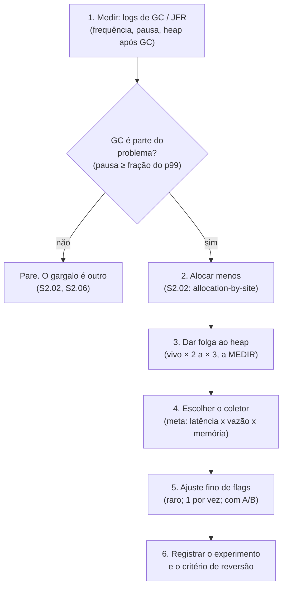

# S2.05 — Tuning de GC

> ⏱️ ~1h30 · 🟣 Sênior · Pré-requisitos: S2.01 a S2.04, P1.03/P1.04 (G1, Parallel, ZGC e logs de GC), P7.02 (JVM em contêiner: seleção do coletor e `MaxRAMPercentage`), S1.01 (Lei de Little)

> ⚠️ **Verificação:** `lab/GcLab.java` + `lab/run-gc.sh` **foram executados** (JDK 25.0.5, Linux, 12 núcleos, **máquina compartilhada**; saída completa em `lab/out-s205.txt`; **2 execuções** por configuração, ~5 min no total). **É um modelo:** um "serviço" de 8 *threads* com um **conjunto vivo de 600 MB de `byte[]`** (barato de percorrer) e lixo de vida curta, **carga aberta de 3.000 req/s**. **Os números não valem para o PayFlow nem para o PostgreSQL**: um grafo de objetos **com muitos ponteiros** muda as pausas. **Não executado:** o PayFlow do aluno, contêiner com limites (os de P7.02 já foram medidos lá), `-XX:MaxGCPauseMillis` e os demais ajustes finos do G1 (**só citados**, **não medidos**), Shenandoah. As pausas do JFR cobrem **a execução inteira**, **inclusive** o aquecimento (a latência, não).

## 🎯 Objetivos
Ao final desta aula você consegue:
- **Definir a meta** de um ajuste de GC (**latência**, **vazão** ou **memória**) e **medir** com JFR/logs (e não por *flags* "de blog").
- **Ler** pausa, frequência e **CPU de GC**, e **separar** o que o GC causa do que o código causa.
- **Dimensionar o heap** (folga sobre o **conjunto vivo**) e **explicar** o que acontece quando ele é **apertado**.
- **Comparar** G1, Parallel, Serial e ZGC **com a mesma carga** e **escolher** com critério.
- **Recusar** ajuste fino sem **evidência**.

## 🤔 Por que isso importa
O GC é uma das poucas causas de **latência de cauda "do nada"**: o p50 está lindo e o p99 tem **pulos** periódicos. Mas é também onde o **folclore** mais prospera ("use esta lista de 14 *flags*"). A regra do sênior: **primeiro reduza a alocação** (S2.02), **depois dê folga ao heap**, **depois escolha o coletor**, e **só então** mexa em *flags*, **sempre medindo**.

## 💡 Intuição (explicação simples)
O GC é a **equipe de limpeza** de um restaurante. Alguns coletores **fecham o salão** para limpar tudo de uma vez (Serial, Parallel: **rápido no total**, mas **os clientes esperam**); outros limpam **mesa a mesa enquanto o salão funciona** (G1, ZGC: o cliente quase **não vê**, mas há **mais gente de limpeza** e o salão precisa de **mesas livres de sobra**). Se o restaurante **está lotado** (heap quase cheio), **nenhuma** estratégia salva: a limpeza vira o trabalho principal.

## 🔬 Como funciona por dentro

### 1. As três metas (e o que cada uma custa)
| Meta | Métrica | Tende a favorecer |
|---|---|---|
| **Latência** (p99 sem pulos) | pausa máxima, p99/p99,9 do **serviço** | G1 (pausas curtas), ZGC (pausas minúsculas) |
| **Vazão** (trabalho/segundo) | CPU de GC, tempo total em pausa | Parallel (em lote, *batch*) |
| **Memória** (pegada, custo) | RSS, tamanho do heap | Serial (poucos núcleos/pouca RAM) |
Você **não otimiza as três**. Um serviço de API como o PayFlow quer **latência** (p99, S2.01) **dentro** de um orçamento de memória (P7.02); um *job* noturno quer **vazão**.

### 2. O laboratório: o mesmo serviço sob 7 configurações
`GcLab` roda **3.000 req/s** (carga **aberta**: a latência conta **desde o instante em que a requisição deveria começar**, então **fila e pausas aparecem**) sobre um **conjunto vivo de 600 MB** que **troca 1 de cada 5 requisições** um pedaço (promoção e envelhecimento) e aloca lixo de ~150 KB por requisição (**~450 MB/s**). Cada configuração rodou **duas vezes**:
| Configuração | p50 (ms) | p99 (ms) | p99,9 (ms) | máx (ms) | nº de pausas | pausa máx. (ms) | pausa total | CPU do processo (s) |
|---|---|---|---|---|---|---|---|---|
| **G1**, `-Xmx1g` | 0,13–0,15 | 0,28–0,29 | 3,2–3,3 | 4,0–4,2 | 56–58 | 15–17 | ~170 ms | 5,2–5,4 |
| **G1**, `-Xmx700m` | 0,15–0,17 | **1,1** | **58–62** | 67–71 | **360–365** | 66–70 | ~380 ms | 7,6–7,8 |
| **G1**, `-Xmx1536m` | 0,14–0,16 | 0,28 | 3,6–3,7 | 4,8–4,9 | 49 | 19–20 | ~170 ms | 5,3 |
| **Parallel**, `-Xmx1g` | 0,16–0,18 | **28–29** | 72–73 | 77 | 62 | ~101 | ~780 ms | **9,3–9,5** |
| **Serial**, `-Xmx1g` | 0,15–0,17 | **48–51** | 91–95 | 97–102 | 34 | ~100 | ~1,0 s | 5,1–5,3 |
| **ZGC**, `-Xmx1g` | 0,15–0,16 | 0,27 | **0,29–0,33** | 1,6–2,9 | ~150 | **0,02–0,03** | ~1,3 ms | 4,6–4,9 |
| **ZGC**, `-Xmx700m` | **`OutOfMemoryError`** (threads de serviço morreram) e, na execução que terminou, **p50 = 27,8 ms** e **p99 = 593 ms** | | | | | | | |
(Conferido em `out-s205.txt`: os intervalos vão **da 1ª à 2ª execução**. "Pausa máx." é do **JFR**, e cobre também o **aquecimento**; "CPU" é do processo **inteiro** (inclui JIT, criação do conjunto vivo e a *thread* do gerador de carga).)

### 3. O que a tabela ensina (e o que **não** ensina)
1. **O p50 é igual em todas** (~0,15 ms): **um painel só de mediana diria "tudo igual"**. O GC **só aparece na cauda** (S2.01: p99 e p99,9).
2. **Serial e Parallel** deram **p99 de 28–51 ms**: suas pausas são **grandes** (~100 ms) porque **copiam/compactam** o conjunto vivo **com o serviço parado**. O **Parallel** gastou **~1,8× a CPU** (usa todos os núcleos **durante** a pausa).
3. **G1** com **folga** (1 GB ou 1,5 GB para 600 MB vivos) deu **p99 = 0,28 ms** e pausas de **dezenas de ms no máximo**; **1,5 GB não melhorou** nada **visível** sobre 1 GB (só **menos coletas**: 49 × 57): **folga tem retorno decrescente**.
4. **G1 com heap apertado (700 MB para 600 MB vivos)**: **~6× mais coletas**, **p99,9 de ~60 ms** e **+45% de CPU**. É o **erro de configuração mais comum**: o heap **menor que o necessário** faz o GC trabalhar o tempo todo.
5. **ZGC** com folga: **pausas de ~0,03 ms** e **p99,9 ≈ p99**: a cauda **sumiu**, **sem** custo de CPU **visível** aqui (4,6–4,9 s, o **menor** da tabela). **Mas** com o heap **apertado** (700 MB) ele **não degrada com graça**: **estourou** (`OutOfMemoryError`) e, quando sobreviveu, a latência foi **centenas de ms** (o ZGC **não compacta em pausa**: sem **folga**, o **alocador espera** o coletor concorrente, as chamadas **bloqueiam**; é o mecanismo conhecido como *allocation stall*). **Regra:** quanto **mais concorrente** o coletor, **mais folga** ele exige.
6. **O que a tabela NÃO diz:** o conjunto vivo é de **`byte[]`** (percorrer é **barato**); num grafo com **milhões de objetos pequenos** (JPA, caches), **G1 e ZGC gastam mais** para marcar. **O vencedor do laboratório não é automaticamente o vencedor do PayFlow:** **meça o PayFlow** (S2.06).

### 4. O caminho do ajuste (nesta ordem)

- **(1) Medir:** `-Xlog:gc*:file=gc.log:time,uptime,level,tags` (P1.04) e `jfr view gc-pauses` / `gc` (S2.02). Perguntas: **frequência**, **pausa máxima**, **heap depois do GC** (se sobe: S2.04) e **tempo total em pausa** como fração do tempo.
- **(2) Alocar menos:** é o **melhor** ajuste de GC: o lixo **que não existe** não precisa ser coletado (S2.02: `String +=`, regex recompilada...).
- **(3) Folga:** a regra prática de **vivo × 2 a × 3** é **ponto de partida**, **não** lei: **meça**. No laboratório, 600 MB vivos em **1 GB** (×1,7) já foi **bom** e em **700 MB** (×1,2) foi **péssimo**. **O vivo é medido após o GC** (S2.04) **sob carga real**.
- **(4) Coletor:** o ponto de partida do JDK 25 é o **G1** (padrão em máquinas com ≥ 2 CPUs e ≥ ~1,8 GB: P7.02 mostrou que o **Serial** é escolhido em contêineres pequenos). **ZGC** quando a **cauda** do p99 é de **GC** e há **memória de sobra**: desde o JDK 23 o `-XX:+UseZGC` é **geracional por padrão** ([JEP 474](https://openjdk.org/jeps/474)) e o modo não geracional **foi removido** no JDK 24 ([JEP 490](https://openjdk.org/jeps/490); a base é o [JEP 439](https://openjdk.org/jeps/439)). **Parallel** para **lote**, em que **vazão** importa e pausa **não**.
- **(5) Ajuste fino:** `-XX:MaxGCPauseMillis` (a **meta** de pausa do G1, **não** uma garantia), tamanho de região, `InitiatingHeapOccupancyPercent`, `-Xmn`... **Não medidos aqui.** A [documentação do JDK 25](https://docs.oracle.com/en/java/javase/25/gctuning/) descreve cada um. **Regra:** **uma** *flag* por vez, **A/B repetido**, **registro** no `experimentos.md`, e a *flag* só **fica** se **o p99 do serviço** melhorar (não a métrica interna do GC).

### 5. Em contêiner
O heap é uma **fração** do limite do *pod* (`MaxRAMPercentage`, **70** no PayFlow, P7.02); **GC concorrente usa mais CPU** e o limite de CPU do *pod* (**P7.05**) pode **estrangular** o coletor (o **throttling** da P7.05 vira **pausa** do ponto de vista do serviço). **Antes** de trocar para ZGC no PayFlow: **medir** com os **limites reais** do manifesto (P7), **não** na máquina do desenvolvedor.

## 🛠️ Exemplo prático
```bash
cd 3-senior/S2-performance-eficiencia/lab
./run-gc.sh                           # ~7 min; regrava out-s205.txt  (não rode outra coisa junto)

# uma configuração isolada:
W=$(mktemp -d); javac -d $W GcLab.java
java -cp $W -XX:+UseG1GC -Xmx1g -Dchurn=5 -XX:StartFlightRecording:filename=$W/g.jfr GcLab 16 3000 600 6
jfr view gc-pauses $W/g.jfr
```
O núcleo do gerador de **carga aberta** (a latência parte do instante **pretendido**; é o que impede a "omissão coordenada" da S2.06):
```java
long due = start + i * 1_000_000_000L / rate;      // quando DEVERIA ter chegado
...  lat[...] = System.nanoTime() - due;           // fim - instante pretendido (inclui fila e pausa)
```
**Saída esperada** (uma linha por execução; os valores **variam**):
```
req=30000 (3000/s)  p50=0.15 ms  p99=0.28  p99.9=3.2  max=4.0
heap max=1024 MB  coletas(total)=57  tempo de GC (MXBean)=170 ms  CPU do processo=5300 ms
```

## 🧠 Pausa para lógica
Um serviço em G1 tem **p99 de 120 ms**. O log mostra pausas de **~100 ms a cada 8 s**, o heap após o GC é **estável** em 900 MB e o heap é de **1 GB**. **Qual a primeira ação e por que **não** "trocar para ZGC" já?**
<details><summary>Dica e solução</summary>

**O heap está apertado** (vivo 900 MB em 1 GB, **×1,1**): o laboratório mostrou o que isso faz (G1 700/600: p99,9 ~60 ms, ~6× as coletas). **Primeira ação:** **dar folga** (subir o heap/o limite do *pod*, P7.02) e **medir de novo**. **Trocar para ZGC** com o heap **apertado** é **pior** (o laboratório: `OutOfMemoryError` e centenas de ms). Só **depois** da folga, **se** o p99 continuar com pausas de GC, **teste** ZGC.
</details>

## 🏗️ Estudo de caso: "trocamos para ZGC e piorou"
O time trocou o PayFlow para `-XX:+UseZGC` **sem mudar o limite do *pod*** (1 GiB, `MaxRAMPercentage=70` → ~700 MiB de heap) e o p99 **subiu** de 80 para 300 ms; a CPU do *pod* chegou ao limite. **Hipóteses e como decidir?**
<details><summary>Solução</summary>

**(1)** Heap de ~700 MiB **apertado** para o conjunto vivo (o laboratório mostra o **ZGC sem folga**); **(2)** o GC concorrente **disputa CPU** com a aplicação e o limite de CPU do *pod* **estrangula** (P7.05); **(3)** a troca de coletor **mudou** o que se mede (**pausas** viram **espera de alocação**). **Decisão:** reverter (`experimentos.md`: **reverter com**), **medir o vivo** (S2.04), **dar folga** (memória e CPU do *pod*) e **reexperimentar** com a **mesma carga aberta** (S2.06).
</details>

## ⚖️ Trade-offs e quando NÃO ajustar
- **Não mexa no GC** se a **pausa é pequena** frente ao **p99** (S2.01: **fração `f`**): o ganho máximo é **`f`**.
- **ZGC** troca **pausa** por **CPU e memória**: bom com **folga**; **ruim** em *pod* **apertado**.
- **Parallel** em API de latência: **não** (p99 de dezenas de ms e ~1,8× a CPU, **medido** acima).
- **Serial** é **certo** para contêiner **pequeno** (1 CPU, pouca RAM) e **ferramentas de linha de comando**: **não** é "ruim".
- **Heap gigante** "para garantir" **atrasa** o problema e **alonga** pausas de *full GC*: **dimensione por medição**.
- **Copiar *flags*** de outro sistema (**cargo cult**) é **o** erro clássico: **o que funciona** depende do **conjunto vivo, da alocação e dos limites**.

## ⚠️ Erros comuns e boas práticas de produção
- **`-Xmx` maior que o limite do contêiner** (a JVM é morta com `OOMKilled`, P7.09): `MaxRAMPercentage` e orçamento **total** (heap + metaspace + pilhas + direta).
- **`System.gc()` em código** (ou bibliotecas que o chamam): `jfr view blocked-by-system-gc` mostra; use `-XX:+DisableExplicitGC` **só** se medir e entender **quem** o chama.
- **Ler só "tempo de GC (%)":** um GC concorrente **consome CPU sem pausar**; olhe **p99 do serviço** **e** CPU.
- **Mudar coletor e heap ao mesmo tempo:** não se sabe **qual** ajudou (S2.01, pecado 2).
- **Comparar uma execução só** (o laboratório fez **2**; em produção, **mais** e com **carga real**).
- **Boa prática:** **G1 padrão** + heap com **folga medida** + **GC log/JFR contínuo** + **alerta** de "tempo em pausa" e "piso do heap" (S2.04); **qualquer troca de coletor** vira **experimento registrado** com **critério de reversão**.

## 🧩 Exercícios
1. **Fixação:** com a tabela, **explique** (a) por que o **p50 não distingue** as configurações; (b) por que o **G1 de 700 MB** teve **p99 ~1 ms** **mas** p99,9 de **~60 ms**; (c) por que o **ZGC de 700 MB** quebrou.
2. **PayFlow (por leitura):** crie `docs/perf/gc.md` com: (a) a **baseline** de GC a coletar **no teste de carga da S2.06** (frequência, pausa máxima, **piso do heap**, tempo em pausa, `jfr view gc-pauses`); (b) a **regra de decisão** ("**só** testar ZGC se a pausa de GC **explicar** ≥ X% do p99 **e** houver folga de memória/CPU no *pod*"; **X a definir com dados**, **não invente**); (c) o **procedimento A/B** (mesma carga aberta, **3 execuções** por variante, ambiente **igual**); (d) o **limite do *pod*** e `MaxRAMPercentage` **coerentes** com o **conjunto vivo medido**. Critérios de pronto:
   - [ ] **nenhuma *flag*** entra sem **experimento** registrado;
   - [ ] a decisão de coletor **cita o p99 do serviço**, não só a pausa do GC;
   - [ ] o doc **retoma a conta de memória** do *pod* (P7.02/P7.09) com **folga**.
3. **Desafio (opcional):** altere o `GcLab` para um **grafo de objetos pequenos** (por exemplo, 5 milhões de `Node{long id; Node next}` no conjunto vivo, em vez de `byte[]`) e **refaça** G1 × ZGC. **A ordem muda?** Registre.
<details><summary>Solução da fixação (1)</summary>

(a) Quase todas as requisições **não** pegam pausa (a mediana é **o caminho feliz**); o GC **só** afeta **as que coincidem com uma pausa**: **cauda**. (b) A pausa de ~60 ms atinge **~0,1%** das requisições (p99,9), **não** 1%: o p99 ainda é **baixo**; é o que o p99,9 **revela**. (c) **Sem folga**, o ZGC **não consegue** reciclar memória na velocidade em que a aplicação aloca: o **alocador espera** (*allocation stall*) e, no limite, **falha** (`OutOfMemoryError`).
</details>

## 🎤 Na entrevista
1. **"Como você ajusta o GC de um serviço?"** **Medi** (log/JFR), vejo se o GC **é parte** do p99, **reduzo alocação**, **dou folga** ao heap, **escolho** o coletor pela **meta** e só então mexo em *flags*, **uma por vez**, com **A/B**.
2. **"G1, ZGC ou Parallel?"** **Latência** com folga: G1 (padrão) ou ZGC (pausas minúsculas, mais CPU/memória); **vazão** em lote: Parallel; **contêiner pequeno**: Serial. **Meço**: no meu laboratório o p50 era igual e o p99 variou **de 0,3 a 50 ms**.
3. **"Por que o heap apertado é ruim?"** O GC **roda o tempo todo** (~6× as coletas, +45% de CPU no laboratório) e a cauda **explode**; com ZGC, **falha**.
4. **"O ZGC elimina pausas?"** As **pausas** ficam **minúsculas** (≈ 0,03 ms no laboratório), **mas** a **CPU** e a **necessidade de folga** aumentam e, **sem folga**, **bloqueia a alocação**.

## 📚 Para ir além
- 📄 [Guia de ajuste de GC do JDK 25](https://docs.oracle.com/en/java/javase/25/gctuning/): G1, ZGC, Parallel, Serial e **todas as *flags***.
- 📄 [JEP 439: Generational ZGC](https://openjdk.org/jeps/439), [JEP 474: ZGC geracional por padrão](https://openjdk.org/jeps/474) e [JEP 490: remover o modo não geracional](https://openjdk.org/jeps/490): **a história** do ZGC no JDK 21→24.
- 📄 [Manual do comando `java` (JDK 25)](https://docs.oracle.com/en/java/javase/25/docs/specs/man/java.html): `-Xlog`, `-XX:+UseZGC`, `-XX:MaxGCPauseMillis`...
- 📑 *Java Performance* (Scott Oaks), caps. de GC (**de memória, não conferido**).

## ✅ Checklist da aula
- [ ] Defini a **meta** (latência, vazão, memória) **antes** de ajustar.
- [ ] Sigo a **ordem**: medir → alocar menos → folga → coletor → *flags*.
- [ ] Sei **por que** o heap apertado é ruim e que o ZGC **pede folga**.
- [ ] Reporto **p99/p99,9 do serviço**, não só pausa de GC.
- [ ] `docs/perf/gc.md` escrito (baseline, regra de decisão, A/B).
