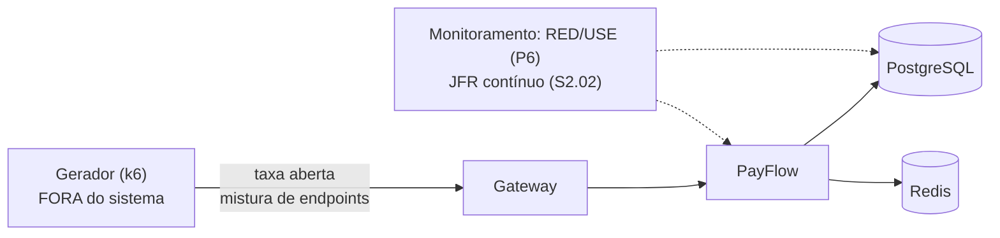

# S2.06 — Testes de carga com k6 ou Gatling e percentis

> ⏱️ ~1h30 · 🟣 Sênior · Pré-requisitos: S2.01 (percentis, linha de base), S2.05 (carga **aberta** do `GcLab`), S1.01 (Lei de Little, conta de conexões), S1.08/S1.09 (idempotência, *rate limit*), P2.06 (HikariCP), P6.03 (RED, histogramas), P10.02 (tokens)

> ✅ **Validação final (2026-11-24):** módulo executado no PayFlow reconstruído; resultado e o que continua não executado no [README do módulo](README.md). Os avisos "não executado" / "por leitura" abaixo descrevem a escrita original.

> ⚠️ **Verificação:** **executados** (JDK 25.0.5, 12 núcleos, **máquina compartilhada, gerador de carga e servidor no MESMO computador**): `lab/LoadLab.java` (servidor HTTP real + geradores de carga em Java puro: curva de saturação e omissão coordenada) e o **k6 1.8.3** em Docker contra o servidor do laboratório (`lab/k6-open.js`, `lab/run-load.sh`; saídas `out-s206-*.txt`). **O "serviço" é um MODELO** (pool de 16 *threads*, ~21,8 ms de serviço simulados com `Thread.sleep`, 1% de requisições de 200 ms): **não é o PayFlow**, e os **números** (capacidade, p99) **não valem** para ele. **Não executado:** o **Gatling** (código **só apresentado**, a **conferir** na documentação), o **teste de carga do PayFlow** (o repositório não existe em disco: roteiro **por leitura**, **a validar no fim do treinamento**), `wrk2`, testes distribuídos e o ambiente do *pod* (P7).

## 🎯 Objetivos
Ao final desta aula você consegue:
- **Escolher** o **tipo** de teste (*smoke*, carga, *stress*, *soak*, *spike*, ponto de ruptura) e o **modelo de carga** (**aberto** × **fechado**).
- **Explicar** a **omissão coordenada** (*coordinated omission*) e **provar** (com os números do laboratório) por que um teste **fechado** subestima a cauda.
- **Ler** uma **curva de saturação** (taxa × latência), achar o **joelho** e **relacionar** à **Lei de Little**.
- **Escrever** um teste **k6** com **cenário aberto** e **limiares** (*thresholds*) que **reprovam** o *build*, e **comparar** com o **Gatling**.
- **Projetar** um teste de carga **realista** para o PayFlow (dados, autenticação, mistura, idempotência, ambiente).

## 🤔 Por que isso importa
"Aguenta?" é a pergunta de **toda** estreia, campanha e Black Friday. O teste de carga responde **com número**, **antes** do cliente: **quanto** o sistema aguenta, **como** degrada, **o que** quebra primeiro. E é a **origem dos dados** que as aulas S2.02 a S2.05 precisam: **sem carga realista, não há perfil que valha**. Mas um teste **mal feito** é pior que nenhum: dá **confiança falsa** (a cauda some) ou **assusta à toa** (gerador saturado).

## 💡 Intuição (explicação simples)
Um **caixa de supermercado**. **Modelo fechado:** 12 clientes **só voltam à fila depois de serem atendidos**; se o caixa **trava por 3 minutos**, **ninguém novo chega** e o relatório diz "o tempo médio de atendimento foi ótimo" (só 12 clientes sofreram). **Modelo aberto:** clientes chegam **no ritmo da rua**, **mesmo com o caixa travado**: **a fila cresce** e o relatório mostra **o que a rua viveu**. Usuários reais da internet **são abertos**: ninguém espera a resposta do outro para clicar.

## 🔬 Como funciona por dentro

### 1. Tipos de teste (um para cada pergunta)
| Tipo | Pergunta | Como |
|---|---|---|
| ***Smoke*** | O teste e o sistema **funcionam**? | carga **mínima**, 1 min; roda **em toda PR** |
| **Carga** (*load*) | Aguenta o **tráfego esperado** dentro do p99 do orçamento? | taxa **esperada** por 15–30 min |
| ***Stress***/ponto de ruptura | **Onde** quebra e **como**? | taxa **crescente** até falhar |
| ***Soak*** (resistência) | **Vaza** memória/conexões/*threads* com o tempo? (S2.04) | taxa **normal** por **horas** |
| ***Spike*** | Aguenta o **pico súbito**? Recupera? | salto de 10× e volta |

### 2. Modelo **fechado** × **aberto**
- **Fechado:** N usuários virtuais; cada um **só manda a próxima depois da resposta**. A taxa **cai sozinha** quando o servidor desacelera (o gerador é **frenado pelo servidor**).
- **Aberto:** as chegadas seguem uma **taxa** (req/s), **independentes** das respostas: se o servidor desacelera, **a fila cresce** (como na vida real).
No k6: **fechado** = `constant-vus`/`ramping-vus`; **aberto** = `constant-arrival-rate`/`ramping-arrival-rate` ([executor `constant-arrival-rate`](https://grafana.com/docs/k6/latest/using-k6/scenarios/executors/constant-arrival-rate/)). No Gatling: `injectClosed` × `injectOpen` ([injection](https://docs.gatling.io/concepts/injection/)). **API pública na internet → modelo aberto.** Fechado só serve para **sistemas com número fixo de clientes** (um pool de *workers* internos, por exemplo).

### 3. Omissão coordenada (executada)
`LoadLab omission`: o servidor **congela por 3 s** (t = 4 s a 7 s, num teste de 10 s); **a mesma falha**, vista por dois geradores:
```
Falha injetada: servidor congelado por 3 s (a partir de t = 4 s); teste de 10 s; ~21,8 ms de servico
FECHADA (12 usuarios):          n=3823  p50=20.7  p95=25.7  p99=200.4  p99.9=3016.4  max=3023.6 ms
ABERTA (400 req/s):             n=4000  p50=711.8  p95=2769.4  p99=2961.6  p99.9=3009.0  max=3017.9 ms
```
- **Fechado (12 usuários):** **p50 = 21 ms, p99 ≈ 200 ms** (parece **saudável**) e **só o p99,9 e o máximo** (**~3 s**) mostram a falha: **só ~12 requisições** (uma por usuário) **ficaram presas**; **os 3 s de chegadas que "deveriam ter acontecido" simplesmente não existem** no relatório (`n` = 3,8 mil; no aberto, 4.000).
- **Aberto (400 req/s):** **p50 ≈ 0,7 s, p95 ≈ 2,8 s, p99 ≈ 3,0 s**: **o que os clientes reais teriam vivido** (centenas de requisições **esperaram** o congelamento passar).
Esse efeito se chama **omissão coordenada** (termo de Gil Tene; veja a palestra em *Para ir além*): o gerador **coordena** com o servidor lento e **omite** as medições que **deveria** fazer. **Regras:** (1) **modelo aberto** para APIs; (2) a latência conta **desde o instante em que a requisição deveria ter começado** (como o `GcLab`, S2.05) ou, no k6, `constant-arrival-rate`; (3) se o gerador **não consegue** manter a taxa, o **teste é inválido** (o k6 avisa: `dropped_iterations`, `Insufficient VUs`).

### 4. A curva de saturação (executada)
O servidor do laboratório tem **16 *threads*** e **~21,8 ms** de serviço médio: pela **Lei de Little**, a **capacidade teórica** é **`N / W` = 16 / 0,0218 ≈ 734 req/s** (a concorrência máxima é o **pool**). Carga **aberta**, 8 s por taxa:
```
pool=16  tempo medio de servico ~21.8 ms  =>  capacidade teorica ~734 req/s
taxa (req/s)  resultado (carga aberta, 8 s por linha, latencia desde o instante pretendido)
         200  n=1600  p50=21.3  p95=26.4  p99=201.1  p99.9=201.6  max=201.6 ms
         400  n=3200  p50=20.9  p95=25.9  p99=26.9  p99.9=201.1  max=201.4 ms
         600  n=4800  p50=20.6  p95=25.6  p99=26.1  p99.9=200.8  max=201.2 ms
         700  n=5600  p50=24.8  p95=61.3  p99=200.4  p99.9=233.3  max=243.4 ms
         800  n=6400  p50=404.0  p95=750.7  p99=801.4  p99.9=925.3  max=988.5 ms
```
- **Até 600 req/s:** p50 ≈ 21 ms (o tempo de serviço), p95 ≈ 26 ms: **plano**.
- **700 req/s (95% da capacidade):** o **joelho**: p50 sobe para ~24 ms, **p95 = 46 a 61 ms** (duas execuções): **as filas começam**. **A latência degrada antes de a capacidade acabar** (teoria das filas: com utilização perto de 1, **qualquer** variação vira fila).
- **800 req/s (> capacidade):** **p50 ≈ 400 a 460 ms e subindo** (o p99 passa de **0,8 s**): **a fila cresce sem limite** durante o teste (**não há estado estacionário**: **quanto mais longo o teste, pior**). Nenhum erro, só **espera**: um servidor **sem limite de fila** **não falha, apodrece**.
- **Leitura do p99 (cuidado):** o **mesmo** modelo, **a mesma taxa**, deu p99 de **27 ms numa execução e 201 ms noutra** (a 200 req/s: 26,9 na 1ª e 201 na 2ª; a 700 req/s: 54 e 200): **não é "ruído do teste"**. **1%** das requisições do modelo levam 200 ms, e o p99 fica **exatamente na borda** dessa fração: se há **um pouco menos** de 1% lentas, o p99 é ~27 ms; **um pouco mais**, ~200 ms. **Percentil na borda de uma cauda é instável**: **olhe o p99,9 e a contagem**, e **repita**.
**Moral:** **dimensione para trabalhar bem abaixo do joelho** (S1.01: o teto é por componente) e **meça o joelho do seu sistema** — este "734" é **do modelo**.

### 5. k6: o teste como código (executado)
```javascript
export const options = {
  scenarios: {
    aberta: {
      executor: 'constant-arrival-rate',   // RATE iterações por segundo, aconteça o que acontecer
      rate: RATE, timeUnit: '1s', duration: '20s',
      preAllocatedVUs: 50, maxVUs: 1000,
    },
  },
  thresholds: {                            // critérios de aprovação
    http_req_failed:   ['rate<0.01'],
    http_req_duration: ['p(95)<50', 'p(99)<250'],
  },
};
export default function () {
  const r = http.get('http://127.0.0.1:18080/api');
  check(r, { 'status 200': (x) => x.status === 200 });
}
```
Executado com `docker run --rm --network host -i -e RATE=400 grafana/k6:1.8.3 run - < k6-open.js`.
**Abaixo da capacidade (400 req/s)** o k6 **aprovou** (código de saída **0**):
```
exit=0
    ✓ 'p(95)<50' p(95)=25.42ms
    ✓ 'p(99)<250' p(99)=49.73ms
    ✓ 'rate<0.01' rate=0.00%
    ✓ status 200
    http_req_duration..............: avg=22.18ms med=20.42ms p(95)=25.42ms p(99)=49.73ms max=200.7ms 
    http_reqs......................: 8001   396.068655/s
    vus_max........................: 50     min=50        max=50
```
**Acima da capacidade (900 req/s)** o k6 **reprovou** os limiares e saiu com **código 99** (é o que o **CI** precisa para **falhar o *build***), **avisou** que **faltaram VUs** e **descartou iterações** (`dropped_iterations`); a **vazão ficou presa na capacidade** (~725/s, perto dos 734 teóricos):
```
exit=99
aviso: "Insufficient VUs, reached 1000 active VUs and cannot initialize more"
    ✗ 'p(95)<50' p(95)=1.45s
    ✗ 'p(99)<250' p(99)=1.47s
    ✓ 'rate<0.01' rate=0.00%
    ✓ status 200
    http_req_duration..............: avg=958.73ms med=1.1s p(95)=1.45s p(99)=1.47s max=1.65s
    http_reqs......................: 15585  724.029448/s
    dropped_iterations.............: 2416   112.239663/s
    vus_max........................: 1000   min=125        max=1000
aviso: "thresholds on metrics 'http_req_duration' have been crossed"
```
**Duas observações:** (a) o **k6 mediu p99 de 50 a 62 ms a 400 req/s** (duas execuções) e o `LoadLab` aberto, **27 ms numa execução e 201 ms noutra**: **mesmo servidor, mesma taxa, ferramentas e execuções diferentes**: **é o p99 na borda** da seção 4 (a fração de requisições lentas é ~1%): **uma execução não decide**; (b) **o gerador estava na mesma máquina** que o servidor (12 núcleos, **ocioso**: aceitável para a aula; **em teste sério o gerador fica FORA do sistema testado** e é **monitorado**).

### 6. Gatling (**não executado**)
O Gatling é **da JVM** (DSL em Java, Kotlin e Scala) e traz **relatório HTML** (**a conferir** na documentação da versão que usar). O **mesmo** cenário em Java (**a conferir** na documentação da versão que você usar; as chamadas `injectOpen`, `constantUsersPerSec(...).during(...)` e as **asserções por percentil** estão na documentação):
```java
public class AccountsSimulation extends Simulation {
  HttpProtocolBuilder protocol = http.baseUrl("http://127.0.0.1:18080");
  ScenarioBuilder scn = scenario("api").exec(http("get").get("/api").check(status().is(200)));
  { setUp(scn.injectOpen(constantUsersPerSec(400).during(20)))
        .protocols(protocol)
        .assertions(global().responseTime().percentile(99).lt(250),
                    global().failedRequests().percent().lt(1.0)); }
}
```
| | **k6** | **Gatling** |
|---|---|---|
| Linguagem do teste | **JavaScript** | Java/Kotlin/Scala (**a sua JVM**) |
| Modelo aberto | `constant-arrival-rate`, `ramping-arrival-rate` | `injectOpen` |
| Aprovação no CI | `thresholds` → **código 99** (medido) | `assertions` → código de saída ≠ 0 (**a validar**) |
| Relatório | resumo no terminal; saída para Prometheus/Grafana/JSON | **relatório HTML** pronto |
| Quando preferir | time **polyglota**, scripts curtos, CI, **Docker** | time **Java**, cenários **longos** com lógica complexa e relatório visual |
**Para o PayFlow:** **k6** (decisão **proposta**): o script **cabe num arquivo**, roda **num contêiner de CI** (a imagem já foi baixada e medida **aqui**) e os limiares **viram o critério** do `perf.yml`. O Gatling é **igualmente válido**: a regra é **uma** ferramenta, **modelo aberto**, **limiares** e **versão fixada**.

### 7. Projetar um teste **realista** para o PayFlow

1. **Dados realistas:** **volume** (milhões de lançamentos: o **gerador de volume** da P2), **distribuição** (poucas contas muito ativas: S1.03/S1.04) e **banco aquecido**. Teste com banco **vazio** **mente** (S2.01: plano do `EXPLAIN`).
2. **Mistura de tráfego** (a **medir** da produção, não inventar; sem produção ainda, **declare a premissa**): p.ex. **maioria leituras** (`GET /accounts/{id}`, extrato) e **minoria escritas** (`POST /transfers`).
3. **Autenticação:** o token dura **5 min** (decisão 172): o teste **obtém** token no `setup()` e **renova**; o **Keycloak também** entra na carga (use o cliente de **laboratório** `payflow-lab-direct`, **só** no ambiente de teste).
4. **Idempotência:** cada `POST` com **`Idempotency-Key` única** (S1.08); e um cenário **à parte** que **repete** a chave (para ver o caminho de 409/replay).
5. **Contas:** **muitas contas distintas** no cenário base (sem chave quente) **e** um cenário **de uma conta quente** (S1.03): contenção de *lock* (P2.02) é **outro** teste.
6. **Limites:** o **limitador do gateway** (S1.09) vai responder **429**: ou **isente** o gerador **no ambiente de teste** (registrado) ou **meça o 429 como resultado**, mas **nunca** misture sem saber.
7. **Dependências externas:** **PSP/antifraude/e-mail** em **dublê** (nunca o real: custo e bloqueio); o dublê tem **latência declarada**.
8. **Ambiente:** **mesmos limites do *pod*** (P7), **mesma versão** de JVM/flags, **mesmo tamanho do banco**; **gerador fora**; **aquecimento** (descartar os primeiros minutos); **janela estável** para as métricas.
9. **Parada e segurança:** limiares de **abortar** (erro > X%); **nunca** contra produção; **ambiente de teste** isolado (custo 💸 se for nuvem: **destruir ao final**).
10. **Registrar:** versão do código, ambiente, dados, taxa, **p50/p95/p99/p99,9**, vazão, erros, **o que o servidor viu** (RED/USE, JFR). **Sem o ambiente descrito, o resultado não é comparável** (S2.01).

## 🛠️ Exemplo prático
```bash
cd 3-senior/S2-performance-eficiencia/lab
./run-load.sh                      # ~3 min; regrava out-s206-*.txt (precisa de Docker; imagem grafana/k6:1.8.3)

# a mao, so o Java:
java LoadLab.java saturation       # curva (50 s)
java LoadLab.java omission         # omissao coordenada (30 s)

# a mao, com k6:
java LoadLab.java server 18080 &
docker run --rm --network host -i -e RATE=400 grafana/k6:1.8.3 run - < k6-open.js ; echo "exit=$?"
kill $(lsof -t -i:18080)
```
**Esboço do teste do PayFlow** (**não executado**; o `payflow` **não existe em disco**; **a validar**):
```javascript
import http from 'k6/http'; import { check } from 'k6';
export const options = {
  scenarios: {
    leituras: { executor: 'constant-arrival-rate', rate: 300, timeUnit: '1s', duration: '10m', preAllocatedVUs: 100, maxVUs: 800, exec: 'leitura' },
    escritas: { executor: 'constant-arrival-rate', rate: 30,  timeUnit: '1s', duration: '10m', preAllocatedVUs: 50,  maxVUs: 400, exec: 'escrita' },
  },
  thresholds: {
    'http_req_duration{scenario:leituras}': ['p(99)<__A_DEFINIR__'],   // alvo: proposta; valida-se aqui
    'http_req_duration{scenario:escritas}': ['p(99)<__A_DEFINIR__'],
    http_req_failed: ['rate<0.01'],
  },
};
export function setup() { /* obter token (cliente de laboratorio) e a lista de contas semeadas */ }
export function leitura(data) { /* GET /api/v1/accounts/{id}/statement com Authorization */ }
export function escrita(data) { /* POST /api/v1/transfers com Idempotency-Key unica (VU + iteracao) */ }
```
(Os **`__A_DEFINIR__`** são **de propósito**: o alvo é **proposta** da S2.01 e se **valida** com o próprio teste; **não** invente número.)

## 🧠 Pausa para lógica
Um teste **fechado** com **50 usuários** reporta **p99 = 180 ms** e **500 req/s**. A produção recebe **700 req/s** e o time acha que "então aguenta com folga". **O que está errado no raciocínio?**
<details><summary>Dica e solução</summary>

No **fechado**, a vazão é **`N / (latência + pensamento)`**: **500 req/s** com 50 usuários = **100 ms por ciclo**: o gerador **só gera o que o servidor deixa**. **Não** mostra o que acontece a **700 req/s** (pode estar **além** da capacidade). **Refaça** em **modelo aberto** a 700 req/s (e subindo): a **curva** e o **joelho** dizem se aguenta.
</details>

## 🏗️ Estudo de caso: "o teste passou, a campanha caiu"
Antes da campanha, o time rodou um teste **fechado** de 10 min e **aprovou** (p99 = 120 ms). Na campanha, **às 10h02** o banco ficou lento por 40 s (um `VACUUM` pesado) e **os clientes viram erros e *timeouts* por minutos**, mas o relatório do teste **nunca** mostrou nada parecido. **Por quê e o que mudar?**
<details><summary>Solução</summary>

**(1)** Modelo **fechado**: o gerador **frenou** quando o servidor desacelerou, e o teste **não tinha** nenhum evento lento (nem **injeção de falha**). **(2)** O teste **não** exercitou **fila** (sem **joelho** medido), **nem** **recuperação**. **Mudar:** **modelo aberto**; **curva de saturação** (a que taxa o p95 sobe?); **teste *spike*** e **injeção de falha** (S4: caos) **mais** os **limites de fila e de *timeout*** (P5.07) para o sistema **falhar rápido** em vez de **apodrecer**; e **medir o p99,9 e a recuperação** (quanto tempo **depois** da falha a latência **volta**).
</details>

## ⚖️ Trade-offs e quando NÃO usar
- **Teste de carga completo** é **caro** (ambiente igual ao de produção, 💸 se em nuvem) e **lento**: **smoke** em **toda PR**, **carga** **noturna**, **stress/soak** **antes de grandes mudanças** e eventos.
- **Teste em produção** (carga sintética): só com **maturidade** (isolamento, *feature flags*, limite): **não** neste estágio.
- **Microbenchmark ≠ teste de carga** (S2.08): um mede **um trecho**, o outro o **sistema**.
- **Ferramenta cara** quando o simples basta: um **script k6** resolve **a maioria**.
- **Não** otimize para o teste ("benchmarketing"): dados e mistura **reais**.

## ⚠️ Erros comuns e boas práticas de produção
- **Modelo fechado para API pública** (omissão coordenada: seção 3).
- **Gerador saturado** (CPU do gerador a 100%): o k6 **avisa** (`Insufficient VUs`, `dropped_iterations`): o teste é **inválido**. **Monitore o gerador**.
- **Gerador e servidor na mesma máquina** (como aqui, **só** didático).
- **Banco vazio / cache quente demais:** dados **realistas** e **aquecimento**.
- **Resposta de erro rápida contada como sucesso:** `check` do status **e** `http_req_failed` **nos limiares** (um 500 **rápido** melhora o p99!).
- **Média de percentis** entre execuções ou instâncias (S2.01): some **histogramas** ou **recalcule** dos dados brutos.
- **Aprovar com "p99 < X" numa execução só**: repita e olhe o **p99,9**.
- **Esquecer o *rate limit*/WAF** (429 contado como carga útil).
- **Boa prática:** **teste de carga como código** no repositório (`perf/`), **limiares versionados**, **smoke na PR** e **carga noturna** com **resultados arquivados** (para ver a **tendência**), **mesma versão fixada** da ferramenta (`grafana/k6:1.8.3`) e **ambiente descrito** em cada resultado.

## 🧩 Exercícios
1. **Fixação:** com `LoadLab saturation`, **recalcule a capacidade** se o pool for de **32** *threads* (`N / W`) e **preveja** o joelho; **rode** (altere `POOL`) e **compare**. Quanto **errou**?
2. **PayFlow (por leitura):** crie `perf/` com `README.md`, `k6/payflow.js` (esboço da seção *Exemplo prático* completo, **sem** valores inventados) e `docs/perf/carga.md` com: (a) a **mistura de tráfego** (**premissa declarada**: "a validar com produção"); (b) o **ambiente de teste** (limites do *pod*, tamanho do banco, versão de tudo); (c) os **5 tipos de teste** com **quando** roda cada um (smoke na PR, carga noturna...); (d) o **critério de pronto** da S2: **limiares** `p(99)` **definidos a partir da primeira medição** e registrados no `experimentos.md` (S2.01). Critérios de pronto:
   - [ ] **modelo aberto** (`constant-arrival-rate`/`ramping-arrival-rate`) em **todos** os cenários;
   - [ ] **dublê** para PSP/antifraude/e-mail, com **latência declarada**;
   - [ ] **idempotência** (chave única) e **token renovado** tratados;
   - [ ] **gerador fora** do sistema testado e **monitorado**.
3. **Desafio (opcional):** rode o **mesmo** `k6-open.js` com `RATE` crescendo (300, 500, 700, 800) e **desenhe** a curva do k6 ao lado da do `LoadLab`. **Coincidem?** Por quê?
<details><summary>Solução da fixação (1)</summary>

`N / W` = 32 / 0,0218 ≈ **1.468 req/s** (o dobro). O joelho (~95%) estaria perto de **1.400 req/s**. **Cuidado:** a **capacidade do gerador** (e da máquina, com 12 núcleos compartilhados) **pode ser o limite antes**: se medir menos que isso, **verifique** o gerador e o **servidor** (S2.02: JFR) **antes** de culpar o modelo.
</details>

## 🎤 Na entrevista
1. **"O que é omissão coordenada?"** O gerador **espera a resposta** antes de mandar a próxima, então, quando o servidor **trava**, **para de medir** justamente o período ruim. No meu laboratório, a **mesma** falha de 3 s deu **p99 ≈ 200 ms (fechado)** e **p99 ≈ 3 s (aberto)**. **Solução:** **modelo aberto** (taxa fixa) e latência medida **desde o instante pretendido**.
2. **"Como você dimensiona/valida a capacidade?"** **Curva de saturação** em carga **aberta**: acho o **joelho** (onde o p95 sobe) e a **capacidade** (onde a vazão **para** de acompanhar a taxa); **Lei de Little** (`N/W`) dá a **expectativa** que eu **confirmo**; opero **abaixo do joelho**.
3. **"k6 ou Gatling?"** Ambos: modelo **aberto** e **limiares**. **k6**: scripts em JS, ótimo no CI/Docker; **Gatling**: JVM, relatório HTML, cenários complexos. **Escolho um** e **fixo a versão**.
4. **"O teste de carga passou, mas a produção caiu. Por quê?"** Modelo **fechado**; dados/ambiente **diferentes**; **sem** teste de pico/falha; **dependências** simuladas **rápidas demais**; **gerador** limitado.

## 📚 Para ir além
- 📄 [k6: constant-arrival-rate](https://grafana.com/docs/k6/latest/using-k6/scenarios/executors/constant-arrival-rate/) e [thresholds](https://grafana.com/docs/k6/latest/using-k6/thresholds/): o **modelo aberto** e os **critérios de aprovação** (o **código de saída 99** em caso de falha foi **medido aqui**).
- 📄 [Gatling: injection](https://docs.gatling.io/concepts/injection/) e [documentação](https://docs.gatling.io/): **aberto × fechado** (`injectOpen`/`injectClosed`) e **asserções**.
- 🎥 [*"How NOT to Measure Latency"* — Gil Tene](https://www.youtube.com/watch?v=lJ8ydIuPFeU): **omissão coordenada** explicada (duração **não conferida**, cerca de uma hora).
- 💻 [wrk2 (Gil Tene)](https://github.com/giltene/wrk2): gerador **de taxa constante** que **corrige** a omissão coordenada (**não executado**).
- 📑 *Release It!* (Michael Nygard), **testes de estabilidade e de carga** (**de memória, não conferido**).

## ✅ Checklist da aula
- [ ] Escolho o **tipo** de teste para cada pergunta.
- [ ] Uso **modelo aberto** e sei **provar** por que (omissão coordenada).
- [ ] Leio a **curva**: joelho, capacidade, "apodrece".
- [ ] Tenho **limiares** que **reprovam** o *build* (k6 `thresholds` → código 99).
- [ ] `perf/` e `docs/perf/carga.md` escritos (aberto, dublês, ambiente descrito).
