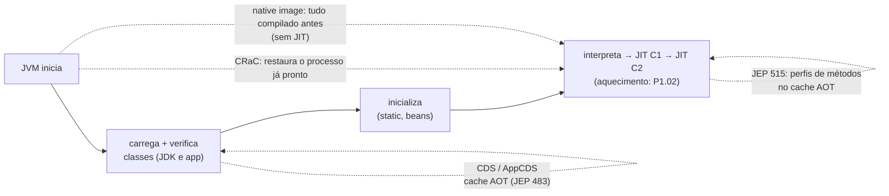

# S2.07 — GraalVM native image e CRaC

> ⏱️ ~1h30 · 🟣 Sênior · Pré-requisitos: S2.01 (medir), P1.02 (JIT e aquecimento), P7.01/P7.02 (imagens e JVM em contêiner), P7.06 (HPA), P9.07 (Lambda e *cold start*), P9.08 (medição de *cold start* local)

> ⚠️ **Verificação:** **executados** (OpenJDK 25.0.5 na máquina; **GraalVM CE 25** em Docker `ghcr.io/graalvm/native-image-community:25`; **Azul Zulu 25 com CRaC** em Docker `azul/zulu-openjdk:25-jdk-crac`; 12 núcleos, **máquina compartilhada**; scripts `lab/run-startup.sh`, `run-peak.sh`, `run-crac.sh`; saídas `out-s207*.txt`). **Tudo foi medido com programas PEQUENOS e sem Spring** (`MiniApp`: servidor HTTP + um cliente + regex/`java.time`; `PeakApp`: 12 lotes de CPU; `CracApp`): **os números NÃO valem para o PayFlow nem para um Spring Boot**, em que a partida é dominada por **centenas de classes e *beans*** (a **razão** entre as variantes pode ser **muito diferente**). **Não executado:** o **PayFlow/Spring Boot** com `-XX:AOTCache`, **Spring AOT + native** (`nativeCompile`), **Spring + CRaC**, CRIU (o CRaC usou o motor **`warp`**), *Native Build Tools* do Maven, GraalVM com **PGO**/outro GC e **Lambda/SnapStart** (P9). As imagens baixadas foram **removidas ao final**.

## 🎯 Objetivos
Ao final desta aula você consegue:
- **Dizer quando partida e pegada de memória importam** (e quando **não**).
- **Montar a "escada" de opções** (CDS → cache AOT do JDK 25 → CRaC → *native image*) e **medir** cada degrau.
- **Explicar** o *trade-off* do **native image**: partida e memória **muito** melhores, **pico** pior, **construção pesada** e **mundo fechado**.
- **Explicar** o CRaC (*checkpoint/restore*) e **por que** ele exige **recursos fechados antes do checkpoint**.
- **Decidir** com **critério** (e registrar em ADR) **sem** adotar por moda.

## 🤔 Por que isso importa
Para um serviço que **sobe uma vez e roda por semanas** (o PayFlow no ECS/EKS), 8 segundos de partida **não importam**. Importam quando: **(1) escalar** (o HPA, P7.06, cria *pods* **sob pressão**: cada segundo de partida é carga **sem capacidade**), **(2) *serverless*** (*cold start* da Lambda, P9.07: o usuário **espera**), **(3) *scale-to-zero*** e **(4) memória** (custo de *pods*, P7.02). É uma área em que **a moda atropela a medição**: "vamos para nativo" é uma decisão **cara** e **reversível só com custo**.

## 💡 Intuição (explicação simples)
Ligar um **carro de corrida** a frio leva alguns minutos de aquecimento e **depois** ele é **imbatível**. A JVM é assim: **partida lenta**, **pico excelente** (o JIT otimiza **enquanto roda**). Há três jeitos de lidar: **(a) deixar o motor já meio quente** (CDS/cache AOT: **guardar parte do trabalho** de aquecimento), **(b) fotografar o carro já aquecido e "ressuscitar" a foto** (CRaC), **(c) construir um carro de rua que nasce pronto** (*native image*: **sem aquecimento**, mas **sem o turbo** do JIT).

## 🔬 Como funciona por dentro

### 1. O que a partida da JVM faz (e o que cada técnica economiza)

- **CDS** (*Class Data Sharing*): o JDK já vem com um **arquivo** de classes do JDK pré-processadas; o **AppCDS** acrescenta as **suas** classes.
- **Cache AOT do JDK** ([JEP 483](https://openjdk.org/jeps/483) *Ahead-of-Time Class Loading & Linking*, JDK 24; [JEP 514](https://openjdk.org/jeps/514) *Command-Line Ergonomics*, JDK 25: cria o cache com **uma** *flag*; [JEP 515](https://openjdk.org/jeps/515) *Method Profiling*, JDK 25: guarda **perfis** para o JIT começar **informado**): **mesma JVM**, **mesmo código**, partida **mais rápida**; **sem** mudar a linguagem.
- **CRaC:** tira um **instantâneo do processo** (memória, *threads*) e o **restaura**; **precisa** de um JDK com suporte (**Azul Zulu** com CRaC, **não** o OpenJDK padrão).
- **Native image (GraalVM):** compila **tudo antes** para um **executável**: **sem JVM, sem JIT, sem carregamento de classes**.

### 2. Medido: a escada da **partida** (executado)
`MiniApp` sobe um servidor HTTP, faz **uma** chamada a si mesmo, valida e formata, e **sai**. **15 execuções por variante**, do `exec` ao fim do processo (`lab/run-startup.sh`):
```
JVM: openjdk version "25.0.5.0.3" 2026-10-24  | 15 execucoes por variante | 12 nucleos
padrao (CDS do JDK ligado)                   mediana= 227 ms  min= 220  max= 236  RSS pico=84 MB
-Xshare:off (sem CDS)                        mediana= 273 ms  min= 267  max= 297  RSS pico=82 MB
-XX:TieredStopAtLevel=1 (so C1)              mediana= 199 ms  min= 195  max= 202  RSS pico=78 MB
AppCDS (-XX:SharedArchiveFile)               mediana= 159 ms  min= 156  max= 169  RSS pico=79 MB
cache AOT (-XX:AOTCache, JDK 25)             mediana= 116 ms  min= 111  max= 123  RSS pico=72 MB
cache AOT + TieredStopAtLevel=1              mediana=  99 ms  min=  97  max= 103  RSS pico=69 MB
arquivo app.aot: 23.3 MB
arquivo app.jsa: 8.1 MB
native-image: compilacao em 44 s; binario 32 MB; 34.52MB in total image size, 32.64MB in total file size;3.0s (6.9% of total time) in 1083 GCs | Peak RSS: 1.86GB | CPU l
native image (binario)                       mediana=  11 ms  min=  10  max=  12  RSS pico=27 MB
```
Leitura (mediana, **neste programa minúsculo**):
- **JVM padrão: ~227 ms** (o **CDS do JDK** já está ligado). **Sem CDS** (`-Xshare:off`): **~273 ms** (**+20%**): o CDS padrão **já** economiza.
- **Só C1** (`TieredStopAtLevel=1`): **~199 ms** (**−12%**): **menos compilação** (e **pico pior**: serve a ferramentas e a *jobs* curtos, **não** a APIs).
- **AppCDS** (arquivo de **8 MB**): **~159 ms** (**−30%**).
- **Cache AOT do JDK 25** (arquivo de **23 MB**): **~116 ms** (**−49%**); **com C1**, **~99 ms**. E a **memória** caiu (84 → 72 MB de RSS no pico).
- **Native image:** **~11 ms** (**~20× menos**), **27 MB** de RSS (**~3× menos**). **Custo:** a compilação levou **~44 s**, pediu **~1,9 GB** de memória para compilar e gerou um binário de **~32 MB**.
**Duas ressalvas:** **(1)** o **cache AOT** e o **AppCDS** são **gerados por uma execução de treino** (ele aprende **o que o seu código usa**): **o treino precisa ser representativo** (a **primeira** requisição de verdade pode usar classes **que o treino não viu**). **(2)** Numa aplicação **Spring Boot**, o **tempo de partida é dominado** por **classes e *beans***: o ganho **relativo** do cache AOT e do nativo **tende** a ser **grande**, mas **o número** você **mede** (S2.01).

### 3. O outro lado: o **pico** (executado)
`PeakApp` executa **12 lotes iguais** de CPU (formatar, regex, mapa, ordenar) e imprime o tempo de **cada lote**:
```
JVM (G1, JIT)        #1: lotes (ms): 279 137 106 122 108 101 95 116 96 97 98 98  | total 1453 ms
native image         #1: lotes (ms): 281 262 262 263 267 268 270 267 268 267 266 267  | total 3208 ms
JVM (G1, JIT)        #2: lotes (ms): 264 128 120 102 97 96 118 95 95 97 98 108  | total 1418 ms
native image         #2: lotes (ms): 275 251 256 257 261 264 263 262 262 261 261 261  | total 3134 ms
```
- **JVM:** o 1º lote custa **~270 ms** (interpretando/compilando) e **cai para ~95–120 ms** (o **JIT** otimizou): **total ~1,4 s**.
- **Native image:** **~260 ms em todos os lotes** (**sem aquecimento**, mas **também sem a otimização por perfil**): **total ~3,1–3,2 s**, ou seja, **~2,2× mais lento no total e ~2,7× no regime**.
**Interpretação com cuidado:** é **um** programa, o *native image* **padrão** (**sem PGO**, **GC Serial**), **uma** carga de CPU. O que se **pode** afirmar: **o nativo troca pico por partida**; **o quanto** varia com a carga (o **PGO** do GraalVM e outro GC mudam isso: **não medidos aqui**). Para um **serviço de longa vida** com muito tráfego, **o JIT ganha**; para algo que **vive 200 ms** (função, CLI, *scale-to-zero*), **o nativo ganha**.

### 4. CRaC (executado, com motor **`warp`**, sem privilégios)
`CracApp` é um servidor HTTP que **fica no ar**. O 1º teste **falhou de propósito**: o `jcmd JDK.checkpoint` devolveu `jdk.internal.crac.mirror.CheckpointException ... BusySelectorException: Selector ... has registered keys from channels: [ServerSocketChannelImpl]`: **o CRaC não deixa um *socket* de escuta aberto no instante do checkpoint** (nem conexões, nem arquivos abertos não previstos). A correção é um **`Resource`** que **fecha** o servidor **antes** (`beforeCheckpoint`) e o **recria depois** (`afterRestore`) (frameworks como o Spring **fazem isso** com o ciclo de vida dos *beans*, **seção 5**). Com isso, o checkpoint **funcionou** (`warp: Checkpoint successful!`), gerou **~33 MB** em disco e a **restauração**:
```
imagem: azul/zulu-openjdk:25-jdk-crac | OpenJDK 64-Bit Server VM Zulu25.38+109-CRaC-CA (build 25.0.5.0.3+1-LTS, mixed mode, sharing)
checkpoint: 33412 KB em disco (core.img engine )
JVM normal (docker run ate o 1o 200)           mediana=  217 ms  min=  205  max=  228
restore do checkpoint CRaC (idem)              mediana=  176 ms  min=  168  max=  180
```
**Restaurar** levou **~176 ms** contra **~217 ms** da JVM normal (**−19%**, **incluindo** o custo de **criar o contêiner**, que **é igual** nos dois e **não** foi separado). **É pouco** porque o programa é **minúsculo**: o CRaC **brilha** quando a partida **custa segundos** (um Spring Boot com **centenas de *beans***) e o **instantâneo já tem o aquecimento** (**não medimos** o aquecimento do JIT restaurado: **não afirme**).
**Cuidados do CRaC** (documentação do Spring): exige **JVM com suporte (somente Linux por enquanto)**, a biblioteca `org.crac` (≥ 1.4.0) e as *flags* `-XX:CRaCCheckpointTo`/`-XX:CRaCRestoreFrom`; os arquivos gerados **contêm a memória do processo** (**segredos, tokens, dados pessoais!**): a documentação manda **avaliar com cuidado onde e como são gerados, guardados e acessados**; e **tarefas agendadas** (`@Scheduled(fixedRate)`) **disparam as execuções "perdidas"** entre o checkpoint e o restore. **Segredos e identidade** (credenciais, `SecureRandom`, relógios, conexões) **precisam ser renovados** após a restauração.

### 5. O que o Spring faz por você (leitura da documentação; **não executado**)
- **CRaC no Spring Framework** ([documentação](https://docs.spring.io/spring-framework/reference/integration/checkpoint-restore.html)): **antes** do checkpoint o Spring **para** os *beans* em execução (`Lifecycle.stop`); **depois** do restore os **reinicia** (`Lifecycle.start`): **o mesmo mecanismo** do nosso `Resource`. Há o **checkpoint automático** na partida (`-Dspring.context.checkpoint=onRefresh`) e o **sob demanda** (`jcmd ... JDK.checkpoint`).
- **Native no Spring Boot** ([documentação](https://docs.spring.io/spring-boot/reference/packaging/native-image/index.html)): é a **análise estática** do **ponto de entrada**; o que **não** é alcançável **sai** do executável; **reflexão, recursos, serialização e *proxies* dinâmicos** precisam ser **declarados** (o **Spring AOT** gera boa parte); **o *classpath* é fixo na construção**, **não há carregamento tardio** e **vale um "mundo fechado"**: os *beans* **não** mudam em tempo de execução, `@Profile`/`@ConditionalOnProperty` e propriedades que **criam** *beans* **têm limitações**.

### 6. A escolha (o quadro de decisão)
| | **JVM padrão** | **+ cache AOT (JDK 25)** | **CRaC** | **Native image** |
|---|---|---|---|---|
| Partida | lenta | **~2× melhor** (medido) | boa (**depende** do app) | **~20× melhor** (medido) |
| Memória | referência | um pouco melhor | ~referência | **~3× menor** (medido) |
| Pico (regime) | **melhor** | = (mesma JVM) | = | **pior** (~2,7× no `PeakApp`) |
| Mudança no build | nenhuma | **etapa de treino** | JDK especial + `Resource`s | **compilação 40 s+ e GBs**; mundo fechado |
| Observabilidade | **completa** (JFR, `jcmd`, agentes) | completa | completa (restaurado) | **reduzida**: confira **JFR, agentes, `jcmd`** no seu caso (**não medido**) |
| Risco operacional | baixo | **baixo** | **médio** (segredos, estado, só Linux) | **médio** (compatibilidade de bibliotecas, depuração) |
| Bom para | **serviços** de longa vida | **quase tudo**: o primeiro degrau a **medir** | *serverless* com JDK com suporte | **funções**, CLIs, *scale-to-zero* |
**Regra do sênior:** **suba a escada na ordem**; **cada degrau só se justifica por um problema medido** (a partida **é** um gargalo? o HPA **sofre**? a Lambda **estoura** o orçamento?). **Pule direto para o nativo** só com a **necessidade clara**.

## 🛠️ Exemplo prático
```bash
cd 3-senior/S2-performance-eficiencia/lab
./run-startup.sh        # ~1 min: CDS, AppCDS, cache AOT e (se a imagem existir) native image
./run-peak.sh           # ~1,5 min: 12 lotes de CPU, JVM x native
./run-crac.sh           # ~1,5 min: CRaC em Docker (Azul Zulu 25)
```
**Os três comandos-chave** (JDK 25):
```bash
# cache AOT (JEP 514): uma etapa de treino e a seguir o uso
java -XX:AOTCacheOutput=app.aot -cp app.jar MiniApp      # treino (grava app.aot)
java -XX:AOTCache=app.aot       -cp app.jar MiniApp      # usa o cache

# native image (compila no contêiner; a entrada da imagem JA e o native-image)
docker run --rm --user "$(id -u):$(id -g)" -v "$PWD:/work" -w /work \
  ghcr.io/graalvm/native-image-community:25 -cp app.jar MiniApp -o miniapp --no-fallback

# CRaC (JDK com suporte): checkpoint sob demanda e restore
java -XX:CRaCCheckpointTo=/cr -cp cls CracApp &          # ... aquece ...
jcmd <pid> JDK.checkpoint                                # grava /cr e encerra
java -XX:CRaCRestoreFrom=/cr                             # restaura
```
**Saída esperada:** as tabelas acima (valores **variam**; a **ordem** das variantes, **não**).

## 🧠 Pausa para lógica
O PayFlow escala de 3 para 12 *pods* em **picos de 2 minutos** (HPA). A partida do Spring Boot é de **20 s** e o p99 sobe **durante** a subida dos *pods*. O time propõe "migrar tudo para nativo". **Qual a primeira medição e a alternativa mais barata?**
<details><summary>Dica e solução</summary>

**Medir a partida** (e quanto **do tempo de 20 s** é **JVM + classes** × **beans** × **conexões**/Flyway) **e o efeito da subida lenta no p99** (S2.06: um teste de pico com HPA). **Alternativas mais baratas, na ordem:** **(1)** reduzir o que a partida faz (migrações **fora** da partida, *lazy init*, `management` etc.), **(2)** **cache AOT** (uma *flag* + um treino), **(3)** **`maxSurge`/capacidade ociosa**/escala **preditiva**. **Nativo** só se **(1) a (3)** **não bastarem**: ele **troca pico por partida** (medido: ~2,7× mais lento no regime, neste teste) e **custa build e compatibilidade**.
</details>

## 🏗️ Estudo de caso: "o nativo subiu em 40 ms e o p99 piorou"
O time converteu um serviço para *native image*: a partida foi de 9 s para 0,1 s e a memória caiu pela metade, mas **o p99 em tráfego normal subiu 40%** e a CPU também. **Por quê e o que fazer?**
<details><summary>Solução</summary>

O nativo **não tem JIT**: o código roda **sem otimização por perfil** (o `PeakApp`: ~2,7× mais lento no regime) e o **GC padrão** do nativo (Serial) tem pausas diferentes (S2.05). **Opções:** **PGO** do GraalVM (otimização guiada por perfil: **a medir**), outro **GC**, **mais CPU** (e **menos réplicas**? **não**: o custo de CPU **sobe**), ou **voltar à JVM com cache AOT**. **Critério:** a decisão é do **custo total** (capacidade × partida × operação) **medido com o tráfego real** (S2.06).
</details>

## ⚖️ Trade-offs e quando NÃO usar
- **Nativo:** **não** para **serviço de longa vida** com **tráfego estável** (você **perde pico**), nem para **bibliotecas muito dinâmicas** (reflexão pesada, *plugins*, *classloaders*), nem quando a **equipe não está pronta** para **depurar** o mundo fechado.
- **CRaC:** **não** com **muito estado externo** (conexões, segredos, relógio) sem **disciplina** de ciclo de vida; **não** onde o **JDK com suporte** não é aceito; o **snapshot é dado sensível**.
- **Cache AOT:** **o mais barato**, mas **o treino precisa ser representativo** e o arquivo **depende da versão exata** da JVM e do **classpath**.
- **Todas:** **a janela de ganho é a partida**: **se a partida não é um problema medido, não mexa**.

## ⚠️ Erros comuns e boas práticas de produção
- **Comparar partida com `time` uma vez** (S2.01): **15 execuções, mediana, mesmo ambiente**.
- **Treinar o cache AOT com outro `classpath`/JDK** do que roda em produção: o cache é **recusado** ou **inútil**.
- **Esquecer o `--no-fallback`** (o nativo "cai" para uma JVM embutida e você **não percebe**): sempre `--no-fallback`.
- **Compilar nativo na máquina do CI sem memória** (**pico de ~1,9 GB** num exemplo minúsculo; um Spring Boot pede **mais**).
- **Snapshot do CRaC no repositório/bucket aberto**: contém **memória do processo**.
- **Decidir por *benchmark* de *hello world*:** foi **o que fizemos aqui**: as **proporções** não se transferem ao PayFlow.
- **Boa prática:** **ADR** com os **números medidos no seu serviço**, o **critério de reversão**, e **a escada sempre na mesma ordem**.

## 🧩 Exercícios
1. **Fixação:** com a tabela da seção 2, **calcule** a economia de partida (`ms`) do **AppCDS** e do **cache AOT** **frente** ao padrão. Quantas **partidas por dia** (ex.: 12 *pods* × 10 escalas) e quantos **segundos de capacidade** isso devolve? **O que você ainda não sabe** (e precisa medir no PayFlow)?
2. **PayFlow (por leitura):** escreva `docs/perf/partida.md`: (a) **como medir** a partida do **Spring Boot** (do `exec` até `readiness` verdadeiro: `Started PayflowApplication in X seconds` **e** o primeiro `GET /actuator/health/readiness` 200), **15 execuções**; (b) a **escada** (cache AOT → CRaC → nativo) **e o critério** de cada degrau (**números a medir**, **não invente**); (c) a **ADR 0025** registrando **"JVM padrão agora; cache AOT a medir; nativo e CRaC NÃO adotados"** com os **gatilhos** para reabrir (HPA atrasado no p99, *Lambda* no orçamento de *cold start*, memória). Critérios de pronto:
   - [ ] a medição usa o **mesmo `classpath`/JDK** da produção;
   - [ ] **nenhuma** decisão sem **número** (ou **marcada "a medir"**);
   - [ ] o doc diz **o que o nativo faria com o pico** (**medir** com o tráfego real).
3. **Desafio (opcional):** troque a carga do `PeakApp` por **sua** operação típica (por exemplo, serializar JSON com Jackson) e **refaça** JVM × nativo: **a razão muda**?
<details><summary>Solução da fixação (1)</summary>

**AppCDS:** 227 → 159 ms = **68 ms**; **cache AOT:** 227 → 116 ms = **111 ms**. Com 120 partidas/dia: **~8 s** e **~13 s** **por dia**: **irrelevante** neste programa minúsculo. **Moral:** o ganho **absoluto** só importa se a partida do **seu** Spring Boot custa **segundos** (aí o **mesmo percentual** devolve **minutos**). **Falta medir:** o **Spring Boot real** com o cache AOT (treino representativo), o **efeito no p99** durante a escala.
</details>

## 🎤 Na entrevista
1. **"Quando usar GraalVM native image?"** Quando **partida e memória** são **o problema** (funções, CLIs, *scale-to-zero*) e o **pico** não é: **troca pico por partida** (no meu teste, **11 ms × 227 ms** de partida, mas ~**2,7×** mais lento no regime), com **build pesado** e **mundo fechado** (reflexão declarada). Para serviço de longa vida, **começo pelo cache AOT do JDK**.
2. **"O que é CRaC?"** **Checkpoint/restore** do **processo**: sobe, **aquece**, **tira o instantâneo** e **restaura** em milissegundos; exige JDK com suporte e **fechar recursos** (sockets, arquivos) **antes**; o **snapshot é sensível**.
3. **"Como reduzir a partida de um Spring Boot sem mudar de runtime?"** **Medir**; **menos trabalho na partida** (lazy, migrações fora); **AppCDS/cache AOT** (treino representativo); **dar capacidade ociosa** ao HPA.
4. **"Por que a JVM é mais rápida no regime?"** O **JIT otimiza por perfil** em tempo de execução (inlining agressivo, especulação); o nativo compila **antes**, **sem perfil** (a menos de **PGO**).

## 📚 Para ir além
- 📄 [JEP 483](https://openjdk.org/jeps/483), [JEP 514](https://openjdk.org/jeps/514) e [JEP 515](https://openjdk.org/jeps/515): o **cache AOT** do JDK 24/25 (**Class Loading & Linking**, **Command-Line Ergonomics**, **Method Profiling**).
- 📄 [GraalVM Native Image](https://www.graalvm.org/latest/reference-manual/native-image/): o **manual** (compatibilidade, reflexão, opções).
- 📄 [Spring Boot: GraalVM Native Images](https://docs.spring.io/spring-boot/reference/packaging/native-image/index.html): **o que muda** para uma aplicação Spring.
- 📄 [Spring Framework: Checkpoint/Restore (CRaC)](https://docs.spring.io/spring-framework/reference/integration/checkpoint-restore.html): **requisitos** e **ciclo de vida**.
- 💻 [Projeto CRaC (OpenJDK)](https://wiki.openjdk.org/display/crac) e [github.com/crac/docs](https://github.com/crac/docs): a **API**, o estado do projeto e a **documentação**.
- 📑 *Java Performance* (Scott Oaks): JIT, GC e **partida** (**de memória, não conferido**).

## ✅ Checklist da aula
- [ ] Sei **quando** a partida importa (HPA, *serverless*, *scale-to-zero*, memória).
- [ ] Conheço a **escada**: CDS → cache AOT → CRaC → nativo.
- [ ] Explico **pico × partida** com os **números** do laboratório.
- [ ] Sei por que o **CRaC** exige **fechar sockets antes** do checkpoint.
- [ ] `docs/perf/partida.md` e a **ADR 0025** (parcial) escritos.
