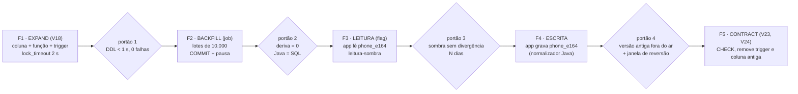

# S3.09 — Estudo de caso: migrar uma coluna com o sistema no ar

> ⏱️ ~1h30 · 🟣 Sênior · Pré-requisitos: S3.01 (expand/contract, `lock_timeout`, *backfill* em lotes), S3.02 (índice único, `CHECK ... NOT VALID`), S1.08 (idempotência), P3.07 (consumidor idempotente), P8.03 (*rolling deploy*), P8.04 (*feature flags*), P10.07 (dado pessoal), J3.12 (Flyway), J7 (testes)

> ⚠️ **Verificação:** o procedimento **inteiro** (expandir → *backfill* sob carga → verificar → contrair) **foi executado** em PostgreSQL **18** (Docker) sobre **220 mil usuários** com **escritas concorrentes** do "código antigo" (`pgbench`, 4 clientes, 30 s), e **repetido sem a *trigger*** (o **mutante**) para provar que a verificação **pode falhar**. O normalizador **em Java** (`PhoneNormalizer`, Java 25, *sem* Spring) foi **executado** contra os **mesmos casos** e contra **todos os 220 mil registros** (`lab/run-s309.sh`; saídas reais em `lab/out-s309-*.txt`; milissegundos variam). **NÃO executado:** o **PayFlow do aluno** (Spring, JPA, Flyway), um *rolling deploy* real, a *flag*, e o leitor das duas colunas em produção: essas partes são **por leitura**. **Os dados são sintéticos** (telefones inventados); **`V18`, `V23` e `V24` são rascunhos** (a numeração segue a ordem **global** da S3: `V19` partição do ledger, `V20` arquivo, `V21` CDC, `V22` resumo diário).

## 🎯 Objetivos
Ao final desta aula você consegue:
- **Planejar** uma migração de coluna em **fases reversíveis**, cada uma com **portão de saída** (o que **precisa** ser verdade para seguir).
- **Garantir** consistência entre a coluna antiga e a nova **durante** a transição (e **provar** que a garantia funciona com um **mutante**).
- **Manter duas implementações** da mesma regra (SQL e Java) **concordando**, com **teste**.
- **Tratar dados sujos** sem adivinhar (fila de revisão) e **proteger** dado pessoal nos *logs*.
- **Executar a contração** sem surpresa e **dizer** quando **não** fazer a migração.

## 🤔 Por que isso importa
É a migração **mais comum e mais subestimada** do trabalho sênior: **"só" mudar o formato de uma coluna**. Em produção ela atravessa **banco, aplicação (várias versões), jobs, integrações e dados sujos**, tudo **com o sistema no ar**. Esta aula **junta** a S3.01 (padrão), a S3.02 (índices e restrições sem bloquear) e a S1.08 (idempotência) numa **execução de ponta a ponta**, com **números**.

## 🏗️ O caso
### Contexto
`users.phone` é `VARCHAR(20)`, **texto livre** (`V5`, J3.12): o formulário aceitava qualquer coisa. O requisito novo: **enviar SMS de verificação** (P10) e **notificações**, que exigem o número no formato **E.164** (`+5511912345678`). Na base há **quatro formatos** convivendo (`(11) 91234-5678`, `11912345678`, `+55 21 91234-5678`, `021-91234-5678`), **vazios** e **lixo** (`sem telefone`, `123`, números de outros países).

**Regra de negócio (decisão do produto, a confirmar):** só **números brasileiros válidos** viram E.164; **o resto fica nulo e entra numa fila de revisão** (o sistema **nunca adivinha** um número). Telefone é **dado pessoal** (LGPD).

### As restrições (o que torna isto "um caso")
1. **A aplicação não pode parar** e, num *rolling deploy*, **a versão N e a N+1 rodam juntas** (P8.03).
2. **Há escritores** que não são a aplicação nova: instâncias **antigas**, um *script* de suporte, a **importação** de contatos.
3. **A tabela** `users` é quente (login, cadastro).
4. **Cada regra existe em dois lugares** (banco e Java) por um tempo.
5. **Reversibilidade:** qualquer passo, até o último, precisa ter **volta**.

### As opções (formato ADR)
| Opção | Como | Problema |
|---|---|---|
| **A. In-place** | `UPDATE users SET phone = normalize(phone)` + `ALTER` do tipo/`CHECK` | **Reescreve** a coluna (e **perde** o original): **sem volta**; **escritas** esperam; *deploy* não reversível |
| **B. Coluna nova + escrita dupla pelo aplicativo** | nova versão grava nas duas | **Instâncias antigas** (e *scripts*) gravam **só** na antiga: **drift** garantido durante o *deploy* |
| **C. Coluna nova + *trigger* + *backfill* (escolhida)** | o **banco** mantém a nova a partir da antiga, para **qualquer** escritor | lógica **duplicada** (SQL + Java) → **teste de concordância**; **lógica no banco** (esconde comportamento) |
| **D. Coluna gerada** (`GENERATED ALWAYS AS (...)`) | o banco calcula | **medido abaixo:** `VIRTUAL` **não aceita função do usuário** (PG 18); `STORED` **reescreve a tabela** |

**Decisão:** **C**, com o **mutante** para provar a verificação e **portões** entre as fases. **Quando reabrir:** se o PostgreSQL passar a aceitar **funções do usuário em colunas virtuais** (D vira **expand sem *trigger*** e **sem reescrita**).

### O plano, com portões


| Fase | O que muda | Portão para a próxima | Reversão |
|---|---|---|---|
| **F1 (V18)** | coluna `phone_e164`, função `normalize_phone_br`, *trigger* | DDL **< 1 s**, **0** transações falhas, `lock_timeout` não estourou (ou **repetido** com sucesso) | `DROP` do que foi criado |
| **F2** | *backfill* em lotes (**fora do Flyway**) | **deriva = 0**; **inválidos** contados e na fila; **Java × SQL = 0 divergências** | parar o *job* (nada se perde) |
| **F3** | app **lê** `phone_e164` (atrás de *flag*) e, em **leitura-sombra**, **compara** com a antiga e **registra divergência** (**sem** número no *log*) | **0 divergências** por N dias (**a definir**) | desligar a *flag* |
| **F4** | app **grava** `phone_e164` (normalizador **Java**) | versão **antiga** **fora do ar**; **janela de reversão** passou | voltar a versão: a *trigger* **ainda** mantém a nova |
| **F5 (V23/V24)** | `CHECK` de formato (`NOT VALID` → `VALIDATE`), `DROP TRIGGER`, `DROP COLUMN phone` | — | **não volta** (por isso é **o último passo**) |

## 🔬 Como funciona por dentro: a execução, passo a passo

### F1 — Expandir: a `V18` (testada)
```sql
-- V18 (EXPAND): additive only. Old code keeps working; nothing is read from the new column yet.
ALTER TABLE users ADD COLUMN phone_e164 VARCHAR(16);

CREATE FUNCTION normalize_phone_br(raw text) RETURNS text LANGUAGE sql IMMUTABLE PARALLEL SAFE AS $$
  SELECT CASE WHEN n ~ '^[1-9][0-9][2-9][0-9]{7}$' OR n ~ '^[1-9][0-9]9[0-9]{8}$' THEN '+55' || n END
  FROM (SELECT CASE WHEN d ~ '^55[1-9][0-9]{9,10}$' THEN substr(d, 3)
                    WHEN d ~ '^0[1-9][0-9]{9,10}$'  THEN substr(d, 2)
                    ELSE d END AS n
        FROM (SELECT regexp_replace(coalesce(raw, ''), '[^0-9]', '', 'g') AS d) x) y
$$;

-- keeps the new column in step with every write made by the OLD code (and by rolling-deploy instances still running it)
CREATE FUNCTION users_sync_phone_e164() RETURNS trigger LANGUAGE plpgsql AS $$
BEGIN
  IF TG_OP = 'INSERT' OR NEW.phone IS DISTINCT FROM OLD.phone THEN
    NEW.phone_e164 := normalize_phone_br(NEW.phone);
  END IF;
  RETURN NEW;
END $$;

CREATE TRIGGER trg_users_sync_phone BEFORE INSERT OR UPDATE OF phone ON users
  FOR EACH ROW EXECUTE FUNCTION users_sync_phone_e164();
```

Três decisões: (1) **`IMMUTABLE PARALLEL SAFE`** na função (o planejador pode **pré-avaliar** e o Postgres a aceita em índices); (2) `BEFORE INSERT OR UPDATE OF phone`: a *trigger* **só dispara** quando a coluna **antiga** é gravada, e dentro dela `NEW.phone IS DISTINCT FROM OLD.phone` evita **recalcular à toa**; (3) a *trigger* **chama a mesma função** que o *backfill* e a verificação usam: **uma** definição da regra no banco.

### F1+F2 — A execução sob carga (a prova)
O "código antigo" **grava `phone`** sem saber da coluna nova: **90% `UPDATE`**, 10% `INSERT` de usuário, **4 clientes por 30 s** (~200 mil transações). **Durante** essa carga: aplicar a `V18` (com `lock_timeout = 2s`) e **rodar o *backfill*** (lotes de 10 mil, `COMMIT` por lote, pausa de 0,1 s):

```text
## MODE=trigger
-- load: old code writing users.phone (4 clients, 90% UPDATE / 10% INSERT) for 30 s; the migration steps run during it
-- step 1 (V18, expand): ADD COLUMN + function + trigger, with lock_timeout and retries
   V18 applied after 0 retries in 100 ms
-- step 2: backfill in batches of 10,000 by id (keyset), COMMIT per batch, 100 ms pause
NOTICE:  backfill: 190 batches, 218258 rows
   backfill took 26090 ms
-- wait for the load to finish, then verify
   pgbench: number of transactions actually processed: 183494
   pgbench: number of failed transactions: 0 (0.000%)
   pgbench: latency average = 0.654 ms
   pgbench: max latency 307.5 ms over 183494 transactions
-- step 3 (verify): drift between the stored column and the function applied to the old column
users: 218258 | with phone: 200887 | stored phone_e164 not null: 200038 | invalid (go to review): 849
DRIFT rows (phone_e164 IS DISTINCT FROM normalize_phone_br(phone)): 0
crosscheck: 218258 rows checked, 0 mismatches
-- step 4 (contract, V23 + V24) once every reader uses phone_e164 and the old code is gone
Time: 0.695 ms
Time: 2.585 ms
Time: 255.062 ms
V23: drop the trigger and the function
Time: 1.074 ms
Time: 0.477 ms
V24: drop the old column
Time: 0.596 ms
 columns now: id, email, full_name, password_hash, role, created_at, phone_e164
```

Leia **na ordem**:
1. **F1:** a `V18` aplicou **sem repetir** (`0 retries`) em **~100 ms**, **com a carga rodando**.
2. **F2:** o *backfill* percorreu **todos** os usuários em ~**170 lotes**, em ~26 s (dormir entre lotes e competir com a carga custam tempo; é **por isso** que ele roda **fora** do Flyway).
3. **A carga não sentiu:** `0` transações falhas; **latência média ~0,6 ms**; a **pior** (**~270 ms**) é **um pico isolado** em 200 mil transações (o *lock* breve do `ALTER` e o *checkpoint*); nada parecido com os **segundos** do `UPDATE` único da S3.01.
4. **Portão 2:** `DRIFT rows = 0`: **toda** linha satisfaz `phone_e164 = normalize_phone_br(phone)` **mesmo com 200 mil escritas durante o *backfill***: é a *trigger* trabalhando. **E `crosscheck`: o normalizador Java e o SQL concordam nas 220 mil linhas** (**0 divergências**).
5. **Inválidos:** **algumas centenas** de linhas (790 a 940 nas execuções que fiz; **os números variam** porque a carga também reescreve telefones) (`invalid (go to review)`: `phone` preenchido, mas **não** normalizável) ficam com `phone_e164 = NULL` e **vão para a fila de revisão** (ver adiante); **não** se adivinha.
6. **F5 (contração, `V23`/`V24`):** `CHECK ... NOT VALID` (ms) → `VALIDATE` (**~200 ms**, só `SHARE UPDATE EXCLUSIVE`, S3.01) → `DROP TRIGGER`/`DROP FUNCTION` (**< 1 ms**) → `DROP COLUMN phone` (**< 1 ms**, só catálogo). A tabela final **não tem** `phone`.

### O mutante: provando que a verificação pode falhar
**"Um teste que nunca falhou não prova nada."** Mesmo procedimento, **mas sem a *trigger*** (só a coluna e a função):

```text
## MODE=mutant
-- load: old code writing users.phone (4 clients, 90% UPDATE / 10% INSERT) for 30 s; the migration steps run during it
-- step 1 (V18, expand) as the MUTANT: ADD COLUMN + function, but WITHOUT the trigger
   V18 applied after 0 retries in 100 ms
-- step 2: backfill in batches of 10,000 by id (keyset), COMMIT per batch, 100 ms pause
NOTICE:  backfill: 167 batches, 219408 rows
   backfill took 26020 ms
-- wait for the load to finish, then verify
   pgbench: number of transactions actually processed: 193028
   pgbench: number of failed transactions: 0 (0.000%)
   pgbench: latency average = 0.622 ms
   pgbench: max latency 303.8 ms over 193028 transactions
-- step 3 (verify): drift between the stored column and the function applied to the old column
users: 219408 | with phone: 202702 | stored phone_e164 not null: 182332 | invalid (go to review): 796
DRIFT rows (phone_e164 IS DISTINCT FROM normalize_phone_br(phone)): 104939
```

Resultado: o *backfill* termina "com sucesso", **a carga não falha** e **a verificação acusa** `DRIFT rows` = **~100 mil**: toda linha **atualizada pelo código antigo depois de o *backfill* passar por ela** ficou **com a coluna nova velha**. **Sem a verificação, a migração "terminaria bem" e F3 leria telefones errados** (SMS para o número **antigo**). Por isso o portão 2 é **medido, não presumido**.

### Duas implementações, um teste de concordância
A regra existe em **SQL** (`normalize_phone_br`) **e** em **Java** (a F4 grava a coluna pela aplicação). O normalizador Java:

```java
/** S3.09: the Java twin of the SQL function normalize_phone_br. Brazilian numbers only; anything else -> null (goes to review, never guessed). */
public final class PhoneNormalizer {
    private static final Pattern WITH_COUNTRY = Pattern.compile("^55[1-9][0-9]{9,10}$");
    private static final Pattern WITH_TRUNK   = Pattern.compile("^0[1-9][0-9]{9,10}$");
    private static final Pattern LANDLINE     = Pattern.compile("^[1-9][0-9][2-9][0-9]{7}$");
    private static final Pattern MOBILE       = Pattern.compile("^[1-9][0-9]9[0-9]{8}$");

    private PhoneNormalizer() {}

    /** @return +55DDNNNNNNNNN or null when the input is not a valid Brazilian number. */
    public static String normalize(String raw) {
        if (raw == null) return null;
        String digits = raw.replaceAll("[^0-9]", "");
        String national = WITH_COUNTRY.matcher(digits).matches() ? digits.substring(2)
                        : WITH_TRUNK.matcher(digits).matches()   ? digits.substring(1) : digits;
        return LANDLINE.matcher(national).matches() || MOBILE.matcher(national).matches() ? "+55" + national : null;
    }
```

Os **casos de referência** (arquivo `phone-cases.tsv`, **uma tabela de verdade**) são rodados **contra as duas**:

```text
## E) the Java normalizer against its documented cases, and the SQL function against the SAME cases
cases: 14 rows checked, 0 mismatches
SQL cases: 14 rows checked, 0 mismatches
```

**Regras do normalizador** (nomeadas, para que **mudem em um só lugar**): tirar tudo que **não é dígito**; aceitar **código do país `55`** e **prefixo de tronco `0`** (e **removê-los**); depois, **fixo** = 10 dígitos com o 3º dígito de **2 a 9**, **celular** = 11 dígitos com o 3º dígito **9**; senão **nulo**. **Armadilha** coberta nos casos: **`(55) 99999-9999`** (DDD **55**, Rio Grande do Sul) **não** é confundido com o código do país (têm 11 dígitos, não 12–13).

**No código real**, a lógica de telefone mais robusta vem de **biblioteca** (por exemplo, a *libphonenumber* do Google: **não executada aqui**); o ponto da aula é **o processo** e o **teste de concordância**, que vale **para qualquer** biblioteca.

### A alternativa "fácil": coluna gerada (medido: não serve **aqui**)
```text
## F) the alternative that looks easier: a GENERATED column (PostgreSQL 18)
-- VIRTUAL (computed on read, no table rewrite) with the user-defined normalize_phone_br:
ERROR:  generation expression uses user-defined function
DETAIL:  Virtual generated columns that make use of user-defined functions are not yet supported.
-- STORED (computed on write): does the table file change, and how long does ACCESS EXCLUSIVE last?
Time: 3272.029 ms (00:03.272)
 table file replaced (rewrite): true

-- a generated column cannot be written by the application:
ERROR:  column "phone_stored" can only be updated to DEFAULT
DETAIL:  Column "phone_stored" is a generated column.
```

No PostgreSQL 18, uma coluna **`VIRTUAL`** (calculada na leitura, **sem reescrita**) **não aceita função do usuário**; uma **`STORED`** **reescreve a tabela** (o arquivo muda) com `ACCESS EXCLUSIVE` pelo tempo da reescrita (**alguns segundos** em 220 mil linhas, porque a função roda **uma vez por linha**; **minutos ou mais** em dezenas de milhões: **extrapolação**), e **não pode ser gravada** (a F4 precisaria de **outra** coluna). **Por isso** a opção C.

## 🧠 Dados sujos, privacidade e observabilidade
- **Fila de revisão:** a verificação **conta** os inválidos; um *job* os lista (`user_id`, **sem** telefone) para o **produto** decidir (pedir novo cadastro **no próximo login**, **nunca** "corrigir" por regra).
- **Telefone é dado pessoal:** os *logs* da migração e da leitura-sombra registram **contagens e `user_id`**, **nunca** o número (o laboratório imprime amostras **porque os dados são sintéticos**).
- **Observabilidade:** *gauge* "linhas com `phone_e164 IS DISTINCT FROM normalize_phone_br(phone)`" (deve ser **0**), progresso do *backfill* (último `id`), contagem de inválidos, **divergências da leitura-sombra** (P6.02: métrica de baixa cardinalidade).
- **Segurança:** a função e a *trigger* **pertencem ao dono** do esquema; a aplicação **não** altera funções (menor privilégio, S3.04).

## ⚖️ Trade-offs e quando NÃO usar
- **Seis passos para mudar o formato de uma coluna**: caro. **Quando NÃO usar:** tabela **pequena**, janela de manutenção **aceita**, **um** escritor; um `ALTER` direto basta.
- **Trigger** dá **garantia** (qualquer escritor), mas **esconde** lógica e **duplica** regras (SQL × Java); **teste de concordância** é **obrigatório**. A alternativa **só no aplicativo** exige que **toda** instância (e script) use a regra: o laboratório mostra o que acontece quando **não** usa (mutante: ~100 mil divergências).
- **Rollback tem prazo:** após o `DROP COLUMN phone` **não há volta**: mantenha a coluna antiga **além** da janela de reversão (**dias**, a definir) **e** um *backup*.
- **O *backfill* compete** com a produção: ele **reduz** a velocidade se o p99 subir (parâmetros por **medição**).
- **Bibliotecas externas** (libphonenumber) mudam **regras** (planos de numeração) com o tempo: **versione** e **teste** a concordância a cada atualização.

## ⚠️ Erros comuns e boas práticas de produção
**Mensagens e problemas reais** (do laboratório):
```text
ERROR:  canceling statement due to lock timeout          (V18 encontrou uma transação longa: repita)
Virtual generated columns that make use of user-defined functions are not yet supported.
ERROR:  column "phone_stored" can only be updated to DEFAULT        (coluna gerada não se grava)
```
- **`WHERE phone_e164 IS NULL` como condição do *backfill*:** os **inválidos** continuam nulos para sempre e o laço **nunca termina** ou **revisita** os mesmos: use **faixa de `id`** (*keyset*).
- **`UPDATE OF phone` só dispara se `phone` está na lista** do `SET`: um `UPDATE` que **não** a menciona **não** passa pela *trigger* (é **o que se quer**; mas **atente** ao escrever o *backfill*).
- **Verificar só no fim:** deriva **nasce** a cada escrita; **monitore** continuamente até o **portão 4**.
- **Remover a *trigger* antes de a versão antiga sair:** a versão antiga **volta a divergir** (por isso o `DROP TRIGGER` fica na **F5**).
- **Remover `phone` antes do fim da janela de reversão.**
- **Logar o telefone.**
- **Duas regras que divergem sem teste.**

## 🧩 Exercícios
**1. Fixação.** (a) Por que a opção B (escrita dupla **só** no aplicativo) falha num *rolling deploy*? (b) O que o mutante provou? (c) Por que o `DROP TRIGGER` só entra na F5?

<details><summary>Soluções</summary>

(a) **Instâncias antigas** (e *scripts*) continuam gravando **só** `phone`: a coluna nova **fica velha** exatamente durante a janela do *deploy*. (b) Que a **verificação** acusa a falha (**~100 mil** divergências) quando a *trigger* falta: o **portão 2 não é decorativo**. (c) Enquanto **qualquer** versão antiga puder escrever (ou for preciso **reverter**), a *trigger* **mantém** a coluna nova correta; tirá-la antes **reabre** a deriva.
</details>

**2. Aplicação no PayFlow.** Escreva `docs/dados/migracao-phone.md` com o **plano de execução** (as 5 fases e os 4 portões), as migrações **`V18`, `V23`, `V24`** (rascunhos) e o **job de *backfill***. Critérios de pronto:
- [ ] **cada fase** com **portão de saída (número/critério)** e **reversão**;
- [ ] `V18` com `lock_timeout`, **função**, **trigger** e **nenhum** `UPDATE` em massa;
- [ ] o *job* de *backfill*: **faixa de `id`**, `COMMIT` por lote, pausa **adaptativa** (**reduz** quando o p99 ou o `replay_lag` sobe), **idempotente**, com **progresso** exposto;
- [ ] a **verificação** (deriva = 0), o **teste de concordância** SQL × Java (no CI) e o **mutante** documentado;
- [ ] a **leitura-sombra** com *flag* e **sem** número nos *logs*;
- [ ] a **fila de revisão** dos inválidos (**sem telefone** no relatório) e quem decide;
- [ ] o **critério** (dias, métrica) para a **contração** (F5) e o **backup** antes do `DROP COLUMN`.

<details><summary>Solução de referência</summary>

Siga o quadro das fases. *Job*: `ShedLock` (P3.02), lotes de **10.000** por `id`, `pg_sleep` **adaptativo** (**dobra** a pausa quando `pg_stat_replication.replay_lag` > **limite** a definir ou p99 do login subir; **reduz** quando normaliza), métrica `payflow.migration.phone.last_id`. CI: um teste que lê `phone-cases.tsv` e **chama as duas** implementações (a SQL via Testcontainers, P7 — **não** executado aqui). Leitura-sombra: `PhoneReader` lê **as duas colunas**, devolve a **nova** (se a *flag* ligada) e incrementa `payflow.migration.phone.shadow_mismatch` **sem** logar o número. Contração: **N dias** com `shadow_mismatch = 0`, versão antiga **fora**, `pg_dump -t users` guardado, **depois** `V23` (CHECK, remove *trigger*) e `V24` (`DROP COLUMN`).
</details>

**3. Desafio (opcional).** **Estenda** o laboratório com **duplicidade**: dois usuários com **o mesmo telefone normalizado**. **Decida** se isso é **inválido** (produto), **adicione** um índice **único parcial** (`WHERE phone_e164 IS NOT NULL`) com `CREATE UNIQUE INDEX CONCURRENTLY` e **trate** a violação no *backfill* sem parar o lote.

## 🎤 Na entrevista
1. **"Como você muda o formato de uma coluna em produção sem downtime?"** **Expand/contract**: crio a coluna nova; uma **trigger** (ou o aplicativo) a mantém para **todo escritor**; faço o ***backfill* em lotes**; **verifico** a deriva (e provo que a verificação falha com um **mutante**); **leio da nova** atrás de *flag* com **leitura-sombra**; escrevo na nova; só **depois** removo a trigger e a coluna. Medi **0 falhas** sob **200 mil** escritas concorrentes e **~100 mil** divergências **sem** a trigger.
2. **"Por que não só escrever nas duas colunas no código?"** Porque num *rolling deploy* **versões antigas** e **scripts** escrevem **só na antiga**: a nova **diverge** durante a janela. A **trigger** cobre **qualquer** escritor.
3. **"E quando a regra existe em SQL e em Java?"** **Uma tabela de casos** roda contra **as duas** (no CI) e **todo o dado** é comparado antes de passar a fase: medi **0 divergências em 220 mil** registros.
4. **"Quando você *não* faria essa migração?"** Tabela **pequena** com janela de manutenção aceita, **um** escritor controlado, ou quando **o risco** do processo é **maior** que o da parada.

## 📚 Para ir além
- 📄 [Martin Fowler: *Parallel Change*](https://martinfowler.com/bliki/ParallelChange.html): o padrão **expand/migrate/contract**.
- 📄 [PostgreSQL 18: *Generated Columns*](https://www.postgresql.org/docs/18/ddl-generated-columns.html): `VIRTUAL` × `STORED` e as **restrições** (função do usuário, índices).
- 📄 [PostgreSQL 18: `CREATE TRIGGER`](https://www.postgresql.org/docs/18/sql-createtrigger.html): `BEFORE`, `UPDATE OF`, e quando a *trigger* dispara.
- 📄 [PostgreSQL 18: `ALTER TABLE`](https://www.postgresql.org/docs/18/sql-altertable.html): `ADD COLUMN`, `DROP COLUMN`, `VALIDATE CONSTRAINT`.
- 📄 [Google *libphonenumber*](https://github.com/google/libphonenumber): a biblioteca de referência para telefones (**não executada**; versão e API **a conferir**).
- 📑 *Refactoring Databases* (Ambler, Sadalage): o catálogo de refatorações de banco (**de memória, não conferido**).

## ✅ Checklist da aula
- [ ] Sei as **5 fases** e o **portão** de cada uma.
- [ ] Sei por que a **trigger** (e não só o aplicativo) mantém a coluna nova durante o *deploy*.
- [ ] Sei **provar** a verificação com um **mutante**.
- [ ] Sei manter **SQL e Java** concordando com **uma tabela de casos**.
- [ ] Sei o que **nunca** logar (dado pessoal) e quando **não** migrar assim.
