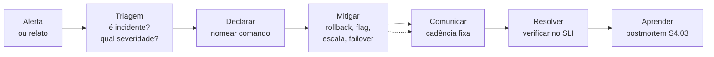

# S4.02 — Gestão de incidentes e runbooks

> ⏱️ ~1h30 · 🟣 Sênior · Pré-requisitos: S4.01 (SLO, *burn rate*, severidade `page`/`ticket`), P6.04 (um alerta = um *runbook*, decisão 141), P6.07 (investigação de incidente, decisão 146), P8.04 (*flags* e *rollback*), P9.02 (`ecs-deploy.sh`), P9.07 (os 12 alarmes)

> ⚠️ **Verificação:** o **verificador de documentos** (`lab/DocLint.java`, Java puro) e o **conferidor de runbooks** (`lab/check-runbooks.sh`) **foram executados** (com **auto-teste** que prova que a verificação **reprova** o documento ruim). O *runbook* de exemplo é o do **PayFlow** (alertas de SLO da S4.01). **Não executado:** o **PayFlow do aluno**, **PagerDuty/Opsgenie/Alertmanager**, *chat ops*, página de status, qualquer **plantão real**. **Papéis, níveis de severidade e prazos de comunicação são PROPOSTAS** (a organização define os seus). O método de papéis vem do **SRE Book** (link abaixo).

## 🎯 Objetivos
Ao final desta aula você consegue:
- **Conduzir** um incidente com **papéis separados** (comando, operação, comunicação, registro) e **mitigar antes de diagnosticar**.
- **Classificar** a severidade e **escolher** quem é acionado e **em quanto tempo**.
- **Escrever** um *runbook* que **uma pessoa cansada às 3 da manhã** consegue seguir.
- **Verificar** automaticamente que **todo alerta** tem um *runbook* **existente** e **completo**.
- **Organizar** o plantão (*on-call*) de forma **sustentável**.

## 🤔 Por que isso importa
O incidente da P6.07 foi **resolvido por quem escreveu o laboratório**. Em produção o incidente acontece **quando a pessoa mais experiente está de folga**. O que separa um incidente de **12 minutos** de um de **3 horas** quase nunca é **talento técnico**: é **saber quem decide**, **o que tentar primeiro** e **quem avisa o resto da empresa**. O sênior **constrói esse sistema** (papéis, *runbooks*, plantão) **antes** da noite ruim.

## 💡 Intuição (explicação simples)
**Um incêndio num prédio.** Quem apaga o fogo **não** é quem liga para os moradores, **nem** quem decide evacuar. Sem **um comandante**, todos correm para a mesma porta. E o **mapa de saída** (o *runbook*) fica **colado na parede do corredor**, escrito para quem **nunca** viu o prédio: **"saída 1: porta à esquerda"**, não "avalie as rotas de evacuação".

## 🔬 Como funciona por dentro

### 1. O ciclo de um incidente

A regra que mais **encurta incidentes**: **mitigar antes de entender a causa.** *Rollback*, **desligar a *flag***, **tirar a instância do ar** ou **escalar** estancam o dano **em minutos**; a causa raiz **pode esperar o dia seguinte** (e **o postmortem existe para isso**). **Armadilha:** o time quer **descobrir o bug ao vivo**, e o **orçamento** (S4.01) **queima enquanto isso**.

### 2. Papéis (quando o incidente passa de "uma pessoa resolve")
O SRE Book descreve um sistema baseado no **Incident Command System**, com **separação de responsabilidades**. Papéis adaptados ao PayFlow (**proposta**; num time pequeno **uma pessoa acumula vários**, **exceto** comando e operação):

| Papel | Faz | **Não** faz |
|---|---|---|
| **Comando** (IC) | decide, **delega**, mantém o **estado** (o que sabemos, o que tentamos), **declara** o fim | **não** debuga: "o comandante assume todos os papéis que não delegou", e **delegar é o trabalho** |
| **Operação** (Ops) | mexe no sistema: *rollback*, *flag*, escala; **só** age com **conhecimento** do comando | **não** fala com a empresa |
| **Comunicação** | atualiza a empresa e o suporte na **cadência**; **uma** fonte | **não** chuta causa |
| **Registro** (*scribe*) | **linha do tempo** ao vivo (horário + o que foi feito + quem) | **não** opina |

**Regra de ouro:** **"freelancing"** (mexer sem avisar) **é o pior padrão**: duas pessoas **desfazem o trabalho uma da outra**. Tudo **passa pelo canal do incidente** e **pelo comando**.

### 3. Severidade e quem é acionado (**proposta**)
A severidade **liga** o SLO (S4.01) ao **processo**:

| Nível | Critério (**exemplos**) | Acionamento | Comunicação (**cadência proposta**) |
|---|---|---|---|
| **SEV1** | **dinheiro** envolvido (divergência na conciliação), indisponibilidade **total** ou **perda de dado** | plantão + **líder** **na hora** | a cada **30 min** + **aviso** a produto/jurídico |
| **SEV2** | **página de SLO** (queima ≥ 6×), **impacto parcial** | **plantão** (página) | a cada **60 min** |
| **SEV3** | **ticket** (queima lenta, degradação sem página) | **fila**, horário comercial | no ticket |

**Duas regras:** (1) **na dúvida, suba um nível** (descer é barato; subir tarde **custa**); (2) **dinheiro vence qualquer número**: uma divergência de **R$ 0,01** na conciliação é **SEV1** (S4.01: "orçamento zero").

### 4. O *runbook*: anatomia
Cada **alerta** aponta (`annotations.runbook`) para **um** documento. As cinco seções:
1. **Impacto**: o que o usuário **sente** e **o que NÃO está em risco** (ex.: "dinheiro não se perde: a transferência é atômica").
2. **Diagnóstico**: **passos numerados**, **em ordem**, cada um **fechado** (responde sim/não ou dá um número).
3. **Mitigação**: **a mais barata primeiro**, com **o comando exato**.
4. **Escalar**: **quando** e **quem** (nome/papel, **não** "alguém").
5. **Verificação**: **como saber** que acabou (**no SLI**, não "parece bom").

**Mais:** **dono**, **data da última revisão** e **severidade do alerta**. O exemplo completo, do **alerta de SLO do PayFlow** (`docs/runbooks/slo-queima-rapida.md`):

```markdown
# Runbook: SLO queimando rápido (PayflowTransfersAvailabilityBurnFast / LatencyBurnFast / ...Slow)

- Dono: @plataforma
- Revisado em: 2026-11-14
- Severidade do alerta: page

## Impacto
O orçamento de erro do mês está sendo gasto a 6x ou mais (14,4x = 2% do mês em 1 h). Transferências estão falhando (5xx) ou lentas (> 500 ms). Dinheiro não se perde: a transferência é atômica (decisão 12 e Outbox).

## Diagnóstico (nesta ordem, 10 minutos no máximo)
1. Abra o painel RED e responda: falha ou lentidão? Todas as rotas ou só /transfers? Todas as instâncias ou uma?
2. Houve mudança nas últimas 2 h? `gh run list --limit 5` (deploy) e a lista de migrações da S3.
3. Banco: `hikaricp_connections_pending` e `payflow_outbox_pending` (painel USE). Conexões esgotadas aponta para o pool (conta de conexões, S4.07).
4. Dependência: o breaker de notificações está aberto? (`resilience4j_circuitbreaker_state`).
5. Pegue um traceId de um erro (resposta Problem Details) e abra o traço.

## Mitigação (a mais barata primeiro; mitigar antes de entender a causa)
1. Mudança recente? Faça o rollback: `./scripts/ecs-deploy.sh rollback` (volta ao digest anterior, P9.02).
2. Flag recente? Desligue a flag (P8.04) e confirme no painel em 5 minutos.
3. Saturação? Suba tarefas (limite: a conta de conexões) ou reduza a carga (limitador, S1.09).
4. Banco com problema? Não reinicie sem o líder de plantão; siga o runbook do banco.

## Escalar
Se o dinheiro pode estar envolvido (divergência na conciliação) ou o erro passa de 5% por 15 minutos: acione @lider-plantao e declare SEV1. Se não há melhora em 30 minutos, acione @lider-plantao de qualquer forma.

## Verificação
A taxa de queima volta abaixo de 1x por 15 minutos e o alerta resolve. Registre o orçamento gasto e abra o postmortem se passou de 5% do mês.
```

**O que o torna utilizável às 3 da manhã:** o **passo 1** já **parte o espaço de busca** (falha ou lentidão? tudo ou uma instância?), a **mitigação** é **uma lista ordenada de ações com comando**, e a **escalada tem um prazo** ("30 minutos sem melhora"), para o **orgulho não atrasar** a ajuda.

### 5. Verificar os *runbooks* por máquina
*Runbook* **que não existe** ou **que ficou vazio** é pior que nenhum: dá a **falsa** sensação de que **há um mapa**. Dois verificadores **executados**:

**(a) O verificador de documento** (`DocLint`, trecho): exige as **cinco seções**, **dono** e **data de revisão**, **diagnóstico em passos numerados** e **mitigação com comando ou *rollback***; e **rejeita** palavras de **culpa**. Auto-teste (os dois bons **passam**, os dois ruins **falham**, e **por quê**):

```text
runbook-good.md        expected OK   -> as expected (0 problems)
runbook-bad.md         expected FAIL -> as expected (8 problems)
     - missing section: Impacto
     - missing section: Mitigação
     - missing section: Escalar
     - missing section: Verificação
     - no owner (@name) anywhere
     - no 'Dono:' line
     - no 'Revisado em:' line
     - Diagnóstico is not an ordered list of steps
```

**(b) O conferidor de alertas × *runbooks*:** lê **todos** os `runbook:` das regras (os **9 alertas da P6.04** e os **6 de SLO**) e confere o **arquivo** e o **verificador**. No laboratório só 2 *runbooks* existem (**de propósito**):

```text
LINT     docs/runbooks/erros-5xx.md
MISSING  docs/runbooks/erros-inesperados.md
MISSING  docs/runbooks/heap-alto.md
MISSING  docs/runbooks/instancia-fora.md
MISSING  docs/runbooks/notificacoes-breaker.md
MISSING  docs/runbooks/outbox-parado.md
MISSING  docs/runbooks/pool-saturado.md
MISSING  docs/runbooks/sem-metricas.md
MISSING  docs/runbooks/slo-queima-lenta.md
OK       docs/runbooks/slo-queima-rapida.md
MISSING  docs/runbooks/transferencias-lentas.md
runbooks referenced: 11 | missing: 9 | failing the lint: 1
```

**Como ler:** **11** *runbooks* citados pelos alertas, **9 faltando** e **1 reprovado** (o "erros-5xx" é o exemplo **ruim**). A **linha final** vira o **código de saída** do **CI**: **o *deploy* das regras de alerta é bloqueado** se algum alerta aponta para um *runbook* inexistente. **Um teste que nunca falhou não prova nada:** o auto-teste **prova** que a verificação **reprova**.

> **Limite honesto do verificador:** ele pega **ausência** e **vagueza óbvia**, **não pega** um *runbook* **errado**. Quem valida **de verdade** é o **ensaio** (S4.04: um *game day* **segue o *runbook* ao pé da letra** e **anota** cada passo que **não funcionou**).

### 6. Comunicação durante o incidente
**Modelo de atualização** (copie, preencha, **repita na cadência**):
```text
[SEV2] Transferências lentas — atualização 14:40 (UTC)
Impacto: ~7% das transferências levam mais de 2 s. Nenhum dinheiro perdido.
Estado: mitigando (rollback da versão 41 em andamento).
Próxima atualização: 15:10 ou antes se algo mudar.
Comando: @plataforma
```
**Regras:** **fato, não hipótese**; **"não sabemos"** é uma resposta válida; **sempre** a **hora da próxima** atualização; **um** canal (a sala do incidente) e **uma** pessoa fala com o **exterior**. **Página de status pública:** **não adotada agora** (**gatilho:** clientes externos dependendo de você; ferramenta **não escolhida**).

### 7. Plantão (*on-call*) sustentável
O SRE Book fixa **limites** de **quantidade e qualidade**: nenhum SRE deveria gastar **mais de 25%** do tempo de plantão (e **pelo menos 50%** em engenharia). **Para o PayFlow** (**proposta**): **primário + secundário**; **passagem de turno por escrito** (o que **está aberto**); **compensação** definida; **todo acionamento** é **registrado** (para **medir** o **ruído**: se o plantão acorda a pessoa **por alertas sem ação**, **o alerta é o defeito**, e a **P6.04 já manda** apagar alerta que ninguém age); e **não há plantão sem *runbook***: **a pessoa de plantão não é a pessoa que escreveu o código**.

## 🏗️ Estudo de caso: "o alerta tocou e o *runbook* mandou reiniciar tudo"
**Sintoma.** (**Cenário construído**, nomes e horários inventados.) 02:10, página de `PayflowTransfersAvailabilityBurnFast`. A pessoa de plantão (**3 meses na empresa**) abre o *runbook*: "**Se houver erro, reinicie o serviço e veja o que acontece.**"

**Diagnóstico.** O *runbook* foi escrito **quando havia uma instância** e **nunca** foi ensaiado. Hoje há **4 tarefas**: reiniciar **todas** ao mesmo tempo **derruba a capacidade** (e a **conta de conexões** da S4.07 transborda ao subirem juntas). O incidente de **6 minutos** (uma migração lenta) virou **38 minutos**.

**Opções.**
1. **Corrigir o texto** e **seguir em frente**.
2. **Exigir a estrutura** (as 5 seções) **por máquina** (a seção 5) e **ensaiar** (S4.04).
3. **Automatizar a mitigação** (um comando `rollback` que **verifica** o resultado).

**Decisão.** (2) e (3): a **mitigação padrão** do *runbook* de SLO é o ***rollback* por comando** (P9.02), o **verificador** barra o texto vazio, e **todo *runbook*** é **seguido ao pé da letra** em um *game day* **por trimestre** (**proposta**). **Consequência:** a pessoa nova **segue** o que **já foi ensaiado**. **Quando reabrir:** um **incidente** em que o *runbook* **foi seguido e falhou** (isso **é** um *runbook* a corrigir e **uma ação no postmortem**, S4.03).

> **Nota:** o cenário é **construído**; o que **foi medido** é a **verificação** (as saídas acima) e o **mecanismo** do **reinício simultâneo** (a **conta de conexões** da S4.06/S4.07).

## ⚖️ Trade-offs e quando NÃO usar
- **Papéis formais** num time de **2 pessoas** são **burocracia**: use **comando + operação** (duas pessoas) e **registro no chat**; formalize quando **a primeira** vez em que **cinco** pessoas **entrarem** na sala.
- ***Runbook* longo demais** não é lido: **uma tela**; o **resto** vira **link** (painel, ADR).
- ***Runbook* totalmente automatizado** (a ação **roda sozinha**) **é melhor**, **mas** só depois de **ensaiado** e **limitado** (auto-remediação sem freio **piora** incidentes). **Gatilho:** o **mesmo** *runbook* usado **3 vezes** sem decisão humana.
- **Plantão 24/7** custa **gente** e **dinheiro**: com **poucas pessoas** e **SLO frouxo**, o plantão **só em horário comercial** + **alerta de ticket** é **honesto** (**decisão de negócio**, registrada).
- **Severidade demais** (tudo SEV1) **desgasta** e **ninguém** mais acredita.

## ⚠️ Erros comuns e boas práticas de produção
- **Diagnosticar antes de mitigar.**
- **Freelancing** e **ninguém no comando**; o comandante **debugando**.
- **Comunicação sem hora da próxima atualização.**
- ***Runbook* de "olhe os logs"** (a verificação **rejeita**: "Diagnóstico is not an ordered list of steps").
- ***Runbook* com **segredo** colado** (use **referência** ao cofre, P9.06).
- **Mudar em produção sem registrar** (o **registro** é a fonte do postmortem).
- **Alerta sem *runbook*** (o conferidor **bloqueia**) ou ***runbook* sem dono** (**ninguém** atualiza).
- **Plantão sem passagem de turno.**

Mensagens **reais** do verificador:
```text
  - missing section: Mitigação
  - no 'Dono:' line
  - Diagnóstico is not an ordered list of steps
MISSING  docs/runbooks/outbox-parado.md
```

## 🧩 Exercícios
**1. Fixação.** (a) Por que **mitigar antes** de achar a causa? (b) Qual a diferença entre **comando** e **operação**? (c) Por que o verificador **não** basta?

<details><summary>Soluções</summary>

(a) O **orçamento** (S4.01) **queima enquanto** se investiga; *rollback*/*flag* **estancam** em minutos e a causa **se estuda com calma** depois. (b) **Comando** **decide e delega** e mantém o **estado**; **operação** **executa** as mudanças **com o conhecimento** do comando. (c) Ele garante **forma** (seções, dono, passos), **não** **correção**: só o **ensaio** mostra que o passo **funciona**.
</details>

**2. Aplicação no PayFlow.** Crie `docs/incidentes/processo.md` (papéis, severidades, cadências, modelo de atualização, plantão) e os **11 *runbooks*** em `docs/runbooks/` (um por alerta: os 9 da P6.04 + `slo-queima-rapida.md` + `slo-queima-lenta.md`). Critérios de pronto:
- [ ] **cada** `runbook:` das regras (P6.04 e S4.01) **aponta para um arquivo existente**;
- [ ] **cada** *runbook* **passa** no `DocLint` (**5 seções, dono, revisão, passos numerados, comando**);
- [ ] **o CI** roda o `check-runbooks.sh` e **reprova** se algum faltar (**prove** apagando um arquivo);
- [ ] **severidades** ligadas ao SLO e **dinheiro = SEV1** escrito;
- [ ] **modelo de atualização** e **cadência** por severidade;
- [ ] **política de plantão** (primário/secundário, passagem de turno, **ruído** medido).

<details><summary>Solução de referência</summary>

Parta do `runbook-slo-queima-rapida.md` do laboratório e **adapte os comandos** ao que **existe** no PayFlow (`gh run list`, `ecs-deploy.sh rollback`). **Não invente** comandos: **cada** comando do *runbook* tem de **existir** (ensaie na S4.04). Para o `outbox-parado.md`: diagnóstico = `payflow_outbox_pending`, o **relé** (P3.09) e o **conector** do broker; mitigação = **reiniciar o relé** (**um** processo, **não** todos), **nunca** apagar linhas do Outbox. Para o `pool-saturado.md`: a **conta de conexões** (S4.07) antes de **escalar**.
</details>

**3. Desafio (opcional).** **Estenda** o `DocLint` para **rejeitar** um *runbook* com **"Revisado em:" mais velho que 180 dias** (usando a data atual) e **escreva o caso de teste** que **falha** antes e **passa** depois.

## 🎤 Na entrevista
1. **"Descreva como você conduz um incidente."** **Declaro**, **nomeio um comando** (que **não** debuga), **mitigo primeiro** (*rollback*, *flag*, escala), **comunico em cadência fixa**, **registro** a linha do tempo, **verifico no SLI** e **abro o postmortem**.
2. **"O que tem um bom *runbook*?"** **Impacto** (inclusive o que **não** está em risco), **diagnóstico numerado e fechado**, **mitigação com comando**, **quando escalar**, **como verificar**; **dono** e **revisão**; e **ensaiado**.
3. **"Alerta toca toda noite e ninguém age. O que faz?"** **O alerta é o defeito:** conserto a **causa**, **rebaixo** para ticket ou **apago**. **Plantão sustentável** exige **poucos** alertas **acionáveis**.
4. **"Como evitar que o incidente piore por pessoas mexendo ao mesmo tempo?"** **Um comando**, **um canal**, **nenhuma mudança sem avisar** e **registro** de cada ação.

## 📚 Para ir além
- 📄 [SRE Book: Managing Incidents](https://sre.google/sre-book/managing-incidents/): **papéis**, "separação recursiva de responsabilidades", **comando** e o exemplo de um incidente **mal** conduzido.
- 📄 [SRE Workbook: Incident Response](https://sre.google/workbook/incident-response/): **exemplos** e prática.
- 📄 [SRE Book: Being On-Call](https://sre.google/sre-book/being-on-call/): a **regra de 25%** e o **equilíbrio** do plantão.
- 📄 [SRE Book: Effective Troubleshooting](https://sre.google/sre-book/effective-troubleshooting/): **diagnóstico** sistemático.
- 📄 [PagerDuty: *Incident Response* (documentação aberta)](https://response.pagerduty.com/): **processo de resposta** usado em produção (**papéis, treinamento**).
- 📄 [Atlassian: *Incident Management Handbook*](https://www.atlassian.com/incident-management/handbook): **severidades** e **comunicação**.
- 📄 [Prometheus: *Alertmanager*](https://prometheus.io/docs/alerting/latest/alertmanager/): **roteamento** do alerta para o **plantão** (**não executado**).
- 🎥 ⚠️ Nenhum vídeo verificado nesta aula: procure palestras sobre **resposta a incidentes** (SREcon, canais oficiais) e confira data e duração **antes**.

## ✅ Checklist da aula
- [ ] Sei o ciclo e **por que** mitigar antes de diagnosticar.
- [ ] Sei os **quatro** papéis e o que **cada um não faz**.
- [ ] Classifico a **severidade** e ligo ao **SLO**.
- [ ] Escrevi *runbooks* **com as cinco seções** e **o verificador** passa.
- [ ] O **CI** reprova alerta **sem** *runbook*.
