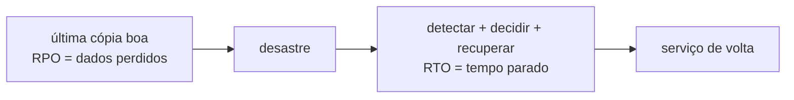

# S4.05 — Backup, RPO e RTO

> ⏱️ ~1h30 · 🟣 Sênior · Pré-requisitos: S4.01 (orçamento: a restauração **gasta**), S4.02 (incidente, comando), S4.04 (ensaio), S3.04 (arquivar **não** é fazer *backup*; restauração antes do `DROP`; impressão digital), S3.03 (réplica assíncrona), P9.08 (Multi-AZ, PITR, *snapshot*, `deletion_protection`), P8.06/P8.07 (*state* e proteção de dados), P9.06 (segredos), S1.12 (conciliação), S1.08 (idempotência)

> ⚠️ **Verificação:** `lab/RpoRtoLab.java` (Java puro) **foi executado**: um **modelo** do **RPO** (taxa de commits **premissa** de 5/s, 20 mil desastres aleatórios por linha, semente fixa) e do **RTO** como **soma de passos** (**todos os tempos dos passos são PREMISSAS**, a substituir pelo resultado de um **ensaio de restauração**). Os **comandos** `aws rds …` foram **conferidos contra a ajuda da AWS CLI 2.39.5 instalada** (nomes e opções), **não executados**. **Não executado:** RDS, AWS Backup, *snapshots*, PITR, cópia entre regiões, `pg_basebackup`/`archive_command`, o PayFlow do aluno. A **restauração de uma partição arquivada** (S3.04) **foi executada** na S3 (PostgreSQL 18 em Docker, **modelo**). **RPO/RTO do PayFlow são PROPOSTAS**.

## 🎯 Objetivos
Ao final desta aula você consegue:
- **Definir** **RPO** e **RTO** e **derivá-los** do **impacto no negócio**, **por tipo de dado**.
- **Distinguir** **cópia** (réplica, Multi-AZ), **arquivo** (S3.04) e ***backup*** (ponto no tempo **restaurável**) e **dizer** de qual falha cada um **protege**.
- **Compor** uma estratégia de *backup* em camadas para o PayFlow, **inclusive contra credenciais comprometidas**.
- **Escrever** o procedimento de **restauração** e **o ensaio** que **mede o RTO**.
- **Prever** o que **falta reconciliar** depois de uma restauração (efeitos **fora** do banco).

## 🤔 Por que isso importa
"Temos *backup*" é a frase **mais cara** do setor quando **ninguém restaurou**. Três perguntas decidem se o *backup* **existe**: **até quando** posso **perder dados** (RPO)? **Em quanto tempo** preciso **voltar** (RTO)? **Já restaurei**, **de verdade**, **este mês**? O banco é **o único componente com estado** do PayFlow (P9.08): **tudo mais se reconstrói com um *deploy***. Uma falha **lógica** (um `DELETE` errado, uma migração ruim) **é copiada** para a réplica e para o *standby* **em milissegundos**: **só o *backup*** volta no tempo.

## 💡 Intuição (explicação simples)
**Um espelho** mostra o que você faz **agora**, **inclusive o erro** (a réplica). **Uma fotografia 3x4** de **ontem** (o *backup*) deixa você **voltar a ontem**: **mas** só vale se **alguém conferir** que a foto **está legível**. **RPO** é **quanto da sua vida** entre a **última foto** e hoje você aceita **perder**; **RTO** é **quanto tempo** você aceita **ficar sem documento** enquanto **tira a segunda via**.

## 🔬 Como funciona por dentro

### 1. RPO e RTO

- **RPO** (*Recovery Point Objective*): **até quanto tempo de dados** posso **perder** (medido **para trás** a partir do desastre).
- **RTO** (*Recovery Time Objective*): **quanto tempo** posso ficar **fora** (medido **para frente**).
**Dois números por cenário** (**não** um para o sistema): "**um AZ morreu**" e "**o dado está errado**" têm **RPO/RTO muito diferentes**.

### 2. Cópia × arquivo × *backup*
| | **Réplica / Multi-AZ** | **Arquivo** (S3.04) | ***Backup* (ponto no tempo)** |
|---|---|---|---|
| Objetivo | **disponibilidade** | **custo** e **retenção** | **voltar no tempo** |
| Protege de | **máquina/AZ** que morre | disco cheio, custo | **dado errado**, apagado, corrompido, **ransomware** |
| **Copia o erro?** | **Sim**, quase **na hora** | (não se aplica) | **Não**: é uma **foto** anterior |
| RPO típico | **~0** (síncrono) a **segundos** (assíncrono) | (n/a) | **minutos** (PITR) a **horas** |

**A frase que resume:** *"Multi-AZ me salva da **máquina**; só o *backup* me salva de **mim**."* Por isso **os dois existem** (P9.08) e **nenhum substitui o outro**. E o **arquivo** da S3.04 **não é *backup***: **é** o dado **antigo** **movido** do banco; quem **perde** o primário **perde** o recente.

### 3. O RPO medido num modelo
O laboratório simula **5 commits/s**, **desastres em instantes aleatórios** e **mecanismos** que **enviam o log** com intervalos diferentes (linha = **quantas transações confirmadas se perdem**):

```text
MODEL: 5.0 commits/s (premise), 20000 random disasters per row, seeded.
RPO = how much committed data is LOST. A row says how often the log is shipped to a place that survives the disaster.

mechanism (ship interval)                    | mean lost tx |  p99 lost tx |  max lost tx
synchronous (every commit waits for the copy) |          0.0 |            0 |            0
async stream, lag ~ 0.003 s (the P9.08 measure) |          0.0 |            1 |            2
async stream, lag ~ 1 s                      |          2.5 |            9 |           14
log shipped every 60 s (archive_timeout = 60) |        149.0 |          308 |          347
log shipped every 300 s (RDS: ~5 min, P9.08) |        746.9 |         1500 |         1601
nightly dump (24 h)                          |     215134.1 |       427176 |       432947

The worst case of periodic shipping is the interval itself (RPO = 300 s -> up to 1500 transfers at 5/s).
Synchronous copy gives RPO 0 but every commit now pays the round trip to the other site (latency x availability trade).
```

**Como ler:** **cópia síncrona** = **0** perdidas, **mas** **cada *commit* espera a ida e volta** ao outro lugar (**latência × disponibilidade**: se o outro lugar some, **o commit trava ou relaxa**, **decisão** de projeto). **Réplica assíncrona com atraso de ~3 ms** (o que a P9.08 **mediu**): **~0–2** transações. **Envio de log a cada 300 s** (o RDS envia **os logs de transação ao S3 a cada ~5 minutos**, P9.08): **perde em média ~750** (e **até ~1.500** = **5 req/s × 300 s**): **o pior caso do RPO é o intervalo**. **Dump noturno**: **~215 mil** em média: **um dia de dinheiro**. **No PostgreSQL**, `archive_timeout` **força** a troca do segmento de WAL **para limitar** a idade do dado **não arquivado**: a documentação sugere "**um minuto ou pouco mais**" como razoável **e avisa** que **valor muito curto** **incha** o arquivo (cada segmento é **do mesmo tamanho** mesmo **forçado**).

### 4. O RTO como **soma de passos**
RTO **não** é "o tempo da restauração": é **detectar + decidir + provisionar + copiar + repetir o log + validar + religar**. O modelo (**todos os tempos são premissas**):

```text
RTO as a sum of steps (all numbers are PREMISES: replace them with a drill's measurements)

detect the failure (alert + human on duty)                         5.0 min
decide to restore and get approval                                10.0 min
provision the new database instance                               15.0 min
restore base backup (200 GB at 150 MB/s)                          22.8 min
replay the WAL since the backup (6 GB at 40 MB/s)                  2.6 min
validate (invariants, row counts, a test transfer)                10.0 min
point the application at it (secret, DNS, deploy)                 10.0 min
TOTAL (PITR path)                                                 75.4 min (1.3 h)

Same database, 10x bigger (2000 GB): restore step becomes 227.6 min -> total 280.2 min (4.7 h)
Multi-AZ failover path instead: detect 1 + failover 1-2 (P9.08: ~60-120 s) + JVM DNS cache 0.5 (30 s measured, P9.08) = ~3-4 min.
The difference is why the two exist: failover handles 'a machine/AZ died'; restore handles 'the DATA is wrong' (a bad DELETE replicates instantly).
```

**Como ler:** o **PITR** do exemplo leva **~75 min**, e **só 25 min** são "restaurar" (**cópia + repetição do log**); **35 min** são **detectar, decidir, validar e religar**. Um banco **10×** maior leva **~4,7 h**: o **RTO cresce com o tamanho**, **e o arquivamento da S3.04** (**banco menor**) **é uma ferramenta de RTO**. **Já o *failover* do Multi-AZ** responde **"uma máquina/AZ morreu"** em **~3–4 min** (**~60–120 s** de *failover* + **~30 s** de DNS da JVM, P9.08): **dezenas de vezes mais rápido**, **por isso existem os dois caminhos**.

> **Para o seu RTO real:** **ensaie** (seção 7), **meça cada passo** e **troque as premissas** da tabela. **Nenhum RTO escrito sem medição vale**.

### 5. A estratégia em camadas do PayFlow (proposta)
| Camada | O quê | Protege de | RPO / RTO **propostos** | Estado |
|---|---|---|---|---|
| **1** | **Multi-AZ** (P9.08) | AZ/instância que morre | RPO ~**0**, RTO **~3–4 min** | **por leitura** |
| **2** | **Backups automáticos + PITR** (retenção ≥ 7 dias; o RDS **envia os logs ao S3 a cada 5 min** e a restauração **cria uma instância nova** sem alterar a original) | dado **errado/apagado** nos últimos 7 dias | RPO **≤ 5 min**, RTO **~1–2 h** (**medir**) | **por leitura** |
| **3** | ***Snapshot* manual** **antes** de mudança arriscada (migração S3, versão do banco) e **final** (P8.07) | **mudança** que dá errado | RPO = **o instante do *snapshot*** | **por leitura** |
| **4** | **Cópia do *snapshot* e dos *backups* para **outra região** e **outra conta**** | **região** perdida, **credencial** comprometida, **conta** invadida | RPO **horas**, RTO **horas** | **por leitura** |
| **5** | **Imutabilidade**: **AWS Backup Vault Lock** (WORM, modo *governance*/*compliance*) e *Object Lock* nos arquivos (S3.04) | **apagar o *backup*** (ataque ou erro) | (não muda RPO/RTO: **garante que existe**) | **por leitura** |
| **6** | **`pg_dump`** lógico **periódico** (S3.04 mediu o `pg_dump -Fc`: tamanho parecido com o CSV) | **portabilidade**, restauração **parcial** | RPO **horas** | **por leitura** |
| **7** | **Tudo o que não é dado**: Terraform (P8), *state* **versionado** (P8.06), imagens por *digest* (P9.02), **segredos recriáveis** (P9.06), **realm do Keycloak** (P10) | **perder a plataforma** | RTO = **o *apply* + o *deploy*** | **por leitura** |

**Por tipo de dado** (**RPO** **proposto**):
| Dado | Por quê | RPO | Como volta |
|---|---|---|---|
| **Ledger, transferências, contas** | **dinheiro** | **≤ 5 min** (e **conciliar**, seção 6) | camadas 1–3 |
| **Chaves de idempotência** | evitam **duplicar** | **≤ 5 min** (mesmo banco) | idem |
| **Outbox** | os **eventos** voltam **do banco** | **0 a mais** que o banco | o relé **republica** (consumidores **idempotentes**, S1.08) |
| **Cache** (Redis) | **reconstruível** | **n/a** | esquenta sozinho |
| **Filas/tópicos** | **reconstruíveis a partir do Outbox** | **n/a** (se o Outbox é a fonte) | republicar |
| **Arquivo frio** (S3.04) | retenção legal | **versionado + imutável** | restauração **testada** |

### 6. O que a restauração **não** desfaz: o mundo fora do banco
**Esta é a parte que os planos esquecem.** Restaurar o banco para **14:00** **apaga** o que aconteceu **entre 14:00 e o desastre**: **mas** o **PSP** (P5/S1.12) **pode** ter **movido dinheiro** de verdade, o **cliente** **recebeu e-mail**, e **as chaves de idempotência** **dessas** transferências **sumiram**, então **uma repetição do cliente** **vira uma transferência nova** (**duplicada**). **O procedimento de restauração do PayFlow** **inclui, por escrito:**
1. **registrar** o **instante** restaurado (`T`) e o **último** *commit* **conhecido** (do **registro** da aplicação/ALB);
2. **conciliar** com o **PSP** (S1.12) **tudo** de `T` em diante: **o que o PSP tem e o banco não**;
3. **bloquear escritas** até a conciliação **terminar** ou **aceitar** o risco por **decisão** (SEV1);
4. **comunicar** (S4.02): **clientes** com transferências **no intervalo**;
5. **registrar** o **orçamento de erro** e **abrir** o postmortem (S4.03).

### 7. O ensaio de restauração (o que torna o *backup* real)
Um *backup* **sem ensaio** é **uma hipótese**. **O ensaio mensal** (**proposta**; **automatize**):
1. **escolher** um **ponto aleatório** dos últimos 7 dias;
2. **restaurar** para uma **instância temporária** (`aws rds restore-db-instance-to-point-in-time --source-db-instance-identifier … --target-db-instance-identifier … --restore-time …` ou `--use-latest-restorable-time`; **ambos existem** na CLI instalada: **conferido**, **não executado**);
3. **rodar as invariantes**: `Σ lançamentos = saldo` por conta (S1.05, com `account_period_balances` da S3.04), **contagem** de linhas por tabela, **versão do Flyway**, **uma transferência de teste**;
4. **cronometrar cada passo** e **gravar** o **RTO medido**; **comparar** com o **alvo**;
5. **destruir** a instância (💸 **cobra por hora**) e **registrar**;
6. **falha** no ensaio = **incidente SEV3** (**um *backup* que não restaura** **é** uma **página** quando o **próximo** desastre chegar).

**Comandos conferidos na ajuda da AWS CLI** (**não executados**; **cuidado** com **identificadores** e **região**):
```bash
aws rds describe-db-instances --db-instance-identifier payflow-prod \
  --query 'DBInstances[0].[LatestRestorableTime,BackupRetentionPeriod]'      # LatestRestorableTime existe no retorno
aws rds create-db-snapshot --db-instance-identifier payflow-prod \
  --db-snapshot-identifier payflow-prod-pre-V25                               # antes de mudança arriscada
aws rds copy-db-snapshot --source-db-snapshot-identifier <arn-do-snapshot> \
  --target-db-snapshot-identifier payflow-prod-pre-V25-dr \
  --source-region us-east-1 --kms-key-id <chave-da-regiao-destino>            # cópia entre regiões (--source-region, --kms-key-id existem)
aws rds start-db-instance-automated-backups-replication \
  --source-db-instance-arn <arn-da-instancia> --backup-retention-period 14    # replica os backups automáticos para outra região (rodar NA região de destino, --region)
```
(Os **identificadores** são **exemplos**; **leia a ajuda** (`aws rds <comando> help`) **antes** de rodar; a **cópia entre regiões** de um **banco criptografado** exige **a chave da região de destino**.)

## 🏗️ Estudo de caso: "o `DELETE` sem `WHERE` e o Multi-AZ que ajudou o erro"
**Sintoma.** (**Cenário construído**; horários e números **inventados**; **o mecanismo da cópia do erro é real**.) 15:42, uma correção manual de dados em produção roda `DELETE FROM idempotency_keys` **sem `WHERE`**. 15:43, o painel mostra **um pico de transferências duplicadas** (os clientes **repetem** e **as chaves sumiram**). **O Multi-AZ está saudável**, **a réplica de relatórios também**: **ambos executaram o `DELETE`**.

**Diagnóstico.** **Disponibilidade** não é **recuperação**. A tabela (**chaves de idempotência**) **mora no banco**; **o único caminho de volta** é o **PITR** para **15:41** (**instância nova**, **sem** alterar a original).

**Opções.**
1. **Restaurar o banco inteiro** para 15:41 e **trocar** o *endpoint*: **RTO ~75 min** (**modelo**) e **perde as transferências boas de 15:41 a agora**.
2. **Restaurar só a tabela** numa **instância temporária** (PITR para 15:41), **exportar as chaves** (`COPY`, S3.04) e **reinserir** no **primário vivo**: **RTO menor**, **sem perder** as **transferências novas**; **depende** de **o esquema** não ter mudado e de **o *runbook* existir**.
3. **Reconstruir** as chaves **a partir das transferências** (cada transferência **guarda** a sua chave?): **depende do modelo**; **se** guardar, é **a mais rápida**.

**Decisão.** (2), com (3) **como validação cruzada**; **ação**: **o papel humano de correção** **não** pode **`DELETE`** sem **transação com `WHERE`** (**menor privilégio** + **revisão**, P10); **ensaiar** o **PITR de uma tabela** **no ensaio mensal**. **Consequência:** **o RTO** deste cenário passa a **~30 min** **medidos no ensaio** (**número a medir**), **sem perda** das transferências boas. **Quando reabrir:** a tabela **crescer** a ponto de a **cópia** passar do **RTO**.

> **Nota:** o cenário é **construído**; o **método** (PITR para uma **instância temporária** e **extrair** só o que se perdeu) **é o que a documentação da AWS descreve** (a restauração **cria** uma **nova** instância **sem alterar** a original).

## ⚖️ Trade-offs e quando NÃO usar
- **RPO 0 (síncrono)** **custa latência** e **acopla** a disponibilidade ao **outro lado**: **não** o exija para **dado que se reconstrói** (cache, filas).
- ***Backup* entre regiões** **custa** (armazenamento **e** transferência) e **só** se justifica **se** o **RTO/RPO de região** for **requisito** (S4.06); **a cópia para outra conta** (contra credencial comprometida) **quase sempre** **vale**.
- **Imutabilidade (WORM)** **protege contra apagar** e **também contra você**: **no modo *compliance*** **ninguém** (nem a AWS) remove **até o fim da retenção**: **teste em *governance*** **primeiro** e **calcule o custo** de **guardar** tudo **o prazo inteiro**.
- **`pg_dump` lógico** **não** é PITR e **não escala** para bancos grandes (**RTO** alto); **serve** a **portabilidade**.
- **Dados pessoais em *backup*** (LGPD): **o pedido de eliminação** **não alcança** o *backup* **imediatamente**: **política escrita** (retenção **limitada** e **eliminação por expiração**; **consulte jurídico**; **sem link de lei verificado** aqui).
- **Backup "perfeito" sem ensaio** **é pior** que **um simples com ensaio**: **priorize o ensaio**.

## ⚠️ Erros comuns e boas práticas de produção
- **Confundir réplica com *backup*.**
- **Nunca restaurar** (descobrir **no desastre** que **faltava** o esquema/a chave/a permissão).
- ***Backup* na **mesma conta, mesma região, mesmas credenciais**** que o banco (um ataque **apaga tudo**).
- **Chave de criptografia (KMS) perdida ou apagada**: o *backup* **vira lixo** (S3.04).
- **RTO "de memória"** (o **tamanho** do banco **cresceu** e ninguém **refez** a conta).
- **Esquecer o que está fora do banco** (PSP, e-mail, chaves de idempotência: seção 6).
- **Não proteger o *state* do Terraform** (P8.06): **sem ele**, **recriar** a plataforma **vira arqueologia**.
- **Restaurar no mesmo identificador** (a **instância original** **fica** como **evidência**).

Mensagem **real** da AWS CLI instalada (executada **sem argumentos**; falha **antes** de qualquer chamada à AWS):
```text
aws: [ERROR]: An error occurred (ParamValidation): the following arguments are required: --target-db-instance-identifier
```
(a forma **de usar** um comando é conferida com `aws rds <comando> help`.)

## 🧩 Exercícios
**1. Fixação.** (a) Por que o Multi-AZ **não** é *backup*? (b) Com **RPO de 5 min** e **5 commits/s**, **quantas transações** se perdem **no pior caso**? (c) Por que **o RTO** do PITR **inclui** passos que **não são** "restaurar"?

<details><summary>Soluções</summary>

(a) Ele **copia o erro** para o *standby* **quase na hora**; só um **ponto anterior** volta no tempo. (b) **5 × 300 = 1.500** (o laboratório mostrou **máx. ~1.600** com ruído do sorteio). (c) **Detectar, decidir, provisionar, validar e religar** **fazem parte** do tempo **parado**: no exemplo, **~35 min de 75**.
</details>

**2. Aplicação no PayFlow.** Escreva `docs/continuidade/backup-e-recuperacao.md` e `docs/continuidade/ensaio-de-restauracao.md`. Critérios de pronto:
- [ ] **RPO e RTO por cenário** (**AZ**, **dado errado**, **região**, **conta comprometida**) **e por tipo de dado** (tabela da seção 5), **assinados por produto**;
- [ ] **as 7 camadas** com **onde moram**, **quem pode apagar** e **retenção**;
- [ ] **procedimento de restauração** com **a etapa de conciliação** da seção 6;
- [ ] **ensaio mensal** (6 passos) com **invariantes**, **cronômetro** e **destruição** da instância (💸);
- [ ] **o RTO medido** **substitui** as **premissas** do modelo (**tabela** antes/depois);
- [ ] **política de LGPD** para *backups* (**retenção** limitada, **eliminação por expiração**) **assinada** por jurídico;
- [ ] **alarme** de *backup* **não concluído** e de **`LatestRestorableTime` velho**.

<details><summary>Solução de referência</summary>

Use as **premissas** de `RpoRtoLab rto` **como esqueleto** e **substitua** cada tempo pelo **medido** no ensaio. **Invariantes** do ensaio: (1) `SELECT count(*)` das tabelas **críticas** **comparado** com a **produção** no mesmo instante (**tolerância** = **o RPO**); (2) `abertura + Σ vivo = saldo` (S3.04); (3) `flyway_schema_history` **na versão esperada**; (4) uma transferência **de teste** **ponta a ponta**. **Alarme**: **idade** do `LatestRestorableTime` **> 15 min** (**proposta**; confirme a **frequência** de atualização **no seu ambiente**).
</details>

**3. Desafio (opcional).** No `RpoRtoLab`, **troque** `commitsPerSec` para **50** e **o intervalo** para **60 s**; **preveja** a perda **média** **antes** de rodar (**fórmula**: `taxa × intervalo ÷ 2`) e **compare** com a saída.

## 🎤 Na entrevista
1. **"Qual a diferença entre RPO e RTO?"** **RPO**: **quanto dado** posso **perder** (tempo **para trás** do desastre). **RTO**: **quanto tempo** posso ficar **fora**. São **dois números**, **por cenário** e **por tipo de dado**, **definidos pelo negócio**, e **só valem se medidos** num ensaio.
2. **"Já tem Multi-AZ. Precisa de *backup*?"** **Sim**: Multi-AZ é **disponibilidade**; **copia o `DELETE`**. **Backup** com **PITR** volta no tempo. E **uma cópia em outra conta/região, imutável**, protege de **credencial comprometida**.
3. **"Como você sabe que o *backup* funciona?"** **Restauro** num **ensaio periódico**, **rodo invariantes**, **cronometro** e **registro** o RTO. **Falhou? É incidente.**
4. **"Restaurou o banco. Acabou?"** **Não**: **o mundo fora do banco** (PSP, e-mails, chaves de idempotência) **não voltou no tempo**; **concilio**, **bloqueio** o que **pode duplicar** e **comunico**.

## 📚 Para ir além
- 📄 [AWS: Disaster Recovery of Workloads on AWS (whitepaper)](https://docs.aws.amazon.com/whitepapers/latest/disaster-recovery-workloads-on-aws/disaster-recovery-workloads-on-aws.html): **RPO/RTO** e as **quatro estratégias** (S4.06).
- 📄 [RDS: restaurar para um ponto no tempo](https://docs.aws.amazon.com/AmazonRDS/latest/UserGuide/USER_PIT.html) e [backups automáticos](https://docs.aws.amazon.com/AmazonRDS/latest/UserGuide/USER_WorkingWithAutomatedBackups.html): **LatestRestorableTime**, **retenção**, **nova instância** (**não executado**).
- 📄 [RDS: copiar um *snapshot*](https://docs.aws.amazon.com/AmazonRDS/latest/UserGuide/USER_CopySnapshot.html) e [replicar *backups* entre regiões](https://docs.aws.amazon.com/AmazonRDS/latest/UserGuide/USER_ReplicateBackups.html).
- 📄 [AWS Backup: o que é](https://docs.aws.amazon.com/aws-backup/latest/devguide/whatisbackup.html) e [Vault Lock](https://docs.aws.amazon.com/aws-backup/latest/devguide/vault-lock.html): **WORM**, modos *governance* e *compliance*.
- 📄 [PostgreSQL 18: arquivamento contínuo e PITR](https://www.postgresql.org/docs/18/continuous-archiving.html) e [`pg_basebackup`](https://www.postgresql.org/docs/18/app-pgbasebackup.html): `archive_timeout`, **WAL** e **backup base**.
- 📄 [Amazon S3: Object Lock](https://docs.aws.amazon.com/AmazonS3/latest/userguide/object-lock.html): **imutabilidade** (S3.04).
- 📄 [SRE Book: Data Integrity](https://sre.google/sre-book/data-integrity/): **por que** *backup* **sem restauração** **não vale** (cap. 26).
- 🎥 ⚠️ Nenhum vídeo verificado nesta aula: procure palestras sobre **disaster recovery** (AWS Events) e confira data e duração **antes**.

## ✅ Checklist da aula
- [ ] Defino **RPO** e **RTO** e **dou dois valores** por cenário.
- [ ] Distingo **réplica**, **arquivo** e ***backup*** e **o erro que cada um copia**.
- [ ] Monto **as camadas** e **protejo** contra **credencial comprometida**.
- [ ] Escrevi o **procedimento** com **a conciliação** (o que **fica fora do banco**).
- [ ] Defini o **ensaio mensal** e **como** o RTO **medido** substitui o **estimado**.
