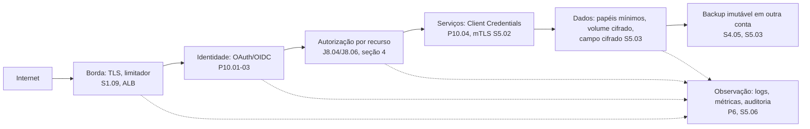

# S5.01 — Defesa em profundidade e zero trust

> ⏱️ ~1h30 · 🟣 Sênior · Pré-requisitos: J8.01/J8.04/J8.06 (autenticação, autorização, IDOR), P10.01–P10.04 (OAuth, *Resource Server*, *Client Credentials*, `/internal`), P10.05 (papéis do banco), P10.07 (STRIDE), S1.09 (limitador), S4.02 (incidente), S4.05 (`DELETE` sem `WHERE`, credencial comprometida)

> ⚠️ **Verificação:** `lab/DefenseLab.java` (Java puro) **foi executado**: uma **simulação** de camadas (premissas declaradas) e uma **política de autorização** com tabela de 16 casos e **3 mutantes**. `lab/run-roles.sh` **foi executado** num **PostgreSQL 18 descartável** (Docker): papéis de menor privilégio, função de expurgo com piso, leitura por coluna e *break-glass* com `VALID UNTIL`. **NÃO executado:** o PayFlow do aluno, IAM/SSO da AWS, qualquer ambiente real. **Os papéis, as políticas e os números do PayFlow são PROPOSTAS.**

## 🎯 Objetivos
Ao final desta aula você consegue:
- **Explicar** defesa em profundidade e **mostrar com conta** por que camadas **que falham juntas** valem **uma** só.
- **Traduzir** zero trust em **decisões de código e de configuração** do PayFlow (e dizer o que **não** é zero trust).
- **Escrever** uma **política de autorização** como função testável e **provar** que a tabela de testes falha quando uma defesa some (mutantes).
- **Desenhar** papéis **humanos e de aplicação** com **menor privilégio** no banco (fechando o `DELETE` sem `WHERE` da S4.05) e um ***break-glass*** com prazo.
- **Mapear** ameaças às camadas que as cobrem e achar as **lacunas**.

## 🤔 Por que isso importa
Até aqui o PayFlow aprendeu **defesas isoladas**: JWT e *Resource Server* (P10), segredos (P9.06/P10.05), imagem assinada (P10.06), limitador (S1.09), SLOs e *backup* (S4). **Nenhuma** é perfeita: um *bug* de autorização, uma credencial vazada, uma dependência vulnerável **vão** acontecer. A pergunta sênior é **"o que acontece no dia em que uma delas falha?"** Se a resposta é "o atacante chega no ledger", você tem **uma** defesa, não várias. E a segunda pergunta: **"quanto das minhas camadas depende da mesma coisa?"** (a mesma credencial, a mesma rede, a mesma pessoa).

## 💡 Intuição (explicação simples)
Um **castelo** tem fosso, muralha, portão, guardas e **cofre** no último andar: o ladrão precisa passar **por todos**. Mas se **o mesmo porteiro** abre o portão e o cofre, **ele** é uma camada só. **Zero trust** é o **prédio onde estar dentro não vale nada**: a **recepção** confere o crachá, e **cada porta** (cada andar, cada sala, cada armário) **confere de novo**, **com o que a pessoa pode abrir**, não com "ela já passou pela recepção".

## 🔬 Como funciona por dentro

### 1. Defesa em profundidade: camadas que **multiplicam**… se forem independentes
O modelo do laboratório: um ataque **vence** se atravessar **todas** as camadas; cada camada **deixa passar** 30% (**premissa**, não medição). Simulados **2 milhões** de ataques por linha (semente fixa):

```text
scenario                                       | formula      | simulated    | reading
1 independent layer(s), miss 30% each          | 30.0000%     | 29.9995%     | one wall
2 independent layer(s), miss 30% each          | 9.0000%      | 9.0065%      | each layer multiplies
3 independent layer(s), miss 30% each          | 2.7000%      | 2.7089%      | each layer multiplies
5 independent layer(s), miss 30% each          | 0.2430%      | 0.2423%      | each layer multiplies
5 layers + shared cause c=1%                   | 1.2406%      | 1.2384%      | the shared cause is the floor
5 layers + shared cause c=5%                   | 5.2309%      | 5.2112%      | the shared cause is the floor
```

**Como ler:** cinco camadas **independentes** deixam passar **0,24%**. Basta **uma causa comum** (a **mesma** credencial roubada, a **mesma** configuração errada) com **1%** de chance e o conjunto passa a deixar **~1,24%**: **cinco vezes pior**. Com **5%**, as cinco camadas valem **pouco mais que a causa comum** (5,2%). **Conte as causas compartilhadas, não as caixas do diagrama.** (A fórmula é `c + (1 − c) × m^n`; a simulação a **confirma**.)

**Causas comuns típicas do PayFlow:** o **mesmo usuário do banco** para a app e para a migração (P10.05 já separou); o **mesmo segredo** em vários ambientes; **rede confiável** como única camada entre serviços (seção 3); a **mesma conta AWS** para produção e para o *backup* (S4.05, camada 4: *backup* em **outra conta**); **a mesma pessoa** que escreve e aprova.

### 2. As camadas do PayFlow e onde cada uma foi ensinada

| Ameaça (STRIDE, P10.07) | Camadas que a cobrem | **Lacuna** a vigiar |
|---|---|---|
| **IDOR** (ver a conta alheia) | autorização por recurso (`sub` = dono); testes de política (seção 4); auditoria de `DENIED` (S5.06) | **uma** camada só: o *bug* num endpoint novo |
| **Credential stuffing** | limitador (S1.09), política de senha e Keycloak (P10), MFA | contas sem MFA |
| **SQL injection** | `PreparedStatement` (J8.05), SAST (S5.04), papel do banco **sem DDL** | papel com `UPDATE` amplo no ledger |
| **Segredo vazado** | segredo fora do Git (J8.07), rotação (P10.05), *scanner* de segredos (S5.04), credencial **curta** | chave estática de longa duração |
| **Insider / erro humano** | menor privilégio, *break-glass* (seção 5), auditoria imutável (S5.06) | acesso permanente de leitura/escrita para humanos |
| **Ransomware / apagar o *backup*** | *backup* em outra conta, **Vault Lock/Object Lock** (S4.05), **chave do *backup*** (S5.03) | a **chave KMS** apagada = *backup* ilegível |
| **Dependência vulnerável** | SCA e SBOM (P10.06, S5.04), portão com isenção que **vence** | isenções antigas |

### 3. Zero trust: o que é (e o que **não** é)
O **NIST SP 800-207** define zero trust como um **conjunto de princípios** (não um produto): **nenhuma confiança implícita** por **localização de rede**; **autenticar e autorizar cada acesso a cada recurso**, o mais **granularmente** possível; **menor privilégio**; **assumir que a violação já aconteceu** (e **observar**). Para o PayFlow, isso vira:

| Princípio | Em código/configuração | Aula |
|---|---|---|
| Não confiar na rede | `/internal/**` exige **escopo e `azp`** (já), **mTLS** onde fizer sentido, **sem** "porta aberta porque é VPC" | P10.04, S5.02 |
| Decidir **a cada requisição** | `Policy.decide(chamador, ação, dono)` **em toda borda** (a seção 4) | esta |
| Menor privilégio | papéis do banco por função; credencial **curta** e **por serviço**; leitura **por coluna** | seção 5 |
| Assumir a violação | **blast radius** pequeno: o app **não** consegue `DELETE` no ledger; auditoria **fora do alcance do app** | S5.06 |
| Verificar continuamente | alertas sobre `DENIED`, **expiração** de certificado, isenções com validade | S5.02, S5.04, S5.06 |

**O que zero trust não é:** comprar um produto "zero trust"; **tirar** o *firewall* (rede **continua** sendo camada; só **não é a única**); autenticar **só no login** (o token vale **por requisição**, mas a **decisão** de autorização é **toda vez**).

### 4. A decisão de autorização como **função testável**, com mutantes
O laboratório tem **uma** função (`Policy.decide`) com **cinco papéis** (cliente, suporte, admin, serviço da API, serviço de relatórios), **cinco ações** e regras: **dono** do recurso; **MFA (*step-up*)** para mover dinheiro; ***break-glass*** (MFA **e** ticket aprovado) para `ADMIN_DELETE`; **negar por padrão**. Uma **tabela de 16 casos** com o resultado esperado:

```text
ok   customer reads own account                           expect allow got allow (owner)
ok   customer reads SOMEONE ELSE's account (IDOR)         expect deny  got deny  (not the owner)
ok   customer transfers from own account with MFA         expect allow got allow (owner)
ok   customer transfers from own account WITHOUT MFA      expect deny  got deny  (step-up (MFA) required)
ok   customer transfers from someone else's account       expect deny  got deny  (not the owner)
ok   customer exports someone else's statement            expect deny  got deny  (not the owner)
ok   admin deletes with MFA and ticket                    expect allow got allow (approved break-glass)
ok   admin deletes WITHOUT ticket                         expect deny  got deny  (needs MFA + approved ticket (break-glass))
ok   reporting service calls /internal/notify             expect deny  got deny  (no rule allows it (deny by default))
ok   anonymous reads an account                           expect deny  got deny  (unauthenticated)
```
(10 das 16 linhas; **todas** passam: `real policy: 16 cases, 0 failing`.) **Mas uma tabela que nunca falhou não prova nada.** Os **mutantes** removem **uma** defesa por vez:

```text
  M1 no owner check (IDOR)                   -> 3 case(s) fail (killed)
  M2 allow by default (no rule -> allow)     -> 4 case(s) fail (killed)
  M3 admin delete without ticket/MFA         -> 2 case(s) fail (killed)
```
**Os três foram mortos**: a tabela **enxerga** a falta do dono, do "negar por padrão" e do *break-glass*. **No PayFlow** isso vira um `AuthorizationPolicyTest` **parametrizado** (J7) que roda **no CI** (o *workflow* da S5.04 já o chama) e **uma nova regra de endpoint exige uma nova linha na tabela** (revisão de código, S7).

> ⚠️ **Limite:** a tabela cobre **a função**. **Chamar a função em todo endpoint** é outro teste (um teste de arquitetura com **ArchUnit**, P4, que reprova *controller* sem checagem, ou um teste de **fatia** com dois usuários). Uma política perfeita **esquecida** num endpoint é IDOR.

### 5. Menor privilégio no banco: papéis humanos e de aplicação (fechando a S4.05)
Na S4.05 o `DELETE FROM idempotency_keys` **sem `WHERE`** foi o gatilho do caso de estudo. A P10.05 já deu ao app um papel **sem DDL** e **sem `UPDATE`/`DELETE` em `ledger_entries`**. Aqui o desenho **completo**, **executado** no PostgreSQL 18:

| Papel | Quem | Pode | **Não** pode |
|---|---|---|---|
| `payflow_owner` (`NOLOGIN`) | **ninguém** entra com ele | é **dono** dos objetos | (não loga) |
| `payflow_migrator` | **só o pipeline** (Flyway) | DDL (herda o dono) | ser usado por pessoas ou pela app |
| `payflow_app` | a **aplicação** | `SELECT/INSERT` no ledger; `SELECT/INSERT/UPDATE` em `users`; **`EXECUTE` do expurgo** | `UPDATE`/`DELETE`/`TRUNCATE` no ledger; `DELETE` em `idempotency_keys`; DDL; ler `audit_events` |
| `payflow_readonly` | suporte, análise | `SELECT` em `id, name` (**por coluna**) | ler `phone_e164`; escrever; ver `audit_events` |
| `breakglass_*` | **uma pessoa**, **com ticket aprovado** | o que o dono pode | existir **fora da janela**: `VALID UNTIL` |

O **resultado real** (trechos exatos):

```text
UPDATE ledger_entries SET amount = 9999;
ERROR:  permission denied for table ledger_entries
DELETE FROM ledger_entries;
ERROR:  permission denied for table ledger_entries
TRUNCATE ledger_entries;
ERROR:  permission denied for table ledger_entries
DELETE FROM idempotency_keys;
ERROR:  permission denied for table idempotency_keys
SELECT purge_idempotency_keys(interval '0 seconds');
ERROR:  refusing to purge keys younger than 24 hours (asked: 00:00:00)
```
(O `interval '0 seconds'` é impresso pelo PostgreSQL como `00:00:00`; `purge_idempotency_keys(interval '24 hours')` apagou **2** das 3 chaves, a `fresh-1` ficou.) **A ideia que fecha a S4.05:** o **expurgo** das chaves de idempotência **não** é um `DELETE` da app: é uma **função `SECURITY DEFINER`** com **piso embutido** ("**não** apago chaves com menos de 24 h"). **Ninguém**, nem a aplicação com um *bug*, nem um humano com pressa, consegue pedir **"apague tudo"**. A restrição **mora no banco**, onde o *bug* da aplicação não alcança.

```text
SELECT id, name FROM users;
SELECT phone_e164 FROM users;
ERROR:  permission denied for table users
```
**Leitura por coluna** (`GRANT SELECT (id, name)`) tira o telefone do papel de suporte **sem criar uma *view***. E o **`payflow_app` não lê `audit_events`** (só insere): se a aplicação for comprometida, o atacante **não consegue ler nem reescrever** a trilha (S5.06).

**Humanos e *break-glass*:** a regra é **nenhum acesso permanente de escrita em produção**. Quando é preciso (um conserto de dados), a pessoa pede um **ticket** com **dois olhos** (quem aprova **não** é quem executa), recebe **credencial com prazo**, e **tudo** o que ela faz vai para a auditoria. O laboratório prova o **prazo** da senha:

```text
inside the window: login ok as breakglass_ana
psql: error: connection to server at "172.17.0.3", port 5432 failed: FATAL:  password authentication failed for user "breakglass_ana"
```
(O segundo `psql` é **depois** do `VALID UNTIL`.) **Dois cuidados reais:** (1) `VALID UNTIL` vale **só para autenticação por senha**; com **IAM database authentication** ou **SSO**, o prazo vem do **token/sessão** (P9, e AWS IAM Identity Center com permission sets de **duração curta**: **não executado**); (2) o cliente recebe só **"password authentication failed"**, **não** "expirou": o motivo está **no log do servidor**.

> 🧪 **Uma surpresa do laboratório (que quase virou um falso positivo):** a **imagem oficial do PostgreSQL** deixa `127.0.0.1` em **`trust`** no `pg_hba.conf`: conectar por `localhost` **nunca confere a senha**. O primeiro teste do *break-glass* "passou" depois da janela **porque a senha nem era verificada**. O laboratório agora conecta pelo **IP do contêiner**. **Moral:** um teste de segurança que dá **verde** por um motivo errado é **pior** que um vermelho.

### 6. A credencial comprometida (o buraco da S4.05) e o raio de dano
A S4.05 deixou uma pergunta: **e se a credencial do operador vazar?** A resposta por camadas: (a) **credencial curta** (STS/SSO, **horas**), (b) **conta de *backup* separada** e **imutável**, (c) a **chave KMS do *backup*** em **outra conta** com política que **nega** apagar (S5.03), (d) **alerta** em login fora do padrão (S5.06), (e) **menor privilégio** para limitar o **que** ela alcança. **Nenhuma** é o conserto: a **soma** (que **não** compartilha causa) é.

## 🏗️ Estudo de caso: "o painel interno que só existe na VPC"
**Sintoma.** (**Cenário construído**; nomes e números **inventados**; o **mecanismo** é real e recorrente.) Uma equipe sobe um painel de operações (`/ops`) **sem autenticação**: "só acessa quem está na VPN". Meses depois, um **serviço de relatórios** vulnerável a **SSRF** (o servidor busca uma URL fornecida pelo usuário) é induzido a chamar `http://ops.internal/ops/export`. O painel **confia na rede**: devolve o extrato **de todos**.

**Diagnóstico.** **Uma** camada (rede) **protegia** o painel; ela **não** protegeu contra **alguém de dentro da rede** (o próprio serviço). A **causa comum**: "estar na VPC" **vale como identidade** para todos os serviços **e** para o SSRF.

**Opções.** (1) **Autenticar** o painel (SSO + MFA para humanos); (2) **autorizar** por papel **e** por ação; (3) **segmentar** (o relatório **não** alcança `/ops`); (4) **bloquear SSRF** (lista de destinos permitidos, **sem** acesso ao *metadata* da nuvem); (5) **auditar** (`EXPORT_*` registrado, alerta de volume).

**Decisão.** (1)+(2)+(5) **sempre**; (3)+(4) **em camadas**. **O que o PayFlow já tem:** o **Actuator** na porta de gestão **passa** pela cadeia de segurança (P6, *lição da P6*), e `/internal/**` exige escopo **e** `azp` (P10.04): **não** confiam na rede.

## ⚖️ Trade-offs e quando NÃO usar
- **Mais camadas = mais complexidade, latência e operação.** Cada camada **tem custo**: um *bug* de configuração do **mTLS** derruba a produção (S5.02); a **MFA** adiciona atrito; a **auditoria** adiciona escrita. **Adote por ameaça**, não por moda.
- **Camada **correlacionada** não compra nada:** antes de adicionar uma, pergunte **"ela falha junto com alguma que já tenho?"**
- **Zero trust total é um destino, não um projeto de uma semana.** Comece **por onde dói**: o ledger, o painel de operações e os papéis humanos.
- **Política em código × política em banco:** a função da seção 4 vive **na aplicação** (rápida, testável); as **restrições** da seção 5 vivem **no banco** (**resistem** a um *bug* da aplicação). **Use as duas**; não escolha.
- **Nada disso substitui detecção e resposta:** assumir a violação **exige** observar (S5.06) e responder (S4.02).

## ⚠️ Erros comuns e boas práticas de produção
- **"Está na VPC, então é seguro":** SSRF, *token* de serviço roubado e **máquina comprometida** estão **dentro**.
- **Autorizar só na borda (gateway)** e **não** no serviço: o gateway **é** uma camada; o serviço **precisa** decidir **de novo** (P5.05/P10.04).
- **Teste de política só de caminho feliz:** o IDOR **é** o caso negativo. **Mutantes** (seção 4) provam a tabela.
- **Papel "admin" para tudo:** `GRANT ALL`, `payflow_owner` com login, `postgres` na app. A lista da seção 5 existe para **não** repetir isso.
- **Senha "temporária" que não vence:** `VALID UNTIL` ou credencial de sessão **sempre**.
- **Mensagem de erro que explica demais:** "usuário existe, senha errada" (J8.06). A seção 5 mostrou o oposto: o **cliente** vê só "password authentication failed"; o motivo fica no **log**.
- **Teste verde pelo motivo errado** (o `trust` do `localhost`): **quebre de propósito** (mutante, caso negativo) para ver o vermelho.

## 🧩 Exercícios
1. **(Fixação)** Com `m = 0,30`, **calcule** à mão a probabilidade de passar por **4** camadas independentes e por **4** com causa comum de **2%**. **Confira** com `DefenseLab.java layers` (mude `n`/`c`).
2. **(Aplicação no PayFlow)** Adicione à tabela da seção 4 **três casos** novos para o PayFlow (por exemplo, "suporte exporta extrato", "serviço de relatórios lê conta", "cliente com token **expirado**") e **um mutante** novo (**M4: MFA não exigida para `EXPORT_STATEMENT`**). **Critérios de pronto:**
   - [ ] os 3 casos novos **passam** na política real;
   - [ ] o M4 **falha** pelo menos 1 caso (se **nenhum** falhar, **falta** um caso);
   - [ ] a política **nega por padrão** o que a tabela não lista.
3. **(Aplicação)** Escreva `docs/security/papeis-do-banco.md` com **a tabela da seção 5 do PayFlow** (nomes reais de tabelas), a **política do *break-glass*** (quem aprova, prazo máximo, o que é auditado) e o **script `GRANT`** que você **rodaria** (sem executá-lo em produção). **Pronto quando:** nenhum papel humano tem escrita **permanente**; o ledger **não** tem `UPDATE`/`DELETE` para a app; há **uma função com piso** para cada limpeza periódica.
4. **(Desafio)** Escreva o **teste de arquitetura (ArchUnit)** que **reprova** um método de `@RestController` que não chama o `AuthorizationPolicy` (ou não tem `@PreAuthorize`). Rode contra uma classe **ruim** de propósito. *(Não executado aqui: o repositório do PayFlow não existe em disco.)*

<details><summary>Soluções de referência</summary>

1. `0,3⁴ = 0,0081 = 0,81%`; com `c = 2%`: `0,02 + 0,98 × 0,0081 = 0,02794 ≈ 2,79%` (a causa comum **domina**).
2. Exemplo de linha: `new Case("support exports a statement", support, EXPORT_STATEMENT, "ana", false)` (suporte **não** exporta: a política **não** tem regra → nega por padrão). Mutante M4: no ramo `CUSTOMER`, troque `if (a != Action.READ_ACCOUNT && !c.mfa())` por `if (a == Action.TRANSFER && !c.mfa())` e crie o caso "cliente exporta **sem MFA**" (esperado: **deny**): o caso **só existe** se você o escrever.
3. Esqueleto: veja `lab/roles.sql` (papéis, `REVOKE ... FROM PUBLIC`, `GRANT` por tabela e por coluna, função `SECURITY DEFINER` com `SET search_path`). No PayFlow, os nomes `app_a`/`app_b` da P10.05 pertencem ao **grupo** `payflow_app` (os privilégios vão no **grupo**).
4. Regra ArchUnit: `methods().that().areAnnotatedWith(GetMapping.class).or()...should().beAnnotatedWith(PreAuthorize.class).orShould().callMethod(AuthorizationPolicy.class, "decide", ...)`. **Teste** a regra com uma classe de fixture **ruim** (lição da P4: regra com *typo* **passa** em silêncio; use `failOnEmptyShould`).
</details>

## 🎤 Na entrevista
1. **"O que é defesa em profundidade e como você sabe que tem profundidade de verdade?"** *Resposta-modelo:* camadas **independentes**, cada uma capaz de **parar** o ataque. A profundidade real **não** é o número de caixas: é o número de camadas **que não falham pela mesma causa**. Eu **listo as causas compartilhadas** (credencial, rede, pessoa, configuração) e **simulo ou calculo**: cinco camadas a 30% de falha dão ~0,24%, mas **uma** causa comum de 1% leva a ~1,2%.
2. **"Zero trust é tirar o firewall?"** *Resposta-modelo:* não. É **não dar confiança implícita pela localização**, **autenticar e autorizar cada acesso**, **menor privilégio** e **assumir a violação**. O *firewall* continua; **deixa de ser a única** camada.
3. **"Como você evita que um `DELETE` sem `WHERE` apague a produção?"** *Resposta-modelo:* **menor privilégio** (a app e os humanos **não** têm `DELETE` amplo), **operações perigosas viram funções com piso** (`purge(older_than)` recusa < 24 h), **acesso humano temporário** com *break-glass* e **dois olhos**, **transação com conferência** de linhas afetadas, e **backup testado** (S4.05) para o resto.
4. **"Seu teste de autorização passa. Confia?"** *Resposta-modelo:* só se eu **quebrei** a política de propósito (**mutantes**: sem checar o dono, *allow* por padrão, sem MFA) e o teste **falhou**. E ainda preciso provar que **todo endpoint** chama a política (teste de arquitetura).

## 📚 Para ir além
- 📄 **NIST SP 800-207 — Zero Trust Architecture:** https://csrc.nist.gov/pubs/sp/800/207/final (**fonte** da definição de zero trust; leia a lista de princípios).
- 📄 **PostgreSQL 18 — Privileges:** https://www.postgresql.org/docs/18/ddl-priv.html (`GRANT` por tabela e **por coluna**; o que `PUBLIC` recebe por padrão).
- 📄 **PostgreSQL 18 — CREATE ROLE:** https://www.postgresql.org/docs/18/sql-createrole.html (`VALID UNTIL`, `NOLOGIN`, `IN ROLE`).
- 📄 **AWS IAM — Best practices:** https://docs.aws.amazon.com/IAM/latest/UserGuide/best-practices.html (credenciais temporárias, menor privilégio, MFA).
- 📄 **AWS Well-Architected, pilar de segurança:** https://docs.aws.amazon.com/wellarchitected/latest/security-pillar/welcome.html (defesa em profundidade e *blast radius*; aprofundado na S6).
- 📄 **OWASP ASVS:** https://owasp.org/www-project-application-security-verification-standard/ (requisitos de controle de acesso verificáveis por nível).
- 📑 *Release It!* (Nygard), capítulo sobre **segurança**/*blast radius*; *Designing Data-Intensive Applications* (Kleppmann) para o contexto dos dados.

## ✅ Checklist da aula
- [ ] Rodei `DefenseLab.java layers` e expliquei por que **a causa comum** domina.
- [ ] Rodei `DefenseLab.java policy` e vi **os 3 mutantes** serem mortos.
- [ ] Rodei `run-roles.sh` (ou li a saída) e **reproduzi** o `permission denied` do `DELETE` e a função com piso.
- [ ] Escrevi a **tabela de papéis** do PayFlow e a política do *break-glass*.
- [ ] Sei dizer **o que zero trust não é**.
- [ ] Anotei o que **não** foi executado (IAM/SSO, PayFlow).
