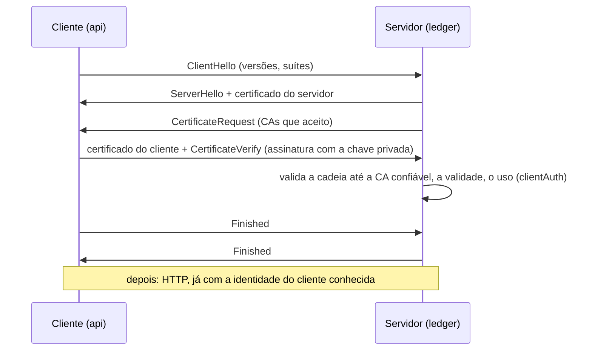

# S5.02 — mTLS entre serviços

> ⏱️ ~1h30 · 🟣 Sênior · Pré-requisitos: S5.01 (zero trust, causa comum), P10.04 (*Client Credentials*, `/internal/**`, `azp`), P5.05 (gateway), J2 (TLS, HTTPS), J10 (TLS com `verify-full` no Postgres), P9.01 (ALB, rede), P9.02 (ECS), P10.05 (rotação), P6.06 (health), S4.02 (*runbooks*)

> ✅ **Validação final (2026-11-24):** módulo executado no PayFlow reconstruído; resultado e o que continua não executado no [README do módulo](README.md). Os avisos "não executado" / "por leitura" abaixo descrevem a escrita original.

> ⚠️ **Verificação:** `lab/MtlsLab.java` **foi executado** com **mTLS de verdade** (JDK 25.0.5): uma **CA descartável** e certificados feitos com o `keytool`, um `HttpsServer` com `needClientAuth` e clientes `java.net.http.HttpClient` com certificados bons e ruins (11 casos), parâmetros negociados e custo do *handshake*. **Tudo em `localhost`.** **NÃO executado:** mTLS no **PayFlow do aluno** (Spring Boot 4.1), no **ALB** (modo *verify*/*passthrough*), no **ECS**, em uma **malha** (Istio), **AWS Private CA/ACM**, **Keycloak** com tokens vinculados a certificado. Propriedades do Spring Boot e recursos do ALB/Istio foram **conferidos na documentação**, **não executados**. **A decisão de adotar mTLS no PayFlow é PROPOSTA.**

## 🎯 Objetivos
Ao final desta aula você consegue:
- **Explicar** o que o **TLS mútuo** acrescenta ao TLS comum (**identidade do cliente**) e **o que ele não faz** (**não** autoriza).
- **Montar** uma **PKI mínima** (CA, certificados de servidor e de cliente, SAN, `extendedKeyUsage`) e **ler** os erros de cada falha.
- **Escolher** **onde terminar** o mTLS (aplicação, balanceador, malha) com os custos de cada lugar.
- **Planejar rotação e expiração** (a **causa nº 1 de queda por mTLS**) com alerta e *runbook*.
- **Decidir** se o PayFlow **precisa** de mTLS **agora** e qual **gatilho** muda a resposta.

## 🤔 Por que isso importa
Na P10.04 cada serviço do PayFlow prova quem é com um **token** (*Client Credentials*). O token é **bearer**: **quem o possui, usa**. Se ele vazar (log, *heap dump* da S2.04, proxy mal configurado), **qualquer um** chama `/internal/notify` até ele expirar. **mTLS** prende a identidade ao **canal**: sem a **chave privada** do serviço, **não há conexão**. E ele **cifra** o tráfego interno (S5.03). **Mas** ele tem **um preço operacional alto** (certificados que **expiram** e derrubam serviços) e **não substitui** a autorização. A pergunta sênior é **"onde o ganho paga o custo"**.

## 💡 Intuição (explicação simples)
TLS comum é entrar num **banco** e conferir, pelo **letreiro** e pelo **selo**, que **é mesmo** o banco: **você** verifica **o prédio**, mas o prédio **não** sabe quem é você (você mostra o documento **depois**, no guichê). **mTLS** é a **portaria que também confere o seu crachá antes de abrir a porta**, **e** você confere o selo do prédio: **os dois** se identificam **antes** de qualquer conversa. O crachá **prova quem você é**; **não diz a quais salas você pode ir** (isso é a **autorização**, seção 5).

## 🔬 Como funciona por dentro

### 1. O que muda no *handshake*

- O **servidor** manda o **`CertificateRequest`** com a **lista de CAs que aceita**. O **cliente** **só envia** um certificado se tiver **um assinado por uma dessas CAs**.
- O **`CertificateVerify`** é uma **assinatura com a chave privada** do cliente sobre o *handshake*: **ter o certificado (público) não basta**; é preciso **a chave**.
- No **TLS 1.3**, a falha de autenticação do cliente **aparece para o cliente só depois** do *handshake* do lado dele (a primeira leitura), **e o que ele vê varia**: no laboratório, em **uma execução** vimos o alerta `certificate_required`/`certificate_unknown`, e em **outra** apenas `SocketException: Connection reset` **para o mesmo caso**. **Teste de segurança que compara a mensagem da exceção é frágil**: asserte **"a conexão falhou"** (e, no servidor, **o motivo no log**).

### 2. A PKI mínima (o que vira arquivo)
| Peça | O que é | No laboratório |
|---|---|---|
| **CA** | emite e **assina** certificados; sua **chave privada** é o segredo mais valioso | `payflow-ca` (EC P-256, `bc:c`, `keyCertSign`) |
| **Certificado do servidor** | prova **o nome** do servidor (**SAN**, não o `CN`) | `ledger` com `san=dns:localhost,ip:127.0.0.1` |
| **Certificado do cliente** | prova **quem chama** | `api`, `reporting` (`CN=api`) |
| **`extendedKeyUsage`** | para que o certificado **serve**: `serverAuth`, `clientAuth` | `eku=serverAuth,clientAuth` |
| **Truststore** | CAs em que **eu** confio | o servidor confia **só** na `payflow-ca` |
| **Keystore** | minha chave privada + minha cadeia | `*.p12` |
| **Validade** | quanto tempo vale | folhas de **7 dias** (CA de 30 dias): **curto de propósito** |

**Pontos que quebram em produção:** (1) o `CN` **não** vale mais para nome: **a SAN vale** (caso 10 abaixo); (2) **truststore com as CAs públicas do sistema** confia no **mundo todo**: **use um truststore só com a **sua** CA**; (3) a **chave privada da CA** **nunca** fica na aplicação (**ACM Private CA**, **Vault**, **SPIRE**: **não executados**); (4) **revogação** (CRL/OCSP) é **difícil de operar**: a alternativa moderna é **certificados de vida curta** (horas a dias) **renovados automaticamente**.

### 3. O laboratório: 11 casos, lidos um a um
Servidor: `HttpsServer` com `needClientAuth`, que **só confia na `payflow-ca`**, e uma **lista de autorização** (`/internal/ping` só para `CN=api`):

```text
1. api cert issued by payflow-ca                                     -> 200 pong to CN=api
2. reporting cert (valid, same CA, NOT on the list)                  -> 403 forbidden: CN=reporting is not allowed on /internal/ping
3. no client certificate                                             -> FAILED (SocketException: Connection reset)
4. api cert issued by rogue-ca (same CN=api!)                        -> FAILED (SocketException: Connection reset)
5. api cert already expired (issued 3 days ago, valid 1 day)         -> FAILED (SocketException: Connection reset)
6. client forced to TLSv1.2                                          -> 200 pong to CN=api
7. client forced to TLSv1.1                                          -> FAILED (SSLHandshakeException: No appropriate protocol (protocol is disabled or cipher suites are inappropriate))
8. client does not trust payflow-ca (trusts rogue-ca only)           -> FAILED (SunCertPathBuilderException: unable to find valid certification path to requested target)
9. valid cert from payflow-ca but extendedKeyUsage = serverAuth only -> FAILED (SSLHandshakeException: (certificate_unknown) Received fatal alert: certificate_unknown)
10. server cert has SAN ledger.internal, client calls localhost      -> FAILED (CertificateException: No subject alternative DNS name matching localhost found.)
11. server WITHOUT needClientAuth, client sends no cert (plain TLS)  -> 403 forbidden: anonymous is not allowed on /internal/ping
```
**Leitura:**
1. **O caminho feliz:** o servidor extrai `CN=api` **do certificado verificado** (`getPeerCertificates`) e **autoriza**.
2. **Autenticado ≠ autorizado.** O `reporting` tem um certificado **válido da mesma CA** e **recebe 403**. **mTLS dá identidade; a permissão é outra decisão** (a lista; na prática, a política da S5.01 ou o escopo do P10.04). **Quem confunde as duas** acaba com "qualquer serviço da malha chama qualquer coisa".
3–5. **Sem certificado, de CA estranha, expirado: a conexão cai**, e a **mensagem que o cliente vê varia** (seção 1). O **caso 4** é o mais instrutivo: o certificado do atacante tem **o mesmo `CN=api`**, mas **vem de outra CA**: **o nome não é a identidade, a cadeia até uma CA confiável é**. (Em uma das execuções o alerta foi `certificate_required`, **compatível** com o cliente **nem ter enviado** o certificado, porque a CA dele não estava na lista do `CertificateRequest`; **não capturei o *handshake* para confirmar**.)
6–7. **TLS 1.2 funciona; TLS 1.1 não**: o JDK **desabilita** `SSLv3, TLSv1, TLSv1.1, DTLSv1.0, RC4, DES, MD5withRSA…` por padrão (`jdk.tls.disabledAlgorithms`, **lido da `Security`**). **Você não precisa ligar nada** para barrar o TLS 1.1 no JDK 25.
8. O **cliente** também valida: **truststore errado = nenhuma conexão** (o que **protege contra o servidor falso**).
9. **O uso do certificado vale:** um certificado **válido, da CA certa**, mas **emitido só para `serverAuth`** (sem `clientAuth`) **não** serve para **identificar um cliente** (a conexão cai com `certificate_unknown`). Por isso o `extendedKeyUsage` **entra** na emissão.
10. **O JDK verifica o nome do servidor por padrão** no `HttpClient` (`SAN` casando com o *host*). **Não desligue** a verificação de nome "para fazer funcionar": **gere o certificado certo**.
11. **O erro mais perigoso e mais silencioso:** **sem `needClientAuth` o servidor aceita conexões sem certificado**, e o **`anonymous` só é barrado pela lista**, se ela existir. **Teste o caso negativo (3 e 11)**: um mTLS que **"funciona"** mas **não obriga** o certificado é **TLS comum com uma etiqueta**.

**Parâmetros negociados** (api → ledger):
```text
  protocol      = TLSv1.3
  cipher suite  = TLS_AES_256_GCM_SHA384
  server cert   = CN=ledger, key = EC, sigalg = SHA384withECDSA
  client cert   = CN=api (sent in the handshake)
```
**Monitor de expiração** (o que um *job* faria com os *keystores*):
```text
  api-by-payflow-ca.p12            notAfter in 167 h
  api-expired-by-payflow-ca.p12    notAfter in -48 h  <-- EXPIRED
```

### 4. O custo
```text
TLS only (server auth)         full handshake:   5.04 ms | request on a reused connection:  0.83 ms
mTLS (client cert verified)    full handshake:   4.38 ms | request on a reused connection:  0.49 ms
```
(200 operações por linha, *loopback*, **máquina compartilhada de 12 núcleos**; **os milissegundos mudam a cada execução** e **a diferença entre as duas linhas está dentro do ruído**.) **O que os números mostram:** um **handshake completo** custa **alguns milissegundos** e uma requisição em **conexão reaproveitada** custa **menos de 1 ms**. **Conclusão prática: o mTLS não é caro, a falta de *pool* de conexões é.** (O reuso também depende do `HttpClient`/*pool* corretos: P5.07.) **Cuidado com o JDK:** o mesmo laboratório no **JDK 17** deu **~42 ms** na requisição reaproveitada (outro *stack*, outra versão): **meça no JDK que você usa**.

### 5. Onde terminar o mTLS
| Onde | Como | Vantagem | Custo / risco |
|---|---|---|---|
| **Na aplicação** (Spring Boot) | *SSL bundles* + `server.ssl.client-auth=need` | a **app** vê o certificado e **decide**; sem peças novas | **cada serviço** cuida de arquivos e **rotação** |
| **No balanceador** (ALB) | **mutual TLS *verify*** (o ALB valida contra um *trust store*) ou ***passthrough*** (manda a cadeia ao alvo, **sem verificar**) | **tira o trabalho** da app; **cabeçalhos `X-Amzn-Mtls-*`** levam os dados do certificado | vale **na borda**, **não** entre serviços internos; o alvo **precisa confiar** no ALB |
| **Numa malha** (Istio, *sidecar*) | `PeerAuthentication` com `mode: STRICT` (ou `PERMISSIVE` para **migrar**) | **todo** o tráfego entre serviços **sem mudar o código**; certificados **automáticos** | **uma plataforma inteira** para operar (a P7 **não** executou Kubernetes; **o PayFlow está no ECS**) |
| **Identidade de carga de trabalho** (SPIFFE/SPIRE) | cada carga recebe um **SVID** de vida curta | **rotação automática** e identidade **independente de rede** | **mais uma infraestrutura**; **não executado** |

**No Spring Boot 4.1** (conferido na documentação; **não executado**): o servidor usa **`server.ssl.bundle`** (que **não** combina com as propriedades soltas do `server.ssl`) e **`server.ssl.client-auth`** (`none`/`want`/`need`; "**requer um *trust store***"); o **cliente** recebe o *bundle* via **`RestClientSsl`** (`org.springframework.boot.restclient.autoconfigure.RestClientSsl`) e `builder.apply(ssl.fromBundle("payflow"))`.

```yaml
# application.yml (serviço ledger) — por leitura, NÃO executado
spring:
  ssl:
    bundle:
      pem:
        payflow:
          reload-on-update: true                                       # opt-in: observa os arquivos (Tomcat/Netty)
          keystore:   { certificate: "file:/run/secrets/tls.crt", private-key: "file:/run/secrets/tls.key" }
          truststore: { certificate: "file:/run/secrets/ca.crt" }     # SÓ a CA do PayFlow
server:
  ssl:
    bundle: payflow
    client-auth: need                                                  # sem certificado, sem conexão
management:
  health:
    ssl:
      certificate-validity-warning-threshold: 14d                      # a saúde avisa 14 dias antes de expirar
```
```java
// cliente (api -> ledger) — por leitura, NÃO executado
@Bean
RestClient ledgerClient(RestClient.Builder builder, RestClientSsl ssl) {
    return builder.baseUrl("https://ledger.internal:8443").apply(ssl.fromBundle("payflow")).build();
}
```
A **saúde de SSL** do Actuator (`SslHealthIndicator`) **avisa** quando um certificado está **perto de expirar** (`management.health.ssl.certificate-validity-warning-threshold`, **conferido na documentação**): **ligue** isso ao alerta da seção 6.

### 6. Rotação e expiração: a causa nº 1 de queda
O mTLS **troca um problema por outro**: **certificado expirado derruba o serviço às 3h da manhã**. A defesa é **processo**, não "lembrar":
1. **Vida curta + renovação automática** (horas a dias; no laboratório, folhas de **7 dias**); **quanto mais curta, menos a revogação importa**.
2. **Recarregar sem reiniciar:** o Spring Boot **recarrega *bundles*** quando os arquivos mudam, **mas só se você ligar** (`reload-on-update: true` no *bundle*; o período de silêncio é `spring.ssl.bundle.watch.file.quiet-period`) **e só em componentes compatíveis** (a documentação lista **Tomcat** e **Netty**); **cliente** (`RestClient`): **teste** se ele pega o certificado novo (**não conferido**) ou **reinicie em *rolling***.
3. **Alerta de expiração** (**dias restantes < 14 → ticket; < 3 → página**), **testado como as regras da S4.01** (`promtool`) **ou** `SslHealthIndicator` no *readiness*? **Não** ponha a **expiração** no *readiness* (derruba **todas** as réplicas ao mesmo tempo): use **métrica + alerta**.
4. ***Runbook* de emergência** (S4.02): como **reemitir** o certificado de um serviço, onde está a **CA**, quem pode usá-la, **como** reiniciar. **Ensaie** antes do incidente.
5. **A chave da CA** é **ativo crítico**: fora da aplicação, com **auditoria** (S5.06) e **backup** (S4.05).

> ⚠️ **Cuidado com a janela de migração:** ligar `client-auth: need` **derruba** todo cliente sem certificado. Use **`want`** (aceita ambos, **registra** quem veio sem certificado), **meça** por uma semana e **só então** mude para `need`. (Istio tem o mesmo conceito em `PERMISSIVE` → `STRICT`.)

## 🏗️ Estudo de caso: "o *token* vazou no log do relatório"
**Sintoma.** (**Cenário construído**; **o mecanismo é real**.) Um *heap dump* do serviço de relatórios (S2.04) é anexado a um ticket. Dentro dele, o **token de acesso** do cliente `payflow-reporting`, **ainda válido por 5 minutos**, e o **segredo do cliente** (P10.04). Com o **segredo**, o atacante pede **tokens novos** quando quiser.

**Diagnóstico.** O **bearer** vale **em qualquer lugar**. O **segredo do cliente** (`client_secret`) **também**: é uma **senha** de longa vida.

**Opções.** (A) **Mais curtos** os tokens e **rotacionar** o segredo (P10.05); (B) **autenticação do cliente por certificado** no Keycloak (`tls_client_auth`, **RFC 8705**: o cliente se autentica **com o certificado**, sem segredo compartilhado) **e tokens vinculados ao certificado** (a **API só aceita** o token **apresentado pelo dono do certificado**); (C) **mTLS entre os serviços** (a chamada **não chega** sem o certificado, mesmo com o *token* roubado); (D) **não ter segredo na memória que vai para o *dump***.

**Decisão (proposta).** **A + D agora** (barato, já ensinado). **C** **quando** houver **mais de um time** ou **dados de mais risco** no caminho; **B** **se** o Keycloak do PayFlow **suportar**: o *Server Administration Guide* do Keycloak descreve a opção ***OAuth 2.0 Mutual TLS Certificate Bound Access Tokens Enabled*** (token ligado ao certificado, "*holder-of-key*"; **conferido na documentação**, **não executado**; **confira a versão** e **teste** antes de prometer).

## ⚖️ Trade-offs e quando NÃO usar
- **Hoje, no PayFlow:** a API, o Keycloak e um punhado de serviços **atrás de um ALB, na mesma conta**, com **token por serviço** (P10.04) e **o ECS que injeta o segredo** (P9.06). **O ganho marginal do mTLS interno é pequeno e o custo operacional é real** (CA, rotação, recarga, runbooks, mais um modo de falha). **Proposta: NÃO adotar mTLS entre serviços internos agora.**
- **Gatilhos para reavaliar (escritos):** (1) **mais de um time** operando serviços que se falam; (2) **dados que o *token* sozinho não deve proteger** (o canal passa por rede não confiável: **outra** região, **outra** conta, **terceiros**); (3) **exigência de conformidade** ou do **parceiro/PSP** (**webhooks do PSP** podem exigir mTLS ou **assinatura**: **confira** o contrato); (4) **adotar uma malha** por outro motivo (P7); (5) um incidente de **token vazado** como o do estudo.
- **Na borda, sim** (ALB com **mutual TLS *verify***) **só se** o **cliente** da API for **outro sistema** (B2B) e **não** um navegador/app móvel (que **não** tem certificado por usuário).
- **mTLS ≠ autorização** (caso 2). **mTLS ≠ proteção contra a aplicação comprometida:** quem **controla o serviço** tem **a chave**.
- **Custo de depuração:** `connection reset` sem motivo, **erros que mudam de texto** (seção 1) e **logs só no servidor**: documente **como** diagnosticar (`openssl s_client`, `-Djavax.net.debug=ssl,handshake`).

## ⚠️ Erros comuns e boas práticas de produção
- **`CN` em vez de SAN:** `No subject alternative DNS name matching localhost found.` (caso 10). **Gere com SAN.**
- **`unable to find valid certification path to requested target`** (caso 8): o **truststore** **não** tem a CA. **Não** "resolva" com `TrustAllCerts` (J8, S5.04 caça isso).
- **Truststore = CAs do sistema:** confia **no mundo**. **Use truststore próprio.**
- **`needClientAuth` esquecido** (caso 11): **teste o caso sem certificado**.
- **Certificado de vida longa "para não ter trabalho"** (anos): **a revogação que você não vai operar** vira **risco permanente**.
- **Chave privada na imagem Docker** ou no Git: segredo (P9.06/P10.05), **montado em tempo de execução**, `chmod` e dono **corretos** (lição da J9/J10).
- **Reiniciar **todas** as réplicas ao mesmo tempo** na rotação: **rolling**.
- **Autorizar pelo `CN` sem verificar a cadeia:** é **cabeçalho forjável** se vier **de proxy** sem validação: **só confie em `X-Amzn-Mtls-*`** se o **ALB** for **o único caminho** até o alvo (SG fechado).

## 🧩 Exercícios
1. **(Fixação)** Rode `MtlsLab.java cases` e **explique cada linha** com **uma frase** (qual verificação do TLS falhou). **Mude** o caso 10 (`dns:localhost` na SAN do servidor errado) e veja o 10 **passar**.
2. **(Aplicação no PayFlow)** Escreva `docs/security/mtls.md` com **(a)** a **decisão** (adotar/não, com os **gatilhos** da seção "Trade-offs"), **(b)** se **adotar**, a **tabela** de quem fala com quem e **qual CA** emite o quê, **(c)** o ***runbook*** "**certificado expirou**" no formato da S4.02 (5 seções) **e** o **alerta** de dias restantes. **Pronto quando:** o *runbook* **passa** no `DocLint` da S4 (se você copiou o verificador) e o alerta tem **teste** (`promtool`).
3. **(Aplicação)** O **caso 9** do laboratório emite o certificado do cliente com `extendedKeyUsage = serverAuth` e a conexão **falha**. **Mudando só o `eku`** em `makeLeaf` (a variável estática `eku`), descubra **quais combinações** (`clientAuth`; `serverAuth,clientAuth`; nenhuma extensão) **passam**. **Critério:** uma tabela de 3 linhas com o resultado **que você viu**, não o que você acha.
4. **(Desafio)** Escreva o **monitor de expiração** (um *job* ou `@Scheduled`) que lê os certificados e **expõe** `payflow_tls_cert_seconds_to_expiry{name=…}`; **teste** com o certificado expirado do laboratório (**deve** dar valor negativo e **disparar** o alerta). *(Não executado aqui.)*

<details><summary>Soluções de referência</summary>

1. 1: tudo certo; 2: **autorização** (lista) negou; 3: o **servidor** exigiu certificado; 4: a **cadeia** não chega a uma CA confiável; 5: **validade**; 6/7: **protocolo**; 8: o **cliente** não confia no **servidor**; 9: **uso do certificado** (`extendedKeyUsage` sem `clientAuth`); 10: **nome (SAN)**; 11: o servidor **não exigiu** certificado.
2. Pontos mínimos da decisão: **hoje não** (token por serviço, ALB, mesma conta), **gatilhos** (1)–(5), **custo** (CA, rotação, recarga, *runbook*). Alerta: `payflow_tls_cert_seconds_to_expiry < 14*86400` (ticket) e `< 3*86400` (página), **com teste que prova** o disparo e o **não disparo**.
3. `serverAuth,clientAuth` passa (caso 1) e `serverAuth` **falha** (caso 9, **medido**); as outras duas **você mede** (rode e anote; **não** presuma).
4. `X509Certificate.getNotAfter()` → `Duration.between(now, notAfter)`; **um** *gauge* por certificado; **cuidado** com o rótulo de **alta cardinalidade** (P6): use o **nome** do certificado, **não** o número de série.
</details>

## 🎤 Na entrevista
1. **"Qual a diferença entre TLS e mTLS e o que o mTLS **não** resolve?"** *Resposta-modelo:* no TLS só o **cliente** verifica o **servidor**; no mTLS **ambos** se identificam com certificados **antes** da aplicação. Dá **identidade forte do chamador** presa à **chave privada**. **Não** resolve **autorização** (um serviço válido ainda pode ser **negado**), nem **aplicação comprometida** (quem controla o serviço tem a chave), nem **expiração** (que **vira** causa de queda).
2. **"Como você opera mTLS sem acordar às 3h por certificado expirado?"** *Resposta-modelo:* **vida curta com renovação automática**, **recarga sem reinício**, **alerta por dias restantes testado**, ***runbook* ensaiado**, **chave da CA fora da app** e **rolling** na troca.
3. **"Token (OAuth) ou mTLS entre serviços?"** *Resposta-modelo:* **não são excludentes**: o **token** carrega **escopo e identidade** (autorização), o **mTLS** prende **o canal**. Para o tamanho do PayFlow, **token por serviço** basta; adoto mTLS por **gatilho** (vários times, rede não confiável, exigência do parceiro, malha). Em alta segurança, **tokens vinculados ao certificado** (RFC 8705) **fecham** o roubo de *bearer*.
4. **"Por que o `CN=api` do atacante não entra?"** *Resposta-modelo:* o servidor **valida a cadeia** até a **CA que ele confia**; o `CN` é **um texto** que o atacante **escolhe**.

## 📚 Para ir além
- 📄 **RFC 8446 — TLS 1.3:** https://datatracker.ietf.org/doc/html/rfc8446 (autenticação do cliente, `CertificateRequest`; **fonte** do protocolo).
- 📄 **RFC 8705 — OAuth 2.0 Mutual-TLS Client Authentication and Certificate-Bound Access Tokens:** https://datatracker.ietf.org/doc/html/rfc8705 (como **prender o token ao certificado**).
- 📄 **Spring Boot — SSL (bundles):** https://docs.spring.io/spring-boot/reference/features/ssl.html (`spring.ssl.bundle.pem.*`, recarga).
- 📄 **Spring Boot — Actuator (saúde `ssl`):** https://docs.spring.io/spring-boot/reference/actuator/endpoints.html (`SslHealthIndicator` e o limiar de validade).
- 📄 **AWS — Mutual TLS no Application Load Balancer:** https://docs.aws.amazon.com/elasticloadbalancing/latest/application/mutual-authentication.html (modos *verify* e *passthrough*, *trust store*, cabeçalhos `X-Amzn-Mtls-*`).
- 📄 **AWS Private CA:** https://docs.aws.amazon.com/acm-pca/latest/userguide/PcaWelcome.html (CA gerenciada; **não executado**).
- 📄 **Istio — conceitos de segurança (mTLS, `PeerAuthentication`):** https://istio.io/latest/docs/concepts/security/ (STRICT × PERMISSIVE).
- 📄 **SPIFFE — visão geral:** https://spiffe.io/docs/latest/spiffe-about/overview/ (identidade de carga de trabalho).
- 📄 **JSSE Reference Guide (JDK 25):** https://docs.oracle.com/en/java/javase/25/security/java-secure-socket-extension-jsse-reference-guide.html (`jdk.tls.*`, depuração do *handshake*).
- 📄 **OWASP — TLS Cheat Sheet:** https://cheatsheetseries.owasp.org/cheatsheets/Transport_Layer_Security_Cheat_Sheet.html (versões, suítes e erros comuns).

## ✅ Checklist da aula
- [ ] Rodei o `MtlsLab` e expliquei **cada um dos 11 casos**.
- [ ] Mostrei que **autenticado ≠ autorizado** (caso 2).
- [ ] Sei por que a **mensagem de erro** do cliente **não** serve como asserção.
- [ ] Escrevi a **decisão** de mTLS do PayFlow **com gatilhos**.
- [ ] Tenho o ***runbook* de certificado expirado** e o **alerta** (com teste).
- [ ] Anotei o que **não** foi executado (ALB, ECS, Keycloak, malha, Private CA).
