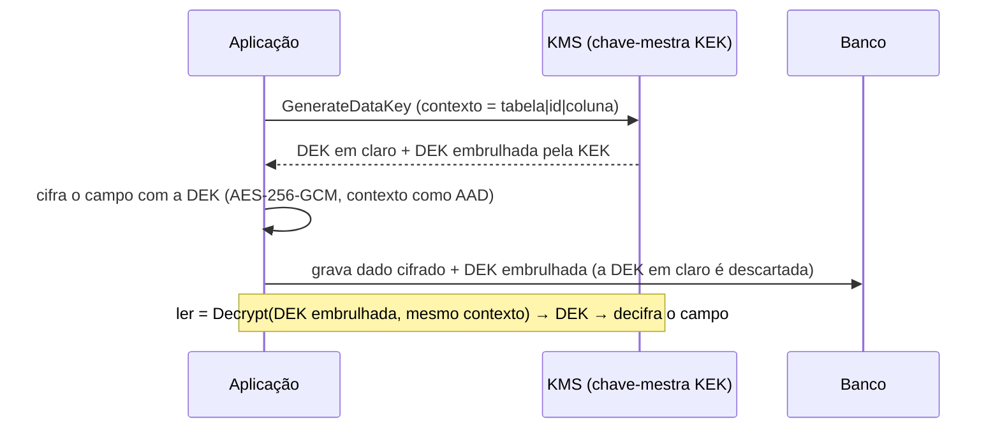

# S5.03 — Criptografia em trânsito e em repouso; KMS

> ⏱️ ~1h30 · 🟣 Sênior · Pré-requisitos: S5.01 (camadas, causa comum), S5.02 (TLS/mTLS), J8.02/J8.07 (hash de senha, segredos), P9.06/P10.05 (segredos, rotação), P9.08 (RDS), S3.09 (`phone_e164`), S4.05 (*backup* em outra conta, imutável), S2.04 (*heap dump*), S1.08 (idempotência)

> ✅ **Validação final (2026-11-24):** módulo executado no PayFlow reconstruído; resultado e o que continua não executado no [README do módulo](README.md). Os avisos "não executado" / "por leitura" abaixo descrevem a escrita original.

> ⚠️ **Verificação:** `lab/CryptoLab.java` (Java puro, JDK 25.0.5) **foi executado**: **criptografia envelope AES-256-GCM** com um **KMS falso (um objeto Java)**, contexto de criptografia, adulteração, **rotação por *re-wrap***, **reuso de nonce** (com recuperação do texto **sem a chave**), **índice cego** (HMAC) e custo local. O **limite de 2³² chamadas** do NIST foi **conferido no texto do SP 800-38D (§8.3)**. **NÃO executado:** **AWS KMS** (chaves, políticas, `GenerateDataKey`, rotação, exclusão), **RDS** com criptografia, **S3 SSE-KMS**, **AWS Encryption SDK**, TLS do ALB para o ECS, o PayFlow do aluno. Fatos do KMS e do RDS foram **conferidos na documentação**, **não executados**. **O que cifrar no PayFlow é PROPOSTA.**

## 🎯 Objetivos
Ao final desta aula você consegue:
- **Distinguir** criptografia **em trânsito**, **em repouso (volume)** e **por campo**, e dizer **de qual ameaça** cada uma protege (e de qual **não**).
- **Explicar e implementar** a **criptografia envelope** (chave de dados + chave-mestra no KMS) e **o que o contexto de criptografia impede**.
- **Planejar rotação** de chaves **sem recriptografar os dados** e **prever o custo** em chamadas ao KMS.
- **Reconhecer** as falhas **que quebram tudo em silêncio** (reuso de *nonce*, chave junto do dado) e **testá-las**.
- **Decidir** o que o PayFlow **cifra por campo** e o que **não** (e a **chave do *backup***).

## 🤔 Por que isso importa
"Criptografamos o banco" é uma frase que **não diz nada** até alguém perguntar **contra quem**. O disco cifrado **não** protege de **um `SELECT *` com credencial válida**, de **SQL injection**, de **um `pg_dump` roubado de um operador**: **o banco entrega os dados decifrados** a quem tem permissão. Cada tipo de criptografia **fecha uma porta específica**. E o **gerenciamento de chaves** é **onde a criptografia morre**: chave junto do dado, chave que **ninguém** rotaciona, chave **apagada** (e com ela **todos** os *backups*, o ponto que a S4.05 deixou).

## 💡 Intuição (explicação simples)
Um **cofre** de banco: **cada gaveta** tem **a sua chave** (a **chave de dados**, DEK) e **todas as chaves das gavetas** ficam **guardadas, embrulhadas**, no **cofre-mestre** do prédio (o **KMS**, com a **chave-mestra**, KEK). Para trocar a chave-mestra, **você não esvazia as gavetas**: você **reembrulha as chaves pequenas**. E o **bilhete na gaveta** ("esta gaveta é a da conta 42, coluna telefone") vai **colado** na fechadura: se alguém **mudar a gaveta de lugar**, a chave **não abre** (o **contexto**).

## 🔬 Como funciona por dentro

### 1. Em trânsito, em repouso, por campo: **de quê** cada uma protege
| Onde | Protege contra | **Não** protege contra |
|---|---|---|
| **Em trânsito** (TLS: ALB, serviço↔serviço, app↔banco, app↔Redis/broker) | alguém **escutando/alterando a rede**; **servidor falso** | quem **já está dentro** do ponto final; **aplicação comprometida** |
| **Em repouso — volume/disco** (RDS, EBS, S3 com SSE) | **disco/*snapshot*/mídia roubada**, acesso à infraestrutura **sem** passar pelo banco | **`SELECT`** com credencial válida, SQL injection, DBA mal-intencionado (o banco **decifra** para quem pede) |
| **Em repouso — por campo** (a **aplicação** cifra antes de gravar) | **dump** do banco, **SQLi**, DBA/operador, réplica/relatório com acesso amplo | **aplicação comprometida** (ela **tem** a chave), **busca/ordenação/índice** (custo, seção 6) |
| **Hash** (senha: J8.02) | **vazamento** da tabela | (**não é criptografia**: não se **recupera**) |

**Em trânsito, no PayFlow** (**por leitura**; a base é a P9/P10): cliente → **ALB** (TLS 1.2+ com certificado do ACM), ALB → **ECS** (**decida**: **re-cifrar** até a tarefa ou terminar no ALB; **a rede privada não é prova de nada**, S5.01), app → **RDS** com **`sslmode=verify-full`** (a J10 já fez isso: **valida a cadeia e o nome**), app → Redis/broker com **TLS**. **O JDK 25 já desabilita `SSLv3`, `TLSv1`, `TLSv1.1`, `RC4`, `DES`, `MD5withRSA`…** (caso 7 da S5.02: `jdk.tls.disabledAlgorithms`, **lido da `Security`**). **HSTS** na borda (J8). **O que *não* fazer:** `TrustAllCerts`, `sslmode=require` sem validar a cadeia (cifra, mas **não** verifica **com quem** fala: **vulnerável a *man-in-the-middle***).

**Em repouso, volume.** O RDS **cifra o armazenamento, os logs, os *backups* automáticos, as réplicas e os *snapshots*** com **AES-256** via **AWS KMS** (**conferido na documentação do RDS**). **Pontos de decisão que a documentação deixa claros:** (1) **depois** de criada, **você não troca a chave KMS** da instância (para trocar: ***snapshot* manual** + cópia com outra chave, ou ***blue/green***); (2) as chaves são **por região** (réplica noutra região precisa de **chave na região de destino**: a mesma regra da cópia de *snapshot* da S4.05). **Decida a chave no `terraform` (P8) **antes** de criar o banco** (e **teste** a restauração com ela).

### 2. Criptografia **envelope**: a ideia que sustenta o KMS

**Por que não cifrar tudo no KMS direto?** Cada chamada é **uma ida e volta de rede com cota** (milissegundos), e o KMS **só** cifra **pedaços pequenos**; a **DEK** local cifra **qualquer volume** em **microssegundos**. A **KEK nunca sai** do KMS (**só embrulha/desembrulha**), e **quem pode usá-la** é uma **política** (o que dá **auditoria**: cada uso vai para o **CloudTrail**).

### 3. O laboratório: o mecanismo, com um KMS **falso**
`CryptoLab` implementa a seção 2 com **AES-256-GCM** (J8 **não** ensinou GCM; aqui o essencial): cada campo ganha **uma DEK nova**, cifrada com **`nonce` de 12 bytes** e **tag de 16 bytes**, e o **contexto** (`"users|u-42|phone_e164"`) entra como **AAD** (*dados autenticados adicionais*: **não** cifrados, **autenticados**). O "KMS" é **um objeto Java** que guarda as KEKs e **só** oferece `wrap`/`unwrap`.

```text
stored: kekId=kek-1 wrappedDek=60 B data=42 B  (value was 14 B: 12 nonce + 16 tag = 28 B overhead; wrapped DEK = 12 + 32 + 16 = 60 B)

1. right place            : OK "+5511999990000"
2. moved to another row   : FAILED (AEADBadTagException: Tag mismatch)   <- the context is part of the check
3. moved to another column: FAILED (AEADBadTagException: Tag mismatch)
4. one flipped bit in data : FAILED (AEADBadTagException: Tag mismatch)   <- GCM authenticates, it does not only hide
5. wrapped DEK from another record: FAILED (AEADBadTagException: Tag mismatch)
```
**Leitura:** (1) funciona; (2–3) **mover o valor cifrado para outra linha ou coluna** (um ataque de **troca**: o telefone da Ana na linha do Beto) **falha**, porque **o contexto faz parte** da verificação; (4) **um *bit* alterado** é **detectado** (GCM **autentica**; **CBC sem MAC não**); (5) uma DEK embrulhada de **outro** registro **não** abre. **O AWS KMS faz o mesmo** com o **contexto de criptografia**: a documentação diz que ele é usado como **AAD**, **não é secreto** e **aparece em texto claro no CloudTrail** (**conferido**): **bom para auditoria, péssimo lugar para um segredo**.

**Rotação sem tocar nos dados** (1.000 registros):
```text
KEY ROTATION (1000 records): re-wrap the DEKs, leave the data alone
  data digest before = dd4c54332f9cc50b, after = dd4c54332f9cc50b  (identical: no data byte was touched)
  KMS calls for the re-wrap = 2000 (1 unwrap + 1 wrap per record); local time 18.2 ms (a real KMS is a network call per operation)
  record 7 under kek-2     : OK "+5511999900007"
  old record 7 under kek-1 : OK "+5511999900007"   <- old KEK must stay until every DEK is re-wrapped
  copy of the DB, stranger's KMS (its own kek-1): FAILED (AEADBadTagException: Tag mismatch)   <- a database dump alone is useless
```
- **Rotacionar a KEK = reembrulhar as DEKs**, **não** recriptografar os dados (o *digest* dos dados **não mudou**).
- **Custo**: **2 chamadas ao KMS por registro** (desembrulhar + embrulhar). 1.000 registros = 2.000 chamadas; **10 milhões = 20 milhões de chamadas** (**cota e latência de rede reais**): a rotação em massa é **um projeto em lotes**, com limitação de taxa, **não** um `UPDATE`.
- **A KEK antiga precisa continuar existindo** até **todas** as DEKs serem reembrulhadas. **No AWS KMS** a **rotação automática** da chave (**padrão: 365 dias**; período configurável) **cria material novo** e **o KMS retém o material antigo** para decifrar o que foi cifrado antes (**conferido na documentação**): por isso a **rotação do KMS é transparente**. **Atenção:** isso vale para a **rotação do KMS**; o **reembrulho** do laboratório é o que você faz quando **troca** de chave (outro `KeyId`).
- **Um *dump* do banco, sozinho, é inútil**: a última linha do laboratório (KMS de **outro dono**) **falha**.

### 4. O erro que quebra tudo em silêncio: reuso de *nonce*
**Se a mesma chave e o mesmo *nonce* cifram duas mensagens com GCM**, o XOR dos dois textos cifrados **é** o XOR dos textos claros: quem **conhece uma** mensagem **recupera a outra sem a chave**:
```text
p1 (attacker knows) = "transfer 0100.00 to acc-17 ok  "
(c1 xor c2) xor p1  = "transfer 9999.99 to acc-66 ok  "   <- p2 recovered WITHOUT the key
p2 (secret)         = "transfer 9999.99 to acc-66 ok  "
equal? true
JDK guard: re-init of the SAME Cipher with the same key+nonce -> InvalidAlgorithmParameterException: Cannot reuse iv for GCM encryption
```
O JDK **barra** a reutilização **no mesmo objeto `Cipher`** (a última linha) **mas não impede** que você crie **outro objeto** com o mesmo par (o laboratório fez **exatamente isso** para mostrar o estrago). **Nonces aleatórios de 96 bits:** a chance de repetição cresce com **n²/2⁹⁷**:
```text
  n = 2^20 messages -> P(repeat) ~ 2^-57  (6.94e-18)
  n = 2^32 messages -> P(repeat) ~ 2^-33  (1.16e-10)
  n = 2^40 messages -> P(repeat) ~ 2^-17  (7.63e-06)
```
O **NIST SP 800-38D (§8.3)** exige que, na construção com **IV aleatório**, o **total de chamadas com a mesma chave** **não passe de 2³²** (**conferido no texto do documento**). **É por isso que o hábito é uma DEK por registro (ou por poucos milhares)**: **nunca** uma chave de aplicação cifrando **bilhões** de mensagens com *nonce* aleatório. **Em produção, não escreva isto à mão:** use o **AWS Encryption SDK** (`com.amazonaws:aws-encryption-sdk-java`, **3.0.2** no Maven Central em 2026-11-23, **não executado**) ou o **Tink**; o laboratório é **didático**. **Nunca** invente algoritmo, modo ou protocolo.

### 5. Índice cego: buscar sem decifrar (e o que ele vaza)
Um campo cifrado **não tem índice, não ordena e não busca** (o cifrado é **aleatório**). O **índice cego** guarda `HMAC-SHA256(segredo, valor normalizado)` **ao lado**: **a igualdade funciona** (`WHERE phone_idx = ?`). **Mas** valores iguais geram **etiquetas iguais**:
```text
  0bb66e3e17e8  x 700
  35842f9aaa03  x 100
  a25f783792a4  x 200
-> the dump leaks WHO shares a value and HOW MANY (700/200/100) without the key; encrypting the column alone leaks neither.
lookup of +5511999990001 -> tag a25f783792a4 -> 200 row(s) found by equality (no decryption).
Without normalization the same phone has two tags: a25f783792a4 vs c589301b7d0f (phone_e164 from S3.09 is the normalized input).
```
**Duas lições:** (1) o índice **vaza a distribuição** (**quem compartilha** um valor e **quantos**): **é o preço** da busca; (2) **sem normalizar** (`phone_e164`, S3.09), o **mesmo** telefone vira **duas** etiquetas e a busca **erra**. **Use HMAC com segredo** (um SHA-256 puro de um espaço pequeno, como um CPF, se **inverte** por força bruta: S5.05).

### 6. O custo
```text
14-byte field (seal only, key reused): 1.97 us/op
14-byte field, envelope (new DEK + local wrap): 4.11 us/op, KMS calls = 50000
  10,000 records, data key reused for     1 records -> 10000 KMS wrap calls (1 per key)
  10,000 records, data key reused for   100 records ->   100 KMS wrap calls (1 per key)
  10,000 records, data key reused for 10000 records ->     1 KMS wrap calls (1 per key)
```
(Microssegundos **por operação local**, **JDK 25**, máquina compartilhada; **variam**.) **O custo real do envelope no PayFlow é a chamada de rede ao KMS** (**milissegundos** e **cota por segundo**; **não medido aqui**). **Reusar uma DEK** por **muitos** registros **reduz as chamadas** (10.000 → 100 → 1) **e aumenta o raio de dano** de **uma** chave (e esbarra no limite de 2³² do §4): **decisão** de projeto (**cache de chaves de dados** com **limite de usos e de idade**, recurso que o *Encryption SDK* oferece: **não executado**).

### 7. A chave do *backup* (a pergunta que a S4.05 deixou)
O *backup* em **outra conta** (S4.05, camada 4) é **cifrado por uma chave KMS**. **Quem controla a chave controla o *backup*.** Riscos e defesas:
- **Chave apagada = *backups* ilegíveis.** O KMS exige **janela de espera de 7 a 30 dias** (padrão 30) para **excluir** uma chave (**conferido**): **alarme** em `ScheduleKeyDeletion` e **política** que **nega** a exclusão **fora** de um papel de **emergência**; prefira **desabilitar** a **excluir**.
- **Chave na mesma conta do banco** = **causa comum** (S5.01): se a conta cai ou é invadida, **perdem-se banco e *backup* juntos**. **Chave na conta de *backup*,** com **política** que **só** o papel de **restauração** usa.
- **Teste de restauração com a chave de destino** (S4.05: "a cópia entre regiões exige a chave **da região de destino**").
- **Imutabilidade do dado ≠ imutabilidade da chave**: **S3 *Object Lock*** (modos *governance*/*compliance*: **conferido**) protege **o objeto**; **a chave** precisa **da sua própria proteção**.

## 🏗️ Estudo de caso: "o *dump* que ninguém conseguiu usar (e o que ele ainda revelou)"
**Sintoma.** (**Cenário construído**; **o mecanismo é real**.) Um analista copia um *dump* lógico para o notebook. O notebook é roubado.

**Diagnóstico por camada.** **Volume cifrado (RDS)**: **não** ajudou: o `pg_dump` **sai decifrado** (o banco decifra para quem tem credencial). **Cifra por campo** (telefone, CPF): os valores estão **cifrados com DEK embrulhada pela KEK do KMS**: **inúteis sem acesso ao KMS**. **Mas** o **índice cego** do telefone **mostra** que **700 contas** compartilham **um** número (a distribuição da seção 5), e **`full_name`** e `email` (**não** cifrados) **continuam legíveis**.

**Opções.** (A) **cifrar mais colunas** (custo: busca, índices); (B) **não permitir `pg_dump` completo** com credencial humana (S5.01: menor privilégio; **leitura por coluna**); (C) **mascarar/pseudonimizar** os dados em **cópias** para análise (S5.05); (D) **criptografia do disco do notebook** (fora do banco) e política de **dispositivos**.

**Decisão (proposta).** **B + C + D** **primeiro** (baratos e **atacam a causa**: dados reais num notebook). **A** só para **campos de alto risco** (seção 8). **A lição:** **cada camada fechou uma porta**; **nenhuma** teria bastado.

## ⚖️ Trade-offs e quando NÃO usar
- **Cifra por campo custa caro:** **perde** busca por intervalo/ordenação/`LIKE`, exige **índice cego** (que **vaza distribuição**), **complica** relatórios e migrações (S3), e **adiciona uma dependência** (KMS) **na rota de leitura**. **Use só** onde a **ameaça justifica**.
- **KMS na rota crítica:** **cota** (um pico de leituras vira **pico de chamadas**), **latência** e **uma dependência a mais para o SLO** (S4.01: cadeia em série **reduz** a disponibilidade). **Cache de DEK** com **limites** ajuda, **com o custo de raio**.
- **Chave sua × da AWS:** chaves **gerenciadas pela AWS** são **mais simples** (a AWS administra a política), mas **você controla menos**; chaves **gerenciadas por você** dão **controle** (política, compartilhar entre contas, **desabilitar**) e **responsabilidade** (apagar sem querer). **Para o *backup* entre contas**, é a **sua** (a AWS-managed **não** compartilha, conferido: "*You can't share a snapshot that has been encrypted using the AWS managed key*").
- **Criptografia não é controle de acesso:** cifrar **não** resolve **quem pode ler** (S5.01).
- **Quando não cifrar por campo:** dados que o negócio **precisa agregar, ordenar e indexar** (o **valor do lançamento**, `amount`, no ledger): proteja com **volume cifrado + papéis + auditoria**.

## ⚠️ Erros comuns e boas práticas de produção
- **Chave no mesmo lugar do dado** (variável de ambiente ao lado do dump, constante no código): **vira ofuscação**. **A KEK mora no KMS.**
- **ECB** ou **CBC sem MAC**: padrão, **proibido** aqui: **use AEAD** (GCM/ChaCha20-Poly1305).
- **Reuso de *nonce*** (seção 4): `Cipher` **novo** por operação; **nunca** um IV **fixo** ou **contador reiniciado** após deploy.
- **Contexto de criptografia ausente** (seção 3, casos 2–3): permite **troca** de valores entre linhas.
- **Segredo no contexto de criptografia** (ele **aparece no CloudTrail**).
- ***Fallback* "se o KMS falhar, grave em claro":** **nunca**; **falhe fechado**.
- **Recriptografar tudo para "rotacionar":** **reembrulhe** as DEKs (seção 3) ou use **rotação automática**.
- **Esquecer a restauração** com chave cifrada: **ensaie** (S4.05) **com a chave de destino**.
- **Criptografia de senha:** **senha é hash** (Argon2/BCrypt, J8.02), **nunca** cifrada.
- **`sslmode=require`** pensando que é seguro: **use `verify-full`**.

## 🧩 Exercícios
1. **(Fixação)** Rode `CryptoLab.java envelope` e **mude o contexto** no teste 2 para `"users|u-42|phone_e164"` (o certo) e veja passar. **Explique** por que o 3 falha **mesmo com a DEK certa**.
2. **(Aplicação no PayFlow)** Escreva `docs/security/criptografia.md` com **uma tabela** (dado × **em trânsito** × **volume** × **campo** × **justificativa**): `users.phone_e164`, `users.full_name`, `ledger_entries.amount`, `idempotency_keys.key`, `audit_events.detail`, **arquivos de arquivo frio** (S3.04), *backups*. **Critérios de pronto:**
   - [ ] **toda** linha tem **uma ameaça** que justifica (ou **"nenhuma: não cifrar por campo"**);
   - [ ] a **chave do *backup*** está **numa conta separada**, com **política de exclusão** e **alarme**;
   - [ ] há **teste de restauração** com a chave de destino no **plano de ensaio mensal** da S4.05.
3. **(Aplicação)** Estime **a rotação** de uma KEK para **5 milhões** de campos cifrados: **chamadas** ao KMS (2 por registro), **tempo** a **500 chamadas/s** (**premissa**; **confira a cota real** da sua conta) e **o que acontece com leituras** durante os dias de rotação.
4. **(Desafio)** Acrescente ao `CryptoLab` o **teste de unicidade de *nonce***: gere **1 milhão** de `seal()` com a **mesma** chave e **verifique** que **nenhum** *nonce* se repete (**e** que um **contador reiniciado** repetiria). *(Probabilisticamente `P ≈ 10¹²/2⁹⁷ ≈ 6,3·10⁻¹⁸`: o teste **não** prova segurança; prova que **você não tem um *bug* grosseiro**.)*

<details><summary>Soluções de referência</summary>

1. O 3 falha porque o **AAD** (`…|email`) **difere** do usado ao cifrar (`…|phone_e164`): o **GCM calcula a tag sobre o AAD**; **outro AAD = outra tag**, mesmo com a **chave certa**.
2. Exemplo de linhas: `phone_e164` → trânsito **sim**, volume **sim**, campo **não por enquanto** (a busca `WHERE phone_e164` e o **índice** do S3.09 valem mais que o ganho; a **leitura por coluna** da S5.01 já tira o dado do suporte); `full_name` → idem; `amount` → **não** (agregação/ordenação); `audit_events.detail` → **sem PII** (S5.06) em vez de cifrar; *backup* → **volume cifrado com chave na conta de *backup***. Se o PayFlow passar a coletar **CPF**, **esse** campo é o candidato a **cifra por campo + índice cego** (S5.05).
3. `5.000.000 × 2 = 10.000.000` chamadas; a 500/s ≈ **20.000 s ≈ 5,6 h** (**premissa**: **meça** a cota e a latência); **durante** a rotação os dois formatos **coexistem**: o **`kekId` no registro** (como no laboratório) diz **com qual chave** abrir.
4. Em `seal()`, colete os 12 primeiros bytes em um `HashSet<String>` (hex); `1_000_000` linhas, **memória** ~dezenas de MB. O contador reiniciado: `nonce = ByteBuffer.allocate(12).putLong(4, counter++)`; **reinicie** `counter = 0` e o **teste falha**.
</details>

## 🎤 Na entrevista
1. **"Criptografia em repouso protege de quê?"** *Resposta-modelo:* **disco/snapshot roubado** e acesso à infraestrutura **sem passar pelo banco**. **Não** protege de **SQL injection nem de credencial válida**: o banco **decifra** para quem pede. Para isso: **cifra por campo**, **menor privilégio** e **auditoria**.
2. **"O que é criptografia envelope e por que o KMS a usa?"** *Resposta-modelo:* uma **chave de dados** local cifra o dado; a **chave-mestra** (no KMS, que **não a entrega**) **embrulha** a de dados. Rápido (a DEK local), **auditável** (cada uso vai ao log), e **rotacionar** a mestra é **reembrulhar** DEKs, **não** recriptografar os dados.
3. **"O que acontece se eu reutilizar o IV/*nonce* no AES-GCM?"** *Resposta-modelo:* o **XOR dos textos cifrados é o XOR dos claros**: quem conhece **um** recupera **o outro** (eu **reproduzi** num teste), e **a autenticação também quebra**. Por isso **nonce único por chave** e **limite de ~2³² mensagens** por chave com IV aleatório (NIST SP 800-38D).
4. **"Como proteger o *backup* contra um atacante com credenciais de administrador?"** *Resposta-modelo:* **outra conta**, **imutabilidade** (Vault Lock/Object Lock), **chave KMS na conta de *backup*** com política que **nega exclusão** (janela de espera de 7–30 dias, **alarme**), **credenciais curtas**, e **ensaio de restauração** com a chave de destino.

## 📚 Para ir além
- 📄 **AWS KMS — Rotating KMS keys:** https://docs.aws.amazon.com/kms/latest/developerguide/rotate-keys.html (padrão de 365 dias; o KMS **retém** o material antigo).
- 📄 **AWS KMS — Encryption context:** https://docs.aws.amazon.com/kms/latest/developerguide/encrypt_context.html (AAD, **não secreto**, aparece no CloudTrail).
- 📄 **AWS KMS — Deleting KMS keys:** https://docs.aws.amazon.com/kms/latest/developerguide/deleting-keys.html (espera de 7 a 30 dias; **irreversível**).
- 📄 **AWS KMS — Key policies:** https://docs.aws.amazon.com/kms/latest/developerguide/key-policies.html (quem pode usar e administrar a chave).
- 📄 **AWS KMS — Conceitos:** https://docs.aws.amazon.com/kms/latest/developerguide/concepts.html e **visão geral:** https://docs.aws.amazon.com/kms/latest/developerguide/overview.html.
- 📄 **Amazon RDS — Encrypting resources:** https://docs.aws.amazon.com/AmazonRDS/latest/UserGuide/Overview.Encryption.html (o que fica cifrado e a regra da chave por região).
- 📄 **AWS Encryption SDK — introdução:** https://docs.aws.amazon.com/encryption-sdk/latest/developer-guide/introduction.html e **repositório Java:** https://github.com/aws/aws-encryption-sdk-java (use a biblioteca, **não** o laboratório).
- 📄 **Amazon S3 — Object Lock:** https://docs.aws.amazon.com/AmazonS3/latest/userguide/object-lock.html (*governance* × *compliance*).
- 📄 **NIST SP 800-38D (GCM):** https://csrc.nist.gov/pubs/sp/800/38/d/final (o limite de 2³² está no **§8.3** do PDF ligado nessa página).
- 📄 **OWASP — Cryptographic Storage Cheat Sheet:** https://cheatsheetseries.owasp.org/cheatsheets/Cryptographic_Storage_Cheat_Sheet.html e **Key Management:** https://cheatsheetseries.owasp.org/cheatsheets/Key_Management_Cheat_Sheet.html.
- 📑 *Serious Cryptography* (Aumasson), capítulos sobre **AEAD** e **gerenciamento de chaves**; *Cryptography Engineering* (Ferguson/Schneier/Kohno).

## ✅ Checklist da aula
- [ ] Rodei `CryptoLab` (envelope, nonce, blind, cost) e li a saída.
- [ ] Expliquei **de qual ameaça** protege cada tipo de criptografia (e de qual **não**).
- [ ] Mostrei que a **rotação** não recriptografa os dados e **calculei** o custo em chamadas.
- [ ] Reproduzi o **reuso de *nonce*** e sei por que **uma DEK por registro**.
- [ ] Escrevi a **tabela de criptografia do PayFlow** com ameaça por linha e a **chave do *backup***.
- [ ] Anotei o que **não** foi executado (KMS real, RDS, S3, Encryption SDK).
