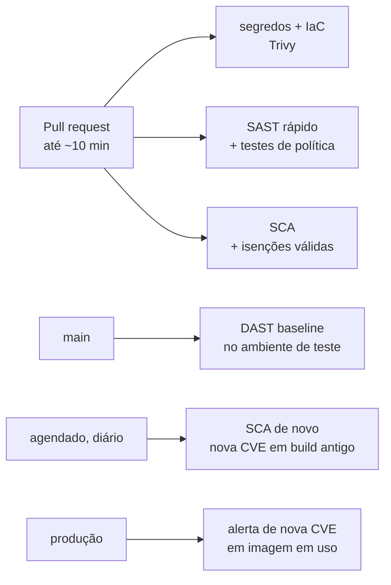

# S5.04 — SAST, DAST e SCA no pipeline

> ⏱️ ~1h30 · 🟣 Sênior · Pré-requisitos: P8.01/P8.02 (pipeline, scan de imagem), P10.06 (SBOM, Trivy, portão de *deploy*), J8.05/J8.06/J8.07 (OWASP Top 10, segredos, *Dependency-Check*), J7 (testes, mutação), S5.01 (política em teste, mutantes), S5.02 (`TrustAllCerts`), S4.01 (alertas, janelas)

> ✅ **Validação final (2026-11-24):** módulo executado no PayFlow reconstruído; resultado e o que continua não executado no [README do módulo](README.md). Os avisos "não executado" / "por leitura" abaixo descrevem a escrita original.

> ⚠️ **Verificação:** (a) `lab/PipelineLab.java` (Java puro) **foi executado**: um **SAST em miniatura** (6 regras por linha), um **DAST em miniatura** (sondas HTTP contra um app local) e uma **checagem de dependências** com advisories **SINTÉTICOS** (`SYN-*`), mais o **portão** com isenções que **vencem**; (b) **Trivy 0.76.2 foi executado de verdade** (imagem Docker, banco de vulnerabilidades baixado) sobre amostras de **dependência** (`log4j-core 2.14.1`), **segredos**, **Dockerfile** e **Terraform**; (c) `check-waivers.py` (bom passa, ruim falha) e **`actionlint` 1.7.12** sobre o *workflow* (com mutante). **NÃO executado:** **ZAP**, **Semgrep**, **CodeQL**, **SonarQube**, **Dependabot/Renovate**, o **GitHub Actions** real, o PayFlow do aluno. **Os programas em miniatura NÃO substituem essas ferramentas**: mostram **o que cada categoria enxerga e o que não**. O *workflow* (`lab/samples/workflows/security.yml`) é **PROPOSTA**.

## 🎯 Objetivos
Ao final desta aula você consegue:
- **Explicar** o que **SAST**, **DAST** e **SCA** enxergam (e o que **não**), com **exemplos de falso positivo e falso negativo**.
- **Posicionar** cada verificação **no pipeline** (PR, *main*, agendada, pré-produção) com **orçamento de tempo**.
- **Montar um portão** que **falha** em risco **corrigível**, **aceita isenções com validade** e **não vira** ruído.
- **Ler** a saída do **Trivy** (dependências, segredos, IaC) e **saber** o que ele **não** pegou no laboratório.
- **Provar** que o próprio pipeline **funciona** (mutantes, auto-teste, `actionlint`).

## 🤔 Por que isso importa
O pipeline da P8/P10 já faz *build*, testes, scan de **imagem** e **SBOM**. Falta o **código** (o que **você** escreveu), a **aplicação rodando** e as **dependências** **como processo contínuo**: **uma CVE nova** aparece **sem que ninguém toque no código**, e o *build* de hoje **fica vulnerável amanhã**. A armadilha: **ligar tudo, receber 400 alertas, ignorar todos**. A habilidade sênior é **decidir o que bloqueia**, **o que vira *ticket*** e **o que expira**.

## 💡 Intuição (explicação simples)
Três inspeções numa **obra**: **SAST** é o **engenheiro que lê a planta** (acha o pilar sem viga **antes** de construir; **não** vê o que só acontece com o prédio em uso). **DAST** é o **inspetor que bate nas paredes** com o prédio de pé (acha o vazamento **real**; só testa o que **bateu**). **SCA** é conferir a **procedência dos materiais** (o cimento do lote 7 foi recolhido?): **não olha seu projeto**, olha **o que você comprou**.

## 🔬 Como funciona por dentro

### 1. O que cada categoria enxerga
| | **SAST** (estático) | **DAST** (dinâmico) | **SCA** (composição) |
|---|---|---|---|
| **Olha** | o **código-fonte** (e o *bytecode*) | a **aplicação rodando** (HTTP) | **dependências** (diretas e **transitivas**) e imagens |
| **Acha bem** | SQL por concatenação, segredo no código, cripto fraca, `TrustAll`, *taint* (com análise de fluxo) | XSS refletido, cabeçalhos ausentes, erro com *stack trace*, cookie sem flags, configuração de servidor | **CVE** conhecida em biblioteca, licença |
| **Não vê** | o que depende de **configuração/ambiente**, **lógica de negócio**, **IDOR** | **código não exercitado** (o `/admin` que ninguém chamou), **autorização entre usuários** | **seu** código; **vulnerabilidade sem CVE**; **se o código vulnerável é alcançado** |
| **Falso positivo** | **muito** (texto parecido com problema) | **pouco** (viu acontecer) | **médio** (biblioteca presente, função **não** usada) |
| **Quando roda** | **cedo e rápido** (PR) | **tarde** (ambiente de teste) | **PR + agendado** (a CVE nasce depois) |
| **Ferramentas** | Semgrep, CodeQL, SonarQube, SpotBugs + FindSecBugs | **OWASP ZAP**, Burp (manual) | **Trivy**, OWASP Dependency-Check, Dependabot/Renovate, Grype |

Existe também **SCA de segredos** e **IaC** (o mesmo Trivy; `gitleaks`): **segredo no repositório** é **sempre** incidente (P10.05).

### 2. SAST em miniatura: o que um *grep* esperto vê (e o que não)
`PipelineLab sast` aplica **6 regras por linha** (SQL por concatenação, segredo literal, MD5/SHA-1, `java.util.Random`, `exec` por concatenação, `TrustManager` que aceita tudo) a **três arquivos**: o **vulnerável**, o **corrigido** e um **"difícil"**.

```text
Vulnerable.java.txt -> 6 finding(s)
  HARDCODED-SECRET   line 2  secret-looking constant with a literal value
  SQL-CONCAT         line 5  SQL built by string concatenation
  PREDICTABLE-RANDOM line 7  java.util.Random is not a CSPRNG
  WEAK-HASH          line 8  MD5/SHA-1 used as a hash
  CMD-INJECTION      line 9  shell command built by concatenation
  TRUST-ALL          line 10 TLS trust manager that accepts everything

Fixed.java.txt -> 0 finding(s)

Tricky.java.txt -> 1 finding(s)
  HARDCODED-SECRET   line 10 secret-looking constant with a literal value
```
- **Verdadeiros positivos:** os 6 problemas plantados **aparecem**; o **corrigido** dá **0**.
- **Falso negativo (o perigoso):** no `Tricky`, o **mesmo SQL** é montado **numa linha** (`String sql = "…" + id;`) e **usado em outra** (`executeQuery(sql)`): **não aparece**. Pegar isso exige **análise de fluxo de dados** (*taint tracking*: do **parâmetro** até o **uso**), o que **Semgrep** (modo *taint*) e **CodeQL** fazem e uma regra de linha **não**.
- **Falso positivo:** a constante `PASSWORD_FIELD = "password"` é só o **nome de um campo**: o *grep* **vê texto, não significado**. **Falso positivo demais ensina o time a ignorar**.
- **Lição:** SAST **não é um *grep***: o valor está no **fluxo** e em **regras mantidas por especialistas**. No PayFlow, **SpotBugs + FindSecBugs** (Maven; J7 já tem SpotBugs) e **Semgrep/CodeQL** (regras *taint*) são os candidatos; **escolha por teste no seu código**, não por brochura.

### 3. DAST em miniatura: o que a aplicação **mostra**
`PipelineLab dast` sobe **dois** apps locais (o **vulnerável** e o **corrigido**, mesma rota `/search`) e envia **3 requisições** (um *payload* `<script>`, um `'`, a leitura de cabeçalhos).

```text
app (VULNERABLE) -> 7 finding(s)
  REFLECTED-XSS     payload came back unescaped in the HTML
  MISSING-CSP       no Content-Security-Policy header
  MISSING-NOSNIFF   no X-Content-Type-Options header
  COOKIE-HTTPONLY   cookie without HttpOnly: SESSION
  COOKIE-SAMESITE   cookie without SameSite
  VERSION-BANNER    Server header reveals a version: Jetty(9.2.2.v20140723)
  ERROR-LEAK        500 with a stack trace / SQL error in the body (org.postgresql.util.PSQLException: ERROR...)

app (FIXED) -> 0 finding(s)
```
**Cada achado é um comportamento observado**, sem ler o código. **Limites** (também escritos na saída): o DAST **só testa o que alguém pediu** (um `/admin` que ninguém chamou **não existe** para ele) e **não enxerga o IDOR** que exige **dois usuários logados** (a tabela da S5.01 é **o teste** dele). **Cookie `Secure` e HSTS** não são checados porque o laboratório é **HTTP puro**.

**ZAP no pipeline** (**não executado**): o **baseline** do ZAP (`zap-baseline.py`) é **passivo**: "roda o *spider* por (padrão) 1 minuto e espera a varredura **passiva** terminar", **sem "ataques" de verdade** (documentação do ZAP, **conferida**). Isso **o torna seguro** para CI (**até contra produção, diz a documentação; ainda assim, o PayFlow o rodaria só contra o ambiente de teste**), e também **limitado**: **não** acharia o XSS que a nossa sonda **ativa** achou; a **varredura completa** (`zap-full-scan.py`) ataca, **só** em ambiente **descartável**. O arquivo `-c` marca regras como `FAIL`/`IGNORE`/`INFO`; `-I` "**não retorna falha por *warning***". **A decisão:** só as regras que **você** colocou em `FAIL` derrubam o job.

### 4. SCA de verdade: o Trivy numa dependência vulnerável
O **Trivy 0.76.2** (imagem oficial; banco baixado na hora) sobre um `pom.xml` com **`log4j-core 2.14.1`** (a versão da famosa falha do **Log4Shell**):

```text
9 finding(s); first 9 by severity:
  CRITICAL pom.xml            CVE-2021-44228 org.apache.logging.log4j:log4j-core 2.14.1 -> fixed in 2.15.0, 2.3.1, 2.12.2
  CRITICAL pom.xml            CVE-2021-45046 org.apache.logging.log4j:log4j-core 2.14.1 -> fixed in 2.16.0, 2.12.2, 2.3.1
  HIGH     pom.xml            CVE-2021-45105 org.apache.logging.log4j:log4j-core 2.14.1 -> fixed in 2.12.3, 2.17.0, 2.3.1
  MEDIUM   pom.xml            CVE-2021-44832 org.apache.logging.log4j:log4j-core 2.14.1 -> fixed in 2.3.2, 2.12.4, 2.17.1
  MEDIUM   pom.xml            CVE-2025-68161 org.apache.logging.log4j:log4j-core 2.14.1 -> fixed in 2.25.3
  MEDIUM   pom.xml            CVE-2026-34477 org.apache.logging.log4j:log4j-core 2.14.1 -> fixed in 2.25.4
  MEDIUM   pom.xml            CVE-2026-34479 org.apache.logging.log4j:log4j-core 2.14.1 -> fixed in 2.25.4
  MEDIUM   pom.xml            CVE-2026-34480 org.apache.logging.log4j:log4j-core 2.14.1 -> fixed in 2.25.4
  MEDIUM   pom.xml            CVE-2026-49844 org.apache.logging.log4j:log4j-api 2.14.1 -> fixed in 2.25.5, 2.26.1
by severity: {'CRITICAL': 2, 'HIGH': 1, 'MEDIUM': 6}
```
(Os identificadores **são os que o Trivy imprimiu**, **não** os de memória.) **Três leituras:**
1. **Uma dependência declarada** trouxe **9 achados**, incluindo **`log4j-api`** (**transitiva**: o Trivy resolveu a árvore). **A versão "corrigida" depende da linha** (`2.3.1`, `2.12.2`, `2.15.0`…: **vários *branches* mantidos**): a recomendação **precisa respeitar** a versão-maior que você usa (e, no PayFlow, o **Spring Boot gerencia** a versão do Log4j/Logback: **suba o Boot**, **não** só a biblioteca; P5/P10.06).
2. **Muitos achados "MEDIUM"** de **uma** biblioteca: **o portão filtra por severidade e correção disponível**; o resto vira *ticket*.
3. **Uma surpresa de operação:** **rodar o Trivy numa pasta com `pom.xml` o faz consultar o Maven Central** para resolver POMs; **repetido várias vezes, levei `HTTP 429 Too Many Requests` com `Retry-After: 1795`** (~30 min) e o **scan inteiro falhou** (era a **mesma** pasta que continha os arquivos de IaC). **Mitigação:** em CI, **cache do `~/.m2`** e **resolver antes** (`mvn dependency:resolve`, recomendação do próprio erro), **ou** um **espelho/proxy** (Nexus/Artifactory) **e** **separar** os varreduras (como em `lab/samples/trivy-sca` × `trivy-iac`). **Não deixe o pipeline depender de a internet estar de bom humor.**

**Segredos e IaC no mesmo Trivy** (amostras com **5 valores com cara de segredo** em `config.properties`, **3 inventados** e **2 chaves "EXAMPLE"** da documentação da AWS):
```text
2 finding(s); first 2 by severity:
  CRITICAL config.properties  aws-access-key-id line 5: AWS Access Key ID
  CRITICAL config.properties  github-pat line 7: GitHub Personal Access Token
```
**Achou 2 de 5.** **Não achou** a **chave secreta AWS** inventada (linha 6) e **ignorou as duas chaves "EXAMPLE"** (linhas 2–3; **provavelmente** de propósito, por conterem `EXAMPLE`: **não li a regra**). **Lição:** um *scanner* de segredos **é rede de proteção, não garantia**; o **controle** é **não ter segredo no repositório** (P10.05) **e** **ter um segundo *scanner*** (`gitleaks`, a proteção de *push* do GitHub) **se o risco justificar**. **Não** deduza "0 achados = limpo".

```text
13 finding(s); first 13 by severity:
  HIGH     Dockerfile         DS-0002 Image user should not be 'root'
  HIGH     main.tf            AWS-0086 S3 Access block should block public ACL
  HIGH     main.tf            AWS-0087 S3 Access block should block public policy
  HIGH     main.tf            AWS-0091 S3 Access Block should Ignore Public ACL
  HIGH     main.tf            AWS-0093 S3 Access block should restrict public bucket to limit access
  HIGH     main.tf            AWS-0132 S3 encryption should use Customer Managed Keys
  HIGH     ssh.tf             AWS-0107 Security groups should not allow unrestricted ingress to SSH or RDP from any IP address.
  MEDIUM   main.tf            AWS-0090 S3 Data should be versioned
  LOW      Dockerfile         DS-0026 No HEALTHCHECK defined
  LOW      main.tf            AWS-0089 S3 Bucket Logging
  LOW      main.tf            AWS-0094 S3 buckets should each define an aws_s3_bucket_public_access_block
  LOW      main.tf            AWS-0099 Missing description for security group.
  LOW      main.tf            AWS-0124 Missing description for security group rule.
by severity: {'HIGH': 7, 'MEDIUM': 1, 'LOW': 5}
```
**Duas observações que a leitura não mostrava:** (1) o `main.tf` tem um *security group* com **a porta 5432 (PostgreSQL) aberta para `0.0.0.0/0`**: o Trivy **só reclamou da falta de descrição** (`AWS-0099`/`AWS-0124`) e **não** da exposição; já a **porta 22 aberta ao mundo** (`ssh.tf`) **gerou `AWS-0107` HIGH**. O **nome da regra diz o porquê**: **ela é específica de SSH/RDP**. **O banco aberto para a internet passou.** **Uma regra própria** (política em código, p. ex. Conftest/OPA, ou **um teste do `terraform plan`** da P8) **cobre o que a ferramenta não cobre**. (2) Do **Dockerfile** o Trivy pegou `USER root` (a J9 já ensinou).

### 5. O portão: o que bloqueia, o que vira ticket, o que **expira**
O portão do laboratório **bloqueia HIGH/CRITICAL com correção disponível**, **a não ser que haja uma isenção com motivo e prazo**:
```text
today = 2026-11-23 -> PASS
today = 2026-12-20 -> FAIL (2)
   SYN-0001 HIGH: waiver EXPIRED on 2026-12-15 (not reachable until the parser feature ships; ticket SEC-88)
   SYN-0011 CRITICAL: waiver EXPIRED on 2026-12-10 (upgrade scheduled)
```
- **O mesmo código, em duas datas**: na primeira **passa**; **na segunda cai** porque **as isenções venceram**. **Risco aceito vira dívida com data.**
- **MEDIUM nunca bloqueia; CRITICAL sem correção também não** (não há o que fazer além de **mitigar**: *ticket*, não *build* vermelho).
- **A isenção é código**, **revisada em PR**, com `id`, `reason`, `owner`, `until`. O verificador (`check-waivers.py`) **foi testado**: o bom passa, o ruim **falha** por **quatro** motivos:
```text
samples/waivers-bad.yml @ 2026-11-23: 4 problem(s)
  - CVE-EXAMPLE-0002: EXPIRED on 2026-11-10 (owner payments-team): fix it or renew with a new decision
  - CVE-EXAMPLE-0003: missing 'owner'
  - CVE-EXAMPLE-0003: expiry 2028-01-01 is more than 90 days away: a waiver is a short loan, not a decision
  - CVE-EXAMPLE-0004: missing 'reason'
```
- **Disponibilidade × alcançabilidade:** a coluna "**o PayFlow usa isso?**" do SCA sintético (`SYN-0001` **sim**, `SYN-0002` **não: só ferramenta de *build***) é **humana**: **ela reduz ruído** e **precisa de prazo** (a **alcançabilidade muda** quando você adiciona uma funcionalidade).

### 6. No pipeline: **onde** e **quando** (e **provado**)

O *workflow* proposto (`lab/samples/workflows/security.yml`) tem **quatro jobs** (`secrets-and-iac`, `sast`, `sca`, `dast`), **`permissions: contents: read`**, `concurrency`, **`timeout-minutes`**, *actions* **fixadas por SHA** (as mesmas da P8), **um `schedule` diário** (a CVE nasce **sem *commit***) e o **DAST só em `push`** na *main* e **só depois** dos outros. Foi **conferido com o `actionlint` 1.7.12**, **e o próprio verificador foi posto à prova com um mutante**:

```text
exit=0
samples/workflows/security.yml:57:3: job "dast" needs job "nope" which does not exist in this workflow [job-needs]
exit=1
```
(O **mutante** trocou a dependência por um *job* inexistente e o rótulo do *runner* por um com erro de digitação: o `actionlint` **reprovou os dois**.) **Orçamento de tempo:** PR **< 10 min** (meta **proposta**, a ajustar ao seu pipeline); o que **não cabe**, vai para `main`/agendado. **Não executado:** o GitHub Actions real, o ZAP, o `docker compose` de segurança (`compose.security.yaml` é **proposta**).

**O que sobe para o PayFlow:** `.github/workflows/security.yml`, `security/waivers.yml` (+ `waivers.trivyignore.yaml`), `security/check-waivers.py`, `security/zap-baseline.conf`, `docs/security/pipeline.md` (o que bloqueia, SLA de correção, como pedir isenção).

## 🏗️ Estudo de caso: "o *build* verde que ficou vulnerável sozinho"
**Sintoma.** (**Cenário construído**; **o mecanismo é recorrente**.) Numa terça, o *scan* do PR passa. Na quinta, **sem nenhum *commit***, sai **uma CVE crítica** numa biblioteca JSON que o PayFlow usa. A **imagem de produção** (assinada, P10.06) **continua em produção**; o **próximo PR** é bloqueado por um problema **que ele não criou**.

**Diagnóstico.** Segurança de dependências é **função do tempo**, não só do código. **Três lacunas:** (1) **nenhum *scan* roda sem PR**; (2) **ninguém vigia o que já está em produção**; (3) **o portão novo bloqueia quem não tem culpa** (o time de uma funcionalidade **para** por causa de uma biblioteca).

**Opções.** (A) **Scan agendado** (diário) **do que está em produção** (SBOM da P10.06) **+ alerta**; (B) **atualização automática** (Dependabot/Renovate) com **PRs pequenos** e **testes** (a **S7** fala de cultura de testes); (C) **separar** o portão do PR do **portão de *deploy***: o PR **avisa**, o **deploy** bloqueia; (D) **isenção** com prazo **quando** não há correção.

**Decisão (proposta).** **A + B + C**, com **D** **sempre com validade** (seção 5). **O SLA vem da severidade** (S5.07: CRITICAL 7 dias, HIGH 30, MEDIUM 90 — **proposta**). **Dono** do ticket: o time que **usa** a biblioteca.

## ⚖️ Trade-offs e quando NÃO usar
- **Bloquear tudo** → **todo mundo contorna** (`continue-on-error: true`, "ignorar este CVE" sem prazo). **Bloqueie pouco, com razão, com dono.**
- **SAST ruidoso** é **pior que nenhum**: comece com **poucas regras de alta confiança** (segredo, injeção óbvia, cripto fraca) e **amplie** com a **taxa de falso positivo medida** (quantos achados viraram correção).
- **DAST em produção:** **evite** a varredura **ativa**; **baseline passivo** em teste. Ele **gera dados**, **dispara alertas** e pode **derrubar** algo frágil.
- **SCA sem alcançabilidade** inflaciona; **com** alcançabilidade (análise de chamadas) **custa** ferramenta e tempo. **Comece** com **severidade + correção disponível + decisão humana**.
- **Ferramenta nunca é o controle:** o Trivy **não viu** o 5432 aberto e **não viu** a chave secreta (seção 4). **Teste a sua cadeia** com **casos que você sabe que são vulneráveis** (como as amostras do laboratório) **e** com **mutantes**.
- **Custo:** minutos de CI, **manutenção de regras e isenções**, **atenção** do time. **Orçamente-os.**

## ⚠️ Erros comuns e boas práticas de produção
- **`continue-on-error: true` "temporário"** que dura anos: **um alerta que não bloqueia nem notifica** é **decoração**.
- **Isenção sem prazo/dono** (seção 5): **vence ou não existe**.
- **`TrustAllCerts`/`sslmode=require`** no código passando no SAST **porque a regra não o cobre**: **teste sua regra** com um arquivo **ruim** (seção 2).
- **Escanear só no PR** (a CVE nasce depois) e **só a imagem** (o **código** também tem problema).
- **429 do Maven Central/registry** derrubando o *scan* (seção 4): **cache e proxy**.
- **Segredo encontrado = segredo queimado:** **rotacione** (P10.05), **não** só apague do histórico.
- **Resultado impresso com o segredo** no log do CI: **mascare** (`::add-mask::`, e o *scanner* **sem** `--debug`).
- **ZAP contra o ambiente errado** (produção): **parametrize o alvo** e **proteja o job** (`if: github.event_name == 'push'` e *environment* com aprovação).
- **Ignorar a ordem de severidade da ferramenta:** *severity* = **da CVE**; **a sua** severidade vem de **alcançabilidade e dado exposto** (S5.07).

## 🧩 Exercícios
1. **(Fixação)** Rode `PipelineLab sast` e **acrescente uma regra** (`NO-VERIFY-HOSTNAME`: `HostnameVerifier` que devolve `true`) **mais um arquivo ruim** que a **dispare** e **um bom** que **não**. **Mostre** o **vermelho** antes do **verde**.
2. **(Aplicação no PayFlow)** Escreva `docs/security/pipeline.md` com: **o que bloqueia** (severidade, correção disponível), **o que vira ticket**, **SLA por severidade** (S5.07), **como pedir isenção** (PR em `security/waivers.yml`: motivo, dono, **prazo ≤ 90 dias**) e **o que roda em PR / main / agendado**. **Critérios de pronto:**
   - [ ] **toda** isenção tem `id`, `reason`, `owner`, `until` e o `check-waivers.py` **passa**;
   - [ ] há **um *job* agendado** (SCA do que está em produção);
   - [ ] o DAST **não** aponta para produção;
   - [ ] você descreveu **um caso que o seu pipeline não pega** (como o 5432) e **quem** cobre.
3. **(Aplicação)** Escreva a **regra própria** que reprova **ingresso `0.0.0.0/0` em porta que não seja 80/443** num *security group* (use `terraform show -json plan.out` + `jq`, **ou** Conftest/OPA). **Teste-a** com o `main.tf` da amostra (**deve** reprovar o 5432) e com um SG **correto** (**deve** passar). *(Não executado aqui.)*
4. **(Desafio)** Faça o **mutante do portão**: remova do `gate()` a verificação de **validade da isenção** e **mostre** que a data `2026-12-20` **passa a dar PASS** (o teste **precisa** falhar). **Depois** restaure.

<details><summary>Soluções de referência</summary>

1. Regra: `Pattern.compile("verify\\s*\\([^)]*\\)\\s*\\{\\s*return\\s+true")`. Arquivo ruim: `HostnameVerifier v = (h, s) -> true;` **não** casa (é *lambda*): **anote** o falso negativo e **escreva a segunda regra** (`->\\s*true`). **Esse é o ponto**: regra de linha **depende da forma do texto**.
2. SLA e isenções: use os da seção 5/S5.07. **Um caso que o pipeline não pega:** *security group* aberto em porta de banco (seção 4); cobertura: **a regra da questão 3**.
3. Esqueleto: `terraform show -json plan.out | jq -r '.resource_changes[] | select(.type=="aws_security_group") | .change.after.ingress[]? | select(.cidr_blocks[]? == "0.0.0.0/0" and (.from_port != 80 and .from_port != 443)) | "\(.from_port)-\(.to_port)"'`. **Teste negativo** com SG sem `0.0.0.0/0`.
4. No `gate()`, comente a linha `else if (w.get().until().compareTo(today) < 0)`. A saída deve mudar para `PASS` em 2026-12-20: **se não mudar, a sua suíte de testes do portão tem um buraco**.
</details>

## 🎤 Na entrevista
1. **"SAST, DAST e SCA: diferença e quando cada um?"** *Resposta-modelo:* SAST lê o **código** (cedo, rápido, **muito falso positivo**, **não vê** configuração/ambiente); DAST testa a **aplicação rodando** (poucos falsos positivos, **só vê o que exerceu**); SCA confere **dependências** (CVE conhecida, **não** o seu código). **PR:** segredos, SAST rápido, SCA; **teste/main:** DAST **passivo**; **agendado:** SCA de novo (a CVE nasce depois).
2. **"Como evitar que o scanner vire ruído?"** *Resposta-modelo:* **bloquear pouco** (HIGH/CRITICAL com **correção disponível**), **o resto vira ticket com SLA**, **isenção com dono e prazo** que **expira** (e um teste que **prova** que expira), **medir** falso positivo e **iniciar** com poucas regras de **alta confiança**.
3. **"Como você sabe que o seu scanner funciona?"** *Resposta-modelo:* **testo com um caso que sei que é vulnerável** (a amostra do `log4j-core 2.14.1`, uma chave plantada, um *security group* aberto) **e com mutantes** (removo a verificação de validade da isenção e o teste **tem que** falhar). No laboratório, o Trivy **não pegou** a porta 5432 aberta: **eu sei porque testei**.
4. **"Passou no scan: é seguro?"** *Resposta-modelo:* **não**: o scan prova **ausência dos problemas que ele sabe procurar**. **IDOR, lógica de negócio, configuração** e **0-day** passam: **testes de política**, **revisão** (S5.07) e **modelagem de ameaças** cobrem o resto.

## 📚 Para ir além
- 📄 **Trivy:** https://trivy.dev/ (documentação: *vulnerability*, *secret*, *misconfiguration*, `--ignorefile`, `--exit-code`).
- 📄 **OWASP ZAP — baseline scan (Docker):** https://www.zaproxy.org/docs/docker/baseline-scan/ (passivo, opções `-c`, `-I`, imagem `ghcr.io/zaproxy/zaproxy:stable`).
- 📄 **Semgrep:** https://semgrep.dev/docs/ (regras e modo de *taint*) · **CodeQL:** https://codeql.github.com/docs/ (consultas, análise de fluxo).
- 📄 **SpotBugs:** https://spotbugs.github.io/ e **Find Security Bugs:** https://find-sec-bugs.github.io/ (detectores de segurança para Java, integrados ao Maven).
- 📄 **Gitleaks:** https://github.com/gitleaks/gitleaks (segredos no repositório e no histórico).
- 📄 **OWASP ASVS:** https://owasp.org/www-project-application-security-verification-standard/ e **OWASP SAMM:** https://owasp.org/www-project-samm/ (modelo de maturidade de práticas de segurança de *software*).
- 📄 **OWASP Top 10:** https://owasp.org/Top10/ (a lista **atual** é a de **2025**: o endereço redireciona para ela).
- 📄 **OWASP Web Security Testing Guide:** https://owasp.org/www-project-web-security-testing-guide/ (o que um teste dinâmico **manual** cobre e o ZAP não).
- 📑 *Alice and Bob Learn Application Security* (Tanya Janca): SAST/DAST/SCA no ciclo de vida; *Software Engineering at Google* (testes e análise estática em escala).

## ✅ Checklist da aula
- [ ] Rodei `PipelineLab` (sast, dast, sca, policy) e expliquei **um falso negativo** e **um falso positivo**.
- [ ] Rodei (ou li a saída do) Trivy e expliquei **o que ele não pegou** (5432, chave secreta).
- [ ] Mostrei que a **isenção expira** (`PASS` hoje, `FAIL` depois) e que o verificador **reprova** o arquivo ruim.
- [ ] Li o *workflow* e o `actionlint` (com o mutante).
- [ ] Escrevi `docs/security/pipeline.md` com **o que bloqueia e o que expira**.
- [ ] Anotei o que **não** foi executado (ZAP, Semgrep, CodeQL, GitHub Actions real).
