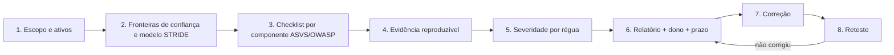

# S5.07 — Como conduzir uma revisão de segurança

> ⏱️ ~1h30 · 🟣 Sênior · Pré-requisitos: S5.01–S5.06 (as camadas e os controles a revisar), P10.07 (STRIDE, modelo de ameaças), S4.02/S4.03 (incidente, postmortem sem culpa, ações com dono e data), S4.01 (política, limiar), J7 (revisão de código), J8 (OWASP Top 10)

> ⚠️ **Verificação:** `lab/ReviewLab.java` (Java puro) **foi executado**: uma **matriz de severidade** (probabilidade × impacto), um ***linter* de relatório** com **auto-teste** (relatório bom passa, ruim falha) e uma **checagem de cobertura de escopo** (componentes × STRIDE). A **versão 5.0.0 do ASVS** (publicada em 30/05/2025) foi **conferida na página do OWASP**. **Os achados do "relatório de exemplo" são FICTÍCIOS** (rotulados). A **revisão "do PayFlow" da seção 6 é feita por leitura** das aulas anteriores: são **hipóteses a verificar** nos testes práticos finais, **não** descobertas em código executado. **NÃO executado:** o PayFlow do aluno, testes de invasão, *threat modeling* com o time. **A régua de severidade, os SLAs e o checklist são PROPOSTAS.**

## 🎯 Objetivos
Ao final desta aula você consegue:
- **Escolher** o **tipo de revisão** (de projeto, de código, de configuração, teste de invasão) para a pergunta que se quer responder.
- **Conduzir** uma revisão com **escopo, método e evidência**, e **dizer o que ela cobriu e o que não**.
- **Classificar** achados com uma **régua explícita** (probabilidade × impacto) e **escrever** um relatório **acionável**, **sem culpa**.
- **Verificar por máquina** a **qualidade do relatório** e a **cobertura do escopo**.
- **Fechar o ciclo**: **dono, prazo, reteste**, **aceite de risco com validade**.

## 🤔 Por que isso importa
Você já construiu **controles** (S5.01–S5.06) e **pipelines** (S5.04). **Ninguém sabe se eles funcionam em conjunto** até **alguém olhar de fora**, com **método**. Um sênior é chamado para **revisar o desenho de outro time**, **aprovar (ou barrar) uma mudança**, **preparar uma auditoria** ou **responder a um cliente** ("**vocês passaram por uma revisão de segurança?**"). Uma revisão **ruim** é **pior que nenhuma**: dá **falsa segurança** ("revisamos e não achamos nada") sem dizer **o que foi olhado**.

## 💡 Intuição (explicação simples)
Uma **inspeção predial** séria: o inspetor **recebe a planta** (escopo), **olha cada andar com uma lista** (método), **fotografa** cada problema com a **data** (evidência), **classifica** (urgente, a corrigir, cosmético), entrega **um laudo** com **o que viu e o que não viu** e **volta depois** para conferir se consertaram (reteste). **Um laudo "tudo ok" sem lista** do que foi inspecionado **não vale nada**.

## 🔬 Como funciona por dentro

### 1. Tipos de revisão: **qual pergunta** cada uma responde
| Tipo | Pergunta | Entrada | Quando |
|---|---|---|---|
| **De projeto** (modelagem de ameaças, **STRIDE**, P10.07) | "**o desenho** permite um ataque?" | diagramas, fluxos de dados, fronteiras de confiança | **antes** de construir; a cada **mudança grande** |
| **De código** (focada) | "**este código** tem o defeito X?" | o diff / módulos críticos (autorização, cripto, entrada) | **todo PR** sensível; auditoria periódica |
| **De configuração/infra** | "**o ambiente** está como achamos?" | Terraform, IAM, redes, papéis do banco | a cada mudança; **periódica** |
| **Teste de invasão** (*pentest*, de terceiros) | "**um atacante** consegue?" | o sistema **rodando**, escopo e regras de engajamento | **anual** ou **antes** de lançamento; **exigência** de cliente |
| ***Bug bounty*** | "**o mundo** acha algo que **nós** não vimos?" | o produto exposto + política | **maturidade** (não é para quem **não** corrige) |
| **Revisão pós-incidente** | "o que **falhou** e **onde mais** isso vale?" | o postmortem (S4.03) | **sempre** que o incidente tiver causa de segurança |
**Referência de método:** o **NIST SP 800-115** (*Technical Guide to Information Security Testing and Assessment*) trata de **planejar, executar e analisar** testes e exames técnicos e de **desenvolver mitigações** (resumo da página do NIST, **conferido**). Para **requisitos verificáveis**, o **OWASP ASVS 5.0.0** (30/05/2025) é **a lista de itens** a conferir; o **OWASP WSTG** é o **guia de testes**; o **OWASP SAMM** mede a **maturidade** do programa (não de um sistema).

### 2. O processo (e onde ele quebra)

1. **Escopo e ativos:** o que **entra** e o que **fica de fora, por escrito, com quem aceitou**. **O que vale proteger** (o ledger, os dados pessoais, a chave do *backup*).
2. **Fronteiras e ameaças:** o diagrama de fluxo de dados (P10.07), **onde cruza** uma fronteira de confiança.
3. **Checklist:** **por componente**, **itens** do ASVS/OWASP **mapeados** para as **aulas** (seção 5).
4. **Evidência:** **como reproduzir** (comando, requisição, captura, *commit*), **data**, **versão**. **Achado sem evidência é opinião.**
5. **Severidade** (seção 3) e **premissas** (o que **tornaria pior**).
6. **Relatório** (seção 4): **resumo**, **escopo**, **achados**, **o que não foi coberto**.
7. **Correção:** **dono**, **prazo pelo SLA**, **opções** (não só "conserte").
8. **Reteste:** **quem achou confirma**. **Fechar sem reteste é torcer.**

### 3. A régua de severidade (e o que ela **não** é)
**Probabilidade (1–5) × impacto (1–5)**; **≥ 20 CRÍTICO, ≥ 12 ALTO, ≥ 6 MÉDIO, senão BAIXO** (**proposta**; **calibre com quem assume o risco**):

```text
L \ I       1         2         3         4         5         
5           LOW       MED       HIGH      CRIT      CRIT      
4           LOW       MED       HIGH      HIGH      CRIT      
3           LOW       MED       MED       HIGH      HIGH      
2           LOW       LOW       MED       MED       MED       
1           LOW       LOW       LOW       LOW       LOW       
```
**SLA proposto de correção** (dias): **CRÍTICO 7, ALTO 30, MÉDIO 90, BAIXO 365**. Exemplos **resolvidos** (os números são **do exemplo**):
```text
  L=5 I=4 -> CRITICAL IDOR on GET /accounts/{id} found, trivially exploitable, other customers' balances
  L=2 I=2 -> LOW      missing CSP header on a page with no user content
  L=2 I=5 -> MEDIUM   DB port open to 0.0.0.0/0 but needs the DB password (strong, rotated)
  L=3 I=5 -> HIGH     heap dump with personal data left in a shared bucket
```
**O mesmo achado muda com o contexto** (o 5432 aberto é MÉDIO **por causa** da senha forte; **seria ALTO ou pior** com senha fraca): **escreva a premissa ao lado da nota**. **A régua não é medição**: é **um acordo** para **ordenar** e **decidir** (a conversa de **negócio**, S7). **CVSS** (para vulnerabilidades em **componentes**, S5.04) **mede a CVE em abstrato**; **a sua severidade** vem de **alcançabilidade e dado exposto**.

### 4. O relatório: **bom** × **ruim**, verificado por máquina
Campos **obrigatórios** por achado: **id**, **título**, **ativo**, **probabilidade e impacto**, **severidade** (**coerente com a régua**), **evidência**, **recomendação**, **dono**, **prazo**, **status**; se **aceito**: **quem aceitou** e **até quando**. O *linter* do laboratório **exige** isso e **foi testado** nos dois sentidos:

```text
-- report 'good' (3 findings)
  F-01 CRITICAL: ok
  F-02 MEDIUM: ok
  F-03 LOW: ok
-- report 'bad' (4 findings, written to FAIL)
  B-01 HIGH: [no evidence (a finding nobody can reproduce is an opinion), no recommendation, no owner, severity HIGH does not match L x I = MEDIUM]
  B-02 MEDIUM: [severity MEDIUM does not match L x I = CRITICAL]
  B-03 HIGH: [OPEN and overdue since 2026-11-01]
  B-04 LOW: [accepted risk without an approver, accepted risk EXPIRED on 2026-10-15: decide again]

self-test: good report -> 0 problems (expected 0); bad report -> 8 problems (expected > 0)
```
(Os achados são **fictícios**.) **Leitura:** B-01 **sem evidência, recomendação nem dono**; **B-02 diz MÉDIO para algo que a própria régua dá CRÍTICO** (**subestimar** é o erro **mais caro**: o *linter* o pega); **B-03** está **aberto e vencido**; **B-04** é um **risco aceito sem aprovador e vencido**: **o aceite tem validade** (S5.04 e as isenções). **O que o *linter* não faz:** **não** sabe se a **evidência é boa** nem se a **recomendação funciona**: **isso é revisão por pessoas** (J7: *code review*).

**Tom: sem culpa** (S4.03). "**O endpoint X não checa o dono**" é um **achado**; "**o time esqueceu**" **não** é. Descreva **o sistema** e **o que o tornou possível** (**causa**, não **culpado**). Dê **opções** com **custo** e **risco residual** ("**A:** checar o dono no serviço (2 dias); **B:** *gateway* também (5 dias); **recomendo A + teste da S5.01**").

### 5. Cobertura: o que **não** foi olhado também é resultado
A revisão tem um **escopo** (componentes × categorias STRIDE). **Cada célula** da matriz deve estar **revisada**, **N/A com motivo** ou **fora de escopo com aceite**. **Silêncio não vale**:

```text
                S    T    R    I    D    E    
api             ok   ok   ok   ok   ok   ok   
ledger-db       ok   ok   ok   ok   na   ok   
keycloak        ok   ok   ok   ok   ok   ok   
outbox/broker   ok   ok   ??   ok   na   ok   
pipeline        ok   ok   ok   ??   ??   ok   
backups         na   ok   ??   ok   ok   ok   

coverage: 32/36 cells decided; silent cells: [outbox/broker/R, pipeline/I, pipeline/D, backups/R]
verdict: FAIL: the review cannot say 'no more findings' while these cells are silent
```
(`ok` = revisada; `na` = N/A **com motivo escrito**; `??` = **silêncio**.) **Quatro células sem decisão**: **repúdio** no *broker* e nos *backups*, **vazamento** e **negação de serviço** no **pipeline**: **justo os lugares onde se acha o que ninguém olhou**. O laboratório **reprova** a revisão **enquanto houver `??`**. **No texto do relatório**, uma seção "**Não coberto**" (**com o motivo**) **vale tanto** quanto a lista de achados.

**Itens de checklist por componente** (resumo; **mapa de aulas**):
| Componente | Itens a verificar | Aula |
|---|---|---|
| **api** | dono em **todo** endpoint (tabela + ArchUnit); MFA em dinheiro; escopo/`azp` em `/internal`; Actuator na porta de gestão **atrás da cadeia**; erros sem *stack trace*; limite de corpo | S5.01, J8, P10 |
| **ledger-db** | papéis (app sem `UPDATE`/`DELETE`; migrador só no pipeline); leitura por coluna; `purge` com piso; TLS `verify-full`; **volume cifrado**; pgAudit | S5.01, S5.03, S5.06 |
| **keycloak** | MFA para admins; eventos ligados; *realm* exportado **sem segredos**; rotação de segredos de clientes | P10.02, S5.06 |
| **outbox/broker** | TLS; **ACL por papel**; mensagens **sem token**; DLQ **sem dado pessoal em claro** | P3, S5.03 |
| **pipeline** | **portão** (S5.04), isenções com validade, *actions* fixadas por SHA, `permissions` mínimas, ambiente de *deploy* com **aprovação**, segredos **de curta duração** (OIDC) | P8, S5.04 |
| **backups** | outra conta, **imutáveis**, **chave KMS** na conta de *backup* com política de **não exclusão**, **ensaio** com a chave de destino | S4.05, S5.03 |
| **dados pessoais** | inventário, retenção, **eliminação**, mascaramento, **plano de incidente (3 dias úteis)** | S5.05 |

### 6. A revisão do **PayFlow** (por leitura): hipóteses, não descobertas
Aplicando o método ao que **as 4 camadas de aulas anteriores** deixaram. **Cada item abaixo é uma HIPÓTESE a verificar nos testes práticos finais**, **com a fonte** (nada foi executado no PayFlow):

| # | Hipótese de achado | Fonte | Severidade (proposta, premissa) | Verificar |
|---|---|---|---|---|
| H1 | **`LoginThrottle` com *check-then-act***: sob concorrência, **60 senhas testadas em vez de 5** (**medido** no modelo da P1): o bloqueio por tentativas **pode não valer** | Correções pendentes (J8.06/P1.09) | **ALTO** (L4×I3) **se** o login ainda for da aplicação; **menor** com o Keycloak (P10) fazendo o login | corrigir **ou** confirmar que o fluxo **saiu** da aplicação; teste de concorrência |
| H2 | ***Heap dumps* sem retenção/dono/cifra** (S2.04) | S2.04, S5.05 | **ALTO** (L3×I5) | `docs/lgpd/inventario.md`: prazo (7 dias), **acesso**, **cifra** |
| H3 | **Papel da aplicação com `DELETE` em `idempotency_keys`** (S4.05) | S4.05 → S5.01 | **MÉDIO** (L2×I5) | trocar pelo `purge_idempotency_keys` com piso |
| H4 | **Actuator**: o `ActuatorTest` da J5.15 espera 404 e o anônimo vê 302; **a porta de gestão** está **atrás da cadeia** (lição da P6) mas **o que `management.endpoints.web.exposure` expõe** precisa de **revisão** | J5.15, P6 | **MÉDIO** | listar os *endpoints* **expostos** e **autorizados** em produção |
| H5 | **Chave KMS do *backup* na mesma conta** do banco (**causa comum**) | S4.05, S5.03 | **ALTO** (L2×I5 → depende do desenho) | política da chave, conta, alarme em `ScheduleKeyDeletion` |
| H6 | **Webhooks** (P3.10): **assinatura** e **teto de corpo** valem em `/webhooks/**`? | P3, decisão 63 (J8) | **ALTO** se **sem assinatura** | teste: requisição **sem assinatura** → 401 |
| H7 | **Dependências**: **nenhum portão SCA/segredos** no CI antes da S5.04 | S5.04 | **MÉDIO** | rodar o `security.yml` na primeira vez e **triar** |
| H8 | **Endpoints de 1 AZ** (P9.01) | S4.06 | (confiabilidade, não segurança) | **fora de escopo** desta revisão: **N/A com motivo** |

**H8 mostra o uso do "N/A com motivo"**: **não** é segurança; **registre** e **passe**. **A revisão real** (com o código e o ambiente) **substitui** esta tabela; **ela existe para você praticar o formato** e **não esquecer o que já sabemos**.

### 7. Conduzir a **conversa**
- **Antes:** alinhe **escopo, prazos e quem decide** sobre risco (**produto/negócio**: S7).
- **Durante:** **não** conserte **no meio**: **registre** (ou você perde a evidência e a visão do todo). **Achado grave** (CRÍTICO em produção) **sai na hora** do relatório, **por canal próprio** (S4.02: **incidente**).
- **Depois:** **apresente** os achados **com as opções**; **o time decide o *como***; **negocie prazos** com **a régua** (**não** com "urgente"). **Acompanhe**; **reteste**.
- **Ao receber** uma revisão do **seu** sistema: **não** discuta **severidade** antes de **reproduzir** o achado; **peça a evidência**.

## 🏗️ Estudo de caso: "a auditoria de cliente que pediu 'o relatório do pentest'"
**Sintoma.** (**Cenário construído**; **fatos inventados**.) Um cliente corporativo exige, no contrato, "**relatório de teste de invasão dos últimos 12 meses** e **evidência de correção dos achados**". O PayFlow **nunca contratou** um *pentest*. Há **três semanas** para a assinatura.

**Diagnóstico.** (1) **Sem relatório**, **não há** o que mostrar; (2) **pentest** de terceiros leva **semanas** para **agendar e executar**; (3) **o que existe**: **laboratórios e checklists** (S5), **portão de CI**, **testes de política**, **auditoria**; **são evidências de controle**, **não** um teste de invasão.

**Opções.** (A) **Contratar** o *pentest* (escopo fechado, **API + autenticação**, **ambiente de homologação**), **dizer a data real** ao cliente; (B) **entregar** o que **existe** (**checklist ASVS L2 mapeado**, **resultado do pipeline**, **tabela de política**, **política de gestão de vulnerabilidades**) **com honestidade** ("**não** há *pentest*; **está contratado** para a data X"); (C) **declarar** o que **não existe** como se existisse (**nunca**).

**Decisão (proposta).** **A + B**, **sempre sem C**. **A lição:** **evidência de controle** (o que S5 constrói) e **teste independente** (o *pentest*) **são complementares**; **o relatório honesto** vale **mais** que **um enfeitado**: **o cliente acha** (e o contrato vira **risco jurídico**).

## ⚖️ Trade-offs e quando NÃO usar
- **Profundidade × amplitude:** uma revisão de **tudo** em **uma semana** é **rasa**; **priorize** pelo **ativo** (ledger, chave do *backup*, dado pessoal) e **declare** o que **ficou de fora**.
- **Checklist × criatividade:** o checklist **garante o básico** e **evita esquecer**; **ameaças novas** vêm de **modelagem** e de **pessoas curiosas** (*pentest*). **Use os dois.**
- **Interna × externa:** **interna** conhece o contexto e é **barata**; **externa** traz **olhar fresco** e **independência** (e **peso** perante clientes). **Alterne.**
- **Régua numérica:** dá **consistência**, **mas** o 20 **parece** exato e **não é**. **Mostre a premissa**; **discuta** casos de fronteira.
- **Revisão que vira burocracia:** **formulários** sem **ação** matam a prática. **Meça**: **tempo para corrigir**, **achados reabertos**, **% de isenções vencidas**.
- **Quando não revisar:** **protótipo descartável** sem dado real; **gaste** o esforço **antes** de ele **virar produção**.

## ⚠️ Erros comuns e boas práticas de produção
- **"Não achamos nada"** **sem lista** do que foi olhado: a **matriz de cobertura** (seção 5).
- **Achado sem evidência**: **opinião** (B-01).
- **Severidade subestimada** para **não incomodar** (B-02): a régua é **o árbitro**, **não o clima da reunião**.
- **Culpar pessoas**: **mata a próxima revisão** (S4.03).
- **Corrigir sem reteste**: o *fix* **muda o sintoma** e **mantém a causa**.
- **Aceite de risco sem prazo** (B-04): **dívida invisível**.
- **Revisar só o código** e **esquecer a configuração** (IAM, SG, papéis do banco) e **a cadeia de entrega** (S5.04).
- **Esperar o *pentest* para ter controles**: **o *pentest* confirma**, **não constrói**.
- **Guardar o relatório com dados sensíveis num lugar aberto**: **o relatório é um mapa para o atacante** (acesso restrito, **dado pessoal fora**).
- **Reabrir achados antigos sem registro**: **versione** o relatório (Git, com PR).

## 🧩 Exercícios
1. **(Fixação)** Rode `ReviewLab.java score|lint|coverage`. **Mude** o achado `B-02` para a **severidade correta** e **veja** o *linter* mudar o número de problemas. **Explique** por que **subestimar** é **o pior** erro.
2. **(Aplicação no PayFlow)** Faça a **revisão de segurança do PayFlow por leitura** em `docs/security/revisao-s5.md`: **escopo** (componentes × STRIDE, **todas as 36 células decididas**), **o relatório** com **os achados H1–H8 (reclassifique-os**, com **evidência** quando o repositório existir), **a seção "Não coberto"** e **o plano** (dono, prazo pela régua). **Critérios de pronto:**
   - [ ] **0 células** `??` na matriz de cobertura;
   - [ ] **todo achado** tem **evidência** (comando/arquivo/linha) **ou** está marcado **"hipótese: verificar"**;
   - [ ] o *linter* do laboratório (adaptado para o seu formato) **passa**;
   - [ ] **cada aceite** de risco tem **aprovador e validade**.
3. **(Aplicação)** **Preencha** o **checklist final da S5** (seção "Entrega" abaixo e o `checkpoint.md`): para **cada item**, **a evidência** (arquivo, teste, saída) ou **"pendente"**.
4. **(Desafio)** **Simule** uma revisão **cruzada** (com um colega ou com você **depois de uma semana**): **revise** o `docs/security/*` dele, **procure uma célula `??`** e **um achado sem evidência**, e **escreva o relatório** em **cinco achados**.

<details><summary>Soluções de referência</summary>

1. `B-02` com `likelihood=4`, `impact=5` → `20` → `CRITICAL`: **mude** o campo `severity` para `"CRITICAL"` e o *linter* **remove** a divergência. **Subestimar** adia a correção do **pior** problema; **superestimar** só **gasta** esforço.
2. Reclassificação (exemplo): **H1** vira **N/A** se o login **saiu** da aplicação (P10.03) **e** o Keycloak aplica **proteção contra força bruta** (*conferir a configuração do realm*); **H6**: **teste** de requisição **sem assinatura** (P3.10).
3. Os itens do checklist estão no `checkpoint.md` (**Parte 2**).
4. Roteiro: (a) **leia o escopo**; (b) **monte a matriz**; (c) **procure `??`**; (d) **tente reproduzir** cada evidência; (e) **escreva o relatório sem culpa**.
</details>

## 🎤 Na entrevista
1. **"Como você conduz uma revisão de segurança de um serviço novo?"** *Resposta-modelo:* **escopo e ativos** primeiro (com o que **fica de fora, por escrito**); **fronteiras de confiança e STRIDE**; **checklist (ASVS)** por componente; **evidência reproduzível**; **severidade por régua** (probabilidade × impacto, com **premissas**); **relatório** com **dono, prazo e opções**, **sem culpa**; **reteste**. E a **matriz de cobertura**: **nenhuma célula em silêncio**.
2. **"Como você prioriza 40 achados?"** *Resposta-modelo:* **severidade pela régua** (impacto no **ativo** e **alcançabilidade**), **SLA por severidade** (7/30/90 dias), **agrupo por causa** (uma correção fecha vários), **os CRÍTICOS** vão por **canal de incidente**; **o resto vira backlog** com **dono**; **aceite de risco** só **com aprovador e prazo**.
3. **"Pentest ou revisão interna?"** *Resposta-modelo:* **complementares**: **interna** (barata, com contexto) **continuamente**; **externa** (independente, exigida por clientes) **periodicamente**. **A externa confirma; não constrói** os controles.
4. **"O scanner não achou nada. A revisão pode terminar?"** *Resposta-modelo:* **não**: o scanner prova **ausência do que ele sabe procurar** (no laboratório, o Trivy **não viu** o banco aberto ao mundo). **A matriz de cobertura** diz **o que ficou sem olhar**; **o relatório honesto lista** o que **não** foi coberto.

## 📚 Para ir além
- 📄 **OWASP ASVS (5.0.0, 30/05/2025):** https://owasp.org/www-project-application-security-verification-standard/ (requisitos verificáveis por nível; baixe o **CSV** e use como **checklist**).
- 📄 **OWASP Web Security Testing Guide:** https://owasp.org/www-project-web-security-testing-guide/ (**como testar** cada categoria).
- 📄 **OWASP SAMM:** https://owasp.org/www-project-samm/ (maturidade do **programa** de segurança).
- 📄 **NIST SP 800-115:** https://csrc.nist.gov/pubs/sp/800/115/final (planejar, executar e analisar testes técnicos de segurança).
- 📄 **AWS Well-Architected, pilar de segurança:** https://docs.aws.amazon.com/wellarchitected/latest/security-pillar/welcome.html (perguntas de revisão por tema; aprofundado na **S6**).
- 📄 **OWASP Top 10 (2025):** https://owasp.org/Top10/ (as categorias de risco **mais comuns** para **nomear** achados).
- 📄 **NIST SP 800-207:** https://csrc.nist.gov/pubs/sp/800/207/final (zero trust: **o que revisar** em uma arquitetura).
- 📑 *Threat Modeling: Designing for Security* (Adam Shostack): o método por trás do STRIDE (P10.07); *The Web Application Hacker's Handbook* (Stuttard/Pinto) para o olhar do **atacante**.

## ✅ Checklist da aula
- [ ] Rodei `ReviewLab` (score, lint, coverage) e expliquei **os 4 `??`** da matriz.
- [ ] Escolhi o **tipo de revisão** certo para **três** perguntas diferentes.
- [ ] Escrevi `docs/security/revisao-s5.md` com **0 células em silêncio** e **a seção "Não coberto"**.
- [ ] **Cada** achado tem **evidência**, **dono**, **prazo** e **severidade coerente com a régua**.
- [ ] **Cada** aceite de risco tem **aprovador e validade**.
- [ ] Marquei as **hipóteses H1–H8** como **"verificar nos testes práticos finais"**.
